# Awesome GPT Image 2.5 プロンプト集

[](README.md)
[](README_zh.md)
[](README_zh-Hant.md)
[](README_ja.md)
[](README_ko.md)
[](README_es.md)
[](README_pt.md)
[](README_fr.md)
[](README_de.md)
[](README_ru.md)
[](README_tr.md)
[](README_it.md)

厳選した **736** 件の GPT Image 2.5 プロンプト集です。各項目に作例画像、プロンプト全文、元の作者と元投稿へのリンクを掲載しています。データは [cinel.ai](https://cinel.ai/prompts/model/gpt-image-2-5?utm_source=github&utm_medium=awesome&utm_campaign=awesome-gpt-image-2.5-prompts) のプロンプトライブラリから自動で同期されます。

👉 [cinel.ai ですべて見る・オンラインで生成](https://cinel.ai/prompts/model/gpt-image-2-5?utm_source=github&utm_medium=awesome&utm_campaign=awesome-gpt-image-2.5-prompts)

## 目次

- [ポートレート・顔写真](#portrait) (79) · [すべて](cases/portrait.md)
- [商品・EC](#product-photography) (46) · [すべて](cases/product-photography.md)
- [ポスター・ロゴ・グラフィック](#poster-design) (67) · [すべて](cases/poster-design.md)
- [インフォグラフィック・UI](#infographic-ui) (36) · [すべて](cases/infographic-ui.md)
- [3D キャラクター・フィギュア](#3d-figurines) (111) · [すべて](cases/3d-figurines.md)
- [フード・ドリンク](#food-drink) (223) · [すべて](cases/food-drink.md)
- [イラスト・アニメ](#illustration-anime) (73) · [すべて](cases/illustration-anime.md)
- [クリエイティブシーン](#scenes-creative) (101) · [すべて](cases/scenes-creative.md)

<a id="portrait"></a>

## ポートレート・顔写真

厳選 6 件 · [全 79 件を見る](cases/portrait.md) · [cinel のカテゴリ](https://cinel.ai/prompts/portrait?utm_source=github&utm_medium=awesome&utm_campaign=awesome-gpt-image-2.5-prompts)

### Olive Velvet Saree High-Fashion Studio Portrait

<a href="https://cinel.ai/prompts/p/velvet-saree-fashion-studio-portrait?utm_source=github&utm_medium=awesome&utm_campaign=awesome-gpt-image-2.5-prompts">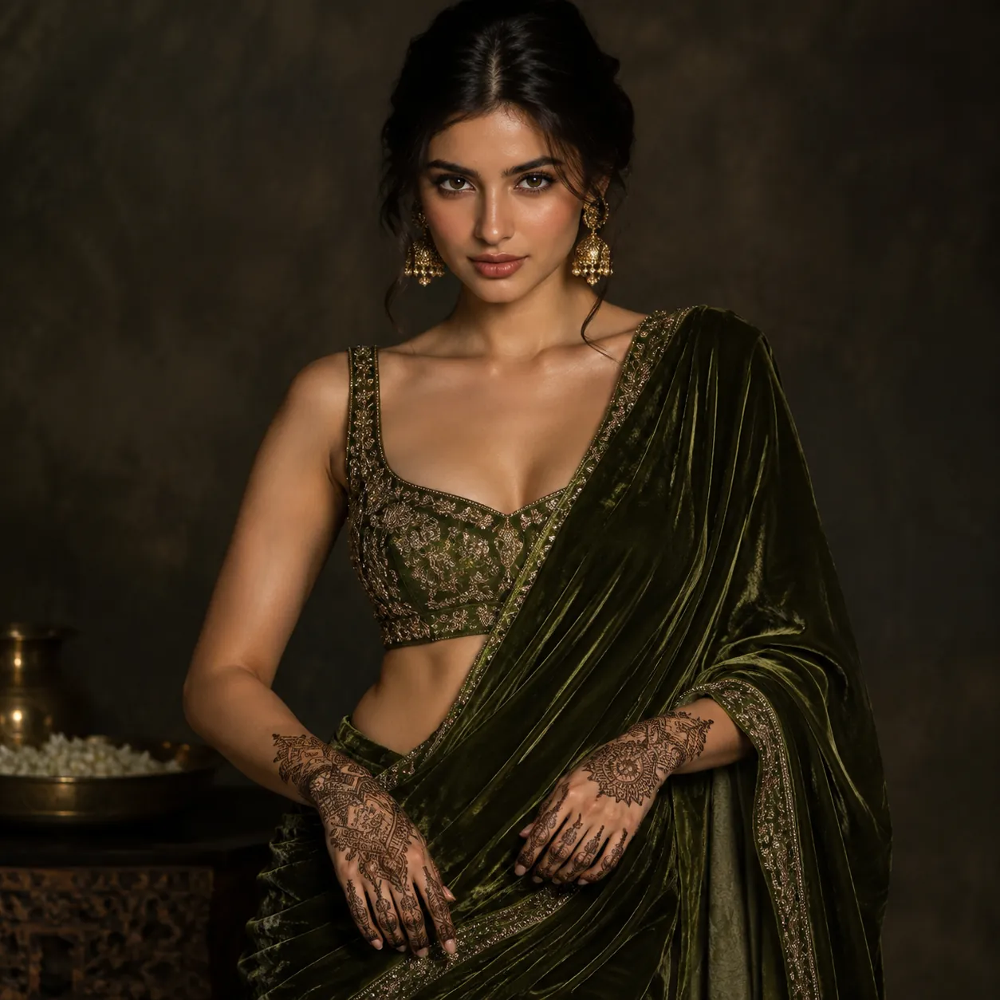</a>

> Proof that a portrait prompt does not need to be long. In about 90 words it fixes the garment (olive velvet, draped over one shoulder), the styling details that make it specific (embroidered sleeveless blouse, dark mehndi, gold earrings), the light (moody, dramatic, raking across velvet) and the expression (direct, confident gaze). Velvet is a smart choice of fabric: under low-key light its pile catches highlights, which is exactly what the model rendered in our example. To adapt it, keep the sentence about lighting and texture and swap the outfit: a silk lehenga, a brocade jacket or a satin gown work the same way. Change the colour of the velvet before anything else.

```text
A detailed, high-fashion studio photograph of a woman posing gracefully, wearing a luxurious olive green velvet saree draped elegantly over her shoulder, paired with a matching heavily embroidered sleeveless blouse that highlights her midriff. The lighting is moody and dramatic, accentuating the rich texture of the velvet and giving her skin a subtle, dewy sheen. Her hands are adorned with intricate, dark henna (mehndi) designs, and she is wearing traditional gold  earrings, looking directly into the camera with a confident expression.
```

- 作者: [@Flora_Janer8](https://x.com/Flora_Janer8)
- 元の投稿: https://x.com/Flora_Janer8/status/2021300975248736723
- [cinel で詳細を見てこのプロンプトで生成](https://cinel.ai/prompts/p/velvet-saree-fashion-studio-portrait?utm_source=github&utm_medium=awesome&utm_campaign=awesome-gpt-image-2.5-prompts)

### Luxury Wellness Lifestyle Four-Photo Series Prompt

<a href="https://cinel.ai/prompts/p/luxury-wellness-lifestyle-photo-series?utm_source=github&utm_medium=awesome&utm_campaign=awesome-gpt-image-2.5-prompts">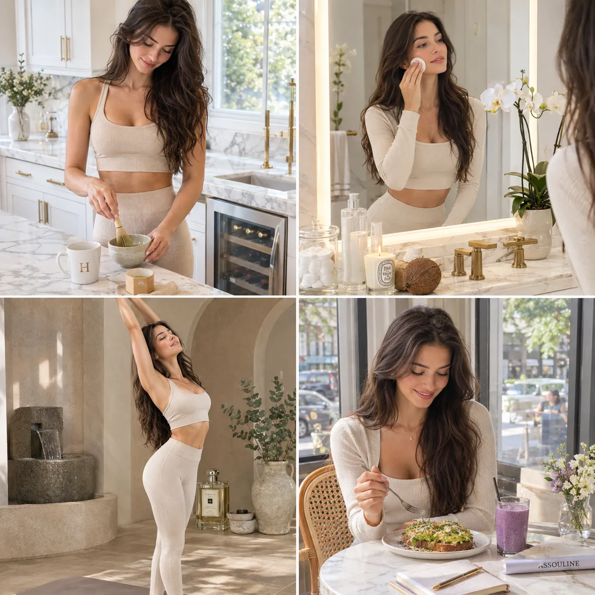</a>

> Built for creators and wellness brands who need a consistent set rather than a single hero shot. The JSON separates the constants (one subject, her hair and makeup, a cream ribbed activewear set, warm window light, a beige-cream-marble palette with green and gold accents) from the variables, which are the four scenes. Because the constants are so tightly defined, our 2×2 result shows the same woman cooking in a marble kitchen, at a vanity, stretching and eating a salad without any jarring change of look. Swap the activewear colour or the four activities to fit another brand, but keep the colour-palette block; it is what makes the series feel art-directed.

```text
{
  "overall_theme": {
    "description": "A curated series of four ultra-photorealistic vignettes showcasing a luxurious, wellness-focused lifestyle.",
    "mood": "Calm, serene, balanced, sophisticated, peaceful, rejuvenating.",
    "style": "Minimalist, high-end, contemporary, clean aesthetic, aspirational."
  },
  "subject": {
    "description": "Young woman.",
    "appearance": {
      "hair": "Long, dark brown, wavy, natural texture.",
      "skin": "Clear, glowing, natural.",
      "makeup": "No-makeup makeup look, dewy finish.",
      "physique": "Fit, toned."
    },
    "expression": "Serene, composed, gently smiling, focused."
  },
  "wardrobe": {
    "outfit_base": "Matching ribbed beige/cream activewear set.",
    "variations": [
      "Sleeveless crop top and high-waisted leggings.",
      "Long-sleeve crop top and high-waisted leggings."
    ],
    "style": "Comfortable, stylish, high-quality fabric."
  },
  "environmental_details": {
    "lighting": {
      "type": "Natural daylight.",
      "quality": "Soft, diffused, warm, bright.",
      "source": "Large windows (implied or visible)."
    },
    "color_palette": {
      "dominant": ["Warm Beige", "Cream", "White", "Marble Grey"],
      "accents": ["Green (plants)", "Gold (fixtures, details)", "Natural Wood", "Soft Purple (smoothie)"]
    },
    "materials": ["White Marble", "Light Wood", "Stone", "Ceramic", "Glass", "Linen"]
  },
  "scenes": [
    {
      "location": "Modern Luxury Kitchen",
      "environment": "White marble island and countertops, white shaker cabinets, gold hardware, integrated wine fridge, large window.",
      "pose": "Standing at the island, body angled slightly, looking down.",
      "action": "Whisking a hot beverage in a small bowl.",
      "props": ["Ceramic bowl", "Wooden whisk", "Steam", "Mug with 'H'", "Wine fridge"]
    },
    {
      "location": "High-End Bathroom",
      "environment": "Large backlit mirror, white marble vanity, white walls, orchid plant.",
      "pose": "Standing facing the mirror, one hand applying product to face.",
      "action": "Applying skincare.",
      "props": ["Cotton pad", "Skincare bottle", "Lit Diptyque candle", "Whole coconut", "Glass jars"]
    },
    {
      "location": "Minimalist Wellness Space",
      "environment": "Textured beige walls with curved arches, stone water fountain, eucalyptus in a vase.",
      "pose": "Full-body stretch, arms extended overhead, head tilted back, eyes closed.",
      "action": "Stretching.",
      "props": ["Stone water feature", "Large perfume bottle", "Eucalyptus vase"]
    },
    {
      "location": "Bright Café Corner",
      "environment": "Round white marble table, cane chair, large window overlooking a street.",
      "pose": "Sitting at the table, smiling while eating, holding a fork.",
      "action": "Eating avocado toast.",
      "props": ["Avocado toast on plate", "Purple smoothie in glass", "Fork", "Assouline book", "Notebooks", "Small flowers"]
    }
  ],
  "camera_and_technical": {
    "type": "DSLR Photography",
    "style": "Editorial lifestyle",
    "lens": "Prime lens (e.g., 50mm or 85mm f/1.4)",
    "focus": "Sharp focus on the subject in each frame.",
    "depth_of_field": "Shallow, creating a soft, creamy bokeh in the background.",
    "resolution": "Ultra-high resolution, photorealistic textures.",
    "composition": "Four-panel grid collage."
  }
}
```

- 作者: [@xmliisu](https://x.com/xmliisu)
- 元の投稿: https://x.com/xmliisu/status/2008486850378293427
- [cinel で詳細を見てこのプロンプトで生成](https://cinel.ai/prompts/p/luxury-wellness-lifestyle-photo-series?utm_source=github&utm_medium=awesome&utm_campaign=awesome-gpt-image-2.5-prompts)

### Chinese New Year Nine-Grid Greeting Portrait Prompt

<a href="https://cinel.ai/prompts/p/new-year-greeting-portrait-grid?utm_source=github&utm_medium=awesome&utm_campaign=awesome-gpt-image-2.5-prompts">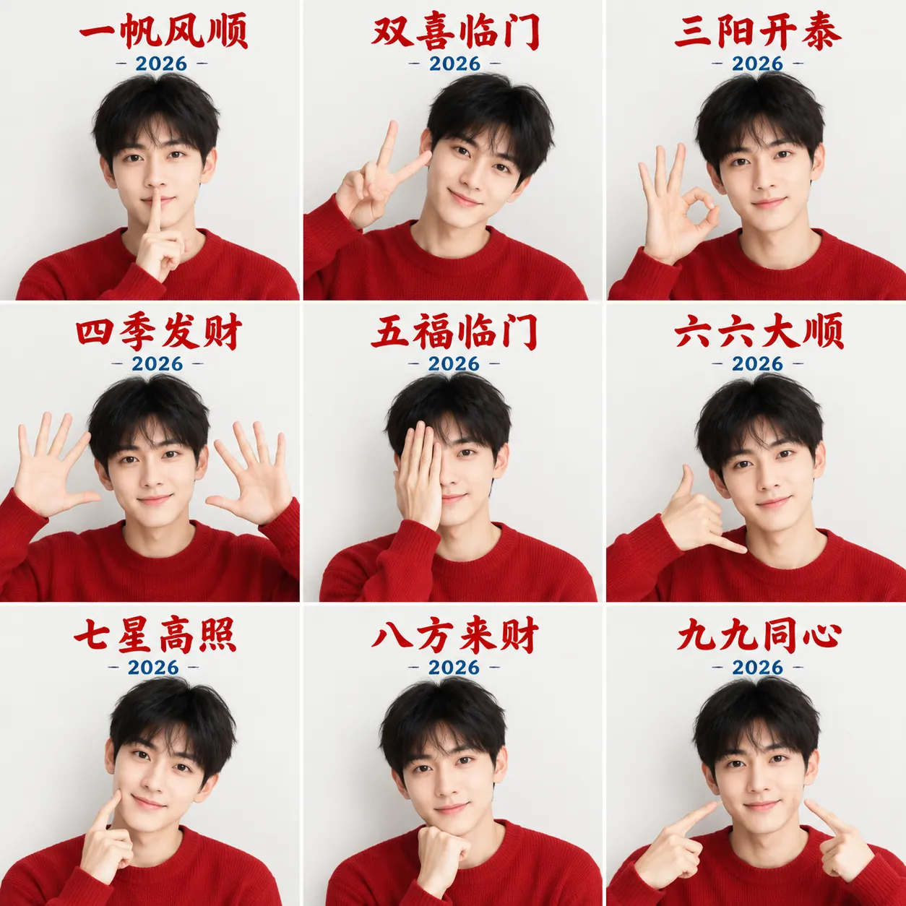</a>

> This Chinese prompt is a neat example of numbered design. Each of the nine cells gets a pose and a four-character New Year blessing whose first character is the number of that cell: 一帆风顺 (smooth sailing), 双喜临门 (double happiness), 三阳开泰 and so on up to 九. The JSON separates subject consistency, pose list and text overlays, and it insists on restraint: a clean white wall, soft light, a 'sunny but not greasy' look and calm smiles. Our result keeps one young man in a red sweater across all nine cells, with red calligraphy and a navy year beneath. Swap the subject, outfit colour or year; the blessing list works for any Lunar New Year.

```text
{
  "project_settings": {
    "task_type": "九宫格新年祝福肖像（男生版）",
    "aspect_ratio": "1:1",
    "grid_layout": "3x3",
    "batch_size": 1
  },

  "overall_style": {
    "整体风格": "极简新年祝福风",
    "视觉基调": "干净、温和、克制的节日感",
    "背景": "纯色白墙面，无装饰",
    "光线": "自然柔光，均匀无强阴影",
    "色彩重点": "中国红（服装 + 文字）"
  },

  "subject_base": {
    "人物一致性": "九宫格内为同一位人物",
    "人物类型": "亚洲男性",
    "性别气质": "干净、阳光、自然，不油腻",
    "发型": "黑色短发，自然蓬松，简洁利落",
    "服装": "红色针织毛衣或卫衣，简洁无图案",
    "妆容": "无明显妆感，真实自然肤质",
    "表情气质": "开心，克制的微笑，不夸张"
  },

  "pose_variations": {
    "grid_1": "食指竖于嘴前，轻松安静手势",
    "grid_2": "单手比 V 手势靠近脸部",
    "grid_3": "单手做 OK 或三指手势",
    "grid_4": "双手举起做轻松俏皮手势（不过度卖萌）",
    "grid_5": "单手张开遮住半边脸",
    "grid_6": "单手做电话手势靠近脸侧",
    "grid_7": "单手轻点脸颊或下巴",
    "grid_8": "单手托下巴，轻微思考姿势",
    "grid_9": "双手指向脸部或克制比心变体"
  },

  "text_overlays": {
    "字体风格": "传统中文新年书法字体",
    "文字颜色": "中国红",
    "年份颜色": "深蓝色",
    "文字位置": "每一格顶部居中",
    "文字结构": "四字祝福语 + 年份"
  },

  "text_content": [
    { "position": "grid_1", "text": "一帆风顺", "year": "2026" },
    { "position": "grid_2", "text": "双喜临门", "year": "2026" },
    { "position": "grid_3", "text": "三阳开泰", "year": "2026" },
    { "position": "grid_4", "text": "四季发财", "year": "2026" },
    { "position": "grid_5", "text": "五福临门", "year": "2026" },
    { "position": "grid_6", "text": "六六大顺", "year": "2026" },
    { "position": "grid_7", "text": "七星高照", "year": "2026" },
    { "position": "grid_8", "text": "八方来财", "year": "2026" },
    { "position": "grid_9", "text": "九九同心", "year": "2026" }
  ],

  "constraints": {
    "禁止项": [
      "不改变人物身份",
      "不夸张表情",
      "不女性化姿态",
      "不使用复杂背景",
      "不添加节日道具",
      "不风格化面部"
    ],
    "一致性要求": [
      "人物脸型五官保持完全一致",
      "服装颜色与材质一致",
      "拍摄角度与距离基本一致"
    ]
  },

  "use_cases": [
    "男生新年纪念照",
    "个人春节祝福九宫格",
    "社交平台头像矩阵",
    "品牌新年男生模板"
  ]
}
```

- 作者: [@wanerfu](https://x.com/wanerfu)
- 元の投稿: https://x.com/wanerfu/status/2008421241091154115
- [cinel で詳細を見てこのプロンプトで生成](https://cinel.ai/prompts/p/new-year-greeting-portrait-grid?utm_source=github&utm_medium=awesome&utm_campaign=awesome-gpt-image-2.5-prompts)

### Long-Exposure Crowd Street Portrait Prompt

<a href="https://cinel.ai/prompts/p/long-exposure-crowd-street-portrait?utm_source=github&utm_medium=awesome&utm_campaign=awesome-gpt-image-2.5-prompts">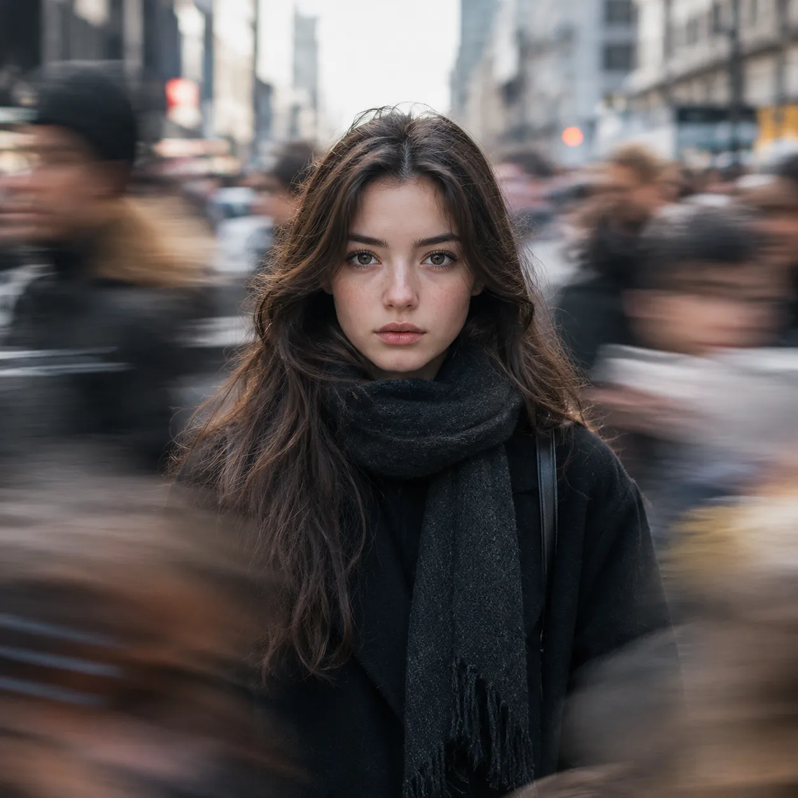</a>

> The idea is a classic photographic trick, one sharp still figure inside a blurred, rushing crowd, and the prompt describes both halves explicitly so the model doesn't blur the subject too. 'Standing still', 'perfectly still' and 'sharp focus on her face' anchor her, while 'strong directional motion blur' and 'streaked crowd movement' set the background in motion. Small realism cues (subtle freckles, neutral makeup, a dark winter coat and scarf) keep the face from looking airbrushed. Our result nails the contrast: a calm, direct gaze framed by horizontal streaks of commuters. Change the city, season or outfit freely, but keep the stillness wording intact; it is doing the heavy lifting.

```text
Ultra-realistic cinematic street portrait of a young woman standing still in a crowded city street, sharp focus on her face with calm, intense expression. Long-exposure effect with people moving around her creating strong directional motion blur, streaked crowd movement while the subject remains perfectly still. Natural soft daylight, shallow depth of field, creamy bokeh, realistic skin texture, subtle freckles, neutral makeup, dark winter coat and scarf. Emotional, introspective mood, urban storytelling photography, DSLR quality, 85mm lens look, f/1.8, high dynamic range, 8K, professional color grading.
```

- 作者: [@Taaruk_](https://x.com/Taaruk_)
- 元の投稿: https://x.com/Taaruk_/status/2018685474131562751
- [cinel で詳細を見てこのプロンプトで生成](https://cinel.ai/prompts/p/long-exposure-crowd-street-portrait?utm_source=github&utm_medium=awesome&utm_campaign=awesome-gpt-image-2.5-prompts)

### Candid Blurry Smartphone Night Snapshot Prompt

<a href="https://cinel.ai/prompts/p/candid-smartphone-selfie-photo?utm_source=github&utm_medium=awesome&utm_campaign=awesome-gpt-image-2.5-prompts">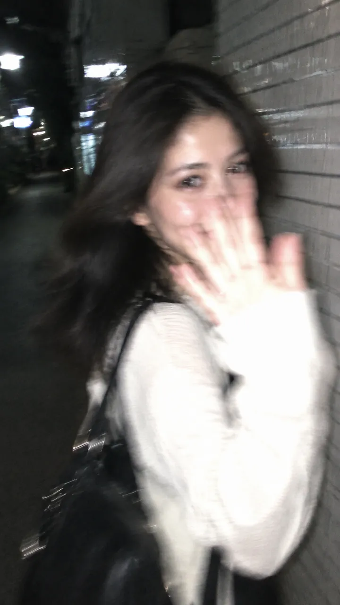</a>

> Everything here is designed to look unplanned, which is harder to prompt than perfection. The author lists combined reactions (head turned back, a hand rising to block the lens, a suppressed laugh), then deliberately degrades the capture with uncontrolled shake, smeared features, ghosting and a subject almost leaving the frame. It also tells the model to treat the reference only as loose inspiration so the face stays original. Our run, from a fictional reference, delivers a convincingly accidental frame: a blurred hand in front of white tiles and a half-hidden smile. Use it for social content that needs to feel real, and keep the blur instructions; without them it turns into a posed photo.

```text
Ultra-realistic candid smartphone photograph, 9:16 vertical.
Use the attached image only as a strong visual inspiration for general facial proportions and vibe,
while ensuring the generated subject remains fully original, non-identifiable, and not a face copy.
Scene
Nighttime on a quiet Tokyo city sidewalk beside a building with white ceramic tile walls.
The subject is walking past the camera, partially side-on, captured mid-step in a rushed, accidental moment.
Poses & Gestures (combined naturally)
The subject reacts instinctively to being photographed:
turning her head back mid-walk as if surprised,
raising one hand close to the lens to partially block the camera,
shy, restrained smile forming as she suppresses laughter,
body angled in half-profile while continuing to walk forward,
motion carries her slightly out of frame, imperfect framing.
Expressions are subtle and spontaneous — embarrassed, playful, fleeting — never posed.
Camera & Motion
Shot on a modern smartphone, handheld, rushed capture. Strong uncontrolled camera shake. Heavy directional motion blur across the raised hand, hair, and face. Facial features appear smeared and streaked by movement, faintly recognizable but distorted. Partial ghosting around the body. Imperfect framing, subject nearly leaving the frame.
Lighting
Flash-only lighting fired mid-motion. Harsh flash highlights on skin and hand. Deep surrounding darkness. Uneven exposure, blown highlights, hard shadows typical of hurried night phone photography.
Background
White ceramic tile wall stretches into streaked light bands due to motion blur. Street surroundings fade into darkness with minimal readable detail.
Mood
Candid, shy, slightly playful. Feels intrusive, raw, imperfect, and authentic — like a fleeting memory accidentally captured and never meant to be perfect.
Image Quality
Extremely noisy. Heavily blurred. Raw smartphone look. Not cinematic. Not editorial. Not polished.
Negative Prompt
anime, illustration, painting, stylized,
studio lighting, beauty lighting, soft portrait,
sharp focus, clean face, perfect anatomy, smooth skin,
fashion editorial, posed portrait, cinematic grading, film still,
tripod shot, professional photography,
identity match, face copy, real person replication
```

- 作者: [@HustleXR](https://x.com/HustleXR)
- 元の投稿: https://x.com/HustleXR/status/2011675822076411914
- [cinel で詳細を見てこのプロンプトで生成](https://cinel.ai/prompts/p/candid-smartphone-selfie-photo?utm_source=github&utm_medium=awesome&utm_campaign=awesome-gpt-image-2.5-prompts)

### Monochrome Men's Fashion Editorial Triptych

<a href="https://cinel.ai/prompts/p/monochrome-fashion-editorial-triptych?utm_source=github&utm_medium=awesome&utm_campaign=awesome-gpt-image-2.5-prompts">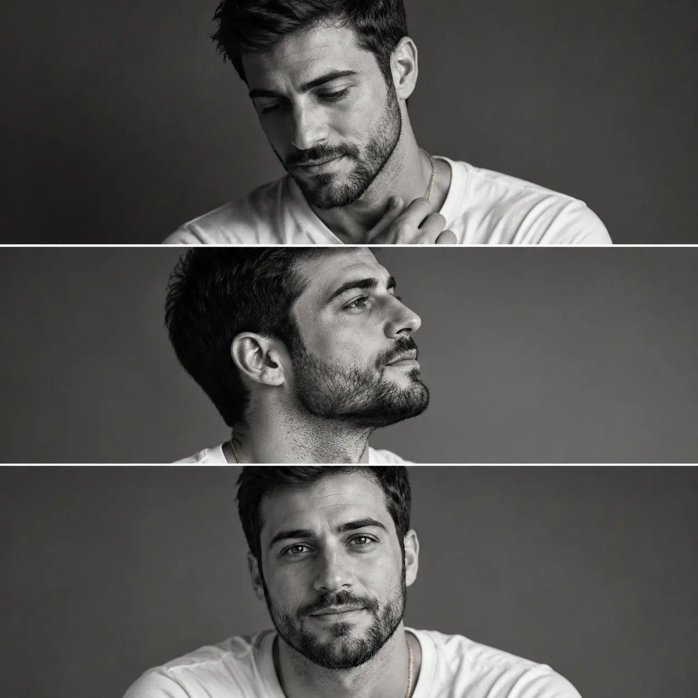</a>

> Three frames, three emotional registers: introspective with a hand near the collarbone, a crisp upward profile and a direct frontal look. That is the structure of a magazine spread, and the prompt specifies each one's light and gaze. Continuity props (a white T-shirt and a gold necklace) tie the frames together. Rembrandt lighting in frame one adds sculpting. Our version, built from a fictional reference of a bearded man, keeps the face consistent across all three stacked panels, with visible pores and soft background falloff. Use it for actor headshot packs, personal branding or a lookbook cover, and swap the continuity props to suit, for example a black turtleneck and silver ring.

```text
Preserve the face, proportions, and external features of the model as in the reference. A minimalist monochrome fashion editorial triptych featuring three stacked cinematic frames. The subject is a young man with short dark hair and a groomed beard. Frame 1: Emotional and introspective, looking downward with a hand near the collarbone, highlighting bone structure with Rembrandt lighting. Frame 2: A crisp profile shot with a focus on the nose, lips, and masculine jawline, gaze directed slightly upward. Frame 3: A frontal, thoughtful portrait with shoulders relaxed and direct eye contact. The composition is clean and modern, using a white T-shirt and gold necklace for visual continuity. Commercial magazine quality, high-end mirrorless camera, authentic skin pores, soft bokeh, and elegant masculinity.
```

- 作者: [@harboriis](https://x.com/harboriis)
- 元の投稿: https://x.com/harboriis/status/2023230471061315992
- [cinel で詳細を見てこのプロンプトで生成](https://cinel.ai/prompts/p/monochrome-fashion-editorial-triptych?utm_source=github&utm_medium=awesome&utm_campaign=awesome-gpt-image-2.5-prompts)

<a id="product-photography"></a>

## 商品・EC

厳選 6 件 · [全 46 件を見る](cases/product-photography.md) · [cinel のカテゴリ](https://cinel.ai/prompts/product-photography?utm_source=github&utm_medium=awesome&utm_campaign=awesome-gpt-image-2.5-prompts)

### Nine-Panel Product Mockup Storyboard Prompt

<a href="https://cinel.ai/prompts/p/product-mockup-storyboard-grid?utm_source=github&utm_medium=awesome&utm_campaign=awesome-gpt-image-2.5-prompts">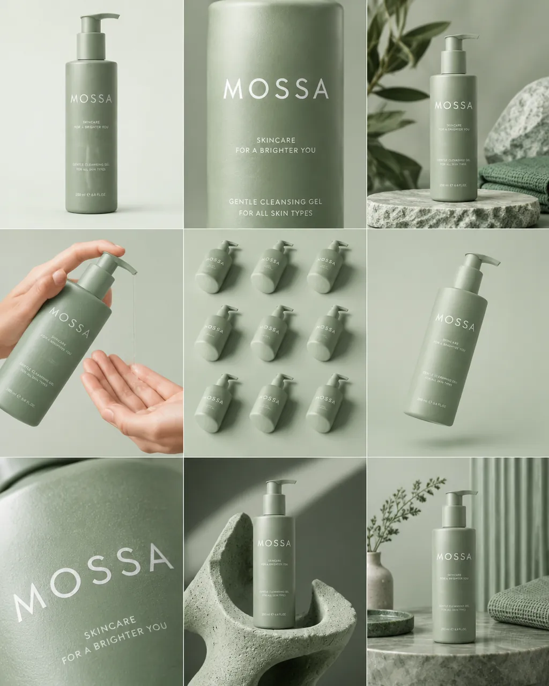</a>

> This prompt does the job of a whole branding-portfolio shoot in one image. Its strength is the frame-by-frame brief: every panel has a defined purpose (hero, macro texture, brand environment, hands in use, isometric arrangement), so the model never repeats itself. The repeated instruction to keep the label, logo and proportions identical is what holds the set together. In our example, a sage-green pump bottle stays recognisable across all nine frames while the props shift from stone to leaves. To adapt it, upload a clean, front-on photo of your product and edit only the frame descriptions; keep the 3×3 structure and the curated, editorial tone.

```text
Create ONE final image. 

A clean 3×3 storyboard grid with nine equal-sized panels on a 4:5 canvas. 

Use the reference image as the base product reference. Keep the same product, packaging design, branding, materials, colors, proportions and overall identity across all nine panels exactly as the reference. The product must remain clearly recognizable in every frame. The label, logo and proportions must stay exactly the same.

This storyboard is a high-end designer mockup presentation for a branding portfolio. The focus is on form, composition, materiality and visual rhythm rather than realism or lifestyle narrative. The overall look should feel curated, editorial and design-driven.

FRAME 1:
Front-facing hero shot of the product in a clean studio setup. Neutral background, balanced composition, calm and confident presentation of the product.

FRAME 2:
Close-up shot with the focus centered on the middle of the product. Focusing on surface texture, materials and print details.

FRAME 3:
Shows the reference product placed in an environment that naturally fits the brand and product category. Studio setting inspired by the product design elements and colours. 

FRAME 4:
Product shown in use or interaction on a neutral studio background. Hands and interaction elements are minimal and restrained, the look matches the style of the package. 

FRAME 5:
Isometric composition showing multiple products arranged in a precise geometric order from the top isometric angle. All products are placed at the same isometric top angle, evenly spaced, clean, structured and graphic.

FRAME 6:
Product levitating slightly tilted on a neutral background that matches the reference image color palette. Floating position is angled and intentional, the product is floating naturally in space.

FRAME 7:
is an extreme close-up focusing on a specific detail of the label, edge, texture or material behavior.

FRAME 8:
The product in an unexpected yet aesthetically strong setting that feels bold, editorial and visually striking.
Unexpected but highly stylized setting. Studio-based, and designer-driven. Bold composition that elevates the brand.

FRAME 9:
Wide composition showing the product in use, placed within a refined designer setup. Clean props, controlled styling, cohesive with the rest of the series.

CAMERA & STYLE:
Ultra high-quality studio imagery with a real camera look. Different camera angles and framings across frames. Controlled depth of field, precise lighting, accurate materials and reflections. Lighting logic, color palette, mood and visual language must remain consistent across all nine panels as one cohesive series.

OUTPUT:
A clean 3×3 grid with no borders, no text, no captions and no watermarks.
```

- 作者: [@Dari_Designs](https://x.com/Dari_Designs)
- 元の投稿: https://x.com/Dari_Designs/status/2013268963266904438
- [cinel で詳細を見てこのプロンプトで生成](https://cinel.ai/prompts/p/product-mockup-storyboard-grid?utm_source=github&utm_medium=awesome&utm_campaign=awesome-gpt-image-2.5-prompts)

### Protein Drink and Iced Coffee Splash Ad Diptych Prompt

<a href="https://cinel.ai/prompts/p/protein-drink-bottle-splash-product-shot?utm_source=github&utm_medium=awesome&utm_campaign=awesome-gpt-image-2.5-prompts">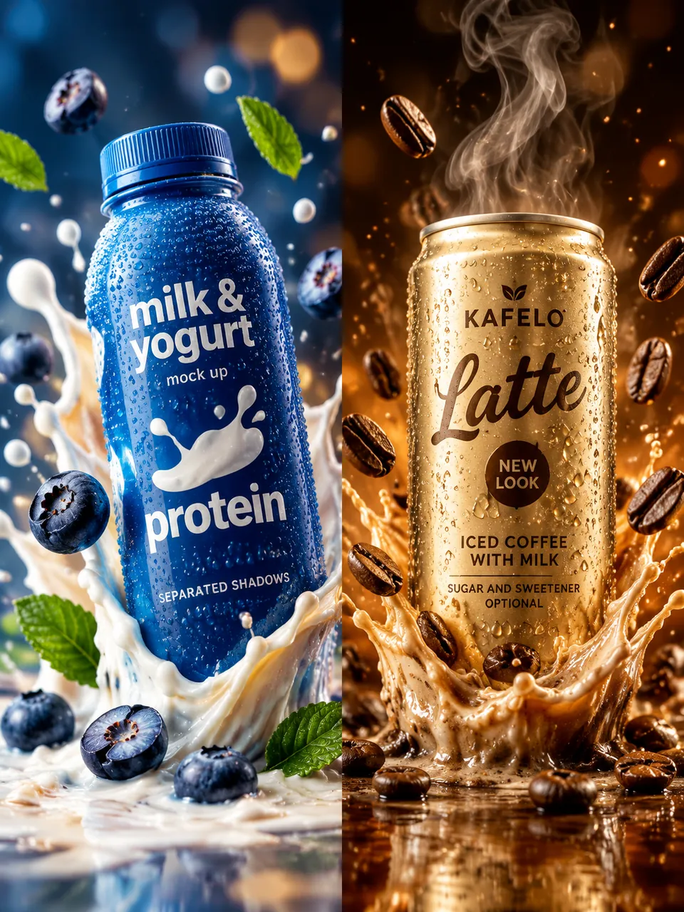</a>

> Written as a 'master prompt' with global settings followed by one module per image, this is a reusable system rather than a one-off. The global block fixes resolution, high-speed motion freeze and cinematic studio light for every module; each module then defines its own bottle, label text, tilt angle, liquid and floating ingredients. That split is why our 3:4 output reads as a matching pair: a matte-blue protein bottle leaning into a milk-and-blueberry splash, and a gold latte can surrounded by beans and steam. The original named a real coffee brand on the can; we swapped in an invented one, KAFELO. Reuse it by editing one module at a time, keeping the global settings untouched.

```text
{
  "master_prompt": {
    "global_settings": {
      "resolution": "8K ultra-high-definition",
      "aspect_ratio": "3:4 vertical",
      "style": "hyper-realistic AI-edited commercial product photography",
      "sharpness": "extreme clarity, micro-detail visibility",
      "lighting_quality": "cinematic studio lighting with controlled highlights and shadows",
      "motion_freeze": "high-speed capture, frozen splashes and particles",
      "noise": "none",
      "artifacts": "none"
    },

"module_1_image_1_style": {
      "subject": {
        "type": "plastic protein drink bottle",
        "color": "deep matte blue",
        "surface_details": "condensation droplets across entire bottle",
        "label_text_visible": [
          "milk & yogurt",
          "mock up",
          "protein",
          "SEPARATED SHADOWS"
        ]
      },
      "pose_and_orientation": {
        "position": "slightly tilted to the right",
        "angle": "three-quarter view",
        "motion_feel": "dynamic, leaning into splash"
      },
      "liquid_and_motion": {
        "liquid_color": "white and light beige milk mixture",
        "texture": "smooth, creamy, fluid",
        "motion": "swirling splash rising around bottle base and sides"
      },
      "floating_elements": {
        "blueberries": "whole and halved blueberries at different depths",
        "mint_leaves": "small green leaves with visible veins",
        "droplets": "milk droplets and spheres suspended mid-air"
      },
      "background": {
        "color_gradient": "dark blue to warm amber",
        "bokeh": "soft circular light particles scattered throughout"
      },
      "surface_and_reflection": {
        "base": "matte ground with light liquid pooling",
        "shadow_style": "soft separated shadow under bottle"
      }
    },
"module_2_image_2_style": {
      "subject": {
        "type": "metal coffee can",
        "color": "warm gold",
        "surface_details": "heavy condensation with visible droplets",
        "branding_text_visible": [
          "KAFELO",
          "Latte",
          "NEW LOOK",
          "ICED COFFEE WITH MILK",
          "SUGAR AND SWEETENER OPTIONAL"
        ]
      },
      "pose_and_orientation": {
        "position": "upright, centered",
        "angle": "front-facing",
        "presence": "hero product stance"
      },
      "liquid_and_motion": {
        "liquid_color": "coffee and milk blend",
        "motion": "splash erupting from base",
        "droplet_behavior": "fine droplets scattered outward"
      },
      "floating_elements": {
        "coffee_beans": "whole roasted beans floating around can",
        "steam": "thick swirling steam rising upward",
        "embers": "tiny glowing particles in background"
      },
      "background": {
        "color_palette": "deep brown, amber, gold",
        "atmosphere": "warm, smoky, intense"
      },
      "surface_and_reflection": {
        "base": "wet surface with liquid splash crown",
        "reflection_quality": "subtle reflective highlights"
      }
    }
```

- 作者: [@mehvishs25](https://x.com/mehvishs25)
- 元の投稿: https://x.com/mehvishs25/status/2017420332458774791
- [cinel で詳細を見てこのプロンプトで生成](https://cinel.ai/prompts/p/protein-drink-bottle-splash-product-shot?utm_source=github&utm_medium=awesome&utm_campaign=awesome-gpt-image-2.5-prompts)

### Low-Angle Fashion Campaign with Oversized Product

<a href="https://cinel.ai/prompts/p/low-angle-fashion-campaign-product-in-hand?utm_source=github&utm_medium=awesome&utm_campaign=awesome-gpt-image-2.5-prompts">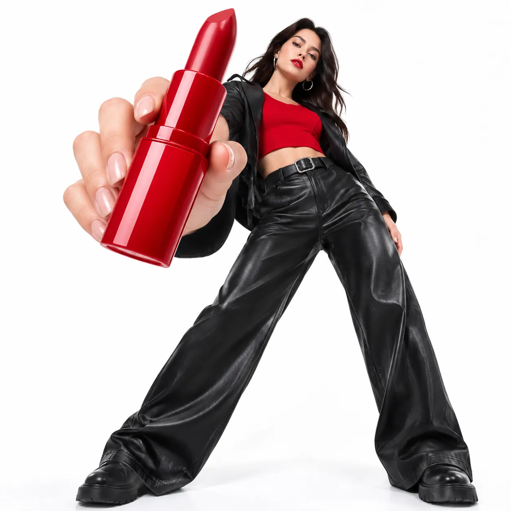</a>

> This prompt turns a basic product-in-hand shot into a campaign image with one device: forced perspective. A low camera, the product held right at the lens and a full-body pose behind it make the pack look monumental while still showing the person and outfit. The supporting details are sensible: high-key white, sharp focus on the product, slight softness on the model. Our lipstick example shows the effect clearly, with a glossy red tube filling a third of the frame and a wide-stance model in black leather behind it. We specified an unbranded case to avoid inventing a logo. Works for perfume, sneakers, phones or drinks; choose a product with a strong colour.

```text
Low-angle fashion campaign photograph of a confident model holding a large glossy red lipstick tube with a plain, unbranded, logo-free case very close to the camera, exaggerated perspective with the hand and product dominating the foreground, full-body pose visible in the background, wide stance, dynamic posture, clean pure white studio background, high-key lighting, sharp focus on product, slight depth of field on the model, bold colorful outfit with strong contrast tones, modern beauty advertising aesthetic, ultra-clean composition, commercial studio photography, glossy packaging detail visible, crisp shadows
```

- 作者: [@azed_ai](https://x.com/azed_ai)
- 元の投稿: https://x.com/azed_ai/status/2048748266293190833
- [cinel で詳細を見てこのプロンプトで生成](https://cinel.ai/prompts/p/low-angle-fashion-campaign-product-in-hand?utm_source=github&utm_medium=awesome&utm_campaign=awesome-gpt-image-2.5-prompts)

### Industrial Packaging Design Presentation Sheet

<a href="https://cinel.ai/prompts/p/industrial-packaging-design-sheet?utm_source=github&utm_medium=awesome&utm_campaign=awesome-gpt-image-2.5-prompts">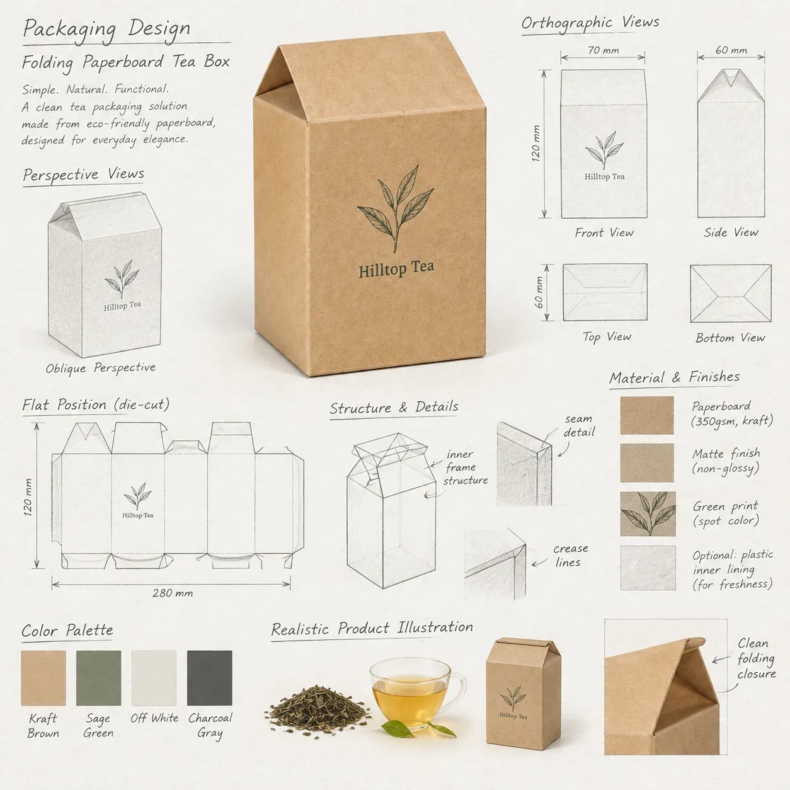</a>

> Designers present packaging this way, with a hero render surrounded by orthographic views, construction sketches and material notes, and the prompt asks for all of it in one sketchbook-style sheet. The mix of 'realistic rendering + pencil sketch' is what gives it a portfolio feel. Starting from our AI-generated reference of a kraft tea box with a leaf illustration, the model produced front, side, top and bottom views, a flat dieline with millimetre arrows, crease details, paper and finish swatches, and a little scene with loose tea and a cup. Dimensions are invented, so set real ones if you will print from it. It suits pitches, school projects and early concept reviews.

```text
Using the attached image, create an illustration sheet of professional industrial design packaging for the package folding paperboard tea box. A centered heroic 3D rendering with realistic materials, soft studio lighting and commercial quality finishes. Surrounded by technical views: front, side, top, bottom, oblique perspective and flat position. Include sketches of the frame structure, crease lines, seam details, and size arrows in millimeters. Show materials and finishes (matte, glossy print, plastic, paper, glass, etc.) in handwritten annotations. Add color swatches, realistic product illustrations, and subtle shadows. Clean sketchbook background, realistic rendering + pencil sketch style, modern design design, ultra-detailed, portfolio ready.
```

- 作者: [@noorwithwifi](https://x.com/noorwithwifi)
- 元の投稿: https://x.com/noorwithwifi/status/2039679180775063573
- [cinel で詳細を見てこのプロンプトで生成](https://cinel.ai/prompts/p/industrial-packaging-design-sheet?utm_source=github&utm_medium=awesome&utm_campaign=awesome-gpt-image-2.5-prompts)

### Top-Down Product Flat Lay with Ingredients and Splash

<a href="https://cinel.ai/prompts/p/top-down-flat-lay-ingredients-product-shot?utm_source=github&utm_medium=awesome&utm_campaign=awesome-gpt-image-2.5-prompts">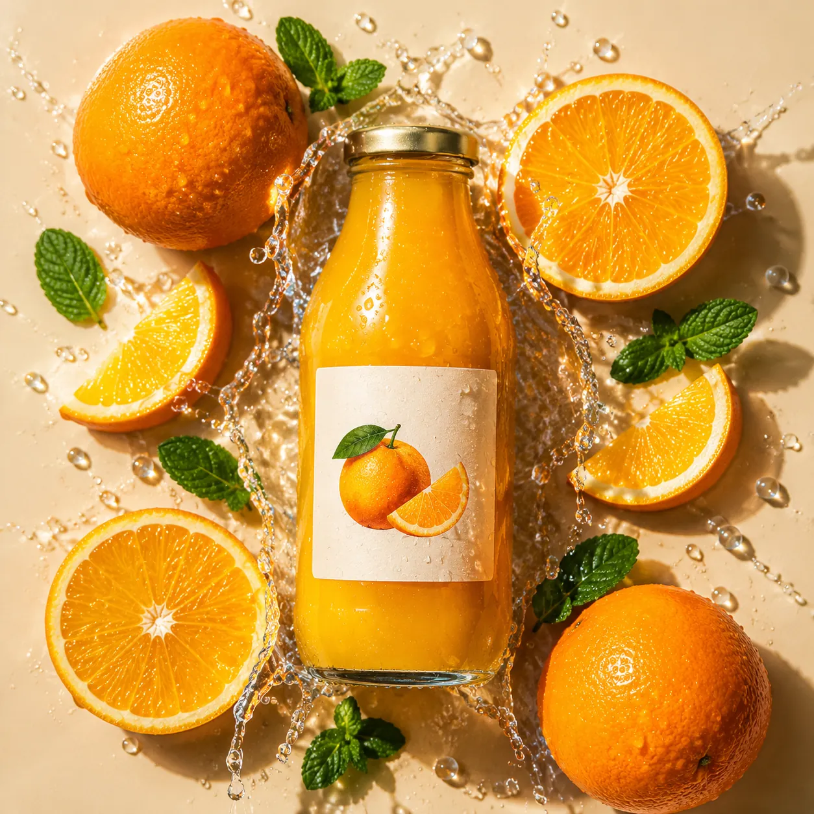</a>

> Two blanks, product and ingredients, make this one of the most reusable product prompts in the library. It combines a centred top-down flat lay with a frozen water splash, which is unusual: splashes are normally shot side-on, and seen from above they become a ring of liquid that frames the product. Dewy droplets on the label, warm beige background and directional sunlight add freshness. We used a cold-pressed orange juice with oranges and mint, and the result reads instantly as a juice ad. Note the prompt still says 'high end skincare advertising', so change that phrase to match your category (beverage, food, cosmetics) for more fitting styling.

```text
A glass bottle of cold-pressed orange juice, centered top down flat lay, surrounded by oranges and fresh mint leaves, fresh slices and whole pieces, glossy wet look, water splash frozen mid motion around the product, dewy droplets on label and surface, warm beige seamless background, soft directional sunlight, crisp realistic shadow, high end skincare advertising, ultra realistic macro product photography, 100mm lens look, f/8 sharp focus, clean composition, no extra text, 8k, 1:1
```

- 作者: [@azed_ai](https://x.com/azed_ai)
- 元の投稿: https://x.com/azed_ai/status/2015423674061643925
- [cinel で詳細を見てこのプロンプトで生成](https://cinel.ai/prompts/p/top-down-flat-lay-ingredients-product-shot?utm_source=github&utm_medium=awesome&utm_campaign=awesome-gpt-image-2.5-prompts)

### Top-Down Luxury Product on Textured Surface Prompt

<a href="https://cinel.ai/prompts/p/top-down-textured-surface-product-shot?utm_source=github&utm_medium=awesome&utm_campaign=awesome-gpt-image-2.5-prompts">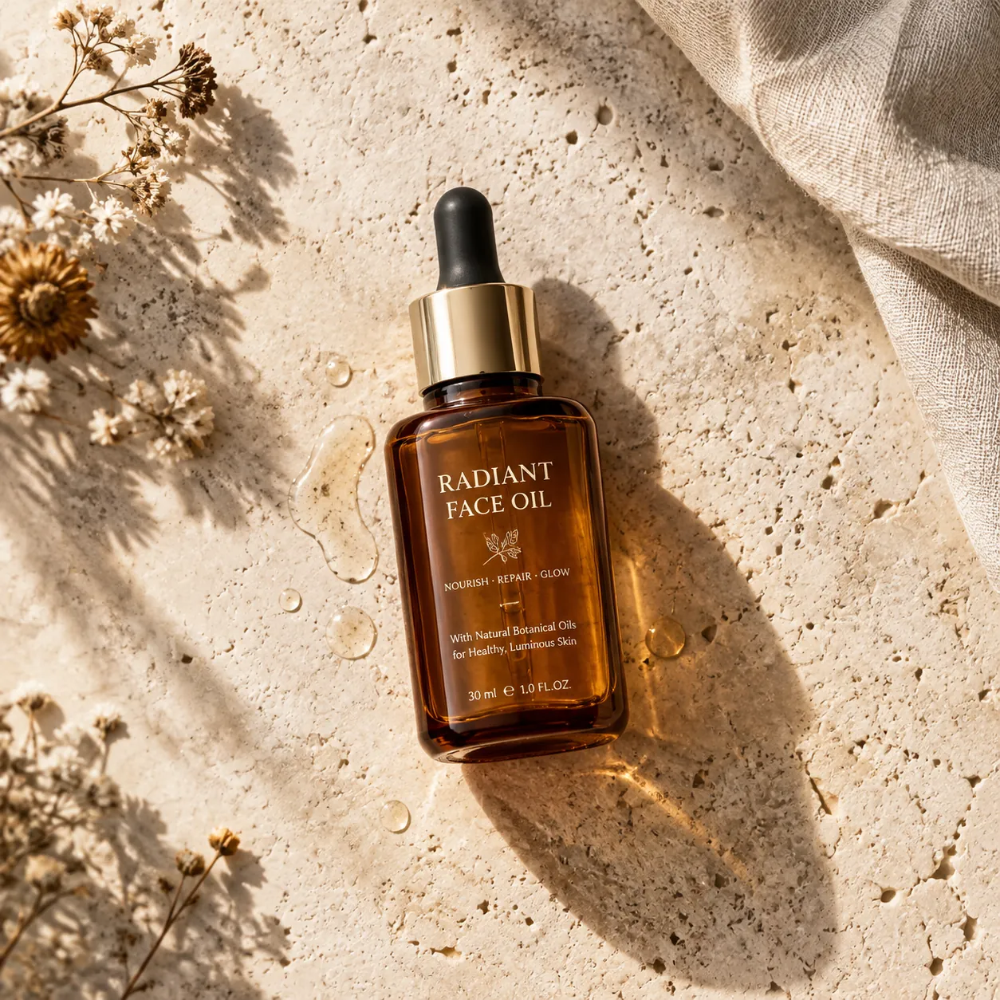</a>

> Quieter than the splash flat lay, this template relies on texture and light. The product lies flat on a material such as stone, sand, linen or salt; the surface is 'gently disturbed to suggest recent motion', a subtle cue that makes the scene feel touched by a person rather than staged by software. Sunlight from the upper left gives long, warm shadows, and the prompt leaves room for complementary props. With an amber face-oil bottle on travertine, dried flowers and a folded linen cloth, our result looks like a skincare brand's editorial shot. The model invented a label ('Radiant Face Oil'), so specify your own label text or ask for an unlabeled bottle.

```text
A high-end editorial photo of a amber glass face-oil bottle with a dropper placed flat on a travertine stone slab, captured from a direct top-down view. The surface is gently disturbed to suggest recent motion or interaction. The front of the product is fully visible and properly oriented upright. The area around the product is intentionally left open to optionally place dried flowers and a folded linen cloth that visually enhance the scene. Natural sunlight from the upper left casts warm, realistic shadows. 3D realism, luxury product photography, shallow depth of field, 1:1 format.
```

- 作者: [@Kerroudjm](https://x.com/Kerroudjm)
- 元の投稿: https://x.com/Kerroudjm/status/2008559850968473671
- [cinel で詳細を見てこのプロンプトで生成](https://cinel.ai/prompts/p/top-down-textured-surface-product-shot?utm_source=github&utm_medium=awesome&utm_campaign=awesome-gpt-image-2.5-prompts)

<a id="poster-design"></a>

## ポスター・ロゴ・グラフィック

厳選 6 件 · [全 67 件を見る](cases/poster-design.md) · [cinel のカテゴリ](https://cinel.ai/prompts/poster-design?utm_source=github&utm_medium=awesome&utm_campaign=awesome-gpt-image-2.5-prompts)

### Sports Tribute Double-Exposure Collage Poster Prompt

<a href="https://cinel.ai/prompts/p/sports-tribute-double-exposure-poster?utm_source=github&utm_medium=awesome&utm_campaign=awesome-gpt-image-2.5-prompts">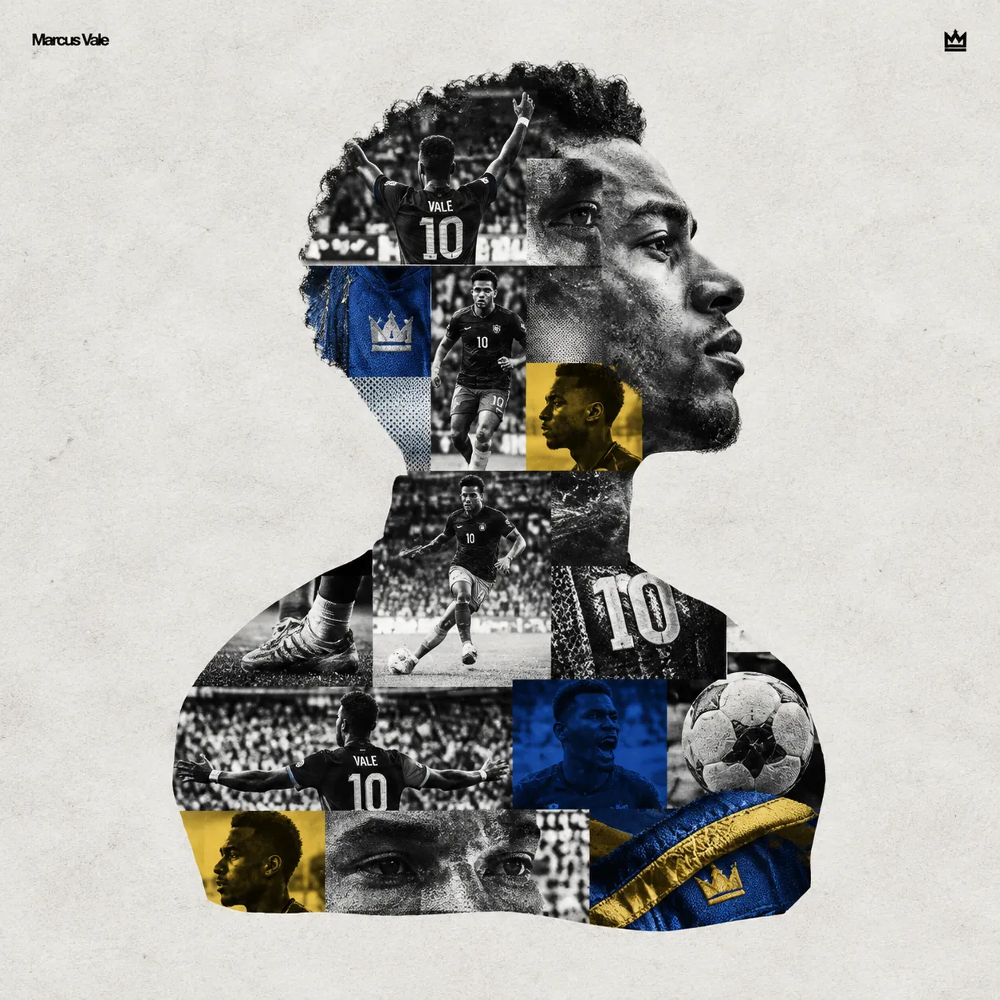</a>

> Most poster prompts ask for big, loud type. This one does the opposite, and that restraint is why it looks designed rather than generated. The silhouette acts as a container, the grid of action shots fills it, and the texture instructions (halftone dots, embroidery, film grain) stop the collage from looking like pasted stock photos. The strict micro-scaling rules keep the name and emblem small in the corners. We filled the name slot with a fictional athlete, Marcus Vale; please do the same or use your own team, because generating real athletes' likenesses raises rights issues. Change the sport and the accent colour to suit a club, a school team or a personal milestone.

```text
Marcus Vale. 
Act as a high-end sports graphic designer creating a conceptual tribute poster. The style is a complex "dual exposure photo-grid composite" with mixed-media textures.
CENTRAL STRUCTURE (THE VESSEL):
The central focus is a large-scale, high-contrast black and white portrait silhouette of Marcus Vale. This main portrait acts as the container.
THE GRID FILL & TEXTURES (MIXED MEDIA):
The interior of the silhouette is populated by a dense "photo mosaic grid" of action shots from the person's career.
CRITICAL TEXTURE INSTRUCTION: Do not just paste flat photos. Apply artistic textures to various grid cells to create a tactile, collage feel. Use effects like:
Halftone Dots: Comic-book style raster patterns on some cells.
Fabric/Embroidery: Subtle thread or canvas textures suggesting a jersey or patch.
Film Grain: Heavy noise on specific high-contrast action shots.
COLOR STRATEGY:
The base is Monochrome B&W. Use selective color overlays (relevant to the team/flag) ONLY on specific grid cells to create a rhythm.
TYPOGRAPHY & BRANDING (STRICT MICRO-SCALING):
Top Left (The Name): Write "Marcus Vale" strictly using the font Inter Semibold.
Kerning: Tight negative kerning (-4%).
Size: SMALL and discreet. It must occupy MAXIMUM 20% of the canvas width. Do NOT make it large or loud.
Top Right (The Symbol): Place the primary logo (Team/Brand/Flag).
Size: VERY SMALL. It must occupy MAXIMUM 10% of the canvas width.
COMPOSITION & BACKGROUND:
Background: Off-white or light grey with a visible high-quality paper or concrete texture. It should not be flat digital white.
Alignment: Center the figure perfectly. Maintain wide negative space around the object.
```

- 作者: [@AmirMushich](https://x.com/AmirMushich)
- 元の投稿: https://x.com/AmirMushich/status/2008976966255337666
- [cinel で詳細を見てこのプロンプトで生成](https://cinel.ai/prompts/p/sports-tribute-double-exposure-poster?utm_source=github&utm_medium=awesome&utm_campaign=awesome-gpt-image-2.5-prompts)

### Brand Logo Shaped Cloud Surreal Ad Prompt

<a href="https://cinel.ai/prompts/p/brand-logo-cloud-surreal-poster?utm_source=github&utm_medium=awesome&utm_campaign=awesome-gpt-image-2.5-prompts">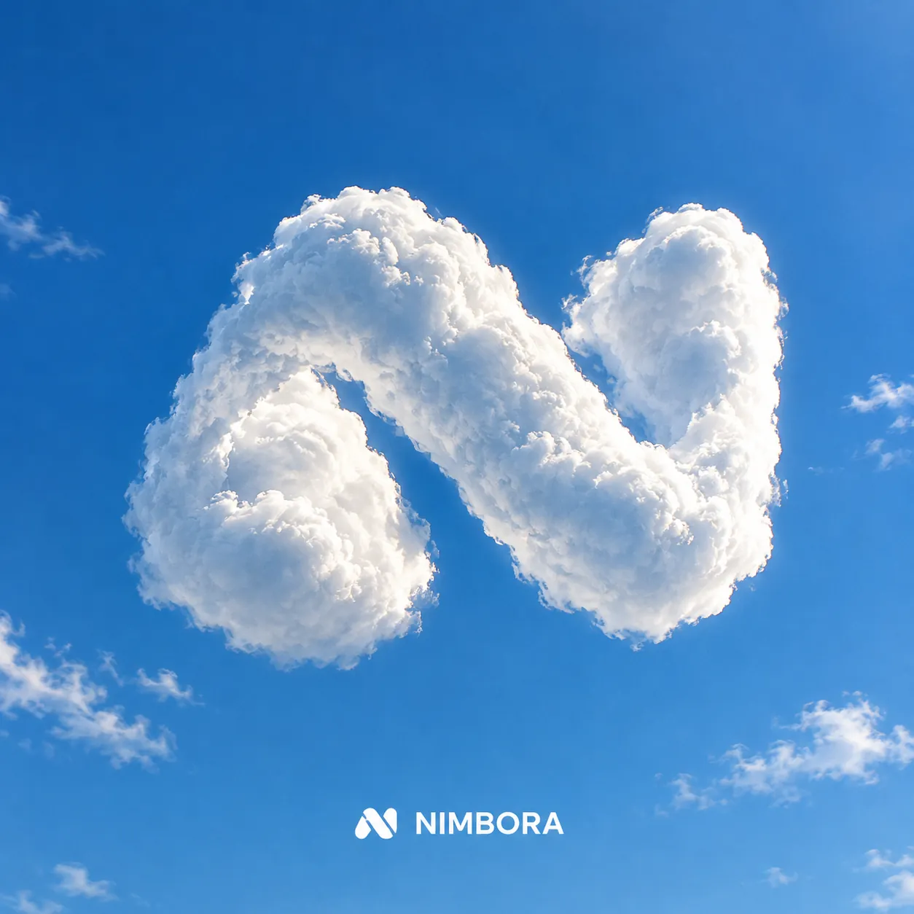</a>

> One idea, executed with discipline. The prompt asks for a single surreal element, a cumulus cloud in the shape of a logo, and then spends its words making that cloud believable: side light on the edges, internal shadow for volume, and tiny distant clouds for scale. The small white wordmark at the bottom keeps it reading as an ad rather than a weather photo. We used an invented brand, NIMBORA, and the model designed a simple N-shaped mark to match the name; with a real brand it would try to recall the logo, which is risky. For your own brand, upload the logo as a reference, and favour bold, simple shapes, because thin strokes dissolve in cloud texture.

```text
NIMBORA: The name of the brand.
Goal: Generate a single, minimalist, and surreal image where a cloud is shaped like the brand's logo.

1. THE LOGO CLOUD
- **Subject**: A massive, photorealistic cumulus cloud in the exact geometric shape of the NIMBORA logo.
- **Texture**: Puffy, soft, and voluminous with natural sunlight illuminating the edges.
- **Volume**: 3D sculptural appearance with realistic shadows within the cloud folds to show depth.

2. ENVIRONMENT & BACKGROUND
- **Sky**: A vast, clear, vibrant blue summer sky.
- **Secondary Elements**: A few small, wispy, natural clouds scattered far in the background to enhance the sense of scale and realism.
- **Lighting**: Bright, direct daylight coming from the side to create high-contrast highlights and shadows.

3. INTEGRATED BRANDING
- **Text**: The word "NIMBORA" written in a clean, bold white sans-serif font.
- **Icon**: A small, flat white version of the brand's logo placed next to the text.
- **Positioning**: The branding (text + logo) is centered at the bottom of the frame, acting as a subtle anchor to the giant cloud above.

4. STYLE
- Surrealist photography, ultra-minimalist composition, high resolution, 8k, cinematic look, clean and airy vibe.
```

- 作者: [@AmirMushich](https://x.com/AmirMushich)
- 元の投稿: https://x.com/AmirMushich/status/2032908105994961090
- [cinel で詳細を見てこのプロンプトで生成](https://cinel.ai/prompts/p/brand-logo-cloud-surreal-poster?utm_source=github&utm_medium=awesome&utm_campaign=awesome-gpt-image-2.5-prompts)

### Giant Crystal Glass Logo Sculpture Ad Prompt

<a href="https://cinel.ai/prompts/p/giant-3d-logo-sculpture-brand-ad?utm_source=github&utm_medium=awesome&utm_campaign=awesome-gpt-image-2.5-prompts"></a>

> The material section is the reason to save this prompt. Instead of saying 'glass', it specifies optical-grade crystal, a high refractive index, fire-polished bevels and a few deliberate flaws (fine scratches, seed bubbles) so the render doesn't look like plastic. It also forbids land and trees, which keeps the frame pure sky and makes the caustics the second subject. In our run with an invented circular mark, the refraction of the clouds through the ring sells the weight of the object. The prompt asks the model to recall an 'official' logo from memory; for anything real, attach your logo file as a reference instead, and keep the shape simple enough to read through refraction.

```text
Act as a High-End Product Photographer and CGI Artist.

PHASE 1: SUBJECT & LOGIC
Generate a massive, perfectly centered, three-dimensional physical sculpture of the official, unaltered corporate logo for ORBYN (a fictional brand with a simple circular logo). The sculpture must strictly adhere to the brand’s precise logo geometry and proportions (1:1 from brandbook). The sculpture is suspended in mid-air. Autonomously identify the exact official shape and structure of the ORBYN (a fictional brand with a simple circular logo) logo and render it as a single, flawless glass object without any modifications.
PHASE 2: MATERIALITY (GLASS)
The entire logo is made of hyper-realistic, optical-grade crystal glass (not water, not gel). The material is solid, colorless, and boasts high clarity with a high refractive index. It must look heavy and монолитное (monolithic). The glass structure contains subtle, photorealistic microscopic flaws: fine polished scratches on the surface and minor internal inclusions (dust particles/seed bubbles, very few) to avoid “CGI plastic.” The edges must be precision-beveled and fire-polished.

PHASE 3: ENVIRONMENT & CAUSTICS
The logo is suspended against a strictly clean, bright blue sky with sparse, naturally defined white cumulus clouds. NO land, NO trees, NO palms. The background is purely atmospheric. The focus is entirely on the glass logo. Critically render hyper-realistic, complex glass caustics: intense, sharp patterns of focused light and color (refractions of the blue sky) cast inside and onto the surface of the glass form due to the sunlight passing through it.

TECH SPECS
Rendered with Arnold or Octane. Phase One XF, 120mm Macro lens. Aperture f/5.6 for sharp depth across the entire glass sculpture. Intense, direct sunlight (hard lighting) to maximize caustics. Global illumination, ray-traced refractions (double-sided geometry), and chromatic aberration emulation (subtle) for optical realism. Fine grain film emulation (Fujifilm Velvia 50).
```

- 作者: [@AmirMushich](https://x.com/AmirMushich)
- 元の投稿: https://x.com/AmirMushich/status/2043027627640799569
- [cinel で詳細を見てこのプロンプトで生成](https://cinel.ai/prompts/p/giant-3d-logo-sculpture-brand-ad?utm_source=github&utm_medium=awesome&utm_campaign=awesome-gpt-image-2.5-prompts)

### Layered Editorial Brand Collage Poster Prompt

<a href="https://cinel.ai/prompts/p/layered-editorial-brand-collage-poster?utm_source=github&utm_medium=awesome&utm_campaign=awesome-gpt-image-2.5-prompts">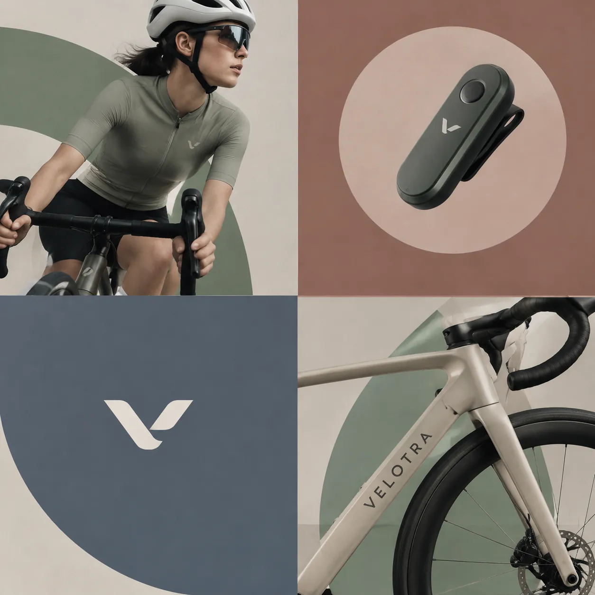</a>

> The phrase worth stealing here is 'the sandwich effect': parts of the subject hide behind the geometric blocks while wheels, limbs or props overlap them, creating depth on a flat grid. The palette rule is equally useful. It tells the model to take a brand's colours and push them towards dusty, desaturated versions, which is why the result looks like a design-studio layout rather than an ad. With our invented cycling brand VELOTRA, the model split the grid into rider, bike frame, logo block and a floating bike light as the 'iconic prop'. Name your product category clearly so the model picks a sensible subject and prop.

```text
VELOTRA (a fictional cycling brand). Act as a World-Class Editorial Designer.

PHASE 1: DYNAMIC SUBJECT LOGIC.

- Subject Selection: Autonomously analyze VELOTRA (a fictional cycling brand).

- Layering (The Sandwich Effect): Interweave the subject with background shapes. Some parts of the car/person must be hidden behind geometric blocks, while other parts (wheels, limbs, props) must overlap them to create 3D depth.

PHASE 2: GRID & GEOMETRY.

- Layout: A clean 2x2 grid composition. 

- Overlays: Superimpose large, bold geometric arcs and circles over the grid. 

- Visual Balance: Place one iconic product prop (e.g., a floating key fob for cars or a ball for sports) in a separate quadrant to balance the subject.

PHASE 3: SOPHISTICATED MUTED PALETTE.

- Color Direction: DO NOT use aggressive neon or oversaturated colors.

- Palette: Identify the core colors of VELOTRA (a fictional cycling brand) and shift them to a "Sophisticated Muted" spectrum. 

- Tones: Use desaturated, earthy, or "dusty" versions of the brand colors (e.g., instead of hot pink, use dusty rose; instead of bright mint, use sage green; instead of royal blue, use slate blue). 

- Finish: Matte, flat color blocks with zero gradients.

PHASE 4: PHOTOGRAPHY & LIGHTING.

- Subject Style: High-end commercial studio photography.

- Lighting: Soft, diffused studio lighting with gentle highlights. No harsh shadows.

- Integration: The subject must feel physically embedded into the graphic grid.

PHASE 5: MINIMALIST BRANDING.

- Logo: Place a clean, single-color VELOTRA (a fictional cycling brand) logo in the center of one background block. No taglines, just the iconic symbol.
```

- 作者: [@AmirMushich](https://x.com/AmirMushich)
- 元の投稿: https://x.com/AmirMushich/status/2028115571724660920
- [cinel で詳細を見てこのプロンプトで生成](https://cinel.ai/prompts/p/layered-editorial-brand-collage-poster?utm_source=github&utm_medium=awesome&utm_campaign=awesome-gpt-image-2.5-prompts)

### Y2K Inflated Spiky 3D Type Streetwear Logo Prompt

<a href="https://cinel.ai/prompts/p/y2k-chrome-3d-type-streetwear-logo?utm_source=github&utm_medium=awesome&utm_campaign=awesome-gpt-image-2.5-prompts">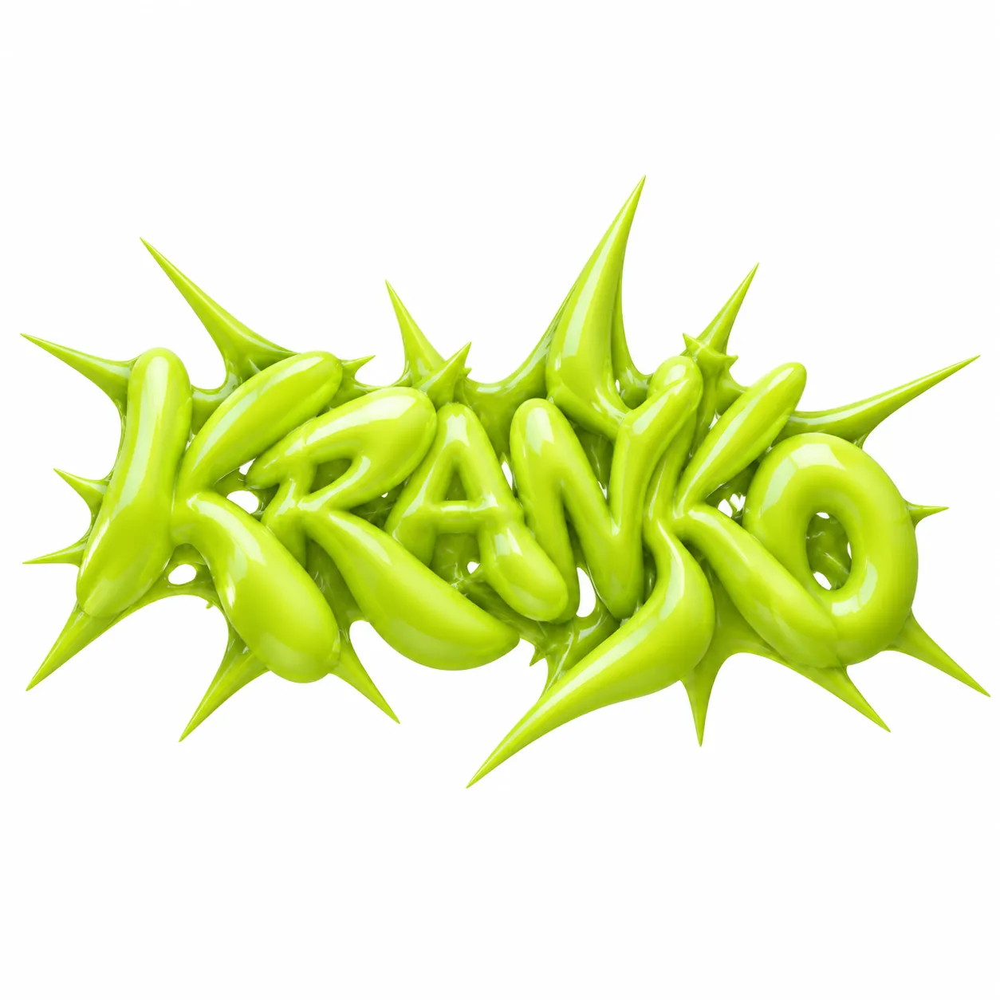</a>

> A long prompt, but every section earns its place. The concept paragraph mixes two references, wildstyle graffiti and inflatable balloons, and then gives concrete anatomy: pressurised bulbous bodies, blade-like spikes between letters, membranes stretched across negative space. The material phase insists on a single unified colour, which is what makes the result read as one sculpted object. Our run with the word KRANKO in acid lime is legible yet aggressive, the balance the prompt explicitly asks for ('readability fights with visual complexity'). We removed one sentence naming real artists before generating; it isn't needed. Five to seven letters is the sweet spot; longer words lose legibility.

```text
KRANKO | acid lime

Act as a 3D Type Designer and CGI Artist working at the intersection of streetwear culture, Y2K aesthetics, and high-end digital sculpture.

---

PHASE 1: TYPOGRAPHIC CONCEPT

Render the word or logotype KRANKO as a fully 3D sculptural object — not a flat text with extrusion, but a living, inflated, organic type sculpture. Style: Wildstyle graffiti DNA fused with inflatable balloon morphology. Letters are not separate — they flow into each other as one continuous organic mass. Each letterform has: bulbous pneumatic body as if inflated under high pressure from within, stretching the surface taut. Aggressive spike extensions — sharp tapered protrusions erupting between and around letters, directional, asymmetric, energetic, some long and blade-like, others short and thorn-like. Wildstyle overlaps — letters partially occlude each other creating depth layers, classic graffiti ambiguity where readability fights with visual complexity. Organic connective tissue — negative spaces between letters filled with stretched membrane forms, like rubber pulled between two inflated surfaces.

---

PHASE 2: MATERIAL & SURFACE

Single unified material across the entire sculpture — no color variation between letters. Material type: high-gloss latex / inflated rubber / soft silicone — the surface behaves like a balloon skin stretched to near-bursting point. Subsurface scattering: active — light penetrates slightly into the material, creating a translucent inner glow at thin edges and spike tips. Thinner areas read lighter, denser volumes read darker. Specular highlights: large, soft, slightly elongated — the kind you get on inflated latex, not hard plastic. Multiple secondary highlights in concave zones. Apply acid lime as the sole material color of the entire sculpture — this is non-negotiable. acid lime defines the pure midtone of the material. Highlights push toward the most luminous near-white version of acid lime. Shadow zones and deep crevices push toward the darkest most saturated version of acid lime. The entire chromatic range of the sculpture lives within the acid lime family — no hue deviation, no neutral grays.

---

PHASE 3: COMPOSITION & STAGING

Background: pure white (#FFFFFF) — clinical studio isolation. Zero texture, zero gradient. Shadow: none, or absolute minimum contact shadow directly beneath the sculpture — the object appears to float slightly. Orientation: horizontal spread — the sculpture is wider than tall, expanding laterally. Spike elements breach the invisible bounding box on all sides — top spikes reach upward, side extensions push outward. Camera angle: straight-on frontal, slightly elevated 5 to 10° above center — reveals the full typographic mass while showing the 3D depth of overlapping elements. Depth of field: none — sharp from foreground spikes to background letter bodies, every detail in focus. Scale feel: monumental — as if the sculpture is 2 meters wide in physical space, photographed in a white infinity studio.

---

PHASE 4: TECH SPECS

Render engine: Octane Render or Redshift — physically accurate subsurface scattering mandatory. Global illumination: large soft HDRI dome light, neutral white temperature 5500K. No directional shadows. No rim lights. No background elements. Ray tracing: on — for accurate specular and inter-reflection between letter surfaces. Anti-aliasing: maximum — edges must be razor-clean against white background. Output feel: this is a CGI product render, not AI art. Precision over expressionism. Aspect ratio: 1:1 square — centered composition with breathing room on all four sides.
```

- 作者: [@AmirMushich](https://x.com/AmirMushich)
- 元の投稿: https://x.com/AmirMushich/status/2043381172646920237
- [cinel で詳細を見てこのプロンプトで生成](https://cinel.ai/prompts/p/y2k-chrome-3d-type-streetwear-logo?utm_source=github&utm_medium=awesome&utm_campaign=awesome-gpt-image-2.5-prompts)

### Restaurant Brand Identity Mockup Board Prompt

<a href="https://cinel.ai/prompts/p/restaurant-brand-identity-mockup-board?utm_source=github&utm_medium=awesome&utm_campaign=awesome-gpt-image-2.5-prompts">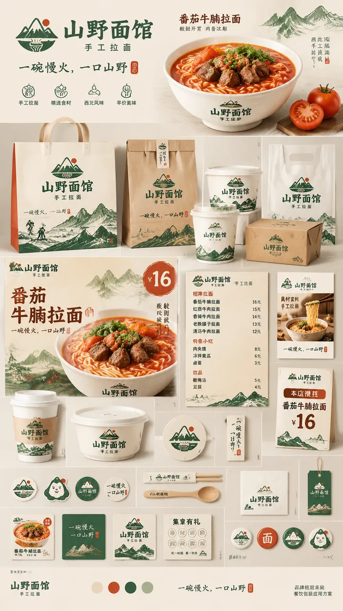</a>

> This Chinese template behaves like a brief to a design agency. Only two inputs are required, the brand name and the food category. Optional fields (hero dish, slogan, style, colours, audience, price level, regional flavour) are inferred if left blank. It then specifies a hierarchy of materials: large bags and boxes as anchors, menus and posters for information, and stickers, napkins and cutlery for completeness. We filled it with a fictional hand-pulled noodle shop, 山野面馆, in warm off-white with tomato red and bamboo green, and got a coherent board with bowls, takeaway bags, cups, a menu and price tags. Prices and menu text are generated, so replace them with your own.

```text
生成一张餐饮品牌触点矩阵系列视觉图，用于展示一个完整的餐饮品牌视觉系统与包装应用方案。

这是一个面向餐饮行业的品牌VI样机展示板 / 包装系统陈列图 / 品牌提案页。画面不是单张宣传海报，而是将品牌主视觉、主打产品、包装物料、菜单信息、促销内容与小型延展物料整合成一张系统化品牌展示图。

【用户输入信息】
- 品牌名：山野面馆
- 经营类目：手工拉面

【可选补充信息】
- 主打产品：番茄牛腩拉面
- 品牌口号：一碗慢火，一口山野
- 风格方向：新中式清新
- 主色调：暖米白
- 辅助色：番茄红与竹青
- 客群定位：城市年轻上班族
- 价格定位：平价
- 地域风格：西北
- 画幅比例：3:4

【自动补全规则】
如果用户没有提供完整品牌信息，请根据【品牌名】与【经营类目】自动推导并完成最优组合，包括：
1. 判断品牌调性（年轻、亲和、国潮、复古、清新、治愈、精致、快餐感等）
2. 匹配适合该类目的视觉风格
3. 自动设定合理的主色、辅助色与点缀色
4. 自动补全主打产品与辅助产品
5. 自动生成适合餐饮传播的品牌口号、卖点文案、价格信息与推荐标签
6. 自动匹配合适的餐饮物料类型与展示内容

【画面内容要求】
画面中应围绕【品牌名】构建一整套餐饮品牌物料系统，包含但不限于以下内容：
- 核心包装：手提袋、外卖袋、包装盒、打包盒、纸袋、塑料袋
- 饮品 / 食品容器：纸杯、杯套、碗、餐盒、封口贴、标签
- 信息传播物料：菜单、促销海报、价格牌、桌牌、立牌、小卡片
- 小型品牌延展：贴纸、徽章、纸巾、餐具、包装封条、吊牌
- 产品表现：主打餐品照片、单品主视觉、食物特写、切面图、推荐组合图

【构图与版式要求】
采用竖版【画幅比例】构图，整体为白色、米白色或浅灰色背景，以品牌提案板 / 样机矩阵板的方式组织画面。
通过大中小物料混排形成视觉层级：
- 大型包装和主视觉物料作为视觉锚点
- 中型菜单、海报和价格模块负责信息传达
- 小型贴纸、餐具、标签与周边物料增强系统完整度

整体构图应具有明确秩序感，接近品牌方案展示页、作品集陈列页、包装提案页的视觉效果。元素要排列整齐但不呆板，丰富但不杂乱，具有模块化与可阅读性。

【风格与质感要求】
整体风格应符合【经营类目】与【品牌名】气质，具有明显的餐饮品牌感、商业传播感、样机展示感与系统设计感。
可融合以下风格倾向：现代简洁、国潮趣味、轻复古、生活方式感、快消感、温暖治愈感、年轻化传播感。
材质真实，包含纸张、塑料、布袋、包装盒、杯体、贴纸、餐具等真实物料质感；光影柔和统一，像在干净摄影棚环境中拍摄的品牌物料合集。

【文字与图形要求】
所有物料上应统一出现品牌名、Logo、品牌符号、主色块、口号或卖点文案。
文案可为中文或中英混排，但要符合餐饮传播表达，简洁直接，具备商品售卖感。
图形系统可以根据品牌调性选择简洁插画、几何图形、卡通吉祥物、符号化图标或辅助纹样，用于增强品牌记忆点。

【输出目标】
最终生成一张完整的【品牌名】餐饮品牌视觉系统展示图，像设计团队为该餐饮品牌制作的整套品牌提案样机板。
要求画面统一、精致、具备商业落地感与作品集展示质量，并能清楚体现品牌风格、主打类目与多触点包装延展能力。

Make the aspect ratio 9:16
```

- 作者: [@MrLarus](https://x.com/MrLarus)
- 元の投稿: https://x.com/MrLarus/status/2048360321379701233
- [cinel で詳細を見てこのプロンプトで生成](https://cinel.ai/prompts/p/restaurant-brand-identity-mockup-board?utm_source=github&utm_medium=awesome&utm_campaign=awesome-gpt-image-2.5-prompts)

<a id="infographic-ui"></a>

## インフォグラフィック・UI

厳選 6 件 · [全 36 件を見る](cases/infographic-ui.md) · [cinel のカテゴリ](https://cinel.ai/prompts/infographic-ui?utm_source=github&utm_medium=awesome&utm_campaign=awesome-gpt-image-2.5-prompts)

### 3D Country Travel Guide Map Infographic Prompt

<a href="https://cinel.ai/prompts/p/3d-country-travel-guide-map-infographic?utm_source=github&utm_medium=awesome&utm_campaign=awesome-gpt-image-2.5-prompts">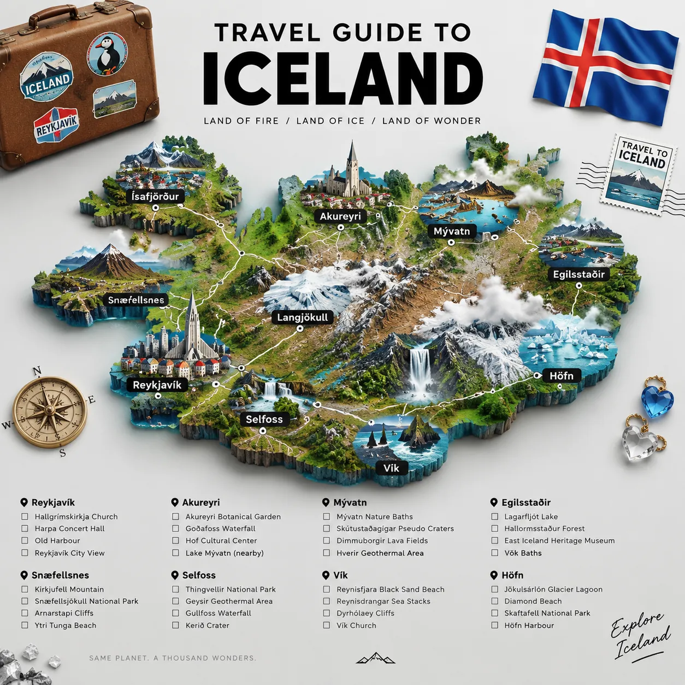</a>

> A one-variable template that produces a surprisingly complete travel poster. The prompt stacks layers in a logical order: terrain map, landmarks in their real locations, connecting routes, labelled cities, then attraction checklists beside the map, with props as a frame. Run with Iceland, the result put Reykjavík, Akureyri, Vík and Höfn in the right regions and listed real sights under each; only the glacier labels were loose. Two typos in the source text (COUNTRY without brackets) would print the literal word, so we corrected them in the version we generated. Swap in any country or region, and fact-check the checklist before you publish it.

```text
A hyper-realistic 3D travel guide infographic poster for Iceland. The country shape is rendered as a raised, textured terrain map floating on a clean light gray surface. Iconic landmarks are placed as miniature 3D sculpted models at their correct geographic locations across the map — each one highly detailed and photorealistic. Roads or railway lines connect key cities as white paths across the terrain. Around the map, floating 3D decorative props related to travel are scattered: a vintage leather suitcase with travel stickers, a compass rose, crystal heart charms, and a postage stamp seal reading “Travel to Iceland.” The national flag of Iceland is shown as a small realistic folded flag in the upper right corner. Each major city has a bold black label on the map, and beside the map, each city has a neat checklist of its top attractions in clean sans-serif typography. A large bold title at the top reads: “TRAVEL GUIDE TO ICELAND” in black uppercase typography with the word Iceland in heavy bold. The overall aesthetic is premium editorial travel content — soft studio lighting, photorealistic 3D render, white/light gray background, clean layout.
```

- 作者: [@TechieBySA](https://x.com/TechieBySA)
- 元の投稿: https://x.com/TechieBySA/status/2043047413770809708
- [cinel で詳細を見てこのプロンプトで生成](https://cinel.ai/prompts/p/3d-country-travel-guide-map-infographic?utm_source=github&utm_medium=awesome&utm_campaign=awesome-gpt-image-2.5-prompts)

### Isometric Technical Infographic of Any Object Prompt

<a href="https://cinel.ai/prompts/p/isometric-technical-infographic-annotated-object?utm_source=github&utm_medium=awesome&utm_campaign=awesome-gpt-image-2.5-prompts">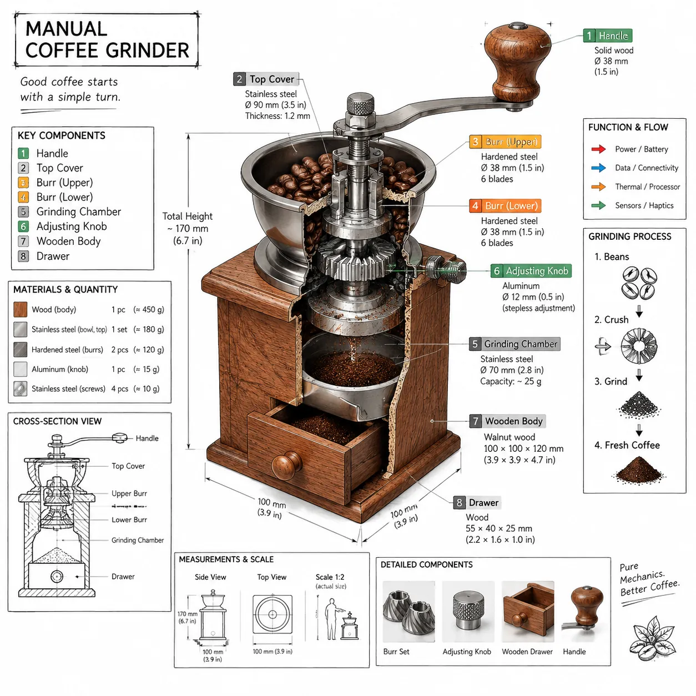</a>

> This template blends two visual languages, a photoreal 3D render and black technical-pen annotation, and the contrast is what makes the result feel like a museum exhibit. The checklist of what to include (cutaways, dimensions, material quantities, colour-coded flow arrows) gives the model a full page to fill. Our coffee-grinder example came out with a cutaway grinding chamber, a cross-section sketch and a four-step grinding process, but the electronics-oriented arrow legend (power, data, sensors) made less sense for a hand tool. For mechanical objects, rewrite the colour legend to match, for example force, flow and heat, and expect the numbers to be illustrative.

```text
Create a technical infographic of a classic hand-crank coffee grinder with a 45-degree isometric 3D perspective showing the device slightly tilted to reveal depth and dimension.
Combine a realistic photoreal render with black ink technical annotations on pure white background. Include:
Key component labels with color-coded callout boxes
Internal component visibility through transparent/cutaway sections
Measurements, dimensions, and precise scale markers
Material callouts and quantities
Color-coded arrows for function/flow: RED (power/battery), BLUE (data/connectivity), ORANGE (thermal/processor), GREEN (sensors/haptics)
Simple schematics or cross-sectional diagrams where relevant

Place “MANUAL COFFEE GRINDER” title in a hand-drawn technical box (top-left corner).
Style: Black linework (technical pen/architectural), sketched but precise. Object remains clearly visible. Educational museum-exhibit vibe. Clean composition, balanced negative space.
Perspective: Isometric 3D angle—tilted to show depth, dimension, and internal architecture dramatically. Like a professional product teardown or engineering manual.
Colors: ~10-15% accent density. Black dominant. White background.
Output: 1080×1080, ultra-crisp, social-feed optimized.
```

- 作者: [@TechieBySA](https://x.com/TechieBySA)
- 元の投稿: https://x.com/TechieBySA/status/2017928823497453789
- [cinel で詳細を見てこのプロンプトで生成](https://cinel.ai/prompts/p/isometric-technical-infographic-annotated-object?utm_source=github&utm_medium=awesome&utm_campaign=awesome-gpt-image-2.5-prompts)

### Tactile 3D Icon Set in a 3×3 Grid Prompt

<a href="https://cinel.ai/prompts/p/tactile-3d-icon-set-grid?utm_source=github&utm_medium=awesome&utm_campaign=awesome-gpt-image-2.5-prompts">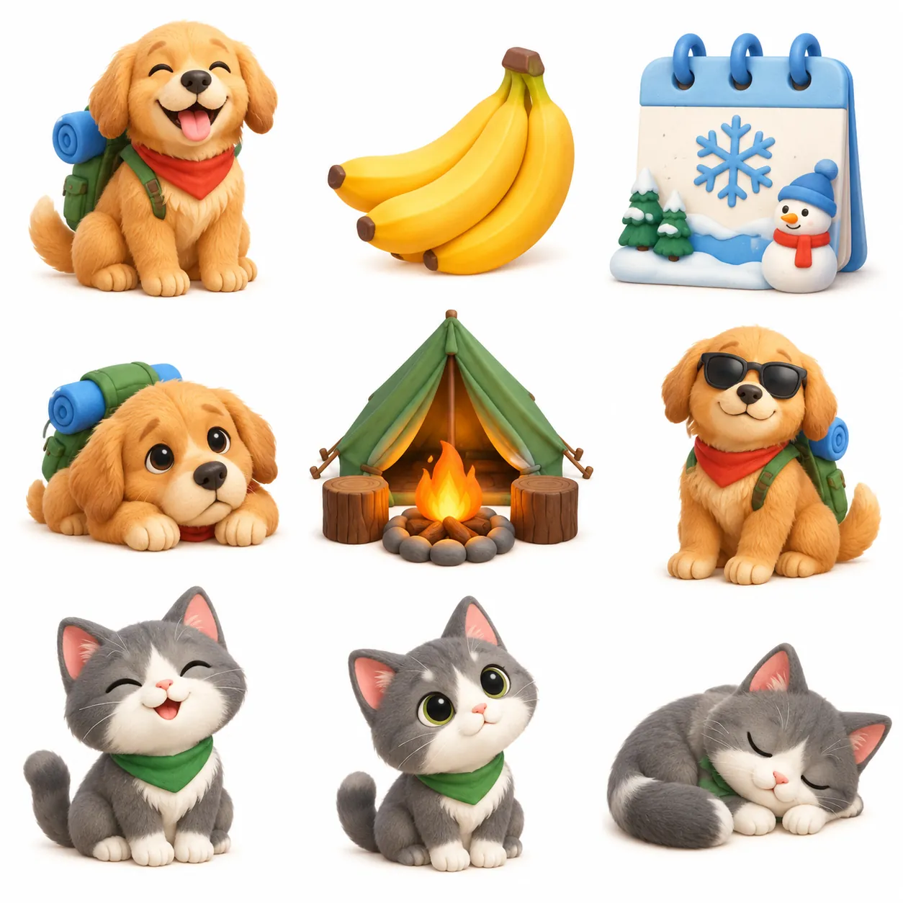</a>

> At under 50 words this is one of the shortest prompts in the library, and it works because it fixes only what matters: one theme, a 3×3 grid, white background, a 'colourful and tactile 3D' finish and no text. The bullet list after it is the author's set of example themes, not part of the brief. We left it in for our camping run, and the model blended them: puppies with backpacks, a snowy calendar for January, bananas and a cat sit beside a tent and campfire. That is a useful lesson. Delete the list and write a single theme, and you'll get a coherent set ready for stickers, app empty-states or slides.

```text
Create a collection of icons representing a cozy camping trip, they belong together as a single theme. Put them in a 3x3 grid. The background is white. Make the icons in a colorful and tactile 3D style. No text.

- dogs with different emotions
- bananas
- January
- the same cat in different emotions
```

- 作者: [@NanoBanana](https://x.com/NanoBanana)
- 元の投稿: https://x.com/NanoBanana/status/2009660363227152653
- [cinel で詳細を見てこのプロンプトで生成](https://cinel.ai/prompts/p/tactile-3d-icon-set-grid?utm_source=github&utm_medium=awesome&utm_campaign=awesome-gpt-image-2.5-prompts)

### Photo with Technical Sketch Annotations Infographic

<a href="https://cinel.ai/prompts/p/photo-with-technical-annotation-infographic?utm_source=github&utm_medium=awesome&utm_campaign=awesome-gpt-image-2.5-prompts">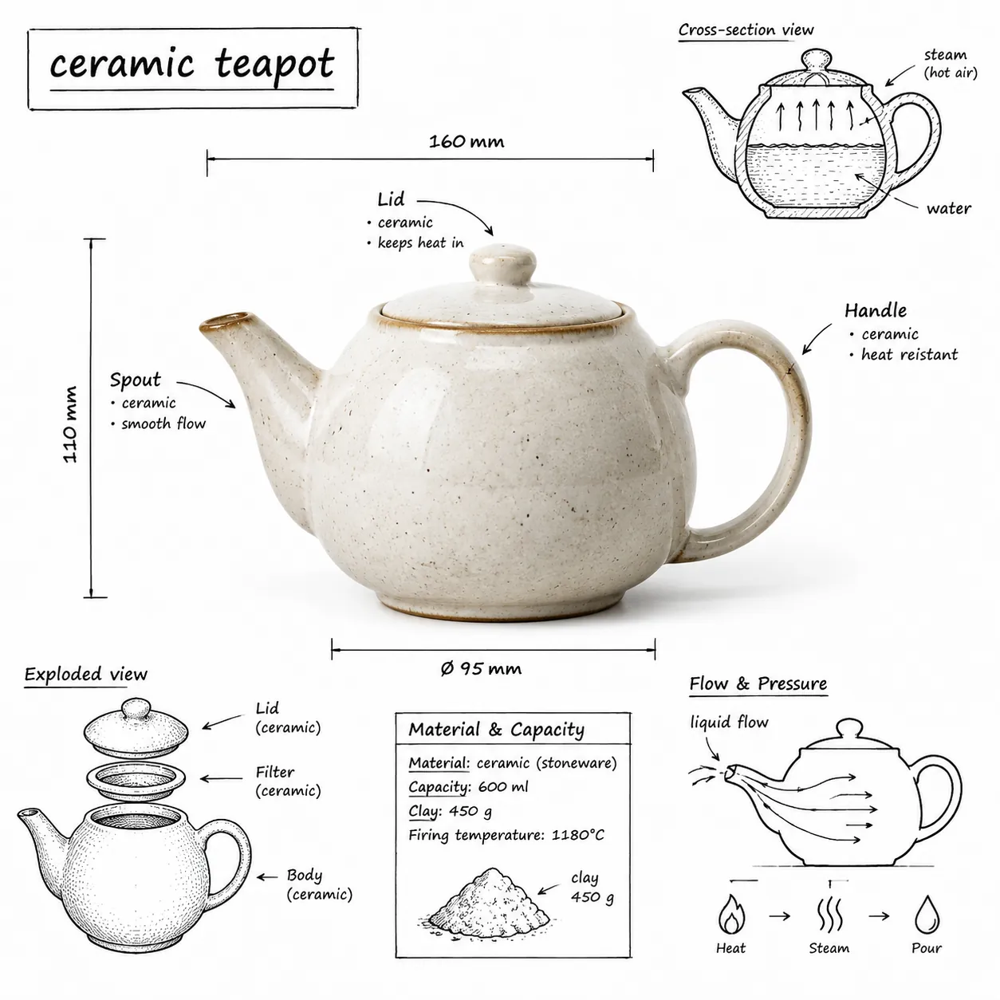</a>

> A sister template to the isometric teardown, with one important difference: it is strictly black ink on white, with no accent colours. That restriction makes the result calmer and closer to an engineering notebook. The list of overlays (labels, exploded outlines, dimensions, material callouts, flow arrows) is broad enough to suit almost any object. With a ceramic teapot, the model produced a cross-section showing steam and water, an exploded lid–filter–body view and a material panel. It also printed a typo ('heat reistant') and a slightly pseudo-scientific flow diagram, so proofread small labels. Everyday objects with a clear function, like kettles, bikes or cameras, make the best subjects.

```text
Create an infographic image of a ceramic teapot, combining a realistic photograph or photoreal render of the object with technical annotation overlays placed directly on top.

Use black ink–style line drawings and text (technical pen / architectural sketch look) on a pure white studio background, including:
•Key component labels
•Internal cutaway or exploded-view outlines
•Measurements, dimensions, and scale markers
•Material callouts and quantities
•Arrows indicating function, force, or flow (air, sound, power, pressure)
•Simple schematic or sectional diagrams where relevant

Place the title a ceramic teapot inside a hand-drawn technical annotation box in one corner.

Style & layout rules:
•The real object remains clearly visible beneath the annotations
•Annotations feel sketched, technical, and architectural
•Clean composition with balanced negative space
•Educational, museum-exhibit / engineering-manual vibe

Visual style:
Minimal technical illustration aesthetic, black linework over realistic imagery, precise but slightly hand-drawn feel.

Color palette:
White background, black annotation lines and text only. No colors.

Output:
1080×1080, ultra-crisp, social-feed optimized, no watermark.
```

- 作者: [@TechieBySA](https://x.com/TechieBySA)
- 元の投稿: https://x.com/TechieBySA/status/2013316513701216688
- [cinel で詳細を見てこのプロンプトで生成](https://cinel.ai/prompts/p/photo-with-technical-annotation-infographic?utm_source=github&utm_medium=awesome&utm_campaign=awesome-gpt-image-2.5-prompts)

### Landmark Photo with Blueprint Annotations Prompt

<a href="https://cinel.ai/prompts/p/landmark-blueprint-annotation-infographic?utm_source=github&utm_medium=awesome&utm_campaign=awesome-gpt-image-2.5-prompts">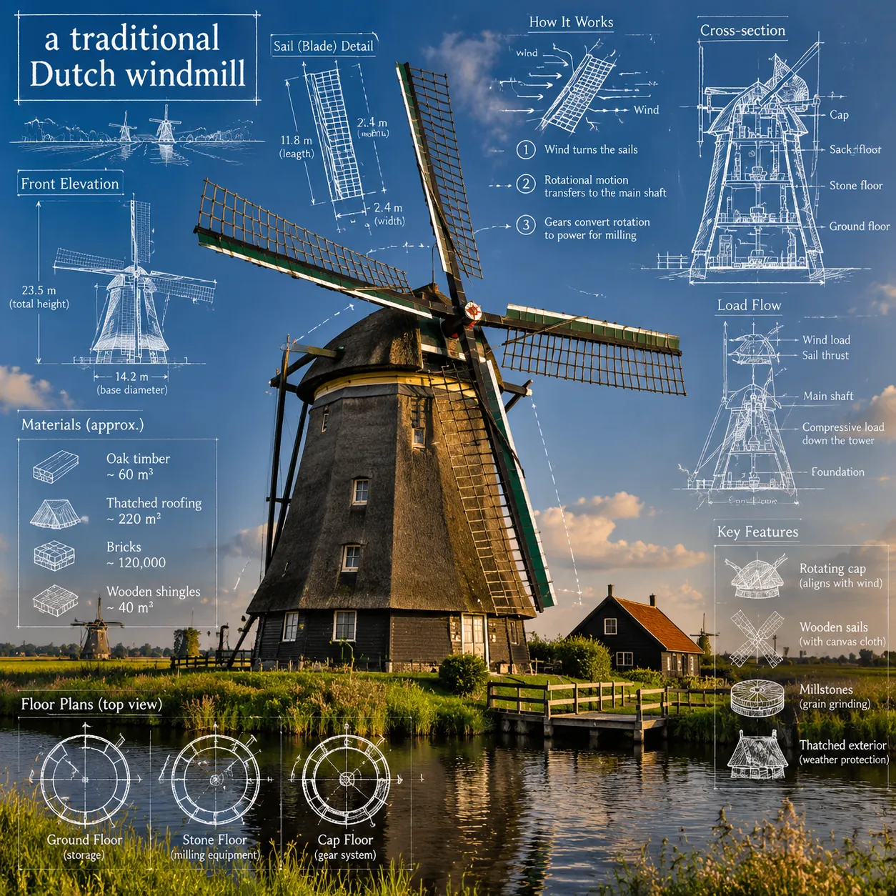</a>

> This one-paragraph template gets its look from a single inversion: instead of dark lines on white, it draws white chalk-style blueprint sketches over a real photograph, so the landmark and its sky stay visible behind the diagrams. The list of overlays (measurements, material quantities, internal diagrams, load-flow arrows, cross-sections and floor plans) fills the frame like an architect's presentation board. Our Dutch windmill result has a front elevation, sail detail, a 'how it works' sequence and floor plans around a photoreal mill at golden hour. The numbers are invented, and one unit was wrong (thatch in cubic metres), so treat the data as decoration unless you verify it.

```text
Create an infographic image of a traditional Dutch windmill, combining a real photograph of the landmark with blueprint-style technical annotations and diagrams overlaid on the image. Include the title “a traditional Dutch windmill” in a hand-drawn box in the corner. Add white chalk-style sketches showing key structural data, important measurements, material quantities, internal diagrams, load-flow arrows, cross-sections, floor plans, and notable architectural or engineering features. Style: blueprint aesthetic with white line drawings on the photograph, technical/architectural annotation style, educational infographic feel, with the real environment visible behind the annotations.
```

- 作者: [@TechieBySA](https://x.com/TechieBySA)
- 元の投稿: https://x.com/TechieBySA/status/2007523056822939698
- [cinel で詳細を見てこのプロンプトで生成](https://cinel.ai/prompts/p/landmark-blueprint-annotation-infographic?utm_source=github&utm_medium=awesome&utm_campaign=awesome-gpt-image-2.5-prompts)

### Exploded View Product Ad with Inner Mechanics

<a href="https://cinel.ai/prompts/p/exploded-product-inner-mechanics-ad?utm_source=github&utm_medium=awesome&utm_campaign=awesome-gpt-image-2.5-prompts">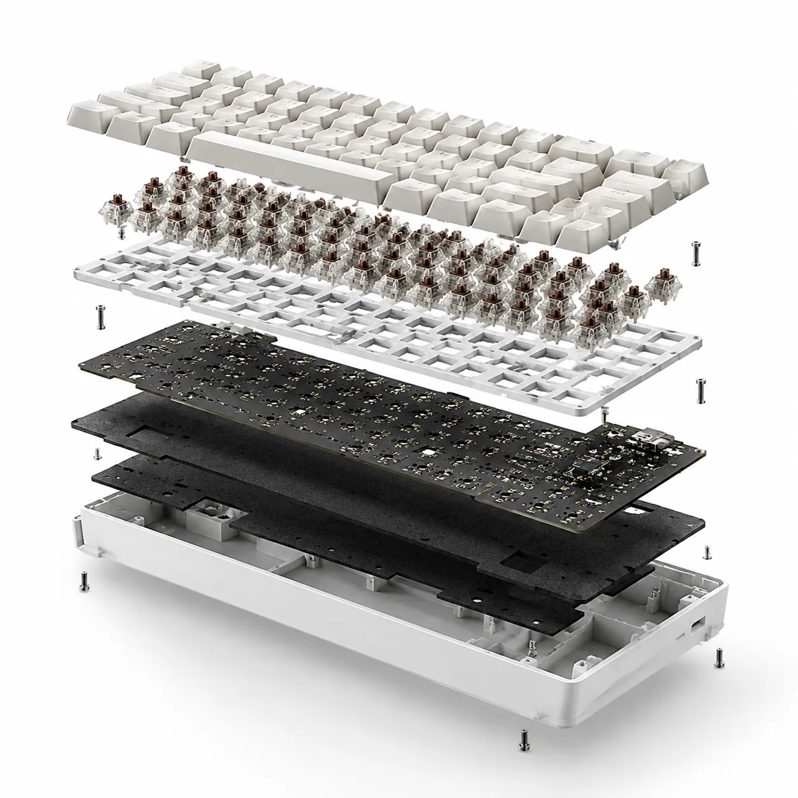</a>

> Exploded views are expensive to produce in 3D software, and this short prompt gets surprisingly close. The key phrases are 'outer shell hovering above core', 'micro screws and components suspended' and 'perfect alignment guides implied'. Together they tell the model to separate layers vertically along one axis, which keeps the result orderly instead of chaotic. Camera language (100mm look, f/8) keeps everything sharp. Our mechanical keyboard example stacks keycaps, switches, plate, PCB, foam and case in perfect vertical alignment, with tiny screws floating at the corners. Products with clear layers, like keyboards, headphones, watches or speakers, work best. The bracket is inserted mid-sentence, so mind the grammar when filling it.

```text
Create an exploded products with inner mechanics of a mechanical keyboard, high-end product advertising, white seamless background, exploded view with inner mechanics revealed, outer shell hovering above core, micro screws and components suspended, perfect alignment guides implied, crisp soft shadow, ultra realistic, macro product photography, 100mm lens look, f/8, 8k, 1:1
```

- 作者: [@azed_ai](https://x.com/azed_ai)
- 元の投稿: https://x.com/azed_ai/status/2010350005870276897
- [cinel で詳細を見てこのプロンプトで生成](https://cinel.ai/prompts/p/exploded-product-inner-mechanics-ad?utm_source=github&utm_medium=awesome&utm_campaign=awesome-gpt-image-2.5-prompts)

<a id="3d-figurines"></a>

## 3D キャラクター・フィギュア

厳選 6 件 · [全 111 件を見る](cases/3d-figurines.md) · [cinel のカテゴリ](https://cinel.ai/prompts/3d-figurines?utm_source=github&utm_medium=awesome&utm_campaign=awesome-gpt-image-2.5-prompts)

### Photo to Minimal 3D Toy Character Style Transfer

<a href="https://cinel.ai/prompts/p/photo-to-minimal-3d-toy-character?utm_source=github&utm_medium=awesome&utm_campaign=awesome-gpt-image-2.5-prompts">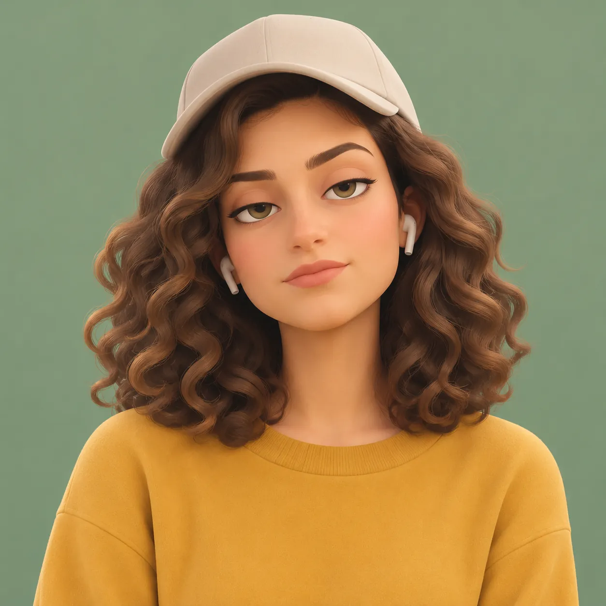</a>

> The charm of this style-transfer prompt is its attitude. Instead of the usual wide-eyed cartoon, it specifies heavy eyelids, a flat mouth and an 'unimpressed, calm, bored' emotion, which gives the result personality. The JSON keeps identity, pose and composition locked while swapping the rendering to matte, softly scattering 'plastic' skin and logo-free streetwear. We ran it on an AI-generated reference of a curly-haired woman in a mustard sweater, and the output kept her hair, sweater and cap while simplifying the face. The original lists a famous studio as inspiration; 'minimal toy-figure render' alone gets you there. For best likeness, use a front-facing photo.

```text
{
 "task": "image_style_transfer_3d_character",
 "input": {
 "source_image": "ATTACHED_REFERENCE_IMAGE",
 "preserve_identity": true,
 "preserve_pose": true,
 "preserve_composition": true
 },
 "style_reference": {
 "render_style": "stylized_3d_character",
 "aesthetic": "soft_minimal_cartoon_3d",
 "inspiration": [
 "pixar_like_but_more_minimal",
 "toy_figure_render",
 "clean_product_character_design"
 ]
 },
 "character_design": {
 "skin": {
 "material": "smooth_matte_plastic",
 "texture": "soft_uniform",
 "subsurface_scattering": "gentle"
 },
 "facial_features": {
 "eyes": "half_closed_bored_expression",
 "eyelids": "heavy",
 "nose": "rounded_simplified",
 "mouth": "flat_neutral",
 "ears": "simplified_rounded"
 },
 "emotion": "unimpressed_calm_bored"
 },
 "clothing": {
 "style": "minimal_streetwear",
 "details": "no_logos_no_patterns",
 "fabric": "soft_matte"
 },
 "accessories": {
 "headwear": "simple_baseball_cap_optional",
 "ear_accessories": "wireless_earbuds_optional"
 },
 "lighting": {
 "setup": "studio_softbox",
 "shadows": "very_soft",
 "contrast": "low",
 "highlights": "subtle"
 },
 "background": {
 "type": "solid_color",
 "color_palette": [
 "muted_green",
 "pastel_tone"
 ],
 "gradient": "none"
 },
 "camera": {
 "angle": "front_facing",
 "framing": "medium_close_up",
 "lens": "50mm_equivalent",
 "distortion": "none"
 },
 "render_quality": {
 "resolution": "high",
 "edges": "clean",
 "noise": "none",
 "realism_balance": "stylized_over_realistic"
 },
 "output": {
 "consistency": "high",
 "style_strength": "strong",
 "photorealism": false
 }
}
```

- 作者: [@firatbilal](https://x.com/firatbilal)
- 元の投稿: https://x.com/firatbilal/status/2020856678351065532
- [cinel で詳細を見てこのプロンプトで生成](https://cinel.ai/prompts/p/photo-to-minimal-3d-toy-character?utm_source=github&utm_medium=awesome&utm_campaign=awesome-gpt-image-2.5-prompts)

### Exaggerated 3D Caricature Character from a Photo

<a href="https://cinel.ai/prompts/p/exaggerated-3d-caricature-from-photo?utm_source=github&utm_medium=awesome&utm_campaign=awesome-gpt-image-2.5-prompts">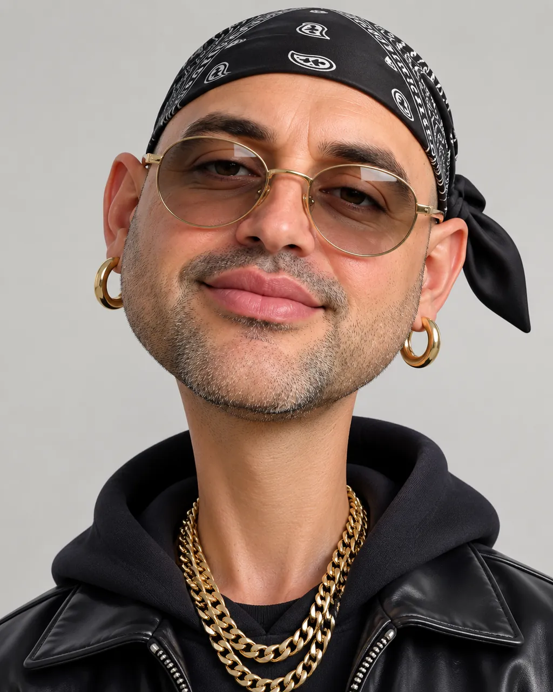</a>

> The prompt aims for a specific, slightly strange collectible look: 'weird, fashion-forward, character-driven rather than cute'. It lists the deformations (elongated neck, oversized head, droopy lids, heavy lips, mild asymmetry) and the styling (round glasses, hoops, chains, bandana, street-luxury clothes), while banning noise and grain so surfaces stay clean. Our run on a fictional bald man in a polo kept his likeness and added a paisley bandana, tinted round glasses, gold hoops and chunky chains, but the deformation came out milder than the text implies. If you want a stronger caricature, move the exaggeration list to the very start and add numbers, e.g. 'head 1.5× normal size'.

```text
Create an exaggerated stylized 3D caricature character portrait with strong intentional deformation and a clean, controlled surface finish. Use the person from the ATTACHED REFERENCE PHOTO. Preserve the subject’s identity, facial likeness, skin tone, and defining features, but reinterpret them into a bold caricatured 3D form with an elongated neck, oversized head-to-neck ratio, droopy eyelids, heavy lips, and slightly asymmetrical facial structure.Render as a human-like 3D character with smooth, studio-clean skin and intentionally designed detail, avoiding random texture or noise. Style with bold accessories such as round or oval glasses, hoop earrings, gold chains, headscarves or bandanas, and street-luxury clothing.

Use neutral studio lighting with soft shadows and even illumination, no dramatic contrast, against a plain neutral grey or off-white background. The overall aesthetic should feel weird, fashion-forward, collectible, and character-driven rather than cute or realistic.

Ultra high definition, premium cinematic 3D render quality, hyper-realistic hyper realism, clean materials, no freckles, no dirt, no grain, no noise, no speckling, no text, no logos, no watermarks.

Aspect ratio 4:5.
```

- 作者: [@Naiknelofar788](https://x.com/Naiknelofar788)
- 元の投稿: https://x.com/Naiknelofar788/status/2032256273782358153
- [cinel で詳細を見てこのプロンプトで生成](https://cinel.ai/prompts/p/exaggerated-3d-caricature-from-photo?utm_source=github&utm_medium=awesome&utm_campaign=awesome-gpt-image-2.5-prompts)

### Isometric Educational 3D Diorama for Any Process

<a href="https://cinel.ai/prompts/p/isometric-educational-3d-diorama?utm_source=github&utm_medium=awesome&utm_campaign=awesome-gpt-image-2.5-prompts">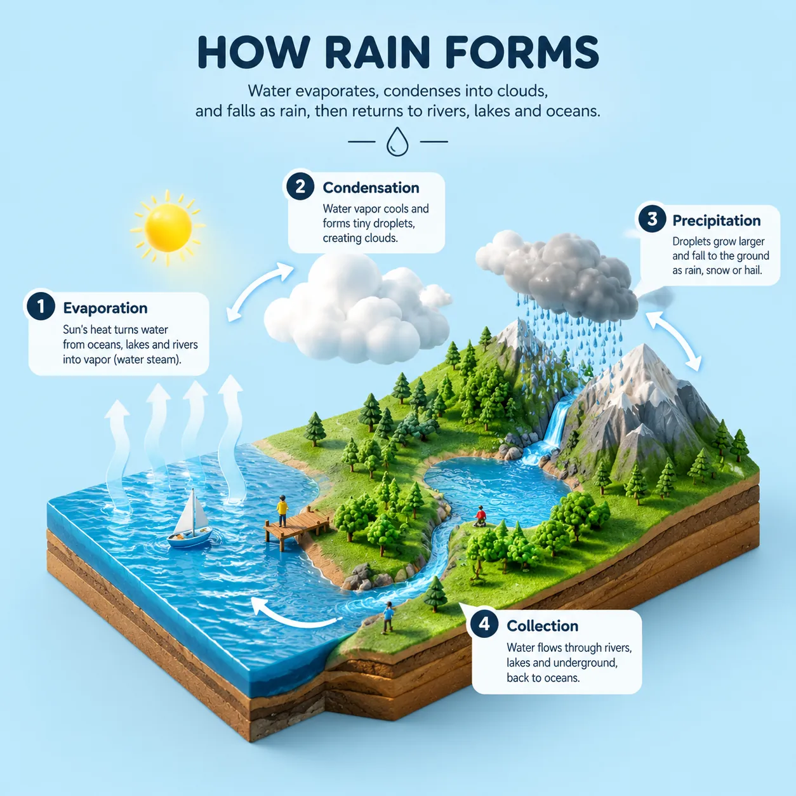</a>

> A smart template for teachers and explainer content. It asks for a stepped or layered base where each level shows one stage, connected by subtle arrows, with tiny faceless figures for scale, which keeps attention on the process rather than characters. Title, subtitle and icon sit at the top over a single background colour, and text contrast is set automatically. For 'how rain forms' on pale sky blue, our result has a cutaway terrain block with ocean, river, mountains and a rain cloud, four numbered stages (evaporation, condensation, precipitation, collection) and accurate captions. It works for photosynthesis, recycling, coffee production or how a bill becomes law.

```text
Create a clear, 45° top-down isometric miniature 3D educational diorama explaining how rain forms (the water cycle).

Use soft refined textures, realistic PBR materials, and gentle lifelike lighting.

Build a stepped or layered diorama base showing each stage of the process with subtle arrows or paths.

Include tiny stylized figures interacting with each stage (no facial details).

Use a clean solid pale sky blue background.
At the top-center, display HOW RAIN FORMS in large bold text, directly beneath it show a short explanation subtitle, and place a minimal symbolic icon below.

All text must automatically match the background contrast (white or black).
```

- 作者: [@aleenaamiir](https://x.com/aleenaamiir)
- 元の投稿: https://x.com/aleenaamiir/status/2013493349156823287
- [cinel で詳細を見てこのプロンプトで生成](https://cinel.ai/prompts/p/isometric-educational-3d-diorama?utm_source=github&utm_medium=awesome&utm_campaign=awesome-gpt-image-2.5-prompts)

### Selfie to 3D Cartoon Meme Sticker Set (3×3)

<a href="https://cinel.ai/prompts/p/selfie-to-3d-cartoon-sticker-set?utm_source=github&utm_medium=awesome&utm_campaign=awesome-gpt-image-2.5-prompts">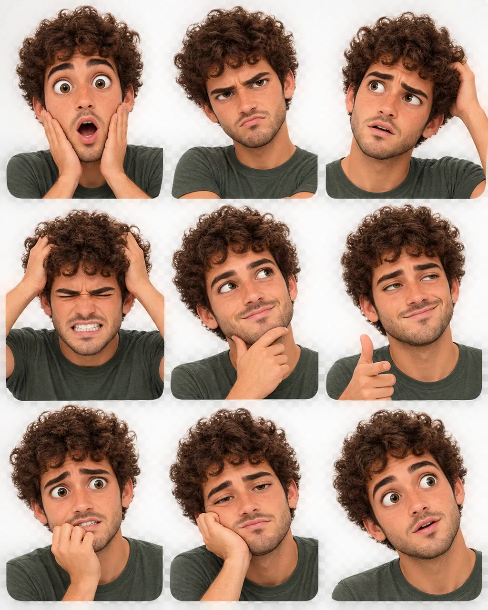</a>

> The emotion list is the heart of this prompt: nine specific, slightly negative states (surprised, annoyed, confused, frustrated, thoughtful, sarcastic, worried, bored, curious) that cover most chat reactions better than the usual happy-sad-angry set. It asks for overacted, readable expressions at small sizes and identical hair, clothing and proportions in every cell. From our fictional curly-haired reference, the model produced nine clear expressions, but rendered them closer to realistic photos than a stylised 3D cartoon, on white rather than true transparency. To push the cartoon look, describe the style in neutral terms ('stylised 3D animated character, big head, simplified features') and expect to remove backgrounds afterwards.

```text
Using the uploaded selfie as the ONLY and exclusive face reference, generate a Pixar-style 3D character sticker set. The character must be clearly recognizable as the person from the selfie. Create a neat 3×3 grid collage (nine stickers total). Final aspect ratio is strictly 4:5. Each cell shows a distinct pose and facial expression. Style and tone: Pixar-style 3D animation with a meme-oriented feel. Exaggerated, slightly absurd emotions, playful overacting. 

Highly readable expressions at small sizes, with expressive eyes, eyebrows, and mouth. Subtle hand gestures where appropriate. Background and output: Fully transparent background (PNG). No backdrop, no background shadows. No text, captions, logos, or UI elements. Stickers must be ready for direct use in messengers. Consistency: Same hairstyle, clothing, colors, and character proportions across all nine stickers. Only facial expression and pose change.

Clean, polished 3D sticker look. Emotions (one per sticker, 3×3 grid): Surprised, Annoyed, Confused, Frustrated, Thoughtful, Sarcastic, Worried, Bored, Curious.
```

- 作者: [@oggii_0](https://x.com/oggii_0)
- 元の投稿: https://x.com/oggii_0/status/2034263750539411550
- [cinel で詳細を見てこのプロンプトで生成](https://cinel.ai/prompts/p/selfie-to-3d-cartoon-sticker-set?utm_source=github&utm_medium=awesome&utm_campaign=awesome-gpt-image-2.5-prompts)

### Photo to Friendly 3D Cartoon Avatar Prompt

<a href="https://cinel.ai/prompts/p/photo-to-3d-cartoon-avatar?utm_source=github&utm_medium=awesome&utm_campaign=awesome-gpt-image-2.5-prompts">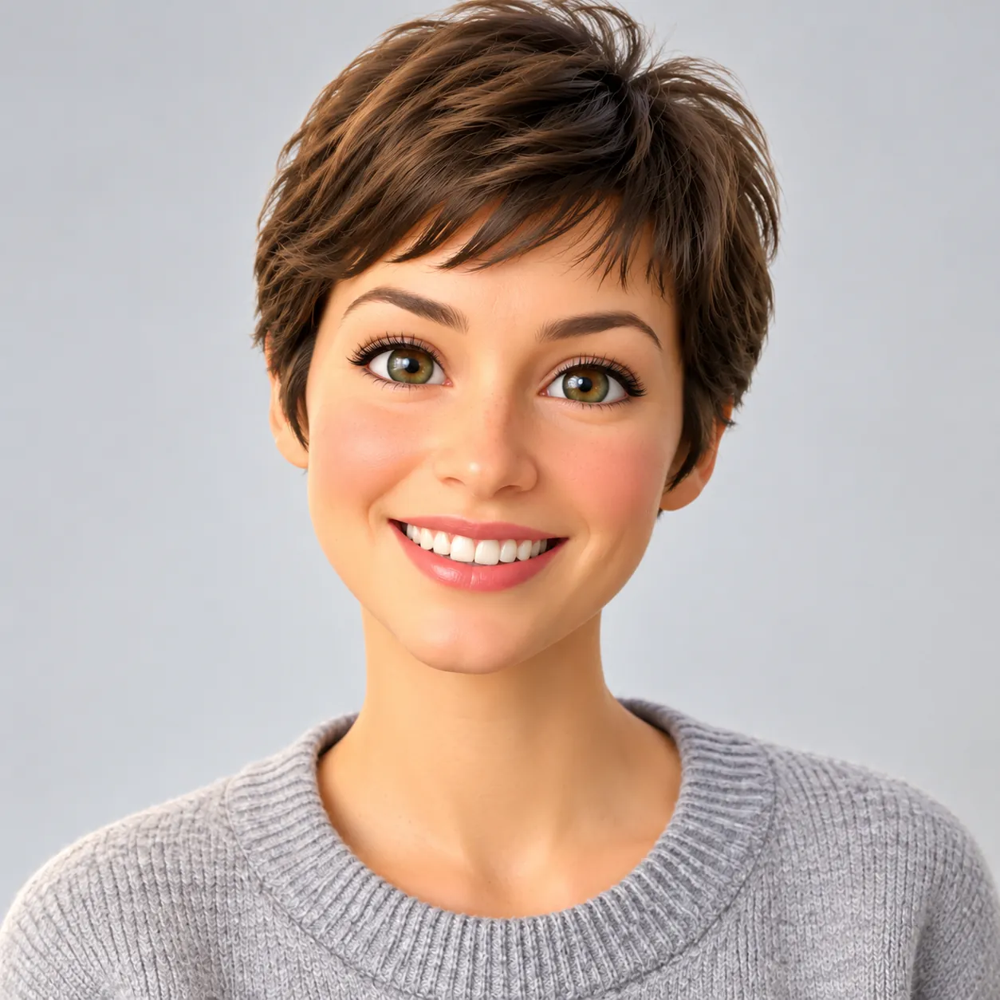</a>

> A reference-based prompt for profile pictures: upload a photo and ask for a cheerful 3D version with a warm smile, bright eyes, smooth textures and slightly exaggerated proportions, lit like a clean studio portrait. We tested it on a fictional reference of a woman in her thirties with a pixie cut. The result kept her hair, smile and grey sweater faithfully, but it sits closer to a polished semi-realistic render than a full cartoon: the proportions are only lightly stylised. If you want a stronger animated look, push the exaggeration explicitly ('large expressive eyes, rounded head, simplified nose') and mention a plain pastel background. For teams, run every member through it for matching avatars.

```text
Create a high-quality 3D avatar of the person in the uploaded image with a cheerful, expressive face. The character should have a warm smile, bright eyes, and soft facial features that feel friendly and approachable. Render in a Pixar-style aesthetic with smooth textures, subtle skin shading, and slightly exaggerated proportions for a cute, animated look. Lighting should be soft and even, creating a clean studio look with gentle shadows for depth.
```

- 作者: [@rovvmut_](https://x.com/rovvmut_)
- 元の投稿: https://x.com/rovvmut_/status/2013295220440654142
- [cinel で詳細を見てこのプロンプトで生成](https://cinel.ai/prompts/p/photo-to-3d-cartoon-avatar?utm_source=github&utm_medium=awesome&utm_campaign=awesome-gpt-image-2.5-prompts)

### Isometric Evolution Timeline Diorama Prompt

<a href="https://cinel.ai/prompts/p/isometric-evolution-timeline-diorama?utm_source=github&utm_medium=awesome&utm_campaign=awesome-gpt-image-2.5-prompts">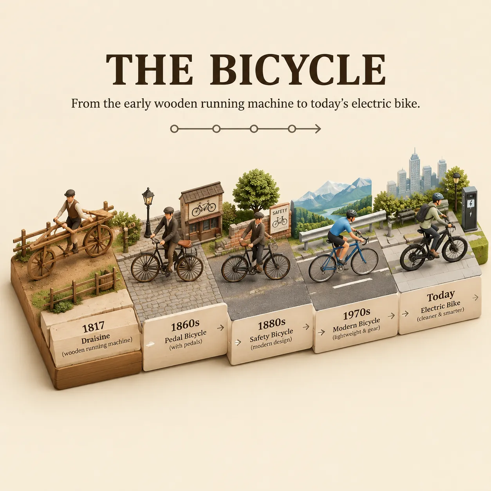</a>

> A neat format for 'history of X' content. The prompt builds a horizontally stepped base split into time periods, fills each with era-appropriate objects and tiny figures, adds arrows for chronological flow, and puts a bold title with a 'From… to…' subtitle above it. We tried the evolution of the bicycle, from the early wooden running machine to today's e-bike. The labels and dates came out historically sensible (1817, 1860s, 1880s, 1970s, today) and the scene is charming, but two drawings don't match their labels: the 1817 machine looks more like a cart and the 1860s bike already has a chain drive. Always check that each era's object is right before publishing.

```text
Create a clean isometric miniature 3D diorama visualizing the evolution of THE BICYCLE from the early wooden running machine to today's electric bike. Use a 45° top-down perspective. Materials are soft and refined with realistic PBR shading.

Lighting is neutral and evenly balanced. Design a horizontally stepped base divided into clear time periods. Each section includes era-specific objects, tools, environments, or technology.

Add tiny stylized figures interacting with each stage with heavy facial details). Use subtle arrows or dividers to show chronological flow.

Background remains solid warm cream. Top center text displays THE BICYCLE in bold. Below it show “From the early wooden running machine to today's electric bike.” Add a minimal timeline icon underneath. Text adapts automatically for contras.
```

- 作者: [@aleenaamiir](https://x.com/aleenaamiir)
- 元の投稿: https://x.com/aleenaamiir/status/2022178815955636413
- [cinel で詳細を見てこのプロンプトで生成](https://cinel.ai/prompts/p/isometric-evolution-timeline-diorama?utm_source=github&utm_medium=awesome&utm_campaign=awesome-gpt-image-2.5-prompts)

<a id="food-drink"></a>

## フード・ドリンク

厳選 6 件 · [全 223 件を見る](cases/food-drink.md) · [cinel のカテゴリ](https://cinel.ai/prompts/food-drink?utm_source=github&utm_medium=awesome&utm_campaign=awesome-gpt-image-2.5-prompts)

### Exploded Dish Food Infographic with Floating Ingredients

<a href="https://cinel.ai/prompts/p/exploded-dish-food-infographic?utm_source=github&utm_medium=awesome&utm_campaign=awesome-gpt-image-2.5-prompts"></a>

> Structured as JSON, this prompt is easy to edit field by field: cuisine, the list of levitating ingredients, label language, background and lighting. The vertical hierarchy (bowl anchored at the bottom, ingredients rising) gives every food the same readable composition, and asking for labels in the cuisine's own language adds authenticity. Our Indonesian example labelled beef, crispy tofu, lime, garlic, chilli and fried shallots correctly in Bahasa Indonesia. One leader line pointed at the wrong item, a reminder to check pointers. To reuse it, change 'cuisine' and the ingredient list together; keep six to eight ingredients so each label has room.

```text
{
  "image_prompt": {
    "type": "Hyper-realistic food infographic",
    "subject": {
      "cuisine": "Indonesian",
      "base_element": "Traditional bowl with steaming hot dish at the bottom",
      "levitating_ingredients": [
        "Juicy meat",
        "Crispy tofu",
        "Glossy sauce splashes",
        "Fresh herbs",
        "Chilies",
        "Lime",
        "Garlic",
        "Fried shallots"
      ]
    },
    "composition": {
      "layout": "Clean vertical composition",
      "arrangement": "Realistic gravity-defying/floating elements",
      "background": "Rustic wooden surface",
      "visual_hierarchy": "Bowl anchored at bottom, ingredients rising vertically"
    },
    "graphic_design_elements": {
      "labels": "Clear Indonesian text",
      "lines": "Thin white pointing lines",
      "style": "Editorial infographic layout, professional food magazine style"
    },
    "lighting_and_mood": {
      "lighting": "Cinematic studio lighting",
      "color_palette": "Warm tones",
      "effects": "Dramatic steam, motion-frozen ingredients"
    },
    "technical_specs": {
      "camera_settings": "Shallow depth of field, sharp focus, DSLR look",
      "details": "Ultra-detailed textures",
      "resolution": "8K ultra-realistic"
    }
  }
}
```

- 作者: [@Taaruk_](https://x.com/Taaruk_)
- 元の投稿: https://x.com/Taaruk_/status/2017865644365255078
- [cinel で詳細を見てこのプロンプトで生成](https://cinel.ai/prompts/p/exploded-dish-food-infographic?utm_source=github&utm_medium=awesome&utm_campaign=awesome-gpt-image-2.5-prompts)

### Floating Dish Recipe Infographic Prompt

<a href="https://cinel.ai/prompts/p/recipe-infographic-floating-dish?utm_source=github&utm_medium=awesome&utm_campaign=awesome-gpt-image-2.5-prompts"></a>

> Most recipe-card prompts produce flat, top-down layouts. This one asks for the finished dish at an angle, slightly floating, with ingredients and steps flowing around it, and it sets a clear hierarchy (dish, then steps, then ingredients, then stats) so the eye knows where to go. Glassmorphism step panels and small cooking icons give it a modern app-like finish. Our biryani version came out as a complete, believable card with ingredient quantities, six numbered steps, timing badges and a tips box; the only slip was cook time not matching the step durations. Note that the dish is written into the prompt itself ('briyani', spelled that way), so replace it every time you reuse the template.

```text
Ultra-clean modern recipe infographic. Showcase briyani in a visually appealing finished form—sliced, plated, or portioned—floating slightly in perspective or angled view. Arrange ingredients, steps, and tips around the dish in a dynamic editorial layout, not restricted to top-down. Ingredients Section: Include icons or mini illustrations for each ingredient with quantities. Arrange them in clusters, lists, or circular flows connected visually to the dish. Steps Section: Show preparation steps with numbered panels, arrows, or lines, forming a logical flow around the main dish. Include small cooking icons (knife, pan, oven, timer) where helpful. Additional Info (optional): Total calories, prep/cook time, servings, spice level—displayed as clean bubbles or badges near the dish. Visual Style: Editorial infographic meets lifestyle food photography. Vibrant, natural food colors, subtle drop shadows, clean vector icons, modern typography, soft gradients or glassmorphism for step panels. Accent colors can highlight key info (calories, prep time). Composition Guidelines: Finished meal as hero visual (perspective or angled) Ingredients and steps flow dynamically around the dish Clear visual hierarchy: dish > steps > ingredients > optional stats Enough negative space to keep design airy and readable Lighting & Background: Soft, natural studio lighting, minimal textured or gradient background for premium editorial feel. Output: 1080×1080, ultra-crisp, social-feed optimized, no watermark.
```

- 作者: [@Strength04_X](https://x.com/Strength04_X)
- 元の投稿: https://x.com/Strength04_X/status/2013186574390046844
- [cinel で詳細を見てこのプロンプトで生成](https://cinel.ai/prompts/p/recipe-infographic-floating-dish?utm_source=github&utm_medium=awesome&utm_campaign=awesome-gpt-image-2.5-prompts)

### Pistachio Baklava Four-Module Dessert Ad Prompt

<a href="https://cinel.ai/prompts/p/pistachio-baklava-dessert-commercial-shot?utm_source=github&utm_medium=awesome&utm_campaign=awesome-gpt-image-2.5-prompts"></a>

> Like the drink 'master prompt', this one splits global settings from per-shot modules, here four baklava scenes with their own backgrounds. What makes it work for pastry is the texture vocabulary: ultra-thin phyllo layers 'clearly visible', diamond cuts, finely ground bright-green pistachio between sheets, syrup glistening on the edges and droplets frozen in mid-air. Our result shows exactly that across four tiles: a floating stack on deep green, a resting tray on cream, a syrup pour on dark brown and shattered layers on olive. The colour-per-module rule gives a cohesive set for a menu or social grid. Swap baklava for any layered dessert, such as mille-feuille or kunafa, and keep the texture lines.

```text
{
  "resolution": "8K UHD",
  "aspect_ratio": "3:4",
  "image_style": "hyper-realistic commercial dessert photography",
  "global_settings": {
    "quality": "Ultra-high detail, razor-sharp focus, luxury dessert clarity",
    "lighting": "Controlled studio lighting emphasizing texture, layers, and syrup highlights",
    "motion": "Frozen mid-air elements with subtle gravity realism",
    "background_style": "Solid or smooth gradient background, color varies per module",
    "camera": "High-speed photography look, shallow to medium depth of field",
    "post_processing": "Rich contrast, warm tones, natural shine, no artificial glow"
  },
  "modules": { "module_1_classic_baklava_stack_explosion": {
      "scene_description": "A dramatic stack of classic pistachio baklava with flying syrup droplets",
      "baklava": {
        "type": "Traditional pistachio baklava",
        "layers": "Ultra-thin phyllo layers clearly visible",
        "cut": "Diamond-shaped pieces",
        "position": "Stacked and floating mid-air"
      },
      "details": {
        "nuts": "Finely ground bright green pistachios between layers",
        "syrup": "Golden sugar syrup glistening on edges"
      },
      "motion_effects": {
        "syrup": "Small syrup droplets splashing outward",
        "crumbs": "Tiny phyllo flakes suspended in air"
      },
      "background": {
        "color": "Deep emerald green",
        "texture": "Smooth, seamless"
      }
    }, "module_2_minimal_baklava_plate_floating": {
      "scene_description": "Minimalist premium baklava presentation with controlled floating crumbs",
      "baklava": {
        "type": "Single-layer pistachio baklava pieces",
        "arrangement": "Neatly aligned rectangular cuts",
        "surface": "Glossy with light syrup sheen"
      },
      "accent_elements": {
        "nuts": "Crushed pistachio dust lightly floating",
        "syrup": "Thin syrup drizzle frozen mid-air"
      },
      "motion_effects": {
        "particles": "Subtle floating crumbs and nut dust"
      },
      "background": {
        "color": "Warm beige",
        "gradient": "Very soft tonal gradient"
      }
    }, "module_3_baklava_syrup_pour_drama": {
      "scene_description": "Cinematic syrup pour over baklava stack",
      "baklava": {
        "type": "Thick stacked baklava slices",
        "texture": "Highly detailed crispy layers"
      },
      "additional_elements": {
        "syrup": {
          "state": "Thick golden syrup pouring from above",
          "motion": "Frozen in elegant flowing strands"
        },
        "nuts": [
          "Whole pistachio kernels",
          "Crushed pistachio fragments"
        ]
      },
      "motion_effects": {
        "splashes": "Micro syrup splashes on impact points",
        "particles": "Floating nut fragments"
      },
      "background": {
        "color": "Dark chocolate brown",
        "tone": "High contrast, luxury feel"
      }
    }, "module_4_modern_baklava_floating_composition": {
      "scene_description": "Modern deconstructed baklava composition in mid-air",
      "elements": {
        "phyllo": "Crispy golden phyllo sheets floating separately",
        "nuts": "Pistachio layers suspended between sheets",
        "syrup": "Glossy syrup threads connecting elements"
      },
      "motion_effects": {
        "flakes": "Ultra-fine pastry flakes suspended",
        "drops": "Minimal syrup droplets"
      },
      "background": {
        "color": "Muted olive green",
        "texture": "Smooth, seamless"
      }
    }
  },
  "negative_prompt": [
    "text",
    "logos",
    "branding",
    "hands",
    "people",
    "utensils",
    "plates",
    "tables",
    "cartoon style",
    "excessive syrup pooling",
    "burnt pastry",
    "overexposure",
    "artificial glow",
    "low detail textures"
  ]
}
```

- 作者: [@kaanakz](https://x.com/kaanakz)
- 元の投稿: https://x.com/kaanakz/status/2009204329236828239
- [cinel で詳細を見てこのプロンプトで生成](https://cinel.ai/prompts/p/pistachio-baklava-dessert-commercial-shot?utm_source=github&utm_medium=awesome&utm_campaign=awesome-gpt-image-2.5-prompts)

### Floating Dessert Stack with Gold Ingredient Labels

<a href="https://cinel.ai/prompts/p/cinematic-studio-food-photography?utm_source=github&utm_medium=awesome&utm_campaign=awesome-gpt-image-2.5-prompts"></a>

> What sets this modular prompt apart is its text design system, defined once in the global settings: metallic-gold ingredient names in a serif, pure-white descriptions in a sans-serif, and long, thin, rounded golden indicator lines. Every module inherits that system, so the labels look consistent across very different scenes. The 'no zoom, no crop, centre-weighted vertical' rules keep the floating stack fully in frame. Our two-panel result pairs a pink-gradient cake stack with a moody pastry scene, both labelled in the same gold style. The descriptions are generic marketing copy, so rewrite them for your real menu. Delete modules you don't need.

```text
{
  "global_settings": {
    "resolution": "8K ultra high definition",
    "aspect_ratio": "3:4",
    "camera_style": "studio food photography with cinematic lighting",
    "depth_of_field": "shallow depth of field, sharp subject, soft background",
    "lighting": "soft directional key light, subtle rim light, controlled highlights",
    "style": "hyper-realistic food illustration with editorial infographic overlays",
    "composition_rules": [
      "no zoom",
      "no crop",
      "center-weighted vertical composition",
      "floating elements frozen in motion"
    ],
    "text_design": {
      "ingredient_name_color": "metallic gold",
      "ingredient_description_color": "pure white",
      "font_style": "elegant serif for titles, clean sans-serif for descriptions",
      "indicator_lines": "long, thin, smooth golden lines with rounded corners"
    }
  },

  "module_1_image_1_style": {
    "scene_description": "A vertical stack of assorted cake slices floating above a white ceramic plate against a soft pink gradient background.",
    "background": {
      "color": "soft pastel pink",
      "texture": "smooth gradient",
      "lighting": "even, studio-lit, no harsh shadows"
    },
    "main_subjects": [
      "multiple layered sponge cake slices",
      "white whipped cream layers",
      "raspberry cream layer",
      "chocolate cream topping"
    ],
    "visible_ingredients": [
      "vanilla sponge cake",
      "whipped cream",
      "raspberries",
      "blueberries",
      "strawberries",
      "macarons (vanilla and chocolate)",
      "chocolate bar pieces",
      "mint leaves",
      "small nut fragments"
    ],
    "motion_elements": [
      "floating fruits",
      "floating macarons",
      "crumbs suspended in air"
    ],
    "text_labels": [
      "Vanilla Cake – soft, fluffy sponge cake layered with white cream filling",
      "Macaron – creamy filling between almond meringue shells",
      "Raspberries – juicy, fresh raspberries",
      "Chocolate Bar – chunks of smooth milk chocolate",
      "Raspberry Cream – soft sponge cake layered with creamy, fruity raspberry cream"
    ]
  },

  "module_2_image_2_style": {
    "scene_description": "Rolled Syrian dessert presented vertically with syrup pouring from above, placed in a warm, rustic kitchen environment.",
    "background": {
      "environment": "traditional kitchen",
      "elements": [
        "warm lantern light",
        "wooden surfaces",
        "brass and copper utensils"
      ],
      "lighting": "warm ambient lighting with soft highlights"
    },
    "main_subjects": [
      "rolled white dessert dough",
      "cream filling spilling out",
      "golden syrup stream"
    ],
    "visible_ingredients": [
      "white cheese dough",
      "cream filling",
      "pistachios",
      "sugar syrup"
    ],
    "motion_elements": [
      "syrup dripping vertically",
      "pistachio crumbs falling"
    ],
    "text_labels": [
      "White Cheese Dough – soft outer layer made from cheese and semolina",
      "Cream Filling – creamy filling inside the roll",
      "Pistachios – crushed pistachios sprinkled over and inside the rolls"
    ]
  }
```

- 作者: [@meng_dagg695](https://x.com/meng_dagg695)
- 元の投稿: https://x.com/meng_dagg695/status/2011994819124752631
- [cinel で詳細を見てこのプロンプトで生成](https://cinel.ai/prompts/p/cinematic-studio-food-photography?utm_source=github&utm_medium=awesome&utm_campaign=awesome-gpt-image-2.5-prompts)

### Floating Stacked Food Ad on White Background

<a href="https://cinel.ai/prompts/p/floating-stacked-food-ad-white-background?utm_source=github&utm_medium=awesome&utm_campaign=awesome-gpt-image-2.5-prompts"></a>

> The fast-food 'exploded burger' look, reduced to two blanks. The prompt pulls the dish apart vertically ('floating stacked composition, levitating pieces'), scatters small ingredient bits around it and grounds everything with one crisp soft shadow on the white surface, the detail that makes levitation read as photographed rather than cut out. High-key light and a 100mm macro look keep textures appetising. Our double cheeseburger splits neatly into bun, lettuce, tomato, two patties with melted cheese and pickles, with lettuce shreds flying. It works for sandwiches, tacos, layered cakes, sushi stacks, anything with distinct layers. Choose ingredient bits that actually belong to the dish.

```text
A stacked double cheeseburger, premium food advertising, white seamless background, high key studio lighting, floating stacked composition, levitating pieces, sesame seeds, shredded lettuce and tomato slices scattered, clean minimal layout, crisp soft shadow on surface, ultra realistic, macro product photography, 100mm lens look, f/8 sharp focus, subtle texture detail, editorial commercial, 8k
```

- 作者: [@azed_ai](https://x.com/azed_ai)
- 元の投稿: https://x.com/azed_ai/status/2009625733933736157
- [cinel で詳細を見てこのプロンプトで生成](https://cinel.ai/prompts/p/floating-stacked-food-ad-white-background?utm_source=github&utm_medium=awesome&utm_campaign=awesome-gpt-image-2.5-prompts)

### Top-Down Dining Table Styled as a Social Post

<a href="https://cinel.ai/prompts/p/top-down-dining-table-group-shot?utm_source=github&utm_medium=awesome&utm_campaign=awesome-gpt-image-2.5-prompts"></a>

> A clever physical-meets-digital concept: the dining table itself is built as a giant social post, with a white profile strip at the top, like and share icons at the bottom, and a coloured centre that becomes the 'photo'. The camera is pulled far back for lots of empty floor, and the prompt strictly confines all food, drinks and hands to the coloured centre so the illusion holds. We set a summer brunch: lemon-yellow centre, sky-blue floor, four friends in linen pouring lemonade and passing berries, under the fictional handle sunday.table. It is perfect for restaurant launches or brand anniversaries. Specify each person's action; vague instructions make everyone do the same thing.

```text
Ultra-wide-angle hyper-realistic shooting in top-down mode. A group of 4 real people sitting at a square dining table. The camera is pushed far back, creating a significant negative space (empty floor area) around the people and the table, which provides a clear, minimalistic composition. Scene (relaxed summer brunch, casual linen clothing): Four people are dressed in casual summer linen outfits in cream and soft blue. Their interaction is specific: one pours lemonade, one passes a bowl of berries, one slices a quiche, one raises a glass. The table is a custom-made physical prop, designed as an Instagram post: it has a solid white stripe ONLY along the top and bottom edges (no white frames on the left or right). - The upper white stripe shows a drawn profile photo with a simple lemon-slice icon, the username "sunday.table", followed by a small blue icon with a confirmed check mark, and "..." on the right. - Red hearts, comment and share icons are painted on the bottom white stripe on the left, and a Bookmarks icon on the right. The center of the table is filled in pastel lemon yellow (#FFF4B8). The table shows a quiche, fresh berries, croissants, a jug of lemonade and four glasses. important: ALL food, beverages, objects, and hands that interact with them must be located strictly within this central area, colored in pastel lemon yellow (#FFF4B8). NOTHING should go beyond the white stripes or beyond the table. The background of the floor is made in soft sky blue to create a visual separation. Professional studio lighting with clear shadows. 8k, clear focus.
```

- 作者: [@Goodmanprotocol](https://x.com/Goodmanprotocol)
- 元の投稿: https://x.com/Goodmanprotocol/status/2045009725218226475
- [cinel で詳細を見てこのプロンプトで生成](https://cinel.ai/prompts/p/top-down-dining-table-group-shot?utm_source=github&utm_medium=awesome&utm_campaign=awesome-gpt-image-2.5-prompts)

<a id="illustration-anime"></a>

## イラスト・アニメ

厳選 6 件 · [全 73 件を見る](cases/illustration-anime.md) · [cinel のカテゴリ](https://cinel.ai/prompts/illustration-anime?utm_source=github&utm_medium=awesome&utm_campaign=awesome-gpt-image-2.5-prompts)

### Minimal Black-and-White Line Art Character Prompt

<a href="https://cinel.ai/prompts/p/minimal-black-white-line-art-character?utm_source=github&utm_medium=awesome&utm_campaign=awesome-gpt-image-2.5-prompts">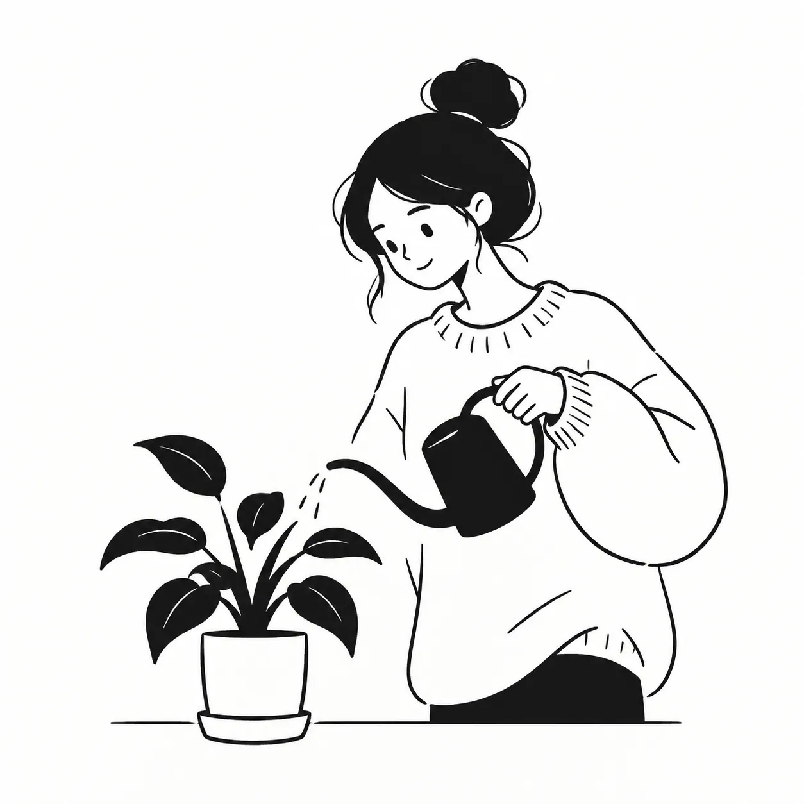</a>

> Four blanks (subject, outfit, action and expression) are all you edit, and the style block does the rest. The prompt asks for flat monochrome, simple shapes, a subtle hand-drawn wobble and an expressive posture, the visual language of productivity-app and newsletter illustrations. With 'a young woman in an oversized knit sweater watering a potted plant', our result is exactly that: solid black hair and plant leaves, a loose sweater outline and a small contented smile, with plenty of white space. Because the output is pure black on white, it converts cleanly to vector. Keep actions simple and visible, such as reading, carrying or stretching, because complex actions get muddled at this level of reduction.

```text
A simple black-and-white illustration of a young woman in an oversized knit sweater, watering a potted plant, with a calm, content expression, in a Notion-style minimalist editorial aesthetic, clean line art, flat monochrome design, simple shapes, subtle hand-drawn feel, minimal detail, expressive posture, clean white background, neat modern layout, soft playful character style
```

- 作者: [@azed_ai](https://x.com/azed_ai)
- 元の投稿: https://x.com/azed_ai/status/2043284009116160473
- [cinel で詳細を見てこのプロンプトで生成](https://cinel.ai/prompts/p/minimal-black-white-line-art-character?utm_source=github&utm_medium=awesome&utm_campaign=awesome-gpt-image-2.5-prompts)

### Four-Panel Fluffy Creatures Story Comic Prompt

<a href="https://cinel.ai/prompts/p/four-panel-fluffy-creatures-story?utm_source=github&utm_medium=awesome&utm_campaign=awesome-gpt-image-2.5-prompts">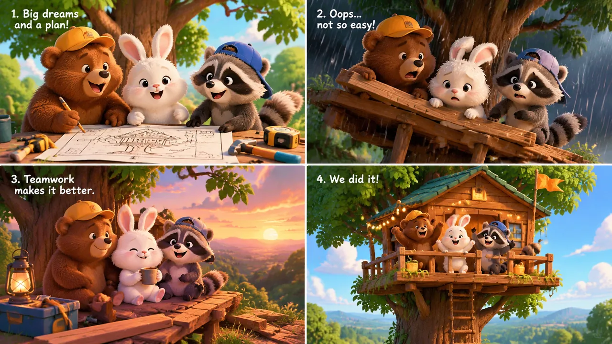</a>

> Instead of describing images, this prompt describes a story arc (a goal, a setback, teamwork, a happy ending) and leaves the visuals to the model. The one technical instruction that matters is 'maintain consistent identity across the 3 characters'. The author intended four separate 16:9 images generated one at a time, in a chat-style session. Run as a single generation, as in our example, the model drew all four beats in one frame: a bear, a bunny and a raccoon planning, failing ('Oops… not so easy'), working at sunset and celebrating in the finished treehouse. Either way, it is a fast route to a picture-book or social carousel draft. Name your creatures for tighter consistency.

```text
Create a funny 4-part story featuring 3 fluffy creatures building a treehouse. The story has emotional highs and lows and ends in a happy moment. Maintain consistent identity across the 3 characters. Generate 4 images in 16:9 format, one at a time.
```

- 作者: [@GoogleAI](https://x.com/GoogleAI)
- 元の投稿: https://x.com/GoogleAI/status/2027094912357761319
- [cinel で詳細を見てこのプロンプトで生成](https://cinel.ai/prompts/p/four-panel-fluffy-creatures-story?utm_source=github&utm_medium=awesome&utm_campaign=awesome-gpt-image-2.5-prompts)

### Futuristic Desert Civilization Worldbuilding Set

<a href="https://cinel.ai/prompts/p/futuristic-desert-worldbuilding-concept-art?utm_source=github&utm_medium=awesome&utm_campaign=awesome-gpt-image-2.5-prompts">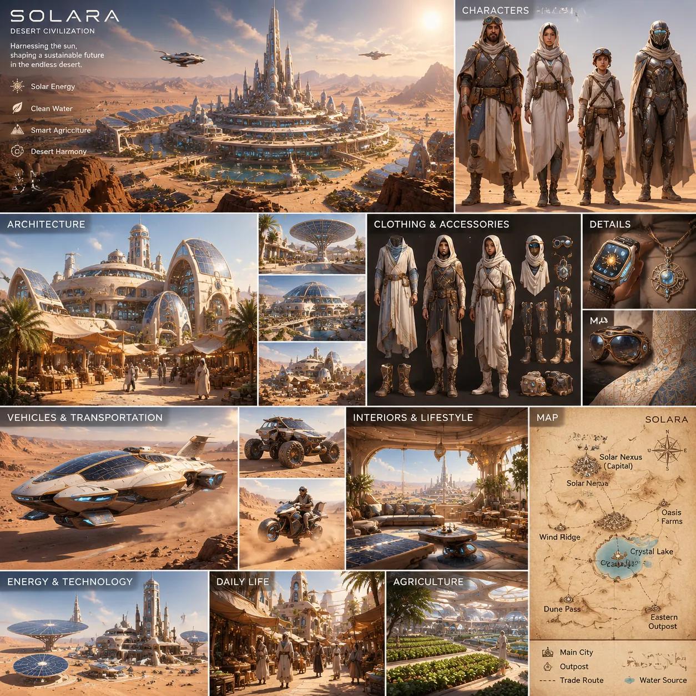</a>

> Remarkably short for what it produces. The prompt names one setting (a futuristic desert civilization powered by solar technology), lists the categories a concept artist would cover (architecture, characters, clothing, vehicles, maps) and asks for a cohesive design language. Run as a single image, our result became a full pitch board titled SOLARA, with a domed city, robed characters, costume details, hover vehicles, interiors, agriculture and a parchment map, all in one sand-and-sky palette. The phrase 'multiple images' assumes a chat-style session; in one generation you get a collage instead. Swap the environment and power source (arctic and geothermal, ocean and tidal) for new worlds.

```text
Create a complete visual worldbuilding set for a futuristic desert civilization powered by solar technology, multiple images including architecture, characters, clothing, vehicles, and maps, cohesive design language, cinematic realism, ultra detailed.
```

- 作者: [@aleenaamiir](https://x.com/aleenaamiir)
- 元の投稿: https://x.com/aleenaamiir/status/2046866168208916503
- [cinel で詳細を見てこのプロンプトで生成](https://cinel.ai/prompts/p/futuristic-desert-worldbuilding-concept-art?utm_source=github&utm_medium=awesome&utm_campaign=awesome-gpt-image-2.5-prompts)

### Woodcut Engraving Portrait Illustration Prompt

<a href="https://cinel.ai/prompts/p/woodcut-engraving-portrait-illustration?utm_source=github&utm_medium=awesome&utm_campaign=awesome-gpt-image-2.5-prompts">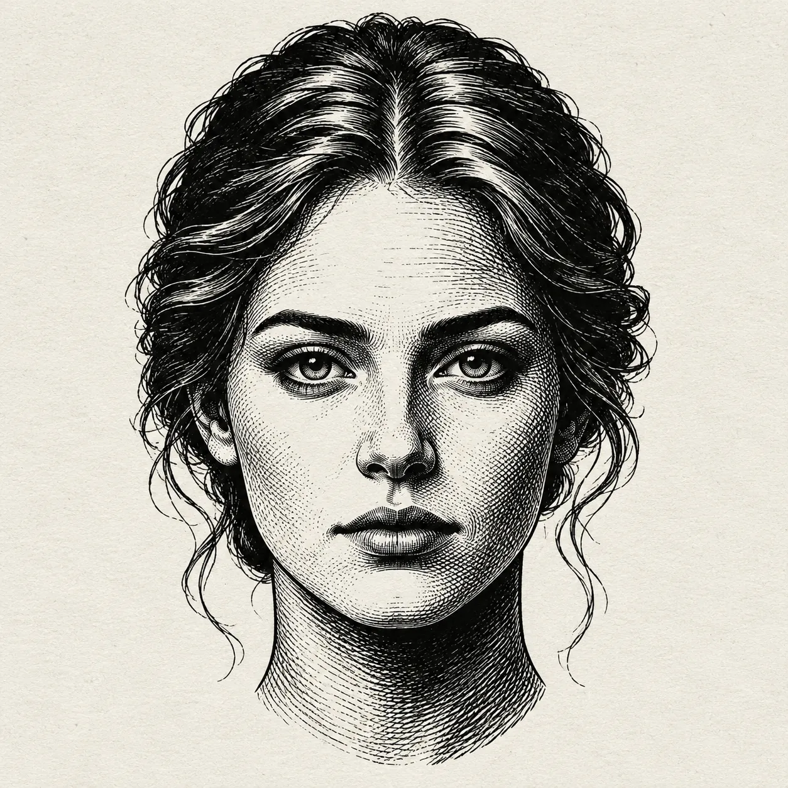</a>

> Engraving style is hard for image models because they drift towards soft pencil shading. This prompt fights that from both sides: the positive part names the technique precisely (cross-hatching, line shading, bold ink under the chin and around the hair, strong contour lines), and a long negative list rules out watercolour, soft shading, 3D, anime and blurred lines. Our result is a striking head-and-shoulders of a woman with loose curls, rendered entirely in parallel and crossed lines on warm paper, the look of a vintage editorial or a banknote vignette. Use it for author portraits, newsletter headers, wine labels or merch. Attach your own photo if you want a specific likeness.

```text
Black and white engraved portrait illustration of a person.
Drawn in classic woodcut / linocut engraving style, high contrast black ink on textured off-white paper background. Fine cross-hatching and line shading to create depth and shadow, bold black ink shadows under chin and around hair, strong contour lines, traditional printmaking aesthetic.
Minimal composition, centered portrait, no body visible, clean negative space, vintage editorial illustration style, ultra detailed linework, sharp crisp ink strokes, professional vector-ready engraving look, monochrome palette, dramatic contrast.
Negative Prompt:
color, watercolor, soft shading, blurred lines, low contrast, realistic photography, 3D render, anime style, cartoon style, messy sketch, thick uneven strokes, background objects, noisy texture, pixelated, distorted face, extra eyes, extra ears, bad anatomy, modern digital painting, glossy skin, overexposed highlights
```

- 作者: [@Naiknelofar788](https://x.com/Naiknelofar788)
- 元の投稿: https://x.com/Naiknelofar788/status/2042785774245154868
- [cinel で詳細を見てこのプロンプトで生成](https://cinel.ai/prompts/p/woodcut-engraving-portrait-illustration?utm_source=github&utm_medium=awesome&utm_campaign=awesome-gpt-image-2.5-prompts)

### High-Contrast Ink Noir Portrait Illustration

<a href="https://cinel.ai/prompts/p/ink-noir-portrait-illustration?utm_source=github&utm_medium=awesome&utm_campaign=awesome-gpt-image-2.5-prompts">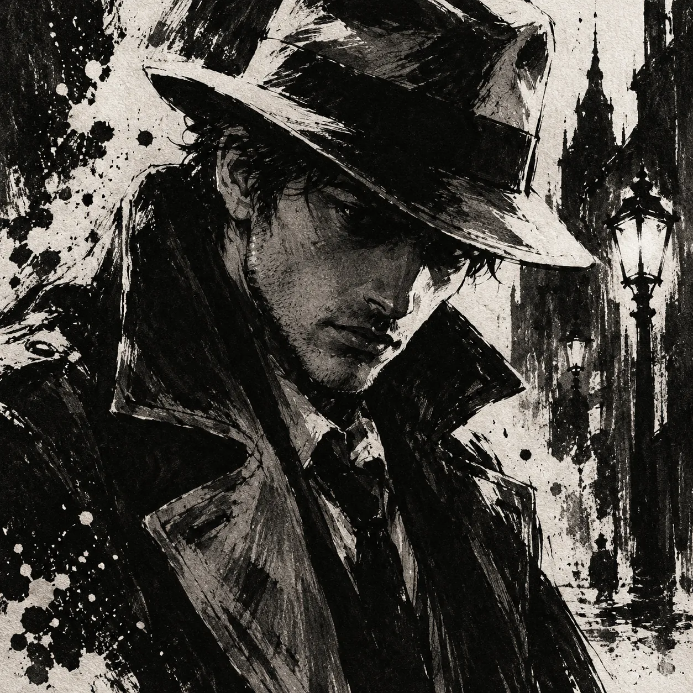</a>

> Short and atmospheric: the whole look comes from limiting the medium to black ink, using strokes and controlled splatter, and letting highlights appear only where the paper is left bare. 'Heavy shadows dominate' pushes the image towards near-silhouette, and 'a graphic novel frozen at its most dramatic panel' sets the mood. We cast a weary detective in a trench coat and fedora, and the result is a striking brush illustration: the hat brim casts the eyes into shadow, ink splashes break up the coat, and a street lamp and spires are suggested in the background. It suits book covers, posters, tattoo flash or podcast art. Swap the subject; keep the ink-only rule.

```text
A high-contrast ink noir portrait of a weary detective in a trench coat and fedora, illustrated entirely with expressive black ink strokes and controlled splatter. Heavy shadows dominate the composition while selective highlights emerge through negative space. Subtle paper grain is visible. Atmosphere is moody, cinematic, and intense, like a graphic novel frozen at its most dramatic panel.
```

- 作者: [@aleenaamiir](https://x.com/aleenaamiir)
- 元の投稿: https://x.com/aleenaamiir/status/2008431391235862892
- [cinel で詳細を見てこのプロンプトで生成](https://cinel.ai/prompts/p/ink-noir-portrait-illustration?utm_source=github&utm_medium=awesome&utm_campaign=awesome-gpt-image-2.5-prompts)

### Monochrome Ink Side-Profile Portrait from a Photo

<a href="https://cinel.ai/prompts/p/monochrome-ink-side-profile-portrait?utm_source=github&utm_medium=awesome&utm_campaign=awesome-gpt-image-2.5-prompts">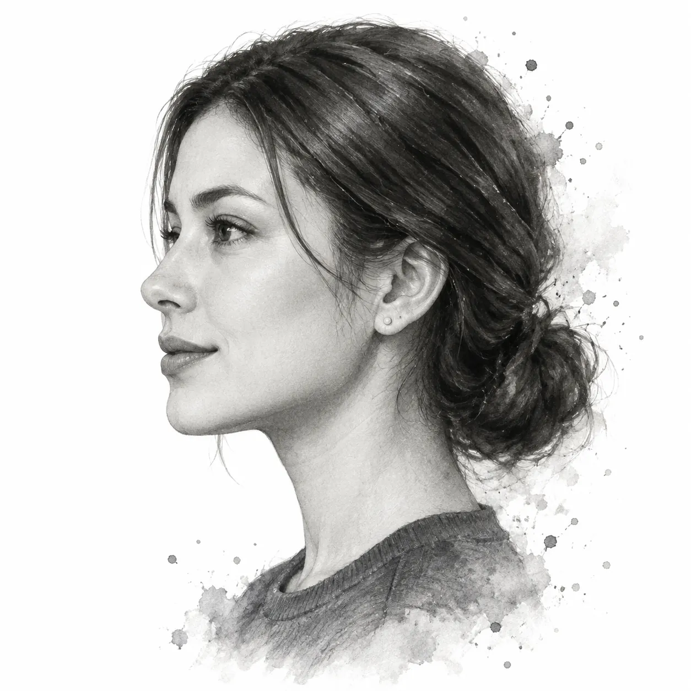</a>

> A gentle, gallery-style conversion: the photo becomes a clean side profile facing left, rendered in soft charcoal-grey ink on pure white, with a little controlled splatter and watercolour bleed that dissolves into mist at the edges. The prompt asks for exact identity and proportions, so the result still looks like the person rather than a generic sketch. Our reference was a three-quarter photo of a fictional woman with a low bun; the model turned her fully into profile, keeping the nose and jawline, with loose ink strands for hair and grey speckles scattered around the bun. It makes a lovely author photo, wedding stationery or memorial portrait. Use a clear, well-lit reference.

```text
Transform the input photo into a refined monochromatic ink portrait on a pure white background. Clean side profile facing left, preserving exact facial identity and proportions. Soft charcoal-gray ink with subtle tonal variation, controlled splatter accents, delicate watercolor diffusion, and faint mist-like dispersion along the edges.
```

- 作者: [@Naiknelofar788](https://x.com/Naiknelofar788)
- 元の投稿: https://x.com/Naiknelofar788/status/2024636606272229577
- [cinel で詳細を見てこのプロンプトで生成](https://cinel.ai/prompts/p/monochrome-ink-side-profile-portrait?utm_source=github&utm_medium=awesome&utm_campaign=awesome-gpt-image-2.5-prompts)

<a id="scenes-creative"></a>

## クリエイティブシーン

厳選 6 件 · [全 101 件を見る](cases/scenes-creative.md) · [cinel のカテゴリ](https://cinel.ai/prompts/scenes-creative?utm_source=github&utm_medium=awesome&utm_campaign=awesome-gpt-image-2.5-prompts)

### Giant Fountain Pen Writing a Book's World into Life

<a href="https://cinel.ai/prompts/p/giant-fountain-pen-story-world-scene?utm_source=github&utm_medium=awesome&utm_campaign=awesome-gpt-image-2.5-prompts">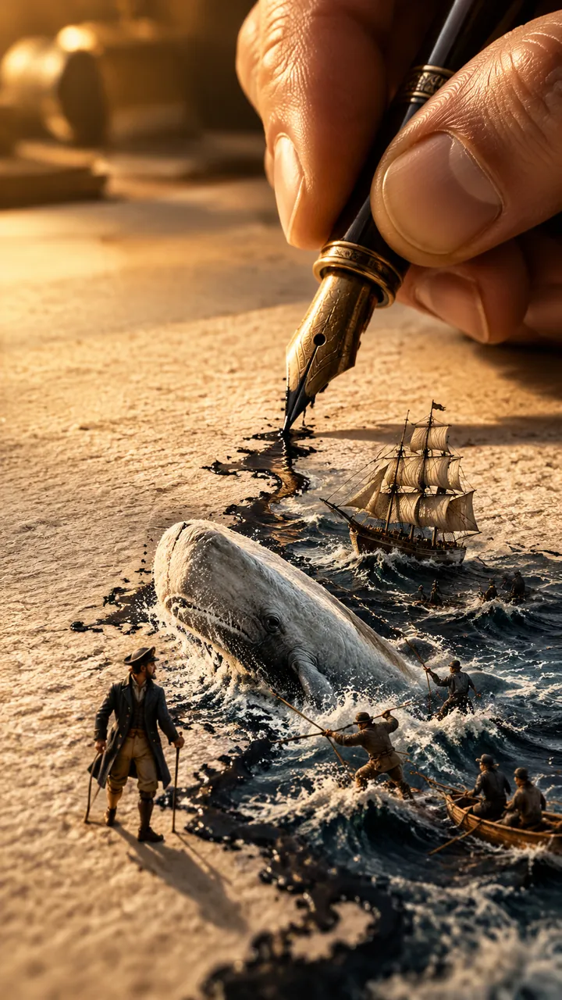</a>

> A lovely visual metaphor, the story literally emerging from the ink, made convincing by scale contrast. The hand and nib are shot as an extreme close-up with skin texture and ink bleeding into paper fibre, while the characters are specified as 'no larger than a fingernail', cascading down the page with wet ink at their edges. Warm, raking amber light ties the two scales together. The template's bracket asks the model to pick iconic elements itself; we wrote them out for a public-domain classic, Moby-Dick (a peg-legged captain, a white whale, harpoon boats, a whaling ship), and they all appear. Public-domain books are the safe choice, since modern franchises bring rights issues.

```text
A colossal hand gripping an enormous vintage fountain pen, captured in vertical portrait format (9:16), writing on endless textured paper that fills the frame. Where the ink flows, the story of Moby-Dick bursts into vivid life — a captain with a peg leg, a great white whale, harpoons, a three-masted whaling ship and stormy waves emerging as tiny miniature figures on the paper, each no larger than a fingernail, ultra-miniature scale. The miniature world cascades downward across the page as the pen moves, characters frozen mid-story, ink still wet at the edges where they emerge. Extreme close-up of the enormous pen nib touching paper, ink bleeding into fiber, fingertips with visible skin texture. Warm amber and soft golden light raking across the paper surface, deep shadows, cinematic depth of field, magical realism, hyper-detailed, photorealistic, 8K, --ar 9:16
```

- 作者: [@0x00_Krypt](https://x.com/0x00_Krypt)
- 元の投稿: https://x.com/0x00_Krypt/status/2028390369902174550
- [cinel で詳細を見てこのプロンプトで生成](https://cinel.ai/prompts/p/giant-fountain-pen-story-world-scene?utm_source=github&utm_medium=awesome&utm_campaign=awesome-gpt-image-2.5-prompts)

### Ball-Shaped Cute Animal Photo Prompt

<a href="https://cinel.ai/prompts/p/ball-shaped-cute-animal-photo?utm_source=github&utm_medium=awesome&utm_campaign=awesome-gpt-image-2.5-prompts">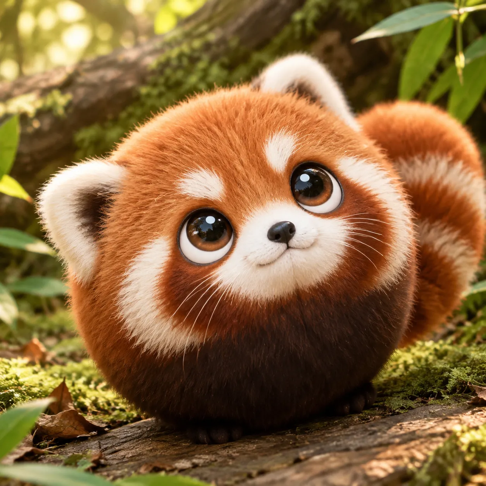</a>

> Simple and endlessly reusable: swap one word and you get a new character. The prompt's clever instruction is anatomical: the animal 'has no head, instead its face is part of the ball', which forces a single sphere rather than a round body with a head on top. Putting it in its usual habitat keeps it photographic, and the upward 'cheeky' eyes add personality. Our red panda came out as a fluffy russet sphere with white cheek markings and big glossy eyes on a mossy log, instantly sticker-worthy. Animals with distinctive markings (red pandas, penguins, tigers, owls) make the most recognisable balls. Try a series across species for a cohesive set.

```text
Make a photo of a cute ball-shaped version of a red panda, with big adorable over-sized eyes, it has no head, instead its face is part of the ball, its head and body are one. They are in their usual habitat. Must be almost spherical and cartoonishly cute. Its eyes are looking up in the most adorable cheeky fashion.
```

- 作者: [@NanoBanana](https://x.com/NanoBanana)
- 元の投稿: https://x.com/NanoBanana/status/2027298143134478451
- [cinel で詳細を見てこのプロンプトで生成](https://cinel.ai/prompts/p/ball-shaped-cute-animal-photo?utm_source=github&utm_medium=awesome&utm_campaign=awesome-gpt-image-2.5-prompts)

### Panning Motion-Blur Soccer Kick Prompt

<a href="https://cinel.ai/prompts/p/panning-soccer-player-motion-blur?utm_source=github&utm_medium=awesome&utm_campaign=awesome-gpt-image-2.5-prompts">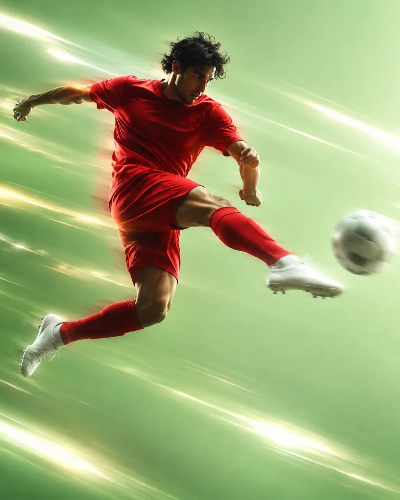</a>

> A compact sports-poster prompt that relies on two things: 'panning shot' and 'streaking lights'. Together they keep the athlete fairly sharp while the background and edges smear into speed lines, the classic look of a camera tracking a fast subject. The light green gradient replaces a stadium, so the red kit pops and there is room for text. The original wording asks for a professional jersey; we added 'plain, unbranded kit and boots, no logos or crest' after our first render produced marks resembling real sportswear and federation badges. Keep that clause for anything you publish. Change the kit colour, the sport or the action (header, dive save) to build a series.

```text
Panning shot of a mysterious soccer player in a plain unbranded red soccer kit and plain all-white boots, with no logos, no crest, no stripes and no brand marks anywhere mid air kicking a ball, motion blur, cinematic lighting agains a Light gree gradient background with streaking
lights --ar 4:5 --raw --stylize 700
```

- 作者: [@ChillaiKalan__](https://x.com/ChillaiKalan__)
- 元の投稿: https://x.com/ChillaiKalan__/status/2019364350151234040
- [cinel で詳細を見てこのプロンプトで生成](https://cinel.ai/prompts/p/panning-soccer-player-motion-blur?utm_source=github&utm_medium=awesome&utm_campaign=awesome-gpt-image-2.5-prompts)

### Real Space with Floating Concept Sketch Lines

<a href="https://cinel.ai/prompts/p/person-at-frame-edge-empty-environment?utm_source=github&utm_medium=awesome&utm_campaign=awesome-gpt-image-2.5-prompts">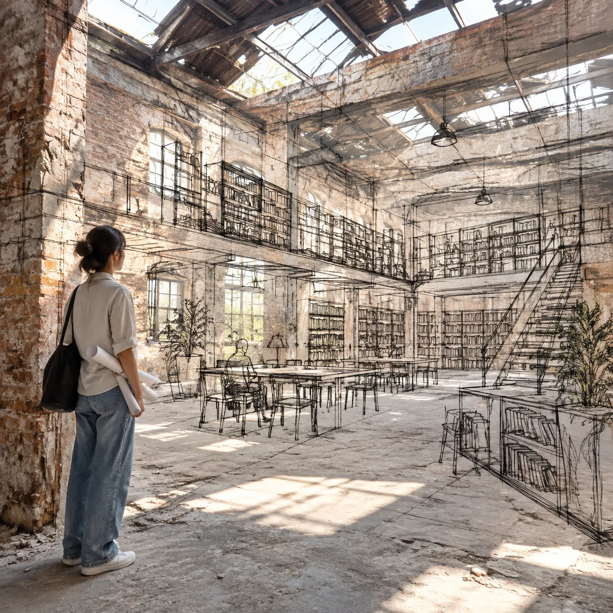</a>

> Photography and drawing meet to show potential. A person stands at the edge of the frame, seen from behind, looking into an unfinished, empty or damaged real space, and black ink sketch lines float inside it in correct perspective, drawing what is missing or what could be. The prompt insists the strokes be loose and slightly imperfect, like a real concept sketch, and lets some lines cross the person to merge imagination and reality. We set it in a half-demolished brick warehouse with broken skylights; the sketches draw a library with mezzanines, shelving and reading tables. It suits architects, interior designers, developers and urban-renewal stories, and works equally for 'what once stood here'.

```text
A young female architect standing full-body near the edge of the frame, slightly to the left, in an empty, half-demolished brick warehouse. The camera is positioned behind and slightly to the right of the person, capturing them from a three-quarter rear angle. The person stands calmly and thoughtfully, looking toward the space ahead.

The environment is empty and decayed, with bare brick walls, broken skylights and a dusty concrete floor. The atmosphere feels quiet and raw. Natural light illuminates the scene, creating realistic shadows and depth. Floating hand-drawn sketch lines appear over and within the environment, aligned precisely in perspective with the real space. These sketches represent what could exist in the future: a bright library with mezzanines, bookshelves and reading tables.

The sketch lines are black, clean, and hand-drawn, resembling architectural and interior concept sketches made with pencil or ink. The strokes are expressive, slightly imperfect, and organic — not rigid or mechanical. The sketched elements occupy the foreground and midground, appearing closer to the person than expected. Some sketch lines subtly overlap the person’s silhouette and the real surfaces, visually merging imagination with reality. The sketches float naturally within the scene, seamlessly blending with the environment and conveying the idea of transformation coming to life.
```

- 作者: [@Arminn_Ai](https://x.com/Arminn_Ai)
- 元の投稿: https://x.com/Arminn_Ai/status/2002826415939682584
- [cinel で詳細を見てこのプロンプトで生成](https://cinel.ai/prompts/p/person-at-frame-edge-empty-environment?utm_source=github&utm_medium=awesome&utm_campaign=awesome-gpt-image-2.5-prompts)

### Exploded Room: Walls and Furniture Floating in 3D

<a href="https://cinel.ai/prompts/p/exploded-room-3d-floating-objects?utm_source=github&utm_medium=awesome&utm_campaign=awesome-gpt-image-2.5-prompts">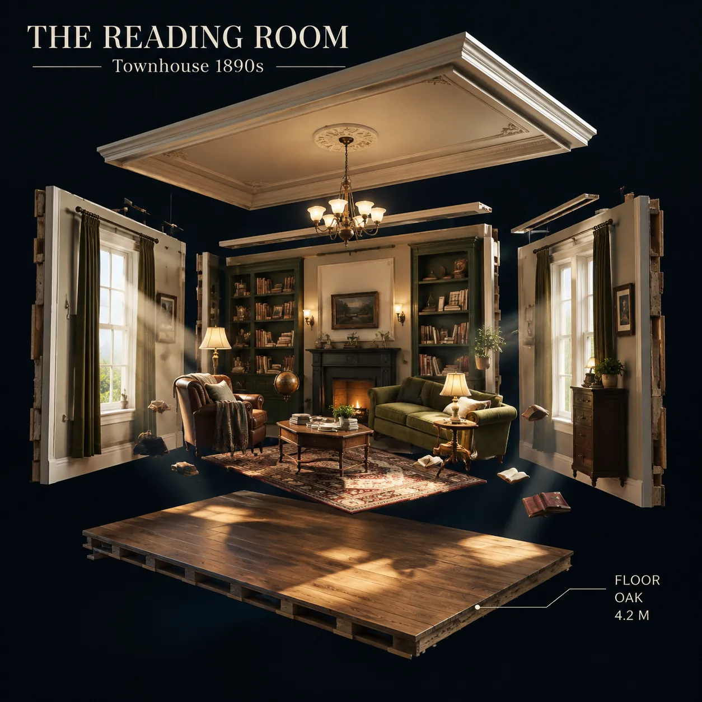</a>

> An exploded-view diagram applied to an interior: the ceiling lifts, the four walls slide outward, the floor drops, and furniture and objects hover in their original positions, so you can still read the room. The poetic touch is that every light source keeps working, with window light crossing the gap and lamps throwing cones into empty space. Labels are restricted to architectural elements, which keeps the image uncluttered. We built an 1890s townhouse reading room: a coffered ceiling with chandelier floats above bookcases, a fireplace, armchairs and a green sofa, while the oak floor below is labelled with material and size. Great for interior designers, real-estate storytelling or museum period rooms.

```text
A reading room pulled apart in 3D, every surface and object  floating at its exact position, slightly separated.  EXPLOSION: ceiling lifted, four walls sliding outward,  floor dropped, furniture floating in place,  objects orbiting their surfaces, light sources  still emitting across the exploded void.  The ghost of the room readable in the arrangement.  Labels on architectural elements only: "FLOOR" / "OAK" / "4.2 M"  LIGHTING: each element still lit by its original source,  windows casting light across the gap, lamps throwing cones  into empty space.  BACKGROUND: deep dark, the room floats in void. TITLE: "THE READING ROOM" / SUBTITLE: "Townhouse 1890s"  Mood: architectural model that became a universe. 4K, extraordinary spatial clarity, tack sharp.
```

- 作者: [@AllaAisling](https://x.com/AllaAisling)
- 元の投稿: https://x.com/AllaAisling/status/2035390729527378146
- [cinel で詳細を見てこのプロンプトで生成](https://cinel.ai/prompts/p/exploded-room-3d-floating-objects?utm_source=github&utm_medium=awesome&utm_campaign=awesome-gpt-image-2.5-prompts)

### Fishermen on Istanbul's Galata Bridge at Sunset

<a href="https://cinel.ai/prompts/p/fishermen-bridge-sunset-silhouette?utm_source=github&utm_medium=awesome&utm_campaign=awesome-gpt-image-2.5-prompts">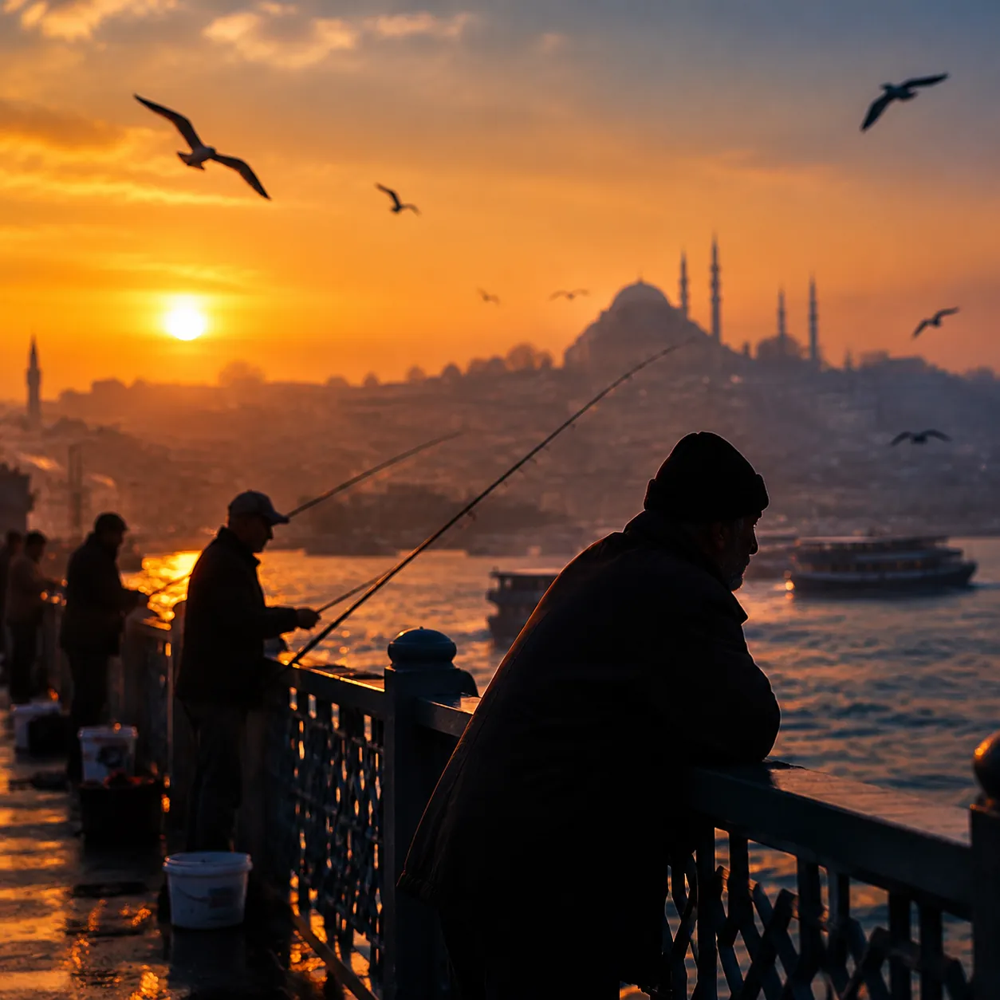</a>

> A travel-photography prompt that tells a small human story in a famous place: anglers lining the Galata Bridge at sunset, one weary fisherman leaning on the railing in the foreground, the hazy silhouette of the Süleymaniye Mosque across the Golden Horn and gulls wheeling overhead, all in warm orange and deep blue. We generalised the original camera brand and lens to a generic full-frame 85mm f/1.4 description. Our result captures the mood beautifully: the sun dropping behind a domed, minaret-lined skyline, rods arcing over the water and figures in silhouette along the ornate rail. Place names like these steer the model well; treat the skyline as evocative, not architecturally exact.

```text
A cinematic silhouette shot of local fishermen lining the Galata Bridge in Istanbul during sunset. In the foreground, a weary fisherman leans against the railing, looking at the sea. The background features the hazy, dreamlike silhouette of the Süleymaniye Mosque and seagulls flying over the Golden Horn. Warm orange and deep blue color palette. Shot on a full-frame mirrorless camera with an 85mm f/1.4 lens at f/1.8. Atmospheric haze, emotional storytelling, award-winning travel photography.
```

- 作者: [@ozan_sihay](https://x.com/ozan_sihay)
- 元の投稿: https://x.com/ozan_sihay/status/2001003144566681621
- [cinel で詳細を見てこのプロンプトで生成](https://cinel.ai/prompts/p/fishermen-bridge-sunset-silhouette?utm_source=github&utm_medium=awesome&utm_campaign=awesome-gpt-image-2.5-prompts)

## ライセンス

コード（scripts/、.github/）は MIT ライセンスです。[LICENSE](LICENSE) を参照してください。各プロンプトには元の作者と元投稿へのリンクを記載しています。
