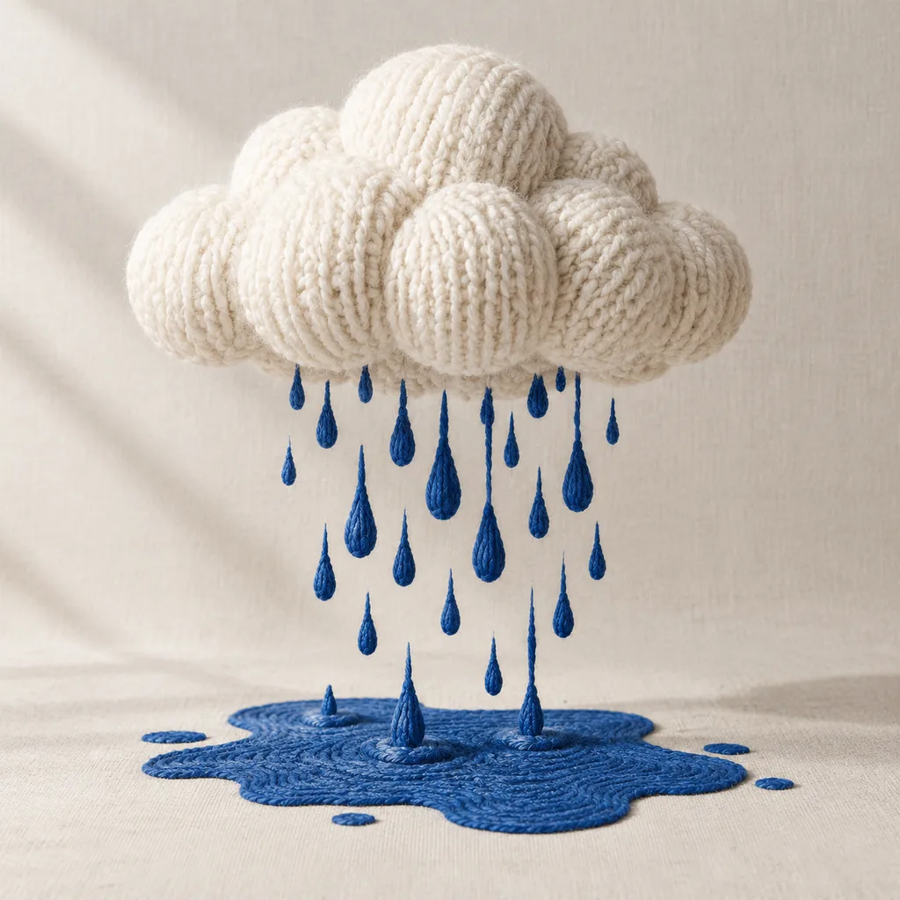
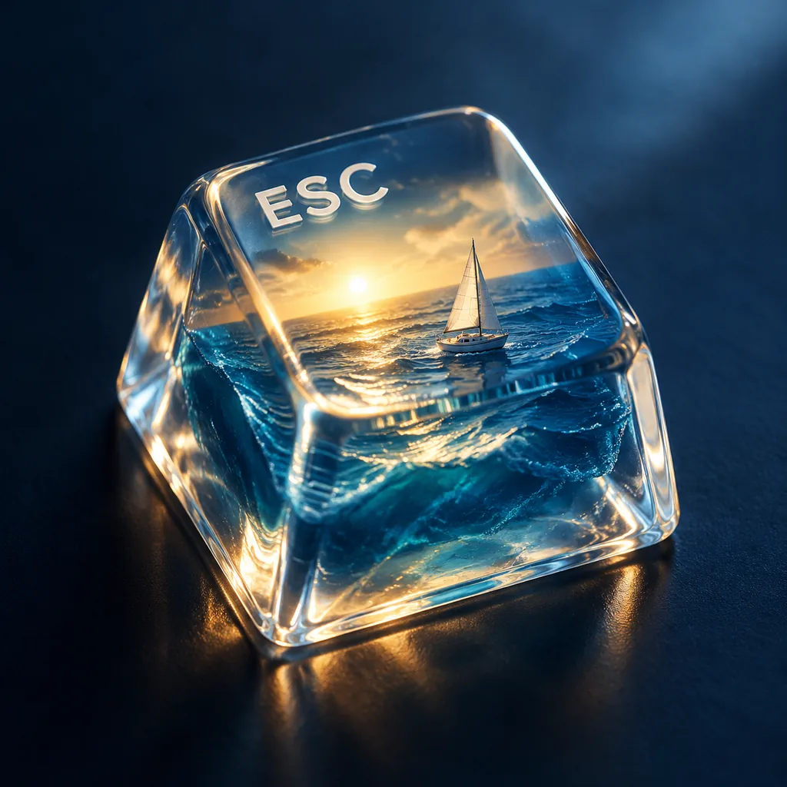
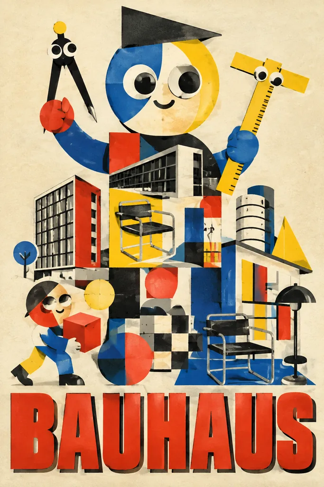
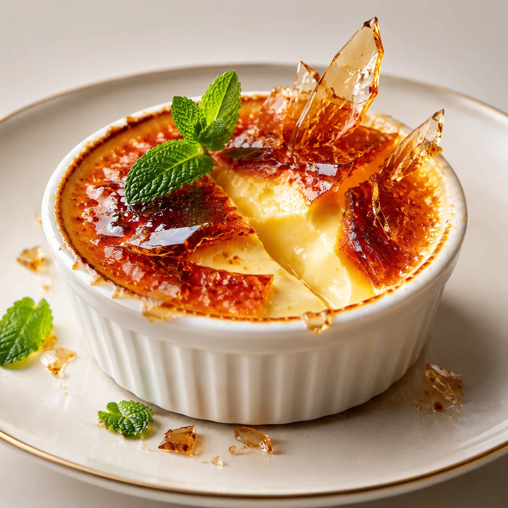
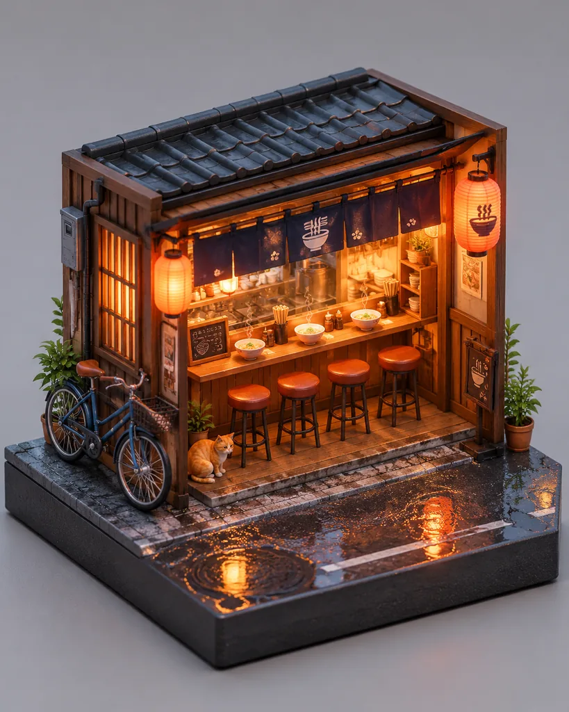
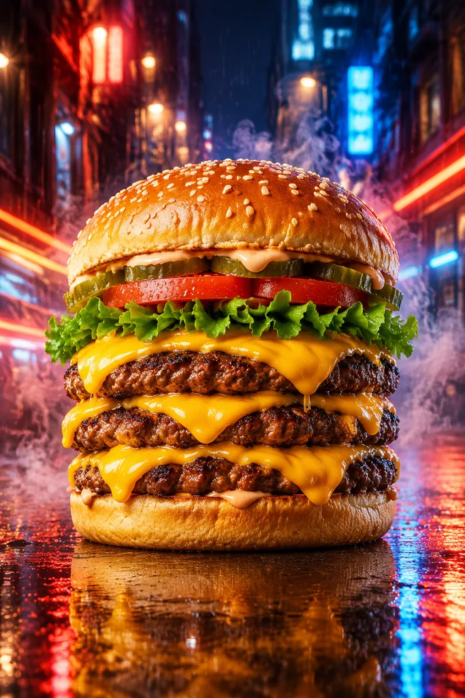
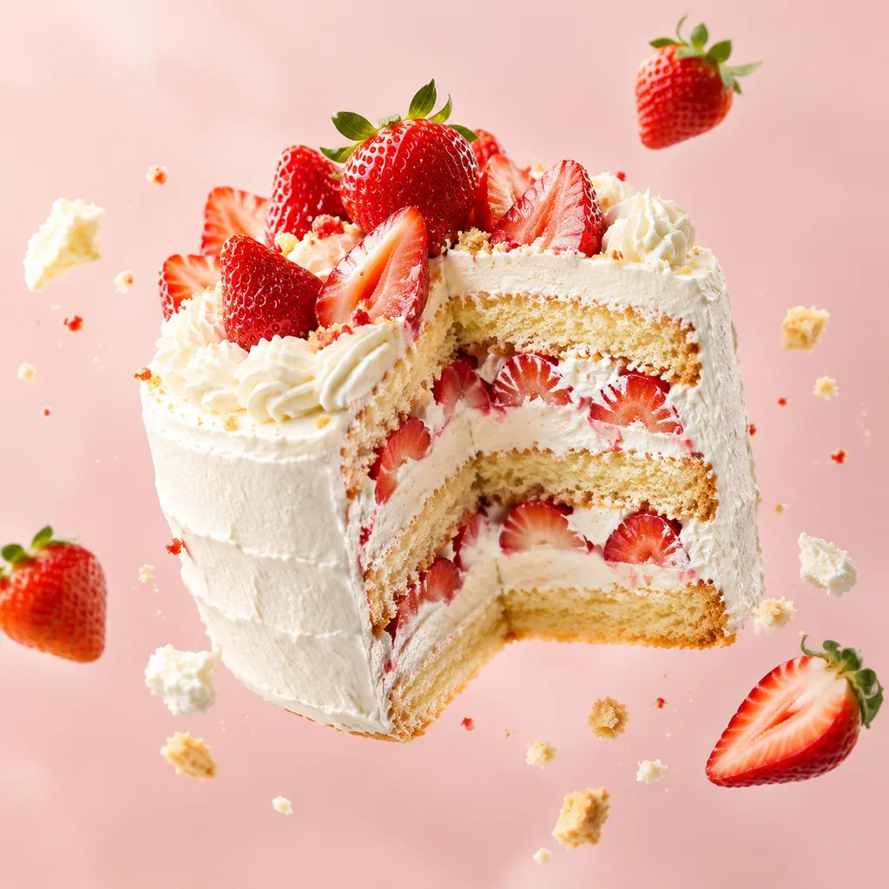
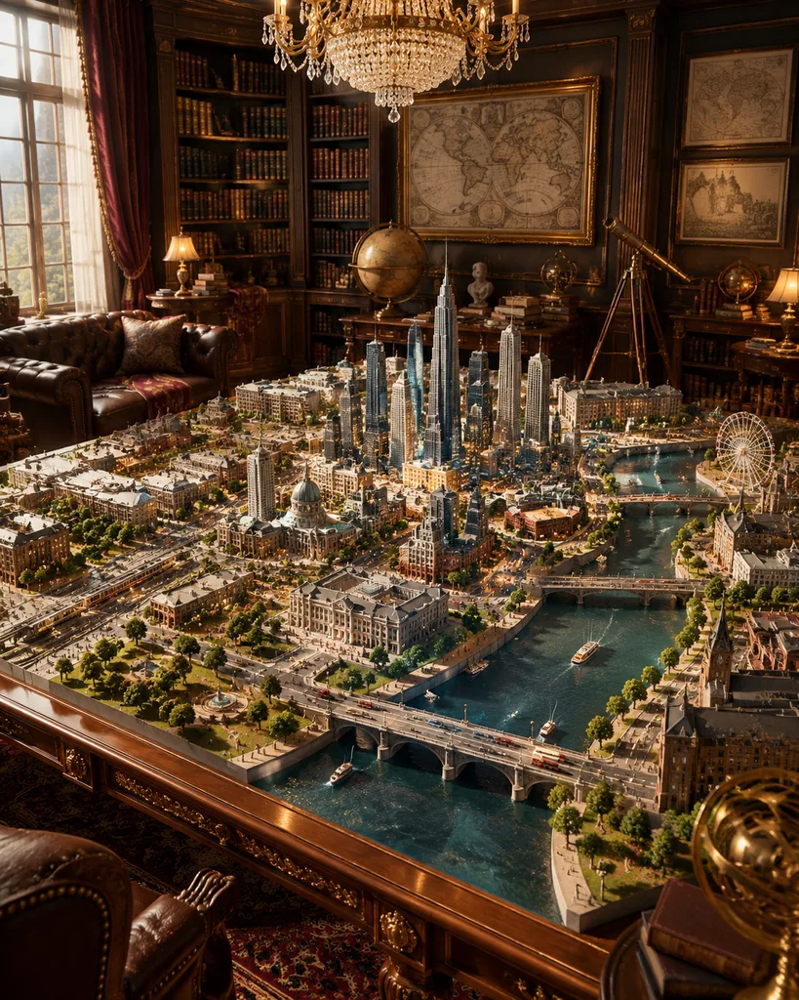

# Awesome GPT Image 2.5 提示词大全

[](README.md)
[](README_zh.md)
[](README_zh-Hant.md)
[](README_ja.md)
[](README_ko.md)
[](README_es.md)
[](README_pt.md)
[](README_fr.md)
[](README_de.md)
[](README_ru.md)
[](README_tr.md)
[](README_it.md)

精选 **847** 条 GPT Image 2.5 提示词，每条都附示例图、完整提示词、原作者和原帖链接。数据来自 [cinel.ai](https://cinel.ai/zh/prompts/model/gpt-image-2-5?utm_source=github&utm_medium=awesome&utm_campaign=awesome-gpt-image-2.5-prompts) 提示词库，自动同步更新。

👉 [在 cinel.ai 浏览全部并在线生成](https://cinel.ai/zh/prompts/model/gpt-image-2-5?utm_source=github&utm_medium=awesome&utm_campaign=awesome-gpt-image-2.5-prompts)

## 目录

- [人像写真](#portrait) (92) · [全部](cases/zh/portrait.md)
- [产品与电商](#product-photography) (61) · [全部](cases/zh/product-photography.md)
- [海报与平面设计](#poster-design) (68) · [全部](cases/zh/poster-design.md)
- [信息图与 UI](#infographic-ui) (40) · [全部](cases/zh/infographic-ui.md)
- [3D 角色与手办](#3d-figurines) (114) · [全部](cases/zh/3d-figurines.md)
- [美食饮品](#food-drink) (238) · [全部](cases/zh/food-drink.md)
- [插画与动漫](#illustration-anime) (103) · [全部](cases/zh/illustration-anime.md)
- [创意场景](#scenes-creative) (131) · [全部](cases/zh/scenes-creative.md)

<a id="portrait"></a>

## 人像写真

精选 6 条 · [查看本类全部 92 条](cases/zh/portrait.md) · [cinel 分类页](https://cinel.ai/zh/prompts/portrait?utm_source=github&utm_medium=awesome&utm_campaign=awesome-gpt-image-2.5-prompts)

### 橄榄绿丝绒纱丽高级时装棚拍人像提示词

<a href="https://cinel.ai/zh/prompts/p/velvet-saree-fashion-studio-portrait?utm_source=github&utm_medium=awesome&utm_campaign=awesome-gpt-image-2.5-prompts"></a>

> 证明人像提示词不必很长。约 90 个英文单词里，它确定了服装（橄榄绿丝绒，搭在一侧肩上）、让画面具体的造型细节（刺绣无袖上衣、深色海娜手绘、金耳饰）、光线（暗调、戏剧化、掠过丝绒表面）以及神态（直视镜头、自信）。选丝绒很聪明：在低调光下，绒面会捕捉高光，示例图正是如此。改写时保留关于光线和质感的那一句，替换服装——丝绸蕾哈迦、织锦外套、缎面礼服都适用。最先改的应该是丝绒的颜色。

```text
A detailed, high-fashion studio photograph of a woman posing gracefully, wearing a luxurious olive green velvet saree draped elegantly over her shoulder, paired with a matching heavily embroidered sleeveless blouse that highlights her midriff. The lighting is moody and dramatic, accentuating the rich texture of the velvet and giving her skin a subtle, dewy sheen. Her hands are adorned with intricate, dark henna (mehndi) designs, and she is wearing traditional gold  earrings, looking directly into the camera with a confident expression.
```

- 原作者: [@Flora_Janer8](https://x.com/Flora_Janer8)
- 原帖: https://x.com/Flora_Janer8/status/2021300975248736723
- [在 cinel 上查看详情并一键生成](https://cinel.ai/zh/prompts/p/velvet-saree-fashion-studio-portrait?utm_source=github&utm_medium=awesome&utm_campaign=awesome-gpt-image-2.5-prompts)

### 高级感健康生活方式四联照提示词

<a href="https://cinel.ai/zh/prompts/p/luxury-wellness-lifestyle-photo-series?utm_source=github&utm_medium=awesome&utm_campaign=awesome-gpt-image-2.5-prompts"></a>

> 这条提示词为需要一整套统一画面、而不是单张主图的博主和健康品牌而写。JSON 把“常量”（同一位人物、发型妆容、奶油色罗纹运动套装、暖调窗光、米色—奶油—大理石配色，点缀绿植和金色）与“变量”（四个场景）分开。正因为常量定义得非常严密，我们的 2×2 成品里，同一位女性在大理石厨房做饭、在梳妆台前护肤、拉伸、吃沙拉，造型毫无突兀变化。可以替换运动服颜色或四个活动以适配其他品牌，但配色区块一定要保留，它让整组照片显得有艺术指导。

```text
{
  "overall_theme": {
    "description": "A curated series of four ultra-photorealistic vignettes showcasing a luxurious, wellness-focused lifestyle.",
    "mood": "Calm, serene, balanced, sophisticated, peaceful, rejuvenating.",
    "style": "Minimalist, high-end, contemporary, clean aesthetic, aspirational."
  },
  "subject": {
    "description": "Young woman.",
    "appearance": {
      "hair": "Long, dark brown, wavy, natural texture.",
      "skin": "Clear, glowing, natural.",
      "makeup": "No-makeup makeup look, dewy finish.",
      "physique": "Fit, toned."
    },
    "expression": "Serene, composed, gently smiling, focused."
  },
  "wardrobe": {
    "outfit_base": "Matching ribbed beige/cream activewear set.",
    "variations": [
      "Sleeveless crop top and high-waisted leggings.",
      "Long-sleeve crop top and high-waisted leggings."
    ],
    "style": "Comfortable, stylish, high-quality fabric."
  },
  "environmental_details": {
    "lighting": {
      "type": "Natural daylight.",
      "quality": "Soft, diffused, warm, bright.",
      "source": "Large windows (implied or visible)."
    },
    "color_palette": {
      "dominant": ["Warm Beige", "Cream", "White", "Marble Grey"],
      "accents": ["Green (plants)", "Gold (fixtures, details)", "Natural Wood", "Soft Purple (smoothie)"]
    },
    "materials": ["White Marble", "Light Wood", "Stone", "Ceramic", "Glass", "Linen"]
  },
  "scenes": [
    {
      "location": "Modern Luxury Kitchen",
      "environment": "White marble island and countertops, white shaker cabinets, gold hardware, integrated wine fridge, large window.",
      "pose": "Standing at the island, body angled slightly, looking down.",
      "action": "Whisking a hot beverage in a small bowl.",
      "props": ["Ceramic bowl", "Wooden whisk", "Steam", "Mug with 'H'", "Wine fridge"]
    },
    {
      "location": "High-End Bathroom",
      "environment": "Large backlit mirror, white marble vanity, white walls, orchid plant.",
      "pose": "Standing facing the mirror, one hand applying product to face.",
      "action": "Applying skincare.",
      "props": ["Cotton pad", "Skincare bottle", "Lit Diptyque candle", "Whole coconut", "Glass jars"]
    },
    {
      "location": "Minimalist Wellness Space",
      "environment": "Textured beige walls with curved arches, stone water fountain, eucalyptus in a vase.",
      "pose": "Full-body stretch, arms extended overhead, head tilted back, eyes closed.",
      "action": "Stretching.",
      "props": ["Stone water feature", "Large perfume bottle", "Eucalyptus vase"]
    },
    {
      "location": "Bright Café Corner",
      "environment": "Round white marble table, cane chair, large window overlooking a street.",
      "pose": "Sitting at the table, smiling while eating, holding a fork.",
      "action": "Eating avocado toast.",
      "props": ["Avocado toast on plate", "Purple smoothie in glass", "Fork", "Assouline book", "Notebooks", "Small flowers"]
    }
  ],
  "camera_and_technical": {
    "type": "DSLR Photography",
    "style": "Editorial lifestyle",
    "lens": "Prime lens (e.g., 50mm or 85mm f/1.4)",
    "focus": "Sharp focus on the subject in each frame.",
    "depth_of_field": "Shallow, creating a soft, creamy bokeh in the background.",
    "resolution": "Ultra-high resolution, photorealistic textures.",
    "composition": "Four-panel grid collage."
  }
}
```

- 原作者: [@xmliisu](https://x.com/xmliisu)
- 原帖: https://x.com/xmliisu/status/2008486850378293427
- [在 cinel 上查看详情并一键生成](https://cinel.ai/zh/prompts/p/luxury-wellness-lifestyle-photo-series?utm_source=github&utm_medium=awesome&utm_campaign=awesome-gpt-image-2.5-prompts)

### 新年祝福九宫格肖像提示词（男生版）

<a href="https://cinel.ai/zh/prompts/p/new-year-greeting-portrait-grid?utm_source=github&utm_medium=awesome&utm_campaign=awesome-gpt-image-2.5-prompts"></a>

> 这是一条“按数字设计”的好例子。九格各有一个手势和一句四字吉祥语，而且吉祥语的首字恰好对应格子序号：一帆风顺、双喜临门、三阳开泰……一直到九。JSON 把人物一致性、手势列表和文字叠加分开写，并且强调克制：纯白墙、自然柔光、“阳光不油腻”、不夸张的微笑。我们的成品里，同一位穿红毛衣的年轻男性贯穿九格，上方是红色书法字、下方是深蓝色年份。可以替换人物、服装颜色或年份，这套吉祥语适用于任何一个春节。

```text
{
  "project_settings": {
    "task_type": "九宫格新年祝福肖像（男生版）",
    "aspect_ratio": "1:1",
    "grid_layout": "3x3",
    "batch_size": 1
  },

  "overall_style": {
    "整体风格": "极简新年祝福风",
    "视觉基调": "干净、温和、克制的节日感",
    "背景": "纯色白墙面，无装饰",
    "光线": "自然柔光，均匀无强阴影",
    "色彩重点": "中国红（服装 + 文字）"
  },

  "subject_base": {
    "人物一致性": "九宫格内为同一位人物",
    "人物类型": "亚洲男性",
    "性别气质": "干净、阳光、自然，不油腻",
    "发型": "黑色短发，自然蓬松，简洁利落",
    "服装": "红色针织毛衣或卫衣，简洁无图案",
    "妆容": "无明显妆感，真实自然肤质",
    "表情气质": "开心，克制的微笑，不夸张"
  },

  "pose_variations": {
    "grid_1": "食指竖于嘴前，轻松安静手势",
    "grid_2": "单手比 V 手势靠近脸部",
    "grid_3": "单手做 OK 或三指手势",
    "grid_4": "双手举起做轻松俏皮手势（不过度卖萌）",
    "grid_5": "单手张开遮住半边脸",
    "grid_6": "单手做电话手势靠近脸侧",
    "grid_7": "单手轻点脸颊或下巴",
    "grid_8": "单手托下巴，轻微思考姿势",
    "grid_9": "双手指向脸部或克制比心变体"
  },

  "text_overlays": {
    "字体风格": "传统中文新年书法字体",
    "文字颜色": "中国红",
    "年份颜色": "深蓝色",
    "文字位置": "每一格顶部居中",
    "文字结构": "四字祝福语 + 年份"
  },

  "text_content": [
    { "position": "grid_1", "text": "一帆风顺", "year": "2026" },
    { "position": "grid_2", "text": "双喜临门", "year": "2026" },
    { "position": "grid_3", "text": "三阳开泰", "year": "2026" },
    { "position": "grid_4", "text": "四季发财", "year": "2026" },
    { "position": "grid_5", "text": "五福临门", "year": "2026" },
    { "position": "grid_6", "text": "六六大顺", "year": "2026" },
    { "position": "grid_7", "text": "七星高照", "year": "2026" },
    { "position": "grid_8", "text": "八方来财", "year": "2026" },
    { "position": "grid_9", "text": "九九同心", "year": "2026" }
  ],

  "constraints": {
    "禁止项": [
      "不改变人物身份",
      "不夸张表情",
      "不女性化姿态",
      "不使用复杂背景",
      "不添加节日道具",
      "不风格化面部"
    ],
    "一致性要求": [
      "人物脸型五官保持完全一致",
      "服装颜色与材质一致",
      "拍摄角度与距离基本一致"
    ]
  },

  "use_cases": [
    "男生新年纪念照",
    "个人春节祝福九宫格",
    "社交平台头像矩阵",
    "品牌新年男生模板"
  ]
}
```

- 原作者: [@wanerfu](https://x.com/wanerfu)
- 原帖: https://x.com/wanerfu/status/2008421241091154115
- [在 cinel 上查看详情并一键生成](https://cinel.ai/zh/prompts/p/new-year-greeting-portrait-grid?utm_source=github&utm_medium=awesome&utm_campaign=awesome-gpt-image-2.5-prompts)

### 长曝光人潮中的街头人像提示词

<a href="https://cinel.ai/zh/prompts/p/long-exposure-crowd-street-portrait?utm_source=github&utm_medium=awesome&utm_campaign=awesome-gpt-image-2.5-prompts"></a>

> 创意来自经典摄影技巧：在模糊、匆忙的人群里，有一个清晰静止的人。提示词把两部分都写得很明确，模型才不会把主角也拍糊。“静止站立”“完全静止”“面部清晰对焦”锚定了人物，“强烈的方向性动态模糊”“人群拖影”则让背景动起来。细微的真实感线索——淡淡的雀斑、自然妆容、深色冬季大衣和围巾——让脸不显得磨皮。我们的成品把这种反差拍得很到位：平静直视的目光，被一道道横向拖影的通勤人群框住。城市、季节、服装都可以随意换，但关于“静止”的描述要保留，效果主要靠它。

```text
Ultra-realistic cinematic street portrait of a young woman standing still in a crowded city street, sharp focus on her face with calm, intense expression. Long-exposure effect with people moving around her creating strong directional motion blur, streaked crowd movement while the subject remains perfectly still. Natural soft daylight, shallow depth of field, creamy bokeh, realistic skin texture, subtle freckles, neutral makeup, dark winter coat and scarf. Emotional, introspective mood, urban storytelling photography, DSLR quality, 85mm lens look, f/1.8, high dynamic range, 8K, professional color grading.
```

- 原作者: [@Taaruk_](https://x.com/Taaruk_)
- 原帖: https://x.com/Taaruk_/status/2018685474131562751
- [在 cinel 上查看详情并一键生成](https://cinel.ai/zh/prompts/p/long-exposure-crowd-street-portrait?utm_source=github&utm_medium=awesome&utm_campaign=awesome-gpt-image-2.5-prompts)

### 夜间手机抓拍：模糊随手照提示词

<a href="https://cinel.ai/zh/prompts/p/candid-smartphone-selfie-photo?utm_source=github&utm_medium=awesome&utm_campaign=awesome-gpt-image-2.5-prompts"></a>

> 这里的一切都是为了看起来“没设计过”，而这比追求完美更难写。作者先列出一组叠加的下意识反应：回头、抬手挡镜头、憋着笑；再刻意降低拍摄质量：失控的抖动、被拖花的五官、重影、人物几乎出画。它还要求模型只把参考图当作宽泛的灵感，确保人脸是原创的。我们用虚构参考图测试，得到了一张非常像意外抓拍的照片：白瓷砖墙前一只模糊的手，和半遮住的笑容。适合需要“真实感”的社交内容；模糊相关的指令一定要保留，否则会变回摆拍照。

```text
Ultra-realistic candid smartphone photograph, 9:16 vertical.
Use the attached image only as a strong visual inspiration for general facial proportions and vibe,
while ensuring the generated subject remains fully original, non-identifiable, and not a face copy.
Scene
Nighttime on a quiet Tokyo city sidewalk beside a building with white ceramic tile walls.
The subject is walking past the camera, partially side-on, captured mid-step in a rushed, accidental moment.
Poses & Gestures (combined naturally)
The subject reacts instinctively to being photographed:
turning her head back mid-walk as if surprised,
raising one hand close to the lens to partially block the camera,
shy, restrained smile forming as she suppresses laughter,
body angled in half-profile while continuing to walk forward,
motion carries her slightly out of frame, imperfect framing.
Expressions are subtle and spontaneous — embarrassed, playful, fleeting — never posed.
Camera & Motion
Shot on a modern smartphone, handheld, rushed capture. Strong uncontrolled camera shake. Heavy directional motion blur across the raised hand, hair, and face. Facial features appear smeared and streaked by movement, faintly recognizable but distorted. Partial ghosting around the body. Imperfect framing, subject nearly leaving the frame.
Lighting
Flash-only lighting fired mid-motion. Harsh flash highlights on skin and hand. Deep surrounding darkness. Uneven exposure, blown highlights, hard shadows typical of hurried night phone photography.
Background
White ceramic tile wall stretches into streaked light bands due to motion blur. Street surroundings fade into darkness with minimal readable detail.
Mood
Candid, shy, slightly playful. Feels intrusive, raw, imperfect, and authentic — like a fleeting memory accidentally captured and never meant to be perfect.
Image Quality
Extremely noisy. Heavily blurred. Raw smartphone look. Not cinematic. Not editorial. Not polished.
Negative Prompt
anime, illustration, painting, stylized,
studio lighting, beauty lighting, soft portrait,
sharp focus, clean face, perfect anatomy, smooth skin,
fashion editorial, posed portrait, cinematic grading, film still,
tripod shot, professional photography,
identity match, face copy, real person replication
```

- 原作者: [@HustleXR](https://x.com/HustleXR)
- 原帖: https://x.com/HustleXR/status/2011675822076411914
- [在 cinel 上查看详情并一键生成](https://cinel.ai/zh/prompts/p/candid-smartphone-selfie-photo?utm_source=github&utm_medium=awesome&utm_campaign=awesome-gpt-image-2.5-prompts)

### 黑白男装时尚大片三联图提示词

<a href="https://cinel.ai/zh/prompts/p/monochrome-fashion-editorial-triptych?utm_source=github&utm_medium=awesome&utm_campaign=awesome-gpt-image-2.5-prompts"></a>

> 三格画面，三种情绪：手放在锁骨附近的内省、清晰向上的侧脸、直视镜头的正面，这正是杂志跨页的结构，提示词还逐格写明了光线和视线。贯穿三格的道具（白 T 恤和金项链）把画面串在一起；第一格的伦勃朗光增加了雕塑感。我们用一张虚构的大胡子男性参考图生成，三格中面部保持一致，毛孔可见，背景柔和过渡。适合演员头像套图、个人品牌或型录封面；贯穿道具可按需替换，比如黑色高领衫配银戒指。

```text
Preserve the face, proportions, and external features of the model as in the reference. A minimalist monochrome fashion editorial triptych featuring three stacked cinematic frames. The subject is a young man with short dark hair and a groomed beard. Frame 1: Emotional and introspective, looking downward with a hand near the collarbone, highlighting bone structure with Rembrandt lighting. Frame 2: A crisp profile shot with a focus on the nose, lips, and masculine jawline, gaze directed slightly upward. Frame 3: A frontal, thoughtful portrait with shoulders relaxed and direct eye contact. The composition is clean and modern, using a white T-shirt and gold necklace for visual continuity. Commercial magazine quality, high-end mirrorless camera, authentic skin pores, soft bokeh, and elegant masculinity.
```

- 原作者: [@harboriis](https://x.com/harboriis)
- 原帖: https://x.com/harboriis/status/2023230471061315992
- [在 cinel 上查看详情并一键生成](https://cinel.ai/zh/prompts/p/monochrome-fashion-editorial-triptych?utm_source=github&utm_medium=awesome&utm_campaign=awesome-gpt-image-2.5-prompts)

<a id="product-photography"></a>

## 产品与电商

精选 6 条 · [查看本类全部 61 条](cases/zh/product-photography.md) · [cinel 分类页](https://cinel.ai/zh/prompts/product-photography?utm_source=github&utm_medium=awesome&utm_campaign=awesome-gpt-image-2.5-prompts)

### 针织云纱雨

<a href="https://cinel.ai/zh/prompts/p/knitted-cloud-yarn-rain?utm_source=github&utm_medium=awesome&utm_campaign=awesome-gpt-image-2.5-prompts"></a>

> 工艺材料气象模板；去掉手写签名。

```text
Create a premium square handmade surreal editorial photograph of a pearl-white knitted cloud entirely reimagined using yarn craft: the cloud rains cobalt yarn that becomes an embroidered puddle on ivory linen. Keep source, motion and final trace materially coherent. Macro fibers, refined stitches, realistic shadows and soft side light. Clean composition, no people or extra props. Square 1:1. No handwritten signature, no logos, no watermark.
```

- 原作者: [@ksa8Turky](https://x.com/ksa8Turky)
- 原帖: https://x.com/ksa8Turky/status/2115190047372919113
- [在 cinel 上查看详情并一键生成](https://cinel.ai/zh/prompts/p/knitted-cloud-yarn-rain?utm_source=github&utm_medium=awesome&utm_campaign=awesome-gpt-image-2.5-prompts)

### ESC键帽内的海洋

<a href="https://cinel.ai/zh/prompts/p/ocean-inside-escape-keycap?utm_source=github&utm_medium=awesome&utm_campaign=awesome-gpt-image-2.5-prompts"></a>

> 日常物体内容纳不可能的迷你世界；无签名。

```text
Create a square surreal editorial macro photograph of a transparent glass ESC keyboard key, translating its everyday function into one impossible miniature world contained inside it: an ocean and one tiny sailboat. Convincing refraction, tactile materials, navy shadows, warm inner light and clean composition. No people or extra objects. Square 1:1. No handwritten signature, no logos, no watermark.
```

- 原作者: [@ksa8Turky](https://x.com/ksa8Turky)
- 原帖: https://x.com/ksa8Turky/status/2114706863522517229
- [在 cinel 上查看详情并一键生成](https://cinel.ai/zh/prompts/p/ocean-inside-escape-keycap?utm_source=github&utm_medium=awesome&utm_campaign=awesome-gpt-image-2.5-prompts)

### 九宫格产品样机分镜提示词

<a href="https://cinel.ai/zh/prompts/p/product-mockup-storyboard-grid?utm_source=github&utm_medium=awesome&utm_campaign=awesome-gpt-image-2.5-prompts"></a>

> 这条提示词用一张图完成了一整套品牌作品集拍摄。它的厉害之处在于逐格写明任务：主视觉、材质微距、品牌环境、手部使用、等距构图……每一格都有明确用途，模型就不会重复。反复强调“标签、Logo、比例必须完全一致”，是整组画面不散的关键。示例中，一瓶鼠尾草绿的按压瓶在九格里始终可辨认，道具则在石材和叶片之间变化。改写时，上传一张正面、背景干净的产品照，只修改各格描述，保留 3×3 结构和克制的杂志感。

```text
Create ONE final image. 

A clean 3×3 storyboard grid with nine equal-sized panels on a 4:5 canvas. 

Use the reference image as the base product reference. Keep the same product, packaging design, branding, materials, colors, proportions and overall identity across all nine panels exactly as the reference. The product must remain clearly recognizable in every frame. The label, logo and proportions must stay exactly the same.

This storyboard is a high-end designer mockup presentation for a branding portfolio. The focus is on form, composition, materiality and visual rhythm rather than realism or lifestyle narrative. The overall look should feel curated, editorial and design-driven.

FRAME 1:
Front-facing hero shot of the product in a clean studio setup. Neutral background, balanced composition, calm and confident presentation of the product.

FRAME 2:
Close-up shot with the focus centered on the middle of the product. Focusing on surface texture, materials and print details.

FRAME 3:
Shows the reference product placed in an environment that naturally fits the brand and product category. Studio setting inspired by the product design elements and colours. 

FRAME 4:
Product shown in use or interaction on a neutral studio background. Hands and interaction elements are minimal and restrained, the look matches the style of the package. 

FRAME 5:
Isometric composition showing multiple products arranged in a precise geometric order from the top isometric angle. All products are placed at the same isometric top angle, evenly spaced, clean, structured and graphic.

FRAME 6:
Product levitating slightly tilted on a neutral background that matches the reference image color palette. Floating position is angled and intentional, the product is floating naturally in space.

FRAME 7:
is an extreme close-up focusing on a specific detail of the label, edge, texture or material behavior.

FRAME 8:
The product in an unexpected yet aesthetically strong setting that feels bold, editorial and visually striking.
Unexpected but highly stylized setting. Studio-based, and designer-driven. Bold composition that elevates the brand.

FRAME 9:
Wide composition showing the product in use, placed within a refined designer setup. Clean props, controlled styling, cohesive with the rest of the series.

CAMERA & STYLE:
Ultra high-quality studio imagery with a real camera look. Different camera angles and framings across frames. Controlled depth of field, precise lighting, accurate materials and reflections. Lighting logic, color palette, mood and visual language must remain consistent across all nine panels as one cohesive series.

OUTPUT:
A clean 3×3 grid with no borders, no text, no captions and no watermarks.
```

- 原作者: [@Dari_Designs](https://x.com/Dari_Designs)
- 原帖: https://x.com/Dari_Designs/status/2013268963266904438
- [在 cinel 上查看详情并一键生成](https://cinel.ai/zh/prompts/p/product-mockup-storyboard-grid?utm_source=github&utm_medium=awesome&utm_campaign=awesome-gpt-image-2.5-prompts)

### 蛋白饮与冰咖啡飞溅广告双联图提示词

<a href="https://cinel.ai/zh/prompts/p/protein-drink-bottle-splash-product-shot?utm_source=github&utm_medium=awesome&utm_campaign=awesome-gpt-image-2.5-prompts"></a>

> 这条提示词写成“主提示词”：先是全局设置，再为每张图单独写一个模块，因此它是一套可复用的系统，而不是一次性指令。全局部分为所有模块固定了分辨率、高速定格和电影感棚拍光；每个模块再分别定义瓶身、标签文字、倾斜角度、液体和悬浮配料。正是这种拆分，让我们的 3:4 成品像一组配套广告：哑光蓝蛋白饮倾向牛奶蓝莓飞溅，金色拿铁罐被咖啡豆和热气环绕。原文罐身写的是真实咖啡品牌，我们换成了虚构品牌 KAFELO。复用时一次只改一个模块，全局设置保持不变。

```text
{
  "master_prompt": {
    "global_settings": {
      "resolution": "8K ultra-high-definition",
      "aspect_ratio": "3:4 vertical",
      "style": "hyper-realistic AI-edited commercial product photography",
      "sharpness": "extreme clarity, micro-detail visibility",
      "lighting_quality": "cinematic studio lighting with controlled highlights and shadows",
      "motion_freeze": "high-speed capture, frozen splashes and particles",
      "noise": "none",
      "artifacts": "none"
    },

"module_1_image_1_style": {
      "subject": {
        "type": "plastic protein drink bottle",
        "color": "deep matte blue",
        "surface_details": "condensation droplets across entire bottle",
        "label_text_visible": [
          "milk & yogurt",
          "mock up",
          "protein",
          "SEPARATED SHADOWS"
        ]
      },
      "pose_and_orientation": {
        "position": "slightly tilted to the right",
        "angle": "three-quarter view",
        "motion_feel": "dynamic, leaning into splash"
      },
      "liquid_and_motion": {
        "liquid_color": "white and light beige milk mixture",
        "texture": "smooth, creamy, fluid",
        "motion": "swirling splash rising around bottle base and sides"
      },
      "floating_elements": {
        "blueberries": "whole and halved blueberries at different depths",
        "mint_leaves": "small green leaves with visible veins",
        "droplets": "milk droplets and spheres suspended mid-air"
      },
      "background": {
        "color_gradient": "dark blue to warm amber",
        "bokeh": "soft circular light particles scattered throughout"
      },
      "surface_and_reflection": {
        "base": "matte ground with light liquid pooling",
        "shadow_style": "soft separated shadow under bottle"
      }
    },
"module_2_image_2_style": {
      "subject": {
        "type": "metal coffee can",
        "color": "warm gold",
        "surface_details": "heavy condensation with visible droplets",
        "branding_text_visible": [
          "KAFELO",
          "Latte",
          "NEW LOOK",
          "ICED COFFEE WITH MILK",
          "SUGAR AND SWEETENER OPTIONAL"
        ]
      },
      "pose_and_orientation": {
        "position": "upright, centered",
        "angle": "front-facing",
        "presence": "hero product stance"
      },
      "liquid_and_motion": {
        "liquid_color": "coffee and milk blend",
        "motion": "splash erupting from base",
        "droplet_behavior": "fine droplets scattered outward"
      },
      "floating_elements": {
        "coffee_beans": "whole roasted beans floating around can",
        "steam": "thick swirling steam rising upward",
        "embers": "tiny glowing particles in background"
      },
      "background": {
        "color_palette": "deep brown, amber, gold",
        "atmosphere": "warm, smoky, intense"
      },
      "surface_and_reflection": {
        "base": "wet surface with liquid splash crown",
        "reflection_quality": "subtle reflective highlights"
      }
    }
```

- 原作者: [@mehvishs25](https://x.com/mehvishs25)
- 原帖: https://x.com/mehvishs25/status/2017420332458774791
- [在 cinel 上查看详情并一键生成](https://cinel.ai/zh/prompts/p/protein-drink-bottle-splash-product-shot?utm_source=github&utm_medium=awesome&utm_campaign=awesome-gpt-image-2.5-prompts)

### 低机位时尚广告：手持超大产品提示词

<a href="https://cinel.ai/zh/prompts/p/low-angle-fashion-campaign-product-in-hand?utm_source=github&utm_medium=awesome&utm_campaign=awesome-gpt-image-2.5-prompts"></a>

> 这条提示词只靠一个手法，就把普通的手持产品图变成了广告大片：强制透视。低机位、产品贴近镜头、身后是完整的全身姿势，让包装显得巨大，同时又能看到人物和穿搭。辅助细节也很合理：高调白底、产品清晰对焦、人物略微虚化。我们的口红示例效果很明显：光泽红色管身占据画面三分之一，身后是穿黑色皮衣、大步站立的模特。我们写明了“无品牌外壳”，避免模型自创 Logo。香水、球鞋、手机、饮料都适用，选颜色鲜明的产品效果最好。

```text
Low-angle fashion campaign photograph of a confident model holding a large glossy red lipstick tube with a plain, unbranded, logo-free case very close to the camera, exaggerated perspective with the hand and product dominating the foreground, full-body pose visible in the background, wide stance, dynamic posture, clean pure white studio background, high-key lighting, sharp focus on product, slight depth of field on the model, bold colorful outfit with strong contrast tones, modern beauty advertising aesthetic, ultra-clean composition, commercial studio photography, glossy packaging detail visible, crisp shadows
```

- 原作者: [@azed_ai](https://x.com/azed_ai)
- 原帖: https://x.com/azed_ai/status/2048748266293190833
- [在 cinel 上查看详情并一键生成](https://cinel.ai/zh/prompts/p/low-angle-fashion-campaign-product-in-hand?utm_source=github&utm_medium=awesome&utm_campaign=awesome-gpt-image-2.5-prompts)

### 工业包装设计展示稿提示词

<a href="https://cinel.ai/zh/prompts/p/industrial-packaging-design-sheet?utm_source=github&utm_medium=awesome&utm_campaign=awesome-gpt-image-2.5-prompts"></a>

> 设计师展示包装正是这样：主渲染图被正交视图、结构草图和材质说明围绕。这条提示词要求把这些全放进一张速写本风格的展示稿里，“写实渲染 + 铅笔草图”的混合正是作品集质感的来源。我们以 AI 生成的牛皮纸茶盒（印有叶片插画）为参考图，模型给出了前、侧、顶、底四视图，带毫米箭头的平面刀版，折痕细节，纸张与表面处理色卡，还有一个配散茶和茶杯的小场景。尺寸是编造的，如果要据此印刷，请填写真实尺寸。适合提案、课程作业和早期概念评审。

```text
Using the attached image, create an illustration sheet of professional industrial design packaging for the package folding paperboard tea box. A centered heroic 3D rendering with realistic materials, soft studio lighting and commercial quality finishes. Surrounded by technical views: front, side, top, bottom, oblique perspective and flat position. Include sketches of the frame structure, crease lines, seam details, and size arrows in millimeters. Show materials and finishes (matte, glossy print, plastic, paper, glass, etc.) in handwritten annotations. Add color swatches, realistic product illustrations, and subtle shadows. Clean sketchbook background, realistic rendering + pencil sketch style, modern design design, ultra-detailed, portfolio ready.
```

- 原作者: [@noorwithwifi](https://x.com/noorwithwifi)
- 原帖: https://x.com/noorwithwifi/status/2039679180775063573
- [在 cinel 上查看详情并一键生成](https://cinel.ai/zh/prompts/p/industrial-packaging-design-sheet?utm_source=github&utm_medium=awesome&utm_campaign=awesome-gpt-image-2.5-prompts)

<a id="poster-design"></a>

## 海报与平面设计

精选 6 条 · [查看本类全部 68 条](cases/zh/poster-design.md) · [cinel 分类页](https://cinel.ai/zh/prompts/poster-design?utm_source=github&utm_medium=awesome&utm_campaign=awesome-gpt-image-2.5-prompts)

### 包豪斯角色拼贴海报

<a href="https://cinel.ai/zh/prompts/p/bauhaus-character-collage-poster?utm_source=github&utm_medium=awesome&utm_campaign=awesome-gpt-image-2.5-prompts"></a>

> 艺术运动海报模板填包豪斯；大标题仅可写 BAUHAUS。

```text
Create ONE tall vertical illustrated poster about Bauhaus. Playful mid-century children's editorial illustration × contemporary paper-cut collage × 1960s educational poster × kawaii object character design × bold retro souvenir graphics. Oversized friendly central geometric architect mascot occupying 55-70% height, body as container for Bauhaus world: primary red yellow blue shapes, tubular steel chair icons, grid buildings, compass and T-square as selectively googly-eyed props. Dense vertical pyramid composition on warm ivory aged cream paper with fibers. Flat vector-like shapes, cut-paper construction, screenprint texture, restrained shading. Massive chunky retro display title at bottom reading only BAUHAUS in bold condensed block letters with slight black offset shadow. Approximately 2:3 aspect. No photorealism, no 3D CGI, no extra paragraphs of text, no logos, no watermark.
```

- 原作者: [@Gdgtify](https://x.com/Gdgtify)
- 原帖: https://x.com/Gdgtify/status/2115289705851879927
- [在 cinel 上查看详情并一键生成](https://cinel.ai/zh/prompts/p/bauhaus-character-collage-poster?utm_source=github&utm_medium=awesome&utm_campaign=awesome-gpt-image-2.5-prompts)

### 运动员致敬双重曝光拼贴海报提示词

<a href="https://cinel.ai/zh/prompts/p/sports-tribute-double-exposure-poster?utm_source=github&utm_medium=awesome&utm_campaign=awesome-gpt-image-2.5-prompts"></a>

> 大多数海报提示词都要求大字号、强冲击，这条反其道而行之，正是这份克制让它看起来像设计作品而不是 AI 拼图。剪影是“容器”，比赛瞬间组成的网格把它填满；网点、刺绣、胶片颗粒等质感指令，避免拼贴看起来像贴上去的图库照片；严格的“微缩排版”规则让名字和徽标安静地待在角落。我们用虚构运动员 Marcus Vale 填充名字，建议你也用虚构人物或自己的球队——生成真实运动员肖像有权利风险。换个运动项目和点缀色，就能用于俱乐部、校队或个人纪念。

```text
Marcus Vale. 
Act as a high-end sports graphic designer creating a conceptual tribute poster. The style is a complex "dual exposure photo-grid composite" with mixed-media textures.
CENTRAL STRUCTURE (THE VESSEL):
The central focus is a large-scale, high-contrast black and white portrait silhouette of Marcus Vale. This main portrait acts as the container.
THE GRID FILL & TEXTURES (MIXED MEDIA):
The interior of the silhouette is populated by a dense "photo mosaic grid" of action shots from the person's career.
CRITICAL TEXTURE INSTRUCTION: Do not just paste flat photos. Apply artistic textures to various grid cells to create a tactile, collage feel. Use effects like:
Halftone Dots: Comic-book style raster patterns on some cells.
Fabric/Embroidery: Subtle thread or canvas textures suggesting a jersey or patch.
Film Grain: Heavy noise on specific high-contrast action shots.
COLOR STRATEGY:
The base is Monochrome B&W. Use selective color overlays (relevant to the team/flag) ONLY on specific grid cells to create a rhythm.
TYPOGRAPHY & BRANDING (STRICT MICRO-SCALING):
Top Left (The Name): Write "Marcus Vale" strictly using the font Inter Semibold.
Kerning: Tight negative kerning (-4%).
Size: SMALL and discreet. It must occupy MAXIMUM 20% of the canvas width. Do NOT make it large or loud.
Top Right (The Symbol): Place the primary logo (Team/Brand/Flag).
Size: VERY SMALL. It must occupy MAXIMUM 10% of the canvas width.
COMPOSITION & BACKGROUND:
Background: Off-white or light grey with a visible high-quality paper or concrete texture. It should not be flat digital white.
Alignment: Center the figure perfectly. Maintain wide negative space around the object.
```

- 原作者: [@AmirMushich](https://x.com/AmirMushich)
- 原帖: https://x.com/AmirMushich/status/2008976966255337666
- [在 cinel 上查看详情并一键生成](https://cinel.ai/zh/prompts/p/sports-tribute-double-exposure-poster?utm_source=github&utm_medium=awesome&utm_campaign=awesome-gpt-image-2.5-prompts)

### 品牌 Logo 云朵超现实广告提示词

<a href="https://cinel.ai/zh/prompts/p/brand-logo-cloud-surreal-poster?utm_source=github&utm_medium=awesome&utm_campaign=awesome-gpt-image-2.5-prompts"></a>

> 只有一个点子，但执行得很克制。提示词只要求一个超现实元素——Logo 形状的积云，然后把篇幅都花在让这朵云可信上：侧光照亮边缘、云团内部的阴影塑造体积、远处的小云衬托尺度。底部的小白色字标让画面读起来是广告，而不是天气照片。我们用了虚构品牌 NIMBORA，模型根据名字设计了一个 N 形标志；如果写真实品牌，模型会凭记忆还原 Logo，存在风险。用于自己的品牌时，建议上传 Logo 作为参考图，并优先选择粗壮简洁的造型，细线条会被云的质感吞没。

```text
NIMBORA: The name of the brand.
Goal: Generate a single, minimalist, and surreal image where a cloud is shaped like the brand's logo.

1. THE LOGO CLOUD
- **Subject**: A massive, photorealistic cumulus cloud in the exact geometric shape of the NIMBORA logo.
- **Texture**: Puffy, soft, and voluminous with natural sunlight illuminating the edges.
- **Volume**: 3D sculptural appearance with realistic shadows within the cloud folds to show depth.

2. ENVIRONMENT & BACKGROUND
- **Sky**: A vast, clear, vibrant blue summer sky.
- **Secondary Elements**: A few small, wispy, natural clouds scattered far in the background to enhance the sense of scale and realism.
- **Lighting**: Bright, direct daylight coming from the side to create high-contrast highlights and shadows.

3. INTEGRATED BRANDING
- **Text**: The word "NIMBORA" written in a clean, bold white sans-serif font.
- **Icon**: A small, flat white version of the brand's logo placed next to the text.
- **Positioning**: The branding (text + logo) is centered at the bottom of the frame, acting as a subtle anchor to the giant cloud above.

4. STYLE
- Surrealist photography, ultra-minimalist composition, high resolution, 8k, cinematic look, clean and airy vibe.
```

- 原作者: [@AmirMushich](https://x.com/AmirMushich)
- 原帖: https://x.com/AmirMushich/status/2032908105994961090
- [在 cinel 上查看详情并一键生成](https://cinel.ai/zh/prompts/p/brand-logo-cloud-surreal-poster?utm_source=github&utm_medium=awesome&utm_campaign=awesome-gpt-image-2.5-prompts)

### 巨型水晶玻璃 Logo 雕塑广告提示词

<a href="https://cinel.ai/zh/prompts/p/giant-3d-logo-sculpture-brand-ad?utm_source=github&utm_medium=awesome&utm_campaign=awesome-gpt-image-2.5-prompts"></a>

> 值得收藏这条提示词的原因在材质部分。它没有简单地写“玻璃”，而是指定了光学级水晶、高折射率、火抛光倒角，以及几处刻意的瑕疵（细微划痕、气泡），让渲染不显得像塑料。它还明确禁止出现陆地和树木，画面只剩天空，焦散就成了第二主角。我们用一个虚构的圆环标志测试，云朵透过圆环的折射很好地表现出物体的重量感。原提示词要求模型凭记忆还原“官方”Logo；真实品牌请改为上传 Logo 文件作为参考图，并保持造型足够简洁，经过折射后仍能辨认。

```text
Act as a High-End Product Photographer and CGI Artist.

PHASE 1: SUBJECT & LOGIC
Generate a massive, perfectly centered, three-dimensional physical sculpture of the official, unaltered corporate logo for ORBYN (a fictional brand with a simple circular logo). The sculpture must strictly adhere to the brand’s precise logo geometry and proportions (1:1 from brandbook). The sculpture is suspended in mid-air. Autonomously identify the exact official shape and structure of the ORBYN (a fictional brand with a simple circular logo) logo and render it as a single, flawless glass object without any modifications.
PHASE 2: MATERIALITY (GLASS)
The entire logo is made of hyper-realistic, optical-grade crystal glass (not water, not gel). The material is solid, colorless, and boasts high clarity with a high refractive index. It must look heavy and монолитное (monolithic). The glass structure contains subtle, photorealistic microscopic flaws: fine polished scratches on the surface and minor internal inclusions (dust particles/seed bubbles, very few) to avoid “CGI plastic.” The edges must be precision-beveled and fire-polished.

PHASE 3: ENVIRONMENT & CAUSTICS
The logo is suspended against a strictly clean, bright blue sky with sparse, naturally defined white cumulus clouds. NO land, NO trees, NO palms. The background is purely atmospheric. The focus is entirely on the glass logo. Critically render hyper-realistic, complex glass caustics: intense, sharp patterns of focused light and color (refractions of the blue sky) cast inside and onto the surface of the glass form due to the sunlight passing through it.

TECH SPECS
Rendered with Arnold or Octane. Phase One XF, 120mm Macro lens. Aperture f/5.6 for sharp depth across the entire glass sculpture. Intense, direct sunlight (hard lighting) to maximize caustics. Global illumination, ray-traced refractions (double-sided geometry), and chromatic aberration emulation (subtle) for optical realism. Fine grain film emulation (Fujifilm Velvia 50).
```

- 原作者: [@AmirMushich](https://x.com/AmirMushich)
- 原帖: https://x.com/AmirMushich/status/2043027627640799569
- [在 cinel 上查看详情并一键生成](https://cinel.ai/zh/prompts/p/giant-3d-logo-sculpture-brand-ad?utm_source=github&utm_medium=awesome&utm_campaign=awesome-gpt-image-2.5-prompts)

### 分层杂志风品牌拼贴海报提示词

<a href="https://cinel.ai/zh/prompts/p/layered-editorial-brand-collage-poster?utm_source=github&utm_medium=awesome&utm_campaign=awesome-gpt-image-2.5-prompts"></a>

> 最值得借鉴的是“三明治效果”这个说法：主体的一部分藏在几何色块后面，车轮、四肢或道具又压在色块上，在平面网格里制造出纵深。配色规则同样实用：让模型取品牌色，再推向灰调、降饱和的版本，所以成品像设计工作室的版式，而不是硬广。用我们虚构的骑行品牌 VELOTRA 测试，模型把网格分成了骑手、车架、Logo 色块，以及作为“标志性道具”的悬浮车灯。请清楚写出产品品类，模型才能选出合理的主体和道具。

```text
VELOTRA (a fictional cycling brand). Act as a World-Class Editorial Designer.

PHASE 1: DYNAMIC SUBJECT LOGIC.

- Subject Selection: Autonomously analyze VELOTRA (a fictional cycling brand).

- Layering (The Sandwich Effect): Interweave the subject with background shapes. Some parts of the car/person must be hidden behind geometric blocks, while other parts (wheels, limbs, props) must overlap them to create 3D depth.

PHASE 2: GRID & GEOMETRY.

- Layout: A clean 2x2 grid composition. 

- Overlays: Superimpose large, bold geometric arcs and circles over the grid. 

- Visual Balance: Place one iconic product prop (e.g., a floating key fob for cars or a ball for sports) in a separate quadrant to balance the subject.

PHASE 3: SOPHISTICATED MUTED PALETTE.

- Color Direction: DO NOT use aggressive neon or oversaturated colors.

- Palette: Identify the core colors of VELOTRA (a fictional cycling brand) and shift them to a "Sophisticated Muted" spectrum. 

- Tones: Use desaturated, earthy, or "dusty" versions of the brand colors (e.g., instead of hot pink, use dusty rose; instead of bright mint, use sage green; instead of royal blue, use slate blue). 

- Finish: Matte, flat color blocks with zero gradients.

PHASE 4: PHOTOGRAPHY & LIGHTING.

- Subject Style: High-end commercial studio photography.

- Lighting: Soft, diffused studio lighting with gentle highlights. No harsh shadows.

- Integration: The subject must feel physically embedded into the graphic grid.

PHASE 5: MINIMALIST BRANDING.

- Logo: Place a clean, single-color VELOTRA (a fictional cycling brand) logo in the center of one background block. No taglines, just the iconic symbol.
```

- 原作者: [@AmirMushich](https://x.com/AmirMushich)
- 原帖: https://x.com/AmirMushich/status/2028115571724660920
- [在 cinel 上查看详情并一键生成](https://cinel.ai/zh/prompts/p/layered-editorial-brand-collage-poster?utm_source=github&utm_medium=awesome&utm_campaign=awesome-gpt-image-2.5-prompts)

### Y2K 充气尖刺 3D 字体潮牌 Logo 提示词

<a href="https://cinel.ai/zh/prompts/p/y2k-chrome-3d-type-streetwear-logo?utm_source=github&utm_medium=awesome&utm_campaign=awesome-gpt-image-2.5-prompts"></a>

> 提示词很长，但每一段都有用。概念段落把狂野涂鸦和充气气球两个参照混在一起，然后给出具体的“解剖结构”：被高压撑满的圆鼓字身、字母间刀刃般的尖刺、在负空间里被拉伸的薄膜。材质阶段坚持使用单一统一颜色，这正是成品看起来像一整件雕塑的原因。我们用酸性青柠色的 KRANKO 测试，结果既能辨认又足够凶，正是提示词要求的“可读性与视觉复杂度的博弈”。生成前我们删掉了一句点名真实艺术家的话，并不影响效果。5–7 个字母最合适，再长就难以辨认。

```text
KRANKO | acid lime

Act as a 3D Type Designer and CGI Artist working at the intersection of streetwear culture, Y2K aesthetics, and high-end digital sculpture.

---

PHASE 1: TYPOGRAPHIC CONCEPT

Render the word or logotype KRANKO as a fully 3D sculptural object — not a flat text with extrusion, but a living, inflated, organic type sculpture. Style: Wildstyle graffiti DNA fused with inflatable balloon morphology. Letters are not separate — they flow into each other as one continuous organic mass. Each letterform has: bulbous pneumatic body as if inflated under high pressure from within, stretching the surface taut. Aggressive spike extensions — sharp tapered protrusions erupting between and around letters, directional, asymmetric, energetic, some long and blade-like, others short and thorn-like. Wildstyle overlaps — letters partially occlude each other creating depth layers, classic graffiti ambiguity where readability fights with visual complexity. Organic connective tissue — negative spaces between letters filled with stretched membrane forms, like rubber pulled between two inflated surfaces.

---

PHASE 2: MATERIAL & SURFACE

Single unified material across the entire sculpture — no color variation between letters. Material type: high-gloss latex / inflated rubber / soft silicone — the surface behaves like a balloon skin stretched to near-bursting point. Subsurface scattering: active — light penetrates slightly into the material, creating a translucent inner glow at thin edges and spike tips. Thinner areas read lighter, denser volumes read darker. Specular highlights: large, soft, slightly elongated — the kind you get on inflated latex, not hard plastic. Multiple secondary highlights in concave zones. Apply acid lime as the sole material color of the entire sculpture — this is non-negotiable. acid lime defines the pure midtone of the material. Highlights push toward the most luminous near-white version of acid lime. Shadow zones and deep crevices push toward the darkest most saturated version of acid lime. The entire chromatic range of the sculpture lives within the acid lime family — no hue deviation, no neutral grays.

---

PHASE 3: COMPOSITION & STAGING

Background: pure white (#FFFFFF) — clinical studio isolation. Zero texture, zero gradient. Shadow: none, or absolute minimum contact shadow directly beneath the sculpture — the object appears to float slightly. Orientation: horizontal spread — the sculpture is wider than tall, expanding laterally. Spike elements breach the invisible bounding box on all sides — top spikes reach upward, side extensions push outward. Camera angle: straight-on frontal, slightly elevated 5 to 10° above center — reveals the full typographic mass while showing the 3D depth of overlapping elements. Depth of field: none — sharp from foreground spikes to background letter bodies, every detail in focus. Scale feel: monumental — as if the sculpture is 2 meters wide in physical space, photographed in a white infinity studio.

---

PHASE 4: TECH SPECS

Render engine: Octane Render or Redshift — physically accurate subsurface scattering mandatory. Global illumination: large soft HDRI dome light, neutral white temperature 5500K. No directional shadows. No rim lights. No background elements. Ray tracing: on — for accurate specular and inter-reflection between letter surfaces. Anti-aliasing: maximum — edges must be razor-clean against white background. Output feel: this is a CGI product render, not AI art. Precision over expressionism. Aspect ratio: 1:1 square — centered composition with breathing room on all four sides.
```

- 原作者: [@AmirMushich](https://x.com/AmirMushich)
- 原帖: https://x.com/AmirMushich/status/2043381172646920237
- [在 cinel 上查看详情并一键生成](https://cinel.ai/zh/prompts/p/y2k-chrome-3d-type-streetwear-logo?utm_source=github&utm_medium=awesome&utm_campaign=awesome-gpt-image-2.5-prompts)

<a id="infographic-ui"></a>

## 信息图与 UI

精选 6 条 · [查看本类全部 40 条](cases/zh/infographic-ui.md) · [cinel 分类页](https://cinel.ai/zh/prompts/infographic-ui?utm_source=github&utm_medium=awesome&utm_campaign=awesome-gpt-image-2.5-prompts)

### 3D 国家旅行指南地图信息图提示词

<a href="https://cinel.ai/zh/prompts/p/3d-country-travel-guide-map-infographic?utm_source=github&utm_medium=awesome&utm_campaign=awesome-gpt-image-2.5-prompts"></a>

> 只有一个变量的模板，却能生成一张相当完整的旅行海报。提示词按合理的顺序叠加信息层：地形图 → 位于真实位置的地标 → 连接路线 → 城市标签 → 地图旁的景点清单，再用道具围成画框。用冰岛测试时，雷克雅未克、阿克雷里、维克、赫本都落在正确区域，清单里的景点也都真实存在，只有冰川标注略有偏差。原文有两处 COUNTRY 没加方括号，会把单词原样印出来，我们生成时已修正。可替换为任何国家或地区，发布前请核对景点清单。

```text
A hyper-realistic 3D travel guide infographic poster for Iceland. The country shape is rendered as a raised, textured terrain map floating on a clean light gray surface. Iconic landmarks are placed as miniature 3D sculpted models at their correct geographic locations across the map — each one highly detailed and photorealistic. Roads or railway lines connect key cities as white paths across the terrain. Around the map, floating 3D decorative props related to travel are scattered: a vintage leather suitcase with travel stickers, a compass rose, crystal heart charms, and a postage stamp seal reading “Travel to Iceland.” The national flag of Iceland is shown as a small realistic folded flag in the upper right corner. Each major city has a bold black label on the map, and beside the map, each city has a neat checklist of its top attractions in clean sans-serif typography. A large bold title at the top reads: “TRAVEL GUIDE TO ICELAND” in black uppercase typography with the word Iceland in heavy bold. The overall aesthetic is premium editorial travel content — soft studio lighting, photorealistic 3D render, white/light gray background, clean layout.
```

- 原作者: [@TechieBySA](https://x.com/TechieBySA)
- 原帖: https://x.com/TechieBySA/status/2043047413770809708
- [在 cinel 上查看详情并一键生成](https://cinel.ai/zh/prompts/p/3d-country-travel-guide-map-infographic?utm_source=github&utm_medium=awesome&utm_campaign=awesome-gpt-image-2.5-prompts)

### 任意物品的等距技术拆解信息图提示词

<a href="https://cinel.ai/zh/prompts/p/isometric-technical-infographic-annotated-object?utm_source=github&utm_medium=awesome&utm_campaign=awesome-gpt-image-2.5-prompts"></a>

> 这个模板混合了两种视觉语言——照片级 3D 渲染和黑色针管笔技术标注，正是这种反差让成品有博物馆展板的味道。提示词列出了要包含的内容清单（剖切、尺寸、材料用量、彩色流向箭头），等于给模型一整页的填空题。我们用手摇磨豆机做示例，得到了剖开的研磨仓、截面草图和四步研磨流程；但原文按电子产品写的箭头图例（电源、数据、传感器）放在手动工具上就不太合理。机械类物品建议把图例改成“力、气流、热量”等，并把数字当作示意。

```text
Create a technical infographic of a classic hand-crank coffee grinder with a 45-degree isometric 3D perspective showing the device slightly tilted to reveal depth and dimension.
Combine a realistic photoreal render with black ink technical annotations on pure white background. Include:
Key component labels with color-coded callout boxes
Internal component visibility through transparent/cutaway sections
Measurements, dimensions, and precise scale markers
Material callouts and quantities
Color-coded arrows for function/flow: RED (power/battery), BLUE (data/connectivity), ORANGE (thermal/processor), GREEN (sensors/haptics)
Simple schematics or cross-sectional diagrams where relevant

Place “MANUAL COFFEE GRINDER” title in a hand-drawn technical box (top-left corner).
Style: Black linework (technical pen/architectural), sketched but precise. Object remains clearly visible. Educational museum-exhibit vibe. Clean composition, balanced negative space.
Perspective: Isometric 3D angle—tilted to show depth, dimension, and internal architecture dramatically. Like a professional product teardown or engineering manual.
Colors: ~10-15% accent density. Black dominant. White background.
Output: 1080×1080, ultra-crisp, social-feed optimized.
```

- 原作者: [@TechieBySA](https://x.com/TechieBySA)
- 原帖: https://x.com/TechieBySA/status/2017928823497453789
- [在 cinel 上查看详情并一键生成](https://cinel.ai/zh/prompts/p/isometric-technical-infographic-annotated-object?utm_source=github&utm_medium=awesome&utm_campaign=awesome-gpt-image-2.5-prompts)

### 3×3 网格触感 3D 图标套组提示词

<a href="https://cinel.ai/zh/prompts/p/tactile-3d-icon-set-grid?utm_source=github&utm_medium=awesome&utm_campaign=awesome-gpt-image-2.5-prompts"></a>

> 不到 50 个单词，是灵感库里最短的提示词之一。它之所以好用，是因为只规定了关键的东西：一个主题、3×3 网格、白底、“彩色且有触感的 3D”质感、不要文字。后面那串列表其实是作者给出的示例主题，并不属于指令本身。我们用“露营”主题时把列表留在了原文里，结果模型把它们混在一起：背包小狗、下雪的一月日历、香蕉和小猫，与帐篷、篝火排在一起。这正好说明：删掉列表，只写一个主题，才能得到风格统一、可直接用于贴纸、应用空状态或幻灯片的一套图标。

```text
Create a collection of icons representing a cozy camping trip, they belong together as a single theme. Put them in a 3x3 grid. The background is white. Make the icons in a colorful and tactile 3D style. No text.

- dogs with different emotions
- bananas
- January
- the same cat in different emotions
```

- 原作者: [@NanoBanana](https://x.com/NanoBanana)
- 原帖: https://x.com/NanoBanana/status/2009660363227152653
- [在 cinel 上查看详情并一键生成](https://cinel.ai/zh/prompts/p/tactile-3d-icon-set-grid?utm_source=github&utm_medium=awesome&utm_campaign=awesome-gpt-image-2.5-prompts)

### 实拍物品叠加技术草图标注信息图提示词

<a href="https://cinel.ai/zh/prompts/p/photo-with-technical-annotation-infographic?utm_source=github&utm_medium=awesome&utm_campaign=awesome-gpt-image-2.5-prompts"></a>

> 它和“等距技术拆解”是姊妹模板，但有一个重要区别：严格只用白底黑墨，没有点缀色。这个限制让成品更安静，更像一本工程笔记。叠加内容清单（部件标签、爆炸图轮廓、尺寸、材料标注、流向箭头）足够宽泛，几乎适用于任何物品。用陶瓷茶壶测试，模型画出了显示蒸汽与水的剖面图、壶盖—滤网—壶身的爆炸图和材料说明框；但也出现了拼写错误（heat reistant）和略显伪科学的流向图，小字标注请务必校对。功能清晰的日常物品——水壶、自行车、相机——最适合。

```text
Create an infographic image of a ceramic teapot, combining a realistic photograph or photoreal render of the object with technical annotation overlays placed directly on top.

Use black ink–style line drawings and text (technical pen / architectural sketch look) on a pure white studio background, including:
•Key component labels
•Internal cutaway or exploded-view outlines
•Measurements, dimensions, and scale markers
•Material callouts and quantities
•Arrows indicating function, force, or flow (air, sound, power, pressure)
•Simple schematic or sectional diagrams where relevant

Place the title a ceramic teapot inside a hand-drawn technical annotation box in one corner.

Style & layout rules:
•The real object remains clearly visible beneath the annotations
•Annotations feel sketched, technical, and architectural
•Clean composition with balanced negative space
•Educational, museum-exhibit / engineering-manual vibe

Visual style:
Minimal technical illustration aesthetic, black linework over realistic imagery, precise but slightly hand-drawn feel.

Color palette:
White background, black annotation lines and text only. No colors.

Output:
1080×1080, ultra-crisp, social-feed optimized, no watermark.
```

- 原作者: [@TechieBySA](https://x.com/TechieBySA)
- 原帖: https://x.com/TechieBySA/status/2013316513701216688
- [在 cinel 上查看详情并一键生成](https://cinel.ai/zh/prompts/p/photo-with-technical-annotation-infographic?utm_source=github&utm_medium=awesome&utm_campaign=awesome-gpt-image-2.5-prompts)

### 地标实景照片 + 蓝图标注提示词

<a href="https://cinel.ai/zh/prompts/p/landmark-blueprint-annotation-infographic?utm_source=github&utm_medium=awesome&utm_campaign=awesome-gpt-image-2.5-prompts"></a>

> 这个一段话的模板，靠一个“反转”获得了独特的观感：不是白底黑线，而是在真实照片上画白色粉笔风格的蓝图草图，让地标和天空在图解背后依然可见。叠加内容清单——尺寸、材料用量、内部结构图、受力流向箭头、剖面图、平面图——把画面填得像一块建筑师的展示板。我们的荷兰风车示例，在金色时刻的写实风车周围排布了立面图、风帆细节、“工作原理”流程和楼层平面图。图中数字是编造的，还有一个单位不对（茅草用了立方米），除非核实过，否则只把数据当作装饰。

```text
Create an infographic image of a traditional Dutch windmill, combining a real photograph of the landmark with blueprint-style technical annotations and diagrams overlaid on the image. Include the title “a traditional Dutch windmill” in a hand-drawn box in the corner. Add white chalk-style sketches showing key structural data, important measurements, material quantities, internal diagrams, load-flow arrows, cross-sections, floor plans, and notable architectural or engineering features. Style: blueprint aesthetic with white line drawings on the photograph, technical/architectural annotation style, educational infographic feel, with the real environment visible behind the annotations.
```

- 原作者: [@TechieBySA](https://x.com/TechieBySA)
- 原帖: https://x.com/TechieBySA/status/2007523056822939698
- [在 cinel 上查看详情并一键生成](https://cinel.ai/zh/prompts/p/landmark-blueprint-annotation-infographic?utm_source=github&utm_medium=awesome&utm_campaign=awesome-gpt-image-2.5-prompts)

### 产品内部结构爆炸图广告提示词

<a href="https://cinel.ai/zh/prompts/p/exploded-product-inner-mechanics-ad?utm_source=github&utm_medium=awesome&utm_campaign=awesome-gpt-image-2.5-prompts"></a>

> 爆炸图用 3D 软件做成本很高，这条短提示词却能做得相当接近。关键短语是“外壳悬浮在核心上方”“微型螺丝和零件悬停”“隐含完美对齐参考线”，它们一起告诉模型沿同一轴线垂直分离各层，画面因此井然有序而不是一团乱。相机语言（100mm、f/8）保证所有部件都清晰。我们的机械键盘示例，把键帽、轴体、定位板、PCB、消音棉和外壳完美地垂直排开，角落里飘着细小的螺丝。键盘、耳机、手表、音箱这类层次分明的产品效果最好。注意方括号插在句子中间，填写时要保证语法通顺。

```text
Create an exploded products with inner mechanics of a mechanical keyboard, high-end product advertising, white seamless background, exploded view with inner mechanics revealed, outer shell hovering above core, micro screws and components suspended, perfect alignment guides implied, crisp soft shadow, ultra realistic, macro product photography, 100mm lens look, f/8, 8k, 1:1
```

- 原作者: [@azed_ai](https://x.com/azed_ai)
- 原帖: https://x.com/azed_ai/status/2010350005870276897
- [在 cinel 上查看详情并一键生成](https://cinel.ai/zh/prompts/p/exploded-product-inner-mechanics-ad?utm_source=github&utm_medium=awesome&utm_campaign=awesome-gpt-image-2.5-prompts)

<a id="3d-figurines"></a>

## 3D 角色与手办

精选 6 条 · [查看本类全部 114 条](cases/zh/3d-figurines.md) · [cinel 分类页](https://cinel.ai/zh/prompts/3d-figurines?utm_source=github&utm_medium=awesome&utm_campaign=awesome-gpt-image-2.5-prompts)

### 照片转极简 3D 玩具角色风格提示词

<a href="https://cinel.ai/zh/prompts/p/photo-to-minimal-3d-toy-character?utm_source=github&utm_medium=awesome&utm_campaign=awesome-gpt-image-2.5-prompts"></a>

> 这条风格迁移提示词的魅力在于“态度”。它没有用常见的大眼卡通，而是指定了沉重的眼皮、平直的嘴和“不以为然、平静、无聊”的情绪，让角色立刻有了性格。JSON 锁定了身份、姿势和构图，只把渲染换成哑光、带柔和次表面散射的“塑料”皮肤，以及无 Logo 的街头服饰。我们用一张 AI 生成的卷发、芥末黄毛衣女性参考图测试，成品保留了发型、毛衣和棒球帽，同时简化了五官。原文把某知名工作室列为灵感，其实只写“极简玩具手办渲染”就够了。想要更像本人，请用正面照。

```text
{
 "task": "image_style_transfer_3d_character",
 "input": {
 "source_image": "ATTACHED_REFERENCE_IMAGE",
 "preserve_identity": true,
 "preserve_pose": true,
 "preserve_composition": true
 },
 "style_reference": {
 "render_style": "stylized_3d_character",
 "aesthetic": "soft_minimal_cartoon_3d",
 "inspiration": [
 "pixar_like_but_more_minimal",
 "toy_figure_render",
 "clean_product_character_design"
 ]
 },
 "character_design": {
 "skin": {
 "material": "smooth_matte_plastic",
 "texture": "soft_uniform",
 "subsurface_scattering": "gentle"
 },
 "facial_features": {
 "eyes": "half_closed_bored_expression",
 "eyelids": "heavy",
 "nose": "rounded_simplified",
 "mouth": "flat_neutral",
 "ears": "simplified_rounded"
 },
 "emotion": "unimpressed_calm_bored"
 },
 "clothing": {
 "style": "minimal_streetwear",
 "details": "no_logos_no_patterns",
 "fabric": "soft_matte"
 },
 "accessories": {
 "headwear": "simple_baseball_cap_optional",
 "ear_accessories": "wireless_earbuds_optional"
 },
 "lighting": {
 "setup": "studio_softbox",
 "shadows": "very_soft",
 "contrast": "low",
 "highlights": "subtle"
 },
 "background": {
 "type": "solid_color",
 "color_palette": [
 "muted_green",
 "pastel_tone"
 ],
 "gradient": "none"
 },
 "camera": {
 "angle": "front_facing",
 "framing": "medium_close_up",
 "lens": "50mm_equivalent",
 "distortion": "none"
 },
 "render_quality": {
 "resolution": "high",
 "edges": "clean",
 "noise": "none",
 "realism_balance": "stylized_over_realistic"
 },
 "output": {
 "consistency": "high",
 "style_strength": "strong",
 "photorealism": false
 }
}
```

- 原作者: [@firatbilal](https://x.com/firatbilal)
- 原帖: https://x.com/firatbilal/status/2020856678351065532
- [在 cinel 上查看详情并一键生成](https://cinel.ai/zh/prompts/p/photo-to-minimal-3d-toy-character?utm_source=github&utm_medium=awesome&utm_campaign=awesome-gpt-image-2.5-prompts)

### 照片生成夸张 3D 漫画人物提示词

<a href="https://cinel.ai/zh/prompts/p/exaggerated-3d-caricature-from-photo?utm_source=github&utm_medium=awesome&utm_campaign=awesome-gpt-image-2.5-prompts"></a>

> 这条提示词追求一种具体又略带怪异的收藏感：“怪、时尚、角色驱动，而不是可爱”。它列出了变形方式（拉长的脖子、超大的头、下垂的眼皮、厚嘴唇、轻微不对称）和造型（圆框眼镜、大耳环、金链、头巾、街头奢华服饰），同时禁止噪点和颗粒，保持表面干净。我们用一位穿 Polo 衫的虚构光头男性测试，成品保留了相似度，加上了佩斯利头巾、茶色圆框镜、金耳环和粗金链，但变形程度比文字描述的要弱。想要更强的夸张效果，把变形列表移到最前面，并加上数字，例如“头部为正常的 1.5 倍”。

```text
Create an exaggerated stylized 3D caricature character portrait with strong intentional deformation and a clean, controlled surface finish. Use the person from the ATTACHED REFERENCE PHOTO. Preserve the subject’s identity, facial likeness, skin tone, and defining features, but reinterpret them into a bold caricatured 3D form with an elongated neck, oversized head-to-neck ratio, droopy eyelids, heavy lips, and slightly asymmetrical facial structure.Render as a human-like 3D character with smooth, studio-clean skin and intentionally designed detail, avoiding random texture or noise. Style with bold accessories such as round or oval glasses, hoop earrings, gold chains, headscarves or bandanas, and street-luxury clothing.

Use neutral studio lighting with soft shadows and even illumination, no dramatic contrast, against a plain neutral grey or off-white background. The overall aesthetic should feel weird, fashion-forward, collectible, and character-driven rather than cute or realistic.

Ultra high definition, premium cinematic 3D render quality, hyper-realistic hyper realism, clean materials, no freckles, no dirt, no grain, no noise, no speckling, no text, no logos, no watermarks.

Aspect ratio 4:5.
```

- 原作者: [@Naiknelofar788](https://x.com/Naiknelofar788)
- 原帖: https://x.com/Naiknelofar788/status/2032256273782358153
- [在 cinel 上查看详情并一键生成](https://cinel.ai/zh/prompts/p/exaggerated-3d-caricature-from-photo?utm_source=github&utm_medium=awesome&utm_campaign=awesome-gpt-image-2.5-prompts)

### 任意流程的等距 3D 科普微缩景观提示词

<a href="https://cinel.ai/zh/prompts/p/isometric-educational-3d-diorama?utm_source=github&utm_medium=awesome&utm_campaign=awesome-gpt-image-2.5-prompts"></a>

> 一个非常适合老师和科普内容的模板。它要求阶梯式或分层的底座，每一层展示一个阶段，用细箭头连接，并用没有面部细节的小人表现尺度——注意力因此留在流程上，而不是角色上。标题、副标题和图标放在顶部，背景为单一颜色，文字对比度自动适配。以“雨是怎么形成的”配浅天蓝色，我们的成品是一块剖开的地形，有海洋、河流、山脉和雨云，四个编号阶段（蒸发、凝结、降水、汇集），说明文字也准确。还可以用于光合作用、垃圾回收、咖啡生产，或者一项法案如何通过。

```text
Create a clear, 45° top-down isometric miniature 3D educational diorama explaining how rain forms (the water cycle).

Use soft refined textures, realistic PBR materials, and gentle lifelike lighting.

Build a stepped or layered diorama base showing each stage of the process with subtle arrows or paths.

Include tiny stylized figures interacting with each stage (no facial details).

Use a clean solid pale sky blue background.
At the top-center, display HOW RAIN FORMS in large bold text, directly beneath it show a short explanation subtitle, and place a minimal symbolic icon below.

All text must automatically match the background contrast (white or black).
```

- 原作者: [@aleenaamiir](https://x.com/aleenaamiir)
- 原帖: https://x.com/aleenaamiir/status/2013493349156823287
- [在 cinel 上查看详情并一键生成](https://cinel.ai/zh/prompts/p/isometric-educational-3d-diorama?utm_source=github&utm_medium=awesome&utm_campaign=awesome-gpt-image-2.5-prompts)

### 自拍生成 3D 卡通表情包贴纸（九宫格）提示词

<a href="https://cinel.ai/zh/prompts/p/selfie-to-3d-cartoon-sticker-set?utm_source=github&utm_medium=awesome&utm_campaign=awesome-gpt-image-2.5-prompts"></a>

> 情绪清单是这条提示词的核心：九种具体、略带负面的状态（惊讶、烦躁、困惑、抓狂、沉思、阴阳怪气、担心、无聊、好奇），比常见的喜怒哀乐更能覆盖聊天中的各种反应。它要求表情夸张、在小尺寸下也能看清，并且每格的发型、服装和比例完全一致。用虚构的卷发男性参考图生成，模型给出了九个清晰的表情，但渲染效果更接近写实照片而不是风格化 3D 卡通，背景也是白色而非真正透明。想要更卡通，可以用中性措辞描述风格（“风格化 3D 动画角色、大头、简化五官”），并做好事后抠图的准备。

```text
Using the uploaded selfie as the ONLY and exclusive face reference, generate a Pixar-style 3D character sticker set. The character must be clearly recognizable as the person from the selfie. Create a neat 3×3 grid collage (nine stickers total). Final aspect ratio is strictly 4:5. Each cell shows a distinct pose and facial expression. Style and tone: Pixar-style 3D animation with a meme-oriented feel. Exaggerated, slightly absurd emotions, playful overacting. 

Highly readable expressions at small sizes, with expressive eyes, eyebrows, and mouth. Subtle hand gestures where appropriate. Background and output: Fully transparent background (PNG). No backdrop, no background shadows. No text, captions, logos, or UI elements. Stickers must be ready for direct use in messengers. Consistency: Same hairstyle, clothing, colors, and character proportions across all nine stickers. Only facial expression and pose change.

Clean, polished 3D sticker look. Emotions (one per sticker, 3×3 grid): Surprised, Annoyed, Confused, Frustrated, Thoughtful, Sarcastic, Worried, Bored, Curious.
```

- 原作者: [@oggii_0](https://x.com/oggii_0)
- 原帖: https://x.com/oggii_0/status/2034263750539411550
- [在 cinel 上查看详情并一键生成](https://cinel.ai/zh/prompts/p/selfie-to-3d-cartoon-sticker-set?utm_source=github&utm_medium=awesome&utm_campaign=awesome-gpt-image-2.5-prompts)

### 照片变友好 3D 卡通头像提示词

<a href="https://cinel.ai/zh/prompts/p/photo-to-3d-cartoon-avatar?utm_source=github&utm_medium=awesome&utm_campaign=awesome-gpt-image-2.5-prompts"></a>

> 一条基于参考图的头像提示词：上传照片，要求生成开朗的 3D 版本——温暖笑容、明亮眼睛、光滑质感、略带夸张的比例，像干净的棚拍人像一样打光。我们用一位三十岁出头、留精灵短发的虚构女性参考图测试。成品忠实保留了她的发型、笑容和灰色毛衣，但更接近精致的半写实渲染，而不是完全的卡通——比例只做了轻微风格化。想要更强的动画感，就明确写出夸张特征（大而有神的眼睛、圆润的头型、简化的鼻子），并指定纯色粉彩背景。团队可以让每位成员都跑一遍，得到风格统一的头像。

```text
Create a high-quality 3D avatar of the person in the uploaded image with a cheerful, expressive face. The character should have a warm smile, bright eyes, and soft facial features that feel friendly and approachable. Render in a Pixar-style aesthetic with smooth textures, subtle skin shading, and slightly exaggerated proportions for a cute, animated look. Lighting should be soft and even, creating a clean studio look with gentle shadows for depth.
```

- 原作者: [@rovvmut_](https://x.com/rovvmut_)
- 原帖: https://x.com/rovvmut_/status/2013295220440654142
- [在 cinel 上查看详情并一键生成](https://cinel.ai/zh/prompts/p/photo-to-3d-cartoon-avatar?utm_source=github&utm_medium=awesome&utm_campaign=awesome-gpt-image-2.5-prompts)

### 等距演变时间轴微缩场景提示词

<a href="https://cinel.ai/zh/prompts/p/isometric-evolution-timeline-diorama?utm_source=github&utm_medium=awesome&utm_campaign=awesome-gpt-image-2.5-prompts"></a>

> 做“XX 发展史”内容的好格式。提示词搭建一个按时代分段的横向阶梯底座，每段放上符合时代的物件和小人，用箭头表示时间顺序，上方是醒目的标题和“从……到……”副标题。我们试了自行车的演变，从早期木制滑行车到今天的电助力车。标签和年份基本符合史实（1817、1860 年代、1880 年代、1970 年代、今天），场景也很可爱，但有两处画面与标签不符：1817 年那台更像小推车，1860 年代的自行车已经有了链条传动。发布前务必核对每个时代的物件是否正确。

```text
Create a clean isometric miniature 3D diorama visualizing the evolution of THE BICYCLE from the early wooden running machine to today's electric bike. Use a 45° top-down perspective. Materials are soft and refined with realistic PBR shading.

Lighting is neutral and evenly balanced. Design a horizontally stepped base divided into clear time periods. Each section includes era-specific objects, tools, environments, or technology.

Add tiny stylized figures interacting with each stage with heavy facial details). Use subtle arrows or dividers to show chronological flow.

Background remains solid warm cream. Top center text displays THE BICYCLE in bold. Below it show “From the early wooden running machine to today's electric bike.” Add a minimal timeline icon underneath. Text adapts automatically for contras.
```

- 原作者: [@aleenaamiir](https://x.com/aleenaamiir)
- 原帖: https://x.com/aleenaamiir/status/2022178815955636413
- [在 cinel 上查看详情并一键生成](https://cinel.ai/zh/prompts/p/isometric-evolution-timeline-diorama?utm_source=github&utm_medium=awesome&utm_campaign=awesome-gpt-image-2.5-prompts)

<a id="food-drink"></a>

## 美食饮品

精选 6 条 · [查看本类全部 238 条](cases/zh/food-drink.md) · [cinel 分类页](https://cinel.ai/zh/prompts/food-drink?utm_source=github&utm_medium=awesome&utm_campaign=awesome-gpt-image-2.5-prompts)

### 怪诞美食·焦糖布丁

<a href="https://cinel.ai/zh/prompts/p/grotesque-gourmet-creme-brulee?utm_source=github&utm_medium=awesome&utm_campaign=awesome-gpt-image-2.5-prompts"></a>

> 可复用模板：替换菜品与怪诞元素。

```text
crème brûlée with crystalline glass-shard sugar shards, high-end food commercial product photography, the dish presented as a luxurious hero shot on an elegant plate, appetizing and slightly uncanny at the same time, the grotesque detail blending seamlessly and realistically into the food, glossy caramelized sugar crust cracked open to reveal creamy custard, fresh mint garnish and perfect plating, professional studio lighting with soft key light, crisp rim light and subtle reflections, macro lens close-up, shallow depth of field with creamy background blur, clean seamless neutral backdrop, ultra detailed textures, visible moisture and surface sheen, photorealistic, sharp focus, premium advertising campaign look, square 1:1, no text, no logos, no watermark, no blood, no gore
```

- 原作者: [@ToshiArte](https://x.com/ToshiArte)
- 原帖: https://x.com/ToshiArte/status/2115186779821080816
- [在 cinel 上查看详情并一键生成](https://cinel.ai/zh/prompts/p/grotesque-gourmet-creme-brulee?utm_source=github&utm_medium=awesome&utm_campaign=awesome-gpt-image-2.5-prompts)

### 药剂师香料圣物匣·烤肉串

<a href="https://cinel.ai/zh/prompts/p/apothecary-spice-reliquary-shashlik?utm_source=github&utm_medium=awesome&utm_campaign=awesome-gpt-image-2.5-prompts"></a>

> 药剂师香料匣模板；黑白食谱墙、彩色食物。

```text
Hyper-realistic 1:1 product photo of an Apothecary Spice Reliquary Diorama for grilled shashlik: U-shaped apothecary shelf box with tiny glass spice jars illusion at desktop scale. Chibi chef mascot in matte PVC holding tongs, food elements glossy-real — charred meat skewers, grilled peppers, spice dust. Background walls with B&W recipe-card typography and ingredient diagrams as abstract illegible marks only. Floor with pop-up spice dust, herb confetti, steam ribbons as paper cut-outs. Figure pours a 2D sauce spiral that becomes a 3D glossy ribbon over the floor. Soft food-photography highlights, no harsh shadows, appetizing miniature realism, square 1:1. No logos, no readable brand or recipe text.
```

- 原作者: [@Gdgtify](https://x.com/Gdgtify)
- 原帖: https://x.com/Gdgtify/status/2115115053703938176
- [在 cinel 上查看详情并一键生成](https://cinel.ai/zh/prompts/p/apothecary-spice-reliquary-shashlik?utm_source=github&utm_medium=awesome&utm_campaign=awesome-gpt-image-2.5-prompts)

### 等距迷你拉面店

<a href="https://cinel.ai/zh/prompts/p/isometric-miniature-ramen-shop?utm_source=github&utm_medium=awesome&utm_campaign=awesome-gpt-image-2.5-prompts"></a>

> 收藏级玩具拉面店；雨夜路边温馨感。

```text
Isometric miniature diorama of a tiny nighttime ramen shop, crafted like a detailed collectible toy set on a plain soft-gray studio surface. Cutaway shop box: warm orange interior light, four miniature stools at a narrow counter, steaming bowls with soft vapor curls, tiny chopsticks, a small chalkboard menu with illegible miniature marks (no readable brand names), hanging paper lanterns, a bicycle parked outside the shop front, rain-wet asphalt with puddle reflections, a tiny orange tabby cat under the eaves. Stylized 3D toy/miniature aesthetic, clean plastic and painted wood materials, subtle subsurface glow from interior lamps, shallow depth of field, centered isometric three-quarter view, cheerful cozy mood. No logos, no watermark, no real restaurant brands, no readable English brand text, vertical 4:5 composition.
```

- 原作者: [@Alyssa4aicreate](https://x.com/Alyssa4aicreate)
- 原帖: https://x.com/Alyssa4aicreate/status/2114152038926032952
- [在 cinel 上查看详情并一键生成](https://cinel.ai/zh/prompts/p/isometric-miniature-ramen-shop?utm_source=github&utm_medium=awesome&utm_campaign=awesome-gpt-image-2.5-prompts)

### 巨构芝士汉堡活动主视觉

<a href="https://cinel.ai/zh/prompts/p/monumental-cheeseburger-campaign-hero?utm_source=github&utm_medium=awesome&utm_campaign=awesome-gpt-image-2.5-prompts"></a>

> 3x3汉堡活动单格改写；去掉品牌字体。

```text
Premium fast-casual burger campaign key visual as a single full-bleed vertical poster tile. Monumental photoreal classic triple cheeseburger as the hero product — identical layer order of bun, melted cheddar, beef patties, lettuce, tomato, pickles, glossy sauce — centered and large, consistent product identity. Background world: neon rainy alley atmosphere with wet reflections, cinematic lighting, bold color grade, surrounding motion suggested by steam and light streaks only. No hand-painted typography, no brand names, no logos, no readable headlines. Ultra-detailed food textures, commercial advertising look, vertical 2:3. No watermark.
```

- 原作者: [@ou_zhen599](https://x.com/ou_zhen599)
- 原帖: https://x.com/ou_zhen599/status/2114736657610277087
- [在 cinel 上查看详情并一键生成](https://cinel.ai/zh/prompts/p/monumental-cheeseburger-campaign-hero?utm_source=github&utm_medium=awesome&utm_campaign=awesome-gpt-image-2.5-prompts)

### 郁金香拉花·薄荷绿杯静物

<a href="https://cinel.ai/zh/prompts/p/tulip-latte-mint-mug-still?utm_source=github&utm_medium=awesome&utm_campaign=awesome-gpt-image-2.5-prompts"></a>

> 由咖啡馆生活照改写为以杯子为主的静物（无人像）。

```text
Photorealistic lifestyle product still life of a handmade sage-green ceramic cappuccino cup on a pale stone café tabletop, both hands cropped out — only the rounded mug and saucer fill the frame. Beautifully defined white tulip latte art surrounded by rich golden-brown crema, soft steam rising. Warm natural afternoon sunlight, gentle specular highlights on glaze, muted beige and sage-green palette, soft filmic contrast, ultra-high-resolution photographic realism, shallow depth of field, vertical 4:5. No people, no faces, no jewelry focus, no logos, no watermark, no readable menu text.
```

- 原作者: [@Kunda623270](https://x.com/Kunda623270)
- 原帖: https://x.com/Kunda623270/status/2115694114620731616
- [在 cinel 上查看详情并一键生成](https://cinel.ai/zh/prompts/p/tulip-latte-mint-mug-still?utm_source=github&utm_medium=awesome&utm_campaign=awesome-gpt-image-2.5-prompts)

### 悬浮剖面千层蛋糕

<a href="https://cinel.ai/zh/prompts/p/floating-cutaway-layer-cake?utm_source=github&utm_medium=awesome&utm_campaign=awesome-gpt-image-2.5-prompts"></a>

> 悬浮蛋糕模板；去掉源帖中文引线标签。

```text
8K ultra high definition hyper-realistic floating strawberry cream layer cake with a clean vertical cutaway revealing sponge, cream, and fresh strawberry layers, suspended in midair against a soft pastel studio backdrop, premium dessert commercial photography, soft directional light, delicate crumbs and cream texture, appetizing moisture, no callout lines, no ingredient labels, no typography, square 1:1. No logos, no watermark.
```

- 原作者: [@AlanMalone131](https://x.com/AlanMalone131)
- 原帖: https://x.com/AlanMalone131/status/2113625735877599488
- [在 cinel 上查看详情并一键生成](https://cinel.ai/zh/prompts/p/floating-cutaway-layer-cake?utm_source=github&utm_medium=awesome&utm_campaign=awesome-gpt-image-2.5-prompts)

<a id="illustration-anime"></a>

## 插画与动漫

精选 6 条 · [查看本类全部 103 条](cases/zh/illustration-anime.md) · [cinel 分类页](https://cinel.ai/zh/prompts/illustration-anime?utm_source=github&utm_medium=awesome&utm_campaign=awesome-gpt-image-2.5-prompts)

### 云中村落双重曝光

<a href="https://cinel.ai/zh/prompts/p/cloud-village-double-exposure?utm_source=github&utm_medium=awesome&utm_campaign=awesome-gpt-image-2.5-prompts"></a>

> 思绪漂移提示分享；撕纸拼贴质感。

```text
Surreal double-exposure collage of one broad glowing cloud drifting above a moonlit bay. Inside its translucent silhouette sits a tiny seaside village with three warmly lit houses and a small silver train curling between them. Torn-paper edges, translucent color layers, pearly highlights, and visible handmade collage textures in lilac, blue, and cream. Keep the cloud large and the surroundings spacious. Portrait 3:4, no readable text, no logos, no watermark.
```

- 原作者: [@RenRose321](https://x.com/RenRose321)
- 原帖: https://x.com/RenRose321/status/2115227167994863801
- [在 cinel 上查看详情并一键生成](https://cinel.ai/zh/prompts/p/cloud-village-double-exposure?utm_source=github&utm_medium=awesome&utm_campaign=awesome-gpt-image-2.5-prompts)

### 极简黑白线稿人物插画提示词

<a href="https://cinel.ai/zh/prompts/p/minimal-black-white-line-art-character?utm_source=github&utm_medium=awesome&utm_campaign=awesome-gpt-image-2.5-prompts"></a>

> 只需改四个空——人物、服装、动作、表情，其余交给风格描述。提示词要求平面单色、简单形状、轻微的手绘抖动感和富有表现力的姿态，这正是效率工具和电子通讯常用的插画语言。填入“穿宽松针织毛衣、正在浇花的年轻女性”后，结果正是如此：实心黑色的头发和叶片、松垮的毛衣轮廓、一个满足的小微笑，留白充足。因为成品是纯黑白，很容易转成矢量图。动作要简单、可见，比如看书、拎东西、伸懒腰；在这种简化程度下，复杂动作容易糊成一团。

```text
A simple black-and-white illustration of a young woman in an oversized knit sweater, watering a potted plant, with a calm, content expression, in a Notion-style minimalist editorial aesthetic, clean line art, flat monochrome design, simple shapes, subtle hand-drawn feel, minimal detail, expressive posture, clean white background, neat modern layout, soft playful character style
```

- 原作者: [@azed_ai](https://x.com/azed_ai)
- 原帖: https://x.com/azed_ai/status/2043284009116160473
- [在 cinel 上查看详情并一键生成](https://cinel.ai/zh/prompts/p/minimal-black-white-line-art-character?utm_source=github&utm_medium=awesome&utm_campaign=awesome-gpt-image-2.5-prompts)

### 毛茸茸小动物四格故事漫画提示词

<a href="https://cinel.ai/zh/prompts/p/four-panel-fluffy-creatures-story?utm_source=github&utm_medium=awesome&utm_campaign=awesome-gpt-image-2.5-prompts"></a>

> 这条提示词没有描述画面，而是描述了一条故事线——目标、挫折、协作、圆满结局，把视觉交给模型发挥。唯一关键的技术指令是“三个角色保持一致的形象”。作者原本的用法是在对话式生成中逐张生成四张 16:9 图片。像我们的示例这样一次生成时，模型会把四个情节画进同一张图：小熊、小兔和浣熊做计划、失败（“Oops… not so easy”）、在夕阳下干活、在完工的树屋里庆祝。两种方式都能快速得到绘本或社交轮播图的草稿。给角色起名字，一致性会更好。

```text
Create a funny 4-part story featuring 3 fluffy creatures building a treehouse. The story has emotional highs and lows and ends in a happy moment. Maintain consistent identity across the 3 characters. Generate 4 images in 16:9 format, one at a time.
```

- 原作者: [@GoogleAI](https://x.com/GoogleAI)
- 原帖: https://x.com/GoogleAI/status/2027094912357761319
- [在 cinel 上查看详情并一键生成](https://cinel.ai/zh/prompts/p/four-panel-fluffy-creatures-story?utm_source=github&utm_medium=awesome&utm_campaign=awesome-gpt-image-2.5-prompts)

### 未来沙漠文明世界观设定集提示词

<a href="https://cinel.ai/zh/prompts/p/futuristic-desert-worldbuilding-concept-art?utm_source=github&utm_medium=awesome&utm_campaign=awesome-gpt-image-2.5-prompts"></a>

> 就产出而言，它短得惊人。提示词只给出一个设定（依靠太阳能的未来沙漠文明），列出概念美术会覆盖的类别（建筑、角色、服饰、载具、地图），并要求统一的设计语言。一次生成时，我们得到了一整张名为 SOLARA 的提案板：穹顶城市、长袍角色、服饰细节、悬浮载具、室内、农业和羊皮纸地图，全部统一在沙色与天空蓝的配色里。原文“多张图片”假定的是对话式生成；单次生成会得到拼贴图。替换环境和能源（极地 + 地热、海洋 + 潮汐），就能创造新的世界。

```text
Create a complete visual worldbuilding set for a futuristic desert civilization powered by solar technology, multiple images including architecture, characters, clothing, vehicles, and maps, cohesive design language, cinematic realism, ultra detailed.
```

- 原作者: [@aleenaamiir](https://x.com/aleenaamiir)
- 原帖: https://x.com/aleenaamiir/status/2046866168208916503
- [在 cinel 上查看详情并一键生成](https://cinel.ai/zh/prompts/p/futuristic-desert-worldbuilding-concept-art?utm_source=github&utm_medium=awesome&utm_campaign=awesome-gpt-image-2.5-prompts)

### 木刻版画风格人像插画提示词

<a href="https://cinel.ai/zh/prompts/p/woodcut-engraving-portrait-illustration?utm_source=github&utm_medium=awesome&utm_campaign=awesome-gpt-image-2.5-prompts"></a>

> 版画风格对图像模型来说不容易，因为它们总爱滑向柔和的铅笔明暗。这条提示词从两头着手：正向部分精确点名技法（交叉排线、线条明暗、下巴和头发周围的浓重墨影、硬朗轮廓线），一长串负面词则排除了水彩、柔和明暗、3D、动漫和模糊线条。我们的成品是一位卷发松散的女性头肩像，完全由平行线和交叉线在暖色纸上刻画而成，像复古杂志插图或钞票上的肖像小图。适合作者头像、简报刊头、酒标或周边商品。想要特定人物的样貌，可以附上自己的照片。

```text
Black and white engraved portrait illustration of a person.
Drawn in classic woodcut / linocut engraving style, high contrast black ink on textured off-white paper background. Fine cross-hatching and line shading to create depth and shadow, bold black ink shadows under chin and around hair, strong contour lines, traditional printmaking aesthetic.
Minimal composition, centered portrait, no body visible, clean negative space, vintage editorial illustration style, ultra detailed linework, sharp crisp ink strokes, professional vector-ready engraving look, monochrome palette, dramatic contrast.
Negative Prompt:
color, watercolor, soft shading, blurred lines, low contrast, realistic photography, 3D render, anime style, cartoon style, messy sketch, thick uneven strokes, background objects, noisy texture, pixelated, distorted face, extra eyes, extra ears, bad anatomy, modern digital painting, glossy skin, overexposed highlights
```

- 原作者: [@Naiknelofar788](https://x.com/Naiknelofar788)
- 原帖: https://x.com/Naiknelofar788/status/2042785774245154868
- [在 cinel 上查看详情并一键生成](https://cinel.ai/zh/prompts/p/woodcut-engraving-portrait-illustration?utm_source=github&utm_medium=awesome&utm_campaign=awesome-gpt-image-2.5-prompts)

### 高对比水墨黑色电影人像插画提示词

<a href="https://cinel.ai/zh/prompts/p/ink-noir-portrait-illustration?utm_source=github&utm_medium=awesome&utm_campaign=awesome-gpt-image-2.5-prompts"></a>

> 简短而有氛围：整个效果来自把媒介限定为黑色墨水——笔触加可控的墨点飞溅，只让纸张留白的地方成为高光。“厚重的阴影占据主导”把画面推向近乎剪影，“像定格在最戏剧化一格的图像小说”定下了情绪。我们选了一位穿风衣、戴软呢帽的疲惫侦探，成品是一张很有冲击力的笔刷插画：帽檐把眼睛压进阴影，墨点打散了风衣，背景隐约有路灯和尖顶。适合书封、海报、纹身稿或播客封面。换主体即可，但保留“只用墨水”的规则。

```text
A high-contrast ink noir portrait of a weary detective in a trench coat and fedora, illustrated entirely with expressive black ink strokes and controlled splatter. Heavy shadows dominate the composition while selective highlights emerge through negative space. Subtle paper grain is visible. Atmosphere is moody, cinematic, and intense, like a graphic novel frozen at its most dramatic panel.
```

- 原作者: [@aleenaamiir](https://x.com/aleenaamiir)
- 原帖: https://x.com/aleenaamiir/status/2008431391235862892
- [在 cinel 上查看详情并一键生成](https://cinel.ai/zh/prompts/p/ink-noir-portrait-illustration?utm_source=github&utm_medium=awesome&utm_campaign=awesome-gpt-image-2.5-prompts)

<a id="scenes-creative"></a>

## 创意场景

精选 6 条 · [查看本类全部 131 条](cases/zh/scenes-creative.md) · [cinel 分类页](https://cinel.ai/zh/prompts/scenes-creative?utm_source=github&utm_medium=awesome&utm_campaign=awesome-gpt-image-2.5-prompts)

### 古董书房迷你城市

<a href="https://cinel.ai/zh/prompts/p/antique-study-miniature-city?utm_source=github&utm_medium=awesome&utm_campaign=awesome-gpt-image-2.5-prompts"></a>

> 城市实体建在室内；暖金光。

```text
Ultra-detailed photorealistic miniature diorama of an entire city contained inside a luxurious antique study. Complete intricately constructed miniature metropolis with skyscrapers, roads, bridges, tiny vehicles, parks, and pedestrians, surrounded by towering dark wooden bookshelves, antique globes, brass telescopes, framed historical maps with illegible marks only, ornate Persian rugs, carved furniture, and a magnificent crystal chandelier. Warm golden lighting and soft daylight. Wide-angle slightly elevated viewpoint balancing miniature city in foreground/midground with elaborate antique interior behind. Rich walnut wood, antique gold, deep burgundy, cinematic shadows, realistic scale contrast, museum-quality craftsmanship. The city must look physically built inside the room, not floating. Vertical 4:5. No logos, no readable text on maps or books.
```

- 原作者: [@Goodmanprotocol](https://x.com/Goodmanprotocol)
- 原帖: https://x.com/Goodmanprotocol/status/2114363628715663450
- [在 cinel 上查看详情并一键生成](https://cinel.ai/zh/prompts/p/antique-study-miniature-city?utm_source=github&utm_medium=awesome&utm_campaign=awesome-gpt-image-2.5-prompts)

### 巨型钢笔写出书中世界的魔幻场景提示词

<a href="https://cinel.ai/zh/prompts/p/giant-fountain-pen-story-world-scene?utm_source=github&utm_medium=awesome&utm_campaign=awesome-gpt-image-2.5-prompts"></a>

> 一个很美的视觉隐喻：故事真的从墨水里长出来，而让它可信的是尺度反差。手和笔尖以超大特写呈现，皮肤纹理清晰，墨水渗进纸纤维；角色则被指定为“不超过指甲盖大小”，顺着纸面向下蔓延，边缘的墨迹还未干。温暖的琥珀色侧光把两种尺度统一起来。模板的方括号要求模型自己挑选标志性元素；我们为公有领域经典《白鲸》写明了元素（装木腿的船长、白鲸、捕鲸小艇、捕鲸船），它们全部出现在画面中。公有领域作品最稳妥，现代 IP 有版权风险。

```text
A colossal hand gripping an enormous vintage fountain pen, captured in vertical portrait format (9:16), writing on endless textured paper that fills the frame. Where the ink flows, the story of Moby-Dick bursts into vivid life — a captain with a peg leg, a great white whale, harpoons, a three-masted whaling ship and stormy waves emerging as tiny miniature figures on the paper, each no larger than a fingernail, ultra-miniature scale. The miniature world cascades downward across the page as the pen moves, characters frozen mid-story, ink still wet at the edges where they emerge. Extreme close-up of the enormous pen nib touching paper, ink bleeding into fiber, fingertips with visible skin texture. Warm amber and soft golden light raking across the paper surface, deep shadows, cinematic depth of field, magical realism, hyper-detailed, photorealistic, 8K, --ar 9:16
```

- 原作者: [@0x00_Krypt](https://x.com/0x00_Krypt)
- 原帖: https://x.com/0x00_Krypt/status/2028390369902174550
- [在 cinel 上查看详情并一键生成](https://cinel.ai/zh/prompts/p/giant-fountain-pen-story-world-scene?utm_source=github&utm_medium=awesome&utm_campaign=awesome-gpt-image-2.5-prompts)

### 球形萌系动物照片提示词

<a href="https://cinel.ai/zh/prompts/p/ball-shaped-cute-animal-photo?utm_source=github&utm_medium=awesome&utm_campaign=awesome-gpt-image-2.5-prompts"></a>

> 简单且可以无限复用：换一个词就是一个新角色。提示词聪明的地方在于“解剖学”指令：动物“没有头，脸就是球的一部分”，迫使模型画出一个完整的球体，而不是圆身子上顶一个头。放在它通常的栖息地里，画面保持摄影感；向上看的“俏皮”眼神增添了性格。我们的小熊猫变成了一颗毛茸茸的红棕色圆球，白色脸颊斑纹、水汪汪的大眼睛，坐在长满苔藓的木头上，立刻就能做贴纸。斑纹鲜明的动物（小熊猫、企鹅、老虎、猫头鹰）做成球最好认。可以跨物种做一个系列。

```text
Make a photo of a cute ball-shaped version of a red panda, with big adorable over-sized eyes, it has no head, instead its face is part of the ball, its head and body are one. They are in their usual habitat. Must be almost spherical and cartoonishly cute. Its eyes are looking up in the most adorable cheeky fashion.
```

- 原作者: [@NanoBanana](https://x.com/NanoBanana)
- 原帖: https://x.com/NanoBanana/status/2027298143134478451
- [在 cinel 上查看详情并一键生成](https://cinel.ai/zh/prompts/p/ball-shaped-cute-animal-photo?utm_source=github&utm_medium=awesome&utm_campaign=awesome-gpt-image-2.5-prompts)

### 追焦动态模糊足球凌空抽射提示词

<a href="https://cinel.ai/zh/prompts/p/panning-soccer-player-motion-blur?utm_source=github&utm_medium=awesome&utm_campaign=awesome-gpt-image-2.5-prompts"></a>

> 一条紧凑的体育海报提示词，靠两个词撑起：“追焦拍摄”和“光线拖尾”。两者结合，让运动员保持相对清晰，背景和边缘则拉成速度线，正是相机跟拍高速主体的经典效果。浅绿色渐变代替了球场，红色球衣更跳，也留出放文字的空间。原文写的是“职业球衣”；我们第一次出图时，衣服上出现了类似真实运动品牌和足协队徽的标志，于是加上了“纯色无品牌球衣和球鞋，无 Logo、无队徽”。凡是要发布的图，都请保留这句。换球衣颜色、运动项目或动作（头球、扑救），就能做成一个系列。

```text
Panning shot of a mysterious soccer player in a plain unbranded red soccer kit and plain all-white boots, with no logos, no crest, no stripes and no brand marks anywhere mid air kicking a ball, motion blur, cinematic lighting agains a Light gree gradient background with streaking
lights --ar 4:5 --raw --stylize 700
```

- 原作者: [@ChillaiKalan__](https://x.com/ChillaiKalan__)
- 原帖: https://x.com/ChillaiKalan__/status/2019364350151234040
- [在 cinel 上查看详情并一键生成](https://cinel.ai/zh/prompts/p/panning-soccer-player-motion-blur?utm_source=github&utm_medium=awesome&utm_campaign=awesome-gpt-image-2.5-prompts)

### 真实空间叠加手绘概念草图提示词

<a href="https://cinel.ai/zh/prompts/p/person-at-frame-edge-empty-environment?utm_source=github&utm_medium=awesome&utm_campaign=awesome-gpt-image-2.5-prompts"></a>

> 摄影与手绘相遇，用来展示可能性。一个人站在画面边缘，从背后看去，正望向一处未完工、空旷或破损的真实空间，黑色墨线草图按正确透视漂浮在空间中，画出缺失的或可能出现的东西。提示词要求笔触松弛、略不完美，像真实的概念草图，并允许部分线条与人物重叠，让想象与现实融合。我们把场景设在一座天窗破碎、拆了一半的砖砌仓库里，草图画出了带夹层、书架和阅览桌的图书馆。适合建筑师、室内设计师、开发商和城市更新故事，用来表现“这里曾经有什么”也同样合适。

```text
A young female architect standing full-body near the edge of the frame, slightly to the left, in an empty, half-demolished brick warehouse. The camera is positioned behind and slightly to the right of the person, capturing them from a three-quarter rear angle. The person stands calmly and thoughtfully, looking toward the space ahead.

The environment is empty and decayed, with bare brick walls, broken skylights and a dusty concrete floor. The atmosphere feels quiet and raw. Natural light illuminates the scene, creating realistic shadows and depth. Floating hand-drawn sketch lines appear over and within the environment, aligned precisely in perspective with the real space. These sketches represent what could exist in the future: a bright library with mezzanines, bookshelves and reading tables.

The sketch lines are black, clean, and hand-drawn, resembling architectural and interior concept sketches made with pencil or ink. The strokes are expressive, slightly imperfect, and organic — not rigid or mechanical. The sketched elements occupy the foreground and midground, appearing closer to the person than expected. Some sketch lines subtly overlap the person’s silhouette and the real surfaces, visually merging imagination with reality. The sketches float naturally within the scene, seamlessly blending with the environment and conveying the idea of transformation coming to life.
```

- 原作者: [@Arminn_Ai](https://x.com/Arminn_Ai)
- 原帖: https://x.com/Arminn_Ai/status/2002826415939682584
- [在 cinel 上查看详情并一键生成](https://cinel.ai/zh/prompts/p/person-at-frame-edge-empty-environment?utm_source=github&utm_medium=awesome&utm_campaign=awesome-gpt-image-2.5-prompts)

### 爆炸分解的房间：墙面与家具悬浮于 3D 空间

<a href="https://cinel.ai/zh/prompts/p/exploded-room-3d-floating-objects?utm_source=github&utm_medium=awesome&utm_campaign=awesome-gpt-image-2.5-prompts"></a>

> 把爆炸图用在室内空间上：天花板抬起，四面墙向外滑开，地板下沉，家具和物品悬停在原本的位置上，所以依然能读出这个房间。诗意的一笔是每个光源都还在工作——窗光穿过缝隙，台灯把光锥投进虚空。标注只限于建筑构件，画面因此不会杂乱。我们搭建了一间 1890 年代联排别墅的阅览室：带吊灯的格子天花板悬浮在书柜、壁炉、扶手椅和绿色沙发上方，下方的橡木地板标注了材质和尺寸。适合室内设计师、地产故事营销或博物馆的时代房间展示。

```text
A reading room pulled apart in 3D, every surface and object  floating at its exact position, slightly separated.  EXPLOSION: ceiling lifted, four walls sliding outward,  floor dropped, furniture floating in place,  objects orbiting their surfaces, light sources  still emitting across the exploded void.  The ghost of the room readable in the arrangement.  Labels on architectural elements only: "FLOOR" / "OAK" / "4.2 M"  LIGHTING: each element still lit by its original source,  windows casting light across the gap, lamps throwing cones  into empty space.  BACKGROUND: deep dark, the room floats in void. TITLE: "THE READING ROOM" / SUBTITLE: "Townhouse 1890s"  Mood: architectural model that became a universe. 4K, extraordinary spatial clarity, tack sharp.
```

- 原作者: [@AllaAisling](https://x.com/AllaAisling)
- 原帖: https://x.com/AllaAisling/status/2035390729527378146
- [在 cinel 上查看详情并一键生成](https://cinel.ai/zh/prompts/p/exploded-room-3d-floating-objects?utm_source=github&utm_medium=awesome&utm_campaign=awesome-gpt-image-2.5-prompts)

## 许可

代码（scripts/、.github/）采用 MIT 许可，见 [LICENSE](LICENSE)。每条提示词均注明原作者和原帖链接。
