# 3D Characters & Figurines · GPT Image 2.5

[← README](../README.md) · 65 · [Category on cinel](https://cinel.ai/prompts/3d-figurines?utm_source=github&utm_medium=awesome&utm_campaign=awesome-gpt-image-2.5-prompts)

### Photo to Minimal 3D Toy Character Style Transfer

<a href="https://cinel.ai/prompts/p/photo-to-minimal-3d-toy-character?utm_source=github&utm_medium=awesome&utm_campaign=awesome-gpt-image-2.5-prompts"></a>

> The charm of this style-transfer prompt is its attitude. Instead of the usual wide-eyed cartoon, it specifies heavy eyelids, a flat mouth and an 'unimpressed, calm, bored' emotion, which gives the result personality. The JSON keeps identity, pose and composition locked while swapping the rendering to matte, softly scattering 'plastic' skin and logo-free streetwear. We ran it on an AI-generated reference of a curly-haired woman in a mustard sweater, and the output kept her hair, sweater and cap while simplifying the face. The original lists a famous studio as inspiration; 'minimal toy-figure render' alone gets you there. For best likeness, use a front-facing photo.

```text
{
 "task": "image_style_transfer_3d_character",
 "input": {
 "source_image": "ATTACHED_REFERENCE_IMAGE",
 "preserve_identity": true,
 "preserve_pose": true,
 "preserve_composition": true
 },
 "style_reference": {
 "render_style": "stylized_3d_character",
 "aesthetic": "soft_minimal_cartoon_3d",
 "inspiration": [
 "pixar_like_but_more_minimal",
 "toy_figure_render",
 "clean_product_character_design"
 ]
 },
 "character_design": {
 "skin": {
 "material": "smooth_matte_plastic",
 "texture": "soft_uniform",
 "subsurface_scattering": "gentle"
 },
 "facial_features": {
 "eyes": "half_closed_bored_expression",
 "eyelids": "heavy",
 "nose": "rounded_simplified",
 "mouth": "flat_neutral",
 "ears": "simplified_rounded"
 },
 "emotion": "unimpressed_calm_bored"
 },
 "clothing": {
 "style": "minimal_streetwear",
 "details": "no_logos_no_patterns",
 "fabric": "soft_matte"
 },
 "accessories": {
 "headwear": "simple_baseball_cap_optional",
 "ear_accessories": "wireless_earbuds_optional"
 },
 "lighting": {
 "setup": "studio_softbox",
 "shadows": "very_soft",
 "contrast": "low",
 "highlights": "subtle"
 },
 "background": {
 "type": "solid_color",
 "color_palette": [
 "muted_green",
 "pastel_tone"
 ],
 "gradient": "none"
 },
 "camera": {
 "angle": "front_facing",
 "framing": "medium_close_up",
 "lens": "50mm_equivalent",
 "distortion": "none"
 },
 "render_quality": {
 "resolution": "high",
 "edges": "clean",
 "noise": "none",
 "realism_balance": "stylized_over_realistic"
 },
 "output": {
 "consistency": "high",
 "style_strength": "strong",
 "photorealism": false
 }
}
```

- Author: [@firatbilal](https://x.com/firatbilal)
- Original post: https://x.com/firatbilal/status/2020856678351065532
- [View on cinel and generate with this prompt](https://cinel.ai/prompts/p/photo-to-minimal-3d-toy-character?utm_source=github&utm_medium=awesome&utm_campaign=awesome-gpt-image-2.5-prompts)

### Exaggerated 3D Caricature Character from a Photo

<a href="https://cinel.ai/prompts/p/exaggerated-3d-caricature-from-photo?utm_source=github&utm_medium=awesome&utm_campaign=awesome-gpt-image-2.5-prompts"></a>

> The prompt aims for a specific, slightly strange collectible look: 'weird, fashion-forward, character-driven rather than cute'. It lists the deformations (elongated neck, oversized head, droopy lids, heavy lips, mild asymmetry) and the styling (round glasses, hoops, chains, bandana, street-luxury clothes), while banning noise and grain so surfaces stay clean. Our run on a fictional bald man in a polo kept his likeness and added a paisley bandana, tinted round glasses, gold hoops and chunky chains, but the deformation came out milder than the text implies. If you want a stronger caricature, move the exaggeration list to the very start and add numbers, e.g. 'head 1.5× normal size'.

```text
Create an exaggerated stylized 3D caricature character portrait with strong intentional deformation and a clean, controlled surface finish. Use the person from the ATTACHED REFERENCE PHOTO. Preserve the subject’s identity, facial likeness, skin tone, and defining features, but reinterpret them into a bold caricatured 3D form with an elongated neck, oversized head-to-neck ratio, droopy eyelids, heavy lips, and slightly asymmetrical facial structure.Render as a human-like 3D character with smooth, studio-clean skin and intentionally designed detail, avoiding random texture or noise. Style with bold accessories such as round or oval glasses, hoop earrings, gold chains, headscarves or bandanas, and street-luxury clothing.

Use neutral studio lighting with soft shadows and even illumination, no dramatic contrast, against a plain neutral grey or off-white background. The overall aesthetic should feel weird, fashion-forward, collectible, and character-driven rather than cute or realistic.

Ultra high definition, premium cinematic 3D render quality, hyper-realistic hyper realism, clean materials, no freckles, no dirt, no grain, no noise, no speckling, no text, no logos, no watermarks.

Aspect ratio 4:5.
```

- Author: [@Naiknelofar788](https://x.com/Naiknelofar788)
- Original post: https://x.com/Naiknelofar788/status/2032256273782358153
- [View on cinel and generate with this prompt](https://cinel.ai/prompts/p/exaggerated-3d-caricature-from-photo?utm_source=github&utm_medium=awesome&utm_campaign=awesome-gpt-image-2.5-prompts)

### Isometric Educational 3D Diorama for Any Process

<a href="https://cinel.ai/prompts/p/isometric-educational-3d-diorama?utm_source=github&utm_medium=awesome&utm_campaign=awesome-gpt-image-2.5-prompts"></a>

> A smart template for teachers and explainer content. It asks for a stepped or layered base where each level shows one stage, connected by subtle arrows, with tiny faceless figures for scale, which keeps attention on the process rather than characters. Title, subtitle and icon sit at the top over a single background colour, and text contrast is set automatically. For 'how rain forms' on pale sky blue, our result has a cutaway terrain block with ocean, river, mountains and a rain cloud, four numbered stages (evaporation, condensation, precipitation, collection) and accurate captions. It works for photosynthesis, recycling, coffee production or how a bill becomes law.

```text
Create a clear, 45° top-down isometric miniature 3D educational diorama explaining how rain forms (the water cycle).

Use soft refined textures, realistic PBR materials, and gentle lifelike lighting.

Build a stepped or layered diorama base showing each stage of the process with subtle arrows or paths.

Include tiny stylized figures interacting with each stage (no facial details).

Use a clean solid pale sky blue background.
At the top-center, display HOW RAIN FORMS in large bold text, directly beneath it show a short explanation subtitle, and place a minimal symbolic icon below.

All text must automatically match the background contrast (white or black).
```

- Author: [@aleenaamiir](https://x.com/aleenaamiir)
- Original post: https://x.com/aleenaamiir/status/2013493349156823287
- [View on cinel and generate with this prompt](https://cinel.ai/prompts/p/isometric-educational-3d-diorama?utm_source=github&utm_medium=awesome&utm_campaign=awesome-gpt-image-2.5-prompts)

### Selfie to 3D Cartoon Meme Sticker Set (3×3)

<a href="https://cinel.ai/prompts/p/selfie-to-3d-cartoon-sticker-set?utm_source=github&utm_medium=awesome&utm_campaign=awesome-gpt-image-2.5-prompts"></a>

> The emotion list is the heart of this prompt: nine specific, slightly negative states (surprised, annoyed, confused, frustrated, thoughtful, sarcastic, worried, bored, curious) that cover most chat reactions better than the usual happy-sad-angry set. It asks for overacted, readable expressions at small sizes and identical hair, clothing and proportions in every cell. From our fictional curly-haired reference, the model produced nine clear expressions, but rendered them closer to realistic photos than a stylised 3D cartoon, on white rather than true transparency. To push the cartoon look, describe the style in neutral terms ('stylised 3D animated character, big head, simplified features') and expect to remove backgrounds afterwards.

```text
Using the uploaded selfie as the ONLY and exclusive face reference, generate a Pixar-style 3D character sticker set. The character must be clearly recognizable as the person from the selfie. Create a neat 3×3 grid collage (nine stickers total). Final aspect ratio is strictly 4:5. Each cell shows a distinct pose and facial expression. Style and tone: Pixar-style 3D animation with a meme-oriented feel. Exaggerated, slightly absurd emotions, playful overacting. 

Highly readable expressions at small sizes, with expressive eyes, eyebrows, and mouth. Subtle hand gestures where appropriate. Background and output: Fully transparent background (PNG). No backdrop, no background shadows. No text, captions, logos, or UI elements. Stickers must be ready for direct use in messengers. Consistency: Same hairstyle, clothing, colors, and character proportions across all nine stickers. Only facial expression and pose change.

Clean, polished 3D sticker look. Emotions (one per sticker, 3×3 grid): Surprised, Annoyed, Confused, Frustrated, Thoughtful, Sarcastic, Worried, Bored, Curious.
```

- Author: [@oggii_0](https://x.com/oggii_0)
- Original post: https://x.com/oggii_0/status/2034263750539411550
- [View on cinel and generate with this prompt](https://cinel.ai/prompts/p/selfie-to-3d-cartoon-sticker-set?utm_source=github&utm_medium=awesome&utm_campaign=awesome-gpt-image-2.5-prompts)

### Photo to Friendly 3D Cartoon Avatar Prompt

<a href="https://cinel.ai/prompts/p/photo-to-3d-cartoon-avatar?utm_source=github&utm_medium=awesome&utm_campaign=awesome-gpt-image-2.5-prompts"></a>

> A reference-based prompt for profile pictures: upload a photo and ask for a cheerful 3D version with a warm smile, bright eyes, smooth textures and slightly exaggerated proportions, lit like a clean studio portrait. We tested it on a fictional reference of a woman in her thirties with a pixie cut. The result kept her hair, smile and grey sweater faithfully, but it sits closer to a polished semi-realistic render than a full cartoon: the proportions are only lightly stylised. If you want a stronger animated look, push the exaggeration explicitly ('large expressive eyes, rounded head, simplified nose') and mention a plain pastel background. For teams, run every member through it for matching avatars.

```text
Create a high-quality 3D avatar of the person in the uploaded image with a cheerful, expressive face. The character should have a warm smile, bright eyes, and soft facial features that feel friendly and approachable. Render in a Pixar-style aesthetic with smooth textures, subtle skin shading, and slightly exaggerated proportions for a cute, animated look. Lighting should be soft and even, creating a clean studio look with gentle shadows for depth.
```

- Author: [@rovvmut_](https://x.com/rovvmut_)
- Original post: https://x.com/rovvmut_/status/2013295220440654142
- [View on cinel and generate with this prompt](https://cinel.ai/prompts/p/photo-to-3d-cartoon-avatar?utm_source=github&utm_medium=awesome&utm_campaign=awesome-gpt-image-2.5-prompts)

### Isometric Evolution Timeline Diorama Prompt

<a href="https://cinel.ai/prompts/p/isometric-evolution-timeline-diorama?utm_source=github&utm_medium=awesome&utm_campaign=awesome-gpt-image-2.5-prompts"></a>

> A neat format for 'history of X' content. The prompt builds a horizontally stepped base split into time periods, fills each with era-appropriate objects and tiny figures, adds arrows for chronological flow, and puts a bold title with a 'From… to…' subtitle above it. We tried the evolution of the bicycle, from the early wooden running machine to today's e-bike. The labels and dates came out historically sensible (1817, 1860s, 1880s, 1970s, today) and the scene is charming, but two drawings don't match their labels: the 1817 machine looks more like a cart and the 1860s bike already has a chain drive. Always check that each era's object is right before publishing.

```text
Create a clean isometric miniature 3D diorama visualizing the evolution of THE BICYCLE from the early wooden running machine to today's electric bike. Use a 45° top-down perspective. Materials are soft and refined with realistic PBR shading.

Lighting is neutral and evenly balanced. Design a horizontally stepped base divided into clear time periods. Each section includes era-specific objects, tools, environments, or technology.

Add tiny stylized figures interacting with each stage with heavy facial details). Use subtle arrows or dividers to show chronological flow.

Background remains solid warm cream. Top center text displays THE BICYCLE in bold. Below it show “From the early wooden running machine to today's electric bike.” Add a minimal timeline icon underneath. Text adapts automatically for contras.
```

- Author: [@aleenaamiir](https://x.com/aleenaamiir)
- Original post: https://x.com/aleenaamiir/status/2022178815955636413
- [View on cinel and generate with this prompt](https://cinel.ai/prompts/p/isometric-evolution-timeline-diorama?utm_source=github&utm_medium=awesome&utm_campaign=awesome-gpt-image-2.5-prompts)

### Stylized 3D Cartoon Character Multi-Panel Sheet

<a href="https://cinel.ai/prompts/p/stylized-3d-cartoon-character-sheet?utm_source=github&utm_medium=awesome&utm_campaign=awesome-gpt-image-2.5-prompts"></a>

> Rather than one image, this JSON prompt defines several 'modules', each a separate panel with its own character, outfit, pose, palette and background. Module one is a girl in an all-green travel outfit with braided pigtails and a suitcase on green; module two is a brunette in a blue ribbed dress and red heels leaning against red; module three puts two characters wrapped in red and orange blankets on a red sofa. Our render combined them into one colour-blocked sheet in a glossy toy-like 3D style. Each panel is monochrome-dominant, which is what makes the set feel designed. Use it to explore a mascot's looks or to plan a sticker or merch series.

```text
{
  "global_settings": {
    "resolution": "8K",
    "quality": "ultra-high definition",
    "aspect_ratio": "2:3",
    "render_style": "AI-edited, high-detail 3D render",
    "lighting_quality": "soft studio lighting with realistic shadows",
    "sharpness": "extreme clarity, crisp edges",
    "noise": "none",
    "compression": "none"
  },

  "Module_1_Image_1_Style": {
    "subject": {
      "character_type": "stylized 3D cartoon female",
      "pose": "standing, body slightly angled, one hand raised with index finger touching lips",
      "expression": "cheerful smile, wide eyes",
      "hair": {
        "color": "black",
        "style": "two braided pigtails",
        "accessories": "green cap"
      },
      "face": {
        "eyes": "large, rounded, dark pupils",
        "skin": "smooth, matte, stylized texture"
      }
    },
    "clothing": {
      "top": "sleeveless green crop top",
      "bottom": "loose green jogger-style pants with drawstring",
      "footwear": "white sneakers"
    },
    "accessories": {
      "luggage": "green hard-shell suitcase with extended handle"
    },
    "color_palette": [
      "multiple shades of green",
      "white accents"
    ],
    "background": {
      "color": "solid green",
      "texture": "soft, slightly grainy studio backdrop"
    },
    "composition": {
      "framing": "full body",
      "camera_angle": "eye-level",
      "depth": "subject sharply separated from background"
    }
  },

  "Module_2_Image_2_Style": {
    "subject": {
      "character_type": "stylized 3D cartoon female",
      "pose": "leaning slightly backward against background",
      "expression": "playful, lips slightly pursed, eyes looking sideways",
      "hair": {
        "color": "brown",
        "style": "short, tousled",
        "accessories": "red sunglasses resting on head"
      }
    },
    "clothing": {
      "dress": "form-fitting blue ribbed dress with thin straps",
      "footwear": "red high-heel sandals with bow detail"
    },
    "color_palette": [
      "bold red",
      "deep blue"
    ],
    "background": {
      "color": "solid red",
      "texture": "smooth matte surface"
    },
    "lighting": {
      "direction": "soft directional light from one side",
      "shadow": "defined shadow cast on red background"
    },
    "composition": {
      "framing": "full body",
      "pose_emphasis": "curved posture, crossed legs"
    }
  },

  "Module_3_Image_3_Style": {
    "subject": {
      "characters": [
        {
          "type": "stylized 3D cartoon female",
          "position": "left",
          "wrapped_in": "red textured blanket",
          "expression": "calm, slight smile, eyes looking upward"
        },
        {
          "type": "stylized 3D cartoon male",
          "position": "right",
          "wrapped_in": "orange textured blanket",
          "expression": "neutral, gentle gaze upward"
        }
      ]
    },
    "environment": {
      "furniture": "red sofa",
      "floor": "red surface",
      "background": {
        "color": "deep red",
        "texture": "fabric-like horizontal texture"
      }
    },
    "details": {
      "feet": "female barefoot, male wearing socks",
      "blanket_texture": "thick, knitted fabric"
    },
    "composition": {
      "framing": "centered, medium-wide shot",
      "symmetry": "balanced left and right composition"
    }
  },
```

- Author: [@meng_dagg695](https://x.com/meng_dagg695)
- Original post: https://x.com/meng_dagg695/status/2012437899955097836
- [View on cinel and generate with this prompt](https://cinel.ai/prompts/p/stylized-3d-cartoon-character-sheet?utm_source=github&utm_medium=awesome&utm_campaign=awesome-gpt-image-2.5-prompts)

### Blueprint Rising into a 3D Building Prompt

<a href="https://cinel.ai/prompts/p/blueprint-to-building-3d-construction?utm_source=github&utm_medium=awesome&utm_campaign=awesome-gpt-image-2.5-prompts"></a>

> This scene stages every phase of a project at once: blueprint lines lift off a drafting table and turn into steel beams, floor plans inflate into furnished rooms, foundations are poured in one corner while the top is already finished, and tiny workers and cranes swarm the structure. A coffee cup at the edge casting a long shadow gives the scale away. We chose a coastal lighthouse: its lantern room glows at the top, a steel frame and scaffolding wrap the middle, a foundation pit sits on the plan, and floating labels name each level. Use it for architecture firms, construction company recruiting, real-estate launches or 'how it's made' explainers. Simple, iconic buildings read best.

```text
Epic 3D scene: a massive architectural blueprint of a coastal lighthouse pinned to a drafting table, its ink lines rising off the paper into fully realized construction. Blue lines become steel beams mid-weld, floor plans inflate into furnished rooms, elevation drawings push outward into facades with working windows. Construction phases coexist simultaneously: foundation being poured in one corner while the penthouse is already inhabited in another. Tiny workers, cranes, and scaffolding swarm the rising structure. The flat drawing and the living building merge at impossible angles. Technical annotations float as dimensional signage. Architect's coffee cup sits at the edge, casting shadow across unbuilt sections. Extreme scale contrast, construction dust catching afternoon light, 8K, photorealistic.
```

- Author: [@AllaAisling](https://x.com/AllaAisling)
- Original post: https://x.com/AllaAisling/status/2010009737816162736
- [View on cinel and generate with this prompt](https://cinel.ai/prompts/p/blueprint-to-building-3d-construction?utm_source=github&utm_medium=awesome&utm_campaign=awesome-gpt-image-2.5-prompts)

### Enamel Fridge Magnet Souvenir Prompt (West Lake)

<a href="https://cinel.ai/prompts/p/enamel-fridge-magnet-west-lake?utm_source=github&utm_medium=awesome&utm_campaign=awesome-gpt-image-2.5-prompts"></a>

> Souvenir magnets are a popular cultural-creative product in China, and this short Chinese prompt designs one in enamel and gold: the outline follows the arch of a famous bridge, the bezel is polished gold, and the scene packs in the lake's classic views, from a snowy bridge, lotus leaves and a painted boat to a pagoda silhouette, stone lanterns, peach blossom and willows, plus a tea-leaf motif and an embroidered fan. Translucent jade-green enamel fills the water, outlined by fine metal ripples. Our render reads as a real product shot, with the bilingual plaque spelling the place name correctly. Swap the landmarks and plaque text for any city or scenic spot to design a souvenir line.

```text
珐琅彩琉璃艺术风格，金属质感，制作一枚冰箱贴，写着"西湖·杭州 WEST LAKE"字样。冰箱贴以断桥拱形轮廓为基底外形，金色金属边框包边。画面描绘西湖经典风景：断桥残雪、湖面莲叶、楼外楼画舫、雷峰塔剪影、三潭印月石灯、粉色桃花与垂柳。左侧点缀龙井茶叶图案，右侧装饰杭绣扇面。采用珐琅彩填色工艺：湖水呈透明翠绿，金属线勾勒波纹细节。浅咖色背景，正面展示，所有元素严格控制在基底轮廓范围内，布局美观协调，产品摄影质感，8K细节
```

- Author: [@VigoCreativeAI](https://x.com/VigoCreativeAI)
- Original post: https://x.com/VigoCreativeAI/status/2026301375249105195
- [View on cinel and generate with this prompt](https://cinel.ai/prompts/p/enamel-fridge-magnet-west-lake?utm_source=github&utm_medium=awesome&utm_campaign=awesome-gpt-image-2.5-prompts)

### 3D Streetwear Dog Character Design Prompt

<a href="https://cinel.ai/prompts/p/3d-streetwear-dog-character?utm_source=github&utm_medium=awesome&utm_campaign=awesome-gpt-image-2.5-prompts"></a>

> A clean character-design brief: one animal, one outfit, one pose, one background colour. The outfit list (oversized neon-green hoodie, cargo pants, chunky sneakers, reflective sunglasses, silver chain) is specific enough to give the character attitude, and 'hands in pockets' sets a confident, relaxed stance. Matching the lime background to the hoodie creates a monochrome fashion look. Our render is a golden-furred dog with floppy ears and green-tinted shades, standing full-body with crisp fabric detail on the hoodie and cargo pockets. It works well as a starting point for mascots, NFT-style collections, sticker packs or apparel brand characters. Swap the animal and the colour together to build a series.

```text
Full-body 3D stylized anthropomorphic cartoon dog character wearing modern streetwear, oversized neon green hoodie, cargo pants, chunky sneakers, reflective sunglasses, silver chain necklace. Confident relaxed pose with hands in pockets. Minimal studio background in solid lime green. Soft studio lighting, smooth shadows, high detail fabric texture, Pixar-quality 3D render, ultra-clean composition, centered framing, fashion editorial character design, 8K resolution.
```

- Author: [@Taaruk_](https://x.com/Taaruk_)
- Original post: https://x.com/Taaruk_/status/2022179786580537521
- [View on cinel and generate with this prompt](https://cinel.ai/prompts/p/3d-streetwear-dog-character?utm_source=github&utm_medium=awesome&utm_campaign=awesome-gpt-image-2.5-prompts)

### Split Stone and Gold Sculptural Mask Portrait

<a href="https://cinel.ai/prompts/p/split-stone-gold-sculptural-mask-portrait?utm_source=github&utm_medium=awesome&utm_campaign=awesome-gpt-image-2.5-prompts"></a>

> A reference-based concept portrait built on one strong contrast: the face is split vertically into cracked matte charcoal stone on one side and polished gold leaf on the other, with kintsugi-like gold seams running through the cracks. A dark blueprint background with gold grid lines, measurement marks and serif type frames it like a design study. We used a fictional reference of a man in his mid-forties with grey hair; the bust keeps his features well, and the model added its own copy, 'Duality in Unity', short notes on stone and gold, and a quote about brokenness. One small word came out misspelled at the bottom, so check text before printing. Strong for book covers and gallery posters.

```text
A high-detail artistic 3D portrait of the person in the photo, reimagined as a fragmented sculptural mask. The face is vertically split: one side is made of matte charcoal-black stone with deep cracks, while the other side is polished, radiant leaf gold. The entire composition is overlaid on a dark architectural blueprint background featuring intricate gold grid lines, technical diagrams, and elegant golden serif typography. Cinematic lighting, hyper-realistic textures, Kintsugi-inspired aesthetic, luxury conceptual art, 8k resolution, moody and sophisticated atmosphere.
```

- Author: [@Samann_ai](https://x.com/Samann_ai)
- Original post: https://x.com/Samann_ai/status/2018708807371628802
- [View on cinel and generate with this prompt](https://cinel.ai/prompts/p/split-stone-gold-sculptural-mask-portrait?utm_source=github&utm_medium=awesome&utm_campaign=awesome-gpt-image-2.5-prompts)

### Portrait Holding a Tiny 3D Cartoon Mini-Me

<a href="https://cinel.ai/prompts/p/portrait-with-3d-cartoon-mini-me?utm_source=github&utm_medium=awesome&utm_campaign=awesome-gpt-image-2.5-prompts"></a>

> A charming twist on the profile photo: a photorealistic man holds up his fingertips, and on them stands a tiny animated-film-style version of himself with big eyes and a playful pose, matching hair, beard and blue t-shirt. The JSON separates the primary and secondary subjects clearly and adds a negative list that bans 'cartoon human' and 'uncanny valley', which keeps the real face real while only the miniature is stylised. Our result shows a light-brown-haired man smiling down at his waving mini-me against a dark neutral backdrop, with crisp focus on both faces. Swap the wardrobe and person, or attach your own photo, for creator avatars and brand ambassador posts.

```text
{
  "Objective": "Create a hyper-realistic studio portrait blending photorealism with a whimsical 3D cartoon miniature character",
  "PersonaDetails": {
    "PrimarySubject": {
      "Type": "Young man",
      "Appearance": {
        "Hair": "Light brown hair, neatly styled",
        "FacialHair": "Neatly trimmed beard",
        "Skin": "Photorealistic, natural texture"
      },
      "Expression": "Soft, warm smile",
      "Gaze": "Looking at the miniature character on his fingertips",
      "Wardrobe": "Blue t-shirt"
    },
    "SecondarySubject": {
      "Type": "Tiny 3D cartoon version of the man",
      "Scale": "Miniature, resting on fingertips",
      "Style": "Pixar-style 3D character design",
      "Proportions": "Exaggerated cute proportions",
      "Features": {
        "Eyes": "Large, expressive",
        "Expression": "Friendly, playful pose"
      },
      "Consistency": "Matching hairstyle and outfit of the main subject"
    }
  },
  "Composition": {
    "Framing": "Close-up studio portrait",
    "Focus": "Ultra-sharp focus on both faces",
    "DepthOfField": "Shallow depth of field with soft background blur",
    "Balance": "Clean, centered composition emphasizing interaction"
  },
  "LightingAndMood": {
    "LightingStyle": "Cinematic soft studio lighting",
    "Highlights": "Gentle highlights on skin and miniature character",
    "Background": "Dark neutral backdrop",
    "Mood": "Modern, whimsical, warm"
  },
  "ArtDirection": {
    "StyleFusion": [
      "Photorealistic human portrait",
      "Pixar-style 3D character rendering"
    ],
    "DetailLevel": "High detail with clean textures",
    "RealismBalance": "Realistic human combined with stylized miniature"
  },
  "PhotographyStyle": {
    "Genre": "Professional studio portrait photography",
    "LensLook": "85mm lens perspective",
    "ImageQuality": "High resolution, ultra-sharp clarity"
  },
  "ColorAndTone": {
    "ColorPalette": "Natural skin tones with soft, modern colors",
    "Contrast": "Balanced contrast, smooth tonal transitions"
  },
  "NegativePrompt": [
    "cartoon human",
    "uncanny valley",
    "harsh lighting",
    "oversaturated colors",
    "blurry faces",
    "low detail",
    "messy composition"
  ],
  "ResponseFormat": {
    "Type": "Single image",
    "Orientation": "Portrait",
    "AspectRatio": "2:3"
  }
}
```

- Author: [@Taaruk_](https://x.com/Taaruk_)
- Original post: https://x.com/Taaruk_/status/2008818683234361811
- [View on cinel and generate with this prompt](https://cinel.ai/prompts/p/portrait-with-3d-cartoon-mini-me?utm_source=github&utm_medium=awesome&utm_campaign=awesome-gpt-image-2.5-prompts)

### 3D Character Stepping Out of a Notebook Sketch

<a href="https://cinel.ai/prompts/p/3d-girl-stepping-out-of-notebook?utm_source=github&utm_medium=awesome&utm_campaign=awesome-gpt-image-2.5-prompts"></a>

> The illusion depends on one split: the lower body stays a graphite sketch on lined paper while the upper body becomes a full-colour 3D character popping off the page. The notebook on a wooden desk, handwritten text at the top and props around it make the drawing feel physical. The original wording describes a 'cute young girl'; we changed it to an adult woman in her mid-twenties so the subject is unambiguous. Our result shows her leaning on her hands on the page, lavender top and wavy brown hair in colour, grey jeans and sneakers rendered as pencil shading, with 'Better Things Ahead' written above. Use it for journaling brands, stationery shops or motivational posts.

```text
A creative 3D illusion artwork of a cheerful adult woman in her mid-20s stepping out of a spiral notebook page placed on a wooden desk. The notebook has lined paper with handwritten text at the top. The woman looks semi-realistic 3D cartoon style, soft wavy brown hair, natural makeup, sweet smile, wearing a pastel crop top and high-waisted light grey jeans with white sneakers. Her lower body appears sketched in pencil on the notebook while the upper body looks realistic and popping out of the page.
```

- Author: [@oggii_0](https://x.com/oggii_0)
- Original post: https://x.com/oggii_0/status/2028389324677611935
- [View on cinel and generate with this prompt](https://cinel.ai/prompts/p/3d-girl-stepping-out-of-notebook?utm_source=github&utm_medium=awesome&utm_campaign=awesome-gpt-image-2.5-prompts)

### Miniature Construction Site on a Blueprint

<a href="https://cinel.ai/prompts/p/blueprint-with-miniature-construction?utm_source=github&utm_medium=awesome&utm_campaign=awesome-gpt-image-2.5-prompts"></a>

> A tidy fill-in template: name a building, list three structural elements, a construction detail, a worker scene, materials and one extra flourish, and the model builds a miniature site rising from the drawing. Compared with the more chaotic 'blueprint into building' prompt, this one stays calm and diorama-like. We filled it with a timber-frame mountain cabin on a drafting table: a stone foundation, timber wall frames and roof trusses rise from the plan, tiny workers carry beams, logs are stacked nearby, and a small crane lifts a window. The drawn elevation stays visible at the bottom of the sheet. Ideal for builders, timber-frame suppliers or architecture students' presentations.

```text
An architectural blueprint of a timber-frame mountain cabin placed on a drafting table, with a photorealistic miniature under-construction version of a timber-frame mountain cabin emerging from it — a stone foundation, timber wall frames, roof trusses, a small wooden scaffold, tiny workers carrying beams, stacked logs, and a little crane lifting a window. All elements grow from the blueprint like a 3D architectural diorama, steel beams rising from the drawn lines, scaffolding threading through the paper. Studio soft lighting, cinematic depth, 2:3
```

- Author: [@0x00_Krypt](https://x.com/0x00_Krypt)
- Original post: https://x.com/0x00_Krypt/status/2033887066363502882
- [View on cinel and generate with this prompt](https://cinel.ai/prompts/p/blueprint-with-miniature-construction?utm_source=github&utm_medium=awesome&utm_campaign=awesome-gpt-image-2.5-prompts)

### Floating Country-Shaped Island Poster Prompt

<a href="https://cinel.ai/prompts/p/floating-country-island-miniature-poster?utm_source=github&utm_medium=awesome&utm_campaign=awesome-gpt-image-2.5-prompts"></a>

> The map becomes a world: the country's outline is turned into a floating island on a sea of clouds, packed with its signature landscapes and landmarks, with the name carved into the terrain in large white 3D letters. Five blanks (country, a landmark, two landscapes, wildlife) are enough to steer it. We filled it with New Zealand: snowy alpine peaks, rolling green hills, turquoise fjords and kiwi birds, and the model added a volcanic cone and a city tower on its own. The outline is recognisable, though the islands are merged and simplified, so treat it as an artistic poster rather than a map. Great for travel agencies, tourism boards or country-themed content series.

```text
Create an ultra-HD, hyper-realistic digital poster of a floating miniature island shaped like New Zealand, resting on white clouds in the sky. Blend iconic landmarks, natural landscapes (like snowy alpine peaks, green rolling hills, or turquoise fjords), and cultural elements unique to New Zealand. Carve "New Zealand" into the terrain using large white 3D letters. Add artistic details like kiwi birds, cinematic lighting, vivid colors, aerial perspective, and sun reflections to enhance realism
```

- Author: [@Naiknelofar788](https://x.com/Naiknelofar788)
- Original post: https://x.com/Naiknelofar788/status/2024277162652815403
- [View on cinel and generate with this prompt](https://cinel.ai/prompts/p/floating-country-island-miniature-poster?utm_source=github&utm_medium=awesome&utm_campaign=awesome-gpt-image-2.5-prompts)

### Glass Skeleton Studying at a Desk 3D Prompt

<a href="https://cinel.ai/prompts/p/glass-skeleton-3d-desk-scene?utm_source=github&utm_medium=awesome&utm_campaign=awesome-gpt-image-2.5-prompts"></a>

> A cute, slightly absurd study scene that went viral in many variations: a clear glass skeleton in black-rimmed glasses, bent over a textbook with a yellow highlighter, lit by a warm gold desk lamp against a soft pink wall. The prompt uses capitalised MUST for the details that make the joke work (looking down, actively highlighting, lamp on the right), and that firmness pays off. Our result has glossy reflections running along the glass bones, a coffee mug, a stack of hardbacks, sticky notes and pastel highlighters on the desk. It works well for study-motivation posts, exam-season campaigns, stationery shops or a 'me during finals' meme. Swap the activity (typing, painting) for a series.

```text
Create a high-quality stylized 3D render of a clear, translucent glass skeleton wearing black-rimmed glasses sitting at a wooden desk. The skeleton MUST be looking down at an open textbook and holding a yellow highlighter, actively highlighting a line of text. The scene MUST feature a warm gold desk lamp on the right side casting a cozy, yellow light that creates glossy reflections on the skeleton's surface. The desk is cluttered with a white coffee mug, a stack of hardcover books on the right, and scattered pens and pastel pink and yellow highlighters. The background MUST be a solid, soft pink wall. The overall aesthetic should be warm, studious, and visually soft. Do not include any text overlays or watermarks.
```

- Author: [@0xROAS](https://x.com/0xROAS)
- Original post: https://x.com/0xROAS/status/2011453125685608456
- [View on cinel and generate with this prompt](https://cinel.ai/prompts/p/glass-skeleton-3d-desk-scene?utm_source=github&utm_medium=awesome&utm_campaign=awesome-gpt-image-2.5-prompts)

### Tiny Workers Restoring an Antique Pocket Watch

<a href="https://cinel.ai/prompts/p/tiny-workers-restoring-antique-pocket-watch?utm_source=github&utm_medium=awesome&utm_campaign=awesome-gpt-image-2.5-prompts"></a>

> The tiny-people genre with a gentle story: miniature restorers working together inside an open antique pocket watch, brushing brass gears, steadying the case and carrying parts, as a symbol of patience, craft and the 'restoration of time'. The JSON keeps it photographic with macro lens language, shallow depth of field, warm directional light and wear details like dust, scratches and fingerprints. Our result shows five or six figures in work clothes and caps scattered across the gilded movement on dark weathered wood, one on a ladder, with tweezers and a spare gear nearby. It makes a lovely visual for watch repair shops, heritage brands or anniversary posts.

```text
{
  "prompt": "Ultra-realistic macro scene depicting tiny restoration workers collaboratively repairing an antique pocket watch. Several figures delicately clean intricate brass gears using fine brushes, while others stabilize the open watch casing and hold miniature components in place. The pocket watch lies on a textured natural surface, such as weathered wood or stone, emphasizing age and history. The scene symbolizes time, patience, craftsmanship, and teamwork.",
  "style": {
    "photography_type": "Macro photography",
    "realism": "Ultra-realistic",
    "mood": "Emotional and cinematic",
    "lighting": "Soft, warm, directional lighting with gentle highlights and natural shadows",
    "depth_of_field": "Shallow depth of field with sharp focus on foreground details and smooth background bokeh"
  },
  "composition": {
    "shot_type": "Close-up macro",
    "angle": "Slightly elevated perspective",
    "focus": "Extreme detail on gears, tools, and figurines’ interactions",
    "framing": "Pocket watch centered with workers distributed naturally across the mechanism"
  },
  "textures_and_details": {
    "materials": "Aged metal, polished brass gears, worn leather strap, natural surface grain",
    "details": "Visible dust particles, subtle scratches, fingerprints, and mechanical wear"
  },
  "atmosphere": {
    "tone": "Warm, nostalgic, hopeful",
    "symbolism": "Restoration of time through collective effort and care"
  },
  "render_settings": {
    "aspect_ratio": "4:5",
    "quality": 2,
    "resolution": "High-resolution",
    "style_precision": "Professional studio-level composition"
  }
}
```

- Author: [@Just_sharon7](https://x.com/Just_sharon7)
- Original post: https://x.com/Just_sharon7/status/2011621455558221930
- [View on cinel and generate with this prompt](https://cinel.ai/prompts/p/tiny-workers-restoring-antique-pocket-watch?utm_source=github&utm_medium=awesome&utm_campaign=awesome-gpt-image-2.5-prompts)

### Inflated Glossy Vinyl 3D Object Render

<a href="https://cinel.ai/prompts/p/inflated-vinyl-3d-object?utm_source=github&utm_medium=awesome&utm_campaign=awesome-gpt-image-2.5-prompts"></a>

> A one-slot 3D template from @azed_ai that turns any subject into a designer collectible. The object is rebuilt in smooth inflated glossy vinyl with pillowy contours, subtle stitched panel seams, toy-like proportions and strong specular highlights, floating just above a plain light grey background under soft studio light. We chose a vintage rotary telephone, and GPT Image 2.5 made it read as a soft, squeezable art toy while keeping the dial and handset recognisable. Use it for product teasers, app icons, merch concepts, NFT-style collectibles or playful social posts.

```text
A vintage rotary telephone, made of smooth inflated glossy vinyl plastic, ultra-realistic 3D render, soft pillowy contours with subtle stitched panel seams, slightly rounded toy-like proportions, highly polished surface with strong specular highlights, realistic material depth, soft studio lighting creating gentle shadows and clean reflections, floating slightly above a plain light gray background, minimal composition, designer collectible aesthetic, premium art toy finish, high detail, centered composition, 1:1 aspect ratio.
```

- Author: [@azed_ai](https://x.com/azed_ai)
- Original post: https://x.com/azed_ai/status/2037922744856412584
- [View on cinel and generate with this prompt](https://cinel.ai/prompts/p/inflated-vinyl-3d-object?utm_source=github&utm_medium=awesome&utm_campaign=awesome-gpt-image-2.5-prompts)

### Hand-Painted Stylized 3D Game Asset Render

<a href="https://cinel.ai/prompts/p/hand-painted-3d-game-asset?utm_source=github&utm_medium=awesome&utm_campaign=awesome-gpt-image-2.5-prompts"></a>

> A one-slot template from @doganuraldesign for the hand-painted look of stylized indie and mobile games. The subject gets chunky simplified geometry, broad readable shapes, softly beveled edges and matte painted wood and metal, then sits in a clean asset-sheet composition with a compact silhouette. We filled it with an alchemist's potion cart. GPT Image 2.5 kept the bottles, barrels and lantern readable at thumbnail size. Use it for concept props, store icons, pitch decks or asset-pack previews.

```text
3D render of a cozy alchemist's potion cart with barrels, bottles and a small lantern, stylized hand-painted 3D game asset, chunky simplified geometry, broad readable shapes, softly beveled edges, matte painted wood and metal, subtle hand-painted surface variation, restrained material detail, deep plum and burgundy wood, dark teal and navy hardware, selective crimson and muted warm accents, soft diffuse lighting, gentle ambient occlusion, simple soft directional shadow, flat solid black background, no vignette, no dramatic lighting, no volumetric effects, elevated isometric three-quarter view, clean centered composition, compact game-ready silhouette, understated handcrafted atmosphere.
```

- Author: [@doganuraldesign](https://x.com/doganuraldesign)
- Original post: https://x.com/doganuraldesign/status/2087216179723043107
- [View on cinel and generate with this prompt](https://cinel.ai/prompts/p/hand-painted-3d-game-asset?utm_source=github&utm_medium=awesome&utm_campaign=awesome-gpt-image-2.5-prompts)

### Isometric Miniature Themed World Prompt

<a href="https://cinel.ai/prompts/p/isometric-miniature-themed-world?utm_source=github&utm_medium=awesome&utm_campaign=awesome-gpt-image-2.5-prompts"></a>

> A one-slot isometric template from @azed_ai. Name a theme and it builds a whole miniature world around it: stylized terrain, iconic props, tiny environmental details and characters, all on a compact diorama base with a playful toy-like finish. We used a deep-sea research station, and the result packs domes, submarines, corals and divers onto one floating block. It works for game pitches, educational explainers, event key art and children's book ideas.

```text
An isometric 3D miniature world themed around a deep-sea research station, featuring stylized terrain, iconic props, tiny environmental details, and glowing accents in cyan and coral. Clean geometry, crisp edges, flat shadows, vibrant colors, highly detailed micro-world design, pixel-diorama aesthetic, playful and immersive composition.
```

- Author: [@azed_ai](https://x.com/azed_ai)
- Original post: https://x.com/azed_ai/status/2067563761431613534
- [View on cinel and generate with this prompt](https://cinel.ai/prompts/p/isometric-miniature-themed-world?utm_source=github&utm_medium=awesome&utm_campaign=awesome-gpt-image-2.5-prompts)

### Travel App Pop-Out Isometric Diorama

<a href="https://cinel.ai/prompts/p/travel-app-pop-out-diorama?utm_source=github&utm_medium=awesome&utm_campaign=awesome-gpt-image-2.5-prompts"></a>

> A destination template from @aiwithlumi. A modern travel-app interface turns into a real miniature world: landmarks, streets, weather, props and local culture rise out of the screen in isometric 3D, with the UI cards still framing the scene. We set it in Kyoto, and GPT Image 2.5 grew pagodas, temples and cherry blossoms out of the phone. Use it for tourism campaigns, travel-app marketing, destination guides and social carousels.

```text
Create a highly detailed isometric 3D pop-out travel app diorama for Kyoto, Japan, where a modern travel interface seamlessly transforms into a miniature real-world landscape emerging from the screen. Include iconic temples and pagodas, a tiny tram, culturally authentic miniature characters in everyday clothes, regional souvenirs, and travel accessories integrated into the scene. The screen should display a premium travel UI with the title “WANDERLUST: EXPLORE THE WORLD”, the destination name, a short tagline, a call-to-action button, a weather widget, a highlights panel and trip-planning options. Place everything inside a sleek dark-gray metallic folding device with illuminated touch icons. Polished isometric pop-out style, ultra-realistic textures, cinematic lighting, soft shadows, depth of field, premium 3D render quality, square 1:1 composition.
```

- Author: [@aiwithlumi](https://x.com/aiwithlumi)
- Original post: https://x.com/aiwithlumi/status/2076931957544689825
- [View on cinel and generate with this prompt](https://cinel.ai/prompts/p/travel-app-pop-out-diorama?utm_source=github&utm_medium=awesome&utm_campaign=awesome-gpt-image-2.5-prompts)

### Landmark Isometric Floating Diorama Prompt

<a href="https://cinel.ai/prompts/p/landmark-isometric-floating-diorama?utm_source=github&utm_medium=awesome&utm_campaign=awesome-gpt-image-2.5-prompts"></a>

> A one-slot architecture template from @egeberkina. It asks for an accurate miniature of a landmark, true to the real structure and proportions, on a small floating base with a slice of the ground, soft studio light and no people or text. The finish is a premium architectural model. We chose the Leaning Tower of Pisa, and the tilt and the arcade galleries came through clearly. It suits travel content, education, collectible-style posters and icon sets.

```text
A miniature isometric architectural diorama of the Leaning Tower of Pisa, accurately reflecting its real-world structure and proportions, placed on a small floating base with subtle surrounding buildings and landscape elements inspired by Pisa, Italy. Realistic materials and natural textures, physically accurate stone, concrete, metal, and glass surfaces. True-to-life color palette based on the actual landmark, muted and realistic tones. Off-white studio background with soft, natural lighting, gentle shadows, and clean composition. High-detail, realistic yet refined 3D render, premium architectural model aesthetic, no people, no text.
```

- Author: [@egeberkina](https://x.com/egeberkina)
- Original post: https://x.com/egeberkina/status/2011378770494566596
- [View on cinel and generate with this prompt](https://cinel.ai/prompts/p/landmark-isometric-floating-diorama?utm_source=github&utm_medium=awesome&utm_campaign=awesome-gpt-image-2.5-prompts)

### Minimal Isometric Transit Stop Diorama

<a href="https://cinel.ai/prompts/p/transit-stop-isometric-diorama?utm_source=github&utm_medium=awesome&utm_campaign=awesome-gpt-image-2.5-prompts"></a>

> A four-slot template from @aleenaamiir for calm, minimal transit scenes. You pick the transport type, vehicle, platform and shelter, and it builds a clean isometric diorama with a paused vehicle, subtle wayfinding, rounded edges and a miniature architectural-model finish on a neutral background. We filled it with a cream-and-green city tram under a glass canopy. Good for urban-planning decks, transit-app art, icon sets and calm infographics.

```text
A clean, minimal 3D isometric diorama of a city tram stop, featuring a cream-and-green tram paused at a raised platform, simple glass canopy shelter, subtle wayfinding signs, smooth concrete surfaces, soft studio lighting, realistic materials, rounded edges, miniature architectural model style, high detail, neutral background.
```

- Author: [@aleenaamiir](https://x.com/aleenaamiir)
- Original post: https://x.com/aleenaamiir/status/2011662366141006262
- [View on cinel and generate with this prompt](https://cinel.ai/prompts/p/transit-stop-isometric-diorama?utm_source=github&utm_medium=awesome&utm_campaign=awesome-gpt-image-2.5-prompts)

### Data Cube Isometric 3D Render Prompt

<a href="https://cinel.ai/prompts/p/data-cube-isometric-render?utm_source=github&utm_medium=awesome&utm_campaign=awesome-gpt-image-2.5-prompts"></a>

> A data-physicalization template shared by @Gdgtify. Give it a topic and it picks one statistic that can be shown as volume, mass, money, data or waste, then builds a single perfect cube from the material that statistic implies, with a minimal caption and a human-scale reference. The goal is to make an impossible quantity feel measurable. We used one year of household food waste. Good for explainer posts, reports, sustainability campaigns and editorial infographics.

```text
Create a minimalist isometric 3D render that compresses one year of household food waste in a single mid-sized city into one perfect cube made of mixed food scraps. It sits beside one familiar comparison object: a city bus. Style: ultra-clean studio render, matte clay and physically accurate material, neutral concrete-grey background, soft ambient occlusion, sharp edges, generous negative space. Add subtle dimension lines showing height, width, and depth. Include one huge numeral floating above the cube. A small caption states what was compressed, the metric and the timeframe. The spirit: make an impossible quantity feel measurable by turning it into one silent block.
```

- Author: [@Gdgtify](https://x.com/Gdgtify)
- Original post: https://x.com/Gdgtify/status/2074079912592593115
- [View on cinel and generate with this prompt](https://cinel.ai/prompts/p/data-cube-isometric-render?utm_source=github&utm_medium=awesome&utm_campaign=awesome-gpt-image-2.5-prompts)

### Object-Base 45° Miniature Diorama Prompt

<a href="https://cinel.ai/prompts/p/object-base-45-degree-diorama?utm_source=github&utm_medium=awesome&utm_campaign=awesome-gpt-image-2.5-prompts"></a>

> A template from @aleenaamiir that turns an object into the ground of a small world. Viewed at a 45-degree angle, the object carries a stylized miniature landscape, with careful scale, clean geometry, fine craftsmanship and an 8K cinematic finish. We used a vintage pocket compass with the Scottish Highlands rising from it: misty hills, a loch-side castle, sheep and a red train on a viaduct. Use it for product storytelling, surreal posters, wallpapers and creative ads.

```text
Create a stylized miniature 3D diorama viewed from a 45-degree angled perspective, emphasizing careful scale, clean geometry, and fine craftsmanship. A vintage pocket compass serves as the central base of the composition. From within this object, a miniature interpretation of the Scottish Highlands emerges naturally, forming a compact, self-contained world: misty hills, a stone castle by a loch, winding paths, tiny sheep and a small red train crossing a viaduct. Use cinematic lighting, soft highlights, and selective depth-of-field blur to create a magical, dreamlike atmosphere. Balance playful isometric styling with realistic materials and lighting, achieving a polished, premium diorama look. Highly detailed, cohesive composition, refined miniature-world aesthetic.
```

- Author: [@aleenaamiir](https://x.com/aleenaamiir)
- Original post: https://x.com/aleenaamiir/status/2011798504482738365
- [View on cinel and generate with this prompt](https://cinel.ai/prompts/p/object-base-45-degree-diorama?utm_source=github&utm_medium=awesome&utm_campaign=awesome-gpt-image-2.5-prompts)

### Miniature City Diorama Held Between Fingers

<a href="https://cinel.ai/prompts/p/city-diorama-between-fingers?utm_source=github&utm_medium=awesome&utm_campaign=awesome-gpt-image-2.5-prompts"></a>

> A city template from @TechieBySA. It asks for an extreme close-up macro of a miniature diorama of a city on a solid base, pinched between two fingers. The city fills most of the frame, landmarks and streets are detailed, the country's colours show up subtly, and the background is softly blurred. We used Lisbon: red roofs, yellow trams and hillside streets came out in tilt-shift detail. Great for travel posts, city campaigns and scroll-stopping social visuals.

```text
Extreme close-up macro of a miniature city diorama of Lisbon, Portugal on a solid base, held between two human fingers. The city fills 85–95% of the frame. The Portuguese national flag stands on a flagpole in the mid-ground, gently waving. Belém Tower is positioned in the clear foreground, unobstructed and naturally integrated, with a yellow tram on a steep street behind it. A small street sign reads “LISBOA” at a plaza edge. Surrounding terracotta-roofed architecture reflects the city's character. Ultra-realistic handcrafted miniature, detailed architecture, realistic materials, accurate proportions. Macro lens, deep depth of field, soft studio lighting, subtle shadows, tilt-shift realism. Neutral softly blurred background. Photorealistic, cinematic, premium quality.
```

- Author: [@TechieBySA](https://x.com/TechieBySA)
- Original post: https://x.com/TechieBySA/status/2007777809712976297
- [View on cinel and generate with this prompt](https://cinel.ai/prompts/p/city-diorama-between-fingers?utm_source=github&utm_medium=awesome&utm_campaign=awesome-gpt-image-2.5-prompts)

### Country Signature Dish Isometric 3D Scene

<a href="https://cinel.ai/prompts/p/country-dish-isometric-3d-scene?utm_source=github&utm_medium=awesome&utm_campaign=awesome-gpt-image-2.5-prompts"></a>

> A food template from @Strength04_X. Name a country and its signature dish, and it builds a 45° top-down isometric miniature cartoon scene: soft refined textures, realistic PBR materials, tiny cooks and cultural props around the dish, a clean layout and a short title. We chose tacos al pastor from Mexico; GPT Image 2.5 served them on a patterned tile with salsas, lime and a bold title. Use it for food blogs, menus, culture posts and recipe carousels.

```text
Present a clear, 45° top-down isometric miniature 3D cartoon scene of Mexico's signature dish: tacos al pastor, with soft refined textures, realistic PBR materials, and gentle lifelike lighting. Create a small raised diorama-style base showcasing the dish in a highly recognizable presentation, with simple complementary elements (plate, lime wedges, small salsa bowls). Use a clean solid turquoise background. At the top-center, display MEXICO in large bold white text, directly beneath it show TACOS AL PASTOR in medium text, and place a small simplified Mexican flag icon below the subtext. Composition: perfectly centered layout, square 1:1, ultra-clean, high-clarity miniature diorama aesthetic.
```

- Author: [@Strength04_X](https://x.com/Strength04_X)
- Original post: https://x.com/Strength04_X/status/2015771756812963853
- [View on cinel and generate with this prompt](https://cinel.ai/prompts/p/country-dish-isometric-3d-scene?utm_source=github&utm_medium=awesome&utm_campaign=awesome-gpt-image-2.5-prompts)

### Chibi Blind-Box Skater Boy 3D Render

<a href="https://cinel.ai/prompts/p/chibi-blind-box-skater-boy?utm_source=github&utm_medium=awesome&utm_campaign=awesome-gpt-image-2.5-prompts"></a>

> A character prompt from @rovvmut_ in the style of high-end blind-box art toys. A cute stylized boy with chibi proportions (big head, small body) skates in a dynamic pose, wearing oversized streetwear with very realistic fabric textures, on a clean studio backdrop. It has no slots, so we used it as written. GPT Image 2.5 captured the fuzzy knit and the vinyl-toy face. Use it for toy concepts, mascots, merch mockups and profile art.

```text
A high-fidelity 3D character render of a cute, stylized boy skateboarding in a dynamic pose. The boy has 'chibi' proportions with a large head, wearing oversized round wire-frame glasses and making a surprised 'O' mouth expression. He is dressed in an extremely fuzzy, textured blue mohair sweater with a small embroidered star on the chest, a matching fuzzy blue beanie with a cream patch, and baggy camouflage-patterned pants made of a soft, velvet-like fabric. He wears chunky white sneakers and a small necklace pouch with a cartoon face. The background is a solid, seamless teal color. Soft diffuse studio lighting, clean high-end blind-box art toy aesthetic with hyper-realistic fabric textures.
```

- Author: [@rovvmut_](https://x.com/rovvmut_)
- Original post: https://x.com/rovvmut_/status/2015648059771044000
- [View on cinel and generate with this prompt](https://cinel.ai/prompts/p/chibi-blind-box-skater-boy?utm_source=github&utm_medium=awesome&utm_campaign=awesome-gpt-image-2.5-prompts)

### Chibi Boy on a Scooter with a Furry Blue Monster

<a href="https://cinel.ai/prompts/p/chibi-boy-scooter-blue-monster?utm_source=github&utm_medium=awesome&utm_campaign=awesome-gpt-image-2.5-prompts"></a>

> A playful character prompt from @rovvmut_. A cute young boy rides an orange electric scooter beside a small, round, furry blue monster, and both wear the same wide-eyed shocked face. The boy's fuzzy teal sweater has a white patch with a short red word, and he wears patterned brown pants and white sneakers on a clean teal studio backdrop. We used it as written. Good for mascots, sticker art, kids' brands and animated-short concepts.

```text
A high-quality 3D render of a cute young boy riding an orange electric scooter next to a small, round, furry blue monster. Both characters have shocked expressions with wide eyes and open mouths. The boy is wearing a highly textured, fuzzy teal sweater with a white patch that reads "noo" in red text, along with brown patterned pants and white sneakers. Clean teal studio background, soft lighting.
```

- Author: [@rovvmut_](https://x.com/rovvmut_)
- Original post: https://x.com/rovvmut_/status/2014987855517614460
- [View on cinel and generate with this prompt](https://cinel.ai/prompts/p/chibi-boy-scooter-blue-monster?utm_source=github&utm_medium=awesome&utm_campaign=awesome-gpt-image-2.5-prompts)

### Modeling Clay Landmark Miniature World

<a href="https://cinel.ai/prompts/p/modeling-clay-landmark-world?utm_source=github&utm_medium=awesome&utm_campaign=awesome-gpt-image-2.5-prompts"></a>

> A landmark template from @Milo_Bahi_02. It builds a whimsical miniature world around a place, entirely from colourful modeling clay, with visible fingerprints, organic textures, a playful childlike style and a bright azure sky with puffy clouds. We kept the creator's Kashmir idea and made it Dal Lake in snowfall, with clay houseboats, shikaras and chinar trees. Use it for travel posts, kids' content, posters and greeting cards.

```text
Generate a whimsical miniature world featuring Dal Lake in Kashmir during snowfall, with wooden houseboats and shikara boats, crafted entirely from colorful modeling clay. Every element (houseboats, chinar trees, snowy mountains, waterways and lakeside houses) should appear hand sculpted with visible fingerprints and organic clay textures. Use a playful, childlike style with vibrant colors: bright azure sky, puffy cream clouds, emerald trees, and buildings in warm yellows, oranges, reds, and blues, dusted with clay snow. The handmade quality should be evident in every surface and gentle curve. Capture from a wide perspective showcasing the entire miniature landscape in a harmonious, joyful composition. Include no text, words, or signage. Square 1:1.
```

- Author: [@Milo_Bahi_02](https://x.com/Milo_Bahi_02)
- Original post: https://x.com/Milo_Bahi_02/status/2008765662488059907
- [View on cinel and generate with this prompt](https://cinel.ai/prompts/p/modeling-clay-landmark-world?utm_source=github&utm_medium=awesome&utm_campaign=awesome-gpt-image-2.5-prompts)

### Stop-Motion Miniature Set Key Frame

<a href="https://cinel.ai/prompts/p/stop-motion-miniature-set-still?utm_source=github&utm_medium=awesome&utm_campaign=awesome-gpt-image-2.5-prompts"></a>

> Adapted from a Seedance stop-motion video prompt by @Soulmotionlabs. The source describes a whole handcrafted, stylized stop-motion clip: a miniature practical set, tactile materials, carved textures, fingerprints, fabric imperfections and snappy expressive poses. We turned it into a single key frame: a small fox puppet in a knitted scarf tiptoes through a night forest set with a glowing lantern and bioluminescent mushrooms. Use it for animation pitches, storyboard frames and posters.

```text
A single key frame from a handcrafted stylized stop-motion film: a small fox puppet in a knitted scarf tiptoes through a miniature practical forest set at night, holding a tiny glowing lantern. Tactile materials, carved wood textures, subtle fingerprints and fabric imperfections, snappy expressive pose with strong silhouette readability, stylized facial expression. Cinematic shallow depth of field, warm magical lantern light mixed with cool bioluminescent mushrooms and moss. No motion blur. Emotional, whimsical, cautious tone. Square 1:1 frame.
```

- Author: [@Soulmotionlabs](https://x.com/Soulmotionlabs)
- Original post: https://x.com/Soulmotionlabs/status/2052847150925516830
- [View on cinel and generate with this prompt](https://cinel.ai/prompts/p/stop-motion-miniature-set-still?utm_source=github&utm_medium=awesome&utm_campaign=awesome-gpt-image-2.5-prompts)

### Crochet Doll Kitchen Stop-Motion Still

<a href="https://cinel.ai/prompts/p/crochet-doll-kitchen-still?utm_source=github&utm_medium=awesome&utm_campaign=awesome-gpt-image-2.5-prompts"></a>

> Adapted from a crochet stop-motion cooking video prompt by @aiwithlumi. The original walks through a whole cooking sequence in a warm rustic vintage kitchen, starring a brown-haired doll in a red dress and green headband. We picked the final beat as a single key frame: she proudly serves a crochet watermelon slice on a scalloped yarn plate, with a glowing retro green oven behind her. Use it for cozy brand visuals, craft channels and animation boards.

```text
A single key frame from a 3D stop-motion crochet film in a warm rustic vintage kitchen: a cute brown-haired crochet doll in a red dress and green headband proudly serves a freshly baked crochet watermelon slice on a white scalloped yarn plate, the slice showing a pink center, green crust and black stitched seeds; a glowing retro green crochet oven, a green yarn bowl and tiny yarn utensils behind her. Handcrafted wool textures, cozy cinematic lighting, tactile details, tilt-shift depth of field. Square 1:1.
```

- Author: [@aiwithlumi](https://x.com/aiwithlumi)
- Original post: https://x.com/aiwithlumi/status/2097973211593920671
- [View on cinel and generate with this prompt](https://cinel.ai/prompts/p/crochet-doll-kitchen-still?utm_source=github&utm_medium=awesome&utm_campaign=awesome-gpt-image-2.5-prompts)

### Giant Hand Rescues a Claymation Village

<a href="https://cinel.ai/prompts/p/giant-hand-helps-clay-village?utm_source=github&utm_medium=awesome&utm_campaign=awesome-gpt-image-2.5-prompts"></a>

> Adapted from a claymation tilt-shift video prompt by @SRather25825, where a giant human hand enters miniature towns to fix micro-disasters. We turned one scene into a key frame: the hand squeezes a big sponge over a flooded clay village while tiny villagers cheer from the rooftops and a little bridge. The mix of a realistic hand and plasticine world sells the scale. Use it for feel-good ads, explainer covers and animation pitches.

```text
A single key frame in 3D claymation style with tilt-shift macro: a realistic giant human hand squeezes a big white sponge over a flooded miniature clay village, soaking up the floodwater while tiny clay villagers on rooftops and a little bridge cheer with raised arms. Rounded clay houses, a tiny clay boat, puddles reflecting soft daylight, handcrafted plasticine textures with fingerprints, shallow depth of field, warm wholesome mood. Square 1:1.
```

- Author: [@SRather25825](https://x.com/SRather25825)
- Original post: https://x.com/SRather25825/status/2093791309790384228
- [View on cinel and generate with this prompt](https://cinel.ai/prompts/p/giant-hand-helps-clay-village?utm_source=github&utm_medium=awesome&utm_campaign=awesome-gpt-image-2.5-prompts)

### Claymation Phinisi Sailing Ship Still

<a href="https://cinel.ai/prompts/p/clay-sailing-ship-build-still?utm_source=github&utm_medium=awesome&utm_campaign=awesome-gpt-image-2.5-prompts"></a>

> Adapted from an 8-scene Seedance claymation video prompt by @Soaima_Ai that shows a traditional Phinisi sailing ship being built step by step. We kept the final reveal as one key frame: the finished clay ship with tall masts and cream sails on a textured turquoise clay sea, with clay clouds and a palm island behind. Use it for culture posts, craft channels, kids' content and maritime illustrations.

```text
A single key frame of a cute hyper-detailed claymation scene: a finished miniature traditional Phinisi wooden sailing ship made of colorful modeling clay, with two tall masts, cream clay sails and tiny ropes, gently rocking on a textured turquoise clay ocean, small clay clouds and palm trees on a tiny island behind it. Handcrafted clay texture with fingerprints, miniature diorama, bright tropical light, soft cinematic lighting, macro photography, shallow depth of field. Square 1:1.
```

- Author: [@Soaima_Ai](https://x.com/Soaima_Ai)
- Original post: https://x.com/Soaima_Ai/status/2089014071182151972
- [View on cinel and generate with this prompt](https://cinel.ai/prompts/p/clay-sailing-ship-build-still?utm_source=github&utm_medium=awesome&utm_campaign=awesome-gpt-image-2.5-prompts)

### Tiny Artisans Carve a Giant Papaya Sorbet

<a href="https://cinel.ai/prompts/p/tiny-artisans-giant-dessert?utm_source=github&utm_medium=awesome&utm_campaign=awesome-gpt-image-2.5-prompts"></a>

> Adapted from a 10-second macro commercial video prompt by @Fujimoto_hina titled 'Neon & Obsidian: Miniature Papaya Sorbet'. We converted the timeline into one hero still: centimeter-tall artisans with ladders, ropes and a wire saw have just opened an enormous sunset-orange papaya on volcanic slate, while a frosty barrel vents vapor and a sorbet sphere is guided into place. Use it for food ads, menu hero shots and social teasers.

```text
Ultra-realistic macro diorama photograph: tiny centimeter-tall culinary artisans in dark aprons work on an enormous ripe sunset-orange papaya resting on matte black volcanic slate. Using ladders, ropes and a wire saw, the miniature chefs have just sliced the giant fruit open, revealing glossy black seeds and micro-dew; beside it a frost-covered steel barrel releases cryogenic vapor and a single frost-dusted sorbet sphere is guided by workers with ropes. Tilt-shift macro depth of field, dramatic volumetric rim lighting, vibrant electric orange set against deep charcoal obsidian. No text, no logos. Square 1:1.
```

- Author: [@Fujimoto_hina](https://x.com/Fujimoto_hina)
- Original post: https://x.com/Fujimoto_hina/status/2106298018513490298
- [View on cinel and generate with this prompt](https://cinel.ai/prompts/p/tiny-artisans-giant-dessert?utm_source=github&utm_medium=awesome&utm_campaign=awesome-gpt-image-2.5-prompts)

### Needle-Felted Woolen Bunny Tea Time Still

<a href="https://cinel.ai/prompts/p/woolen-world-bunny-tea?utm_source=github&utm_medium=awesome&utm_campaign=awesome-gpt-image-2.5-prompts"></a>

> Adapted from a 5,950-character, 30-second Seedance wool stop-motion video prompt by @Caden_Flux. The original lays out a whole tiny woolen world with strict character consistency. We distilled its core style and lead character into one key frame: a cream wool bunny with rosy cheeks, a sage cardigan and pink socks holds a steaming teacup by a tiny window, with a felted snowy forest outside. Use it for cozy brand art, greeting cards and channel thumbnails.

```text
A single key frame from a cozy needle-felted wool stop-motion film: a cream wool bunny with pink inner ears, rosy cheeks, a sage-green knitted cardigan and dusty-pink knitted socks sits by a tiny window holding a steaming miniature teacup, inside a handcrafted cottage with a chunky knitted blanket, miniature wooden furniture and a snowy felted pine forest visible outside. Visible fuzzy wool fibers, slight handmade imperfections, macro cinematography, shallow depth of field, soft bokeh, warm practical lighting. Must look physically handmade, not smooth CGI. Square 1:1.
```

- Author: [@Caden_Flux](https://x.com/Caden_Flux)
- Original post: https://x.com/Caden_Flux/status/2092234516660432989
- [View on cinel and generate with this prompt](https://cinel.ai/prompts/p/woolen-world-bunny-tea?utm_source=github&utm_medium=awesome&utm_campaign=awesome-gpt-image-2.5-prompts)

### Keycap Cockpit Hidden Miniature Workstation

<a href="https://cinel.ai/prompts/p/keycap-cockpit-miniature-terminal?utm_source=github&utm_medium=awesome&utm_campaign=awesome-gpt-image-2.5-prompts"></a>

> Adapted from a 15-second continuous macro video prompt by @Zyrellix, where a keycap on a matte pastel keyboard flips open like a miniature cockpit door. We captured the reveal as one frame: a tiny chibi figurine typing at a microscopic keyboard under a glowing CRT showing a cartoon game world, with PBR plastics and subsurface scattering. Use it for peripheral ads, gaming posts, desk-setup content and tech teasers.

```text
A macro, shallow depth of field 3D render of a sleek matte pastel-peach mechanical keyboard. One central keycap hinges open upward like a miniature cockpit door, revealing a hidden retro-futuristic workstation underneath, where a tiny stylized chibi figurine of a girl with a ponytail sits typing on a microscopic keyboard; a tiny glowing CRT monitor shows a colorful cartoon game landscape and casts light on her face. Excellent PBR textures, subtle subsurface scattering on the plastic, clean commercial product lighting. No logos. Square 1:1.
```

- Author: [@Zyrellix](https://x.com/Zyrellix)
- Original post: https://x.com/Zyrellix/status/2062098605977313521
- [View on cinel and generate with this prompt](https://cinel.ai/prompts/p/keycap-cockpit-miniature-terminal?utm_source=github&utm_medium=awesome&utm_campaign=awesome-gpt-image-2.5-prompts)

### Tiny Diorama Worlds Inside Eyeglass Lenses

<a href="https://cinel.ai/prompts/p/tiny-worlds-in-eyeglass-lenses?utm_source=github&utm_medium=awesome&utm_campaign=awesome-gpt-image-2.5-prompts"></a>

> A reverse-written prompt based on an image shared by @HerodotusWave of a handmade miniature artwork (no prompt was posted, and the original piece is a physical craft work, not an AI image). We described the idea in our own words: vintage amber eyeglasses hung on a textured white wall, with a sleeping figure in a polka-dot bed in one lens and moss, two hens and a brass alarm clock in the other. Our image is fully AI-generated. Use it for poetic posters, eyewear-shop window ideas and art prompts.

```text
Handmade miniature art photograph: a pair of vintage translucent amber plastic eyeglasses hung on a white textured wall, each lens turned into a tiny diorama. In the left lens a miniature woman with black hair is tucked into a tiny bed with a lace-trimmed pink polka-dot blanket and a white pillow; in the right lens a patch of green moss grass with two tiny white hens and a miniature brass alarm clock. Sculpted miniature figures, real textures, soft natural daylight, gentle shadows, centered composition, whimsical and poetic.
```

- Author: [@HerodotusWave](https://x.com/HerodotusWave)
- Original post: https://x.com/HerodotusWave/status/2088453126420308071
- [View on cinel and generate with this prompt](https://cinel.ai/prompts/p/tiny-worlds-in-eyeglass-lenses?utm_source=github&utm_medium=awesome&utm_campaign=awesome-gpt-image-2.5-prompts)

### Stop-Motion Puppet Lab with a Dodo Bird

<a href="https://cinel.ai/prompts/p/stop-motion-bird-office-still?utm_source=github&utm_medium=awesome&utm_campaign=awesome-gpt-image-2.5-prompts"></a>

> A reverse-written prompt based on a Veo video thumbnail shared by @aibabbler (the post had no prompt). We described the still in our own words: a tall felt scientist puppet with curly hair and round glasses stands deadpan in a teal-tiled vintage lab, while a scruffy dodo-like bird puppet stares at the camera among brass and glass apparatus. The look is symmetrical framing, pastel teal and mustard, soft even light and dry comedy. Use it for short-film pitches, posters and quirky brand art.

```text
A still from a stop-motion puppet film: a tall, thin felt-and-fabric woman puppet with voluminous brown curly hair, round glasses, an orange tweed blouse with a bow and suspenders stands deadpan in a teal-tiled vintage laboratory; beside her on the counter a scruffy dodo-like bird puppet stares at the camera, surrounded by brass and glass distillation apparatus, a pressure gauge, an orange liquid flask and a framed dinosaur sketch. Symmetrical framing, pastel teal and mustard palette, soft even light, handcrafted textures, dry comedic tone. Square 1:1.
```

- Author: [@aibabbler](https://x.com/aibabbler)
- Original post: https://x.com/aibabbler/status/2097322517077577916
- [View on cinel and generate with this prompt](https://cinel.ai/prompts/p/stop-motion-bird-office-still?utm_source=github&utm_medium=awesome&utm_campaign=awesome-gpt-image-2.5-prompts)

### Giant Everyday Object Macro Miniature Scene

<a href="https://cinel.ai/prompts/p/giant-object-macro-miniature-scene?utm_source=github&utm_medium=awesome&utm_campaign=awesome-gpt-image-2.5-prompts"></a>

> A prompt-only template from @DrSadek_ (shared without an image). An oversized everyday object becomes a whole landscape, with tiny, detailed figures climbing and working on it, shot on an 85mm macro lens at f/1.8 with soft directional light, micro-shadows, dust and scratches. We filled it with a vintage typewriter, with tiny figures climbing the keys and carrying paper scrolls. Use it for surreal ads, editorial covers and scroll-stopping posts.

```text
Create a hyper-realistic macro photograph of a miniature surreal scene. The environment is dominated by a giant, oversized vintage typewriter, which has been repurposed as a bustling landscape. Tiny, highly detailed miniature human figures are interacting around and on the object: climbing the keys, painting letters, carrying paper scrolls. Shot on an 85mm macro lens with a shallow depth of field (f/1.8) to heavily blur the distant background. Lighting is soft, directional, and casts appropriate micro-shadows to emphasize the massive scale of the object relative to the figures. Intricate environmental details like dust particles and surface scratches are visible on the object. Cinematic, photorealistic.
```

- Author: [@DrSadek_](https://x.com/DrSadek_)
- Original post: https://x.com/DrSadek_/status/2033136123342401904
- [View on cinel and generate with this prompt](https://cinel.ai/prompts/p/giant-object-macro-miniature-scene?utm_source=github&utm_medium=awesome&utm_campaign=awesome-gpt-image-2.5-prompts)

### Open Book Cinematic Diorama Prompt

<a href="https://cinel.ai/prompts/p/open-book-cinematic-diorama?utm_source=github&utm_medium=awesome&utm_campaign=awesome-gpt-image-2.5-prompts"></a>

> A prompt-only template shared by @Gdgtify, written for non-copyrighted books. Name a title and it infers the hero, world, title material, foreground event and lighting, then builds a photoreal practical-effects diorama rising out of an open book with giant 3D title letters. We used H. G. Wells' The Time Machine (public domain): brass-and-glass lettering, a Victorian time machine and a tiny traveler stepping off the page. Use it for book covers, reading campaigns and library posters.

```text
Create a photorealistic cinematic diorama emerging physically from an open book for H. G. Wells' The Time Machine (public domain). The open hardcover book occupies the lower majority of the frame; its pages physically transform into a misty far-future valley with ruined domes. The words THE TIME MACHINE become massive freestanding brass-and-glass 3D typography embedded in the terrain. A monumental Victorian time machine of brass rails, a velvet seat and a spinning dial rises behind the typography. On the front page a miniature traveler in a Victorian coat steps out among tiny ferns and broken columns. Page edges remain visible. Cinematic practical lighting at dusk, macro practical-effects photography, real book fibers, physical miniature materials, contact shadows, dust, atmospheric depth, handcrafted diorama realism. Square 1:1.
```

- Author: [@Gdgtify](https://x.com/Gdgtify)
- Original post: https://x.com/Gdgtify/status/2093007884854378782
- [View on cinel and generate with this prompt](https://cinel.ai/prompts/p/open-book-cinematic-diorama?utm_source=github&utm_medium=awesome&utm_campaign=awesome-gpt-image-2.5-prompts)

### Hand-Carved Wooden Miniature Figure

<a href="https://cinel.ai/prompts/p/hand-carved-wooden-miniature-figure?utm_source=github&utm_medium=awesome&utm_campaign=awesome-gpt-image-2.5-prompts"></a>

> A one-slot craft template from @Sheldon056. Name a character and it appears as a hand-carved wooden miniature with visible knife marks, natural grain and smooth unfinished edges, on a workshop table with carving tools, wood shavings and warm directional light. We filled it with an old fisherman cat holding a tiny rod. Use it for craft-shop visuals, gift ideas, character concepts and cozy social posts.

```text
A hand-carved wooden miniature figure of an old fisherman cat holding a tiny fishing rod, shaped with visible knife marks, natural grain texture, and smooth unfinished edges. Placed on a workshop table with carving tools, wood shavings, and soft warm directional lighting. Square 1:1.
```

- Author: [@Sheldon056](https://x.com/Sheldon056)
- Original post: https://x.com/Sheldon056/status/2006921734092632261
- [View on cinel and generate with this prompt](https://cinel.ai/prompts/p/hand-carved-wooden-miniature-figure?utm_source=github&utm_medium=awesome&utm_campaign=awesome-gpt-image-2.5-prompts)

### Soft-Sculpture Toy Character 3D Illustration

<a href="https://cinel.ai/prompts/p/soft-sculpture-toy-character-illustration?utm_source=github&utm_medium=awesome&utm_campaign=awesome-gpt-image-2.5-prompts"></a>

> An editorial 3D template from @MissDelulu9. It builds one exaggerated cartoon character with a tiny head, chubby body, very long limbs and big shoes, frozen mid-jump, in matte rubber, fuzzy fabric and knit textures, with dopamine colours on a clean white backdrop and floating soft props. The original ended with a SaaS-dashboard theme; we swapped in a generic one, a joyful baker with a giant loaf and floating croissants. Use it for hero illustrations, campaign art and stickers.

```text
A complete single 3D illustration, exaggerated artistic editorial illustration style, not storyboard, not a collage layout. The subject is an exaggerated cartoon character with a tiny head, round chubby body, extremely elongated limbs, oversized hands and oversized shoes, off-balance center of gravity, frozen mid-air in a dramatic jumping pose, with strong tension and comedic energy. Overall form looks like a soft sculpture toy: round, chunky, bouncy, exaggerated, not anatomically correct. Materials are matte soft rubber, fuzzy fabric, knitted texture, plasticine feel, with fine fiber details, slight grain, hand-sculpted touch; avoid glossy plastic toy look, avoid translucent glass look, avoid high reflections. High-saturation dopamine color palette, bold color clashes, large flat color blocks, bright but not over-glowing. Clean white background, minimal space, only a soft oval shadow on the ground. Floating abstract graphic elements around the character: stars, squiggle lines, balls, cubes, music notes, all rendered as soft rubber or paper props. Soft studio lighting, global illumination, soft shadows, low contrast, clean commercial render. Stylized soft sculpture, matte clay material, fuzzy fabric texture, knitted surface detail, playful editorial 3D illustration. Theme: a joyful baker leaping with a giant loaf of bread and a whisk, surrounded by floating croissants, flour clouds and recipe cards.
```

- Author: [@MissDelulu9](https://x.com/MissDelulu9)
- Original post: https://x.com/MissDelulu9/status/2056323209323319324
- [View on cinel and generate with this prompt](https://cinel.ai/prompts/p/soft-sculpture-toy-character-illustration?utm_source=github&utm_medium=awesome&utm_campaign=awesome-gpt-image-2.5-prompts)

### 3D Chibi Vinyl Figurine Sticker Sheet

<a href="https://cinel.ai/prompts/p/chibi-vinyl-figurine-sticker-sheet?utm_source=github&utm_medium=awesome&utm_campaign=awesome-gpt-image-2.5-prompts"></a>

> A sticker-sheet template from @aiwithlumi. It designs one consistent chibi character (brown hair, big glossy eyes, oversized head) in a matte vinyl, clay-like finish, then lays out nine stickers in a 3x3 grid, each with its own pose, outfit and emotion, thick white outlines, speech bubbles, sparkles and hearts. We used it nearly as written, listing five outfits. Use it for sticker packs, messaging stickers, merch and character sheets.

```text
3D chibi character sticker sheet, stylized feminine figurine, consistent character design, brown medium-length hair, large glossy expressive eyes, soft rounded facial features, cute chibi proportions (oversized head, small body), soft clay-like texture, matte vinyl finish, high-end animation style, bright soft studio lighting, pastel color palette, subtle 3D relief sculpture effect, 9-sticker 3x3 grid layout, evenly spaced, each sticker with unique pose and outfit (hoodie, denim overalls, pink varsity jacket, artist beret and apron, bunny onesie), expressive emotions, colorful speech bubbles, kawaii style, clean thick white sticker outlines, sparkles and heart accents, no photorealism, no harsh shadows, no noise, no realistic proportions.
```

- Author: [@aiwithlumi](https://x.com/aiwithlumi)
- Original post: https://x.com/aiwithlumi/status/2051701782129352839
- [View on cinel and generate with this prompt](https://cinel.ai/prompts/p/chibi-vinyl-figurine-sticker-sheet?utm_source=github&utm_medium=awesome&utm_campaign=awesome-gpt-image-2.5-prompts)

### Clay Miniature Onsen Village Diorama

<a href="https://cinel.ai/prompts/p/clay-miniature-onsen-village-diorama?utm_source=github&utm_medium=awesome&utm_campaign=awesome-gpt-image-2.5-prompts"></a>

> A place template from @AllaAisling. It builds a side-view clay miniature of a location on a platform carved from matching natural material, here a Japanese onsen village on hot-spring rock with mineral deposits. Wooden bathhouses, rising steam, stone lanterns, autumn maples and tiny guests in yukata fill the scene, with soft light diffused by the steam. Use it for travel posts, seasonal content, game-level concepts and cozy wallpapers.

```text
3D miniature scene, a Japanese onsen village with wooden bathhouses, steam rising from natural hot springs, stone lanterns, maple trees in autumn color, guests in tiny yukata robes carrying wooden buckets, presented as a small platform diorama. The platform is carved from natural hot spring rock with mineral deposits. Side view, cute clay style, miniature diorama, soft rendered lighting effects, warm steam diffusing the light, light background.
```

- Author: [@AllaAisling](https://x.com/AllaAisling)
- Original post: https://x.com/AllaAisling/status/2028672209544175970
- [View on cinel and generate with this prompt](https://cinel.ai/prompts/p/clay-miniature-onsen-village-diorama?utm_source=github&utm_medium=awesome&utm_campaign=awesome-gpt-image-2.5-prompts)

### Chibi Figures with Giant Food Ad Poster

<a href="https://cinel.ai/prompts/p/chibi-figures-giant-food-poster?utm_source=github&utm_medium=awesome&utm_campaign=awesome-gpt-image-2.5-prompts"></a>

> A food-poster template from @Taaruk_. Miniature chibi characters interact with giant, glossy dishes in an adorable 3D clay style, with cheese pulls, tiny ladders, speech bubbles, chunky 3D bubble lettering and a dreamy pastel palette. We built it around tteokbokki and a cheese-stuffed corn dog, with the Korean word 떡볶이 at the top. Use it for menu posters, delivery-app banners, food festivals and social ads.

```text
Ultra-cute Korean food advertisement poster, miniature chibi characters interacting with a giant bowl of tteokbokki and a giant cheese-stuffed corn dog, soft pastel background, adorable 3D clay-style illustration, kawaii diorama aesthetic, highly detailed food textures, melted cheese stretch, glossy toppings, tiny ladders and playful poses, cozy studio lighting, smooth rounded props, whimsical composition, clean commercial poster design, the Korean word 떡볶이 at the top in big chunky 3D bubble letters, tiny speech bubbles with short Korean text, dreamy pastel color palette, toy-like characters with blushy faces, wholesome happy mood, ultra polished CGI render, depth of field, soft shadows, minimal background, premium food campaign aesthetic.
```

- Author: [@Taaruk_](https://x.com/Taaruk_)
- Original post: https://x.com/Taaruk_/status/2052211493295546701
- [View on cinel and generate with this prompt](https://cinel.ai/prompts/p/chibi-figures-giant-food-poster?utm_source=github&utm_medium=awesome&utm_campaign=awesome-gpt-image-2.5-prompts)

### Handcrafted Landmark Miniature Travel Card

<a href="https://cinel.ai/prompts/p/handcrafted-landmark-miniature-travel-card?utm_source=github&utm_medium=awesome&utm_campaign=awesome-gpt-image-2.5-prompts"></a>

> A landmark template from @Naiknelofar788. It shows a famous structure as a sculpted tiny 3D model with soft rounded details and handmade textures, a few hints of its location, and lots of negative space on warm-white textured paper. A small wooden plaque names the structure, the city and a short fact. We used the Golden Gate Bridge, with fog clouds, sailboats and a cable car. Use it for travel journals, postcards, tourism posts and collectible series.

```text
Create a charming handcrafted miniature travel scene featuring the Golden Gate Bridge as the main focal point. Show the landmark as a beautifully sculpted tiny 3D model, with soft rounded details, handmade textures, delicate imperfections, and a whimsical storybook feeling. Surround it with a few subtle elements that represent its location, such as tiny fog clouds, sailboats, hills and a cable car, without making the scene crowded. Place everything on a clean warm-white textured paper background, with plenty of elegant negative space. Add a small tasteful wooden travel plaque containing: GOLDEN GATE BRIDGE / SAN FRANCISCO, USA / Famous for: its International Orange color. Use soft natural lighting, gentle shadows, pastel yet realistic colors, miniature diorama depth, handcrafted clay/paper textures, and a premium cute travel-journal aesthetic. Centered composition, highly detailed landmark, adorable but sophisticated, clean and collectible travel-card design, no photorealistic people, no clutter.
```

- Author: [@Naiknelofar788](https://x.com/Naiknelofar788)
- Original post: https://x.com/Naiknelofar788/status/2097646788258021837
- [View on cinel and generate with this prompt](https://cinel.ai/prompts/p/handcrafted-landmark-miniature-travel-card?utm_source=github&utm_medium=awesome&utm_campaign=awesome-gpt-image-2.5-prompts)

### Pop-Up Storybook Travel Diorama

<a href="https://cinel.ai/prompts/p/pop-up-storybook-travel-diorama?utm_source=github&utm_medium=awesome&utm_campaign=awesome-gpt-image-2.5-prompts"></a>

> A destination template from @Naiknelofar788. A city rises from an open vintage book as a premium paper-engineered pop-up: layered landmarks, streets, a river, tiny trams and boats, a paper title banner with a tagline, a layered paper sky with balloons, and gold-trimmed page corners. We used Prague with the tagline 'City of a Hundred Spires'. Use it for tourism posters, travel-guide covers, greeting cards and kids' books.

```text
Create an ultra-detailed handcrafted 3D pop-up storybook travel illustration of Prague, presented inside a beautifully opened vintage book. The scene looks like a premium collectible paper-engineered pop-up book where the whole city rises from the pages in layered miniature diorama form: Prague Castle, the Charles Bridge over the Vltava river, red-roofed old town streets, a tiny tram, market stalls, trees, tiny tourists and boats. A large decorative paper title banner emerges from the pages reading "PRAGUE" with the tagline "City of a Hundred Spires". Background: bright blue layered-paper sky, puffy paper clouds, hot-air balloons, birds and a decorative paper sun. Foreground: decorative flowers spilling onto the pages, elegant page corners with gold embellishments, origami decorations. Hyper-detailed papercut construction, storybook fantasy aesthetic, vibrant travel-poster colors, soft daylight, subtle depth shadows between paper layers, highly dimensional, museum-quality craftsmanship. Square 1:1.
```

- Author: [@Naiknelofar788](https://x.com/Naiknelofar788)
- Original post: https://x.com/Naiknelofar788/status/2064166761583550562
- [View on cinel and generate with this prompt](https://cinel.ai/prompts/p/pop-up-storybook-travel-diorama?utm_source=github&utm_medium=awesome&utm_campaign=awesome-gpt-image-2.5-prompts)

### Recycled Warforged Adventurer 3D Render

<a href="https://cinel.ai/prompts/p/recycled-warforged-adventurer-render?utm_source=github&utm_medium=awesome&utm_campaign=awesome-gpt-image-2.5-prompts"></a>

> A filled example of a cinematic 3D fantasy template @azed_ai shared. We chose a weary adventurer in armour salvaged from warforged robot parts, with rusted plates, exposed gears and a battered longsword on a clean white background. Use it for game character concepts, RPG portraits and 3D-print references.

```text
A highly detailed cinematic 3D character render of a weary fantasy adventurer, wearing weathered armor crafted from recycled warforged robot parts, featuring a scarred determined face, cropped dark hair, a battered longsword, weathered clothing, rusted mechanical plates, exposed gears, damaged robotic components, intricate armor construction, exhausted expression, guarded posture, realistic PBR materials, detailed skin textures, metallic surface imperfections, stylized realistic proportions, dramatic studio lighting, full-body character design, clean white background, no text. Square 1:1 composition.
```

- Author: [@azed_ai](https://x.com/azed_ai)
- Original post: https://x.com/azed_ai/status/2111050036905939238
- [View on cinel and generate with this prompt](https://cinel.ai/prompts/p/recycled-warforged-adventurer-render?utm_source=github&utm_medium=awesome&utm_campaign=awesome-gpt-image-2.5-prompts)

### Clay Relief Rabbit Landscape Panel

<a href="https://cinel.ai/prompts/p/clay-relief-rabbit-landscape-panel?utm_source=github&utm_medium=awesome&utm_campaign=awesome-gpt-image-2.5-prompts"></a>

> Copied from a full clay-relief prompt @churvikv shared, adapted from wide panoramic to square. Porcelain and polymer clay on off-white plaster: a golden sun, silver lake, autumn cliff and a grey-white rabbit. Use it for nursery art, craft posters and handmade-product covers.

```text
Hand-sculpted 3D clay relief wall-art panel photographed flat, square 1:1, cold porcelain and polymer clay bas-relief, matte finish, soft studio light revealing real physical depth, edge to edge with no frame. An off-white plaster background, a large golden sun disc with raised rays in the upper right, layered grey-blue clay mountains, a calm mirrored lake of brushed silver clay, a tall sculpted grey cliff with autumn birches on top, three peach-pink blossoms in the lower left, and a plump grey-white clay rabbit with pink inner ears sitting in golden dry grass in the lower right. Bas-relief depth, matte clay, no text. Square 1:1 composition.
```

- Author: [@churvikv](https://x.com/churvikv)
- Original post: https://x.com/churvikv/status/2108861102008193470
- [View on cinel and generate with this prompt](https://cinel.ai/prompts/p/clay-relief-rabbit-landscape-panel?utm_source=github&utm_medium=awesome&utm_campaign=awesome-gpt-image-2.5-prompts)

### Macro Diorama: Kyoto in an Open Palm

<a href="https://cinel.ai/prompts/p/macro-diorama-kyoto-in-open-palm?utm_source=github&utm_medium=awesome&utm_campaign=awesome-gpt-image-2.5-prompts"></a>

> Expanded from a code-style Surreal_Macro_Dioramas template @Gdgtify tested with Nano Banana 2.1. We set one city, Kyoto, in a single palm instead of a grid. Use it for travel art, miniature worlds and poster concepts.

```text
A surreal macro diorama, square 1:1: a miniature Kyoto temple district resting in a single open human palm, tiny pagoda roofs, maple trees and a small torii gate growing from the skin like a living model, soft daylight, shallow depth of field, photorealistic macro photography, intricate miniature detail, no text. Square 1:1 composition.
```

- Author: [@Gdgtify](https://x.com/Gdgtify)
- Original post: https://x.com/Gdgtify/status/2111355279698805167
- [View on cinel and generate with this prompt](https://cinel.ai/prompts/p/macro-diorama-kyoto-in-open-palm?utm_source=github&utm_medium=awesome&utm_campaign=awesome-gpt-image-2.5-prompts)

### Y2K Chibi Designer Toy Figurine

<a href="https://cinel.ai/prompts/p/y2k-chibi-designer-toy-figurine?utm_source=github&utm_medium=awesome&utm_campaign=awesome-gpt-image-2.5-prompts"></a>

> Adapted from a post by @azed_ai on 2026-10-18 (186 likes at capture). We rewrote it as one clean 1:1 still, removing brands, logos, celebrity/IP elements and any need for your own photo. Change one variable at a time.

```text
High-detail 3D render, square 1:1: a trendy fictional young woman as a designer-toy blind-box figurine, C4D/Blender aesthetic, exaggerated chibi proportions, oversized head, playful Y2K street fashion, glossy vinyl skin, soft studio light on seamless pastel backdrop, no brand, no text, no logo. Square 1:1 composition.
```

- Author: [@azed_ai](https://x.com/azed_ai)
- Original post: https://x.com/azed_ai/status/2111774317289889900
- [View on cinel and generate with this prompt](https://cinel.ai/prompts/p/y2k-chibi-designer-toy-figurine?utm_source=github&utm_medium=awesome&utm_campaign=awesome-gpt-image-2.5-prompts)

### Salt Crystal Micro Sculpture Figure

<a href="https://cinel.ai/prompts/p/salt-crystal-micro-sculpture-figure?utm_source=github&utm_medium=awesome&utm_campaign=awesome-gpt-image-2.5-prompts"></a>

> Adapted from a prompt + image post by @edizkan_ on 2026-10-18 (32 likes at capture). We rewrote it as one clean square 1:1 image, removing brands, logos and any need for your own photo. Change one variable at a time.

```text
Macro product photograph, square 1:1: a micro sculpture of a cute original cartoon fox character — rounded body, big pointed ears, fluffy tail, simple dot eyes, no mouth — made entirely of tiny coloured salt grains in tangerine orange, cream, soft pink and teal, every grain visible as a sparkling translucent crystal, the colours forming clean graphic zones. The sculpture stands alone, centered on a seamless pale grey-beige background, and is the only element in the picture. Clean product photography lighting, soft diffused key light, crisp crystal highlights, a gentle contact shadow, shallow macro depth of field. No text, no logo. Square 1:1 composition.
```

- Author: [@edizkan_](https://x.com/edizkan_)
- Original post: https://x.com/edizkan_/status/2111928978969657827
- [View on cinel and generate with this prompt](https://cinel.ai/prompts/p/salt-crystal-micro-sculpture-figure?utm_source=github&utm_medium=awesome&utm_campaign=awesome-gpt-image-2.5-prompts)

### Papercraft Halloween Witch Cottage Diorama

<a href="https://cinel.ai/prompts/p/papercraft-halloween-witch-cottage-diorama?utm_source=github&utm_medium=awesome&utm_campaign=awesome-gpt-image-2.5-prompts"></a>

> Adapted from an image post by @minuitIA on 2026-10-17 (29 likes at capture). We rewrote it as one clean square 1:1 image, removing brands, logos and any need for your own photo. Change one variable at a time.

```text
Handcrafted paper sculpture diorama, square 1:1: a tall witch figure folded and cut from black and charcoal cardstock — pointed hat, flowing layered paper robe, a long broom of cut paper straw strips — stands in front of a crooked little paper cottage with glowing amber windows, carved paper jack-o'-lanterns at her feet, a pale cream paper moon and tiny paper bats in a warm terracotta-orange sky, layered cut-paper hills behind. Visible paper fibres, crisp folds and scored edges, soft shadows between layers, warm studio light, playful-spooky storybook mood. No text, no logo. Square 1:1 composition.
```

- Author: [@minuitIA](https://x.com/minuitIA)
- Original post: https://x.com/minuitIA/status/2111510286805131671
- [View on cinel and generate with this prompt](https://cinel.ai/prompts/p/papercraft-halloween-witch-cottage-diorama?utm_source=github&utm_medium=awesome&utm_campaign=awesome-gpt-image-2.5-prompts)

### City Diorama With Soil Cross-Section

<a href="https://cinel.ai/prompts/p/city-soil-cross-section-diorama?utm_source=github&utm_medium=awesome&utm_campaign=awesome-gpt-image-2.5-prompts">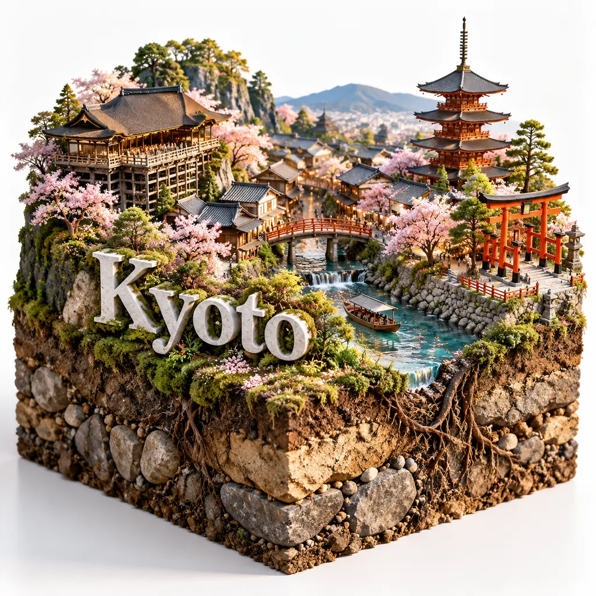</a>

> A popular city template from @kaanakz that many creators reused for their own hometowns: the city sits on a square block lifted out of the earth, with an exposed cross-section of soil, rocks and roots underneath and a whimsical cityscape of iconic landmarks and cultural details on top, plus a clean white city label. We filled it with Kyoto. Great for geography lessons, travel content and city series.

```text
Hyper-realistic 3D square diorama of Kyoto, carved out with exposed soil cross-section beneath showing rocks, roots, and earth layers. Above: whimsical fairytale cityscape featuring iconic landmarks, architecture, and cultural elements of Kyoto. Modern white “Kyoto” label integrated naturally. Pure white studio background with soft natural lighting. DSLR photograph quality - crisp, vibrant, magical realism style. square 1:1 composition
```

- Author: [@kaanakz](https://x.com/kaanakz)
- Original post: https://x.com/kaanakz/status/1997303209111535773
- [View on cinel and generate with this prompt](https://cinel.ai/prompts/p/city-soil-cross-section-diorama?utm_source=github&utm_medium=awesome&utm_campaign=awesome-gpt-image-2.5-prompts)

### Isometric Building Cutaway Slice

<a href="https://cinel.ai/prompts/p/commercial-building-cutaway-slice?utm_source=github&utm_medium=awesome&utm_campaign=awesome-gpt-image-2.5-prompts">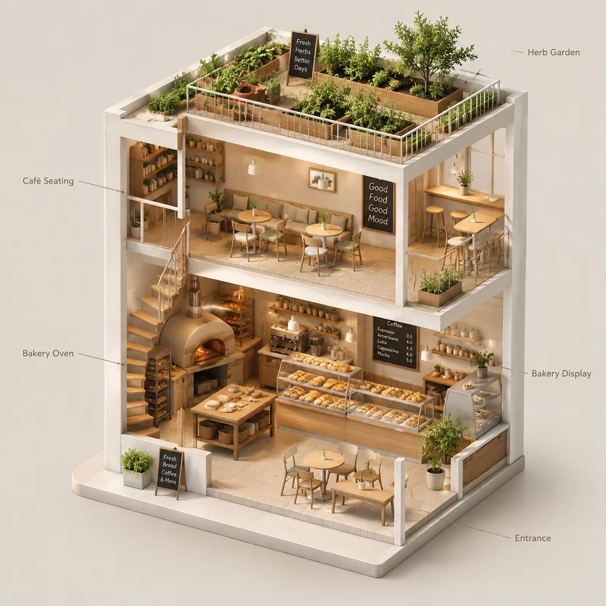</a>

> A six-slot template from @aleenaamiir for showing how a building works inside: a clean isometric section with a cutaway wall, simple structural frame, subtle informational signage, smooth finishes, soft studio light and a miniature architectural-model look on a neutral background. We filled it with a neighborhood bakery café with ovens, counters and a rooftop herb garden. Great for architecture explainers, floor-plan teasers and icon series.

```text
A clean, minimal 3D isometric diorama of a neighborhood bakery and café section, featuring ovens, display counters, seating and a rooftop herb garden visible in a front-wall cutaway style, simple white steel frame, subtle small floor labels, smooth matte plaster and warm wood finish, soft studio lighting, realistic materials, rounded edges, miniature architectural model style, high detail, neutral background.
```

- Author: [@aleenaamiir](https://x.com/aleenaamiir)
- Original post: https://x.com/aleenaamiir/status/2012072821439283400
- [View on cinel and generate with this prompt](https://cinel.ai/prompts/p/commercial-building-cutaway-slice?utm_source=github&utm_medium=awesome&utm_campaign=awesome-gpt-image-2.5-prompts)

### Product Assembly Clay Island Diorama

<a href="https://cinel.ai/prompts/p/product-assembly-clay-island-diorama?utm_source=github&utm_medium=awesome&utm_campaign=awesome-gpt-image-2.5-prompts">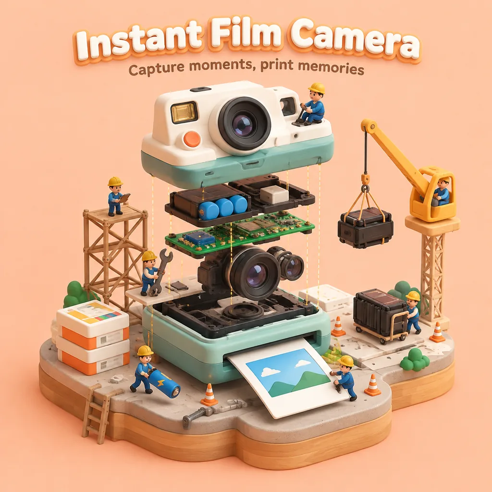</a>

> A playful explainer template from @0x00_Krypt: the product is oversized and exploded into its key layers above a multi-tier floating island, linked by glowing dashed lines and scaffolding, while tiny clay-style workers carry screws, wave wrenches and run a crane. Soft Blender/C4D materials, a bold rounded title with a function subtitle and three background options. We filled it with a generic instant film camera on soft peach. Great for how-it's-made posts and product education.

```text
Create a playful and educational 3D isometric miniature diorama explaining the assembly of Instant Film Camera.

Style & Material:Use a "3D illustration" style typical of Blender 3D or C4D. Materials should look like matte clay, soft resin, and smooth plastic. Avoid harsh photorealism; aim for a tactile, toy-like aesthetic with soft, warm global illumination and rounded edges.

The Scene (The "Exploded" View):Instead of a technical blueprint, create a multi-tiered floating island. The Instant Film Camera is oversized and "exploded" into key layers (shell, battery, circuit board, lens, etc.) that are floating slightly apart, connected by glowing dashed energy lines or miniature scaffolding.

Characters (The "Soul"):Populate the scene with tiny stylized 3D figures (cute proportions, minimal features). They are actively building the product:

Some are carrying oversized screws or components.

Some are holding giant wrenches or clipboards.

Maybe one is sliding down a cable or directing a crane.

(Make them look busy and purposeful, like a construction crew).

Background & Color:Use a clean solid background color that is soft peach pastel (Option A). The base of the island should have a subtle texture (like wood, concrete, or tech-grid) but with a thick, satisfying cross-section.

Text:At the top-center, display Instant Film Camera in bold, rounded 3D typography, with a subtitle below explaining the core function.

Background Logic (Option A chosen):

Option A (Pop): Soft pastel color contrasting with the product.

Option B (Tech): Deep matte navy or charcoal for glowing elements to pop.

Option C (Studio): Clean soft grey or off-white for a museum feel.
```

- Author: [@0x00_Krypt](https://x.com/0x00_Krypt)
- Original post: https://x.com/0x00_Krypt/status/2014297677773828368
- [View on cinel and generate with this prompt](https://cinel.ai/prompts/p/product-assembly-clay-island-diorama?utm_source=github&utm_medium=awesome&utm_campaign=awesome-gpt-image-2.5-prompts)

### Building Exploded-View Model Diorama

<a href="https://cinel.ai/prompts/p/building-exploded-view-model-diorama?utm_source=github&utm_medium=awesome&utm_campaign=awesome-gpt-image-2.5-prompts">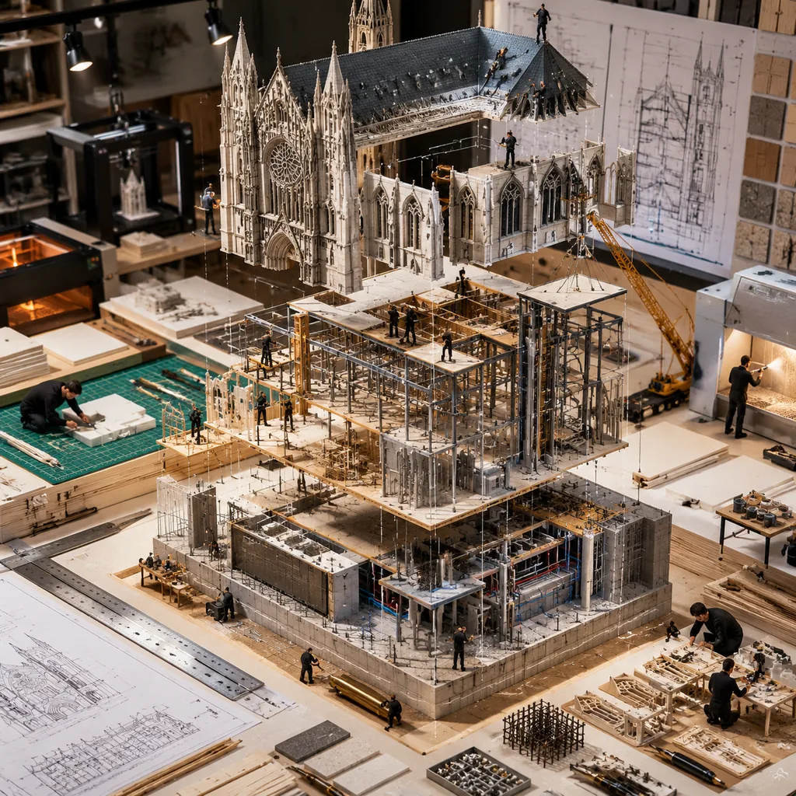</a>

> A structured architecture prompt from @Gdgtify: the building is exploded into three systems (facade skin, steel structure, foundation and utilities) stacked vertically on a drafting table, with section lines showing load paths, while 1:87-scale model makers cut foam core, glue balsa and place floor plates with tiny cranes. Basswood, acrylic and brass textures under studio track lights. We filled it with a generic Gothic stone cathedral. Great for architecture classes and building explainers.

```text
Input Variable: a classic Gothic stone cathedral
System Instruction:
Generate a hyper-realistic, isometric 3D "Exploded View" diorama showing the Input Building deconstructed into its structural systems with an architectural model-making crew assembling a scale version.
1. Semantic Engineering Analysis:

Layer 1 (The Skin): Exterior facade panels, windows, cladding, roofing, entrance canopy
Layer 2 (The Structure): Steel framework, floor plates, columns, beams, elevator shafts, stairwells, mechanical systems
Layer 3 (The Foundation): Basement levels, support pillars, utility conduits, HVAC units, individual rivets/bolts, rebar cages

2.   Container:

Surface: Architect's drafting table with cutting mats and T-squares
Layout: Building layers stacked vertically showing ground-up construction sequence
Connections: White architectural section lines showing structural load paths and circulation
Additional Elements: Blueprint sheets, scale rulers, material samples, elevation drawings

3.  Micro-Narrative:

CRITICAL: This is meta - tiny workers building a model that's being built by tiny workers. Recursive scale concept.
Workers: 1:87 scale model makers in black turtlenecks (architect stereotype)
Equipment: Laser cutters, 3D printers, basswood cutting stations, acrylic gluing rigs, miniature cranes positioning floor plates
Interaction: Architects cutting foam core, assembling balsa wood frames, installing tiny windows, spray painting facades, arranging scale furniture

4. Visual Syntax & Material Physics:

Materials: Basswood grain, clear acrylic sheets, white foam core, brass rod framework, museum board textures
Lighting: Architecture studio track lighting creating dramatic model shadows
Special Effects: Glue strands, wood shavings, spray paint mist, laser cutter burn marks
Output: Elevated three-quarter view, architectural presentation, 1:1 ratio, 8K, architecture model photography aesthetic
```

- Author: [@Gdgtify](https://x.com/Gdgtify)
- Original post: https://x.com/Gdgtify/status/2018906863266345105
- [View on cinel and generate with this prompt](https://cinel.ai/prompts/p/building-exploded-view-model-diorama?utm_source=github&utm_medium=awesome&utm_campaign=awesome-gpt-image-2.5-prompts)

### Monument Isometric Cross-Section

<a href="https://cinel.ai/prompts/p/monument-isometric-cross-section?utm_source=github&utm_medium=awesome&utm_campaign=awesome-gpt-image-2.5-prompts">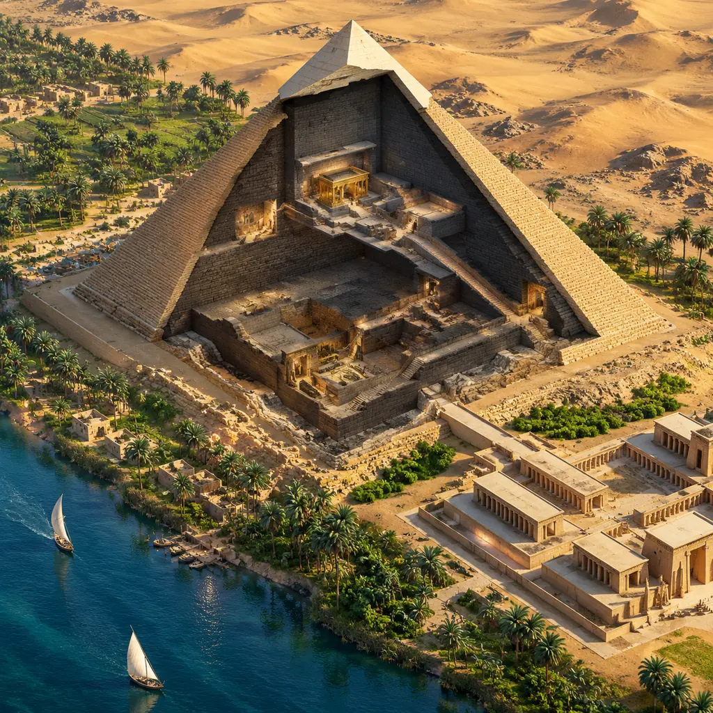</a>

> A compact prompt from @CharaspowerAI: an isometric cross-section of an iconic monument together with landscape elements of its country, rendered as a hyper-realistic 3D diorama. The cut reveals what is inside and below. We filled it with an ancient Egyptian pyramid beside the Nile, palm groves and dunes, showing its inner chambers and passages. Great for history lessons and travel explainers.

```text
isometric cross-section of an ancient Egyptian pyramid with the Nile river, palm groves and desert dunes, revealing its inner burial chambers and passages, in isometric perspective, a diorama, hyper-realistic, detailed, 3d render, high-resolution photography.
```

- Author: [@CharaspowerAI](https://x.com/CharaspowerAI)
- Original post: https://x.com/CharaspowerAI/status/2034683852480745799
- [View on cinel and generate with this prompt](https://cinel.ai/prompts/p/monument-isometric-cross-section?utm_source=github&utm_medium=awesome&utm_campaign=awesome-gpt-image-2.5-prompts)

### Inside the Machine Cutaway Diorama

<a href="https://cinel.ai/prompts/p/inside-the-machine-cutaway-diorama?utm_source=github&utm_medium=awesome&utm_campaign=awesome-gpt-image-2.5-prompts">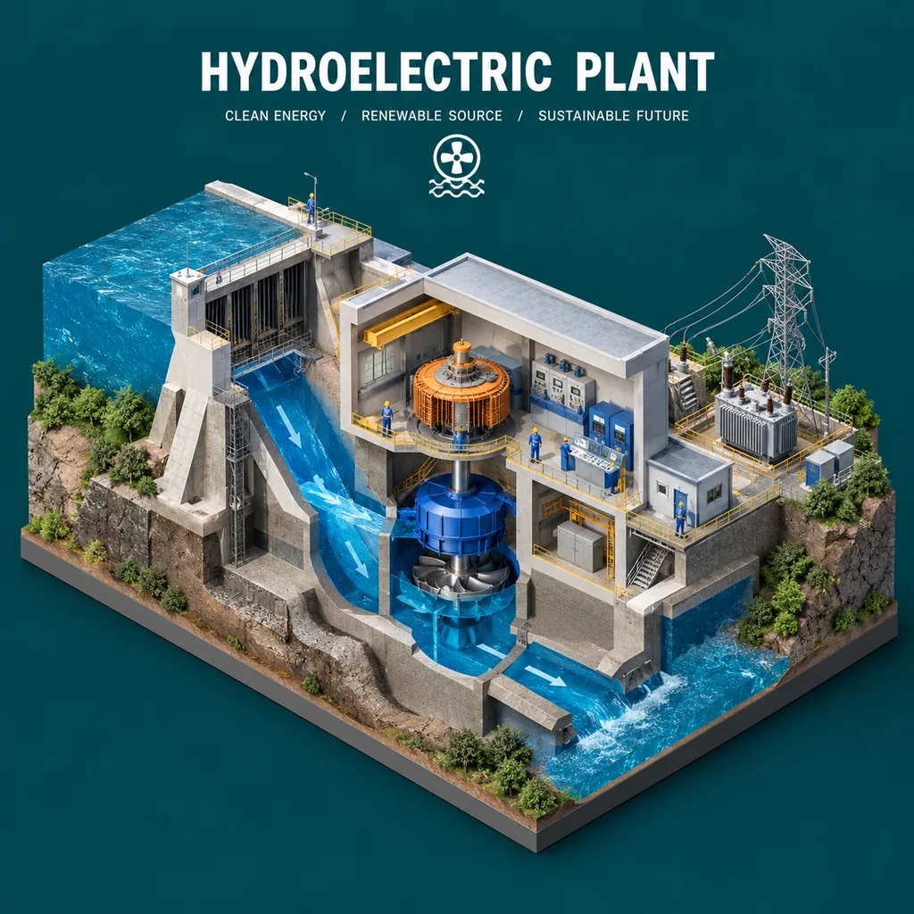</a>

> An educational template from @aleenaamiir's isometric diorama series: a 45° top-down miniature cutaway of a machine or device on a raised base, with internal components, wiring, gears and energy-flow paths visible, tiny faceless technicians at work, a solid background and a bold title, technical subtitle and engineering icon that auto-contrast. We filled it with a hydroelectric power plant on deep teal. Great for STEM explainers and science posts.

```text
Create a clear, 45° top-down isometric miniature 3D cutaway diorama showing the inside of a hydroelectric power plant.

Use soft refined textures, realistic PBR materials, and clean technical lighting.

Design a raised base with visible internal components, wiring, gears, or energy flow paths.
Include tiny stylized technicians interacting with the machinery (no facial details).

Use a clean solid deep teal background.

At the top-center, display HYDROELECTRIC PLANT in large bold text, beneath it show a short technical subtitle, and place a minimal engineering icon below.

All text must automatically match the background contrast (white or black).
```

- Author: [@aleenaamiir](https://x.com/aleenaamiir)
- Original post: https://x.com/aleenaamiir/status/2018147539992862866
- [View on cinel and generate with this prompt](https://cinel.ai/prompts/p/inside-the-machine-cutaway-diorama?utm_source=github&utm_medium=awesome&utm_campaign=awesome-gpt-image-2.5-prompts)

### Kyoto Destination Isometric Diorama

<a href="https://cinel.ai/prompts/p/kyoto-destination-isometric-diorama?utm_source=github&utm_medium=awesome&utm_campaign=awesome-gpt-image-2.5-prompts">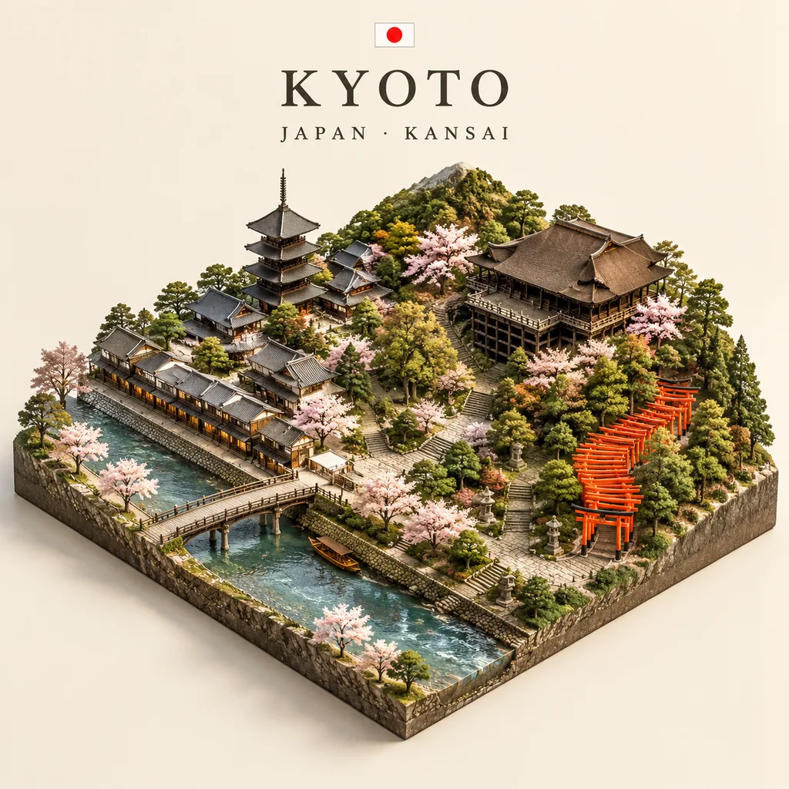</a>

> @AiwithLariab destination core-identity diorama meta-prompt (126 likes). Filled DESTINATION=Kyoto; square 1:1; accurate JP flag only.

```text
Create a premium square 1:1 3D isometric miniature diorama of Kyoto, focused on its most internationally recognizable geographic and cultural core.
Use the smallest coherent area that best represents Kyoto: historic center with river corridor and temple district. Maintain iconic core 75% + supporting context 25%.
Terrain footprint visible and uncropped. Include 1–2 hero landmarks (Kiyomizu-dera wooden stage silhouette, Fushimi Inari vermilion torii tunnel) and 3–5 secondary elements (Pagoda roof cluster, stone lantern path, cherry trees, Kamo river edge, traditional machiya street). Correct relative positions, connected by streets, bridges, parks, vegetation.
High-angle three-quarter isometric view, orthographic-like perspective, sculpted terrain, realistic materials, soft contact shadows, warm off-white studio background, subtle ground shadow. Elegant museum-quality architectural miniature — not cartoonish or toy-like.
Top center header exactly:
KYOTO
JAPAN · KANSAI
with one small accurate Japanese national flag only. No other text, logos, or watermarks. No people faces. Square 1:1.
```

- Author: [@AiwithLariab](https://x.com/AiwithLariab)
- Original post: https://x.com/AiwithLariab/status/2094618926475055509
- [View on cinel and generate with this prompt](https://cinel.ai/prompts/p/kyoto-destination-isometric-diorama?utm_source=github&utm_medium=awesome&utm_campaign=awesome-gpt-image-2.5-prompts)

### Lisbon Destination Isometric Diorama

<a href="https://cinel.ai/prompts/p/lisbon-destination-isometric-diorama?utm_source=github&utm_medium=awesome&utm_campaign=awesome-gpt-image-2.5-prompts">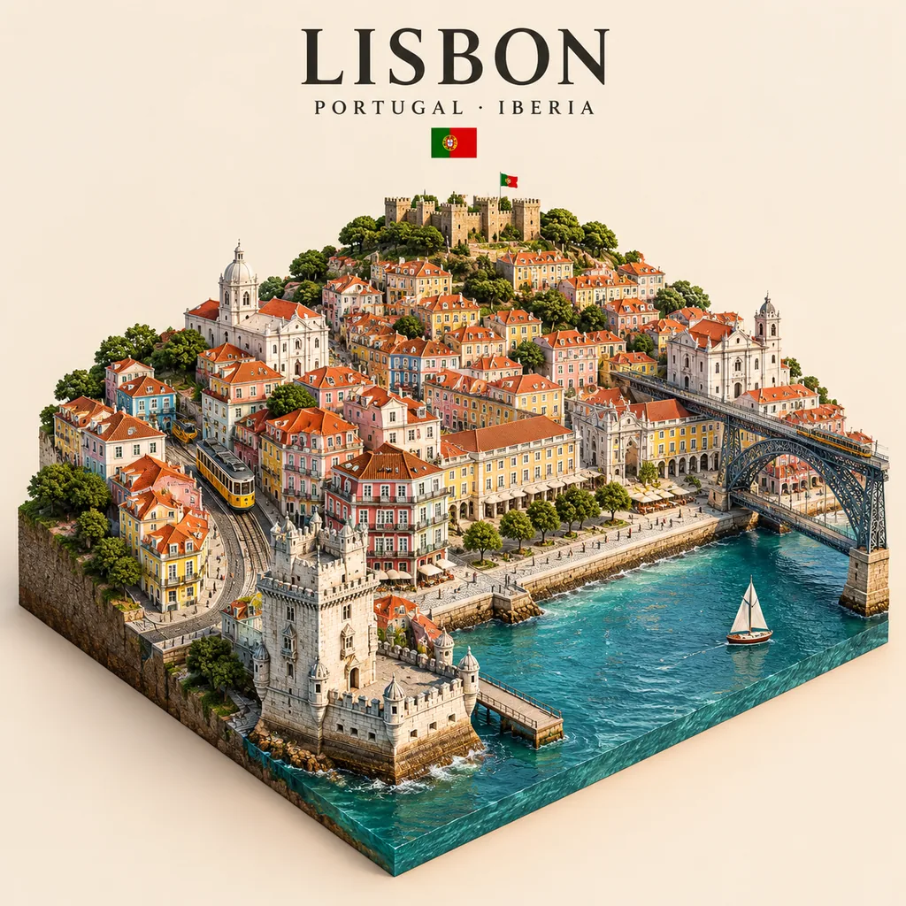</a>

> @Goodmanprotocol destination isometric diorama (42 likes). Filled Lisbon; square 1:1.

```text
DESTINATION = Lisbon SCOPE = AUTO
Create a premium square 1:1 3D isometric miniature diorama of Lisbon, focused on its most recognizable geographic and cultural core. Select 5–8 authentic iconic elements.
Use Alfama/Baixa waterfront core as raised terrain. Include hero: Belém Tower and Dom Luís I / riverside skyline hierarchy; secondary: yellow tram on hill street, tiled rooftops, São Jorge Castle hill, Tagus waterfront, pastel façades. Connect via streets, hills, water.
High-detail realistic architectural miniature, high-angle three-quarter isometric, soft ambient occlusion, warm off-white studio background.
Top center exactly:
LISBON
PORTUGAL · IBERIA
small accurate Portuguese flag only. No logos, watermarks, invented landmarks. Square 1:1.
```

- Author: [@Goodmanprotocol](https://x.com/Goodmanprotocol)
- Original post: https://x.com/Goodmanprotocol/status/2092819809453129850
- [View on cinel and generate with this prompt](https://cinel.ai/prompts/p/lisbon-destination-isometric-diorama?utm_source=github&utm_medium=awesome&utm_campaign=awesome-gpt-image-2.5-prompts)

### Venice Block-Style City Diorama

<a href="https://cinel.ai/prompts/p/venice-block-city-diorama?utm_source=github&utm_medium=awesome&utm_campaign=awesome-gpt-image-2.5-prompts">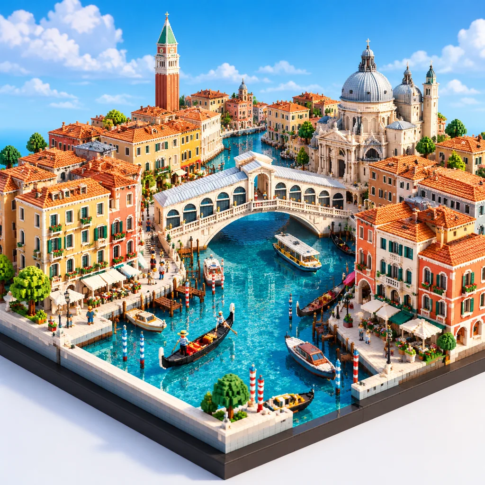</a>

> @Goodmanprotocol block-style city diorama (44 likes). Filled Venice; removed toy-brand wording from filled_prompt; original kept.

```text
Create a premium square 1:1 miniature city diorama for Venice.
Automatically identify iconic canals, bridges, and architecture. Recreate as a highly detailed block-style miniature city diorama with clean geometric forms, crisp edges, modular details, realistic miniature proportions.
Dynamic isometric elevated three-quarter viewpoint. Main landmark focal point (Rialto Bridge silhouette) surrounded by supporting buildings, canals, boats, greenery, tiny miniature figures without facial detail.
Bright clear daytime, vivid blue sky, soft white clouds, bright natural studio illumination. Charming collectible architectural model aesthetic. No logos, no brand names, no watermarks, no photorealistic full-scale city. Square 1:1.
```

- Author: [@Goodmanprotocol](https://x.com/Goodmanprotocol)
- Original post: https://x.com/Goodmanprotocol/status/2101305861000040790
- [View on cinel and generate with this prompt](https://cinel.ai/prompts/p/venice-block-city-diorama?utm_source=github&utm_medium=awesome&utm_campaign=awesome-gpt-image-2.5-prompts)

### Printing Press Invention World Diorama

<a href="https://cinel.ai/prompts/p/printing-press-invention-diorama?utm_source=github&utm_medium=awesome&utm_campaign=awesome-gpt-image-2.5-prompts">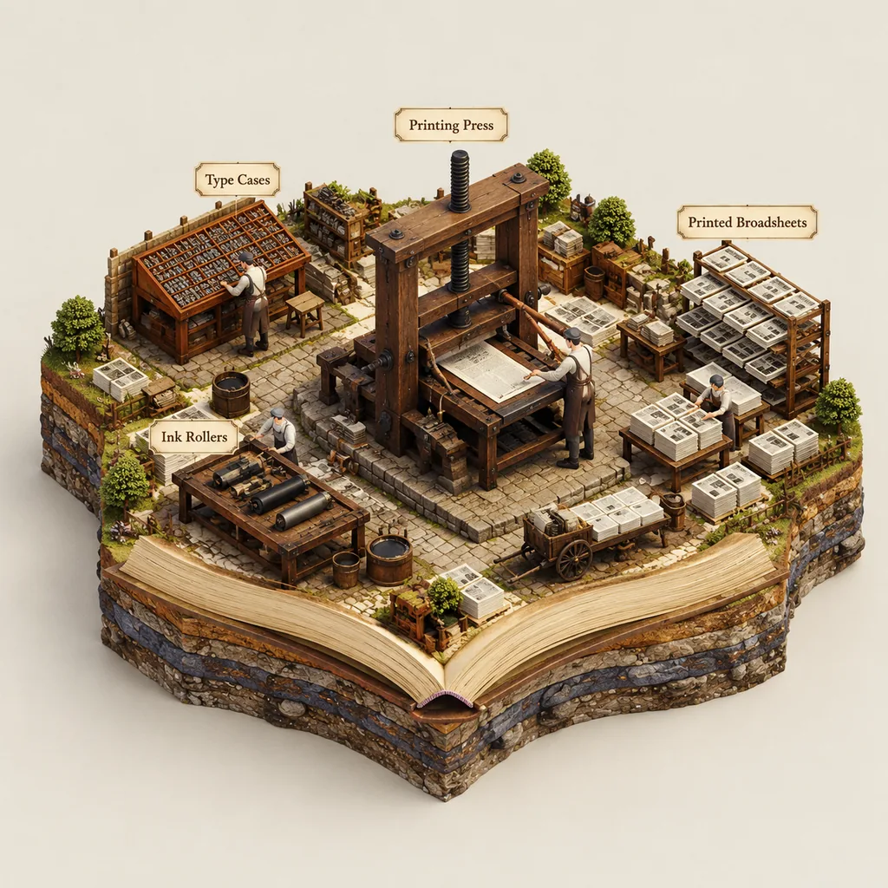</a>

> @Gdgtify inventions isometric miniature world (9 likes). Filled mechanical printing press / open-book silhouette; single frame 1:1.

```text
Square 1:1 isometric miniature world of the theme "mechanical printing press", landmass cut as a silhouette of an open book, floating as a self-contained diorama. Isometric projection, cross-section side walls revealing strata, soft global illumination. Core landmark: a detailed antique printing press at center; surrounding sub-scenes of type cases, ink rollers, stacked broadsheets, tiny printers at work without facial detail. Soft shadows and small elegant labels only on key scenes. Matte blank background. No brands, no modern logos. 8K isometric diorama masterwork.
```

- Author: [@Gdgtify](https://x.com/Gdgtify)
- Original post: https://x.com/Gdgtify/status/2097225927394836520
- [View on cinel and generate with this prompt](https://cinel.ai/prompts/p/printing-press-invention-diorama?utm_source=github&utm_medium=awesome&utm_campaign=awesome-gpt-image-2.5-prompts)

### Robie House Blueprint Desk Diorama

<a href="https://cinel.ai/prompts/p/robie-house-blueprint-desk-diorama?utm_source=github&utm_medium=awesome&utm_campaign=awesome-gpt-image-2.5-prompts">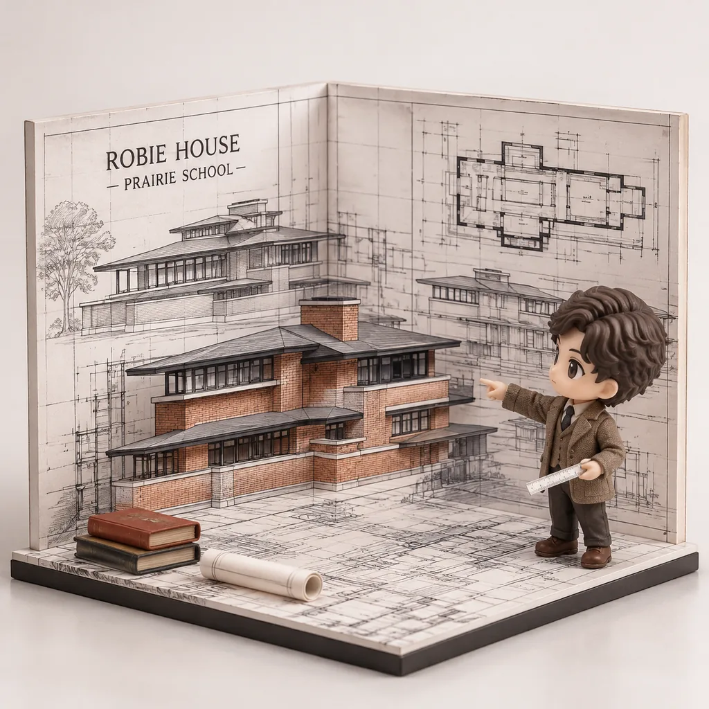</a>

> @Gdgtify blueprint-to-model desk diorama (17 likes). Filled Robie House (prairie school); chibi architect avatar, no real likeness.

```text
Hyper-realistic 1:1 product photo of a Blueprint-to-Model Desk Diorama (isometric miniature) for Robie House prairie-school architecture.
U-shaped cardboard drafting station (two walls + floor). Walls: B&W blueprint lines, elevation drawings, annotations. Floor: blueprint fragments fold upward. A 2D blueprint line rises into a 3D model piece of the long horizontal cantilevered brick volumes; a small stylized chibi architect avatar in matte PVC holding a tiny scale ruler points at the emerging model — no real-person likeness. Palette: strict B&W blueprint world; full color figure + one accent prop. Soft product lighting. Label: "ROBIE HOUSE — PRAIRIE SCHOOL". Museum-miniature realism. Square 1:1. No logos.
```

- Author: [@Gdgtify](https://x.com/Gdgtify)
- Original post: https://x.com/Gdgtify/status/2089551609466683653
- [View on cinel and generate with this prompt](https://cinel.ai/prompts/p/robie-house-blueprint-desk-diorama?utm_source=github&utm_medium=awesome&utm_campaign=awesome-gpt-image-2.5-prompts)
