# Food & Drink · GPT Image 2.5

[← README](../README.md) · 184 · [Category on cinel](https://cinel.ai/prompts/food-drink?utm_source=github&utm_medium=awesome&utm_campaign=awesome-gpt-image-2.5-prompts)

### Exploded Dish Food Infographic with Floating Ingredients

<a href="https://cinel.ai/prompts/p/exploded-dish-food-infographic?utm_source=github&utm_medium=awesome&utm_campaign=awesome-gpt-image-2.5-prompts">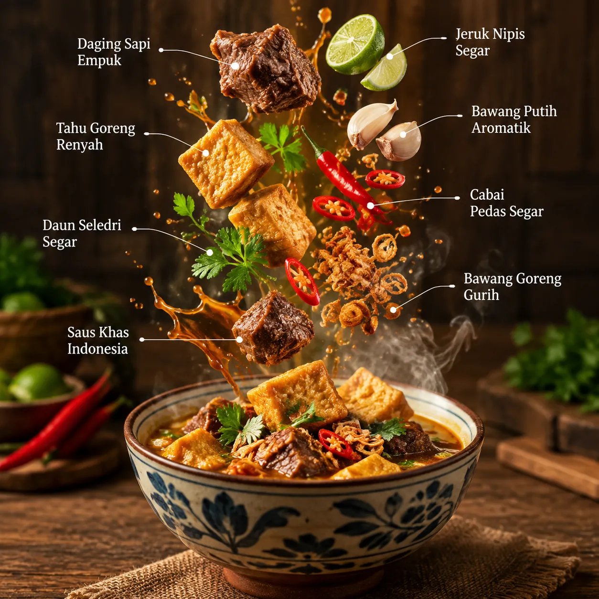</a>

> Structured as JSON, this prompt is easy to edit field by field: cuisine, the list of levitating ingredients, label language, background and lighting. The vertical hierarchy (bowl anchored at the bottom, ingredients rising) gives every food the same readable composition, and asking for labels in the cuisine's own language adds authenticity. Our Indonesian example labelled beef, crispy tofu, lime, garlic, chilli and fried shallots correctly in Bahasa Indonesia. One leader line pointed at the wrong item, a reminder to check pointers. To reuse it, change 'cuisine' and the ingredient list together; keep six to eight ingredients so each label has room.

```text
{
  "image_prompt": {
    "type": "Hyper-realistic food infographic",
    "subject": {
      "cuisine": "Indonesian",
      "base_element": "Traditional bowl with steaming hot dish at the bottom",
      "levitating_ingredients": [
        "Juicy meat",
        "Crispy tofu",
        "Glossy sauce splashes",
        "Fresh herbs",
        "Chilies",
        "Lime",
        "Garlic",
        "Fried shallots"
      ]
    },
    "composition": {
      "layout": "Clean vertical composition",
      "arrangement": "Realistic gravity-defying/floating elements",
      "background": "Rustic wooden surface",
      "visual_hierarchy": "Bowl anchored at bottom, ingredients rising vertically"
    },
    "graphic_design_elements": {
      "labels": "Clear Indonesian text",
      "lines": "Thin white pointing lines",
      "style": "Editorial infographic layout, professional food magazine style"
    },
    "lighting_and_mood": {
      "lighting": "Cinematic studio lighting",
      "color_palette": "Warm tones",
      "effects": "Dramatic steam, motion-frozen ingredients"
    },
    "technical_specs": {
      "camera_settings": "Shallow depth of field, sharp focus, DSLR look",
      "details": "Ultra-detailed textures",
      "resolution": "8K ultra-realistic"
    }
  }
}
```

- Author: [@Taaruk_](https://x.com/Taaruk_)
- Original post: https://x.com/Taaruk_/status/2017865644365255078
- [View on cinel and generate with this prompt](https://cinel.ai/prompts/p/exploded-dish-food-infographic?utm_source=github&utm_medium=awesome&utm_campaign=awesome-gpt-image-2.5-prompts)

### Floating Dish Recipe Infographic Prompt

<a href="https://cinel.ai/prompts/p/recipe-infographic-floating-dish?utm_source=github&utm_medium=awesome&utm_campaign=awesome-gpt-image-2.5-prompts">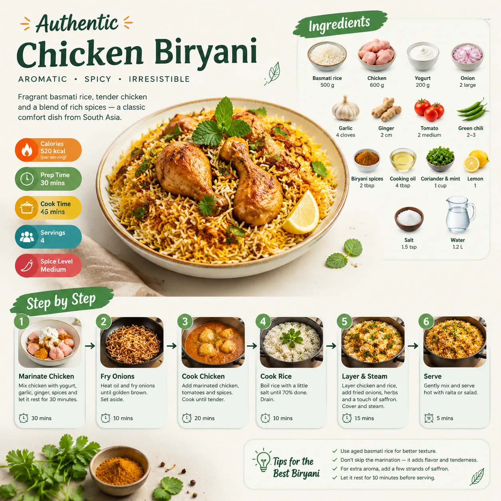</a>

> Most recipe-card prompts produce flat, top-down layouts. This one asks for the finished dish at an angle, slightly floating, with ingredients and steps flowing around it, and it sets a clear hierarchy (dish, then steps, then ingredients, then stats) so the eye knows where to go. Glassmorphism step panels and small cooking icons give it a modern app-like finish. Our biryani version came out as a complete, believable card with ingredient quantities, six numbered steps, timing badges and a tips box; the only slip was cook time not matching the step durations. Note that the dish is written into the prompt itself ('briyani', spelled that way), so replace it every time you reuse the template.

```text
Ultra-clean modern recipe infographic. Showcase briyani in a visually appealing finished form—sliced, plated, or portioned—floating slightly in perspective or angled view. Arrange ingredients, steps, and tips around the dish in a dynamic editorial layout, not restricted to top-down. Ingredients Section: Include icons or mini illustrations for each ingredient with quantities. Arrange them in clusters, lists, or circular flows connected visually to the dish. Steps Section: Show preparation steps with numbered panels, arrows, or lines, forming a logical flow around the main dish. Include small cooking icons (knife, pan, oven, timer) where helpful. Additional Info (optional): Total calories, prep/cook time, servings, spice level—displayed as clean bubbles or badges near the dish. Visual Style: Editorial infographic meets lifestyle food photography. Vibrant, natural food colors, subtle drop shadows, clean vector icons, modern typography, soft gradients or glassmorphism for step panels. Accent colors can highlight key info (calories, prep time). Composition Guidelines: Finished meal as hero visual (perspective or angled) Ingredients and steps flow dynamically around the dish Clear visual hierarchy: dish > steps > ingredients > optional stats Enough negative space to keep design airy and readable Lighting & Background: Soft, natural studio lighting, minimal textured or gradient background for premium editorial feel. Output: 1080×1080, ultra-crisp, social-feed optimized, no watermark.
```

- Author: [@Strength04_X](https://x.com/Strength04_X)
- Original post: https://x.com/Strength04_X/status/2013186574390046844
- [View on cinel and generate with this prompt](https://cinel.ai/prompts/p/recipe-infographic-floating-dish?utm_source=github&utm_medium=awesome&utm_campaign=awesome-gpt-image-2.5-prompts)

### Pistachio Baklava Four-Module Dessert Ad Prompt

<a href="https://cinel.ai/prompts/p/pistachio-baklava-dessert-commercial-shot?utm_source=github&utm_medium=awesome&utm_campaign=awesome-gpt-image-2.5-prompts">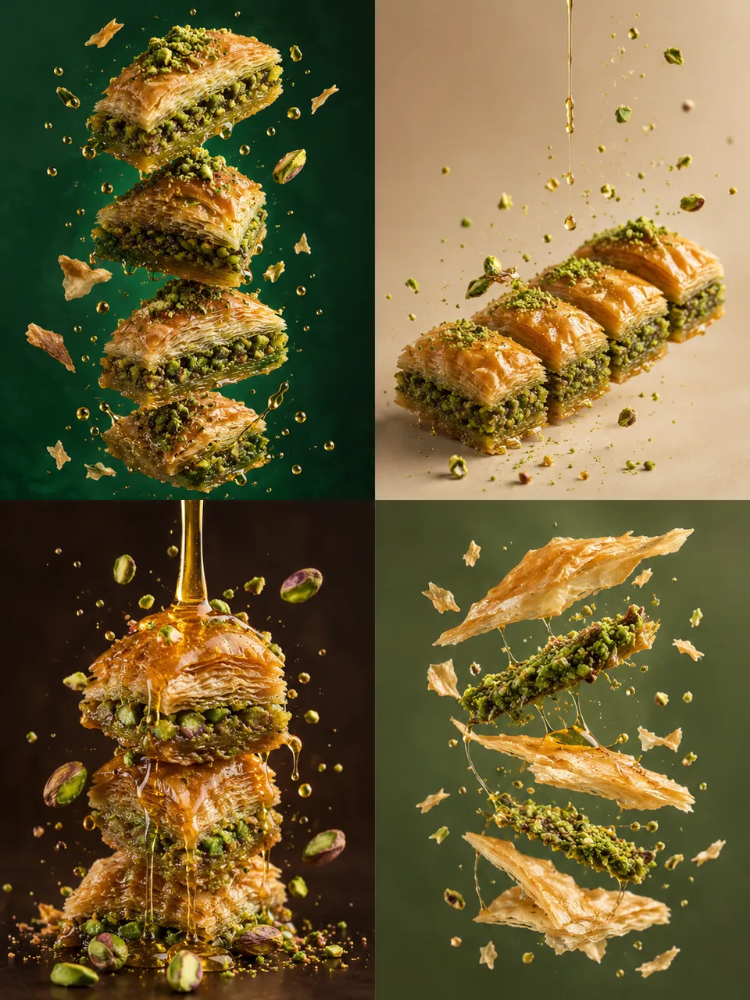</a>

> Like the drink 'master prompt', this one splits global settings from per-shot modules, here four baklava scenes with their own backgrounds. What makes it work for pastry is the texture vocabulary: ultra-thin phyllo layers 'clearly visible', diamond cuts, finely ground bright-green pistachio between sheets, syrup glistening on the edges and droplets frozen in mid-air. Our result shows exactly that across four tiles: a floating stack on deep green, a resting tray on cream, a syrup pour on dark brown and shattered layers on olive. The colour-per-module rule gives a cohesive set for a menu or social grid. Swap baklava for any layered dessert, such as mille-feuille or kunafa, and keep the texture lines.

```text
{
  "resolution": "8K UHD",
  "aspect_ratio": "3:4",
  "image_style": "hyper-realistic commercial dessert photography",
  "global_settings": {
    "quality": "Ultra-high detail, razor-sharp focus, luxury dessert clarity",
    "lighting": "Controlled studio lighting emphasizing texture, layers, and syrup highlights",
    "motion": "Frozen mid-air elements with subtle gravity realism",
    "background_style": "Solid or smooth gradient background, color varies per module",
    "camera": "High-speed photography look, shallow to medium depth of field",
    "post_processing": "Rich contrast, warm tones, natural shine, no artificial glow"
  },
  "modules": { "module_1_classic_baklava_stack_explosion": {
      "scene_description": "A dramatic stack of classic pistachio baklava with flying syrup droplets",
      "baklava": {
        "type": "Traditional pistachio baklava",
        "layers": "Ultra-thin phyllo layers clearly visible",
        "cut": "Diamond-shaped pieces",
        "position": "Stacked and floating mid-air"
      },
      "details": {
        "nuts": "Finely ground bright green pistachios between layers",
        "syrup": "Golden sugar syrup glistening on edges"
      },
      "motion_effects": {
        "syrup": "Small syrup droplets splashing outward",
        "crumbs": "Tiny phyllo flakes suspended in air"
      },
      "background": {
        "color": "Deep emerald green",
        "texture": "Smooth, seamless"
      }
    }, "module_2_minimal_baklava_plate_floating": {
      "scene_description": "Minimalist premium baklava presentation with controlled floating crumbs",
      "baklava": {
        "type": "Single-layer pistachio baklava pieces",
        "arrangement": "Neatly aligned rectangular cuts",
        "surface": "Glossy with light syrup sheen"
      },
      "accent_elements": {
        "nuts": "Crushed pistachio dust lightly floating",
        "syrup": "Thin syrup drizzle frozen mid-air"
      },
      "motion_effects": {
        "particles": "Subtle floating crumbs and nut dust"
      },
      "background": {
        "color": "Warm beige",
        "gradient": "Very soft tonal gradient"
      }
    }, "module_3_baklava_syrup_pour_drama": {
      "scene_description": "Cinematic syrup pour over baklava stack",
      "baklava": {
        "type": "Thick stacked baklava slices",
        "texture": "Highly detailed crispy layers"
      },
      "additional_elements": {
        "syrup": {
          "state": "Thick golden syrup pouring from above",
          "motion": "Frozen in elegant flowing strands"
        },
        "nuts": [
          "Whole pistachio kernels",
          "Crushed pistachio fragments"
        ]
      },
      "motion_effects": {
        "splashes": "Micro syrup splashes on impact points",
        "particles": "Floating nut fragments"
      },
      "background": {
        "color": "Dark chocolate brown",
        "tone": "High contrast, luxury feel"
      }
    }, "module_4_modern_baklava_floating_composition": {
      "scene_description": "Modern deconstructed baklava composition in mid-air",
      "elements": {
        "phyllo": "Crispy golden phyllo sheets floating separately",
        "nuts": "Pistachio layers suspended between sheets",
        "syrup": "Glossy syrup threads connecting elements"
      },
      "motion_effects": {
        "flakes": "Ultra-fine pastry flakes suspended",
        "drops": "Minimal syrup droplets"
      },
      "background": {
        "color": "Muted olive green",
        "texture": "Smooth, seamless"
      }
    }
  },
  "negative_prompt": [
    "text",
    "logos",
    "branding",
    "hands",
    "people",
    "utensils",
    "plates",
    "tables",
    "cartoon style",
    "excessive syrup pooling",
    "burnt pastry",
    "overexposure",
    "artificial glow",
    "low detail textures"
  ]
}
```

- Author: [@kaanakz](https://x.com/kaanakz)
- Original post: https://x.com/kaanakz/status/2009204329236828239
- [View on cinel and generate with this prompt](https://cinel.ai/prompts/p/pistachio-baklava-dessert-commercial-shot?utm_source=github&utm_medium=awesome&utm_campaign=awesome-gpt-image-2.5-prompts)

### Floating Dessert Stack with Gold Ingredient Labels

<a href="https://cinel.ai/prompts/p/cinematic-studio-food-photography?utm_source=github&utm_medium=awesome&utm_campaign=awesome-gpt-image-2.5-prompts">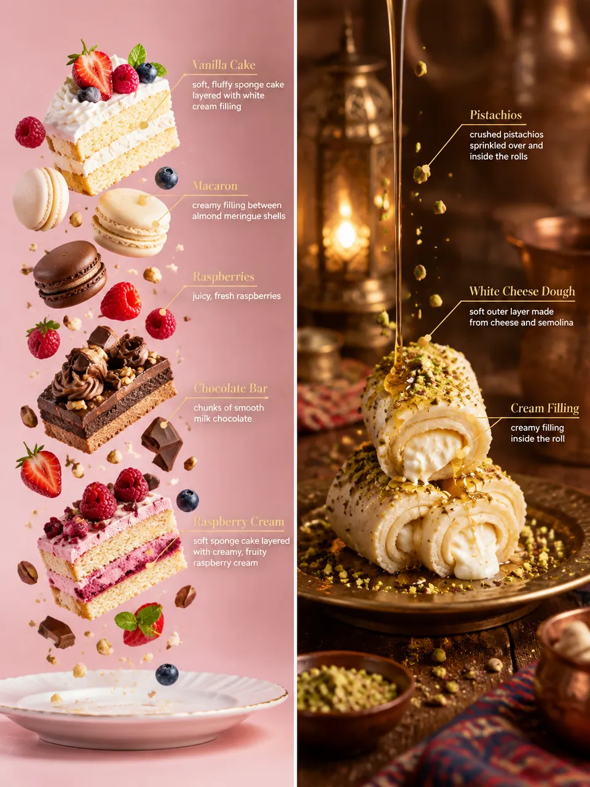</a>

> What sets this modular prompt apart is its text design system, defined once in the global settings: metallic-gold ingredient names in a serif, pure-white descriptions in a sans-serif, and long, thin, rounded golden indicator lines. Every module inherits that system, so the labels look consistent across very different scenes. The 'no zoom, no crop, centre-weighted vertical' rules keep the floating stack fully in frame. Our two-panel result pairs a pink-gradient cake stack with a moody pastry scene, both labelled in the same gold style. The descriptions are generic marketing copy, so rewrite them for your real menu. Delete modules you don't need.

```text
{
  "global_settings": {
    "resolution": "8K ultra high definition",
    "aspect_ratio": "3:4",
    "camera_style": "studio food photography with cinematic lighting",
    "depth_of_field": "shallow depth of field, sharp subject, soft background",
    "lighting": "soft directional key light, subtle rim light, controlled highlights",
    "style": "hyper-realistic food illustration with editorial infographic overlays",
    "composition_rules": [
      "no zoom",
      "no crop",
      "center-weighted vertical composition",
      "floating elements frozen in motion"
    ],
    "text_design": {
      "ingredient_name_color": "metallic gold",
      "ingredient_description_color": "pure white",
      "font_style": "elegant serif for titles, clean sans-serif for descriptions",
      "indicator_lines": "long, thin, smooth golden lines with rounded corners"
    }
  },

  "module_1_image_1_style": {
    "scene_description": "A vertical stack of assorted cake slices floating above a white ceramic plate against a soft pink gradient background.",
    "background": {
      "color": "soft pastel pink",
      "texture": "smooth gradient",
      "lighting": "even, studio-lit, no harsh shadows"
    },
    "main_subjects": [
      "multiple layered sponge cake slices",
      "white whipped cream layers",
      "raspberry cream layer",
      "chocolate cream topping"
    ],
    "visible_ingredients": [
      "vanilla sponge cake",
      "whipped cream",
      "raspberries",
      "blueberries",
      "strawberries",
      "macarons (vanilla and chocolate)",
      "chocolate bar pieces",
      "mint leaves",
      "small nut fragments"
    ],
    "motion_elements": [
      "floating fruits",
      "floating macarons",
      "crumbs suspended in air"
    ],
    "text_labels": [
      "Vanilla Cake – soft, fluffy sponge cake layered with white cream filling",
      "Macaron – creamy filling between almond meringue shells",
      "Raspberries – juicy, fresh raspberries",
      "Chocolate Bar – chunks of smooth milk chocolate",
      "Raspberry Cream – soft sponge cake layered with creamy, fruity raspberry cream"
    ]
  },

  "module_2_image_2_style": {
    "scene_description": "Rolled Syrian dessert presented vertically with syrup pouring from above, placed in a warm, rustic kitchen environment.",
    "background": {
      "environment": "traditional kitchen",
      "elements": [
        "warm lantern light",
        "wooden surfaces",
        "brass and copper utensils"
      ],
      "lighting": "warm ambient lighting with soft highlights"
    },
    "main_subjects": [
      "rolled white dessert dough",
      "cream filling spilling out",
      "golden syrup stream"
    ],
    "visible_ingredients": [
      "white cheese dough",
      "cream filling",
      "pistachios",
      "sugar syrup"
    ],
    "motion_elements": [
      "syrup dripping vertically",
      "pistachio crumbs falling"
    ],
    "text_labels": [
      "White Cheese Dough – soft outer layer made from cheese and semolina",
      "Cream Filling – creamy filling inside the roll",
      "Pistachios – crushed pistachios sprinkled over and inside the rolls"
    ]
  }
```

- Author: [@meng_dagg695](https://x.com/meng_dagg695)
- Original post: https://x.com/meng_dagg695/status/2011994819124752631
- [View on cinel and generate with this prompt](https://cinel.ai/prompts/p/cinematic-studio-food-photography?utm_source=github&utm_medium=awesome&utm_campaign=awesome-gpt-image-2.5-prompts)

### Floating Stacked Food Ad on White Background

<a href="https://cinel.ai/prompts/p/floating-stacked-food-ad-white-background?utm_source=github&utm_medium=awesome&utm_campaign=awesome-gpt-image-2.5-prompts">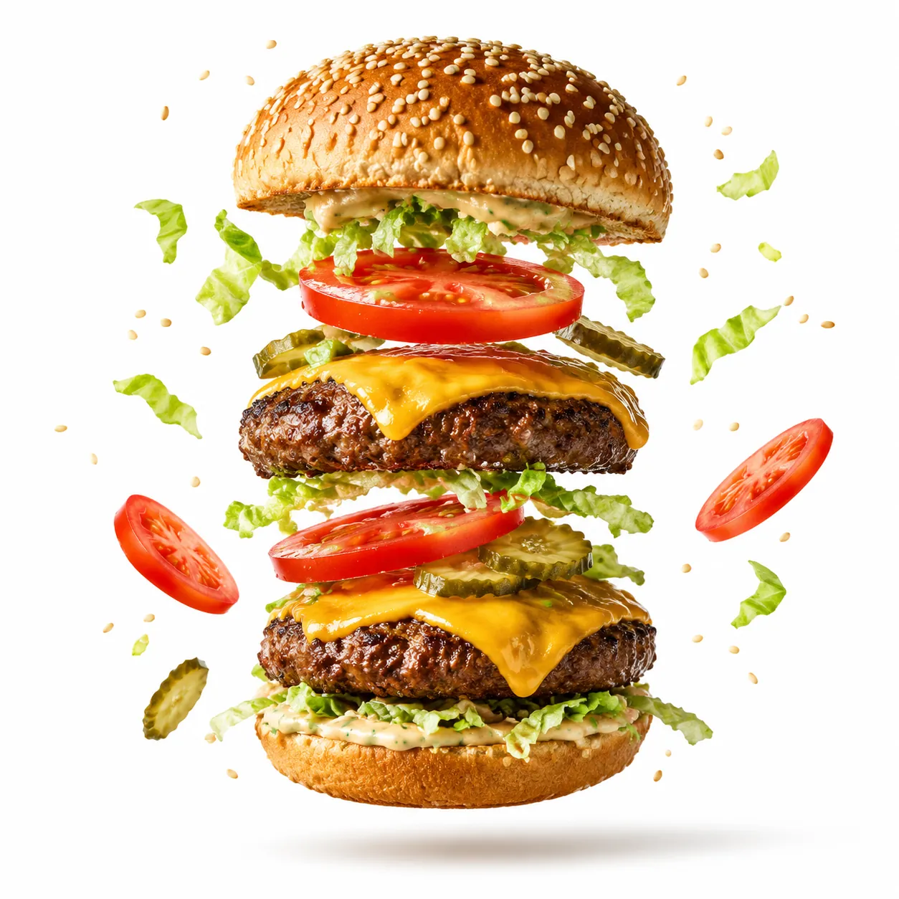</a>

> The fast-food 'exploded burger' look, reduced to two blanks. The prompt pulls the dish apart vertically ('floating stacked composition, levitating pieces'), scatters small ingredient bits around it and grounds everything with one crisp soft shadow on the white surface, the detail that makes levitation read as photographed rather than cut out. High-key light and a 100mm macro look keep textures appetising. Our double cheeseburger splits neatly into bun, lettuce, tomato, two patties with melted cheese and pickles, with lettuce shreds flying. It works for sandwiches, tacos, layered cakes, sushi stacks, anything with distinct layers. Choose ingredient bits that actually belong to the dish.

```text
A stacked double cheeseburger, premium food advertising, white seamless background, high key studio lighting, floating stacked composition, levitating pieces, sesame seeds, shredded lettuce and tomato slices scattered, clean minimal layout, crisp soft shadow on surface, ultra realistic, macro product photography, 100mm lens look, f/8 sharp focus, subtle texture detail, editorial commercial, 8k
```

- Author: [@azed_ai](https://x.com/azed_ai)
- Original post: https://x.com/azed_ai/status/2009625733933736157
- [View on cinel and generate with this prompt](https://cinel.ai/prompts/p/floating-stacked-food-ad-white-background?utm_source=github&utm_medium=awesome&utm_campaign=awesome-gpt-image-2.5-prompts)

### Top-Down Dining Table Styled as a Social Post

<a href="https://cinel.ai/prompts/p/top-down-dining-table-group-shot?utm_source=github&utm_medium=awesome&utm_campaign=awesome-gpt-image-2.5-prompts">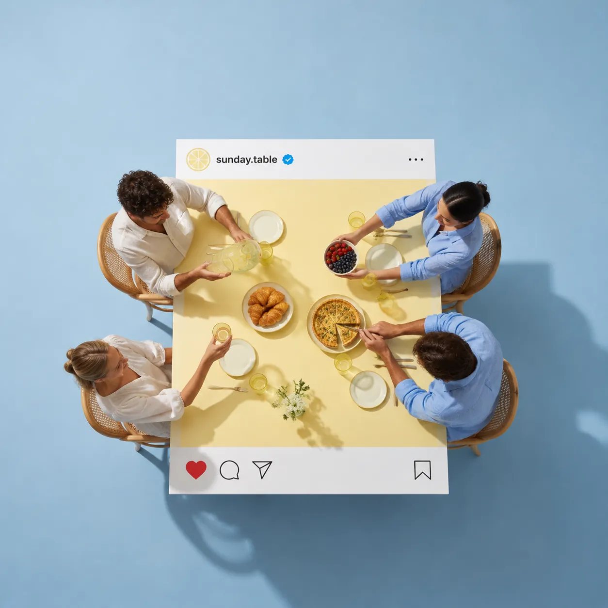</a>

> A clever physical-meets-digital concept: the dining table itself is built as a giant social post, with a white profile strip at the top, like and share icons at the bottom, and a coloured centre that becomes the 'photo'. The camera is pulled far back for lots of empty floor, and the prompt strictly confines all food, drinks and hands to the coloured centre so the illusion holds. We set a summer brunch: lemon-yellow centre, sky-blue floor, four friends in linen pouring lemonade and passing berries, under the fictional handle sunday.table. It is perfect for restaurant launches or brand anniversaries. Specify each person's action; vague instructions make everyone do the same thing.

```text
Ultra-wide-angle hyper-realistic shooting in top-down mode. A group of 4 real people sitting at a square dining table. The camera is pushed far back, creating a significant negative space (empty floor area) around the people and the table, which provides a clear, minimalistic composition. Scene (relaxed summer brunch, casual linen clothing): Four people are dressed in casual summer linen outfits in cream and soft blue. Their interaction is specific: one pours lemonade, one passes a bowl of berries, one slices a quiche, one raises a glass. The table is a custom-made physical prop, designed as an Instagram post: it has a solid white stripe ONLY along the top and bottom edges (no white frames on the left or right). - The upper white stripe shows a drawn profile photo with a simple lemon-slice icon, the username "sunday.table", followed by a small blue icon with a confirmed check mark, and "..." on the right. - Red hearts, comment and share icons are painted on the bottom white stripe on the left, and a Bookmarks icon on the right. The center of the table is filled in pastel lemon yellow (#FFF4B8). The table shows a quiche, fresh berries, croissants, a jug of lemonade and four glasses. important: ALL food, beverages, objects, and hands that interact with them must be located strictly within this central area, colored in pastel lemon yellow (#FFF4B8). NOTHING should go beyond the white stripes or beyond the table. The background of the floor is made in soft sky blue to create a visual separation. Professional studio lighting with clear shadows. 8k, clear focus.
```

- Author: [@Goodmanprotocol](https://x.com/Goodmanprotocol)
- Original post: https://x.com/Goodmanprotocol/status/2045009725218226475
- [View on cinel and generate with this prompt](https://cinel.ai/prompts/p/top-down-dining-table-group-shot?utm_source=github&utm_medium=awesome&utm_campaign=awesome-gpt-image-2.5-prompts)

### Labeled Food Cross-Section Poster Prompt

<a href="https://cinel.ai/prompts/p/food-cross-section-layers-shot?utm_source=github&utm_medium=awesome&utm_campaign=awesome-gpt-image-2.5-prompts">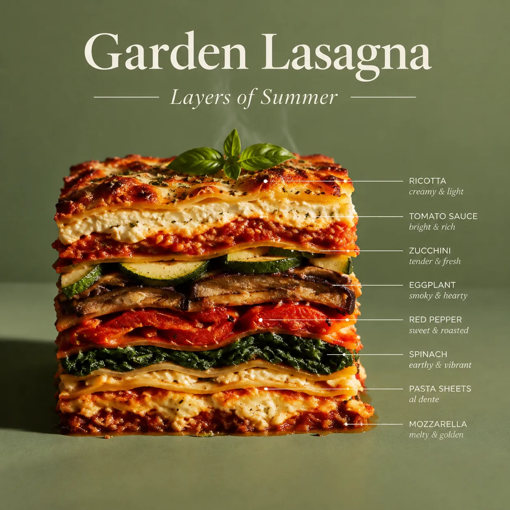</a>

> The idea is to treat a dish like a rock sample: cut it cleanly, turn the face straight to camera and label every stratum. Thin horizontal leader lines run to uppercase ingredient names with italic descriptors, a big serif title sits on top, and a flat matte background keeps it poster-clean. Side light from the left carves shadows that show depth. We filled it with a garden vegetable lasagna on sage green, and the model labelled eight layers, from ricotta to mozzarella, with short notes like 'smoky & hearty'. Check that the labels match the layers you see; models sometimes list an ingredient that is not visible. It suits menus, recipe cards and food blogs.

```text
Perfect cinematic cross-section cut through a garden vegetable lasagna, sliced cleanly down the center revealing every internal layer in full detail. The cut face is facing the camera straight-on, like a geological diagram of flavor. Each visible layer is labeled with a thin horizontal line extending to the right — uppercase sans-serif "RICOTTA" with italic descriptor below. Background: flat matte sage green. Lighting: dramatic side light from left casting long shadows, single warm spotlight on the cut face. Every texture hyperreal — visible moisture, air pockets, char, glaze, and steam. Mood: architectural food photography meets scientific illustration. Dish name "Garden Lasagna" in large elegant type at top. Subtitle: "Layers of Summer". 4K, tack sharp, Style ref: Wes Anderson symmetry meets Michelin-star kitchen.
```

- Author: [@AllaAisling](https://x.com/AllaAisling)
- Original post: https://x.com/AllaAisling/status/2025686032700805436
- [View on cinel and generate with this prompt](https://cinel.ai/prompts/p/food-cross-section-layers-shot?utm_source=github&utm_medium=awesome&utm_campaign=awesome-gpt-image-2.5-prompts)

### Food Pull-Apart Action Photo Series Prompt

<a href="https://cinel.ai/prompts/p/pizza-cheese-pull-photo-series?utm_source=github&utm_medium=awesome&utm_campaign=awesome-gpt-image-2.5-prompts">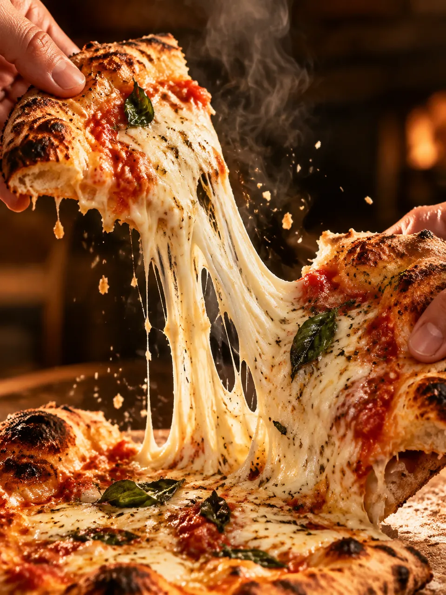</a>

> This JSON packs a five-image series into one prompt: pizza with a long mozzarella stretch, syrup-soaked baklava, a molten lava cake, a sticky cinnamon roll and a creamy cheesecake, each torn apart by two hands with its own lighting note. When run as a single image, the model rendered only the first entry, a pizza cheese pull, and it is a strong one: blistered crust, basil leaves, steam and crumbs mid-air, with long glossy strands of cheese between slice and pie. To get the whole set, run each 'prompt' value separately with the same ratio and render mode. It's ideal for bakery, pizzeria or delivery-app social feeds that need a consistent action series.

```text
{
  "aspect_ratio": "3:4",
  "render_mode": "raw",
  "series": [
    {
      "index": "1/5",
      "prompt": "two hands pulling apart a hot freshly baked pizza slice, long elastic mozzarella cheese stretch between the slice and the pie, blistered crust edges, steam rising, crumbs falling mid-air, warm cinematic light, ultra high-detail food action photography",
      "category": "cheese pull",
      "lighting": "warm cinematic oven light",
      "detail_level": "ultra-detailed"
    },
    {
      "index": "2/5",
      "prompt": "two hands pulling apart a syrup-soaked baklava piece, thin crispy phyllo layers cracking, rich pistachio filling visible, thick honey syrup stretching and dripping mid-air, golden warm light, cinematic dessert action photography",
      "category": "syrup & crunch",
      "lighting": "golden warm light",
      "detail_level": "ultra-detailed"
    },
    {
      "index": "3/5",
      "prompt": "two hands breaking a molten chocolate lava cake in half, glossy dark chocolate flowing out from the center, steam rising gently, crumbs suspended mid-air, soft warm spotlight, cinematic dessert action photography",
      "category": "molten chocolate",
      "lighting": "soft warm spotlight",
      "detail_level": "ultra-detailed"
    },
    {
      "index": "4/5",
      "prompt": "two hands tearing a glazed cinnamon roll apart, sticky cinnamon sugar filling stretching in glossy strands, icing dripping slowly, fluffy dough texture visible, cozy warm bakery light, high-detail cinematic food photography",
      "category": "sticky pull",
      "lighting": "warm bakery light",
      "detail_level": "ultra-detailed"
    },
    {
      "index": "5/5",
      "prompt": "two hands splitting a classic New York-style cheesecake slice, ultra-creamy interior slowly separating, crumbly biscuit base breaking apart, subtle cream stretch, soft studio warm light, cinematic high-detail dessert photography",
      "category": "creamy separation",
      "lighting": "soft warm studio light",
      "detail_level": "ultra-detailed"
    }
  ]
}
```

- Author: [@kaanakz](https://x.com/kaanakz)
- Original post: https://x.com/kaanakz/status/2011762827866845208
- [View on cinel and generate with this prompt](https://cinel.ai/prompts/p/pizza-cheese-pull-photo-series?utm_source=github&utm_medium=awesome&utm_campaign=awesome-gpt-image-2.5-prompts)

### Floating Taco Cinematic Food Action Shot

<a href="https://cinel.ai/prompts/p/cinematic-hand-held-food-shot?utm_source=github&utm_medium=awesome&utm_campaign=awesome-gpt-image-2.5-prompts">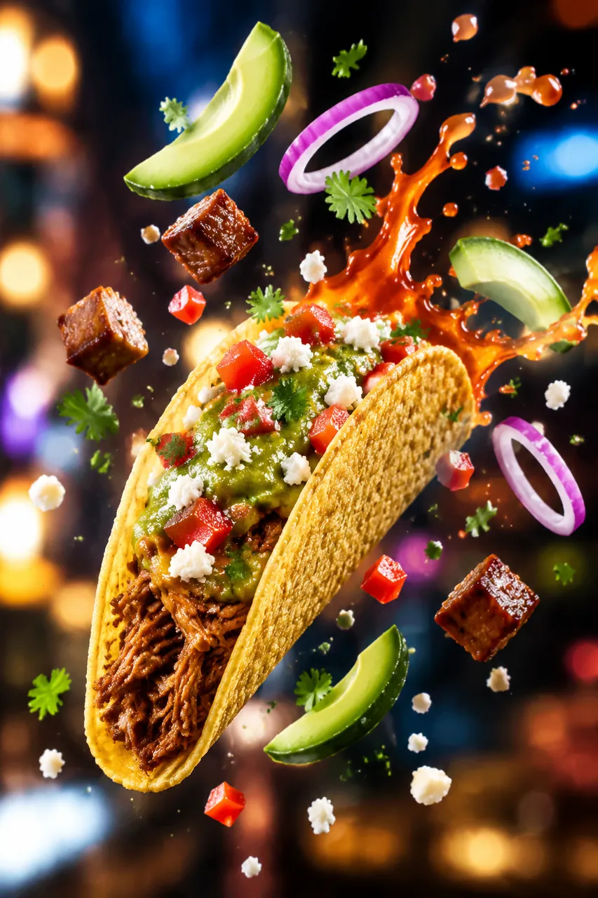</a>

> Another multi-module JSON prompt, this time for high-energy food shots: module one is a hard-shell taco with ingredients and an orange-red sauce splash suspended around it, module two grilled skewers on deep red, module three a floating cluster of sushi rolls on blue-grey. Run as a single image, the model rendered the first module only, and it is a lively result: a golden taco shell packed with shredded meat, salsa verde and cheese, with avocado slices, purple onion rings and meat cubes flying against warm and cool neon bokeh. For a full set, split each module into its own generation. Great for restaurant menus, delivery-app banners and food-truck socials.

```text
{
  "global_settings": {
    "resolution": "8K ultra high definition",
    "aspect_ratio": "2:3 vertical",
    "image_type": "AI-edited cinematic food photography",
    "detail_level": "extreme micro-detail, sharp focus, clean edges",
    "style_constraint": "enhanced realism, minimal alteration from original composition"
  },

  "module_1_image_1_style": {
    "subject": "single hard-shell taco",
    "composition": {
      "orientation": "diagonal, floating in mid-air",
      "foreground_focus": "taco shell and filling",
      "motion": "ingredients suspended, sauce splash frozen mid-air"
    },
    "visible_elements": {
      "shell": "golden yellow hard taco shell with crisp texture",
      "filling": [
        "shredded cooked meat with visible fibers",
        "green sauce layered on top",
        "small red diced pieces",
        "white crumbled cheese"
      ],
      "floating_garnish": [
        "avocado slices",
        "purple onion rings",
        "green herb leaves",
        "small reddish-brown meat cubes",
        "tiny white crumbs"
      ],
      "liquid": "orange-red sauce splash erupting upward behind taco"
    },
    "lighting": {
      "type": "high-contrast studio lighting",
      "highlights": "glossy reflections on sauce and meat",
      "background_lights": "soft circular bokeh in warm and cool tones"
    },
    "background": {
      "color": "dark with neon-like blurred lights",
      "depth": "strong depth of field, background fully defocused"
    }
  },

  "module_2_image_2_style": {
    "subject": "three grilled meat skewers",
    "composition": {
      "orientation": "vertical skewers, slightly angled",
      "foreground_focus": "center skewer",
      "motion": "ingredients and sauce suspended"
    },
    "visible_elements": {
      "skewers": "wooden sticks with pointed ends",
      "meat": "chunked grilled meat with char marks and uneven texture",
      "garnish": "small green herb leaves attached to meat",
      "floating_items": [
        "round cucumber slices",
        "thin onion rings"
      ],
      "sauce": {
        "container": "small white ramekin",
        "action": "thick orange sauce splashing upward from bowl"
      },
      "particles": "tiny spice or crumb particles scattered in air"
    },
    "lighting": {
      "type": "dramatic directional lighting",
      "highlights": "strong sheen on meat surface",
      "contrast": "deep shadows"
    },
    "background": {
      "color": "solid deep red",
      "texture": "soft grain with floating particles"
    }
  },

  "module_3_image_3_style": {
    "subject": "four sushi rolls",
    "composition": {
      "orientation": "floating cluster",
      "spacing": "uneven depth, some closer, some blurred behind",
      "motion": "sesame seeds and herbs suspended"
    },
    "visible_elements": {
      "sushi_structure": {
        "outer_layer": "white rice",
        "inner_layer": "dark seaweed",
        "fillings": [
          "orange fish slice",
          "green avocado"
        ]
      },
      "toppings": [
        "toasted sesame seeds",
        "brown crunchy coating",
        "finely chopped green herbs"
      ],
      "particles": [
        "sesame seeds",
        "small green herb pieces"
      ]
    },
    "lighting": {
      "type": "soft but crisp studio lighting",
      "focus": "front sushi pieces sharp, rear slightly blurred"
    },
    "background": {
      "color": "dark blue-grey",
      "depth": "clean bokeh-free backdrop with floating particles"
    }
  },
  "post_processing": {
    "clarity": "ultra-sharp",
    "noise": "minimal",
    "color_balance": "rich but natural",
    "ai_signature": "clean AI-edited look without exaggeration"
  }
}
```

- Author: [@meng_dagg695](https://x.com/meng_dagg695)
- Original post: https://x.com/meng_dagg695/status/2009887009591226787
- [View on cinel and generate with this prompt](https://cinel.ai/prompts/p/cinematic-hand-held-food-shot?utm_source=github&utm_medium=awesome&utm_campaign=awesome-gpt-image-2.5-prompts)

### Creamy Penne Pasta Clean Food Photo Prompt

<a href="https://cinel.ai/prompts/p/creamy-penne-pasta-food-photo?utm_source=github&utm_medium=awesome&utm_campaign=awesome-gpt-image-2.5-prompts">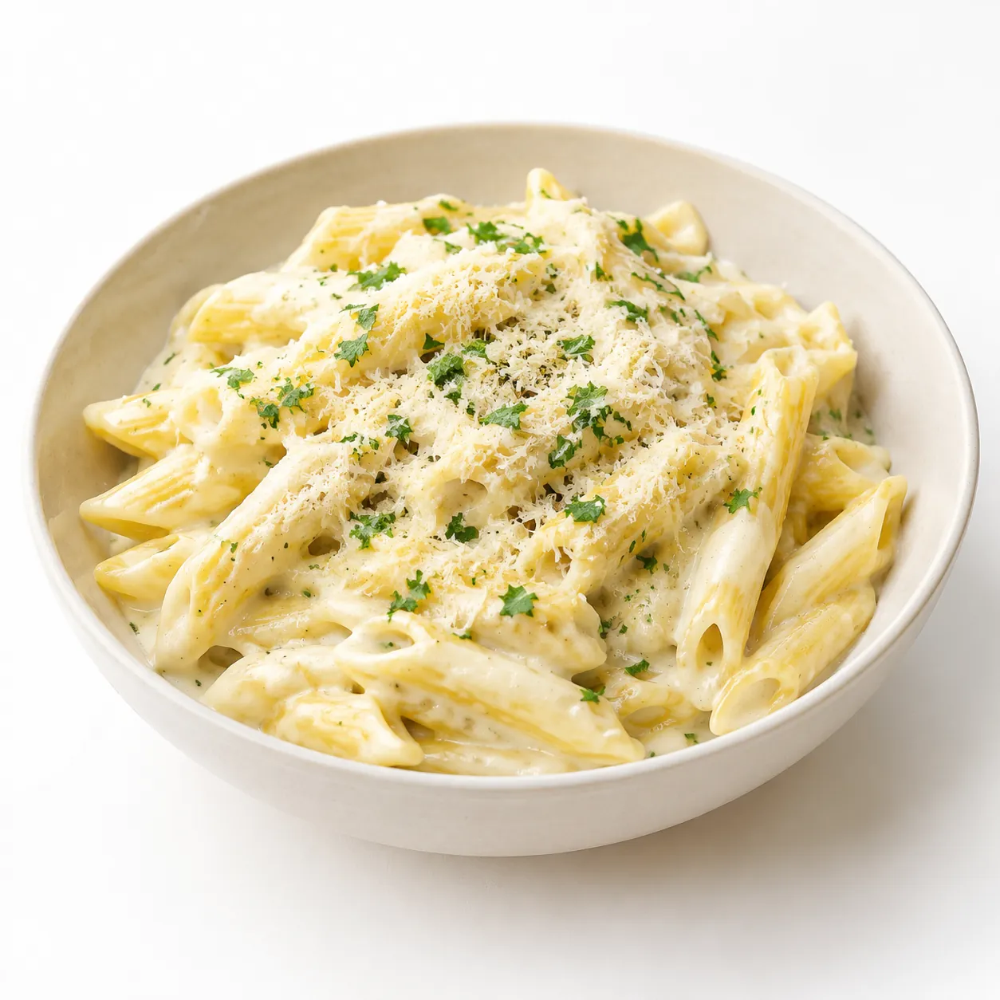</a>

> Not every food prompt needs drama. This one aims for the clean, consistent image you'd put on a delivery app or menu: one dish, a minimal ceramic bowl, white background, soft diffused light and a gentle shadow, with a firm list of exclusions (no text, labels, hands, props or watermark). The useful detail is in the food description itself: penne 'coated evenly' in a 'glossy' sauce with 'realistic texture and thickness', which avoids the plastic look. Our result is a bright bowl of creamy penne dusted with parmesan and chopped parsley, the sauce clinging to the ridges. Swap the dish name and toppings to shoot a whole menu in the same style.

```text
Ultra-realistic food photography of a prepared creamy white sauce penne pasta served in a minimal ceramic bowl. Perfectly cooked penne coated evenly in rich, glossy cream sauce, topped with freshly grated parmesan cheese and finely chopped green herbs. Clean white studio background, soft diffused lighting, gentle shadows under the bowl, natural highlights on the sauce, realistic texture and thickness. Centered composition, shallow depth of field, premium restaurant-style presentation, high-detail food styling, 8K quality, sharp focus, no text, no labels, no hands, no props, no watermark.
```

- Author: [@Strength04_X](https://x.com/Strength04_X)
- Original post: https://x.com/Strength04_X/status/2016073152820846633
- [View on cinel and generate with this prompt](https://cinel.ai/prompts/p/creamy-penne-pasta-food-photo?utm_source=github&utm_medium=awesome&utm_campaign=awesome-gpt-image-2.5-prompts)

### Iced Caramel Coffee Explosion Ad Shot Prompt

<a href="https://cinel.ai/prompts/p/iced-caramel-coffee-explosion-shot?utm_source=github&utm_medium=awesome&utm_campaign=awesome-gpt-image-2.5-prompts">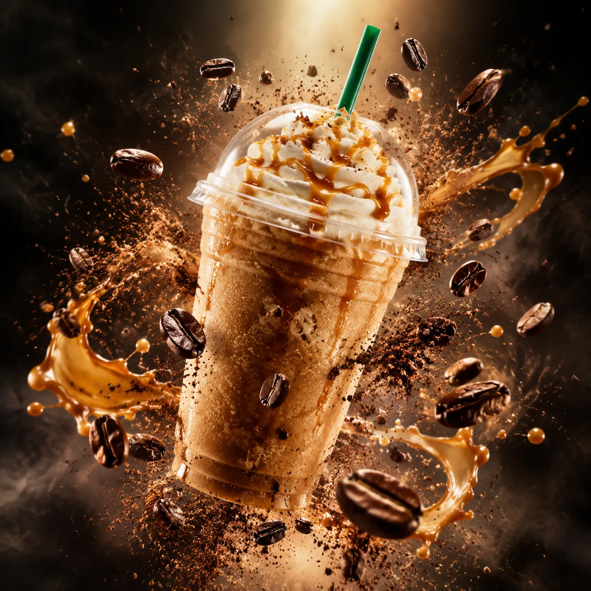</a>

> A high-energy café ad: the drink floats in the dark while coffee beans burst outward, fine powder hangs in the air and caramel ribbons whip around the cup, lit by a hard top spotlight and warm golden rim light. The 'dark smoky background' keeps the creamy drink as the brightest thing in the frame. Our first render put a famous coffee chain's logo on the cup because the source used a trademarked drink name, so we reworded it to a plain, unprinted cup with an iced caramel blended coffee. The final image shows a domed cup with whipped cream and caramel drizzle amid flying beans. Keep the 'plain cup, no logo' wording, and add your own branding afterwards.

```text
Ultra-realistic commercial product photography of an iced caramel blended coffee in a clear plastic cup with dome lid and green straw, the cup plain and unprinted with no logo, topped with whipped cream and caramel drizzle, floating mid-air. Coffee beans exploding around the cup with fine coffee powder dust particles suspended in the air, dynamic caramel splash trails swirling around the drink. Dark smoky background with dramatic spotlight from above, warm golden rim lighting, high contrast, sharp focus, macro details, cinematic depth of field, hyper-detailed texture, premium beverage advertisement, 8K resolution.
```

- Author: [@Kashberg_0](https://x.com/Kashberg_0)
- Original post: https://x.com/Kashberg_0/status/2024707382727889320
- [View on cinel and generate with this prompt](https://cinel.ai/prompts/p/iced-caramel-coffee-explosion-shot?utm_source=github&utm_medium=awesome&utm_campaign=awesome-gpt-image-2.5-prompts)

### Phone Photo to Pro Taco Ad + Exploded Ingredient View

<a href="https://cinel.ai/prompts/p/tacos-reference-commercial-food-shot?utm_source=github&utm_medium=awesome&utm_campaign=awesome-gpt-image-2.5-prompts">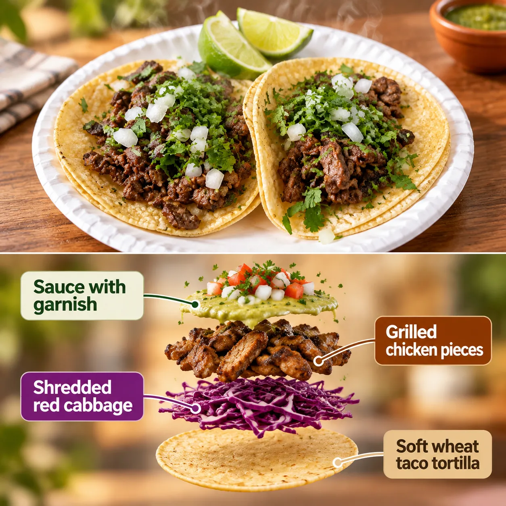</a>

> A two-part workflow for small restaurants: start from a casual phone photo, then ask for a polished three-quarter commercial shot of the same tacos and a second, exploded view that stacks the ingredients vertically with bold colour-block labels. Our reference was an overhead snap of two beef street tacos with onion, cilantro and lime. Image one upgraded it nicely with warm light, a clean plate and lime wedges. Image two, however, followed the prompt's written ingredient list (wheat tortilla, red cabbage, grilled chicken, sauce) rather than our tacos, a useful warning: rewrite the ingredient list to match your actual dish, or the exploded view will show a different recipe.

```text
A high-end commercial food photograph of the same two tacos from the reference image, preserving their exact structure, fillings, proportions, and arrangement. The camera angle is slightly adjusted to a more flattering three-quarter close-up, enhancing depth and appetite appeal without altering the tacos themselves. Soft cinematic lighting highlights the textures of the tortillas and fillings, with subtle steam and natural sheen to emphasize freshness. The background is replaced with a clean, modern, out-of-focus setting in warm complementary tones that enhance the food without distracting from it. Shallow depth of field, crisp focus on the tacos, rich contrast, natural colors, and premium restaurant advertising quality. No added or removed ingredients, refined composition, lighting, and environment.

Image 2: Exploded-view commercial visualization of the taco from the image, presented as premium recipe-style breakdown.

The taco is deconstructed into four visible ingredients, matching the original taco precisely in composition, color, and texture. No additional ingredients.

The ingredients are separated and arranged in a clean vertical stack, evenly spaced from bottom to top, floating in place with precise alignment and symmetry.

Ingredient order (bottom → top):

Soft wheat taco tortilla

Shredded red cabbage

Grilled chicken pieces

Sauce with garnish (topped with a small mixed garnish of diced onion, tomato, and parsley, approximately 5–6 small cubes total, lightly mixed, placed naturally on top)

Each ingredient is visually distinct and clearly readable in shape and texture.

Annotation design requirements:

– Large, bold sans-serif font, high legibility at feed scale

– Each annotation placed inside a solid or softly rounded rectangular color block

– Background color of each block corresponds subtly to the ingredient color (tomato red, lettuce green, meat warm brown, sauce white/cream, pita beige)

– High contrast text (dark on light, light on dark)

– Thick, clean connector lines pointing clearly to each ingredient

– No transparency that reduces readability

– Annotations must visually dominate over background without covering ingredients

Background is soft, neutral, and atmospheric, with subtle depth and gentle gradients, inspired by premium food advertising.

Overall style is clean, modern, and appetizing, commercial-ready without technical or schematic feel.

No extra elements, no substitutions, no reinterpretation of ingredients.
```

- Author: [@Strength04_X](https://x.com/Strength04_X)
- Original post: https://x.com/Strength04_X/status/2011770206839062641
- [View on cinel and generate with this prompt](https://cinel.ai/prompts/p/tacos-reference-commercial-food-shot?utm_source=github&utm_medium=awesome&utm_campaign=awesome-gpt-image-2.5-prompts)

### Crispy Martabak Tearing Open Macro Food Shot

<a href="https://cinel.ai/prompts/p/crispy-martabak-macro-food-shot?utm_source=github&utm_medium=awesome&utm_campaign=awesome-gpt-image-2.5-prompts">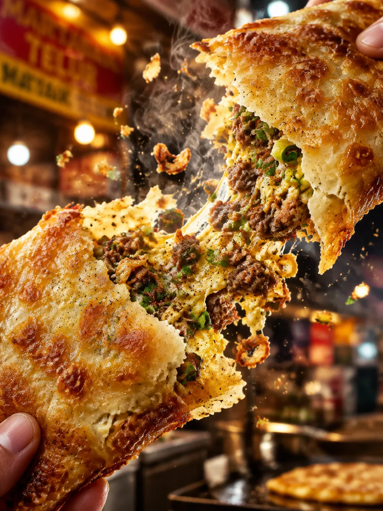</a>

> Street food shot like a luxury ad. The prompt freezes the moment an Indonesian martabak telur tears open: the thin golden wrapper cracks, the minced beef, scallion and egg filling bursts outward, flecks of fried onion hang in the air and steam rises, all under warm tungsten-and-charcoal light with night-market signage melting into bokeh. Specific texture words (bubbled wrapper, layered interior, oil sheen) are what make it mouth-watering. Our result shows two hands pulling the crisp pastry apart, the filling glistening and crumbs flying against warm stall lights. The prompt cites a specific camera body; a '105mm macro, fast shutter' description is enough. Ideal for food stalls, delivery apps and travel content.

```text
"Macro food photography of a crispy martabak telur tearing open mid-air, thin golden wrapper shattering with a crack, hot filling of minced beef, scallions, and egg bursting outward. Flecks of fried onion and pepper suspended in motion, steam visible, glossy oil sheen catching the light. Warm Indonesian street-stall lighting, tungsten + charcoal warmth, dramatic rim light, ultra high texture detail (bubbled wrapper, layered interior).Editorial food shot, shallow depth of field, bokeh of night market signage, Nikon Z9 look, 105mm macro, fast shutter freeze, hyper-real crumbs. --ar 3:4"
```

- Author: [@Just_sharon7](https://x.com/Just_sharon7)
- Original post: https://x.com/Just_sharon7/status/2009937038670540843
- [View on cinel and generate with this prompt](https://cinel.ai/prompts/p/crispy-martabak-macro-food-shot?utm_source=github&utm_medium=awesome&utm_campaign=awesome-gpt-image-2.5-prompts)

### Mid-Bite Gourmet Burger Craving Shot (JSON Prompt)

<a href="https://cinel.ai/prompts/p/craving-food-action-photography?utm_source=github&utm_medium=awesome&utm_campaign=awesome-gpt-image-2.5-prompts">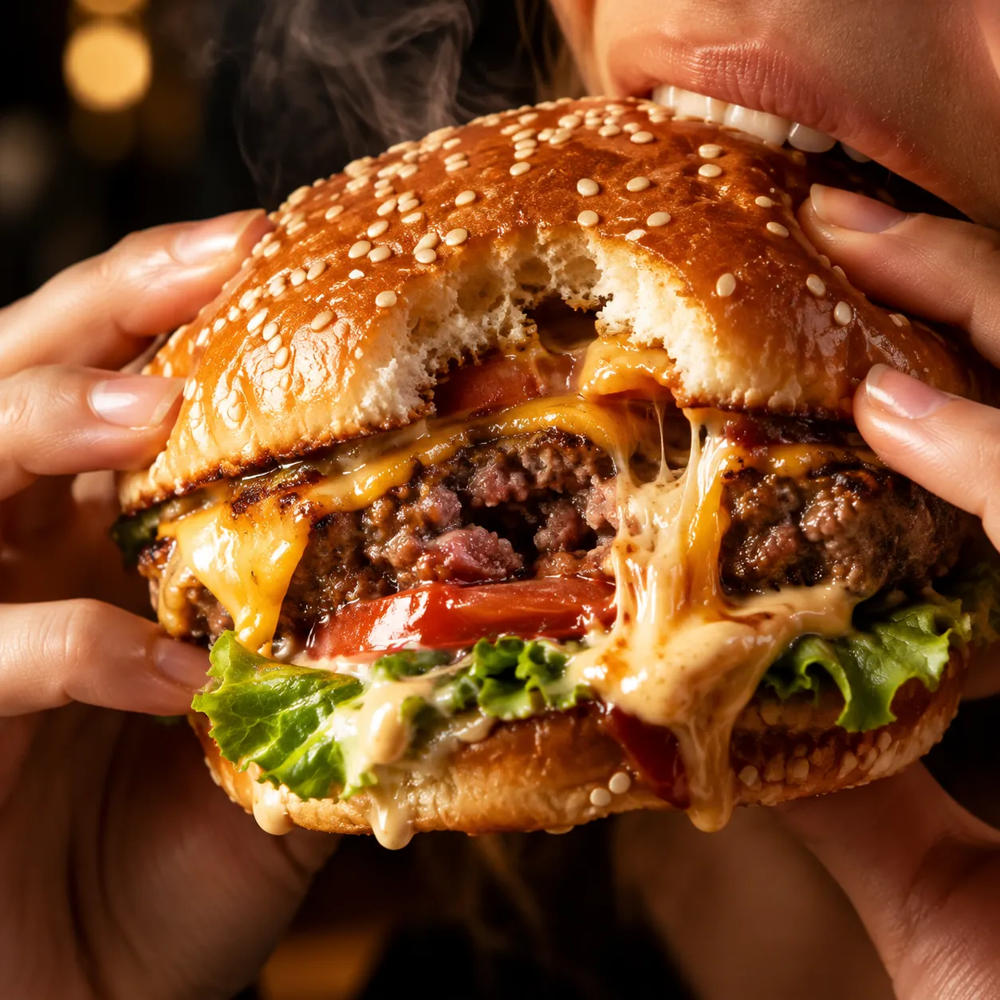</a>

> This prompt treats a burger like a hero product. It locks every craving trigger into JSON: a visible bite mark with compressed layers, stretching cheese, a glossy sauce drip, steam, sesame seeds, visible meat fibres, real hands with clean nails, warm high-contrast side light and a dark blurred background. Our result is a tight close-up of two hands holding a thick, sesame-topped burger just after a bite, melted cheese pulling into strings over the patty, tomato and lettuce peeking out. A quality-control block ('natural compression of ingredients, no plastic look') is a smart addition worth keeping for any food. Swap the subject for pizza, a sandwich or a bao.

```text
{
  "content_goal": "viral food visual with extreme craving appeal",
  "image_type": "ultra-photorealistic food action photography",
  "visual_style": {
    "aesthetic": "cinematic food editorial, hyper-real",
    "vibe": "juicy, indulgent, irresistible",
    "realism": "high-end commercial food realism"
  },
  "composition": {
    "framing": "tight close-up or medium close-up",
    "camera_angle": "slightly low or front-facing",
    "subject_position": "centered hero bite moment",
    "perspective": "depth-rich with strong foreground focus"
  },
  "subject": {
    "description": "large gourmet burger captured mid-bite",
    "bite_action": "visible bite mark with compressed layers",
    "ingredients": "juicy beef patty, melted cheese, fresh lettuce, tomato, sauce drip",
    "details": "cheese stretch, sauce gloss, steam rising"
  },
  "texture_details": {
    "bun": "soft toasted bun with sesame seeds",
    "patty": "juicy with visible meat fibers",
    "cheese": "melted, glossy, stretching",
    "sauce": "thick, dripping naturally"
  },
  "human_element": {
    "hands": "realistic hands holding burger",
    "bite_mark": "natural teeth impression",
    "skin_detail": "natural skin texture, clean nails"
  },
  "lighting": {
    "type": "dramatic food lighting",
    "quality": "warm, directional, high-contrast",
    "direction": "side or top-side light emphasizing gloss",
    "highlight_focus": "cheese melt and sauce texture",
    "shadow_style": "deep but controlled shadows"
  },
  "color_palette": {
    "primary": ["golden brown", "cheese yellow", "deep red"],
    "accent": ["lettuce green"],
    "mood": "rich, bold, indulgent"
  },
  "environment": {
    "location": "burger joint, café, or studio food setup",
    "background": "dark, blurred background to isolate burger",
    "atmosphere": "warm, indulgent, street-food luxury"
  },
  "camera_details": {
    "camera_type": "professional DSLR / mirrorless simulation",
    "lens": "85mm or macro food lens",
    "focus": "tack-sharp on bite area",
    "depth_of_field": "shallow for dramatic bokeh",
    "resolution": "advertising-grade clarity"
  },
  "quality_control": {
    "food_realism": "hyper-real textures, no plastic look",
    "bite_accuracy": "natural compression of ingredients",
    "ai_artifacts": "none",
    "professional_finish": "commercial food photography quality"
  },
  "overall_mood": "mouth-watering, bold, indulgent",
  "intended_use": {
    "primary": "viral food post on X",
    "secondary": "restaurant branding, food editorial, ads"
  }
}
```

- Author: [@cuties7377](https://x.com/cuties7377)
- Original post: https://x.com/cuties7377/status/2011374713780457546
- [View on cinel and generate with this prompt](https://cinel.ai/prompts/p/craving-food-action-photography?utm_source=github&utm_medium=awesome&utm_campaign=awesome-gpt-image-2.5-prompts)

### Floating Drink Can Ad with Liquid Word Splash

<a href="https://cinel.ai/prompts/p/floating-drink-can-gradient-ad?utm_source=github&utm_medium=awesome&utm_campaign=awesome-gpt-image-2.5-prompts">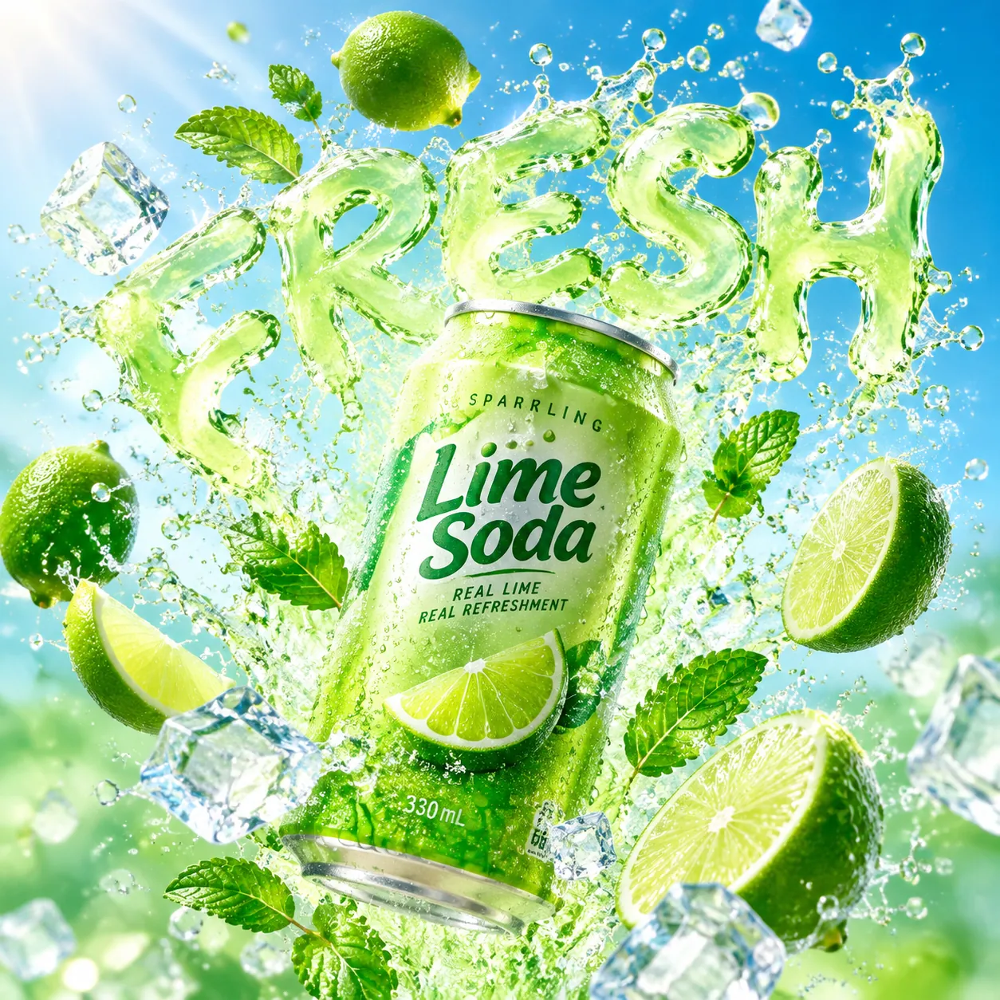</a>

> A fill-in-the-blanks template for beverage ads: name the drink, the liquid, the fruits and one word, and the prompt builds a floating can, a summer gradient, an explosion of ice and fruit, and a splash shaped into liquid letters. For our sample we filled it with a sparkling lime soda, limes and mint, and the word FRESH. The result is bright and punchy: a green can mid-air, the word FRESH formed from translucent lime-green liquid behind it, lime slices, mint leaves and ice flying against a sunny blue sky. Liquid lettering of short words (4–6 letters) works best; longer words lose legibility. Use your own invented product name.

```text
A vibrant, high-end advertising visual of a sparkling lime soda can/bottle floating dynamically in the center. The background is a soft gradient inspired by the drink’s color, blending into fresh sky-blue tones for a refreshing summer feel.  A powerful splash of sparkling lime soda explodes around the product, forming the word ”FRESH” in smooth, fluid, organic liquid typography.  Crystal-clear ice cubes burst around the composition, with fresh limes and mint (whole and sliced) flying in the air. Juicy splashes, droplets, light mist, and condensation create an intense refreshing atmosphere.  Bright sunlight, glossy highlights, commercial lighting, premium brand look, dynamic motion, hyper-detailed, semi-realistic illustration style, ultra-clean, 4k, sharp focus.
```

- Author: [@Kerroudjm](https://x.com/Kerroudjm)
- Original post: https://x.com/Kerroudjm/status/2011108316882014431
- [View on cinel and generate with this prompt](https://cinel.ai/prompts/p/floating-drink-can-gradient-ad?utm_source=github&utm_medium=awesome&utm_campaign=awesome-gpt-image-2.5-prompts)

### Cozy Flat Lay with Hand-Drawn Doodle Labels

<a href="https://cinel.ai/prompts/p/rustic-table-cozy-flat-lay?utm_source=github&utm_medium=awesome&utm_campaign=awesome-gpt-image-2.5-prompts">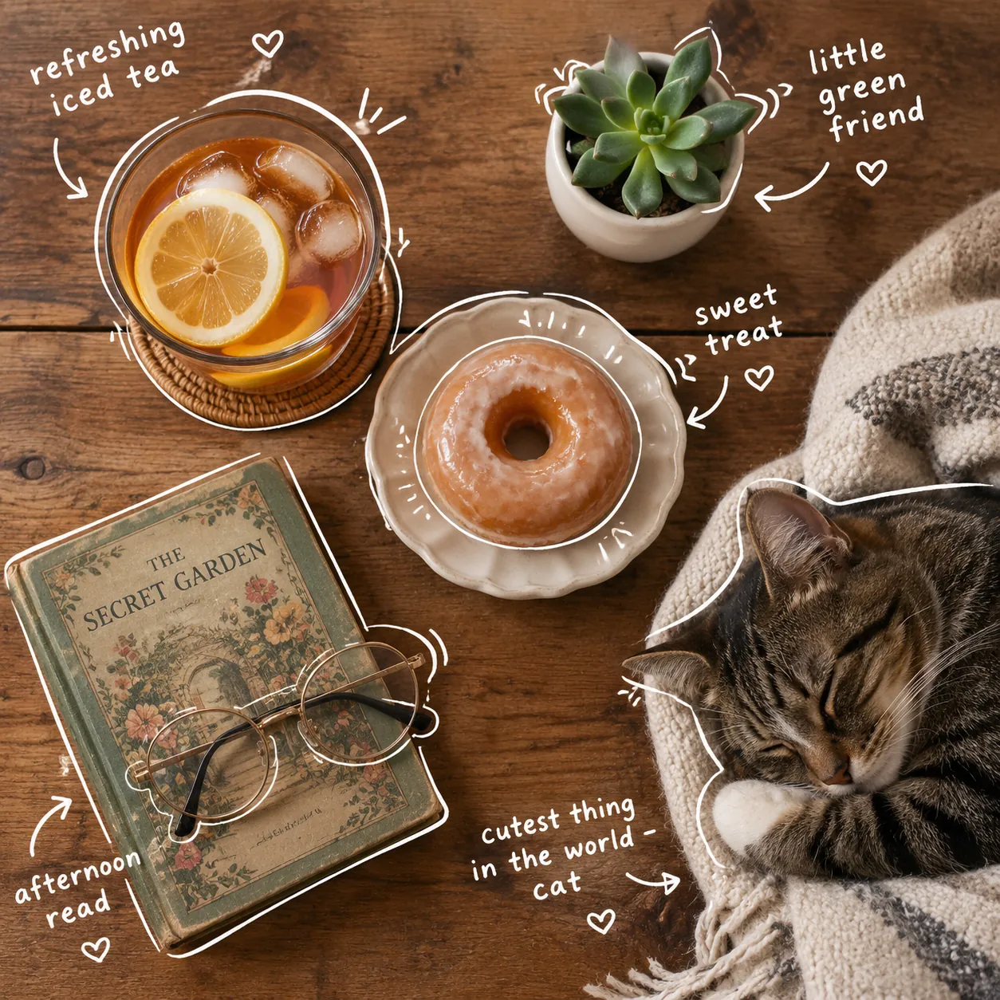</a>

> Part photo, part scrapbook: a top-down flat lay of an afternoon on a rustic wooden table, iced tea with lemon, a glazed donut, a succulent in a white pot, a vintage book with glasses and a tabby cat asleep on a blanket, each object circled by white hand-drawn outlines, arrows and cute handwritten captions. The doodles turn a pretty photo into a story, which is why this style performs so well on lifestyle feeds. Our result nails the cosy mood: warm light on dark wood, the cat curled in the corner, and all five labels legible, from 'refreshing iced tea' to 'cutest thing in the world – cat'. Swap the objects and labels to tell your own moment.

```text
Top-down flat lay on a rustic wooden table, cozy aesthetic, soft natural light. A glass of iced tea with lemon slices and ice cubes, a glazed donut, a small succulent plant in a white pot, a vintage book, and eyeglasses. A sleeping tabby cat curled on a blanket at the edge. White hand-drawn doodle outlines and arrows around each object with playful handwritten labels like “refreshing iced tea,” “sweet treat,” “little green friend,” “afternoon read,” and “cutest thing in the world – cat.” Warm tones, minimal shadows, lifestyle photography, high detail, Instagram aesthetic.
```

- Author: [@Sairah_0](https://x.com/Sairah_0)
- Original post: https://x.com/Sairah_0/status/2048725842096976020
- [View on cinel and generate with this prompt](https://cinel.ai/prompts/p/rustic-table-cozy-flat-lay?utm_source=github&utm_medium=awesome&utm_campaign=awesome-gpt-image-2.5-prompts)

### Exploded Vertical Food Layer Infographic

<a href="https://cinel.ai/prompts/p/exploded-food-layer-infographic?utm_source=github&utm_medium=awesome&utm_campaign=awesome-gpt-image-2.5-prompts">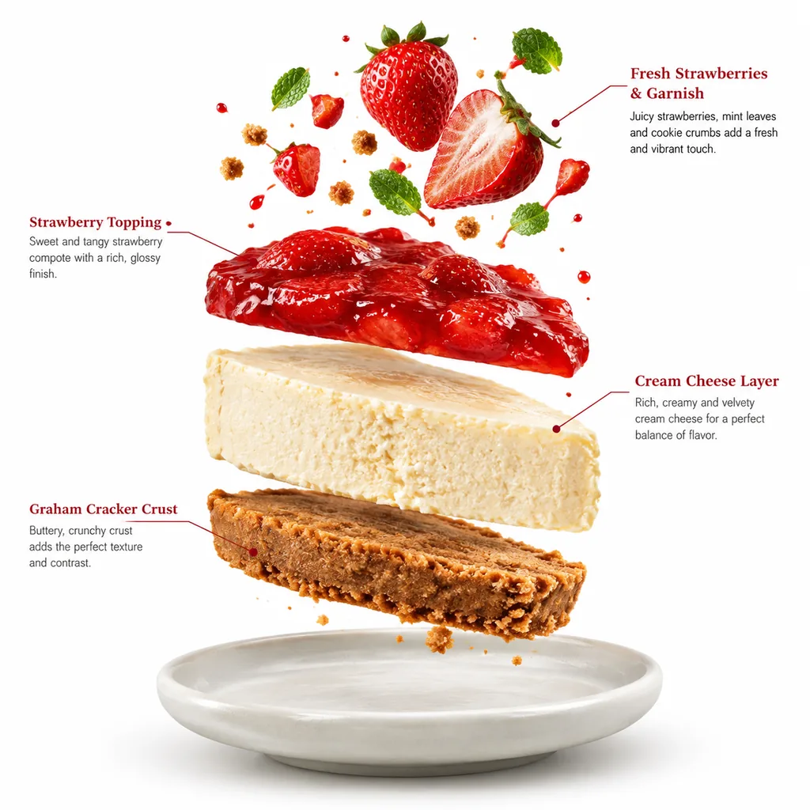</a>

> This template turns any food into a vertical exploded view. Garnishes and droplets hover at the top, followed by the topping, the core layer, the base and finally a simple plate, each slightly separated with soft shadows on a pure white background. Thin pointer lines and clean labels explain each layer, giving it a premium editorial feel. We filled it with a slice of strawberry cheesecake; GPT Image 2.5 rendered glossy berry topping, a creamy filling and a crumbly graham crust with readable callouts. Ideal for menus, recipe blogs, bakery social posts and food-brand explainers.

```text
Create a hyper-realistic exploded vertical infographic composition of a slice of strawberry cheesecake.
At the top, characteristic particles, droplets, or garnishes associated with the food, frozen mid-air.
Below it, the primary surface or topping layer with rich texture and realistic material detail.
Underneath, the core ingredient layer showing structure, depth, and natural variation.
Below that, the supporting base or interior layer, slightly separated to reveal construction.
At the bottom, a minimal plate, bowl, cup, or base appropriate to the food’s presentation.
Pure white background, soft studio lighting, subtle shadows beneath each floating element, ultra-sharp focus, DSLR macro photography, clean infographic text labels with thin pointer lines, premium editorial food photography aesthetic, 8K quality.
```

- Author: [@TechieBySA](https://x.com/TechieBySA)
- Original post: https://x.com/TechieBySA/status/2010305720764551520
- [View on cinel and generate with this prompt](https://cinel.ai/prompts/p/exploded-food-layer-infographic?utm_source=github&utm_medium=awesome&utm_campaign=awesome-gpt-image-2.5-prompts)

### Floating Breakfast Bowls with Frozen Splashes

<a href="https://cinel.ai/prompts/p/floating-breakfast-bowl-splash?utm_source=github&utm_medium=awesome&utm_campaign=awesome-gpt-image-2.5-prompts">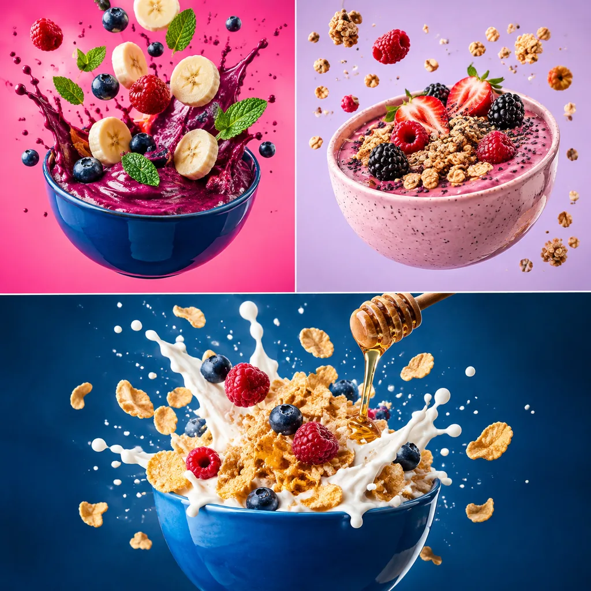</a>

> A structured JSON prompt that defines a set of breakfast scenes as separate modules, each with its own bowl, contents, motion effects and background colour. One berry smoothie bowl bursts with banana, blueberries and mint on hot pink; a speckled pink bowl floats with granola and berries on lavender; a blue bowl of cornflakes catches a milk splash and a honey drizzle on deep blue. Global settings lock in high-speed studio lighting and natural saturation. GPT Image 2.5 combined all three modules into one cohesive panel set. Use it for café menus, cereal and smoothie ads, or social carousels; add or edit modules to change the lineup.

```text
{
  "resolution": "8K UHD",
  "aspect_ratio": "1:1",
  "image_style": "hyper-realistic commercial food photography",
  "global_settings": {
    "quality": "Ultra-high detail, sharp focus, studio-grade clarity",
    "lighting": "Soft but controlled studio lighting with visible highlights and splash definition",
    "motion": "Frozen mid-air action, ingredients suspended",
    "background_style": "Solid or smooth gradient background, color varies per module",
    "camera": "High-speed photography look, shallow to medium depth of field",
    "post_processing": "Balanced contrast, natural saturation, no artificial glow"
  },

  "modules": {

    "module_1_berry_smoothie_explosion": {
      "scene_description": "A vibrant smoothie bowl exploding with fruit and liquid splashes",
      "bowl": {
        "color": "Deep blue ceramic bowl",
        "finish": "Glossy",
        "position": "Centered, floating mid-air"
      },
      "base_contents": {
        "type": "Thick berry smoothie",
        "color": "Deep purple-magenta",
        "texture": "Creamy with visible swirl marks"
      },
      "ingredients": {
        "fruits": [
          "Banana slices (round, pale yellow)",
          "Blueberries (whole, dark blue)",
          "Raspberries (whole, red)"
        ],
        "herbs": [
          "Fresh mint leaves (bright green)"
        ]
      },
      "motion_effects": {
        "liquid": "Berry smoothie splashing upward and outward",
        "particles": "Small droplets suspended in air"
      },
      "background": {
        "color": "Bright pink",
        "texture": "Smooth, seamless"
      }
    },

    "module_2_minimal_pink_smoothie_bowl": {
      "scene_description": "Minimalist floating smoothie bowl with granola and berries",
      "bowl": {
        "color": "Light pink ceramic bowl with dark speckles",
        "finish": "Matte",
        "position": "Floating centrally"
      },
      "base_contents": {
        "type": "Smoothie",
        "color": "Soft pink with purple undertones",
        "texture": "Thick and smooth"
      },
      "toppings": {
        "granola": "Golden-brown oat clusters",
        "seeds": "Small black seeds scattered",
        "fruits": [
          "Strawberries (halved)",
          "Raspberries (whole)",
          "Blackberries (whole)"
        ]
      },
      "motion_effects": {
        "ingredients": "Granola flakes, seeds, and berries floating gently"
      },
      "background": {
        "color": "Pastel lavender",
        "gradient": "Subtle, soft gradient"
      }
    },

    "module_3_cereal_milk_honey_splash": {
      "scene_description": "Dynamic cereal stack with milk splash and honey drizzle",
      "bowl": {
        "color": "Blue ceramic bowl",
        "finish": "Glossy",
        "position": "Centered, resting visually but surrounded by motion"
      },
      "contents": {
        "cereal": "Golden cornflakes stacked vertically",
        "milk": "White milk splashing and dripping over flakes",
        "fruits": [
          "Raspberries",
          "Blueberries"
        ]
      },
      "additional_elements": {
        "honey": {
          "source": "Wooden honey dipper",
          "state": "Honey dripping mid-air"
        }
      },
      "motion_effects": {
        "splashes": "Milk splashes frozen in dramatic arcs",
        "particles": "Floating flakes and droplets"
      },
      "background": {
        "color": "Deep blue",
        "tone": "High contrast"
      }
    },
}
```

- Author: [@meng_dagg695](https://x.com/meng_dagg695)
- Original post: https://x.com/meng_dagg695/status/2009157208240755151
- [View on cinel and generate with this prompt](https://cinel.ai/prompts/p/floating-breakfast-bowl-splash?utm_source=github&utm_medium=awesome&utm_campaign=awesome-gpt-image-2.5-prompts)

### Floating Gourmet Hero Food Shot

<a href="https://cinel.ai/prompts/p/floating-gourmet-hero-food?utm_source=github&utm_medium=awesome&utm_campaign=awesome-gpt-image-2.5-prompts">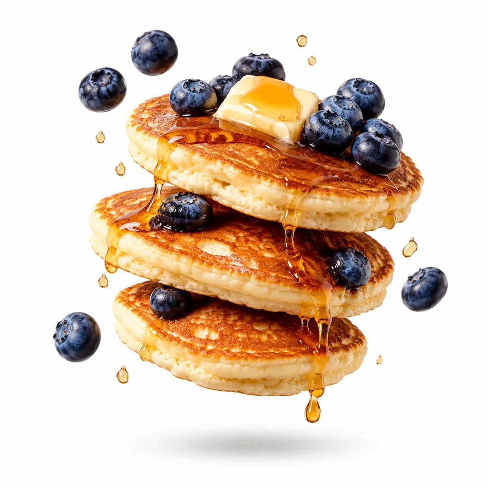</a>

> A compact two-slot template from @azed_ai for hero food shots. Name a dish and a garnish and the prompt suspends them mid-air against an isolated white background, with appetising surface texture, visible moisture, subtle seasoning, soft studio light and a crisp shadow below for a commercial look. We tried a stack of buttermilk pancakes with blueberries, butter and maple syrup; GPT Image 2.5 caught the syrup ribbon and berries floating in a clean, dynamic composition. Use it for menus, delivery-app tiles, packaging mockups and social ads, swapping the dish and garnish per product.

```text
A stack of three fluffy buttermilk pancakes topped with fresh blueberries, a pat of butter and a ribbon of maple syrup, suspended in midair against a clean white isolated background, premium food photography, rich natural surface texture, appetizing detail, realistic fibers and moisture, subtle seasoning, soft studio lighting, crisp natural shadow, dynamic floating composition, commercial advertising aesthetic, sharp focus, high detail
```

- Author: [@azed_ai](https://x.com/azed_ai)
- Original post: https://x.com/azed_ai/status/2101627451063546110
- [View on cinel and generate with this prompt](https://cinel.ai/prompts/p/floating-gourmet-hero-food?utm_source=github&utm_medium=awesome&utm_campaign=awesome-gpt-image-2.5-prompts)

### Lotus Pond Boat Harvest Key Frame

<a href="https://cinel.ai/prompts/p/lotus-pond-boat-harvest-keyframe?utm_source=github&utm_medium=awesome&utm_campaign=awesome-gpt-image-2.5-prompts"></a>

> Inspired by a short video @PixelAigc shared of someone picking lotus pods and cooking lotus-seed soup, made on Doubao. The prompt was in a linked reply, so we wrote this frame ourselves: a misty pond, a small wooden boat, a woven basket and a hand lifting a lotus pod. Use it for food-story intros, tea and dessert brands, and slow-living content.

```text
A single cinematic key frame, close-up from the side: a person in loose cream linen clothes sits at the edge of a small wooden boat on a misty lotus pond, one hand lifting a fresh green lotus seed pod from the water, a woven bamboo basket with more pods beside them, giant lotus leaves fading into soft fog behind, calm dark water reflections, muted green and grey palette, quiet natural light, documentary realism, no text. Square 1:1 composition.
```

- Author: [@PixelAigc](https://x.com/PixelAigc)
- Original post: https://x.com/PixelAigc/status/2108831585995010139
- [View on cinel and generate with this prompt](https://cinel.ai/prompts/p/lotus-pond-boat-harvest-keyframe?utm_source=github&utm_medium=awesome&utm_campaign=awesome-gpt-image-2.5-prompts)

### Dragon Burnt the Meat Stall Keyframe

<a href="https://cinel.ai/prompts/p/dragon-burnt-the-meat-stall-keyframe?utm_source=github&utm_medium=awesome&utm_campaign=awesome-gpt-image-2.5-prompts">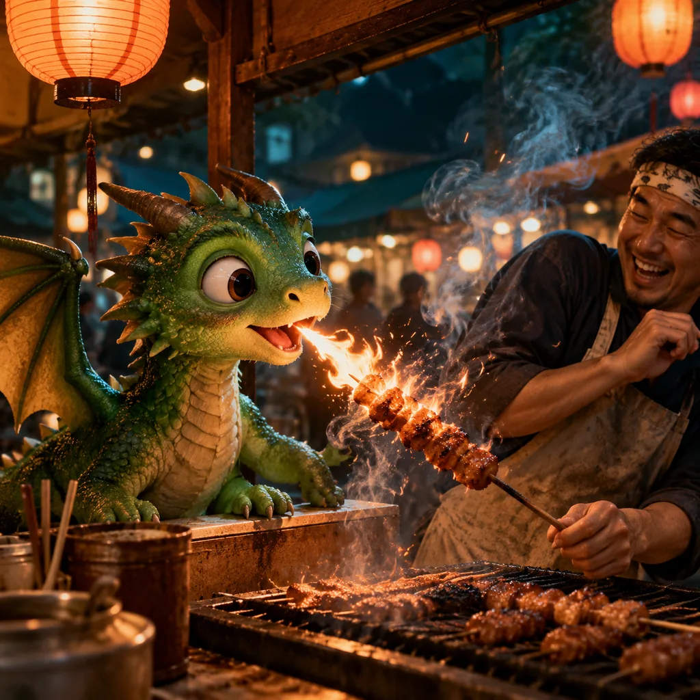</a>

> Rewritten as one 1:1 keyframe from a Seedance video post by @saniaspeaks_ about a dragon burning the meat. We froze the flame, sparks and the cook ducking back. Use it for food-stall posters, fantasy comedy covers and market scenes.

```text
Cinematic video keyframe, square 1:1: a small friendly green dragon at a night-market food stall frozen mid-breath as a tiny flame accidentally scorches a skewer of grilled meat, the cook ducking back laughing, sparks and smoke curling up, warm lantern light and teal night shadows, playful photorealistic film still, the most eye-catching frame of the clip, no text, no logo. Square 1:1 composition.
```

- Author: [@saniaspeaks_](https://x.com/saniaspeaks_)
- Original post: https://x.com/saniaspeaks_/status/2109613917622198384
- [View on cinel and generate with this prompt](https://cinel.ai/prompts/p/dragon-burnt-the-meat-stall-keyframe?utm_source=github&utm_medium=awesome&utm_campaign=awesome-gpt-image-2.5-prompts)

### Unbranded Noodles Billboard Campaign

<a href="https://cinel.ai/prompts/p/unbranded-noodles-billboard-campaign?utm_source=github&utm_medium=awesome&utm_campaign=awesome-gpt-image-2.5-prompts">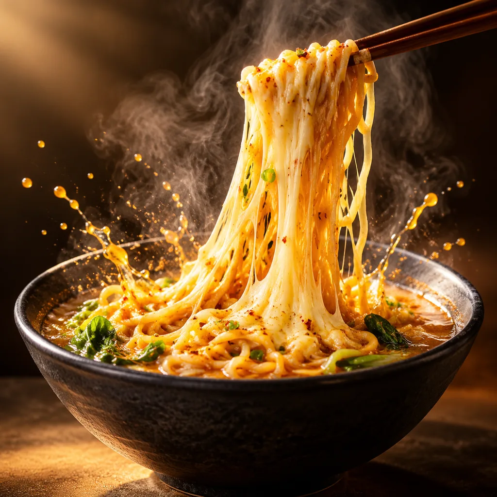</a>

> Adapted from a post by @Diplomeme on 2026-10-12 (60 likes at capture). We rewrote it as one clean 1:1 still, removing brands, logos, celebrity/IP elements and any need for your own photo. Change one variable at a time.

```text
Agency-grade cinematic food billboard visual, square 1:1: an unbranded bowl of steaming noodles lifted by chopsticks with a dramatic cheese-like noodle pull, splashing broth droplets, bold studio lighting, appetising premium FMCG key visual, no brand, no text, no logo. Square 1:1 composition.
```

- Author: [@Diplomeme](https://x.com/Diplomeme)
- Original post: https://x.com/Diplomeme/status/2109694043559223444
- [View on cinel and generate with this prompt](https://cinel.ai/prompts/p/unbranded-noodles-billboard-campaign?utm_source=github&utm_medium=awesome&utm_campaign=awesome-gpt-image-2.5-prompts)

### Sunny Cafe Couple Food Table

<a href="https://cinel.ai/prompts/p/sunny-cafe-couple-food-table?utm_source=github&utm_medium=awesome&utm_campaign=awesome-gpt-image-2.5-prompts">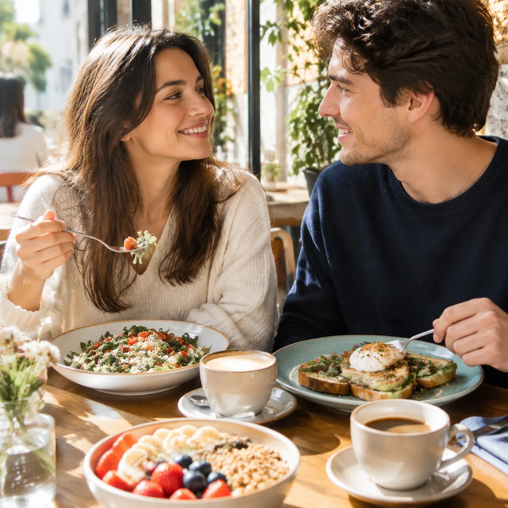</a>

> Adapted from a post by @rubialixr on 2026-10-14 (2 likes at capture). We rewrote it as one clean 1:1 still, removing brands, logos, celebrity/IP elements and any need for your own photo. Change one variable at a time.

```text
Ultra-realistic premium lifestyle food photography, square 1:1: a happy fictional young couple in modest clothes enjoying delicious food together at a sunny cafe table, colourful plates and coffee, warm daylight, no brand, no readable text, no logo. Square 1:1 composition.
```

- Author: [@rubialixr](https://x.com/rubialixr)
- Original post: https://x.com/rubialixr/status/2110468930624274916
- [View on cinel and generate with this prompt](https://cinel.ai/prompts/p/sunny-cafe-couple-food-table?utm_source=github&utm_medium=awesome&utm_campaign=awesome-gpt-image-2.5-prompts)

### Ayam Geprek Fried Chicken Exploded Infographic

<a href="https://cinel.ai/prompts/p/ayam-geprek-fried-chicken-exploded?utm_source=github&utm_medium=awesome&utm_campaign=awesome-gpt-image-2.5-prompts">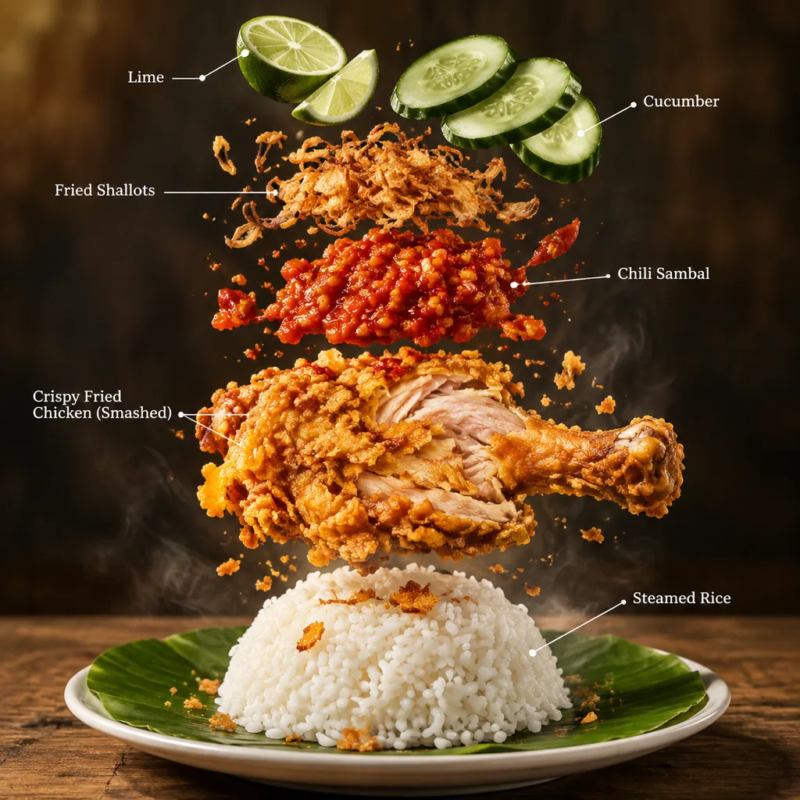</a>

> Adapted from a post by @woleswoosh on 2025-11-29 (926 likes at capture). We rewrote it as one clean 1:1 hyper-realistic exploded / floating-layer food infographic still, removing brands, logos, celebrity/IP elements and any need for a user photo. Change one variable at a time.

```text
Hyper-realistic food anatomy exploded-view infographic, square 1:1: authentic Ayam Geprek crushed fried chicken: banana leaf or white plate at the bottom with warm steamed rice, whole crispy golden fried chicken leg smashed to show batter texture and tender meat, glistening red chili sambal, fried shallots, cucumber slices and lime floating above. Clean vertical composition, gravity-defying floating ingredients evenly spaced above a base at the bottom, rustic or studio surface, thin white pointer lines with clear English labels, cinematic studio lighting, warm editorial tones, dramatic steam or gloss where natural, ultra-detailed textures, 8K photoreal, no brand logos, no chain names, no celebrity. Square 1:1 composition.
```

- Author: [@woleswoosh](https://x.com/woleswoosh)
- Original post: https://x.com/woleswoosh/status/1994773362875535462
- [View on cinel and generate with this prompt](https://cinel.ai/prompts/p/ayam-geprek-fried-chicken-exploded?utm_source=github&utm_medium=awesome&utm_campaign=awesome-gpt-image-2.5-prompts)

### Steamed Dumpling Exploded View Infographic

<a href="https://cinel.ai/prompts/p/steamed-dumpling-exploded-view?utm_source=github&utm_medium=awesome&utm_campaign=awesome-gpt-image-2.5-prompts">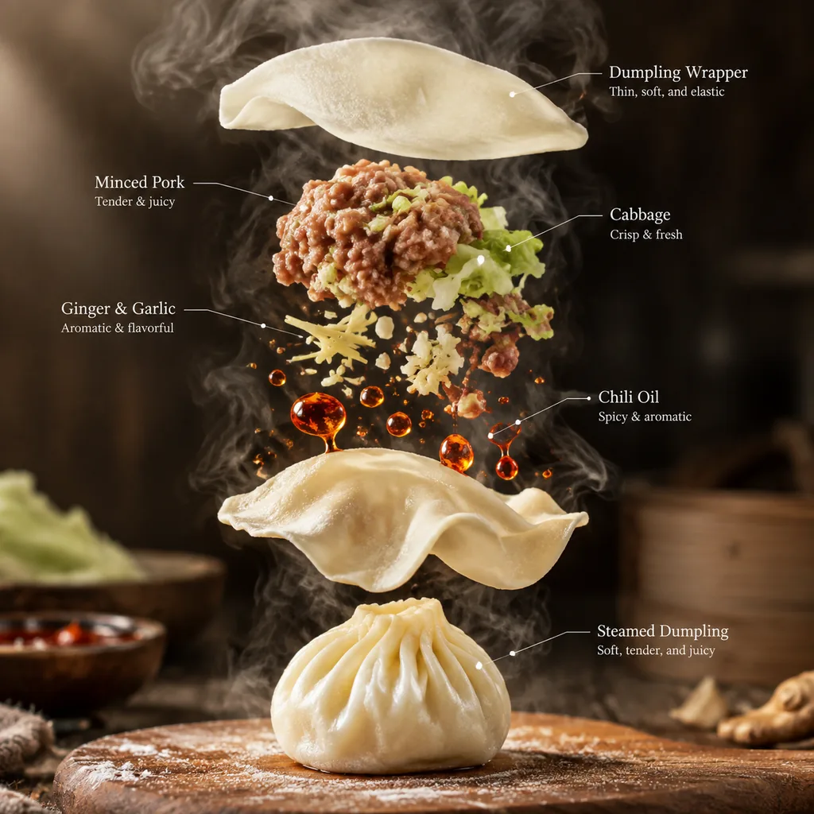</a>

> Adapted from a post by @Taaruk_ on 2026-01-31 (144 likes at capture). We rewrote it as one clean 1:1 hyper-realistic exploded / floating-layer food infographic still, removing brands, logos, celebrity/IP elements and any need for a user photo. Change one variable at a time.

```text
Hyper-realistic food anatomy exploded-view infographic, square 1:1: freshly steamed dumplings (momos): rustic wooden board with one intact pleated dumpling at the bottom, thin dumpling wrappers unfurled, juicy minced pork and cabbage filling, ginger garlic flecks, chili oil droplets and rising steam frozen mid-air. Clean vertical composition, gravity-defying floating ingredients evenly spaced above a base at the bottom, rustic or studio surface, thin white pointer lines with clear English labels, cinematic studio lighting, warm editorial tones, dramatic steam or gloss where natural, ultra-detailed textures, 8K photoreal, no brand logos, no chain names, no celebrity. Square 1:1 composition.
```

- Author: [@Taaruk_](https://x.com/Taaruk_)
- Original post: https://x.com/Taaruk_/status/2017438502632493084
- [View on cinel and generate with this prompt](https://cinel.ai/prompts/p/steamed-dumpling-exploded-view?utm_source=github&utm_medium=awesome&utm_campaign=awesome-gpt-image-2.5-prompts)

### Lasagna Dish Anatomy Exploded Infographic

<a href="https://cinel.ai/prompts/p/lasagna-dish-anatomy-exploded?utm_source=github&utm_medium=awesome&utm_campaign=awesome-gpt-image-2.5-prompts">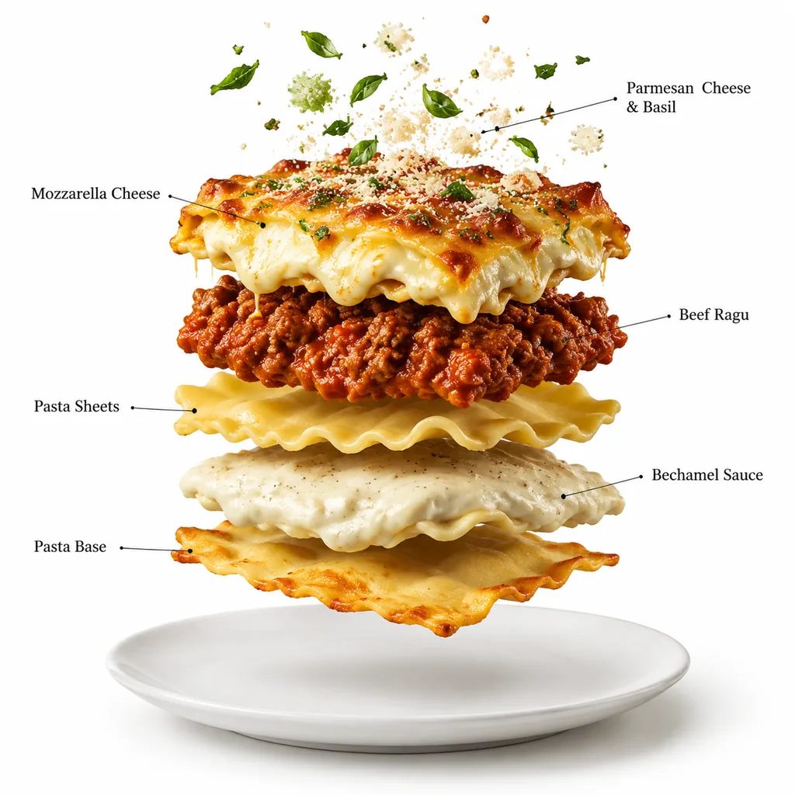</a>

> Adapted from a post by @Gdgtify on 2026-04-29 (46 likes at capture). We rewrote it as one clean 1:1 hyper-realistic exploded / floating-layer food infographic still, removing brands, logos, celebrity/IP elements and any need for a user photo. Change one variable at a time.

```text
Create a hyper-realistic exploded vertical food infographic, square 1:1, of a square slice of classic beef lasagna: grated parmesan dust and basil flecks at the top, bubbling mozzarella cheese layer, rich meat ragu, pasta sheet layers, creamy bechamel, golden-edged pasta base, white plate at the bottom. At the top, signature particles, droplets or garnishes frozen mid-air. Below, the primary topping layer with rich texture. Underneath, the core ingredient layer. Below that, the supporting base or interior, slightly separated. At the bottom, a minimal plate, bowl or board. Pure white background, soft studio lighting, subtle shadows under each floating piece, ultra-sharp DSLR macro look, thin pointer lines with clean English ingredient labels, premium editorial food photography, 8K, no brand logos, no celebrity, no modern IP. Square 1:1 composition.
```

- Author: [@Gdgtify](https://x.com/Gdgtify)
- Original post: https://x.com/Gdgtify/status/2049515048372945169
- [View on cinel and generate with this prompt](https://cinel.ai/prompts/p/lasagna-dish-anatomy-exploded?utm_source=github&utm_medium=awesome&utm_campaign=awesome-gpt-image-2.5-prompts)

### Sushi Nigiri Anatomy Exploded Infographic

<a href="https://cinel.ai/prompts/p/sushi-nigiri-anatomy-exploded?utm_source=github&utm_medium=awesome&utm_campaign=awesome-gpt-image-2.5-prompts">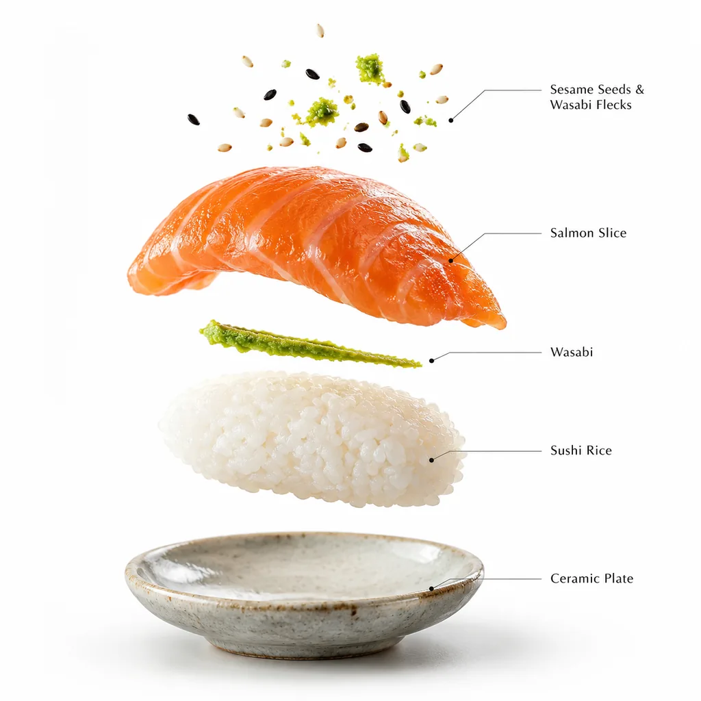</a>

> Adapted from a post by @aiwithlumi on 2026-06-10 (12 likes at capture). We rewrote it as one clean 1:1 hyper-realistic exploded / floating-layer food infographic still, removing brands, logos, celebrity/IP elements and any need for a user photo. Change one variable at a time.

```text
Create a hyper-realistic exploded vertical food infographic, square 1:1, of a single piece of salmon nigiri sushi: loose sesame and wasabi flecks at the top, glossy salmon slice, thin wasabi smear, hand-pressed sushi rice oval, small ceramic plate at the bottom. At the top, signature particles, droplets or garnishes frozen mid-air. Below, the primary topping layer with rich texture. Underneath, the core ingredient layer. Below that, the supporting base or interior, slightly separated. At the bottom, a minimal plate, bowl or board. Pure white background, soft studio lighting, subtle shadows under each floating piece, ultra-sharp DSLR macro look, thin pointer lines with clean English ingredient labels, premium editorial food photography, 8K, no brand logos, no celebrity, no modern IP. Square 1:1 composition.
```

- Author: [@aiwithlumi](https://x.com/aiwithlumi)
- Original post: https://x.com/aiwithlumi/status/2064859064891543784
- [View on cinel and generate with this prompt](https://cinel.ai/prompts/p/sushi-nigiri-anatomy-exploded?utm_source=github&utm_medium=awesome&utm_campaign=awesome-gpt-image-2.5-prompts)

### Gourmet Smash Burger Exploded Infographic

<a href="https://cinel.ai/prompts/p/gourmet-smash-burger-exploded-infographic?utm_source=github&utm_medium=awesome&utm_campaign=awesome-gpt-image-2.5-prompts">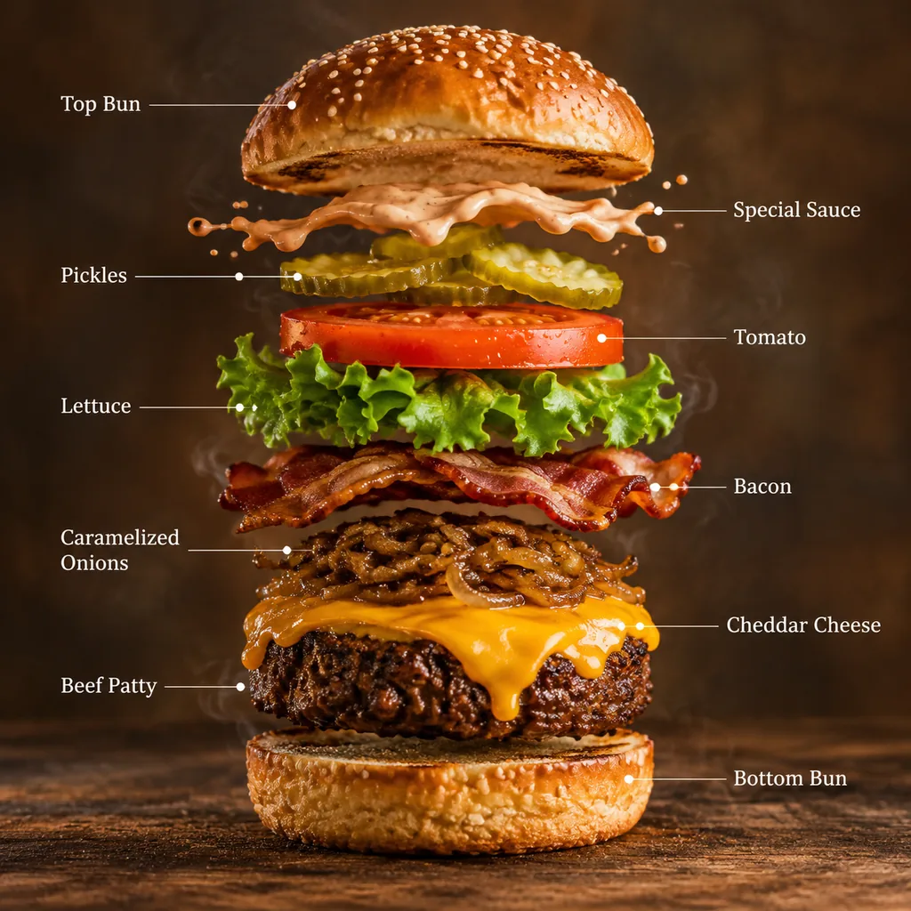</a>

> Adapted from a post by @Ravelberger on 2026-02-02 (3 likes at capture). We rewrote it as one clean 1:1 hyper-realistic exploded / floating-layer food infographic still, removing brands, logos, celebrity/IP elements and any need for a user photo. Change one variable at a time.

```text
Hyper-realistic food anatomy exploded-view infographic, square 1:1: a gourmet smash burger: bottom sesame bun on rustic wood, juicy grilled beef smash patty, melted cheddar, caramelized onions, crispy bacon strips, fresh lettuce, ripe tomato slice, pickles, glossy sauce splash, top bun floating highest. Clean vertical composition, gravity-defying floating ingredients evenly spaced above a base at the bottom, rustic or studio surface, thin white pointer lines with clear English labels, cinematic studio lighting, warm editorial tones, dramatic steam or gloss where natural, ultra-detailed textures, 8K photoreal, no brand logos, no chain names, no celebrity. Square 1:1 composition.
```

- Author: [@Ravelberger](https://x.com/Ravelberger)
- Original post: https://x.com/Ravelberger/status/2018324778021736656
- [View on cinel and generate with this prompt](https://cinel.ai/prompts/p/gourmet-smash-burger-exploded-infographic?utm_source=github&utm_medium=awesome&utm_campaign=awesome-gpt-image-2.5-prompts)

### Pizza Margherita Exploded Infographic

<a href="https://cinel.ai/prompts/p/pizza-margherita-exploded-infographic?utm_source=github&utm_medium=awesome&utm_campaign=awesome-gpt-image-2.5-prompts">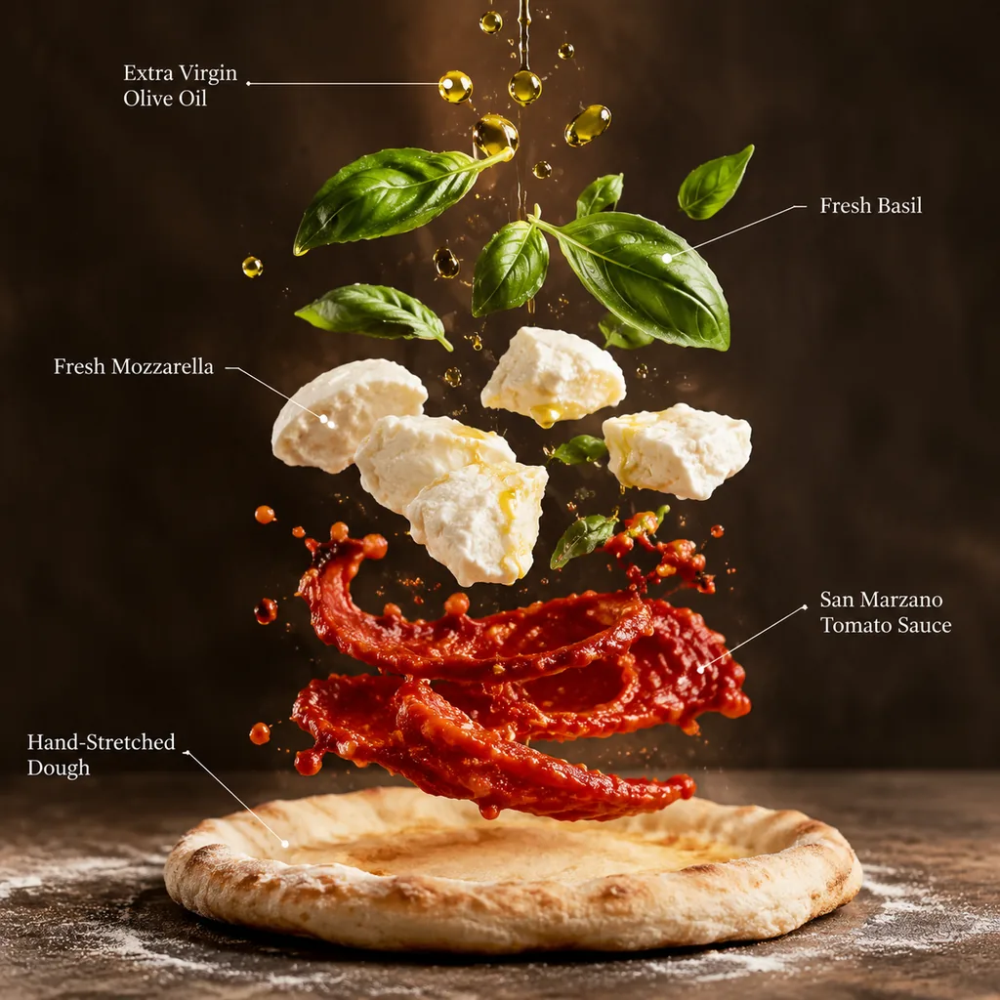</a>

> Adapted from a post by @Ravelberger on 2026-02-04 (5 likes at capture). We rewrote it as one clean 1:1 hyper-realistic exploded / floating-layer food infographic still, removing brands, logos, celebrity/IP elements and any need for a user photo. Change one variable at a time.

```text
Hyper-realistic food anatomy exploded-view infographic, square 1:1: a classic Pizza Margherita: hand-stretched dough base at the bottom, San Marzano tomato sauce swirl, fresh mozzarella melting patches, basil leaves floating, olive oil drizzle droplets at the top. Clean vertical composition, gravity-defying floating ingredients evenly spaced above a base at the bottom, rustic or studio surface, thin white pointer lines with clear English labels, cinematic studio lighting, warm editorial tones, dramatic steam or gloss where natural, ultra-detailed textures, 8K photoreal, no brand logos, no chain names, no celebrity. Square 1:1 composition.
```

- Author: [@Ravelberger](https://x.com/Ravelberger)
- Original post: https://x.com/Ravelberger/status/2019049554071429349
- [View on cinel and generate with this prompt](https://cinel.ai/prompts/p/pizza-margherita-exploded-infographic?utm_source=github&utm_medium=awesome&utm_campaign=awesome-gpt-image-2.5-prompts)

### Street Taco Exploded Infographic

<a href="https://cinel.ai/prompts/p/street-taco-exploded-infographic?utm_source=github&utm_medium=awesome&utm_campaign=awesome-gpt-image-2.5-prompts">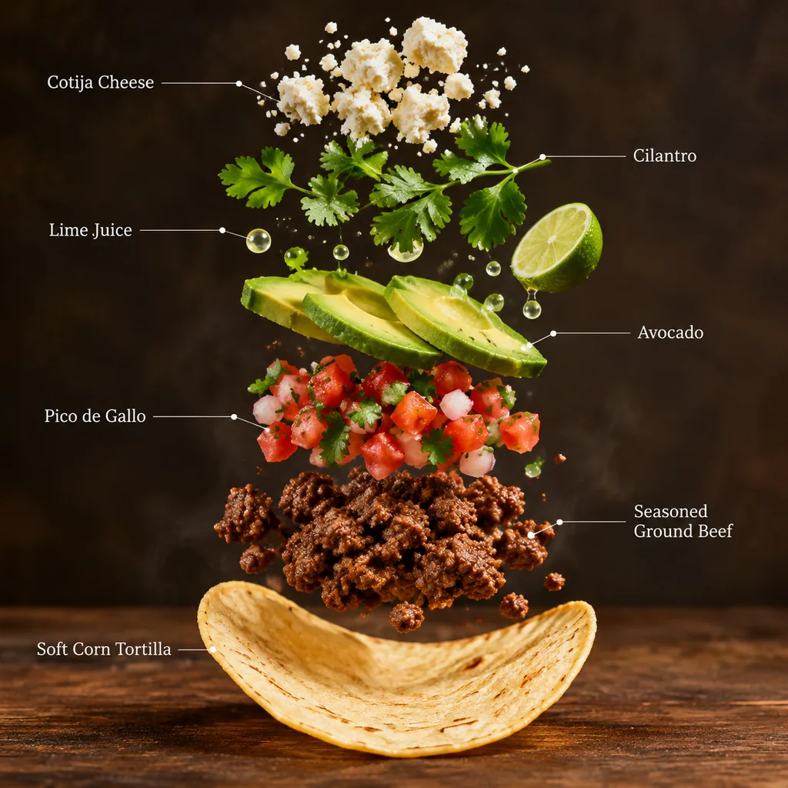</a>

> Adapted from a post by @Ravelberger on 2026-02-06 (2 likes at capture). We rewrote it as one clean 1:1 hyper-realistic exploded / floating-layer food infographic still, removing brands, logos, celebrity/IP elements and any need for a user photo. Change one variable at a time.

```text
Hyper-realistic food anatomy exploded-view infographic, square 1:1: a soft street taco: soft corn tortilla curved at the bottom, seasoned ground beef, pico de gallo, avocado slices, cilantro sprigs, lime squeeze droplets, cotija cheese crumble floating above. Clean vertical composition, gravity-defying floating ingredients evenly spaced above a base at the bottom, rustic or studio surface, thin white pointer lines with clear English labels, cinematic studio lighting, warm editorial tones, dramatic steam or gloss where natural, ultra-detailed textures, 8K photoreal, no brand logos, no chain names, no celebrity. Square 1:1 composition.
```

- Author: [@Ravelberger](https://x.com/Ravelberger)
- Original post: https://x.com/Ravelberger/status/2019774329894928775
- [View on cinel and generate with this prompt](https://cinel.ai/prompts/p/street-taco-exploded-infographic?utm_source=github&utm_medium=awesome&utm_campaign=awesome-gpt-image-2.5-prompts)

### Falafel Pita Exploded Infographic

<a href="https://cinel.ai/prompts/p/falafel-pita-exploded-infographic?utm_source=github&utm_medium=awesome&utm_campaign=awesome-gpt-image-2.5-prompts">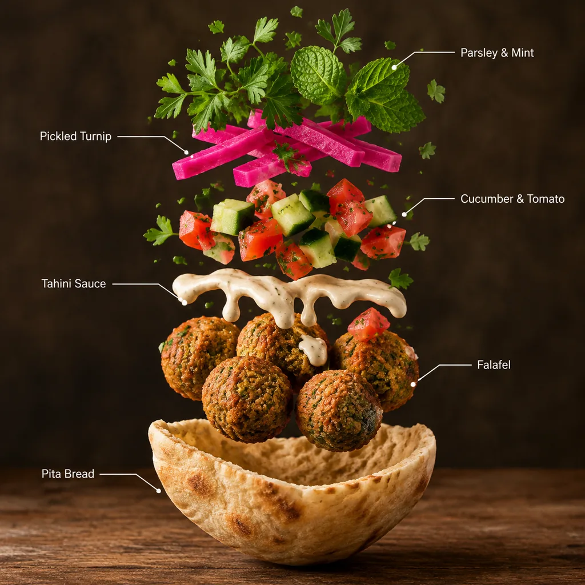</a>

> Adapted from a post by @aldakhee1 on 2026-01-11 (0 likes at capture). We rewrote it as one clean 1:1 hyper-realistic exploded / floating-layer food infographic still, removing brands, logos, celebrity/IP elements and any need for a user photo. Change one variable at a time.

```text
Hyper-realistic food anatomy exploded-view infographic, square 1:1: a falafel pita sandwich in anatomical exploded style: open pita pocket at the bottom, crispy golden falafel balls, tahini drizzle, diced cucumber and tomato, pickled turnip, fresh parsley and mint floating above. Clean vertical composition, gravity-defying floating ingredients evenly spaced above a base at the bottom, rustic or studio surface, thin white pointer lines with clear English labels, cinematic studio lighting, warm editorial tones, dramatic steam or gloss where natural, ultra-detailed textures, 8K photoreal, no brand logos, no chain names, no celebrity. Square 1:1 composition.
```

- Author: [@aldakhee1](https://x.com/aldakhee1)
- Original post: https://x.com/aldakhee1/status/2010378703851626638
- [View on cinel and generate with this prompt](https://cinel.ai/prompts/p/falafel-pita-exploded-infographic?utm_source=github&utm_medium=awesome&utm_campaign=awesome-gpt-image-2.5-prompts)

### Commercial Taco Exploded Video Keyframe

<a href="https://cinel.ai/prompts/p/commercial-taco-exploded-video-keyframe?utm_source=github&utm_medium=awesome&utm_campaign=awesome-gpt-image-2.5-prompts">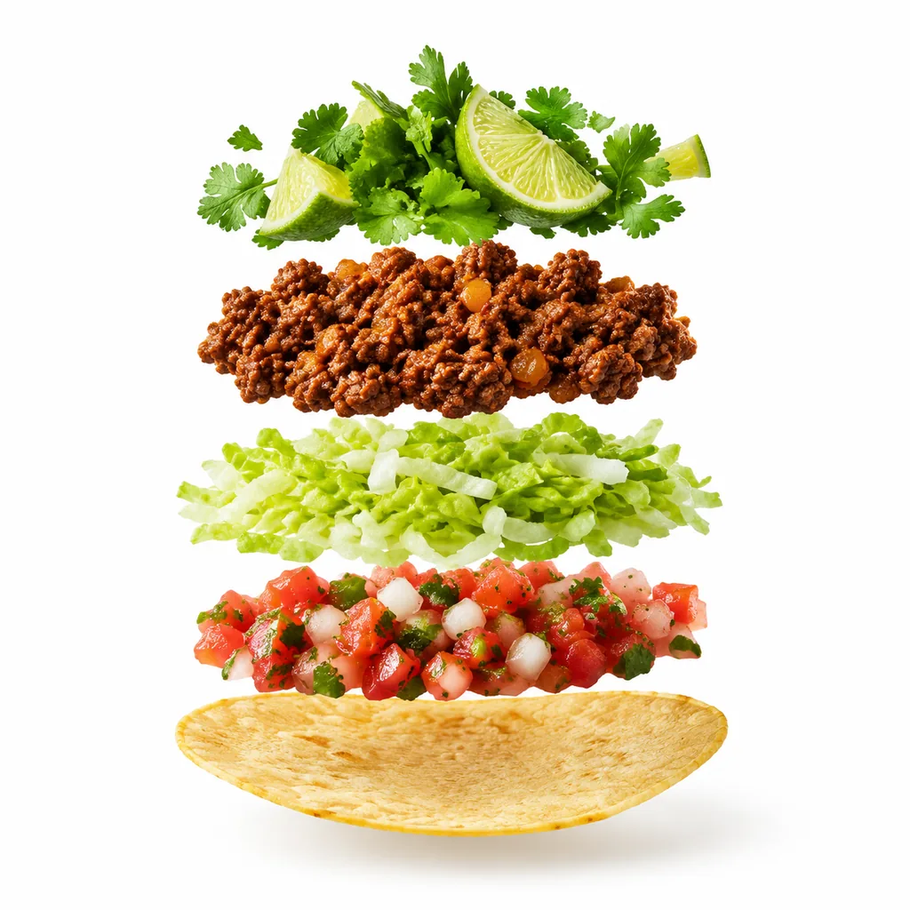</a>

> Adapted from a post by @Strength04_X on 2025-12-30 (2389 likes at capture). We rewrote it as one clean 1:1 hyper-realistic exploded / floating-layer food infographic still, removing brands, logos, celebrity/IP elements and any need for a user photo. Change one variable at a time.

```text
Clean commercial recipe-style exploded still, square 1:1: the same soft taco broken into exactly five floating layers stacked vertically and perfectly aligned — lime cilantro garnish on top, seasoned beef, shredded lettuce, pico de gallo, soft corn tortilla at the bottom — pure white background, soft studio light, subtle shadows, frozen from an AI image-to-video spin, no brand logos, no text logos. Square 1:1 composition.
```

- Author: [@Strength04_X](https://x.com/Strength04_X)
- Original post: https://x.com/Strength04_X/status/2006031630268522943
- [View on cinel and generate with this prompt](https://cinel.ai/prompts/p/commercial-taco-exploded-video-keyframe?utm_source=github&utm_medium=awesome&utm_campaign=awesome-gpt-image-2.5-prompts)

### Spinning Burger Layers Video Keyframe

<a href="https://cinel.ai/prompts/p/spinning-burger-layers-keyframe?utm_source=github&utm_medium=awesome&utm_campaign=awesome-gpt-image-2.5-prompts">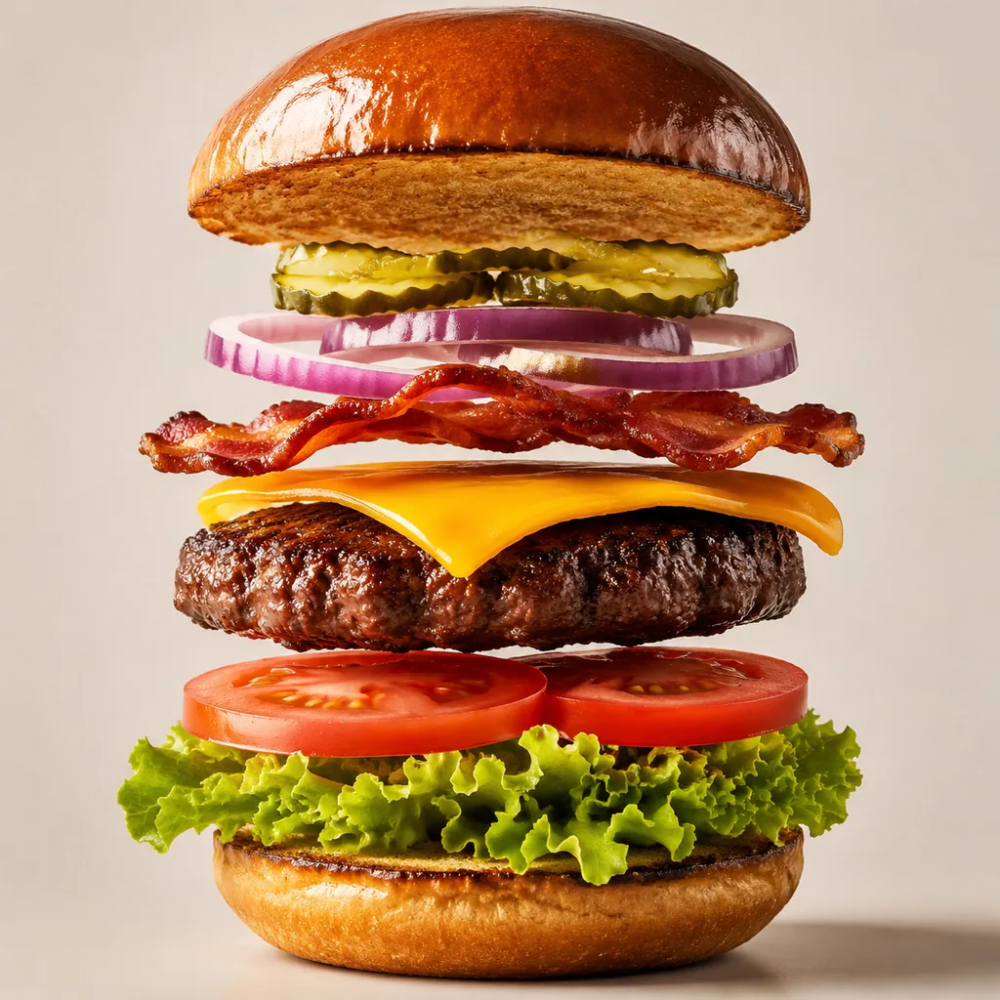</a>

> Adapted from a post by @ZaraIrahh on 2026-01-07 (563 likes at capture). We rewrote it as one clean 1:1 hyper-realistic exploded / floating-layer food infographic still, removing brands, logos, celebrity/IP elements and any need for a user photo. Change one variable at a time.

```text
Hyper-realistic commercial burger exploded still, square 1:1: glossy brioche top bun, juicy beef patty, melted cheese, crisp lettuce, tomato, bottom bun — layers gently separated with perfect alignment and even spacing as if mid slow rotation, soft studio light, clean backdrop, no chain brand marks, no text logos. Square 1:1 composition.
```

- Author: [@ZaraIrahh](https://x.com/ZaraIrahh)
- Original post: https://x.com/ZaraIrahh/status/2008910386008125614
- [View on cinel and generate with this prompt](https://cinel.ai/prompts/p/spinning-burger-layers-keyframe?utm_source=github&utm_medium=awesome&utm_campaign=awesome-gpt-image-2.5-prompts)

### Breakfast Sandwich Exploded Video Keyframe

<a href="https://cinel.ai/prompts/p/breakfast-sandwich-exploded-keyframe?utm_source=github&utm_medium=awesome&utm_campaign=awesome-gpt-image-2.5-prompts">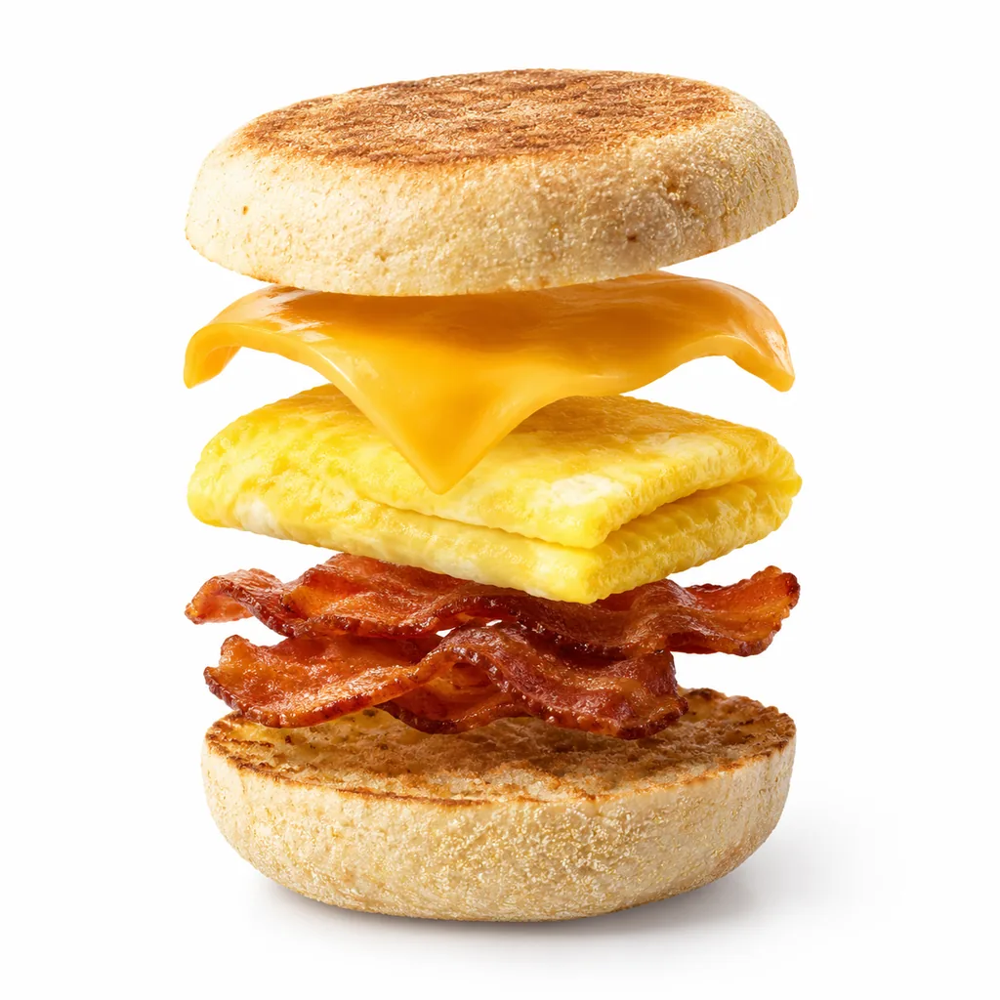</a>

> Adapted from a post by @Strength04_X on 2026-02-22 (152 likes at capture). We rewrote it as one clean 1:1 hyper-realistic exploded / floating-layer food infographic still, removing brands, logos, celebrity/IP elements and any need for a user photo. Change one variable at a time.

```text
Clean commercial exploded still, square 1:1: a breakfast sandwich with layers gently separated and perfectly aligned — toasted English muffin top, melted American-style cheese, folded egg, crispy bacon or sausage patty, muffin bottom — pure white studio background, soft shadows, frozen mid-spin from an AI food video, no brand logos. Square 1:1 composition.
```

- Author: [@Strength04_X](https://x.com/Strength04_X)
- Original post: https://x.com/Strength04_X/status/2025444001848197575
- [View on cinel and generate with this prompt](https://cinel.ai/prompts/p/breakfast-sandwich-exploded-keyframe?utm_source=github&utm_medium=awesome&utm_campaign=awesome-gpt-image-2.5-prompts)

### Fried Chicken Burger Mid-Air Exploded

<a href="https://cinel.ai/prompts/p/fried-chicken-burger-midair-exploded?utm_source=github&utm_medium=awesome&utm_campaign=awesome-gpt-image-2.5-prompts">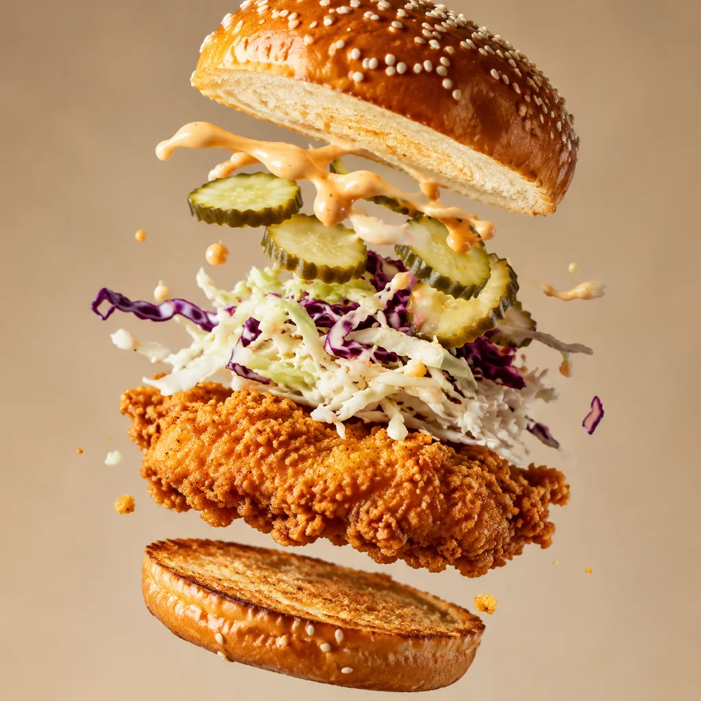</a>

> Adapted from a post by @Minahil42298354 on 2026-03-04 (56 likes at capture). We rewrote it as one clean 1:1 hyper-realistic exploded / floating-layer food infographic still, removing brands, logos, celebrity/IP elements and any need for a user photo. Change one variable at a time.

```text
Hyper-realistic mid-air exploded gourmet fried chicken burger, square 1:1: toasted sesame brioche at the bottom, crispy breaded chicken fillet, shredded cabbage slaw, pickles, spicy mayo drizzle, top bun highest — ingredients flying upward in a controlled gravity-defying stack, studio backdrop, reverse-written from image, no brand name like Royal Crisp, no logos. Square 1:1 composition.
```

- Author: [@Minahil42298354](https://x.com/Minahil42298354)
- Original post: https://x.com/Minahil42298354/status/2029157743748170190
- [View on cinel and generate with this prompt](https://cinel.ai/prompts/p/fried-chicken-burger-midair-exploded?utm_source=github&utm_medium=awesome&utm_campaign=awesome-gpt-image-2.5-prompts)

### Ramen with Fried Chicken Levitation Shot

<a href="https://cinel.ai/prompts/p/ramen-fried-chicken-levitation-shot?utm_source=github&utm_medium=awesome&utm_campaign=awesome-gpt-image-2.5-prompts">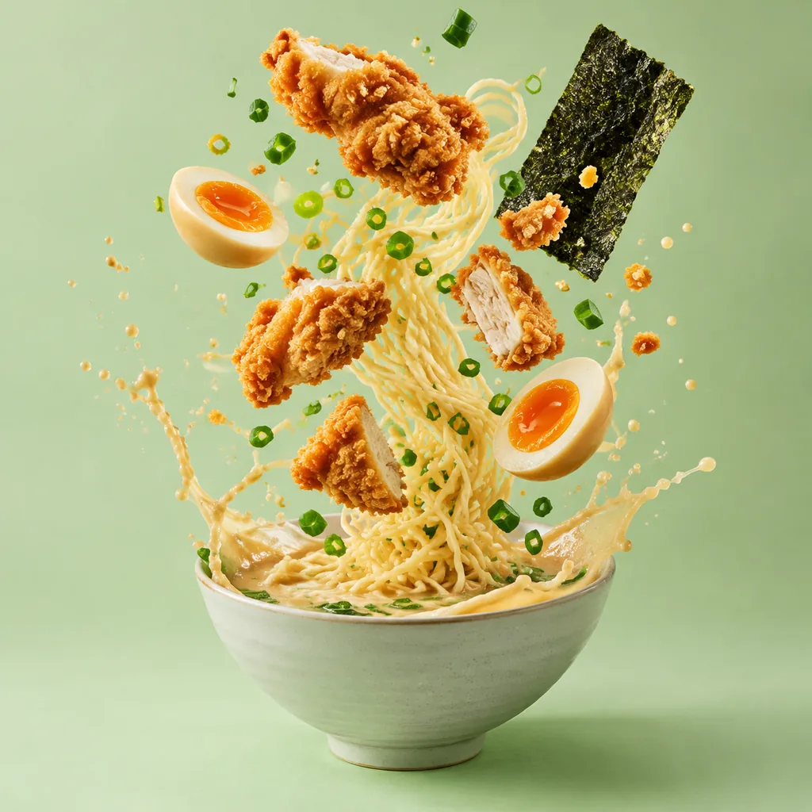</a>

> Adapted from a post by @pauu_pk on 2026-01-21 (0 likes at capture). We rewrote it as one clean 1:1 hyper-realistic exploded / floating-layer food infographic still, removing brands, logos, celebrity/IP elements and any need for a user photo. Change one variable at a time.

```text
Professional studio food photography, square 1:1: deconstructed ramen with breaded fried chicken in high-speed levitation — noodles uncoiling, broth splash droplets, soft-boiled egg halves, nori, scallions, crispy fried chicken pieces above a simple ramen bowl on a seamless pastel green studio sweep, soft diffused light, reverse-written from image, no brand logos. Square 1:1 composition.
```

- Author: [@pauu_pk](https://x.com/pauu_pk)
- Original post: https://x.com/pauu_pk/status/2013993462077460635
- [View on cinel and generate with this prompt](https://cinel.ai/prompts/p/ramen-fried-chicken-levitation-shot?utm_source=github&utm_medium=awesome&utm_campaign=awesome-gpt-image-2.5-prompts)

### Steak Salad Exploded Infographic

<a href="https://cinel.ai/prompts/p/steak-salad-exploded-infographic?utm_source=github&utm_medium=awesome&utm_campaign=awesome-gpt-image-2.5-prompts">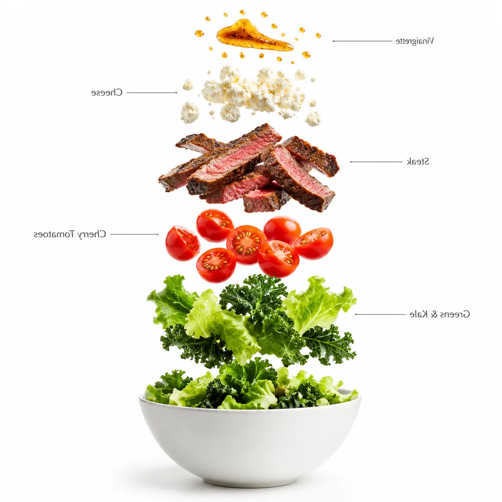</a>

> Adapted from a post by @meAsifAi on 2026-02-19 (0 likes at capture). We rewrote it as one clean 1:1 hyper-realistic exploded / floating-layer food infographic still, removing brands, logos, celebrity/IP elements and any need for a user photo. Change one variable at a time.

```text
Clean vertically stacked exploded-view salad, square 1:1: steak salad ingredients evenly spaced on a center axis from bottom to top — white ceramic bowl, leafy greens and curly kale, cherry tomatoes, sliced grilled steak strips, crumbled cheese, vinaigrette droplets at the top — pure white background, soft studio light, subtle shadows, reverse-written from image, thin optional pointer lines, no brand logos. Square 1:1 composition.
```

- Author: [@meAsifAi](https://x.com/meAsifAi)
- Original post: https://x.com/meAsifAi/status/2024390571872194725
- [View on cinel and generate with this prompt](https://cinel.ai/prompts/p/steak-salad-exploded-infographic?utm_source=github&utm_medium=awesome&utm_campaign=awesome-gpt-image-2.5-prompts)

### Classic Cheeseburger No-Text Exploded View

<a href="https://cinel.ai/prompts/p/classic-cheeseburger-no-text-exploded?utm_source=github&utm_medium=awesome&utm_campaign=awesome-gpt-image-2.5-prompts">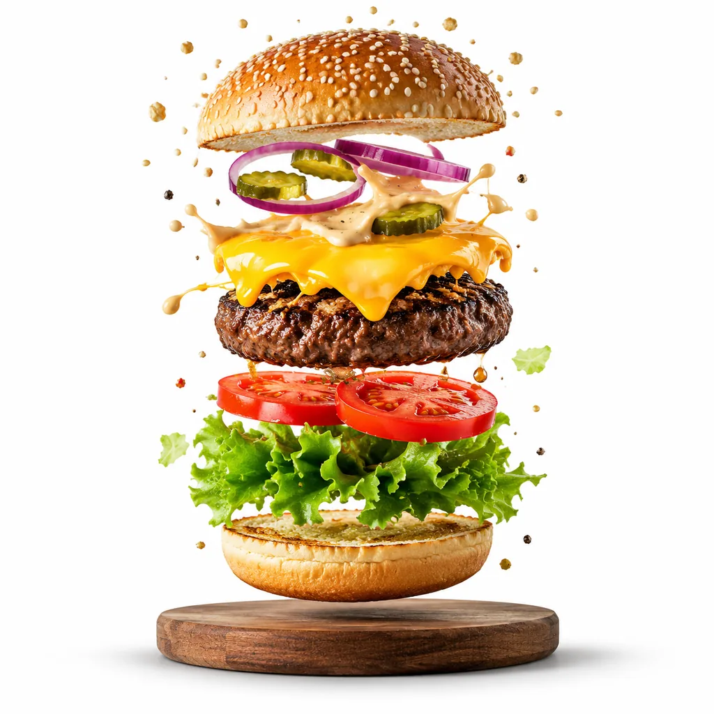</a>

> Adapted from a post by @underwoodxie96 on 2025-12-30 (658 likes at capture). We rewrote it as one clean 1:1 hyper-realistic exploded / floating-layer food infographic still, removing brands, logos, celebrity/IP elements and any need for a user photo. Change one variable at a time.

```text
Create a hyper-realistic exploded vertical food infographic, square 1:1, of a classic cheeseburger: sesame top bun crumbs at the very top, melted cheese stretch, juicy beef patty, fresh lettuce and tomato, bottom bun on a small wooden board. At the top, signature particles, droplets or garnishes frozen mid-air. Below, the primary topping layer with rich texture. Underneath, the core ingredient layer. Below that, the supporting base or interior, slightly separated. At the bottom, a minimal plate, bowl or board. Pure white background, soft studio lighting, subtle shadows under each floating piece, ultra-sharp DSLR macro look, ensure no text titles or text labels of any kind, no pointer lines with words, premium editorial food photography, 8K, no brand logos, no celebrity, no modern IP. Square 1:1 composition.
```

- Author: [@underwoodxie96](https://x.com/underwoodxie96)
- Original post: https://x.com/underwoodxie96/status/2006055122837856381
- [View on cinel and generate with this prompt](https://cinel.ai/prompts/p/classic-cheeseburger-no-text-exploded?utm_source=github&utm_medium=awesome&utm_campaign=awesome-gpt-image-2.5-prompts)

### Middle Eastern Mezze Exploded Infographic

<a href="https://cinel.ai/prompts/p/middle-eastern-mezze-exploded?utm_source=github&utm_medium=awesome&utm_campaign=awesome-gpt-image-2.5-prompts">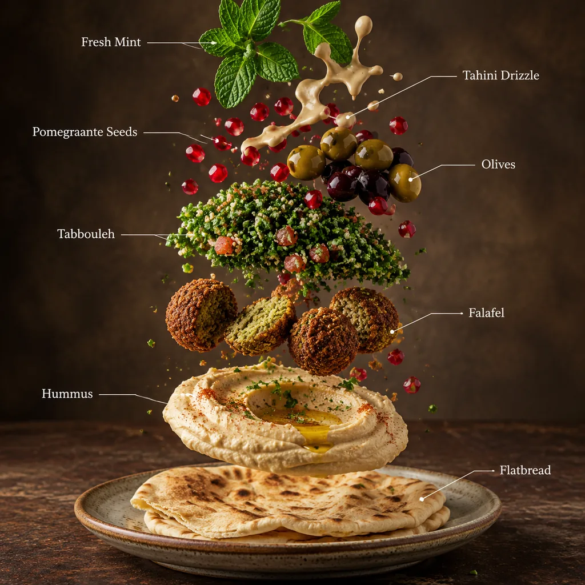</a>

> Adapted from a post by @Taaruk_ on 2026-01-29 (166 likes at capture). We rewrote it as one clean 1:1 hyper-realistic exploded / floating-layer food infographic still, removing brands, logos, celebrity/IP elements and any need for a user photo. Change one variable at a time.

```text
Hyper-realistic food anatomy exploded-view infographic, square 1:1: a deconstructed Middle Eastern mezze plate: flatbread at the bottom on a ceramic platter, hummus swirl, falafel pieces, tabbouleh, olives, pomegranate seeds, tahini drizzle and fresh mint floating above. Clean vertical composition, gravity-defying floating ingredients evenly spaced above a base at the bottom, rustic or studio surface, thin white pointer lines with clear English labels, cinematic studio lighting, warm editorial tones, dramatic steam or gloss where natural, ultra-detailed textures, 8K photoreal, no brand logos, no chain names, no celebrity. Square 1:1 composition.
```

- Author: [@Taaruk_](https://x.com/Taaruk_)
- Original post: https://x.com/Taaruk_/status/2016781186543317340
- [View on cinel and generate with this prompt](https://cinel.ai/prompts/p/middle-eastern-mezze-exploded?utm_source=github&utm_medium=awesome&utm_campaign=awesome-gpt-image-2.5-prompts)

### Truffle Mushroom Pizza Exploded View

<a href="https://cinel.ai/prompts/p/truffle-mushroom-pizza-exploded?utm_source=github&utm_medium=awesome&utm_campaign=awesome-gpt-image-2.5-prompts">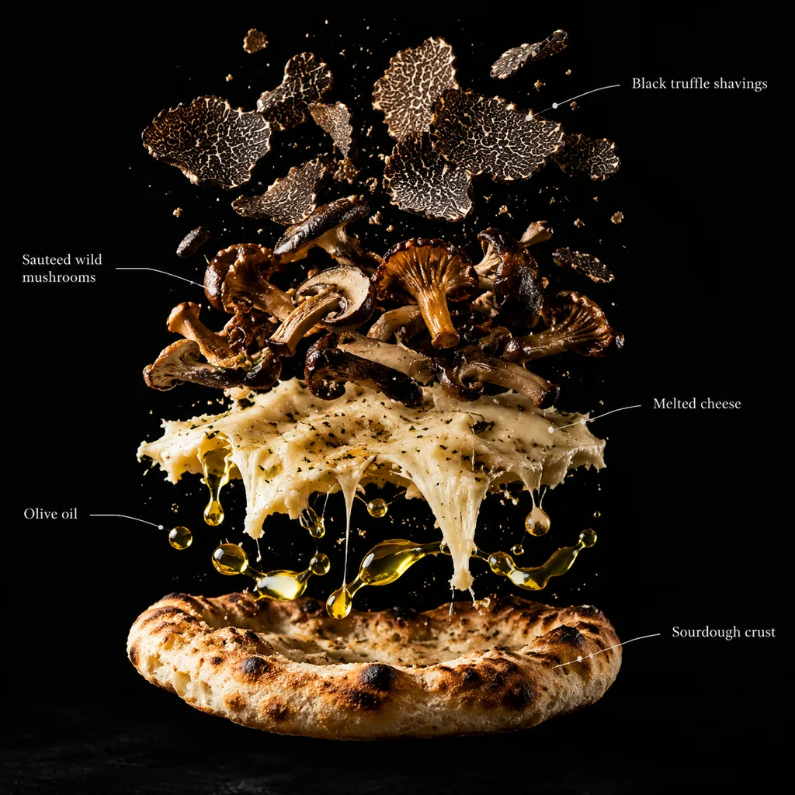</a>

> Adapted from a post by @aiwithlumi on 2026-06-06 (72 likes at capture). We rewrote it as one clean 1:1 hyper-realistic exploded / floating-layer food infographic still, removing brands, logos, celebrity/IP elements and any need for a user photo. Change one variable at a time.

```text
High-end food photography, square 1:1: a deconstructed truffle and mushroom pizza in exploded view, floating layers of ingredients suspended vertically — black truffle shavings exploding at the top, sauteed wild mushrooms, melted cheese, olive oil droplets, sourdough crust at the bottom — dark black studio backdrop, dramatic side light, thin pointer labels, no brand logos. Square 1:1 composition.
```

- Author: [@aiwithlumi](https://x.com/aiwithlumi)
- Original post: https://x.com/aiwithlumi/status/2063294103673270685
- [View on cinel and generate with this prompt](https://cinel.ai/prompts/p/truffle-mushroom-pizza-exploded?utm_source=github&utm_medium=awesome&utm_campaign=awesome-gpt-image-2.5-prompts)

### Pad Thai Exploded Layers Infographic

<a href="https://cinel.ai/prompts/p/pad-thai-exploded-layers?utm_source=github&utm_medium=awesome&utm_campaign=awesome-gpt-image-2.5-prompts">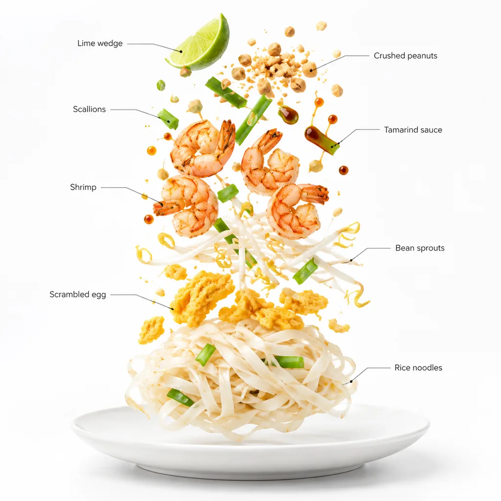</a>

> Adapted from a post by @SaasJunctionHQ on 2025-11-16 (0 likes at capture). We rewrote it as one clean 1:1 hyper-realistic exploded / floating-layer food infographic still, removing brands, logos, celebrity/IP elements and any need for a user photo. Change one variable at a time.

```text
Deconstructed layers of pad thai suspended in space, square 1:1: rice noodles, scrambled egg pieces, shrimp, bean sprouts, crushed peanuts, lime wedge, tamarind sauce droplets, scallions dispersed vertically in an energetic but clean stack, white ceramic plate at the bottom, clean white studio backdrop, high-key lighting, commercial food photography, thin pointer labels, no brand logos. Square 1:1 composition.
```

- Author: [@SaasJunctionHQ](https://x.com/SaasJunctionHQ)
- Original post: https://x.com/SaasJunctionHQ/status/1990074814657409404
- [View on cinel and generate with this prompt](https://cinel.ai/prompts/p/pad-thai-exploded-layers?utm_source=github&utm_medium=awesome&utm_campaign=awesome-gpt-image-2.5-prompts)

### Garden Salad Exploded Video Keyframe

<a href="https://cinel.ai/prompts/p/garden-salad-exploded-keyframe?utm_source=github&utm_medium=awesome&utm_campaign=awesome-gpt-image-2.5-prompts">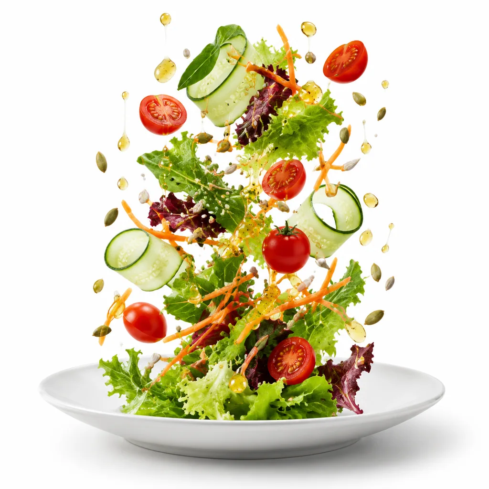</a>

> Adapted from a post by @Strength04_X on 2026-01-04 (1277 likes at capture). We rewrote it as one clean 1:1 hyper-realistic exploded / floating-layer food infographic still, removing brands, logos, celebrity/IP elements and any need for a user photo. Change one variable at a time.

```text
Clean commercial salad exploded still, square 1:1: a fresh garden salad with ingredients separated and aligned — mixed greens, cucumber ribbons, cherry tomatoes, shredded carrot, seeds, vinaigrette droplets above a white plate — pure studio white, soft shadows, frozen from a plate-spin AI video, no brand logos. Square 1:1 composition.
```

- Author: [@Strength04_X](https://x.com/Strength04_X)
- Original post: https://x.com/Strength04_X/status/2007848790175453305
- [View on cinel and generate with this prompt](https://cinel.ai/prompts/p/garden-salad-exploded-keyframe?utm_source=github&utm_medium=awesome&utm_campaign=awesome-gpt-image-2.5-prompts)

### Pancake Stack Exploded Video Keyframe

<a href="https://cinel.ai/prompts/p/pancake-stack-exploded-keyframe?utm_source=github&utm_medium=awesome&utm_campaign=awesome-gpt-image-2.5-prompts">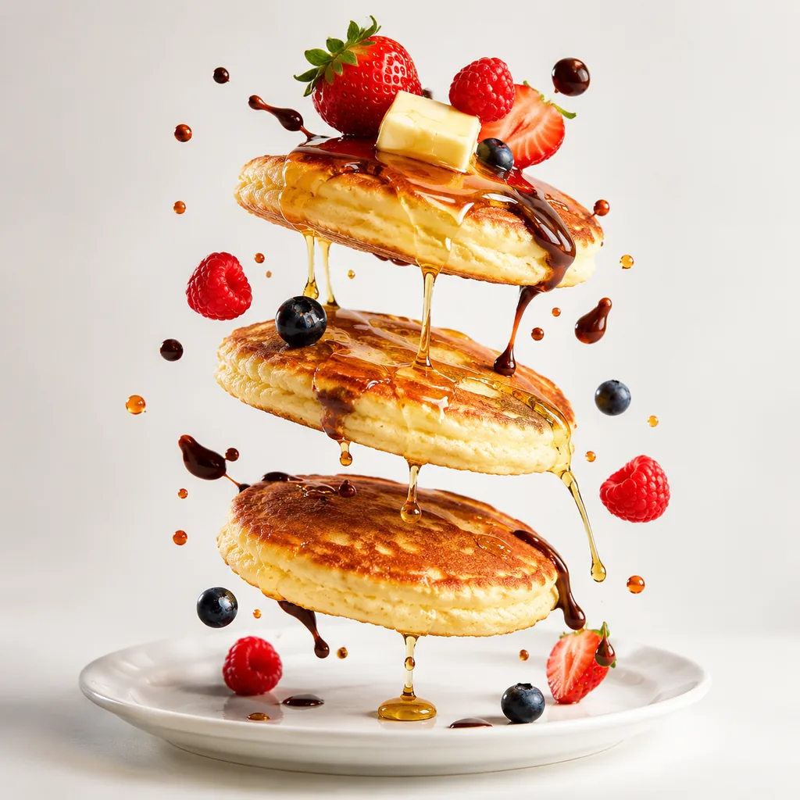</a>

> Adapted from a post by @Strength04_X on 2026-01-20 (335 likes at capture). We rewrote it as one clean 1:1 hyper-realistic exploded / floating-layer food infographic still, removing brands, logos, celebrity/IP elements and any need for a user photo. Change one variable at a time.

```text
Ultra-realistic pancake stack exploded still, square 1:1: three fluffy golden pancakes separated vertically with even gaps, melted butter cube, glossy maple syrup strands and chocolate sauce droplets frozen mid-air, berries at the top, minimal white ceramic plate at the bottom, soft studio light, frozen from an AI spin video, no brand syrup logos. Square 1:1 composition.
```

- Author: [@Strength04_X](https://x.com/Strength04_X)
- Original post: https://x.com/Strength04_X/status/2013456246091981078
- [View on cinel and generate with this prompt](https://cinel.ai/prompts/p/pancake-stack-exploded-keyframe?utm_source=github&utm_medium=awesome&utm_campaign=awesome-gpt-image-2.5-prompts)

### Strawberry Matcha Latte Exploded Keyframe

<a href="https://cinel.ai/prompts/p/strawberry-matcha-latte-exploded-keyframe?utm_source=github&utm_medium=awesome&utm_campaign=awesome-gpt-image-2.5-prompts">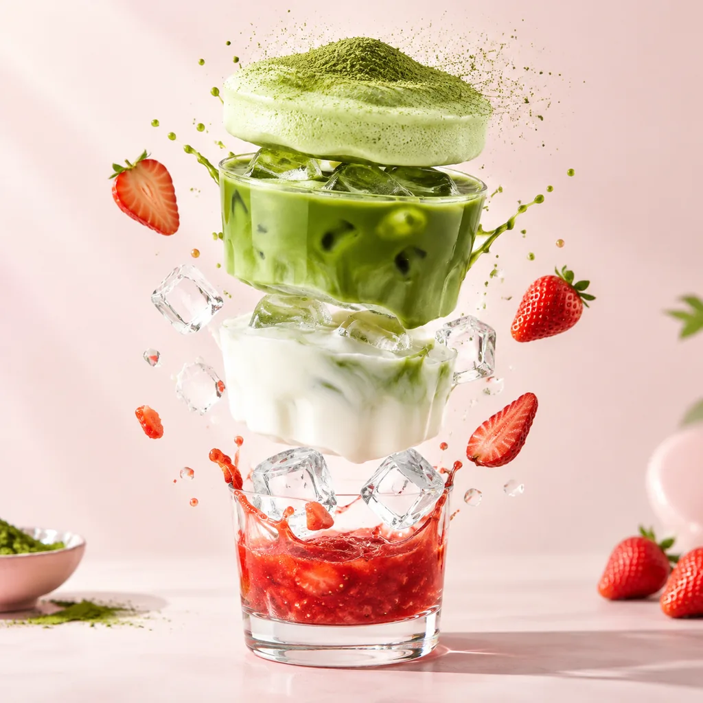</a>

> Adapted from a post by @manibuildsAI on 2026-06-01 (0 likes at capture). We rewrote it as one clean 1:1 hyper-realistic exploded / floating-layer food infographic still, removing brands, logos, celebrity/IP elements and any need for a user photo. Change one variable at a time.

```text
Premium cafe beverage exploded still, square 1:1: iced strawberry matcha latte layers gently separated — matcha foam dusting at the top, vibrant green matcha, milk layer, ice cubes, strawberry puree at the bottom of a clear glass — soft pastel backdrop, elegant vertical stack frozen mid slow rotation, no brand cup logos. Square 1:1 composition.
```

- Author: [@manibuildsAI](https://x.com/manibuildsAI)
- Original post: https://x.com/manibuildsAI/status/2061487714965553489
- [View on cinel and generate with this prompt](https://cinel.ai/prompts/p/strawberry-matcha-latte-exploded-keyframe?utm_source=github&utm_medium=awesome&utm_campaign=awesome-gpt-image-2.5-prompts)

### Fruit Salad Exploded Infographic

<a href="https://cinel.ai/prompts/p/fruit-salad-exploded-infographic?utm_source=github&utm_medium=awesome&utm_campaign=awesome-gpt-image-2.5-prompts">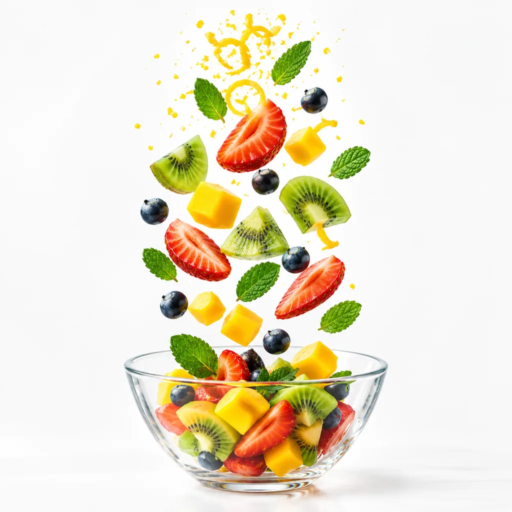</a>

> Adapted from a post by @Ankit_patel211 on 2026-01-07 (26 likes at capture). We rewrote it as one clean 1:1 hyper-realistic exploded / floating-layer food infographic still, removing brands, logos, celebrity/IP elements and any need for a user photo. Change one variable at a time.

```text
Clean exploded-view fruit salad, square 1:1: colorful fruit pieces floating in a vertical stack — strawberry slices, kiwi, mango cubes, blueberry, mint leaves, citrus zest mist at the top, glass bowl at the bottom — bright high-key studio, reverse-written from image, no brand logos. Square 1:1 composition.
```

- Author: [@Ankit_patel211](https://x.com/Ankit_patel211)
- Original post: https://x.com/Ankit_patel211/status/2008766506528858471
- [View on cinel and generate with this prompt](https://cinel.ai/prompts/p/fruit-salad-exploded-infographic?utm_source=github&utm_medium=awesome&utm_campaign=awesome-gpt-image-2.5-prompts)

### Fresh Spring Rolls Exploded Infographic

<a href="https://cinel.ai/prompts/p/fresh-spring-rolls-exploded-infographic?utm_source=github&utm_medium=awesome&utm_campaign=awesome-gpt-image-2.5-prompts">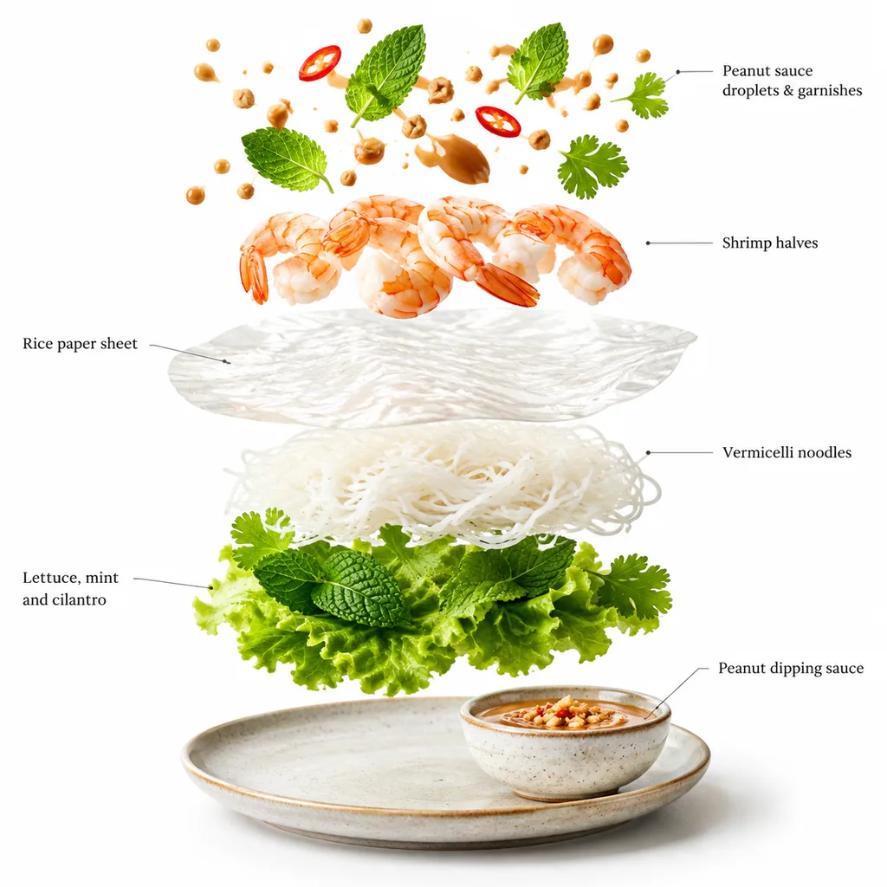</a>

> Adapted from a post by @recap_david on 2026-01-05 (1059 likes at capture). We rewrote it as one clean 1:1 hyper-realistic exploded / floating-layer food infographic still, removing brands, logos, celebrity/IP elements and any need for a user photo. Change one variable at a time.

```text
Create a hyper-realistic exploded vertical food infographic, square 1:1, of fresh Vietnamese summer rolls: rice paper sheet unfurled at the mid layers, shrimp halves, vermicelli noodles, lettuce, mint and cilantro, peanut dipping sauce droplets, ceramic plate at the bottom. At the top, signature particles, droplets or garnishes frozen mid-air. Below, the primary topping layer with rich texture. Underneath, the core ingredient layer. Below that, the supporting base or interior, slightly separated. At the bottom, a minimal plate, bowl or board. Pure white background, soft studio lighting, subtle shadows under each floating piece, ultra-sharp DSLR macro look, thin pointer lines with clean English ingredient labels, premium editorial food photography, 8K, no brand logos, no celebrity, no modern IP. Square 1:1 composition.
```

- Author: [@recap_david](https://x.com/recap_david)
- Original post: https://x.com/recap_david/status/2007987682681782457
- [View on cinel and generate with this prompt](https://cinel.ai/prompts/p/fresh-spring-rolls-exploded-infographic?utm_source=github&utm_medium=awesome&utm_campaign=awesome-gpt-image-2.5-prompts)

### Brown Sugar Boba Tea Exploded Infographic

<a href="https://cinel.ai/prompts/p/brown-sugar-boba-tea-exploded?utm_source=github&utm_medium=awesome&utm_campaign=awesome-gpt-image-2.5-prompts">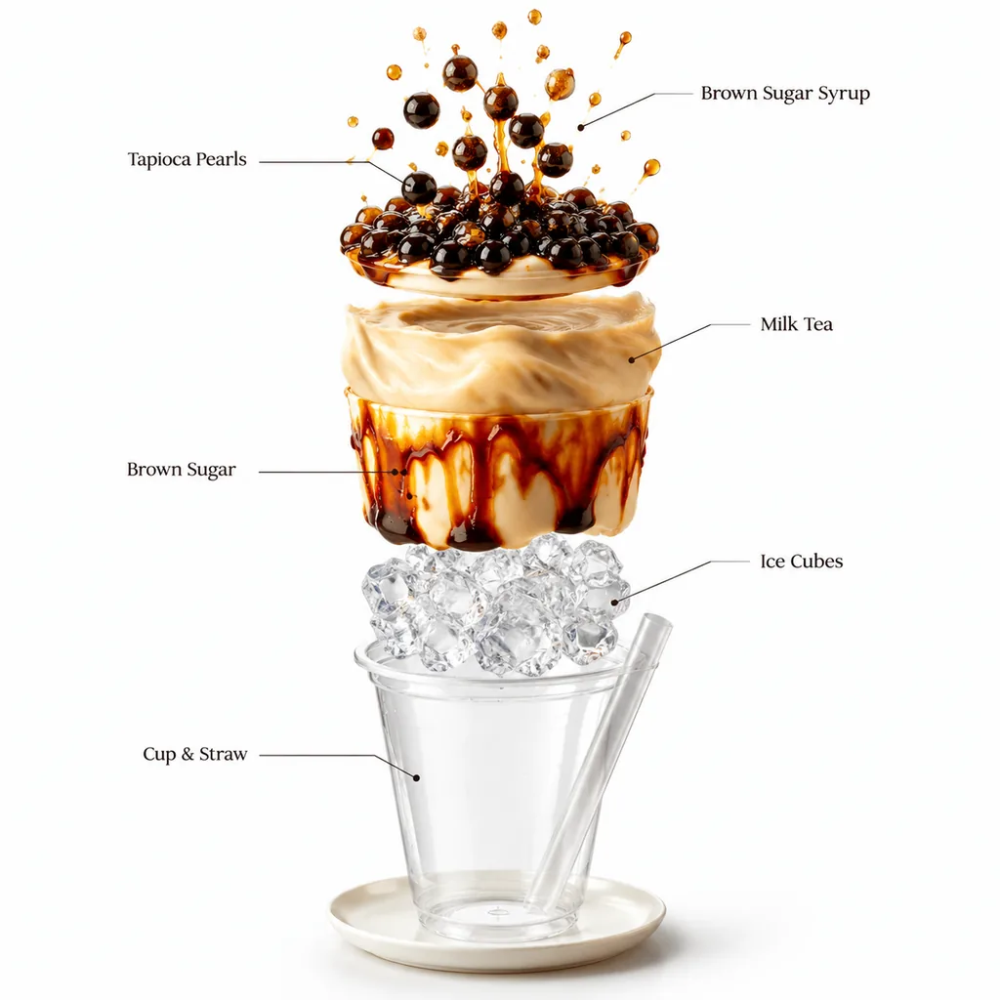</a>

> Adapted from a post by @Strength04_X on 2026-05-29 (157 likes at capture). We rewrote it as one clean 1:1 hyper-realistic exploded / floating-layer food infographic still, removing brands, logos, celebrity/IP elements and any need for a user photo. Change one variable at a time.

```text
Create a hyper-realistic exploded vertical food infographic, square 1:1, of a brown sugar bubble tea: tapioca pearls cascading at the top, creamy milk tea layer, dark brown sugar syrup streaks on the cup wall, ice cubes, clear cup and wide straw at the bottom. At the top, signature particles, droplets or garnishes frozen mid-air. Below, the primary topping layer with rich texture. Underneath, the core ingredient layer. Below that, the supporting base or interior, slightly separated. At the bottom, a minimal plate, bowl or board. Pure white background, soft studio lighting, subtle shadows under each floating piece, ultra-sharp DSLR macro look, thin pointer lines with clean English ingredient labels, premium editorial food photography, 8K, no brand logos, no celebrity, no modern IP. Square 1:1 composition.
```

- Author: [@Strength04_X](https://x.com/Strength04_X)
- Original post: https://x.com/Strength04_X/status/2060392975570702433
- [View on cinel and generate with this prompt](https://cinel.ai/prompts/p/brown-sugar-boba-tea-exploded?utm_source=github&utm_medium=awesome&utm_campaign=awesome-gpt-image-2.5-prompts)

### Molten Lava Cake No-Text Exploded View

<a href="https://cinel.ai/prompts/p/molten-lava-cake-no-text-exploded?utm_source=github&utm_medium=awesome&utm_campaign=awesome-gpt-image-2.5-prompts">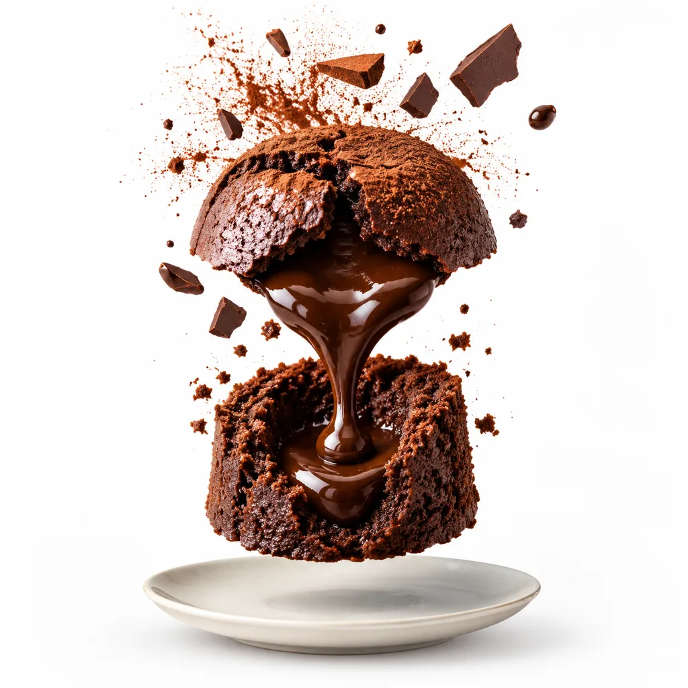</a>

> Adapted from a post by @mehvishs25 on 2026-03-04 (88 likes at capture). We rewrote it as one clean 1:1 hyper-realistic exploded / floating-layer food infographic still, removing brands, logos, celebrity/IP elements and any need for a user photo. Change one variable at a time.

```text
Create a hyper-realistic exploded vertical food infographic, square 1:1, of a molten chocolate lava cake: cocoa dust and chocolate shards at the top, cracked cake dome, flowing molten chocolate core mid-pour, cake crumb walls, small dessert plate at the bottom. At the top, signature particles, droplets or garnishes frozen mid-air. Below, the primary topping layer with rich texture. Underneath, the core ingredient layer. Below that, the supporting base or interior, slightly separated. At the bottom, a minimal plate, bowl or board. Pure white background, soft studio lighting, subtle shadows under each floating piece, ultra-sharp DSLR macro look, ensure no text titles or text labels of any kind, no pointer lines with words, premium editorial food photography, 8K, no brand logos, no celebrity, no modern IP. Square 1:1 composition.
```

- Author: [@mehvishs25](https://x.com/mehvishs25)
- Original post: https://x.com/mehvishs25/status/2029021169727488047
- [View on cinel and generate with this prompt](https://cinel.ai/prompts/p/molten-lava-cake-no-text-exploded?utm_source=github&utm_medium=awesome&utm_campaign=awesome-gpt-image-2.5-prompts)

### Ice Cream Sundae Exploded Infographic

<a href="https://cinel.ai/prompts/p/ice-cream-sundae-exploded-infographic?utm_source=github&utm_medium=awesome&utm_campaign=awesome-gpt-image-2.5-prompts">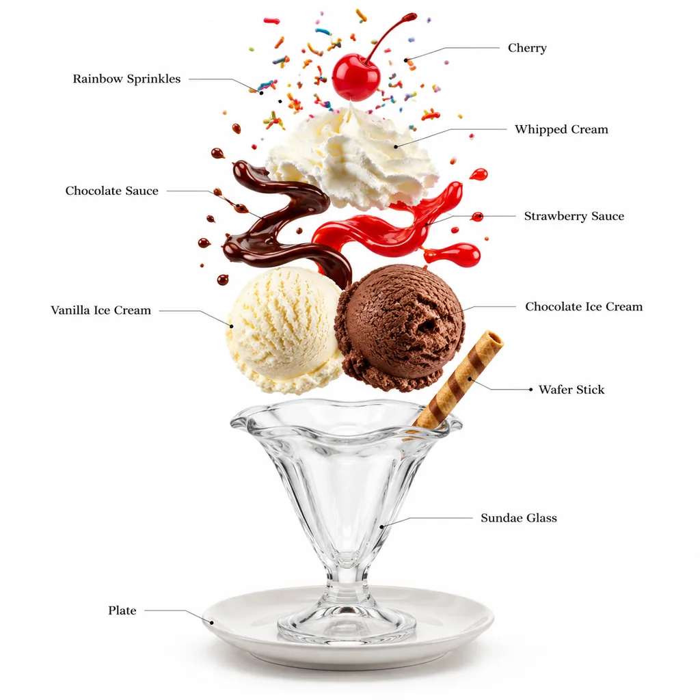</a>

> Adapted from a post by @oggii_0 on 2026-01-11 (89 likes at capture). We rewrote it as one clean 1:1 hyper-realistic exploded / floating-layer food infographic still, removing brands, logos, celebrity/IP elements and any need for a user photo. Change one variable at a time.

```text
Create a hyper-realistic exploded vertical food infographic, square 1:1, of a classic ice cream sundae: rainbow sprinkles and cherry at the top, whipped cream, chocolate and strawberry sauce ribbons, vanilla and chocolate scoops, wafer stick, tall sundae glass at the bottom. At the top, signature particles, droplets or garnishes frozen mid-air. Below, the primary topping layer with rich texture. Underneath, the core ingredient layer. Below that, the supporting base or interior, slightly separated. At the bottom, a minimal plate, bowl or board. Pure white background, soft studio lighting, subtle shadows under each floating piece, ultra-sharp DSLR macro look, thin pointer lines with clean English ingredient labels, premium editorial food photography, 8K, no brand logos, no celebrity, no modern IP. Square 1:1 composition.
```

- Author: [@oggii_0](https://x.com/oggii_0)
- Original post: https://x.com/oggii_0/status/2010294844116369609
- [View on cinel and generate with this prompt](https://cinel.ai/prompts/p/ice-cream-sundae-exploded-infographic?utm_source=github&utm_medium=awesome&utm_campaign=awesome-gpt-image-2.5-prompts)

### Ramen Bowl Exploded Layer Infographic

<a href="https://cinel.ai/prompts/p/ramen-bowl-exploded-layer-infographic?utm_source=github&utm_medium=awesome&utm_campaign=awesome-gpt-image-2.5-prompts">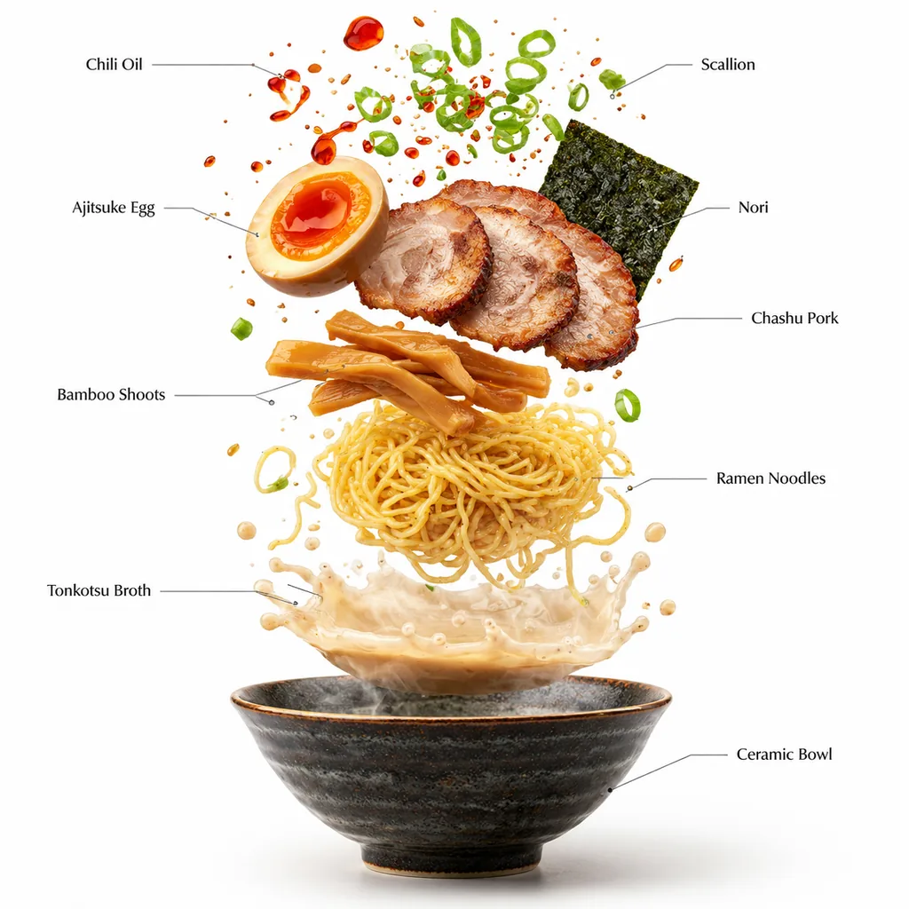</a>

> Adapted from a post by @iamaiistudio on 2026-07-01 (25 likes at capture). We rewrote it as one clean 1:1 hyper-realistic exploded / floating-layer food infographic still, removing brands, logos, celebrity/IP elements and any need for a user photo. Change one variable at a time.

```text
Create a hyper-realistic exploded vertical food infographic, square 1:1, of a rich tonkotsu ramen bowl: chili oil droplets and scallion rings at the top, soft-boiled ajitsuke egg, chashu pork slices, nori sheet, bamboo shoots, springy noodles, steaming creamy broth, deep ceramic bowl at the bottom. At the top, signature particles, droplets or garnishes frozen mid-air. Below, the primary topping layer with rich texture. Underneath, the core ingredient layer. Below that, the supporting base or interior, slightly separated. At the bottom, a minimal plate, bowl or board. Pure white background, soft studio lighting, subtle shadows under each floating piece, ultra-sharp DSLR macro look, thin pointer lines with clean English ingredient labels, premium editorial food photography, 8K, no brand logos, no celebrity, no modern IP. Square 1:1 composition.
```

- Author: [@iamaiistudio](https://x.com/iamaiistudio)
- Original post: https://x.com/iamaiistudio/status/2072208469437112566
- [View on cinel and generate with this prompt](https://cinel.ai/prompts/p/ramen-bowl-exploded-layer-infographic?utm_source=github&utm_medium=awesome&utm_campaign=awesome-gpt-image-2.5-prompts)

### Sichuan Hotpot Exploded Infographic

<a href="https://cinel.ai/prompts/p/sichuan-hotpot-exploded-infographic?utm_source=github&utm_medium=awesome&utm_campaign=awesome-gpt-image-2.5-prompts">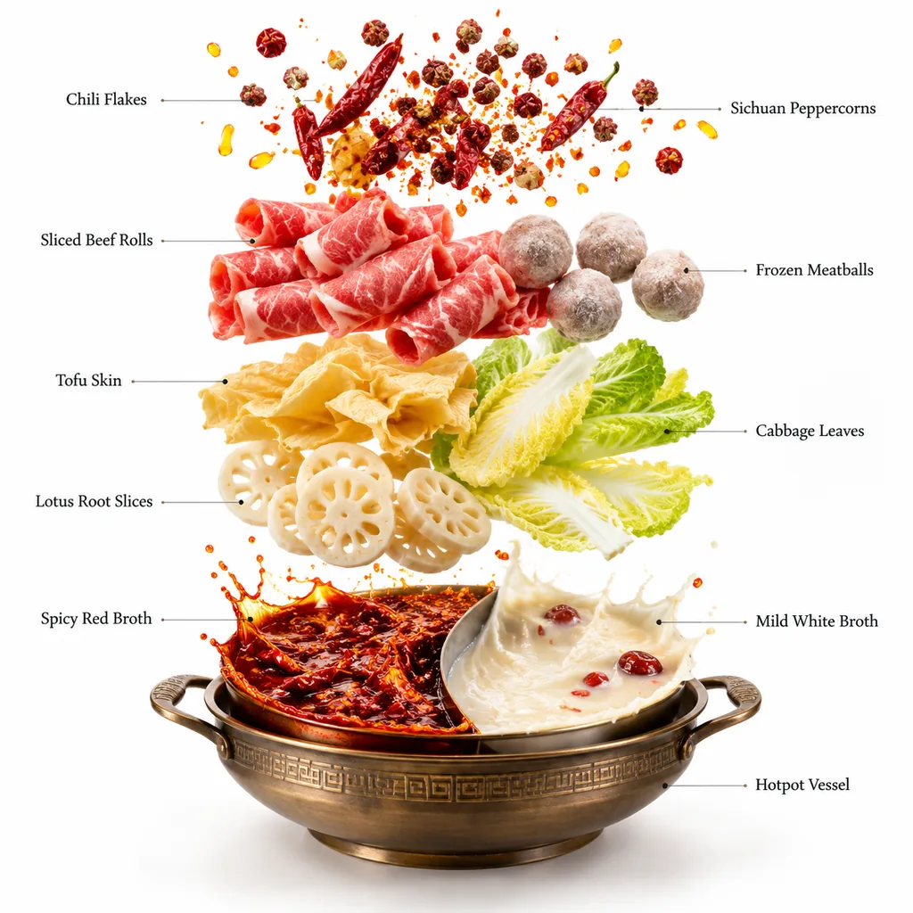</a>

> Adapted from a post by @iamaiistudio on 2026-05-29 (4 likes at capture). We rewrote it as one clean 1:1 hyper-realistic exploded / floating-layer food infographic still, removing brands, logos, celebrity/IP elements and any need for a user photo. Change one variable at a time.

```text
Create a hyper-realistic exploded vertical food infographic, square 1:1, of a Sichuan dual-broth hotpot: chili flakes and Sichuan peppercorns exploding at the top, thinly sliced beef rolls, frozen meatballs, tofu skin, cabbage leaves, lotus root slices, spicy red broth and mild white broth divided, wide hotpot vessel at the bottom. At the top, signature particles, droplets or garnishes frozen mid-air. Below, the primary topping layer with rich texture. Underneath, the core ingredient layer. Below that, the supporting base or interior, slightly separated. At the bottom, a minimal plate, bowl or board. Pure white background, soft studio lighting, subtle shadows under each floating piece, ultra-sharp DSLR macro look, thin pointer lines with clean English ingredient labels, premium editorial food photography, 8K, no brand logos, no celebrity, no modern IP. Square 1:1 composition.
```

- Author: [@iamaiistudio](https://x.com/iamaiistudio)
- Original post: https://x.com/iamaiistudio/status/2060453015585534115
- [View on cinel and generate with this prompt](https://cinel.ai/prompts/p/sichuan-hotpot-exploded-infographic?utm_source=github&utm_medium=awesome&utm_campaign=awesome-gpt-image-2.5-prompts)

### Poke Bowl Exploded Infographic

<a href="https://cinel.ai/prompts/p/poke-bowl-exploded-infographic?utm_source=github&utm_medium=awesome&utm_campaign=awesome-gpt-image-2.5-prompts"></a>

> Adapted from a post by @tutorgpt_io on 2026-08-17 (4 likes at capture). We rewrote it as one clean 1:1 hyper-realistic exploded / floating-layer food infographic still, removing brands, logos, celebrity/IP elements and any need for a user photo. Change one variable at a time.

```text
Create a hyper-realistic exploded vertical food infographic, square 1:1, of a Hawaiian poke bowl: sesame seeds and nori strips at the top, cubed raw tuna, avocado, edamame, pickled ginger, cucumber, sushi rice, shallow ceramic bowl at the bottom. At the top, signature particles, droplets or garnishes frozen mid-air. Below, the primary topping layer with rich texture. Underneath, the core ingredient layer. Below that, the supporting base or interior, slightly separated. At the bottom, a minimal plate, bowl or board. Pure white background, soft studio lighting, subtle shadows under each floating piece, ultra-sharp DSLR macro look, thin pointer lines with clean English ingredient labels, premium editorial food photography, 8K, no brand logos, no celebrity, no modern IP. Square 1:1 composition.
```

- Author: [@tutorgpt_io](https://x.com/tutorgpt_io)
- Original post: https://x.com/tutorgpt_io/status/2089298352718639558
- [View on cinel and generate with this prompt](https://cinel.ai/prompts/p/poke-bowl-exploded-infographic?utm_source=github&utm_medium=awesome&utm_campaign=awesome-gpt-image-2.5-prompts)

### Vietnamese Pho Exploded Infographic

<a href="https://cinel.ai/prompts/p/vietnamese-pho-exploded-infographic?utm_source=github&utm_medium=awesome&utm_campaign=awesome-gpt-image-2.5-prompts"></a>

> Adapted from a post by @TLightFactory on 2026-02-02 (3 likes at capture). We rewrote it as one clean 1:1 hyper-realistic exploded / floating-layer food infographic still, removing brands, logos, celebrity/IP elements and any need for a user photo. Change one variable at a time.

```text
Hyper-realistic food anatomy exploded-view infographic, square 1:1: a bowl of Vietnamese pho: deep pho bowl with clear aromatic broth at the bottom, flat rice noodles rising, rare beef slices, Thai basil, bean sprouts, lime wedges, sliced chili, fried shallots floating above. Clean vertical composition, gravity-defying floating ingredients evenly spaced above a base at the bottom, rustic or studio surface, thin white pointer lines with clear English labels, cinematic studio lighting, warm editorial tones, dramatic steam or gloss where natural, ultra-detailed textures, 8K photoreal, no brand logos, no chain names, no celebrity. Square 1:1 composition.
```

- Author: [@TLightFactory](https://x.com/TLightFactory)
- Original post: https://x.com/TLightFactory/status/2018251711043744010
- [View on cinel and generate with this prompt](https://cinel.ai/prompts/p/vietnamese-pho-exploded-infographic?utm_source=github&utm_medium=awesome&utm_campaign=awesome-gpt-image-2.5-prompts)

### Raccoon Escaping With Thanksgiving Pie

<a href="https://cinel.ai/prompts/p/raccoon-thanksgiving-pie-escape?utm_source=github&utm_medium=awesome&utm_campaign=awesome-gpt-image-2.5-prompts"></a>

> Adapted from a post by @heathergreen on 2026-10-19 (0 likes at capture). We rewrote it as one clean 1:1 still, removing brands, logos, celebrity/IP elements and any need for your own photo. Change one variable at a time.

```text
Hilarious storybook illustration, square 1:1: a mischievous raccoon fleeing with a whole Thanksgiving pie, crumbs flying, autumn porch and fallen leaves, comic energy and warm fall colours, no brand, no readable text, no logo. Square 1:1 composition.
```

- Author: [@heathergreen](https://x.com/heathergreen)
- Original post: https://x.com/heathergreen/status/2111985689269244155
- [View on cinel and generate with this prompt](https://cinel.ai/prompts/p/raccoon-thanksgiving-pie-escape?utm_source=github&utm_medium=awesome&utm_campaign=awesome-gpt-image-2.5-prompts)

### Night Dumpling Kitchen Keyframe

<a href="https://cinel.ai/prompts/p/dumpling-night-kitchen-keyframe?utm_source=github&utm_medium=awesome&utm_campaign=awesome-gpt-image-2.5-prompts"></a>

> Adapted from a video post by @Mayz1169 on 2026-10-13 (28 likes at capture). We rewrote it as one clean 1:1 still, removing brands, logos, celebrity/IP elements and any need for your own photo. Change one variable at a time.

```text
Cinematic food video keyframe, square 1:1: steaming handmade dumplings being plated in a cozy nighttime apartment kitchen, warm practical light against cool window blue, flour dust and rising steam, Japanese anime-inspired food cinematography frozen at the hero plating beat, no text, no logo. Square 1:1 composition.
```

- Author: [@Mayz1169](https://x.com/Mayz1169)
- Original post: https://x.com/Mayz1169/status/2110010358350176442
- [View on cinel and generate with this prompt](https://cinel.ai/prompts/p/dumpling-night-kitchen-keyframe?utm_source=github&utm_medium=awesome&utm_campaign=awesome-gpt-image-2.5-prompts)

### Nasi Goreng Floating Ingredients Poster

<a href="https://cinel.ai/prompts/p/nasi-goreng-floating-ingredients-poster?utm_source=github&utm_medium=awesome&utm_campaign=awesome-gpt-image-2.5-prompts"></a>

> Adapted from a post by @Taaruk_ on 2026-02-02 (248 likes at capture). We rewrote it as one clean 1:1 hyper-realistic exploded / floating-layer food infographic still, removing brands, logos, celebrity/IP elements and any need for a user photo. Change one variable at a time.

```text
Hyper-realistic Indonesian food infographic poster of nasi goreng, square 1:1. A plate of smoky fried rice topped with a crispy fried egg sits at the bottom on dark wood; above it sweet soy sauce ribbons, shrimp, chicken pieces, shallots, garlic, red chilies, cucumber slices and prawn crackers levitate in mid-air, each with a clean white label line and a short English name. Bold title text at the top reading "NASI GORENG" with a small subtitle "INDONESIA". Glossy sauces, steam and wok smoke, motion-frozen rice grains, strong contrast cinematic lighting, editorial food magazine layout, 8K DSLR quality, no brand logos. Square 1:1 composition.
```

- Author: [@Taaruk_](https://x.com/Taaruk_)
- Original post: https://x.com/Taaruk_/status/2018167340417130614
- [View on cinel and generate with this prompt](https://cinel.ai/prompts/p/nasi-goreng-floating-ingredients-poster?utm_source=github&utm_medium=awesome&utm_campaign=awesome-gpt-image-2.5-prompts)

### Beef Rendang Banana-Leaf Floating Infographic

<a href="https://cinel.ai/prompts/p/beef-rendang-banana-leaf-floating?utm_source=github&utm_medium=awesome&utm_campaign=awesome-gpt-image-2.5-prompts"></a>

> Adapted from a post by @Taaruk_ on 2026-02-05 (227 likes at capture). We rewrote it as one clean 1:1 hyper-realistic exploded / floating-layer food infographic still, removing brands, logos, celebrity/IP elements and any need for a user photo. Change one variable at a time.

```text
Ultra-realistic cinematic food photography of Indonesian beef rendang presented as a floating ingredients composition, square 1:1. Dark caramelized rendang beef chunks sit at the bottom in a rustic ceramic bowl on a banana leaf with steamed rice. Key ingredients suspended above: lemongrass stalks, galangal slices, kaffir lime leaves, red chilies, toasted coconut, shallots and a splash of thick spiced coconut gravy frozen in motion, each labeled with clean minimalist English typography and thin pointer lines. Natural tropical setting with soft banana leaves and warm sunlight, shallow depth of field, glossy sauce, gentle steam, editorial food poster style, 8K, no brand logos. Square 1:1 composition.
```

- Author: [@Taaruk_](https://x.com/Taaruk_)
- Original post: https://x.com/Taaruk_/status/2019254034654195755
- [View on cinel and generate with this prompt](https://cinel.ai/prompts/p/beef-rendang-banana-leaf-floating?utm_source=github&utm_medium=awesome&utm_campaign=awesome-gpt-image-2.5-prompts)

### Cendol Dessert Coconut Splash

<a href="https://cinel.ai/prompts/p/cendol-dessert-coconut-splash-floating?utm_source=github&utm_medium=awesome&utm_campaign=awesome-gpt-image-2.5-prompts"></a>

> Adapted from a post by @Taaruk_ on 2026-03-03 (155 likes at capture). We rewrote it as one clean 1:1 hyper-realistic exploded / floating-layer food infographic still, removing brands, logos, celebrity/IP elements and any need for a user photo. Change one variable at a time.

```text
Ultra-realistic food photography of a traditional cendol dessert bowl with a dynamic splash, square 1:1. Creamy coconut milk and dark palm sugar syrup exploding upward from a rustic ceramic bowl of shaved ice, with floating ingredients frozen mid-air: green pandan jelly noodles, red beans, sweet corn kernels, jackfruit pieces, ice shards and pandan leaves. Dramatic motion freeze, cold mist rising, rustic wooden background, cinematic lighting, high-speed photography, shallow depth of field, glossy liquid details, warm tones, professional food styling, no text, no brand logos. Square 1:1 composition.
```

- Author: [@Taaruk_](https://x.com/Taaruk_)
- Original post: https://x.com/Taaruk_/status/2028758281079152659
- [View on cinel and generate with this prompt](https://cinel.ai/prompts/p/cendol-dessert-coconut-splash-floating?utm_source=github&utm_medium=awesome&utm_campaign=awesome-gpt-image-2.5-prompts)

### Soto Ayam Vertical Floating Infographic

<a href="https://cinel.ai/prompts/p/soto-ayam-vertical-floating-infographic?utm_source=github&utm_medium=awesome&utm_campaign=awesome-gpt-image-2.5-prompts"></a>

> Adapted from a post by @Taaruk_ on 2026-02-06 (136 likes at capture). We rewrote it as one clean 1:1 hyper-realistic exploded / floating-layer food infographic still, removing brands, logos, celebrity/IP elements and any need for a user photo. Change one variable at a time.

```text
Ultra-realistic cinematic food photography of Indonesian soto ayam presented as a floating ingredients infographic, square 1:1. The finished turmeric chicken soup sits at the bottom in a ceramic bowl on a wooden surface. Above it, key ingredients float in a clean vertical layout: shredded chicken, glass noodles, half a boiled egg, bean sprouts, celery leaves, fried shallots, lime wedge, sambal and a ribbon of golden broth, each separated and balanced. Thin minimalist pointer lines connect to elegant readable English labels. Glossy broth, gentle steam, soft studio lighting mixed with daylight, shallow depth of field, premium editorial food poster style, clean background, no brand logos. Square 1:1 composition.
```

- Author: [@Taaruk_](https://x.com/Taaruk_)
- Original post: https://x.com/Taaruk_/status/2019806212599284155
- [View on cinel and generate with this prompt](https://cinel.ai/prompts/p/soto-ayam-vertical-floating-infographic?utm_source=github&utm_medium=awesome&utm_campaign=awesome-gpt-image-2.5-prompts)

### Rawon Black Beef Soup Floating Infographic

<a href="https://cinel.ai/prompts/p/rawon-black-beef-soup-infographic?utm_source=github&utm_medium=awesome&utm_campaign=awesome-gpt-image-2.5-prompts"></a>

> Adapted from a post by @john_my07 on 2026-02-03 (192 likes at capture). We rewrote it as one clean 1:1 hyper-realistic exploded / floating-layer food infographic still, removing brands, logos, celebrity/IP elements and any need for a user photo. Change one variable at a time.

```text
Ultra-realistic culinary infographic of Indonesian rawon black beef soup, square 1:1. A traditional serving bowl of dark keluak beef soup steams at the base on a textured rustic wooden tabletop. Levitating above in a minimal vertically stacked layout: tender beef cubes, keluak nuts, bean sprouts, salted egg half, red chilies, sliced lime, crushed garlic, crispy fried shallots and dark broth droplets in mid-air. Fine white connector lines and clean English annotations, high-end editorial magazine design, controlled cinematic studio lighting, warm appetizing tones, visible steam, shallow depth of field, 8K photorealistic, no brand logos. Square 1:1 composition.
```

- Author: [@john_my07](https://x.com/john_my07)
- Original post: https://x.com/john_my07/status/2018524475306938771
- [View on cinel and generate with this prompt](https://cinel.ai/prompts/p/rawon-black-beef-soup-infographic?utm_source=github&utm_medium=awesome&utm_campaign=awesome-gpt-image-2.5-prompts)

### Butter Chicken Floating Spice Poster

<a href="https://cinel.ai/prompts/p/butter-chicken-floating-spice-poster?utm_source=github&utm_medium=awesome&utm_campaign=awesome-gpt-image-2.5-prompts"></a>

> Adapted from a post by @Taaruk_ on 2026-05-09 (190 likes at capture). We rewrote it as one clean 1:1 hyper-realistic exploded / floating-layer food infographic still, removing brands, logos, celebrity/IP elements and any need for a user photo. Change one variable at a time.

```text
Ultra cinematic food advertisement poster of butter chicken in a copper karahi bowl, square 1:1, dramatic floating ingredients composition: tandoori grilled chicken pieces levitating above rich makhani curry, garlic naan, a butter cube, cilantro leaves, red chilies, cardamom pods and aromatic spices suspended mid-air, creamy sauce splashes and steam swirls, warm orange-brown background, cinematic studio lighting, ultra realistic textures, infographic-style ingredient labels in English, floating spice particles, rich glossy curry, premium restaurant poster design, 8K, no brand logos. Square 1:1 composition.
```

- Author: [@Taaruk_](https://x.com/Taaruk_)
- Original post: https://x.com/Taaruk_/status/2052944455939031041
- [View on cinel and generate with this prompt](https://cinel.ai/prompts/p/butter-chicken-floating-spice-poster?utm_source=github&utm_medium=awesome&utm_campaign=awesome-gpt-image-2.5-prompts)

### Monster Face Club Sandwich Exploded View

<a href="https://cinel.ai/prompts/p/monster-face-club-sandwich-exploded?utm_source=github&utm_medium=awesome&utm_campaign=awesome-gpt-image-2.5-prompts"></a>

> Adapted from a post by @azed_ai on 2026-08-24 (149 likes at capture). We rewrote it as one clean 1:1 hyper-realistic exploded / floating-layer food infographic still, removing brands, logos, celebrity/IP elements and any need for a user photo. Change one variable at a time.

```text
Ultra-realistic exploded view of a monster-shaped club sandwich, square 1:1, individual ingredients floating separately in their natural assembly order: toasted bread slices, turkey, crispy bacon, cheddar, lettuce, tomato and a fried egg, with a funny monster face constructed entirely from edible ingredients — olive and egg eyes, cheese-cut teeth, a ham tongue, playful expression. Realistic food textures, dynamic suspended composition, clean white background, soft studio lighting, sharp focus, premium commercial food photography, no text, no brand logos. Square 1:1 composition.
```

- Author: [@azed_ai](https://x.com/azed_ai)
- Original post: https://x.com/azed_ai/status/2091842989043953992
- [View on cinel and generate with this prompt](https://cinel.ai/prompts/p/monster-face-club-sandwich-exploded?utm_source=github&utm_medium=awesome&utm_campaign=awesome-gpt-image-2.5-prompts)

### Grilled Salmon Suspended Ingredient Ad

<a href="https://cinel.ai/prompts/p/grilled-salmon-suspended-ingredient-ad?utm_source=github&utm_medium=awesome&utm_campaign=awesome-gpt-image-2.5-prompts"></a>

> Adapted from a post by @azed_ai on 2026-09-30 (97 likes at capture). We rewrote it as one clean 1:1 hyper-realistic exploded / floating-layer food infographic still, removing brands, logos, celebrity/IP elements and any need for a user photo. Change one variable at a time.

```text
Premium commercial food advertising photograph of a grilled salmon fillet with herb potatoes resting naturally on a rustic wooden table, square 1:1, hero dish fully visible and sharply focused, lemon slices, dill sprigs, cherry tomatoes, capers, peppercorns and asparagus tips suspended above and around the dish, individual pieces clearly separated, a controlled arc of lemon butter sauce splashing through the air behind the food, droplets frozen in motion, realistic appetizing textures, directional studio lighting, shallow depth of field, uncluttered composition, generous empty space for advertising copy, high-speed food photography, photorealistic, no text, no brand logos. Square 1:1 composition.
```

- Author: [@azed_ai](https://x.com/azed_ai)
- Original post: https://x.com/azed_ai/status/2105251333037342846
- [View on cinel and generate with this prompt](https://cinel.ai/prompts/p/grilled-salmon-suspended-ingredient-ad?utm_source=github&utm_medium=awesome&utm_campaign=awesome-gpt-image-2.5-prompts)

### Spicy Fire Noodles Chopstick Lift Deconstructed

<a href="https://cinel.ai/prompts/p/fire-noodles-chopstick-lift-deconstructed?utm_source=github&utm_medium=awesome&utm_campaign=awesome-gpt-image-2.5-prompts"></a>

> Adapted from a post by @mehvishs25 on 2026-02-27 (138 likes at capture). We rewrote it as one clean 1:1 hyper-realistic exploded / floating-layer food infographic still, removing brands, logos, celebrity/IP elements and any need for a user photo. Change one variable at a time.

```text
High-angle cinematic food commercial shot of deconstructed spicy Korean fire noodles, square 1:1, mid-air suspension and slow-motion fall: vibrant orange-red sauced noodles, grilled chicken slices with charred edges, soft-boiled egg halves with jammy yolks, scallions and red chili flakes, all falling toward a steaming ceramic bowl of dark spicy broth, wooden chopsticks lifting a bundle of noodles at peak height. Softly blurred warm noodle-shop background, dramatic directional lighting highlighting steam and texture, hyper-realistic, professional food photography, no text, no brand names or packaging. Square 1:1 composition.
```

- Author: [@mehvishs25](https://x.com/mehvishs25)
- Original post: https://x.com/mehvishs25/status/2027202898002956554
- [View on cinel and generate with this prompt](https://cinel.ai/prompts/p/fire-noodles-chopstick-lift-deconstructed?utm_source=github&utm_medium=awesome&utm_campaign=awesome-gpt-image-2.5-prompts)

### Beef Rib Soup Splash Floating

<a href="https://cinel.ai/prompts/p/beef-rib-soup-splash-floating?utm_source=github&utm_medium=awesome&utm_campaign=awesome-gpt-image-2.5-prompts"></a>

> Adapted from a post by @Taaruk_ on 2026-03-05 (103 likes at capture). We rewrote it as one clean 1:1 hyper-realistic exploded / floating-layer food infographic still, removing brands, logos, celebrity/IP elements and any need for a user photo. Change one variable at a time.

```text
Ultra-realistic cinematic food photography of a bowl of rich beef rib soup, square 1:1, large bone-in ribs rising dramatically from the broth, a swirling splash of dark savory soup forming dynamic liquid ribbons around the meat, green onions, crispy fried shallots, star anise and spices floating mid-air, steam rising, dramatic dark studio background, high-speed splash capture, macro texture detail on tender meat and glossy broth, gourmet food advertising style, hyper-detailed liquid physics, no text, no brand logos. Square 1:1 composition.
```

- Author: [@Taaruk_](https://x.com/Taaruk_)
- Original post: https://x.com/Taaruk_/status/2029485155442892960
- [View on cinel and generate with this prompt](https://cinel.ai/prompts/p/beef-rib-soup-splash-floating?utm_source=github&utm_medium=awesome&utm_campaign=awesome-gpt-image-2.5-prompts)

### Samosa Cut-Open Mid-Air Infographic

<a href="https://cinel.ai/prompts/p/samosa-cut-open-midair-infographic?utm_source=github&utm_medium=awesome&utm_campaign=awesome-gpt-image-2.5-prompts"></a>

> Adapted from a post by @Taaruk_ on 2026-03-08 (67 likes at capture). We rewrote it as one clean 1:1 hyper-realistic exploded / floating-layer food infographic still, removing brands, logos, celebrity/IP elements and any need for a user photo. Change one variable at a time.

```text
Ultra-realistic food advertising shot of a crispy Indian samosa cut open in mid-air, square 1:1, revealing spiced potato masala filling, surrounded by floating green peas, chopped onions, fresh coriander leaves, sliced green chilies, cumin seeds and a small bowl of mint chutney, flaky golden pastry shell breaking apart with crumbs suspended in motion, black background for dramatic contrast, high-speed food photography, sharp lighting highlighting texture and crunch, modern infographic style with thin lines and clean English ingredient labels, commercial food advertisement, 8K, no brand logos. Square 1:1 composition.
```

- Author: [@Taaruk_](https://x.com/Taaruk_)
- Original post: https://x.com/Taaruk_/status/2030543984100335694
- [View on cinel and generate with this prompt](https://cinel.ai/prompts/p/samosa-cut-open-midair-infographic?utm_source=github&utm_medium=awesome&utm_campaign=awesome-gpt-image-2.5-prompts)

### Waffle Bowl Caramel Ice Cream Floating

<a href="https://cinel.ai/prompts/p/waffle-bowl-caramel-ice-cream-floating?utm_source=github&utm_medium=awesome&utm_campaign=awesome-gpt-image-2.5-prompts"></a>

> Adapted from a post by @john_my07 on 2026-02-08 (143 likes at capture). We rewrote it as one clean 1:1 hyper-realistic exploded / floating-layer food infographic still, removing brands, logos, celebrity/IP elements and any need for a user photo. Change one variable at a time.

```text
Hyper-realistic commercial dessert photography, square 1:1: a golden waffle bowl filled with vanilla-caramel ice cream floating diagonally, deep honeycomb texture with toasted edges, creamy swirls with soft melting edges, thick caramel ribbons wrapping around the bowl, suspended glossy caramel droplets, floating waffle shards, toasted hazelnuts, chocolate curls and a mint leaf frozen mid-splash. Radiant amber gradient backdrop with floating particles, high-contrast studio lighting with soft glow and rim highlights, honey gold, cocoa brown and vanilla cream palette, razor-sharp focus, no text, no brand logos. Square 1:1 composition.
```

- Author: [@john_my07](https://x.com/john_my07)
- Original post: https://x.com/john_my07/status/2020506802937634983
- [View on cinel and generate with this prompt](https://cinel.ai/prompts/p/waffle-bowl-caramel-ice-cream-floating?utm_source=github&utm_medium=awesome&utm_campaign=awesome-gpt-image-2.5-prompts)

### Veggie Burger Mid-Air Assembly Keyframe

<a href="https://cinel.ai/prompts/p/veggie-burger-midair-assembly-keyframe?utm_source=github&utm_medium=awesome&utm_campaign=awesome-gpt-image-2.5-prompts"></a>

> Adapted from a post by @ZaraIrahh on 2026-02-02 (467 likes at capture). We rewrote it as one clean 1:1 hyper-realistic exploded / floating-layer food infographic still, removing brands, logos, celebrity/IP elements and any need for a user photo. Change one variable at a time.

```text
Cinematic food fantasy still adapted from a stacking video, square 1:1: in a bold stylized kitchen studio, a grilled portobello mushroom patty rotates mid-air with fresh grill marks and sparkling juices while a slice of creamy cheddar melts over its edges in glossy ribbons. A toasted sesame bun halves itself above, interior glowing golden as butter melts into the crumb; crisp lettuce leaves flutter like thin sails, ripe tomato slices spin, red onion rings hover and a swirl of herb aioli spirals through the air, all aligned to stack onto a clean white ceramic plate below. Warm golden firelight on the patty, soft studio fill, light steam, extreme texture detail, frozen-motion keyframe, no text, no brand logos. Square 1:1 composition.
```

- Author: [@ZaraIrahh](https://x.com/ZaraIrahh)
- Original post: https://x.com/ZaraIrahh/status/2018189159283011846
- [View on cinel and generate with this prompt](https://cinel.ai/prompts/p/veggie-burger-midair-assembly-keyframe?utm_source=github&utm_medium=awesome&utm_campaign=awesome-gpt-image-2.5-prompts)

### Quiche Slice Exploded Layer Keyframe

<a href="https://cinel.ai/prompts/p/quiche-slice-exploded-layer-keyframe?utm_source=github&utm_medium=awesome&utm_campaign=awesome-gpt-image-2.5-prompts"></a>

> Adapted from a post by @Strength04_X on 2026-01-18 (401 likes at capture). We rewrote it as one clean 1:1 hyper-realistic exploded / floating-layer food infographic still, removing brands, logos, celebrity/IP elements and any need for a user photo. Change one variable at a time.

```text
Produce an ultra-realistic exploded quiche lorraine slice infographic as a single video keyframe, square 1:1. Top layer: chive pieces and cracked pepper floating. Below: golden custard top with browned spots, diced smoked bacon, caramelized onions, grated gruyère, silky egg custard filling, and the buttery flaky shortcrust pastry base at the bottom on a small white plate. Clean white background, professional food photography lighting, realistic textures, gentle shadows, floating layers evenly spaced and perfectly aligned as if separating during a slow turntable spin, thin labeled infographic lines in English, 8K, no brand logos. Square 1:1 composition.
```

- Author: [@Strength04_X](https://x.com/Strength04_X)
- Original post: https://x.com/Strength04_X/status/2012909080785072329
- [View on cinel and generate with this prompt](https://cinel.ai/prompts/p/quiche-slice-exploded-layer-keyframe?utm_source=github&utm_medium=awesome&utm_campaign=awesome-gpt-image-2.5-prompts)

### Chocolate Layer Cake Exploded Keyframe

<a href="https://cinel.ai/prompts/p/chocolate-layer-cake-exploded-keyframe?utm_source=github&utm_medium=awesome&utm_campaign=awesome-gpt-image-2.5-prompts"></a>

> Adapted from a post by @Strength04_X on 2026-02-17 (173 likes at capture). We rewrote it as one clean 1:1 hyper-realistic exploded / floating-layer food infographic still, removing brands, logos, celebrity/IP elements and any need for a user photo. Change one variable at a time.

```text
Design an ultra-realistic exploded chocolate layer cake infographic as a single keyframe from a turntable video, square 1:1. Top layer: cocoa powder dust, fresh raspberries, dark chocolate curls and gold sugar pearls floating. Below: glossy chocolate ganache frosting swirl, three moist chocolate sponge layers with porous crumb, smooth white cream filling between them, and the white cake plate base at the bottom. White background, professional dessert photography lighting, rich textures, floating symmetry with even spacing, labeled infographic style with thin English labels, 8K, no brand logos. Square 1:1 composition.
```

- Author: [@Strength04_X](https://x.com/Strength04_X)
- Original post: https://x.com/Strength04_X/status/2023741334335713360
- [View on cinel and generate with this prompt](https://cinel.ai/prompts/p/chocolate-layer-cake-exploded-keyframe?utm_source=github&utm_medium=awesome&utm_campaign=awesome-gpt-image-2.5-prompts)

### Veggie Omelette Exploded Infographic Keyframe

<a href="https://cinel.ai/prompts/p/veggie-omelette-exploded-infographic-keyframe?utm_source=github&utm_medium=awesome&utm_campaign=awesome-gpt-image-2.5-prompts"></a>

> Adapted from a post by @Strength04_X on 2026-03-07 (119 likes at capture). We rewrote it as one clean 1:1 hyper-realistic exploded / floating-layer food infographic still, removing brands, logos, celebrity/IP elements and any need for a user photo. Change one variable at a time.

```text
Exploded vertical food infographic of a fluffy omelette on a clean white studio background, square 1:1, as a keyframe from a slow spin. The omelette separated into floating layers: top golden egg layer, melted cheese layer stretching, sautéed vegetable filling of spinach, mushrooms and diced tomatoes, chive garnish, and bottom egg layer resting on a white plate. Each component labeled with bold annotation blocks and clean connector lines: Egg Layer, Cheese Melt, Spinach, Mushrooms, Tomatoes, Vegetable Filling. Minimal modern infographic design, bright commercial food photography, crisp textures, soft studio lighting, premium recipe visualization aesthetic, no brand logos. Square 1:1 composition.
```

- Author: [@Strength04_X](https://x.com/Strength04_X)
- Original post: https://x.com/Strength04_X/status/2030138248530645250
- [View on cinel and generate with this prompt](https://cinel.ai/prompts/p/veggie-omelette-exploded-infographic-keyframe?utm_source=github&utm_medium=awesome&utm_campaign=awesome-gpt-image-2.5-prompts)

### Tteokbokki Deconstructed Falling Keyframe

<a href="https://cinel.ai/prompts/p/tteokbokki-deconstructed-falling-keyframe?utm_source=github&utm_medium=awesome&utm_campaign=awesome-gpt-image-2.5-prompts"></a>

> Adapted from a post by @Taaruk_ on 2026-01-31 (195 likes at capture). We rewrote it as one clean 1:1 hyper-realistic exploded / floating-layer food infographic still, removing brands, logos, celebrity/IP elements and any need for a user photo. Change one variable at a time.

```text
Cinematic food commercial keyframe, high-angle deconstructed tteokbokki, square 1:1. In the center, glossy chewy rice cakes coated in red gochujang sauce, fish cake slices, a halved boiled egg, cabbage, scallions and sesame seeds are suspended in mid-air, slowly falling into a shallow steaming pan of bubbling red sauce below. Wooden chopsticks hold one rice cake at the top dripping sauce. Warm softly blurred Korean street-food stall background, dramatic lighting with visible steam rising from the pan, hyper-realistic textures, slow-motion feel, professional food photography, no text, no brand logos. Square 1:1 composition.
```

- Author: [@Taaruk_](https://x.com/Taaruk_)
- Original post: https://x.com/Taaruk_/status/2017600665519009949
- [View on cinel and generate with this prompt](https://cinel.ai/prompts/p/tteokbokki-deconstructed-falling-keyframe?utm_source=github&utm_medium=awesome&utm_campaign=awesome-gpt-image-2.5-prompts)

### Instant Noodle Block Floating Veggies Keyframe

<a href="https://cinel.ai/prompts/p/instant-noodle-block-floating-veggies-keyframe?utm_source=github&utm_medium=awesome&utm_campaign=awesome-gpt-image-2.5-prompts"></a>

> Adapted from a post by @1H77k on 2026-09-07 (246 likes at capture). We rewrote it as one clean 1:1 hyper-realistic exploded / floating-layer food infographic still, removing brands, logos, celebrity/IP elements and any need for a user photo. Change one variable at a time.

```text
Cinematic food photography keyframe, square 1:1: extreme slow-motion macro shot of a raw curly instant noodle block floating in mid-air surrounded by fresh flying ingredients — sliced cherry tomatoes, sweet corn kernels, basil leaves, black olives, chili flakes and a soft-boiled egg half — above a steel pot of boiling water with rising steam. Bright natural volumetric sunlight streaming through a rustic kitchen background, depth of field, ultra-realistic textures, appetizing colors, no packaging, no brand names or logos, no text. Square 1:1 composition.
```

- Author: [@1H77k](https://x.com/1H77k)
- Original post: https://x.com/1H77k/status/2096829877987291200
- [View on cinel and generate with this prompt](https://cinel.ai/prompts/p/instant-noodle-block-floating-veggies-keyframe?utm_source=github&utm_medium=awesome&utm_campaign=awesome-gpt-image-2.5-prompts)

### Japanese Curry Rice Exploded Keyframe

<a href="https://cinel.ai/prompts/p/japanese-curry-rice-exploded-keyframe?utm_source=github&utm_medium=awesome&utm_campaign=awesome-gpt-image-2.5-prompts"></a>

> Adapted from a post by @namakemonoAI39 on 2026-01-12 (10 likes at capture). We rewrote it as one clean 1:1 hyper-realistic exploded / floating-layer food infographic still, removing brands, logos, celebrity/IP elements and any need for a user photo. Change one variable at a time.

```text
Create a hyper-realistic exploded vertical infographic composition of Japanese katsu curry rice as a slow-rotation video keyframe, square 1:1. At the top, chopped parsley and red pickled fukujinzuke floating with tiny droplets. Below, sliced golden panko pork cutlet with crisp crumb. Next, chunks of carrot, potato and onion. Underneath, a glossy ribbon of thick brown Japanese curry sauce suspended in mid-air with steam wisps. Below that, a dome of fluffy white rice, and at the bottom a wide white plate. Each element floats independently in perfect alignment and scale, dark wooden background with dramatic side lighting, thin pointer lines with clean English labels, 8K, no brand logos. Square 1:1 composition.
```

- Author: [@namakemonoAI39](https://x.com/namakemonoAI39)
- Original post: https://x.com/namakemonoAI39/status/2010617492767469847
- [View on cinel and generate with this prompt](https://cinel.ai/prompts/p/japanese-curry-rice-exploded-keyframe?utm_source=github&utm_medium=awesome&utm_campaign=awesome-gpt-image-2.5-prompts)

### Chocolate Dome Spun Sugar Dessert

<a href="https://cinel.ai/prompts/p/chocolate-dome-spun-sugar-dessert?utm_source=github&utm_medium=awesome&utm_campaign=awesome-gpt-image-2.5-prompts"></a>

> Adapted from a post by @Kisalay_ on 2026-06-16 (8 likes at capture). We rewrote it as one clean 1:1 hyper-realistic exploded / floating-layer food infographic still, removing brands, logos, celebrity/IP elements and any need for a user photo. Change one variable at a time.

```text
A hyper-detailed, mouth-watering macro food photograph of an avant-garde dark chocolate dome dessert resting on rough textured black slate, square 1:1. The glossy tempered chocolate shell melts open under a drizzle of steaming liquid-gold caramel, revealing a vibrant crimson berry core topped with delicate edible gold leaf. White liquid nitrogen mist rolls over the slate. Suspended around the dessert are gravity-defying shards of crystalline spun sugar, freeze-dried raspberries and cocoa nibs catching the warm spotlight. 100mm macro lens at f/2.8, soft buttery bokeh, dark moody background, dramatic chiaroscuro lighting, Michelin-style presentation, no text, no brand logos. Square 1:1 composition.
```

- Author: [@Kisalay_](https://x.com/Kisalay_)
- Original post: https://x.com/Kisalay_/status/2066776707345142067
- [View on cinel and generate with this prompt](https://cinel.ai/prompts/p/chocolate-dome-spun-sugar-dessert?utm_source=github&utm_medium=awesome&utm_campaign=awesome-gpt-image-2.5-prompts)

### Crossing-the-Bridge Rice Noodles Exploded Poster

<a href="https://cinel.ai/prompts/p/crossing-bridge-rice-noodles-exploded-poster?utm_source=github&utm_medium=awesome&utm_campaign=awesome-gpt-image-2.5-prompts"></a>

> Adapted from a post by @Soranlan on 2025-11-25 (155 likes at capture). We rewrote it as one clean 1:1 hyper-realistic exploded / floating-layer food infographic still, removing brands, logos, celebrity/IP elements and any need for a user photo. Change one variable at a time.

```text
Hyper-realistic vertical exploded food poster of Yunnan crossing-the-bridge rice noodles, square 1:1. At the bottom, a celadon ru-ware porcelain bowl with fine gold kintsugi repair lines holds clear golden chicken broth with steam and heat haze rising. Above it, ingredients float in neat layers as if about to be blanched in the hot broth: thin raw pork and fish slices, quail egg, ham strips, chives and scallions, bean sprouts and goji berries, and a cloud of white rice noodles lifted by chopsticks at the top. Black background, warm cinematic rim light, thin pointer lines with small elegant labels in Chinese and English, bold calligraphy title "过桥米线" in the top-left corner, premium editorial food poster, no brand logos. Square 1:1 composition.
```

- Author: [@Soranlan](https://x.com/Soranlan)
- Original post: https://x.com/Soranlan/status/1993145792123879519
- [View on cinel and generate with this prompt](https://cinel.ai/prompts/p/crossing-bridge-rice-noodles-exploded-poster?utm_source=github&utm_medium=awesome&utm_campaign=awesome-gpt-image-2.5-prompts)

### Tom Yum Clay Pot Floating Infographic

<a href="https://cinel.ai/prompts/p/tom-yum-clay-pot-floating-infographic?utm_source=github&utm_medium=awesome&utm_campaign=awesome-gpt-image-2.5-prompts"></a>

> Adapted from a post by @GenboAI on 2026-02-05 (3 likes at capture). We rewrote it as one clean 1:1 hyper-realistic exploded / floating-layer food infographic still, removing brands, logos, celebrity/IP elements and any need for a user photo. Change one variable at a time.

```text
Ultra-realistic exploded food infographic of Thai tom yum goong, square 1:1. A rustic clay pot of spicy orange-red tom yum broth sits at the bottom on a dark wooden table, steam rising. Above it, the ingredients float in a loose vertical column frozen in motion: whole prawns, straw mushrooms, lemongrass stalks, galangal slices, kaffir lime leaves, bird's-eye chilies, cherry tomatoes, lime halves and cilantro, with broth droplets suspended mid-air. Thin white pointer lines connect to clean English labels on both sides. Warm rustic kitchen bokeh background, cinematic lighting, hyper-detailed textures, no brand logos. Square 1:1 composition.
```

- Author: [@GenboAI](https://x.com/GenboAI)
- Original post: https://x.com/GenboAI/status/2019394850043388224
- [View on cinel and generate with this prompt](https://cinel.ai/prompts/p/tom-yum-clay-pot-floating-infographic?utm_source=github&utm_medium=awesome&utm_campaign=awesome-gpt-image-2.5-prompts)

### Tiramisu Cup Exploded White Infographic

<a href="https://cinel.ai/prompts/p/tiramisu-cup-exploded-white-infographic?utm_source=github&utm_medium=awesome&utm_campaign=awesome-gpt-image-2.5-prompts"></a>

> Adapted from a post by @TechieBySA on 2026-03-02 (218 likes at capture). We rewrote it as one clean 1:1 hyper-realistic exploded / floating-layer food infographic still, removing brands, logos, celebrity/IP elements and any need for a user photo. Change one variable at a time.

```text
Hyper-realistic exploded vertical food infographic of a tiramisu dessert cup on pure white, square 1:1. From top to bottom, evenly spaced floating layers: cocoa powder dust cloud and a coffee bean garnish, smooth mascarpone cream layer, espresso-soaked ladyfinger biscuits with coffee droplets, a second mascarpone layer, another ladyfinger layer, and the clear glass cup at the bottom. Soft studio lighting, subtle shadows under each floating piece, ultra-sharp macro detail, thin gray pointer lines with clean English labels on the right side, minimal editorial layout, no brand logos. Square 1:1 composition.
```

- Author: [@TechieBySA](https://x.com/TechieBySA)
- Original post: https://x.com/TechieBySA/status/2028451530198642753
- [View on cinel and generate with this prompt](https://cinel.ai/prompts/p/tiramisu-cup-exploded-white-infographic?utm_source=github&utm_medium=awesome&utm_campaign=awesome-gpt-image-2.5-prompts)

### Honey Garlic Fried Chicken Explosion Poster

<a href="https://cinel.ai/prompts/p/honey-garlic-fried-chicken-explosion-poster?utm_source=github&utm_medium=awesome&utm_campaign=awesome-gpt-image-2.5-prompts"></a>

> Adapted from a post by @MrLarus on 2026-06-11 (340 likes at capture). We rewrote it as one clean 1:1 hyper-realistic exploded / floating-layer food infographic still, removing brands, logos, celebrity/IP elements and any need for a user photo. Change one variable at a time.

```text
High-end commercial restaurant key-visual poster of honey garlic fried chicken, square 1:1. A pile of crunchy glazed fried chicken pieces sits at the center, exploding outward in a natural layered burst: crispy chicken wings and drumsticks, glossy honey glaze ribbons, garlic cloves and minced garlic, toasted sesame seeds, chili flakes and scallion rings suspended with depth and slight perspective, honey droplets frozen mid-air, steam rising. Warm caramel-amber background with soft bokeh, cinematic food lighting, bold designed headline "蜂蜜蒜香炸鸡" and a short tagline "外酥里嫩 · 蒜香浓郁" in poster typography, real-photo texture, no brand logos. Square 1:1 composition.
```

- Author: [@MrLarus](https://x.com/MrLarus)
- Original post: https://x.com/MrLarus/status/2065096379824005129
- [View on cinel and generate with this prompt](https://cinel.ai/prompts/p/honey-garlic-fried-chicken-explosion-poster?utm_source=github&utm_medium=awesome&utm_campaign=awesome-gpt-image-2.5-prompts)

### Chelo Kebab Isometric Exploded Diorama

<a href="https://cinel.ai/prompts/p/chelo-kebab-isometric-exploded-diorama?utm_source=github&utm_medium=awesome&utm_campaign=awesome-gpt-image-2.5-prompts"></a>

> Adapted from a post by @Gdgtify on 2026-02-06 (39 likes at capture). We rewrote it as one clean 1:1 hyper-realistic exploded / floating-layer food infographic still, removing brands, logos, celebrity/IP elements and any need for a user photo. Change one variable at a time.

```text
Generate a hyper-realistic isometric 3D exploded-view diorama of Persian chelo kebab, square 1:1. The dish is separated into floating layers above a round ceramic platter base: saffron-tinted fluffy basmati rice dome with a golden tahdig crisp, two long grilled koobideh minced kebab skewers, a charred tomato, grilled green chili, a pat of butter, sumac powder cloud and raw onion slices, each layer hovering at an even isometric offset with soft shadows. Thin technical callout lines with clean English labels like a product teardown diagram, light warm gray studio background, crisp miniature-diorama lighting, ultra detailed textures, no brand logos. Square 1:1 composition.
```

- Author: [@Gdgtify](https://x.com/Gdgtify)
- Original post: https://x.com/Gdgtify/status/2019841271418736702
- [View on cinel and generate with this prompt](https://cinel.ai/prompts/p/chelo-kebab-isometric-exploded-diorama?utm_source=github&utm_medium=awesome&utm_campaign=awesome-gpt-image-2.5-prompts)

### Sichuan Boiled Fish Explosion Poster

<a href="https://cinel.ai/prompts/p/boiled-fish-chili-oil-explosion-poster?utm_source=github&utm_medium=awesome&utm_campaign=awesome-gpt-image-2.5-prompts"></a>

> Adapted from a post by @MrLarus on 2026-06-11 (34 likes at capture). We rewrote it as one clean 1:1 hyper-realistic exploded / floating-layer food infographic still, removing brands, logos, celebrity/IP elements and any need for a user photo. Change one variable at a time.

```text
High-end commercial restaurant key-visual poster for Sichuan boiled fish in chili oil (水煮鱼), square 1:1. The dish is centered and enlarged: a deep bowl of tender white fish slices in sizzling red chili oil, with ingredients bursting outward in an explosive floating arrangement that follows the dish's own layers — silky fish slices, dried red chilies, Sichuan peppercorns, bean sprouts, garlic slices, scallions and cilantro — with natural height offsets, foreground and background depth, splashes of red oil frozen mid-air and hot steam rising. Warm dark wood table, shallow depth of field, cinematic light. Bold Chinese calligraphy headline "水煮鱼" with a short tagline "麻辣鲜嫩 · 热油飘香" in elegant restaurant-poster typography, real food photography texture, no brand logos. Square 1:1 composition.
```

- Author: [@MrLarus](https://x.com/MrLarus)
- Original post: https://x.com/MrLarus/status/2065097083707896104
- [View on cinel and generate with this prompt](https://cinel.ai/prompts/p/boiled-fish-chili-oil-explosion-poster?utm_source=github&utm_medium=awesome&utm_campaign=awesome-gpt-image-2.5-prompts)

### Paella Exploded Culinary Infographic

<a href="https://cinel.ai/prompts/p/paella-exploded-culinary-infographic?utm_source=github&utm_medium=awesome&utm_campaign=awesome-gpt-image-2.5-prompts"></a>

> Adapted from a post by @AngelNwoha on 2026-06-03 (0 likes at capture). We rewrote it as one clean 1:1 hyper-realistic exploded / floating-layer food infographic still, removing brands, logos, celebrity/IP elements and any need for a user photo. Change one variable at a time.

```text
A hyper-realistic 3D exploded-view culinary infographic poster for Spanish seafood paella, square 1:1. Every individual ingredient is separated and floating in a vertical stack against a clean pure white studio background, hovering at different heights with soft realistic shadows, as if frozen in zero gravity: saffron bomba rice grains, king prawns, mussels, clams, squid rings, chicken pieces, red bell pepper strips, green peas, lemon wedges, parsley and saffron threads. Thin elegant leader lines connect each ingredient to a clean black sans-serif label along the left side. No assembled dish anywhere, no title text. To the right, a slim editorial sidebar with a small flavor profile bar chart and a short list of key spices. Soft diffused lighting, crisp focus, generous negative space, no brand logos. Square 1:1 composition.
```

- Author: [@AngelNwoha](https://x.com/AngelNwoha)
- Original post: https://x.com/AngelNwoha/status/2062217972005888041
- [View on cinel and generate with this prompt](https://cinel.ai/prompts/p/paella-exploded-culinary-infographic?utm_source=github&utm_medium=awesome&utm_campaign=awesome-gpt-image-2.5-prompts)

### Bánh Mì Deconstructed Vertical Exploded

<a href="https://cinel.ai/prompts/p/banh-mi-deconstructed-vertical-exploded?utm_source=github&utm_medium=awesome&utm_campaign=awesome-gpt-image-2.5-prompts"></a>

> Adapted from a post by @nthfuture_x on 2026-08-25 (2 likes at capture). We rewrote it as one clean 1:1 hyper-realistic exploded / floating-layer food infographic still, removing brands, logos, celebrity/IP elements and any need for a user photo. Change one variable at a time.

```text
Ultra-realistic premium studio food photography of an authentic Vietnamese bánh mì in a dramatic deconstructed exploded composition, square 1:1. The fully assembled bánh mì rests on a dark rustic wooden cutting board in the lower part of the frame, while every ingredient is precisely suspended above it in a perfectly aligned vertical column: glossy pork meatballs in savory sauce, a slice of Vietnamese pork sausage, a layer of creamy pâté, julienned pickled carrot and daikon, crisp cucumber slices, fresh cilantro sprigs and thin red chili slices at the top. Tiny sauce droplets fall between the floating pieces, frozen mid-air. Folded linen cloth and small ceramic spice bowls in the foreground, dark moody studio, strong directional key light, realistic moisture and crumbs, no text, no brand logos. Square 1:1 composition.
```

- Author: [@nthfuture_x](https://x.com/nthfuture_x)
- Original post: https://x.com/nthfuture_x/status/2092235557170737421
- [View on cinel and generate with this prompt](https://cinel.ai/prompts/p/banh-mi-deconstructed-vertical-exploded?utm_source=github&utm_medium=awesome&utm_campaign=awesome-gpt-image-2.5-prompts)

### Bibimbap Spiral Floating Ingredients

<a href="https://cinel.ai/prompts/p/bibimbap-spiral-floating-ingredients?utm_source=github&utm_medium=awesome&utm_campaign=awesome-gpt-image-2.5-prompts"></a>

> Adapted from a post by @nthfuture_x on 2026-08-23 (2 likes at capture). We rewrote it as one clean 1:1 hyper-realistic exploded / floating-layer food infographic still, removing brands, logos, celebrity/IP elements and any need for a user photo. Change one variable at a time.

```text
Ultra-realistic high-end commercial food photography of Korean bibimbap, square 1:1. A rustic black stone bowl of steaming fluffy white rice sits centered at the bottom on a dark wooden tabletop. Above the bowl, the ingredients are dramatically suspended mid-air as if being tossed into the dish in a dynamic circular spiral: a large sunny-side-up egg with glossy golden yolk at the center, julienned carrots, bean sprouts, sautéed spinach with sesame seeds, shiitake slices, tender grilled beef strips, a ribbon of red gochujang sauce and crispy golden rice grains. Tiny sesame seeds, sauce droplets and rice grains fly through the air, wisps of steam weave between them, premium Korean food advertising light, no text, no brand logos. Square 1:1 composition.
```

- Author: [@nthfuture_x](https://x.com/nthfuture_x)
- Original post: https://x.com/nthfuture_x/status/2091383682267480116
- [View on cinel and generate with this prompt](https://cinel.ai/prompts/p/bibimbap-spiral-floating-ingredients?utm_source=github&utm_medium=awesome&utm_campaign=awesome-gpt-image-2.5-prompts)

### Pasta Carbonara Floating Ingredients Infographic

<a href="https://cinel.ai/prompts/p/carbonara-floating-ingredients-infographic?utm_source=github&utm_medium=awesome&utm_campaign=awesome-gpt-image-2.5-prompts"></a>

> Adapted from a post by @Preda2005 on 2026-04-30 (17 likes at capture). We rewrote it as one clean 1:1 hyper-realistic exploded / floating-layer food infographic still, removing brands, logos, celebrity/IP elements and any need for a user photo. Change one variable at a time.

```text
Hyper-realistic cinematic food infographic of Italian pasta carbonara, square 1:1. A deep ceramic bowl of glossy spaghetti carbonara sits anchored at the bottom on dark marble, emitting gentle steam. Gravity-defying floating ingredients rise upward in layered depth: a raw egg yolk dripping, a twirl of spaghetti lifted on a fork, crispy guanciale pieces, a wedge of pecorino with grated shavings, cracked black pepper, a few droplets of rendered fat and creamy sauce splashing in motion, with fine steam particles. Thin white guide lines connect each element to minimal clean English labels. Cinematic studio lighting, warm rich tones, shallow depth of field, 8K photoreal, no brand logos. Square 1:1 composition.
```

- Author: [@Preda2005](https://x.com/Preda2005)
- Original post: https://x.com/Preda2005/status/2049960503880118525
- [View on cinel and generate with this prompt](https://cinel.ai/prompts/p/carbonara-floating-ingredients-infographic?utm_source=github&utm_medium=awesome&utm_campaign=awesome-gpt-image-2.5-prompts)

### Gulai Goat Curry Floating Infographic Poster

<a href="https://cinel.ai/prompts/p/gulai-goat-curry-floating-infographic-poster?utm_source=github&utm_medium=awesome&utm_campaign=awesome-gpt-image-2.5-prompts"></a>

> Adapted from a post by @Taaruk_ on 2026-02-02 (272 likes at capture). We rewrote it as one clean 1:1 hyper-realistic exploded / floating-layer food infographic still, removing brands, logos, celebrity/IP elements and any need for a user photo. Change one variable at a time.

```text
Ultra-realistic Indonesian traditional food infographic poster of gulai kambing goat curry, square 1:1. A clay bowl of rich yellow coconut curry with tender goat pieces sits at the bottom, steam rising. Cinematic floating ingredients suspended in mid-air above it: a glossy curry splash, goat chunks, turmeric root, galangal, lemongrass, candlenuts, star anise, cinnamon, red chilies and fresh basil. Bold headline at the top reading "GULAI KAMBING" with a small subtitle "ASAL: SUMATERA", clean typography with curved label arrows pointing to each ingredient in English. Dramatic but clean dark background, rich golden studio lighting, hyper-detailed glossy textures, shallow depth of field, editorial layout, no brand logos. Square 1:1 composition.
```

- Author: [@Taaruk_](https://x.com/Taaruk_)
- Original post: https://x.com/Taaruk_/status/2018252656574185981
- [View on cinel and generate with this prompt](https://cinel.ai/prompts/p/gulai-goat-curry-floating-infographic-poster?utm_source=github&utm_medium=awesome&utm_campaign=awesome-gpt-image-2.5-prompts)

### Clay Pot Pepper Chicken Lid Eruption Poster

<a href="https://cinel.ai/prompts/p/clay-pot-pepper-chicken-lid-eruption-poster?utm_source=github&utm_medium=awesome&utm_campaign=awesome-gpt-image-2.5-prompts"></a>

> Adapted from a post by @ou_zhen599 on 2026-10-19 (4 likes at capture). We rewrote it as one clean 1:1 hyper-realistic exploded / floating-layer food infographic still, removing brands, logos, celebrity/IP elements and any need for a user photo. Change one variable at a time.

```text
Full-bleed dark fiery Japanese restaurant food poster for a signature pepper chicken clay pot, square 1:1. A dramatic mid-frame product eruption: the clay lid lifted on a diagonal, a central steam column rising, a restrained burst of ingredients flying up — glossy sauce-coated chicken pieces, potato chunks, green and red peppers, sansho peppercorns, garlic and scallions — flames wrapping behind the heat-worn matte ceramic pot, ember underglow, deep roasted background. Large brush-calligraphy headline "土鍋椒香鶏" at the top with a small vertical tagline "炊きたての香り", glossy sauce cling, juicy hot food, cinematic contrast. No brand name, no price badge, no logos. Square 1:1 composition.
```

- Author: [@ou_zhen599](https://x.com/ou_zhen599)
- Original post: https://x.com/ou_zhen599/status/2112200465832395025
- [View on cinel and generate with this prompt](https://cinel.ai/prompts/p/clay-pot-pepper-chicken-lid-eruption-poster?utm_source=github&utm_medium=awesome&utm_campaign=awesome-gpt-image-2.5-prompts)

### Borscht Dusty Pink Levitation Shot

<a href="https://cinel.ai/prompts/p/borscht-dusty-pink-levitation-shot?utm_source=github&utm_medium=awesome&utm_campaign=awesome-gpt-image-2.5-prompts"></a>

> Adapted from a post by @oggii_0 on 2026-01-20 (239 likes at capture). We rewrote it as one clean 1:1 hyper-realistic exploded / floating-layer food infographic still, removing brands, logos, celebrity/IP elements and any need for a user photo. Change one variable at a time.

```text
Professional studio food photography of a deconstructed borscht in high-speed levitation, square 1:1. Against a seamless dusty pink background with soft diffused studio lighting, ingredients float and explode dynamically above a ceramic bowl of deep ruby beet soup on a wooden board: sliced beets, shredded cabbage, carrot ribbons, potato cubes, a dollop of sour cream mid-air, fresh dill sprigs, garlic cloves and a slice of dark rye bread. Fine details like flying crumbs, spice particles, herbs and red soup droplets in sharp focus with shallow depth of field, a soft shadow cast beneath the floating elements, no text, no brand logos. Square 1:1 composition.
```

- Author: [@oggii_0](https://x.com/oggii_0)
- Original post: https://x.com/oggii_0/status/2013488775356391702
- [View on cinel and generate with this prompt](https://cinel.ai/prompts/p/borscht-dusty-pink-levitation-shot?utm_source=github&utm_medium=awesome&utm_campaign=awesome-gpt-image-2.5-prompts)

### Avocado Toast Poached Egg Levitation

<a href="https://cinel.ai/prompts/p/avocado-toast-poached-egg-levitation?utm_source=github&utm_medium=awesome&utm_campaign=awesome-gpt-image-2.5-prompts"></a>

> Adapted from a post by @oggii_0 on 2026-01-17 (195 likes at capture). We rewrote it as one clean 1:1 hyper-realistic exploded / floating-layer food infographic still, removing brands, logos, celebrity/IP elements and any need for a user photo. Change one variable at a time.

```text
Hyper-realistic commercial food photography, square 1:1, frozen mid-air action with ingredients suspended: a thick slice of toasted sourdough at the bottom, a layer of smashed avocado lifting off it, a runny poached egg separating in mid-air with a golden yolk drip, cherry tomato halves, radish slices, microgreens, chili flakes, flaky sea salt and a drizzle of olive oil droplets. Smooth sage-green gradient background, soft but controlled studio lighting with visible highlights and splash definition, high-speed photography look, shallow to medium depth of field, balanced contrast, natural saturation, no text, no brand logos. Square 1:1 composition.
```

- Author: [@oggii_0](https://x.com/oggii_0)
- Original post: https://x.com/oggii_0/status/2012557350591434765
- [View on cinel and generate with this prompt](https://cinel.ai/prompts/p/avocado-toast-poached-egg-levitation?utm_source=github&utm_medium=awesome&utm_campaign=awesome-gpt-image-2.5-prompts)

### Lamb Mandi Rice Exploded Commercial

<a href="https://cinel.ai/prompts/p/lamb-mandi-rice-exploded-commercial?utm_source=github&utm_medium=awesome&utm_campaign=awesome-gpt-image-2.5-prompts"></a>

> Adapted from a post by @ksa8Turky on 2026-01-30 (124 likes at capture). We rewrote it as one clean 1:1 hyper-realistic exploded / floating-layer food infographic still, removing brands, logos, celebrity/IP elements and any need for a user photo. Change one variable at a time.

```text
Hyper-realistic cinematic Middle Eastern food commercial of lamb mandi, square 1:1, with a controlled exploded-view composition: a large round platter of fragrant saffron and white basmati rice topped with a slow-cooked bone-in lamb shoulder sits at the bottom, while individual rice grains, shredded lamb, toasted almonds and pine nuts, fried onions, raisins, cardamom pods, cloves, cinnamon sticks and parsley are frozen mid-air above the plated dish. Warm smoky atmosphere, dark rustic table, golden rim light, steam and smoke wisps, glossy textures, high-speed photography, no text, no brand logos. Square 1:1 composition.
```

- Author: [@ksa8Turky](https://x.com/ksa8Turky)
- Original post: https://x.com/ksa8Turky/status/2017309337186640249
- [View on cinel and generate with this prompt](https://cinel.ai/prompts/p/lamb-mandi-rice-exploded-commercial?utm_source=github&utm_medium=awesome&utm_campaign=awesome-gpt-image-2.5-prompts)

### Mango Chia Bowl Weightless Hero

<a href="https://cinel.ai/prompts/p/mango-chia-bowl-weightless-hero?utm_source=github&utm_medium=awesome&utm_campaign=awesome-gpt-image-2.5-prompts"></a>

> Adapted from a post by @mehvishs25 on 2026-01-22 (113 likes at capture). We rewrote it as one clean 1:1 hyper-realistic exploded / floating-layer food infographic still, removing brands, logos, celebrity/IP elements and any need for a user photo. Change one variable at a time.

```text
Ultra-premium cinematic food photography, square 1:1. A high-end studio composition featuring a single floating coconut-shell bowl of mango chia pudding as the weightless hero, captured in a high-speed moment with ingredients suspended mid-air: mango cubes, passion fruit pulp, toasted coconut flakes, chia seeds, granola clusters, mint leaves and an elegant arc of coconut milk with droplets. Soft directional studio lighting sculpting textures, shallow-to-medium depth of field, rich yet natural colors, creamy organic swirls, crisp granola, believable physics, seamless warm apricot gradient background, no artificial glow, no text, no brand logos. Square 1:1 composition.
```

- Author: [@mehvishs25](https://x.com/mehvishs25)
- Original post: https://x.com/mehvishs25/status/2014162814739611701
- [View on cinel and generate with this prompt](https://cinel.ai/prompts/p/mango-chia-bowl-weightless-hero?utm_source=github&utm_medium=awesome&utm_campaign=awesome-gpt-image-2.5-prompts)

### Tempura Zero-Gravity Editorial

<a href="https://cinel.ai/prompts/p/tempura-zero-gravity-editorial?utm_source=github&utm_medium=awesome&utm_campaign=awesome-gpt-image-2.5-prompts"></a>

> Adapted from a post by @Ozayrr_irl on 2026-05-12 (80 likes at capture). We rewrote it as one clean 1:1 hyper-realistic exploded / floating-layer food infographic still, removing brands, logos, celebrity/IP elements and any need for a user photo. Change one variable at a time.

```text
A hyper-realistic ultra cinematic floating tempura photography editorial, square 1:1: premium tempura pieces suspended at different heights in zero gravity — a golden shrimp tempura with lacy crisp batter in extreme macro, a slice of kabocha squash, shiso leaf tempura, lotus root slice showing its holes, maitake mushroom — tiny batter flakes bursting outward, a small bowl of tentsuyu dipping sauce with grated daikon below, droplets of sauce frozen mid-fall as glossy spheres, steam wisps. Deep midnight black background with a single razor-sharp overhead light and soft rim light, luxurious Japanese editorial mood, no text, no brand logos. Square 1:1 composition.
```

- Author: [@Ozayrr_irl](https://x.com/Ozayrr_irl)
- Original post: https://x.com/Ozayrr_irl/status/2054043869512184255
- [View on cinel and generate with this prompt](https://cinel.ai/prompts/p/tempura-zero-gravity-editorial?utm_source=github&utm_medium=awesome&utm_campaign=awesome-gpt-image-2.5-prompts)

### Jambalaya Recipe Card Ink Explosion

<a href="https://cinel.ai/prompts/p/jambalaya-recipe-card-ink-explosion?utm_source=github&utm_medium=awesome&utm_campaign=awesome-gpt-image-2.5-prompts"></a>

> Adapted from a post by @Gdgtify on 2026-03-22 (37 likes at capture). We rewrote it as one clean 1:1 hyper-realistic exploded / floating-layer food infographic still, removing brands, logos, celebrity/IP elements and any need for a user photo. Change one variable at a time.

```text
The Recipe Explosion for Cajun jambalaya, square 1:1. Base: an old, stained handwritten recipe card on a wooden counter. The ink words are exploding upward, transmuting into the actual fresh ingredients suspended in mid-air: the word "Shrimp" turns into plump shrimp splashing in tomato broth droplets, "Andouille" into smoky sausage slices, "Rice" into a cascade of grains, "Holy Trinity" into diced onion, celery and bell pepper, "Cayenne" into a puff of red spice and a small flame. Tiny chef figurines with nets try to catch the floating ingredients. High-speed food photography, zero gravity, high saturation, delicious detail, no brand logos. Square 1:1 composition.
```

- Author: [@Gdgtify](https://x.com/Gdgtify)
- Original post: https://x.com/Gdgtify/status/2035767965887410385
- [View on cinel and generate with this prompt](https://cinel.ai/prompts/p/jambalaya-recipe-card-ink-explosion?utm_source=github&utm_medium=awesome&utm_campaign=awesome-gpt-image-2.5-prompts)

### Mole Enchiladas Recipe Card Explosion

<a href="https://cinel.ai/prompts/p/mole-enchiladas-recipe-card-explosion?utm_source=github&utm_medium=awesome&utm_campaign=awesome-gpt-image-2.5-prompts"></a>

> Adapted from a post by @Gdgtify on 2026-03-18 (25 likes at capture). We rewrote it as one clean 1:1 hyper-realistic exploded / floating-layer food infographic still, removing brands, logos, celebrity/IP elements and any need for a user photo. Change one variable at a time.

```text
The Recipe Explosion for Mexican enchiladas with mole poblano, square 1:1. Base: an old, stained handwritten recipe card. The ink words explode upward and transmute into real ingredients suspended mid-air: "Mole" becomes a glossy dark chocolate-chili sauce ribbon, "Chiles" becomes dried ancho and pasilla peppers, "Tortillas" becomes rolled corn tortillas, "Pollo" becomes shredded chicken, with sesame seeds, cinnamon, chocolate shards, crumbled queso fresco and onion rings flying. Tiny chef figurines with nets try to catch the floating ingredients. High-speed food photography, zero gravity, vertical energy, high saturation, delicious detail, no brand logos. Square 1:1 composition.
```

- Author: [@Gdgtify](https://x.com/Gdgtify)
- Original post: https://x.com/Gdgtify/status/2034303566479806507
- [View on cinel and generate with this prompt](https://cinel.ai/prompts/p/mole-enchiladas-recipe-card-explosion?utm_source=github&utm_medium=awesome&utm_campaign=awesome-gpt-image-2.5-prompts)

### Berry Smoothie Bowl Flavor Explosion

<a href="https://cinel.ai/prompts/p/berry-smoothie-bowl-flavor-explosion?utm_source=github&utm_medium=awesome&utm_campaign=awesome-gpt-image-2.5-prompts"></a>

> Adapted from a post by @iamrealsnow on 2026-01-30 (24 likes at capture). We rewrote it as one clean 1:1 hyper-realistic exploded / floating-layer food infographic still, removing brands, logos, celebrity/IP elements and any need for a user photo. Change one variable at a time.

```text
Hyper-realistic commercial food photography, square 1:1: a vibrant thick berry smoothie bowl in a glossy deep blue ceramic bowl, centered and floating mid-air, exploding with fruit and liquid splashes — blueberries, raspberries, strawberry halves, blackberries, banana coins, granola clusters, coconut flakes and chia seeds suspended, a purple smoothie wave arcing over the rim with droplets. Ultra-high detail, sharp focus, studio-grade clarity, soft but controlled studio lighting with visible highlights and splash definition, smooth lavender gradient background, high-speed photography look, balanced contrast, natural saturation, no artificial glow, no text, no brand logos. Square 1:1 composition.
```

- Author: [@iamrealsnow](https://x.com/iamrealsnow)
- Original post: https://x.com/iamrealsnow/status/2017240107749961883
- [View on cinel and generate with this prompt](https://cinel.ai/prompts/p/berry-smoothie-bowl-flavor-explosion?utm_source=github&utm_medium=awesome&utm_campaign=awesome-gpt-image-2.5-prompts)

### Chicken Satay Gravity-Defying Infographic

<a href="https://cinel.ai/prompts/p/chicken-satay-gravity-defying-infographic?utm_source=github&utm_medium=awesome&utm_campaign=awesome-gpt-image-2.5-prompts"></a>

> Adapted from a post by @iamaiistudio on 2026-05-20 (2 likes at capture). We rewrote it as one clean 1:1 hyper-realistic exploded / floating-layer food infographic still, removing brands, logos, celebrity/IP elements and any need for a user photo. Change one variable at a time.

```text
Hyper-realistic food infographic of Indonesian sate ayam, square 1:1. At the bottom sits a traditional plate with grilled chicken satay skewers, rice cakes and a bowl of peanut sauce, anchoring the frame. Rising vertically above it, levitating ingredients caught mid-air: charred chicken pieces, a ribbon of glossy peanut sauce, sweet soy drizzle, crushed peanuts, shallots, bird's-eye chilies, lime wedge, cucumber slices and fried shallots. Clean vertical layout on a rustic wooden surface, clear English text labels with thin white pointing lines, editorial infographic layout, professional food magazine style, cinematic studio lighting, warm palette, dramatic grill smoke, motion-frozen ingredients, shallow depth of field, 8K, no brand logos. Square 1:1 composition.
```

- Author: [@iamaiistudio](https://x.com/iamaiistudio)
- Original post: https://x.com/iamaiistudio/status/2057091631627829538
- [View on cinel and generate with this prompt](https://cinel.ai/prompts/p/chicken-satay-gravity-defying-infographic?utm_source=github&utm_medium=awesome&utm_campaign=awesome-gpt-image-2.5-prompts)

### Fish and Chips Black Reflective Infographic

<a href="https://cinel.ai/prompts/p/fish-and-chips-black-reflective-infographic?utm_source=github&utm_medium=awesome&utm_campaign=awesome-gpt-image-2.5-prompts"></a>

> Adapted from a post by @Maercihh on 2026-04-24 (129 likes at capture). We rewrote it as one clean 1:1 hyper-realistic exploded / floating-layer food infographic still, removing brands, logos, celebrity/IP elements and any need for a user photo. Change one variable at a time.

```text
An infographic-style food photography shot of British fish and chips on a black reflective background, square 1:1. In the center is a high-resolution, delicious beer-battered cod fillet with golden crunchy coating on a pile of thick-cut chips. Surrounding the dish are its deconstructed ingredients floating and in small piles: raw cod fillet, batter with flour and sparkling bubbles, potato wedges, mushy peas, tartar sauce, lemon wedge, malt vinegar droplets and sea salt flakes, with thin elegant lines pointing from text descriptions to each part. Each ingredient has a bold English header in orange with short white sub-text, minimalist sans-serif typography, professional studio lighting, cinematic composition, flat design elements mixed with realistic 3D food textures, no brand logos. Square 1:1 composition.
```

- Author: [@Maercihh](https://x.com/Maercihh)
- Original post: https://x.com/Maercihh/status/2047643979110601154
- [View on cinel and generate with this prompt](https://cinel.ai/prompts/p/fish-and-chips-black-reflective-infographic?utm_source=github&utm_medium=awesome&utm_campaign=awesome-gpt-image-2.5-prompts)

### Beef Chow Fun Wok Toss Keyframe

<a href="https://cinel.ai/prompts/p/beef-chow-fun-wok-toss-keyframe?utm_source=github&utm_medium=awesome&utm_campaign=awesome-gpt-image-2.5-prompts"></a>

> Adapted from a post by @Just_sharon7 on 2026-01-17 (112 likes at capture). We rewrote it as one clean 1:1 hyper-realistic exploded / floating-layer food infographic still, removing brands, logos, celebrity/IP elements and any need for a user photo. Change one variable at a time.

```text
Cinematic slow-motion food video keyframe, square 1:1: sizzling beef chow fun being tossed high above a black carbon-steel wok — wide flat rice noodles, seared beef slices, bean sprouts, scallion segments and onion strips flying mid-air in an arc, rich dark soy sauce glistening, dramatic wok-hei smoke and steam spiraling upward, flames licking the wok edge below, warm golden highlights on noodles, moody restaurant kitchen background, ultra-realistic texture, appetizing motion, shallow depth of field, subtle bokeh, no people, no text, no logos. Square 1:1 composition.
```

- Author: [@Just_sharon7](https://x.com/Just_sharon7)
- Original post: https://x.com/Just_sharon7/status/2012499864882729296
- [View on cinel and generate with this prompt](https://cinel.ai/prompts/p/beef-chow-fun-wok-toss-keyframe?utm_source=github&utm_medium=awesome&utm_campaign=awesome-gpt-image-2.5-prompts)

### Strawberry Cloud Cake Hologram Reveal

<a href="https://cinel.ai/prompts/p/strawberry-cloud-cake-hologram-reveal?utm_source=github&utm_medium=awesome&utm_campaign=awesome-gpt-image-2.5-prompts"></a>

> Adapted from a post by @Just_sharon7 on 2026-03-31 (98 likes at capture). We rewrote it as one clean 1:1 hyper-realistic exploded / floating-layer food infographic still, removing brands, logos, celebrity/IP elements and any need for a user photo. Change one variable at a time.

```text
Keyframe from a futuristic food transformation video, square 1:1: in a clean white studio, a glowing blue holographic recipe interface floats in mid-air, its digital ingredient icons materializing into real floating ingredients — strawberries, cream swirls, eggs, flour particles, sugar crystals — with magical light particles flowing down into a hyper-realistic strawberry cloud cake below: ultra-fluffy ethereal white sponge, glossy fresh red strawberries, delicate cream swirls and a subtle pink glaze. Vibrant juicy reds and soft pastel whites, dreamy lighting with glowing cyan accents, appetizing food photography mixed with hologram effects, no readable text, no brand logos. Square 1:1 composition.
```

- Author: [@Just_sharon7](https://x.com/Just_sharon7)
- Original post: https://x.com/Just_sharon7/status/2038881078103212219
- [View on cinel and generate with this prompt](https://cinel.ai/prompts/p/strawberry-cloud-cake-hologram-reveal?utm_source=github&utm_medium=awesome&utm_campaign=awesome-gpt-image-2.5-prompts)

### Dan Dan Noodles Mid-Air Explosion Keyframe

<a href="https://cinel.ai/prompts/p/dan-dan-noodles-midair-explosion-keyframe?utm_source=github&utm_medium=awesome&utm_campaign=awesome-gpt-image-2.5-prompts"></a>

> Adapted from a post by @SyntheSarah on 2026-04-06 (59 likes at capture). We rewrote it as one clean 1:1 hyper-realistic exploded / floating-layer food infographic still, removing brands, logos, celebrity/IP elements and any need for a user photo. Change one variable at a time.

```text
Ultra-realistic cinematic slow-motion food keyframe, square 1:1: full food explosion in mid-air above a ceramic bowl of Sichuan dan dan noodles on a dark teal blurred background — glossy chili-oil coated noodles twisting upward lifted by black chopsticks, spiced minced pork crumbles, bok choy leaves, crushed peanuts, scallions, Sichuan peppercorns and drops of red chili oil floating and rotating, seasoning particles and sesame seeds suspended, thick steam swirls. Dramatic high-contrast studio lighting, soft rim light, warm highlights on noodles, 85mm lens look, creamy bokeh, no people, no text, no brand logos. Square 1:1 composition.
```

- Author: [@SyntheSarah](https://x.com/SyntheSarah)
- Original post: https://x.com/SyntheSarah/status/2041064143407460697
- [View on cinel and generate with this prompt](https://cinel.ai/prompts/p/dan-dan-noodles-midair-explosion-keyframe?utm_source=github&utm_medium=awesome&utm_campaign=awesome-gpt-image-2.5-prompts)

### Calzone Oven Pull Floating Herbs Keyframe

<a href="https://cinel.ai/prompts/p/calzone-oven-pull-floating-herbs-keyframe?utm_source=github&utm_medium=awesome&utm_campaign=awesome-gpt-image-2.5-prompts"></a>

> Adapted from a post by @SyntheSarah on 2026-03-24 (135 likes at capture). We rewrote it as one clean 1:1 hyper-realistic exploded / floating-layer food infographic still, removing brands, logos, celebrity/IP elements and any need for a user photo. Change one variable at a time.

```text
Hero keyframe from a cinematic food commercial, square 1:1: a freshly baked golden calzone on a wooden peel just pulled from a glowing wood-fired oven, cut open with melted mozzarella and ricotta stretching dramatically, steam rising, while its fillings float above in a gentle burst — roasted vegetables, spinach leaves, mushrooms, cherry tomatoes, basil leaves, oregano flakes and parmesan shavings. Rich golden tones, dramatic shadows, dark blurred kitchen background, macro lens detail, subtle particles of flour and steam, premium food commercial, hyper-realistic, no people, no text, no brand logos. Square 1:1 composition.
```

- Author: [@SyntheSarah](https://x.com/SyntheSarah)
- Original post: https://x.com/SyntheSarah/status/2036377944621478185
- [View on cinel and generate with this prompt](https://cinel.ai/prompts/p/calzone-oven-pull-floating-herbs-keyframe?utm_source=github&utm_medium=awesome&utm_campaign=awesome-gpt-image-2.5-prompts)

### Lobster Roll Exploded Technical Labels

<a href="https://cinel.ai/prompts/p/lobster-roll-exploded-technical-labels?utm_source=github&utm_medium=awesome&utm_campaign=awesome-gpt-image-2.5-prompts"></a>

> Adapted from a post by @alien_insurance on 2026-01-08 (1 likes at capture). We rewrote it as one clean 1:1 hyper-realistic exploded / floating-layer food infographic still, removing brands, logos, celebrity/IP elements and any need for a user photo. Change one variable at a time.

```text
Cinematic studio keyframe of a New England lobster roll centered on a dark background, square 1:1, captured at the end of a smooth controlled vertical expansion: the split-top brioche bun lifts up, followed by lemon-butter drizzle, chunks of sweet lobster meat, a crisp butter lettuce leaf, celery dice and chive pieces, separating into distinct floating layers hovering in a perfect exploded-view stack. Thin white technical lines and clean text labels point to each layer (Bun, Lobster, Butter, Lettuce, Chives). High contrast warm lighting, ultra-realistic textures, slight push-in framing, no chaotic spinning, no brand logos. Square 1:1 composition.
```

- Author: [@alien_insurance](https://x.com/alien_insurance)
- Original post: https://x.com/alien_insurance/status/2009333658814173416
- [View on cinel and generate with this prompt](https://cinel.ai/prompts/p/lobster-roll-exploded-technical-labels?utm_source=github&utm_medium=awesome&utm_campaign=awesome-gpt-image-2.5-prompts)

### Pulled Pork Sandwich White Exploded View

<a href="https://cinel.ai/prompts/p/pulled-pork-sandwich-white-exploded-view?utm_source=github&utm_medium=awesome&utm_campaign=awesome-gpt-image-2.5-prompts"></a>

> Adapted from a post by @Lc_9998 on 2026-03-19 (5 likes at capture). We rewrote it as one clean 1:1 hyper-realistic exploded / floating-layer food infographic still, removing brands, logos, celebrity/IP elements and any need for a user photo. Change one variable at a time.

```text
Exploded view of a premium pulled pork sandwich, square 1:1, as a clean keyframe from a reveal video: toasted brioche bun top floating highest, then a tangle of smoky glossy BBQ pulled pork, creamy coleslaw, pickled red onions, dill pickle chips and the bottom bun, with sauce droplets suspended between layers. Floating ingredients evenly spaced and aligned, cinematic lighting, hyper-realistic textures, white minimalist background with soft shadows under each layer, 8K, no text, no brand logos. Square 1:1 composition.
```

- Author: [@Lc_9998](https://x.com/Lc_9998)
- Original post: https://x.com/Lc_9998/status/2034522230332563485
- [View on cinel and generate with this prompt](https://cinel.ai/prompts/p/pulled-pork-sandwich-white-exploded-view?utm_source=github&utm_medium=awesome&utm_campaign=awesome-gpt-image-2.5-prompts)

### Ghormeh Sabzi Radial Burst Freeze Frame

<a href="https://cinel.ai/prompts/p/ghormeh-sabzi-radial-burst-freeze-frame?utm_source=github&utm_medium=awesome&utm_campaign=awesome-gpt-image-2.5-prompts"></a>

> Adapted from a post by @Gdgtify on 2026-03-16 (15 likes at capture). We rewrote it as one clean 1:1 hyper-realistic exploded / floating-layer food infographic still, removing brands, logos, celebrity/IP elements and any need for a user photo. Change one variable at a time.

```text
Exploding burst of Persian ghormeh sabzi as a high-speed freeze frame, square 1:1, the first frame of a start/end video pair: ingredients suspended in mid-air in a radial explosion pattern from the center, captured at the peak of separation — tender lamb cubes, red kidney beans, dark sautéed herb mixture of parsley, cilantro and fenugreek, dried black limes split open, turmeric dust, onion slices and a few grains of saffron rice — with fresh moisture droplets, steam rising, distinct separation between pieces. Rim lighting from behind, high-speed flash freezing the motion, vibrant appetizing colors, macro 100mm lens, 1/8000 shutter, commercial food photography, no plated food, no text, no brand logos. Square 1:1 composition.
```

- Author: [@Gdgtify](https://x.com/Gdgtify)
- Original post: https://x.com/Gdgtify/status/2033576021828706439
- [View on cinel and generate with this prompt](https://cinel.ai/prompts/p/ghormeh-sabzi-radial-burst-freeze-frame?utm_source=github&utm_medium=awesome&utm_campaign=awesome-gpt-image-2.5-prompts)

### Chocolate Chip Cookie Ingredients Float Keyframe

<a href="https://cinel.ai/prompts/p/chocolate-chip-cookie-ingredients-float-keyframe?utm_source=github&utm_medium=awesome&utm_campaign=awesome-gpt-image-2.5-prompts"></a>

> Adapted from a post by @Urwa_345 on 2026-09-02 (164 likes at capture). We rewrote it as one clean 1:1 hyper-realistic exploded / floating-layer food infographic still, removing brands, logos, celebrity/IP elements and any need for a user photo. Change one variable at a time.

```text
Ultra-realistic macro keyframe from a baking ASMR video, square 1:1: a warm golden-baked chocolate chip cookie broken in half at the bottom on a small plate beside a mini glass of milk, while its raw ingredients float above in a gentle vertical cascade — cookie dough balls, glossy chocolate chips, a cracked egg with yolk, a cube of butter, brown sugar crystals, a puff of flour and a vanilla pod — tiny crumbs and flour particles suspended. Warm orange oven glow from the background, realistic metal and glass reflections, soft steam, shallow depth of field, no hands, no people, no text, no brand logos. Square 1:1 composition.
```

- Author: [@Urwa_345](https://x.com/Urwa_345)
- Original post: https://x.com/Urwa_345/status/2095009773121053155
- [View on cinel and generate with this prompt](https://cinel.ai/prompts/p/chocolate-chip-cookie-ingredients-float-keyframe?utm_source=github&utm_medium=awesome&utm_campaign=awesome-gpt-image-2.5-prompts)

### Eggs Benedict Exploded Script Labels

<a href="https://cinel.ai/prompts/p/eggs-benedict-exploded-script-labels?utm_source=github&utm_medium=awesome&utm_campaign=awesome-gpt-image-2.5-prompts"></a>

> Adapted from a post by @furoku on 2025-12-02 (3 likes at capture). We rewrote it as one clean 1:1 hyper-realistic exploded / floating-layer food infographic still, removing brands, logos, celebrity/IP elements and any need for a user photo. Change one variable at a time.

```text
Hyper-realistic vertical exploded food diagram of eggs Benedict, square 1:1, layers floating in neat vertical order with even gaps: shaved black truffle slices at the top, a glossy cascade of rich hollandaise sauce, a perfect poached egg with a soft runny yolk, a nest of sautéed spinach, and a toasted English muffin half at the bottom. Elegant white script handwriting labels with thin curved pointer lines (Truffle Slices, Rich Hollandaise Sauce, Perfect Poached Egg, Sautéed Spinach, Toasted English Muffin). Softly blurred warm candlelit restaurant background, shallow depth of field, gentle rim light, appetizing textures, no brand logos. Square 1:1 composition.
```

- Author: [@furoku](https://x.com/furoku)
- Original post: https://x.com/furoku/status/1995858644043530731
- [View on cinel and generate with this prompt](https://cinel.ai/prompts/p/eggs-benedict-exploded-script-labels?utm_source=github&utm_medium=awesome&utm_campaign=awesome-gpt-image-2.5-prompts)

### Fish Burger Japanese Calorie Exploded Diagram

<a href="https://cinel.ai/prompts/p/fish-burger-japanese-calorie-exploded?utm_source=github&utm_medium=awesome&utm_campaign=awesome-gpt-image-2.5-prompts"></a>

> Adapted from a post by @mountainjump on 2026-01-18 (11 likes at capture). We rewrote it as one clean 1:1 hyper-realistic exploded / floating-layer food infographic still, removing brands, logos, celebrity/IP elements and any need for a user photo. Change one variable at a time.

```text
Exploded diagram of a crispy fish fillet burger in high-end Japanese food magazine style, square 1:1. Each component floats separately in a vertical stack on a dark slate background: top bun, creamy tartar sauce, broccoli florets, golden panko-fried white fish fillet, finely shredded cabbage, and bottom bun. Each ingredient is labeled in Japanese with its name and approximate calories using thin white leader lines, e.g. 上バンズ（約75kcal）, タルタルソース（約50kcal）, ブロッコリー（約20kcal）, フライドフィッシュ（約180kcal）, 千切りキャベツ（約5kcal）, 下バンズ（約75kcal). Soft studio lighting, crisp textures, elegant editorial typography, no brand logos. Square 1:1 composition.
```

- Author: [@mountainjump](https://x.com/mountainjump)
- Original post: https://x.com/mountainjump/status/2012775275214622990
- [View on cinel and generate with this prompt](https://cinel.ai/prompts/p/fish-burger-japanese-calorie-exploded?utm_source=github&utm_medium=awesome&utm_campaign=awesome-gpt-image-2.5-prompts)

### Fesenjan Bento Cross-Section Diorama

<a href="https://cinel.ai/prompts/p/fesenjan-bento-cross-section-diorama?utm_source=github&utm_medium=awesome&utm_campaign=awesome-gpt-image-2.5-prompts"></a>

> Adapted from a post by @Gdgtify on 2026-01-31 (84 likes at capture). We rewrote it as one clean 1:1 hyper-realistic exploded / floating-layer food infographic still, removing brands, logos, celebrity/IP elements and any need for a user photo. Change one variable at a time.

```text
A hyper-realistic product photo of a "Bento Cross-Section Diorama" miniature food exhibit for Persian fesenjan, square 1:1. A U-shaped glossy black lacquer bento display box (two walls and a floor) holds a full-color dish of chicken in dark glossy pomegranate-walnut sauce with saffron rice. The back walls are covered in black-and-white recipe-card typography, ingredient diagrams and plating sketches; the floor has pop-up paper steam ribbons, walnut and pomegranate-seed confetti rising. A cute matte-PVC chibi chef mascot in a white toque pulls a 2D sauce swirl from the wall that becomes a 3D glossy pomegranate ribbon over the dish. Label "Fesenjan — Iran" on the wall. Soft food-photography lighting, appetizing miniature realism, no brand logos. Square 1:1 composition.
```

- Author: [@Gdgtify](https://x.com/Gdgtify)
- Original post: https://x.com/Gdgtify/status/2017660652219686942
- [View on cinel and generate with this prompt](https://cinel.ai/prompts/p/fesenjan-bento-cross-section-diorama?utm_source=github&utm_medium=awesome&utm_campaign=awesome-gpt-image-2.5-prompts)

### Koshari Apothecary Diorama

<a href="https://cinel.ai/prompts/p/koshari-apothecary-diorama?utm_source=github&utm_medium=awesome&utm_campaign=awesome-gpt-image-2.5-prompts"></a>

> Adapted from a post by @Gdgtify on 2026-02-13 (21 likes at capture). We rewrote it as one clean 1:1 hyper-realistic exploded / floating-layer food infographic still, removing brands, logos, celebrity/IP elements and any need for a user photo. Change one variable at a time.

```text
A hyper-realistic 1:1 product photo of an "Apothecary Diorama" for Egyptian koshari, square 1:1. A U-shaped apothecary shelf box with a tiny glass-jar illusion holds a full-color bowl of koshari: rice, brown lentils, macaroni, chickpeas, crispy fried onions and spicy tomato sauce. Walls show black-and-white recipe-card typography and ingredient diagrams; the floor has pop-up paper cut-out spice dust, herb confetti and steam ribbons. A matte-PVC chibi chef figure in a white toque pours a 2D tomato sauce spiral that becomes a 3D glossy ribbon over the bowl, food elements glossy-real. Label "Koshari — Egypt". Soft food-photography highlights, no harsh shadows, appetizing miniature realism, no brand logos. Square 1:1 composition.
```

- Author: [@Gdgtify](https://x.com/Gdgtify)
- Original post: https://x.com/Gdgtify/status/2022369932575674732
- [View on cinel and generate with this prompt](https://cinel.ai/prompts/p/koshari-apothecary-diorama?utm_source=github&utm_medium=awesome&utm_campaign=awesome-gpt-image-2.5-prompts)

### BBQ Ribs Isometric Floating Prep Board

<a href="https://cinel.ai/prompts/p/bbq-ribs-isometric-floating-prep-board?utm_source=github&utm_medium=awesome&utm_campaign=awesome-gpt-image-2.5-prompts"></a>

> Adapted from a post by @GFXAiPrompt on 2026-10-15 (0 likes at capture). We rewrote it as one clean 1:1 hyper-realistic exploded / floating-layer food infographic still, removing brands, logos, celebrity/IP elements and any need for a user photo. Change one variable at a time.

```text
Appetizing 3D isometric food diorama, square 1:1: a floating thick wooden prep board viewed from a 45-degree isometric angle on a clean white background, holding a glazed rack of smoky BBQ pork ribs as the hero, surrounded by neatly arranged prep details — a small cast-iron grill pan, a bowl of BBQ sauce with a basting brush, corn on the cob with butter, coleslaw, pickles, sliced onions, a checkered napkin and unbranded plain red and yellow squeeze bottles — with a few herbs and spice flecks floating just above the board. Warm appetite-inducing studio lighting, soft drop shadow under the board, studio-grade 3D culinary asset look, no text, no brand logos. Square 1:1 composition.
```

- Author: [@GFXAiPrompt](https://x.com/GFXAiPrompt)
- Original post: https://x.com/GFXAiPrompt/status/2110823102657839605
- [View on cinel and generate with this prompt](https://cinel.ai/prompts/p/bbq-ribs-isometric-floating-prep-board?utm_source=github&utm_medium=awesome&utm_campaign=awesome-gpt-image-2.5-prompts)

### Moussaka 3D Exploded Culinary Poster

<a href="https://cinel.ai/prompts/p/moussaka-3d-exploded-culinary-poster?utm_source=github&utm_medium=awesome&utm_campaign=awesome-gpt-image-2.5-prompts"></a>

> Adapted from a post by @TechieBySA on 2026-06-01 (15 likes at capture). We rewrote it as one clean 1:1 hyper-realistic exploded / floating-layer food infographic still, removing brands, logos, celebrity/IP elements and any need for a user photo. Change one variable at a time.

```text
A hyper-realistic 3D exploded-view culinary infographic poster for Greek moussaka, square 1:1. The complete dish is deconstructed in mid-air against a clean pure white studio background — every component separated and floating in a vertical stack at different heights with soft realistic shadows, as if frozen in zero gravity: golden béchamel top layer, grated kefalotyri cheese, spiced lamb ragù, sliced roasted eggplant, sliced potatoes, tomato, cinnamon stick, nutmeg and oregano. Thin elegant leader lines connect each floating ingredient to a clean black sans-serif label along the left side. No assembled version of the dish and no title text. To the right, a slim editorial sidebar shows a flavor profile with small bars for sweet, salty, sour, umami and spicy, the origin "Greece" with a tiny flag icon, and a short list of key spices. Premium food-magazine aesthetic, soft diffused lighting, generous negative space, no brand logos. Square 1:1 composition.
```

- Author: [@TechieBySA](https://x.com/TechieBySA)
- Original post: https://x.com/TechieBySA/status/2061448697997566371
- [View on cinel and generate with this prompt](https://cinel.ai/prompts/p/moussaka-3d-exploded-culinary-poster?utm_source=github&utm_medium=awesome&utm_campaign=awesome-gpt-image-2.5-prompts)

### Syrian Shawarma Exploded Street Infographic

<a href="https://cinel.ai/prompts/p/syrian-shawarma-exploded-street-infographic?utm_source=github&utm_medium=awesome&utm_campaign=awesome-gpt-image-2.5-prompts"></a>

> Adapted from a post by @syp_now on 2026-01-14 (0 likes at capture). We rewrote it as one clean 1:1 hyper-realistic exploded / floating-layer food infographic still, removing brands, logos, celebrity/IP elements and any need for a user photo. Change one variable at a time.

```text
Commercial gourmet exploded-view infographic of a Syrian chicken shawarma wrap, square 1:1, blending realism with authentic Syrian street-food aesthetics. A high-angle cinematic exploded view where thin white Syrian flatbread, grilled marinated chicken slices with charred edges, whipped garlic cream (toum), pickled cucumbers, french fry strips and sumac float above the rolled wrap as if frozen in time, with garlic sauce droplets suspended. Warm beige, bread white, garlic cream, grilled-brown and pickle-green palette, rustic street-stall background softly blurred, thin pointer lines with clean English and Arabic labels, title "Syrian Shawarma" at the top, editorial infographic layout, no brand logos. Square 1:1 composition.
```

- Author: [@syp_now](https://x.com/syp_now)
- Original post: https://x.com/syp_now/status/2011506445221503039
- [View on cinel and generate with this prompt](https://cinel.ai/prompts/p/syrian-shawarma-exploded-street-infographic?utm_source=github&utm_medium=awesome&utm_campaign=awesome-gpt-image-2.5-prompts)

### Kung Pao Chicken Seven-Layer Black Poster

<a href="https://cinel.ai/prompts/p/kung-pao-chicken-seven-layer-black-poster?utm_source=github&utm_medium=awesome&utm_campaign=awesome-gpt-image-2.5-prompts"></a>

> Adapted from a post by @wuzhutisushuo on 2025-12-08 (37 likes at capture). We rewrote it as one clean 1:1 hyper-realistic exploded / floating-layer food infographic still, removing brands, logos, celebrity/IP elements and any need for a user photo. Change one variable at a time.

```text
High-end Chinese restaurant food poster presenting kung pao chicken in deconstructed form, square 1:1: all ingredients and the finished dish float in seven stacked layers on a pure black (#000000) background with natural gaps. Layer 1 at top: dried red chilies and Sichuan peppercorns. Layer 2: crushed roasted peanuts and scallion rings. Layer 3: diced chicken cubes. Layer 4: diced cucumber, leek and garlic. Layer 5: glossy kung pao sauce in a clear glass dish with floating particles. Layer 6: an extra-wide breathing gap with only faint steam, oil droplets and spice flecks drifting down. Layer 7 at the bottom: the finished kung pao chicken in a traditional porcelain plate at a 45-degree angle, steaming and glossy. Unified dramatic 45-degree studio lighting with rim light, elegant small Chinese labels with ultra-thin white lines and arrows, subtle sparkle near the finished dish, luxurious commercial food photography, no platform, no brand logos. Square 1:1 composition.
```

- Author: [@wuzhutisushuo](https://x.com/wuzhutisushuo)
- Original post: https://x.com/wuzhutisushuo/status/1998108674682990944
- [View on cinel and generate with this prompt](https://cinel.ai/prompts/p/kung-pao-chicken-seven-layer-black-poster?utm_source=github&utm_medium=awesome&utm_campaign=awesome-gpt-image-2.5-prompts)

### Croque Monsieur Deconstructed White Labels

<a href="https://cinel.ai/prompts/p/croque-monsieur-deconstructed-white-labels?utm_source=github&utm_medium=awesome&utm_campaign=awesome-gpt-image-2.5-prompts"></a>

> Adapted from a post by @icreatelife on 2026-01-13 (4 likes at capture). We rewrote it as one clean 1:1 hyper-realistic exploded / floating-layer food infographic still, removing brands, logos, celebrity/IP elements and any need for a user photo. Change one variable at a time.

```text
Croque monsieur, high-end food advertising, white seamless background, deconstructed view with layers separated, square 1:1: golden broiled gruyère crust on top, creamy béchamel layer, toasted brioche slice, thin-sliced ham, melted emmental, a smear of dijon mustard and the bottom toasted slice, ingredients floating in perfect arrangement, individual components suspended mid-air, natural layering implied, crisp soft shadow, ultra realistic, macro food photography, 100mm lens look, the name of each ingredient added beside it in an elegant thin serif font, no brand logos. Square 1:1 composition.
```

- Author: [@icreatelife](https://x.com/icreatelife)
- Original post: https://x.com/icreatelife/status/2011072501602726144
- [View on cinel and generate with this prompt](https://cinel.ai/prompts/p/croque-monsieur-deconstructed-white-labels?utm_source=github&utm_medium=awesome&utm_campaign=awesome-gpt-image-2.5-prompts)

### Tomato Beef Brisket Collage Recipe Poster

<a href="https://cinel.ai/prompts/p/tomato-beef-brisket-collage-recipe-poster?utm_source=github&utm_medium=awesome&utm_campaign=awesome-gpt-image-2.5-prompts"></a>

> Adapted from a post by @sereinworld on 2026-05-07 (14 likes at capture). We rewrote it as one clean 1:1 hyper-realistic exploded / floating-layer food infographic still, removing brands, logos, celebrity/IP elements and any need for a user photo. Change one variable at a time.

```text
Ultra minimalist modern food recipe infographic poster for Tomato Potato Stir-Fried Beef Brisket (番茄土豆炒牛腩), square 1:1, combining modern editorial infographic, luxury food magazine layout, Chinese guochao journal style, torn-paper food magazine and Japanese street-poster aesthetics. Central focus: a highly realistic plated beef brisket with glossy rich sauce, vibrant red tomatoes, golden potatoes, visible steam and oil sheen, slightly angled with a subtle floating composition and soft shadow, while a few ingredients — tomato wedges, potato cubes, brisket chunks, star anise, scallion — float lightly around it. Left: an ingredients section with realistic mini cut-out photos; right: numbered cooking steps; top: a clean information bar; bottom: calories, tips and spice-level module. Torn paper textures, masking tape, handwritten annotations, subtle stamp graphics, generous breathing space, photorealistic food not illustration, no brand logos. Square 1:1 composition.
```

- Author: [@sereinworld](https://x.com/sereinworld)
- Original post: https://x.com/sereinworld/status/2052387250806390976
- [View on cinel and generate with this prompt](https://cinel.ai/prompts/p/tomato-beef-brisket-collage-recipe-poster?utm_source=github&utm_medium=awesome&utm_campaign=awesome-gpt-image-2.5-prompts)

### Pistachio Cone Paris Golden-Hour Portrait

<a href="https://cinel.ai/prompts/p/pistachio-cone-paris-golden-hour-portrait?utm_source=github&utm_medium=awesome&utm_campaign=awesome-gpt-image-2.5-prompts"></a>

> Adapted from a prompt + image post by @afrinxai on 2026-10-16 (51 likes at capture). We rewrote it as one clean square 1:1 image, removing brands, logos and any need for your own photo. Change one variable at a time.

```text
Vibrant golden-hour street fashion portrait, square 1:1: a fictional young woman in a ruby-red outfit peeks over gold-rimmed heart-shaped sunglasses with deep red lenses, holding a crisp waffle cone with two scoops of pale green pistachio ice cream, drizzled with white cream and sprinkled with chopped pistachios, out toward the camera as a bold foreground hero. Long wavy honey-brown hair with a few thin braids, a red bandana with a small white floral print tied in a bow, light freckles, glossy cherry-red lips, small hoop earrings. Fitted ruby-red knit top under an open red leather jacket, an oval ruby pendant on a black cord, red jeweled bracelets, glossy cherry-red nails. Behind her, a lively Parisian boulevard at golden hour — cream stone buildings, wrought-iron balconies, a vintage street lamp, red awnings and a café with a warm pink neon glow — melts into creamy amber bokeh. Warm backlight rims her hair; crisp highlights sparkle on the lenses and the glossy ice cream. Polished lifestyle editorial finish, 50mm f/1.8 look. No text, no readable signs, no logos, no watermark. Square 1:1 composition.
```

- Author: [@afrinxai](https://x.com/afrinxai)
- Original post: https://x.com/afrinxai/status/2111095820724375803
- [View on cinel and generate with this prompt](https://cinel.ai/prompts/p/pistachio-cone-paris-golden-hour-portrait?utm_source=github&utm_medium=awesome&utm_campaign=awesome-gpt-image-2.5-prompts)

### Rainy Café Chocolate Lava Cake

<a href="https://cinel.ai/prompts/p/rainy-cafe-chocolate-lava-cake-dessert?utm_source=github&utm_medium=awesome&utm_campaign=awesome-gpt-image-2.5-prompts"></a>

> Adapted from a prompt + image post by @Nokiardnv on 2026-10-14 (25 likes at capture). We rewrote it as one clean square 1:1 image, removing brands, logos and any need for your own photo. Change one variable at a time.

```text
Ultra-realistic luxury dessert photography, square 1:1: a premium café interior during heavy rain, rain streaming down the window glass with blurred warm city lights beyond. On a dark luxurious table, an elegant black plate holds a molten chocolate lava cake, split open with glossy chocolate flowing out, a scoop of vanilla ice cream and fresh mint leaves, beside a premium espresso shot and golden cutlery. Warm candle glow, rich textures, soft reflections on the table, high-end pastry advertising look, photorealistic, no people, no text, no logo. Square 1:1 composition.
```

- Author: [@Nokiardnv](https://x.com/Nokiardnv)
- Original post: https://x.com/Nokiardnv/status/2110446334918758652
- [View on cinel and generate with this prompt](https://cinel.ai/prompts/p/rainy-cafe-chocolate-lava-cake-dessert?utm_source=github&utm_medium=awesome&utm_campaign=awesome-gpt-image-2.5-prompts)

### Oversized-Type Fast-Food Tray Poster

<a href="https://cinel.ai/prompts/p/oversized-type-fast-food-tray-poster?utm_source=github&utm_medium=awesome&utm_campaign=awesome-gpt-image-2.5-prompts"></a>

> Adapted from a prompt + image post by @oggii_0 on 2026-05-22 (316 likes at capture). We rewrote it as one clean square 1:1 design with fictional brand names, so there are no real logos and no need to upload your own photo or logo. Change one variable at a time.

```text
Premium fast-food advertising poster for crispy chicken tenders from a fictional brand "CRUNCHLAB". Two paper trays of golden crispy tenders placed diagonally: one in the upper left, one in the lower right, with dynamic zig-zag eye movement. Oversized extra-bold geometric sans-serif letters "CRUNCH" run behind and between the trays, mixing solid fill and outline type, cropped by the frame edges. Small simple wordmark CRUNCHLAB centered at the top. Clean light-grey studio background, strong negative space, soft realistic shadows, high-detail crispy texture, warm food tones with one bold tomato-red brand color. Minimal wording, high-end FMCG campaign look, crisp readable text, no real brands. Square 1:1 composition.
```

- Author: [@oggii_0](https://x.com/oggii_0)
- Original post: https://x.com/oggii_0/status/2057758702812500383
- [View on cinel and generate with this prompt](https://cinel.ai/prompts/p/oversized-type-fast-food-tray-poster?utm_source=github&utm_medium=awesome&utm_campaign=awesome-gpt-image-2.5-prompts)

### Kawaii Café Snack Menu Poster

<a href="https://cinel.ai/prompts/p/kawaii-cafe-snack-menu-poster?utm_source=github&utm_medium=awesome&utm_campaign=awesome-gpt-image-2.5-prompts"></a>

> Adapted from a prompt + image post by @Taaruk_ on 2026-05-18 (166 likes at capture). We rewrote it as one clean square 1:1 design with fictional brand names, so there are no real logos and no need to upload your own photo or logo. Change one variable at a time.

```text
Cute kawaii-style food menu advertisement poster for a fictional Korean café "BUNBUN CAFÉ". Vibrant overhead food photography of crispy fried chicken bites, a cheese toast, and two pastel iced drinks on a cream table, mixed with playful doodle graphics: pastel cartoon stickers, hand-drawn sparkles, hearts, arrows and stars, an adorable original bear mascot and bunny mascot. Bold rounded headline "SNACK TIME!" with white outlines, cute handwritten captions "crispy!", "so cheesy", "new". Vibrant orange, pink, green and cream palette, glossy textures, warm lighting, dreamy soft glow, kawaii scrapbook layout, cheerful social media design, crisp readable text, no real brands. Square 1:1 composition.
```

- Author: [@Taaruk_](https://x.com/Taaruk_)
- Original post: https://x.com/Taaruk_/status/2056324712435986847
- [View on cinel and generate with this prompt](https://cinel.ai/prompts/p/kawaii-cafe-snack-menu-poster?utm_source=github&utm_medium=awesome&utm_campaign=awesome-gpt-image-2.5-prompts)

### Street-Food Doodle Story Post

<a href="https://cinel.ai/prompts/p/street-food-doodle-story-post?utm_source=github&utm_medium=awesome&utm_campaign=awesome-gpt-image-2.5-prompts"></a>

> Adapted from a prompt + image post by @Sairah_0 on 2026-05-07 (184 likes at capture). We rewrote it as one clean square 1:1 design with fictional brand names, so there are no real logos and no need to upload your own photo or logo. Change one variable at a time.

```text
Aesthetic close-up food photography of a crispy Korean-style corn dog on a wooden stick, heavily drizzled with creamy white and yellow sauces and sprinkled with red chili seasoning, served on a plain paper tray over a dark wooden table. Warm cozy café lighting, shallow depth of field, soft shadows, golden-brown crunchy texture, comfort-food vibe. Cute handwritten doodles and pastel annotations around the food: "good morning", "comfort food", "little bites, big happiness", with hearts, arrows, stars and dashed lines. Social story style layout with a few sticker accents, cozy warm tones, realistic texture, trendy food-blogger look, no app interface, no logos. Square 1:1 composition.
```

- Author: [@Sairah_0](https://x.com/Sairah_0)
- Original post: https://x.com/Sairah_0/status/2052361133617823865
- [View on cinel and generate with this prompt](https://cinel.ai/prompts/p/street-food-doodle-story-post?utm_source=github&utm_medium=awesome&utm_campaign=awesome-gpt-image-2.5-prompts)

### Oversized-Type Bakery Brunch Poster

<a href="https://cinel.ai/prompts/p/oversized-type-bakery-brunch-poster?utm_source=github&utm_medium=awesome&utm_campaign=awesome-gpt-image-2.5-prompts"></a>

> Adapted from a prompt + image post by @MrLarus on 2026-08-30 (137 likes at capture). We rewrote it as one clean square 1:1 design with fictional brand names, so there are no real logos and no need to upload your own photo or logo. Change one variable at a time.

```text
Editorial food poster for a fictional bakery "BUTTER & BLOOM". Product: a caramel waffle stacked with banana slices and a glossy caramel drizzle. Poster theme: weekend brunch launch. Headline "Sunday tastes golden", supporting text "Caramel Waffle · $9 · Sat–Sun 9–14". Butter-yellow background, one dominant caramel-brown accent. Layout direction: oversized vertical side type — the word "WAFFLE" runs huge and vertical along the left edge, cropped by the canvas, with the waffle overlapping and breaking through the letters. Realistic appetizing textures, crumbs and glaze highlights, a few thin lines and small circles, lively asymmetric hierarchy, playful but professional, crisp readable text, no real brands. Square 1:1 composition.
```

- Author: [@MrLarus](https://x.com/MrLarus)
- Original post: https://x.com/MrLarus/status/2094071843850223978
- [View on cinel and generate with this prompt](https://cinel.ai/prompts/p/oversized-type-bakery-brunch-poster?utm_source=github&utm_medium=awesome&utm_campaign=awesome-gpt-image-2.5-prompts)

### Dark Neon Burger Promo Post

<a href="https://cinel.ai/prompts/p/dark-neon-burger-promo-post?utm_source=github&utm_medium=awesome&utm_campaign=awesome-gpt-image-2.5-prompts"></a>

> Adapted from a prompt + image post by @RizwanAly07 on 2026-05-09 (112 likes at capture). We rewrote it as one clean square 1:1 design with fictional brand names, so there are no real logos and no need to upload your own photo or logo. Change one variable at a time.

```text
Bold modern fast-food advertising post for "Double Smash Burger" from a fictional brand "GRILLHOUND". Large hero burger composition with aggressive modern marketing energy: two smashed beef patties, melted cheese, pickles, glossy brioche bun. Dark luxury charcoal background with neon green and orange accents, smooth abstract shapes, glowing overlays, dynamic curves, subtle floating sesame seeds and lettuce, premium shadows. Dramatic cinematic commercial lighting, glossy highlights, crispy texture. Oversized distressed headline "SMASH IT" mixed with an elegant handwritten subtitle "premium taste", small badges "Limited Time Offer", "Up To 50% OFF", "Order Now". Product large and dominant, strong hierarchy, uncluttered, crisp readable text, no real brands. Square 1:1 composition.
```

- Author: [@RizwanAly07](https://x.com/RizwanAly07)
- Original post: https://x.com/RizwanAly07/status/2053158966625259554
- [View on cinel and generate with this prompt](https://cinel.ai/prompts/p/dark-neon-burger-promo-post?utm_source=github&utm_medium=awesome&utm_campaign=awesome-gpt-image-2.5-prompts)

### Blueberry Lavender Soda Scrapbook Poster

<a href="https://cinel.ai/prompts/p/blueberry-lavender-soda-scrapbook-poster?utm_source=github&utm_medium=awesome&utm_campaign=awesome-gpt-image-2.5-prompts"></a>

> Adapted from a prompt + image post by @john_my07 on 2026-05-21 (98 likes at capture). We rewrote it as one clean square 1:1 design with fictional brand names, so there are no real logos and no need to upload your own photo or logo. Change one variable at a time.

```text
Vintage-inspired blueberry lavender soda scrapbook poster for a fictional café "MOONJAR", dreamy artisanal café ad aesthetic. A tall glass of sparkling layered blueberry soda with lavender cream foam and translucent ice cubes, fizzy bubbles visible, glossy condensation, purple-to-blue gradient drink tones. Ultra-realistic beverage photography blended with playful hand-drawn doodles and pastel marker sketches: lavender sprigs, bows, stars, tiny moons, blueberries, sparkles and little ingredient arrows. Sticker-book collage layout with torn notebook paper, washi tape, a polaroid snapshot and a small recipe card; handwritten notes "fizzy!", "new flavor", "MOONJAR soda bar". Warm window light, soft lavender, dusty blue, cream and silver palette, nostalgic Gen Z café mood, crisp readable text, no real brands. Square 1:1 composition.
```

- Author: [@john_my07](https://x.com/john_my07)
- Original post: https://x.com/john_my07/status/2057417084259487783
- [View on cinel and generate with this prompt](https://cinel.ai/prompts/p/blueberry-lavender-soda-scrapbook-poster?utm_source=github&utm_medium=awesome&utm_campaign=awesome-gpt-image-2.5-prompts)

### Spicy Combo Split-Background Poster

<a href="https://cinel.ai/prompts/p/spicy-combo-split-background-poster?utm_source=github&utm_medium=awesome&utm_campaign=awesome-gpt-image-2.5-prompts"></a>

> Adapted from a prompt + image post by @Ziha_ai on 2026-05-24 (76 likes at capture). We rewrote it as one clean square 1:1 design with fictional brand names, so there are no real logos and no need to upload your own photo or logo. Change one variable at a time.

```text
Bold modern fast-food advertising poster for a spicy Korean crispy chicken burger paired with a sparkling lemon soda combo. Background split: left side warm cream white, right side vibrant spicy red blending into lemon yellow. Burger slightly left of center, plain metallic lemon soda can slightly right of center, both overlapping the split. Burger: golden crispy fried chicken, dripping spicy sauce, lettuce, cheese, glossy brioche bun. Can: condensation droplets, cold reflections, fizz. Giant lemon slices and chili textures behind, floating chips, soda splashes, spice powder and crumbs, dynamic wave shapes. Large vertical white typography "SPICY COMBO" cropped by the edges, top-left placeholder wordmark "ZESTA × CRUNCHA" (fictional), headline "Crunch Meets Refreshment". Cinematic food lighting, energetic youthful design, crisp readable text, no real brands. Square 1:1 composition.
```

- Author: [@Ziha_ai](https://x.com/Ziha_ai)
- Original post: https://x.com/Ziha_ai/status/2058382524997681287
- [View on cinel and generate with this prompt](https://cinel.ai/prompts/p/spicy-combo-split-background-poster?utm_source=github&utm_medium=awesome&utm_campaign=awesome-gpt-image-2.5-prompts)

### Salted Egg Custard Bun Exploding Core

<a href="https://cinel.ai/prompts/p/salted-egg-custard-bun-exploding-core?utm_source=github&utm_medium=awesome&utm_campaign=awesome-gpt-image-2.5-prompts"></a>

> The freshest high-engagement template in this batch: @azed_ai's six-slot "Exploding Food Core" prompt. It freezes one filled food at the instant it splits, so the filling, crumb and crust are all readable in a single frame. We filled it with a Cantonese salted-egg custard bun, a dish not yet in the library, and kept the original slot order so you can swap in any stuffed food.

```text
Exploding steamed salted-egg custard bun (liu sha bao) filled with molten salted-egg yolk custard, split into two pieces as the golden custard bursts and stretches between the halves, soft, matte, pillowy steamed-dough exterior, exposed fluffy white bun crumb and a glossy custard core, crumbs and particles frozen mid-air, clean warm beige studio background, professional studio lighting, realistic food textures, sharp focus, high-end commercial food photography, premium advertising aesthetic. No text, no logos. Square 1:1 composition.
```

- Author: [@azed_ai](https://x.com/azed_ai)
- Original post: https://x.com/azed_ai/status/2107788046167105839
- [View on cinel and generate with this prompt](https://cinel.ai/prompts/p/salted-egg-custard-bun-exploding-core?utm_source=github&utm_medium=awesome&utm_campaign=awesome-gpt-image-2.5-prompts)

### Chongqing Spicy Noodles Flying Vegetables Keyframe

<a href="https://cinel.ai/prompts/p/chongqing-spicy-noodles-flying-veg-keyframe?utm_source=github&utm_medium=awesome&utm_campaign=awesome-gpt-image-2.5-prompts"></a>

> @aynellex posted a 13-second Seedance 2.5 commercial in which instant noodles are boiled, wok-tossed with flying vegetables and finished with a breaking egg yolk. The library already has an instant-noodle keyframe, so we kept the strongest beat (Scene 3, the wok toss) and rewrote it as one still of Chongqing spicy noodles, with the egg from Scene 6 anchoring the bottom of the frame.

```text
Ultra-realistic cinematic food-commercial keyframe, square 1:1: a single frozen moment above a black wok — a tangle of glossy chili-oil coated Chongqing wheat noodles tossed high in mid-air, with bok choy leaves, sliced scallions, crushed roasted peanuts, Sichuan peppercorns, dried red chilies, minced pickled mustard greens and a few drops of red chili oil flying around the noodles in slow motion, thick steam backlit in warm amber, a dark bowl below topped with a fried egg whose golden yolk is just breaking. Dark dramatic kitchen background, strong backlight through the steam, warm golden highlights, macro detail on the noodle strands, shallow depth of field, premium food-advertising cinematography. No people, no hands, no text, no logos. Square 1:1 composition.
```

- Author: [@aynellex](https://x.com/aynellex)
- Original post: https://x.com/aynellex/status/2108792014695535051
- [View on cinel and generate with this prompt](https://cinel.ai/prompts/p/chongqing-spicy-noodles-flying-veg-keyframe?utm_source=github&utm_medium=awesome&utm_campaign=awesome-gpt-image-2.5-prompts)

### Cuban Sandwich Floating Spin Commercial Shot

<a href="https://cinel.ai/prompts/p/cuban-sandwich-floating-spin-commercial?utm_source=github&utm_medium=awesome&utm_campaign=awesome-gpt-image-2.5-prompts"></a>

> @1H77k's prompt for a floating, slowly spinning cheeseburger (posted with both a still and a video) earned 110 likes. Burgers are already well covered here, so we kept the structure word for word (hero item, orbiting single ingredients, steam, golden rim light, the long negative list) and swapped in a pressed Cuban sandwich, whose cut face shows five distinct layers.

```text
A whole, mouthwatering pressed Cuban sandwich floating and slowly spinning in mid-air, featuring a crisp golden flattened loaf with a glossy pressed crust, thick layers of slow-roasted mojo pork, thin-sliced ham, melted Swiss cheese, crunchy dill pickle slices and a bright stripe of yellow mustard visible at the cut edge. Surrounding the sandwich, individual pickle slices, folds of ham, curls of roast pork, a cheese slice and tiny mustard droplets gracefully float and rotate, creating a dynamic suspended-motion food commercial scene. Subtle steam rises from the warm pork. Ultra-realistic food photography, premium deli commercial aesthetic, cinematic golden lighting, warm highlights, dramatic rim lighting, glistening melted cheese, juicy meat fibers, shallow depth of field, soft creamy bokeh background, high-speed commercial photography, photorealistic, crisp focus on the sandwich, frozen flying ingredients with subtle motion trails. No text, no logo, no watermark, no hands, no people. Square 1:1 composition.
```

- Author: [@1H77k](https://x.com/1H77k)
- Original post: https://x.com/1H77k/status/2091732378355962144
- [View on cinel and generate with this prompt](https://cinel.ai/prompts/p/cuban-sandwich-floating-spin-commercial?utm_source=github&utm_medium=awesome&utm_campaign=awesome-gpt-image-2.5-prompts)

### Iced Coconut Coffee Floating Ingredients Keyframe

<a href="https://cinel.ai/prompts/p/iced-coconut-coffee-floating-crystal-tumbler-keyframe?utm_source=github&utm_medium=awesome&utm_campaign=awesome-gpt-image-2.5-prompts"></a>

> @DuaFatimaAi's Seedance 2.5 coffee ad (Oct 1) opens on a crystal tumbler with ice, beans and cream suspended above it before the pour. We froze that opening frame, dropped the gloved hand from the end of the clip, and made it a coconut iced coffee so it does not repeat the caramel iced coffee already in the library. It works for any layered drink.

```text
Ultra-realistic luxury beverage keyframe on a pure black studio background, square 1:1: a premium crystal tumbler with intricate faceted glass texture sits centered, filled with layered iced coffee — dark espresso swirling into creamy coconut milk, crystal-clear ice cubes and fresh condensation on the glass. Above the glass, floating ingredients are frozen in mid-air: a transparent ice cube, roasted coffee beans, a curl of toasted coconut flakes, a half coconut shell with white flesh, a soft cloud of coconut cream foam and one glossy falling drop of cream about to touch the surface. Dramatic high-contrast studio lighting, strong rim light on the crystal edges, realistic reflections and refractions, cinematic macro product photography, centered composition, shallow depth of field. No hands, no text, no logos, no extra objects. Square 1:1 composition.
```

- Author: [@DuaFatimaAi](https://x.com/DuaFatimaAi)
- Original post: https://x.com/DuaFatimaAi/status/2105612605046034677
- [View on cinel and generate with this prompt](https://cinel.ai/prompts/p/iced-coconut-coffee-floating-crystal-tumbler-keyframe?utm_source=github&utm_medium=awesome&utm_campaign=awesome-gpt-image-2.5-prompts)

### Strawberry Chocolate Tart Mid-Air Vortex Keyframe

<a href="https://cinel.ai/prompts/p/strawberry-chocolate-tart-midair-vortex-keyframe?utm_source=github&utm_medium=awesome&utm_campaign=awesome-gpt-image-2.5-prompts"></a>

> @yourPlugAI made this with GPT Image 2.5 Flare and Seedance 2.0 Mini: a single strawberry spins, bursts into a vortex of fruit, chocolate and sugar, and snaps back together as a gourmet tart. We kept the 3–6 second "transformation" beat as a still and removed the pastry chef and the closing brand graphics, so the prompt now produces one clean hero image.

```text
Ultra-realistic macro food keyframe, square 1:1: the transformation moment in mid-air above a white marble slab — a swirling vortex of vibrant red strawberry pieces, liquid chocolate ribbons and fine powdered-sugar clouds spirals inward and condenses into a multi-layered glossy strawberry chocolate tart hovering at the center, its dark chocolate shell half-formed, strawberry halves settling on top, golden spun-sugar threads spiraling around it, droplets of chocolate and fruit particles frozen in motion. Bright clean studio lighting, glossy glaze highlights, crisp detail, shallow depth of field, premium dessert commercial aesthetic. No people, no hands, no text, no logos. Square 1:1 composition.
```

- Author: [@yourPlugAI](https://x.com/yourPlugAI)
- Original post: https://x.com/yourPlugAI/status/2098049745885225020
- [View on cinel and generate with this prompt](https://cinel.ai/prompts/p/strawberry-chocolate-tart-midair-vortex-keyframe?utm_source=github&utm_medium=awesome&utm_campaign=awesome-gpt-image-2.5-prompts)

### Smoked Salmon Bagel Suspended on White

<a href="https://cinel.ai/prompts/p/smoked-salmon-bagel-suspended-white-studio?utm_source=github&utm_medium=awesome&utm_campaign=awesome-gpt-image-2.5-prompts"></a>

> @meAsifAi asked Grok for "one universal prompt" covering a set of floating food heroes on white, and the two-slot result is the simplest template in this batch. We filled it with a smoked salmon bagel and added one instruction, lifting the top half of the bagel, so the stack reads as layered.

```text
A halved everything bagel layered with silky smoked salmon and whipped cream cheese, topped with capers, thin red onion rings, dill sprigs and cracked black pepper, suspended in midair against a clean white isolated background, the top half of the bagel and a few capers and onion rings floating just above, premium food photography, rich natural surface texture, appetizing detail, realistic fibers and moisture, subtle seasoning, soft studio lighting, crisp natural shadow, dynamic floating composition, commercial advertising aesthetic, sharp focus, high detail. No text, no logos, no hands. Square 1:1 composition.
```

- Author: [@meAsifAi](https://x.com/meAsifAi)
- Original post: https://x.com/meAsifAi/status/2101967169286197750
- [View on cinel and generate with this prompt](https://cinel.ai/prompts/p/smoked-salmon-bagel-suspended-white-studio?utm_source=github&utm_medium=awesome&utm_campaign=awesome-gpt-image-2.5-prompts)

### Chana Masala Spice Vortex Keyframe

<a href="https://cinel.ai/prompts/p/chana-masala-spice-vortex-keyframe?utm_source=github&utm_medium=awesome&utm_campaign=awesome-gpt-image-2.5-prompts"></a>

> @JuliaClarky's 8-second Seedance 2.0 Fast spot (157 likes) is timed shot by shot: cardamom drops, eight spices rotate, everything bursts into a vortex, and it ends on a fictional "SpiceMix" box. We kept the 1.6–4.2 s explosion-to-vortex beat, replaced the packaging with a bowl of chana masala so the spices land on a dish, and removed all text.

```text
Ultra-realistic luxury food-commercial keyframe, square 1:1: the "ingredients explosion" moment frozen in mid-air above a matte black ceramic bowl of glossy chana masala on a dark reflective surface — green cardamom pods, cinnamon sticks, cloves, black peppercorns, cumin seeds, coriander seeds, star anise, dried red chilies and bay leaves burst upward and spiral into an elegant vortex, the outer ring dissolving into shimmering clouds of turmeric-gold and chili-red spice powder, fresh cilantro leaves and a few chickpeas suspended among them, warm golden backlight catching fine spice dust. Macro cinematography, shallow depth of field, rich warm color grading, premium CGI-level detail with photorealistic textures. No people, no hands, no utensils, no packaging, no text, no logos. Square 1:1 composition.
```

- Author: [@JuliaClarky](https://x.com/JuliaClarky)
- Original post: https://x.com/JuliaClarky/status/2072868373382550000
- [View on cinel and generate with this prompt](https://cinel.ai/prompts/p/chana-masala-spice-vortex-keyframe?utm_source=github&utm_medium=awesome&utm_campaign=awesome-gpt-image-2.5-prompts)

### Breakfast Burrito Culinary Blueprint Cutaway

<a href="https://cinel.ai/prompts/p/breakfast-burrito-culinary-blueprint-cutaway?utm_source=github&utm_medium=awesome&utm_campaign=awesome-gpt-image-2.5-prompts"></a>

> @Gdgtify adapted a "Culinary Blueprint" prompt written for packaged foods and ran it on GPT Image 2.5 for four Texas lunches. Its XML-style blocks (transparency pass, cutaway logic, render) make the model treat food like a mechanical assembly. We ran it on one breakfast burrito at 1:1 and pinned the callout labels to seven exact words so they render cleanly.

```text
Culinary Blueprint engineering exploded view of a Texas breakfast burrito. A "Perfect Slice" cross-section cuts the burrito in half; the outer flour tortilla is rendered as a distinct material layer, and the inner components — fluffy scrambled eggs, crispy diced potatoes, crumbled chorizo, melted cheddar, pico de gallo and a red salsa layer — separate outward from the cut face as distinct floating components with clear even spacing, mimicking a mechanical exploded view. Neutral white background, high-key lighting that emphasizes texture and moisture, thin dark-gray leader lines with small clean sans-serif labels reading exactly: TORTILLA, EGGS, POTATO, CHORIZO, CHEDDAR, PICO, SALSA. Photorealistic food textures, crisp technical composition, generous white space. No other text, no logos. Square 1:1 composition.
```

- Author: [@Gdgtify](https://x.com/Gdgtify)
- Original post: https://x.com/Gdgtify/status/2102330563600244770
- [View on cinel and generate with this prompt](https://cinel.ai/prompts/p/breakfast-burrito-culinary-blueprint-cutaway?utm_source=github&utm_medium=awesome&utm_campaign=awesome-gpt-image-2.5-prompts)

### Katsu Sando Anatomy Pedestal Infographic

<a href="https://cinel.ai/prompts/p/katsu-sando-anatomy-pedestal-infographic?utm_source=github&utm_medium=awesome&utm_campaign=awesome-gpt-image-2.5-prompts"></a>

> @Gdgtify wrote this one as a Python class (Premium_Anatomy_Infographic): left side the exploded layers with gold leader lines, right side the assembled item on a marble pedestal. GPT Image 2.5 follows that two-column structure well. We wrote it out in plain English for one katsu sando and fixed the label text so the gold typography stays legible.

```text
Premium anatomy infographic of a Japanese katsu sando. High-end commercial photography, dark cinematic background, warm spotlighting, elegant gold and white typography. Left side: a levitating exploded view of its core layers stacked vertically with perfect spacing — crustless white milk bread top, tonkatsu sauce layer, golden panko-crusted pork cutlet, finely shredded cabbage, a thin swipe of Japanese mustard mayo and the bottom milk bread — with thin gold lines pointing from small gold labels to each floating component. Right side: the fully assembled photorealistic katsu sando cut in half to show the thick cross-section, resting on a sleek minimalist black marble display pedestal. A small elegant gold title at the top reads exactly "KATSU SANDO". Labels read exactly: Milk Bread, Tonkatsu Sauce, Pork Cutlet, Cabbage, Mustard Mayo. No other text, no logos. Square 1:1 composition.
```

- Author: [@Gdgtify](https://x.com/Gdgtify)
- Original post: https://x.com/Gdgtify/status/2106039251561267367
- [View on cinel and generate with this prompt](https://cinel.ai/prompts/p/katsu-sando-anatomy-pedestal-infographic?utm_source=github&utm_medium=awesome&utm_campaign=awesome-gpt-image-2.5-prompts)

### Loco Moco Exploded Labeled Infographic

<a href="https://cinel.ai/prompts/p/loco-moco-exploded-labeled-infographic?utm_source=github&utm_medium=awesome&utm_campaign=awesome-gpt-image-2.5-prompts"></a>

> @Strength04_X (M-studioAi) posted a two-image cheeseburger set for Kling 3.0 + GPT Image 2, where the second prompt ("IMAGE 2") is a vertical exploded infographic with exact pointer labels. We kept that second prompt line for line and swapped the burger for a Hawaiian loco moco, which stacks just as cleanly: egg, gravy, mushrooms, patty, rice, bowl.

```text
Create a hyper-realistic exploded vertical infographic composition of a Hawaiian loco moco. At the top, a sunny-side-up fried egg with a glossy golden yolk. Below it, a ribbon of rich brown gravy, sautéed sliced mushrooms, a juicy seared beef patty, sliced green onion, a scoop of steamed white rice, and a shallow white bowl at the base. All ingredients are evenly spaced and perfectly aligned vertically. Warm yellow seamless studio background, soft commercial food lighting, subtle realistic shadows under each floating element, ultra-sharp focus, DSLR macro food photography, premium diner ad aesthetic. Add clean infographic text labels with thin pointer lines pointing to each element using these exact labels: "Fried Egg" "Gravy" "Mushrooms" "Beef Patty" "Green Onion" "Rice" "Bowl". No other text, no logos. Square 1:1 composition.
```

- Author: [@Strength04_X](https://x.com/Strength04_X)
- Original post: https://x.com/Strength04_X/status/2046851786297037305
- [View on cinel and generate with this prompt](https://cinel.ai/prompts/p/loco-moco-exploded-labeled-infographic?utm_source=github&utm_medium=awesome&utm_campaign=awesome-gpt-image-2.5-prompts)

### Peking Duck Exploded Disassembly Poster

<a href="https://cinel.ai/prompts/p/peking-duck-exploded-disassembly-poster?utm_source=github&utm_medium=awesome&utm_campaign=awesome-gpt-image-2.5-prompts"></a>

> @LucyChenSpeaker shared a Chinese "exploded view disassembly" prompt for ChatGPT that auto-matches its style to the subject: industrial-poster lighting for machines, a scroll look for heritage objects, and warm golden food-ad light for dishes. Her example was hotpot, so we ran the food branch on Peking duck, a dish with clearly separable parts, and fixed six Chinese labels.

```text
An ultra-detailed exploded-view disassembly diagram of Peking duck, composed like a high-end poster fused with a structural breakdown infographic. Break the dish into its real components and layers so the frame is "full of parts yet still orderly": a whole glossy mahogany roast duck at the center, with thin slices of crisp lacquered skin, sliced duck meat, a stack of thin steamed pancakes, a small dish of sweet bean sauce, cucumber batons and fine scallion threads floating outward in clean radial order. Food styling: high-end food-advertising look with warm golden light on a dark background. Thin white leader lines with small clear Chinese labels reading exactly: 鸭皮, 鸭肉, 荷叶饼, 甜面酱, 黄瓜条, 葱丝. No other text, no logos, no wrong structures, no disorder. Square 1:1 composition.
```

- Author: [@LucyChenSpeaker](https://x.com/LucyChenSpeaker)
- Original post: https://x.com/LucyChenSpeaker/status/2105834981931266263
- [View on cinel and generate with this prompt](https://cinel.ai/prompts/p/peking-duck-exploded-disassembly-poster?utm_source=github&utm_medium=awesome&utm_campaign=awesome-gpt-image-2.5-prompts)

### Kaisendon Cold Mist Rising Seafood Poster

<a href="https://cinel.ai/prompts/p/kaisendon-cold-mist-rising-seafood-poster?utm_source=github&utm_medium=awesome&utm_campaign=awesome-gpt-image-2.5-prompts"></a>

> From @ou_zhen599's "Evolution of Japanese Cuisine" series (GPT Image 2). Rather than steam, it builds the frame on cold vapor and backlight, so raw seafood looks chilled instead of cooked. The original sells a fictional restaurant ("Oulaolao"). We dropped all branding and typography and anchored the burst on a kaisendon rice bowl, which the library did not have.

```text
Create an ultra-premium cinematic food advertising poster for a Japanese kaisendon seafood rice bowl with a cold blue-black luxury atmosphere, extreme ingredient realism and master-level backlit mist. In the lower center, one elegant matte charcoal Japanese bowl of vinegared rice is the visual anchor; from it, thick-cut salmon sashimi, tuna slices, delicate white fish, sweet shrimp, glistening ikura, shiso leaves, daikon threads, a nori strip, microgreens and a small yuzu wedge rise upward in a controlled, graceful cold burst, surrounded by translucent cold vapor, condensation haze and suspended micro particles. Strong cinematic backlight through the mist gives a luminous halo around floating ingredients and translucent edges on the sashimi. Clear spatial layering: softly blurred foreground edge, sharp midground hero bowl, luminous misty background receding into deep navy darkness. Palette: blue-black, deep navy, cool silver highlights, mist white, salmon orange, tuna crimson, emerald microgreens. Hyper-realistic commercial food photography, 8k. No text, no logos, no brand names. Square 1:1 composition.
```

- Author: [@ou_zhen599](https://x.com/ou_zhen599)
- Original post: https://x.com/ou_zhen599/status/2074912308313325819
- [View on cinel and generate with this prompt](https://cinel.ai/prompts/p/kaisendon-cold-mist-rising-seafood-poster?utm_source=github&utm_medium=awesome&utm_campaign=awesome-gpt-image-2.5-prompts)

### Curry Laksa Spice Vortex With Handwritten Callouts

<a href="https://cinel.ai/prompts/p/curry-laksa-spice-vortex-handwritten-callouts?utm_source=github&utm_medium=awesome&utm_campaign=awesome-gpt-image-2.5-prompts"></a>

> @ou_zhen599's point in this post: to make a complex dish feel "genuine ingredients," don't lay them flat around the bowl; let them rise out of it on the broth and steam, then label each one. The post's summary already describes a curry with prawns, lemongrass, galangal, lime leaf and tofu puffs, while its full prompt is written for crossing-the-bridge noodles. We built the laksa version the summary describes.

```text
Create an ultra-premium commercial food poster for Malaysian curry laksa. One real hero bowl of curry laksa sits in the lower center, photographed from a slightly elevated front angle: rich orange coconut-curry broth with a red chili-oil sheen, rice vermicelli and yellow noodles, prawns, tofu puffs, fish cake slices, bean sprouts, half a boiled egg and fresh mint. Above the bowl, key ingredients rise upward in a controlled aromatic spice vortex carried by broth and steam — prawns, tofu puffs, lemongrass stalks, galangal slices, kaffir lime leaves and a spoonful of sambal — with thick curry droplets, glossy suspended arcs and spice-infused mist. Elegant handwritten English callouts in warm ivory, connected to each hero ingredient with delicate thin lines, reading exactly: Prawns, Tofu Puffs, Lemongrass, Galangal, Lime Leaf, Sambal. Rich dark restaurant background with warm shadow depth and subtle amber bokeh, soft high-end cinematic food lighting, steam catching the light. Ultra-premium photorealistic food advertising, 8k. No other text, no logos. Square 1:1 composition.
```

- Author: [@ou_zhen599](https://x.com/ou_zhen599)
- Original post: https://x.com/ou_zhen599/status/2081782016224465182
- [View on cinel and generate with this prompt](https://cinel.ai/prompts/p/curry-laksa-spice-vortex-handwritten-callouts?utm_source=github&utm_medium=awesome&utm_campaign=awesome-gpt-image-2.5-prompts)

### Spaghetti and Meatballs Spiral Levitation Keyframe

<a href="https://cinel.ai/prompts/p/spaghetti-meatball-spiral-levitation-keyframe?utm_source=github&utm_medium=awesome&utm_campaign=awesome-gpt-image-2.5-prompts"></a>

> @MayaAiCreator posted a full image-plus-video workflow: one motion prompt, two keyframe prompts and a short motion line for the video tool. Spaghetti spirals in mid-air and wraps itself around the meatballs as it falls onto a plate. We merged keyframes 1 and 2 into one 1:1 still that catches the spiral just as it lands.

```text
Commercial food photography keyframe, dark studio background, high-speed macro action shot, square 1:1: a dynamic swirling vertical spiral of cooked spaghetti levitating in mid-air, with juicy browned meatballs each partly wrapped in a nest of spaghetti strands, vibrant red tomato sauce droplets and splashes, fresh basil leaves, red chili slices, garlic cloves, oregano flakes and salt crystals floating and swirling together; the bottom of the spiral is just settling onto a clean white plate with rising steam and a basil garnish. Dramatic rim lighting, cinematic contrast, ultra-realistic food commercial quality, highly detailed textures. No people, no hands, no text, no logos. Square 1:1 composition.
```

- Author: [@MayaAiCreator](https://x.com/MayaAiCreator)
- Original post: https://x.com/MayaAiCreator/status/2105219279951897079
- [View on cinel and generate with this prompt](https://cinel.ai/prompts/p/spaghetti-meatball-spiral-levitation-keyframe?utm_source=github&utm_medium=awesome&utm_campaign=awesome-gpt-image-2.5-prompts)

### Thai Boat Noodle Soup Spiral Explosion

<a href="https://cinel.ai/prompts/p/thai-boat-noodle-soup-spiral-explosion?utm_source=github&utm_medium=awesome&utm_campaign=awesome-gpt-image-2.5-prompts"></a>

> @Web3_Deey's late-night JSON prompt for a "rich Asian soup": the broth whips into a spiral ribbon and splash crown while eight ingredients burst upward. The field structure (subject, action, ingredients, lighting, camera) is easy to edit. We kept the JSON format, set the subject to Thai boat noodles with matching ingredients, and added square framing and a no-text constraint.

```text
{"image_prompt": {"subject": "Thai boat noodle soup in a small dark ceramic bowl", "action": "Ingredients exploding upward in mid-air, swirling spiral splash of dark rich broth forming a dynamic ribbon shape, liquid splash crown", "ingredients": ["Floating thin beef slices", "Beef meatballs", "Thin rice noodles", "Morning glory greens", "Bean sprouts", "Fried pork crackling", "Thai basil", "Bird's eye chili"], "environment": "Dramatic dark textured background", "lighting": "Studio lighting, strong rim light, glossy broth reflections, cinematic contrast", "photography_style": "Ultra-realistic food photography, high-speed photography, frozen motion, hyper realistic", "camera_settings": {"lens": "85mm", "aperture": "f/4", "focus": "Sharp focus, macro clarity"}, "constraints": "No text, no logos, no people", "aspect_ratio": "1:1 square composition"}}
```

- Author: [@Web3_Deey](https://x.com/Web3_Deey)
- Original post: https://x.com/Web3_Deey/status/2079301739048792540
- [View on cinel and generate with this prompt](https://cinel.ai/prompts/p/thai-boat-noodle-soup-spiral-explosion?utm_source=github&utm_medium=awesome&utm_campaign=awesome-gpt-image-2.5-prompts)

### Strawberry Lava Mochi Torn Explosion

<a href="https://cinel.ai/prompts/p/strawberry-lava-mochi-torn-explosion?utm_source=github&utm_medium=awesome&utm_campaign=awesome-gpt-image-2.5-prompts"></a>

> @iamrealsnow's "Strawberry Lava Mochi Explosion" (GPT Image 2 in ChatGPT) works because it describes a tear, not a cut: elastic cream ribbons, translucent mochi skin and a debris field of berries and rice flour. It runs almost unchanged; we only removed the "16K" resolution tag and added the square-format and no-text lines.

```text
An ultra premium Japanese strawberry mochi suspended in mid air, violently torn into two halves at the exact moment of impact, molten strawberry cream stretching between both pieces in long elastic ribbons, fresh strawberry chunks bursting outward, delicate rice flour particles floating through the air, microscopic sugar crystals sparkling under cinematic studio lights, ultra soft mochi skin revealing translucent texture, hyper realistic filling layers exposed, dynamic debris field of berry fragments and powdered sugar, frozen motion photography, luxury dessert advertising campaign, pure white seamless background, dramatic rim lighting, macro food photography, ultra sharp focus, photorealistic textures, award winning commercial food photography. No text, no logos. Square 1:1 composition.
```

- Author: [@iamrealsnow](https://x.com/iamrealsnow)
- Original post: https://x.com/iamrealsnow/status/2065796399695069424
- [View on cinel and generate with this prompt](https://cinel.ai/prompts/p/strawberry-lava-mochi-torn-explosion?utm_source=github&utm_medium=awesome&utm_campaign=awesome-gpt-image-2.5-prompts)

### Shakshuka Levitating Out of a Cast Iron Skillet

<a href="https://cinel.ai/prompts/p/shakshuka-levitating-cast-iron-skillet?utm_source=github&utm_medium=awesome&utm_campaign=awesome-gpt-image-2.5-prompts"></a>

> @aiwithlumi's pizza prompt (Gemini Flash) has a distinctive set: a skillet over glowing flames, a bright white light panel framed by dark brick, and one piece pulled up on a stretchy strand. We moved that set to shakshuka; the lifted slice becomes a poached egg on a spoonful of sauce, so the "pull" still has a strand connecting it to the pan.

```text
Dynamic commercial food advertisement of hot shakshuka levitating out of a black cast iron skillet on a rustic wooden table. Dramatic flames glow along the bottom edge. One soft-poached egg is lifted upward on a spoonful of spiced tomato-pepper sauce, its runny yolk just breaking, with a strand of sauce connecting it to the skillet. Crumbled feta, fresh parsley and cilantro leaves, sliced red peppers, onion slivers and cumin seeds float in mid-air against a bright glowing white rectangular backdrop framed by dark brick walls. Steam rising. Cinematic lighting, intense warmth, action shot, ultra-realistic food styling, high detail. No people, no hands, no text, no logos. Square 1:1 composition.
```

- Author: [@aiwithlumi](https://x.com/aiwithlumi)
- Original post: https://x.com/aiwithlumi/status/2063235297148891527
- [View on cinel and generate with this prompt](https://cinel.ai/prompts/p/shakshuka-levitating-cast-iron-skillet?utm_source=github&utm_medium=awesome&utm_campaign=awesome-gpt-image-2.5-prompts)

### Chilaquiles Salsa Heart Ingredient Orbit

<a href="https://cinel.ai/prompts/p/chilaquiles-salsa-heart-ingredient-orbit?utm_source=github&utm_medium=awesome&utm_campaign=awesome-gpt-image-2.5-prompts"></a>

> @ou_zhen599's idea: the heart works because it is made from the dish (the sauce rises out of the bowl and becomes the symbol), and a tight orbit of ingredients keeps the splash from looking messy. The original sells koshari under a fictional brand. We swapped in red chilaquiles, whose salsa forms the heart naturally, and removed the brand, logo and headline copy.

```text
Create a Cannes-level flagship food advertising poster featuring a signature bowl of red chilaquiles. Use a fully saturated premium crimson-red seamless background with soft tonal gradients. In the lower center, one large ultra-realistic white ceramic bowl floats slightly above a warm wooden tabletop, with a neatly arranged yellow-and-white gingham cloth corner beneath it. Fill the bowl generously with crisp tortilla chips simmered in glossy red salsa, a sunny-side-up egg, crumbled queso fresco, Mexican crema drizzle, sliced avocado, pickled red onion and cilantro. From the bowl, a bold rising splash of thick glossy red salsa arcs upward and resolves into a suspended heart shape. Around the heart, a controlled circular orbit of tortilla chip shards, cilantro leaves, crumbled cheese, avocado slices, red onion rings and tiny chili slices. Warm premium studio lighting, gentle shadows beneath the floating bowl, ultra-realistic commercial food photography, strong negative space, no clutter. No text, no logos, no brand names. Square 1:1 composition.
```

- Author: [@ou_zhen599](https://x.com/ou_zhen599)
- Original post: https://x.com/ou_zhen599/status/2096532359680299351
- [View on cinel and generate with this prompt](https://cinel.ai/prompts/p/chilaquiles-salsa-heart-ingredient-orbit?utm_source=github&utm_medium=awesome&utm_campaign=awesome-gpt-image-2.5-prompts)

### Hungarian Goulash Bauhaus Recipe Exploded Poster

<a href="https://cinel.ai/prompts/p/hungarian-goulash-bauhaus-recipe-exploded-poster?utm_source=github&utm_medium=awesome&utm_campaign=awesome-gpt-image-2.5-prompts"></a>

> @Gdgtify wrote this as "poster style DNA": two parent styles (exploded-view product ad and vintage recipe card) plus a Bauhaus-grid mutation, mixed 40/35/25. It produces something between an advertisement and a cookbook page. We wrote it out in plain English for a single Hungarian goulash and set the three typography slots to short words.

```text
Vertical-feel culinary poster in a square 1:1 frame, mixing 40% ultra-premium exploded-view product advertisement (floating layers, studio lighting, precise material separation), 35% vintage recipe-card illustration and European café menu design (warm paper, culinary nostalgia, elegant food diagrams) and 25% Bauhaus culinary grid system (geometric plates, measurement marks, flavor icons, modular typography). Hungarian goulash is presented as a floating luxury object, partially assembled from its ingredients: beef chuck cubes, potato chunks, a scoop of sweet paprika powder, caraway seeds, sliced onions and carrot, a sprig of parsley, and a matte red enamel pot, all suspended in precise alignment around a steaming bowl of deep red stew. Small recipe annotations and ingredient swatches on warm archival paper texture, restrained steam, premium shadows, matte ceramics. Typography reads exactly: "GOULASH" large at the top, "HUNGARY" small beneath it, and "slow paprika comfort" as a short tagline. No other text, no watermark, no messy table scene. Square 1:1 composition.
```

- Author: [@Gdgtify](https://x.com/Gdgtify)
- Original post: https://x.com/Gdgtify/status/2076704959903470016
- [View on cinel and generate with this prompt](https://cinel.ai/prompts/p/hungarian-goulash-bauhaus-recipe-exploded-poster?utm_source=github&utm_medium=awesome&utm_campaign=awesome-gpt-image-2.5-prompts)

### Churro Caramel Dessert Explosion

<a href="https://cinel.ai/prompts/p/churro-caramel-dessert-explosion?utm_source=github&utm_medium=awesome&utm_campaign=awesome-gpt-image-2.5-prompts"></a>

> @nxnusratul's "dessert overload" JSON maps the frame by zone (centerpiece, upper, lower-left, lower-right, mid-ground, fluid dynamics), which keeps a crowded explosion organized. The original centerpiece is a chocolate-chip cookie ball. We put a bundle of churros at the center with two dipping cups and trimmed a few zones so the hero stays readable at 1:1.

```text
{"scene_description": "A dynamic, high-velocity explosion of churros, chocolate and caramel elements captured in an ultra-detailed studio shot against a warm, swirling caramel and cream background.", "composition": {"style": "Dynamic action splash, hyper-realistic macro photography", "lighting": "Volumetric cinematic lighting, warm golden hour glow, glossy reflections on liquid surfaces", "framing": "Centric, multi-layered explosion with a sense of floating and zero-gravity motion, square 1:1", "color_palette": ["Rich chocolate brown", "Golden amber caramel", "Creamy off-white", "Vibrant raspberry pink"]}, "visual_elements": {"centerpiece": {"item": "A crossed bundle of three ridged, cinnamon-sugar-dusted golden churros", "topping": "Glossy dulce de leche ribbon wrapping around them", "texture": "Crisp fried ridges with sparkling sugar crystals"}, "upper_section": {"waffle_cones": "Two crispy golden waffle cones pointing downwards, bursting with liquid caramel splashes"}, "lower_left_section": {"chocolate": "A swirling vortex of dark melted chocolate with solid chocolate squares and whole hazelnuts flying"}, "lower_right_section": {"dip_cups": "One small cup of thick hot chocolate and one small cup of golden sea-salt caramel"}, "mid_ground_floating_elements": {"fruit": ["Fresh red raspberries"], "accent_details": "Delicate flakes of edible gold leaf and cinnamon sugar crumbs"}, "fluid_dynamics": {"caramel_splashes": "High-speed crown splashes and fluid ribbons wrapping around the churros", "cream_swirls": "Smooth satin cream streams snaking through the center"}}, "technical_specifications": {"camera_settings": "1/8000s shutter to freeze motion, sharp focus on the central churros, soft bokeh on outer debris", "rendering_hints": "photorealistic textures, subsurface scattering on cream and caramel"}, "constraints": "No text, no logos, no people"}
```

- Author: [@nxnusratul](https://x.com/nxnusratul)
- Original post: https://x.com/nxnusratul/status/2060546986299007016
- [View on cinel and generate with this prompt](https://cinel.ai/prompts/p/churro-caramel-dessert-explosion?utm_source=github&utm_medium=awesome&utm_campaign=awesome-gpt-image-2.5-prompts)

### Sundubu Jjigae Claypot Spoon Lift Poster

<a href="https://cinel.ai/prompts/p/sundubu-jjigae-claypot-spoon-lift-poster?utm_source=github&utm_medium=awesome&utm_campaign=awesome-gpt-image-2.5-prompts"></a>

> The freshest post in the batch (Oct 20, Nano Banana 2.1). @ou_zhen599's rule: the steam and the spoonful should not decorate the pot but extend its heat upward, so the eye reads appetite from pot to spoon in one glance. The original is a golden tofu casserole for a fictional Korean brand with Korean headlines and a hand on the ladle. We kept the vertical heat path, made it red sundubu jjigae, and removed the hand, the brand and all text.

```text
Create a premium commercial food poster centered on a hyper-real hero: a steaming black earthen claypot (ttukbaegi) of bubbling red sundubu jjigae — soft silken tofu, a cracked egg, clams, scallions and a glossy chili-oil broth — sitting frontally in the lower half on a clean wooden stand over a warm wood tabletop. A long pale wooden ladle enters from the upper right with no hand visible, angled diagonally toward center, lifting one spoonful of large tender tofu pieces in glossy red broth above the pot, one small drip falling back. The spoonful is suspended in the upper-middle zone, aligned with layered rising steam that forms a visual bridge. The pot feels authentic, weighty, kiln-fired, with matte charcoal glaze and rim wear. Background: deep near-black brown negative space, no kitchen, no extra props. Dramatic chiaroscuro: glowing warm highlights on the broth, bright tofu planes, soft amber specular accents, controlled side light on the pot texture. Palette: roasted brown, charcoal black, chili red, tofu cream, warm wood. Ultra-real premium food photography. No people, no hands, no text, no logos. Square 1:1 composition.
```

- Author: [@ou_zhen599](https://x.com/ou_zhen599)
- Original post: https://x.com/ou_zhen599/status/2112582876068028750
- [View on cinel and generate with this prompt](https://cinel.ai/prompts/p/sundubu-jjigae-claypot-spoon-lift-poster?utm_source=github&utm_medium=awesome&utm_campaign=awesome-gpt-image-2.5-prompts)

### Luosifen 45-Degree Exploded View With Labels

<a href="https://cinel.ai/prompts/p/luosifen-45-degree-exploded-labels?utm_source=github&utm_medium=awesome&utm_campaign=awesome-gpt-image-2.5-prompts"></a>

> @xiaojianjian567 (Polo) posted this short Chinese template and suggested saving it as a reusable "skill" for your AI: a 45-degree tilted bowl, every ingredient floating along its center axis, red broth splashing to connect the layers, and a white leader line with a Chinese label beside each item. We filled in a complete luosifen ingredient list and pinned the label text.

```text
Ultra-realistic exploded view of a bowl of Liuzhou luosifen (river snail rice noodle soup), tilted 45 degrees and suspended in mid-air, with all ingredients separated into floating layers along the bowl's vertical center axis, from top to bottom: pickled bamboo shoots and sour long beans, fried peanuts, wood ear fungus strips, leafy greens, chopped scallions, river snails, thick rice noodles, red chili-oil broth, and a white porcelain bowl at the base. The glossy red broth splashes upward and connects each layer. Pure black background, professional studio side-backlight with softbox fill emphasizing the broth's sheen and layered texture, natural refined colors, not oversaturated. Beside each ingredient a thin white line with a clean, neat Chinese label reading exactly: 酸笋, 酸豆角, 炸花生, 木耳丝, 青菜, 葱花, 螺蛳, 米粉, 红汤 — labels clear and not covering the food. Ultra-realistic 8K food photography, maximum detail, a futuristic-tech floating-disassembly feel. No other text, no logos. Square 1:1 composition.
```

- Author: [@xiaojianjian567](https://x.com/xiaojianjian567)
- Original post: https://x.com/xiaojianjian567/status/2073317121015365782
- [View on cinel and generate with this prompt](https://cinel.ai/prompts/p/luosifen-45-degree-exploded-labels?utm_source=github&utm_medium=awesome&utm_campaign=awesome-gpt-image-2.5-prompts)

### Pistachio Kunafa Cup Floating Ad

<a href="https://cinel.ai/prompts/p/pistachio-kunafa-cup-floating-ad?utm_source=github&utm_medium=awesome&utm_campaign=awesome-gpt-image-2.5-prompts"></a>

> @SPEEDAI07 posted a fully bracketed dessert-ad template for GPT Image 2 with a cheat sheet of suggested values for each slot (product type, texture, floating ingredients, motion effect, palette, typography). We filled every slot for a pistachio kunafa cup and set typography to none, which makes it a reusable starting point for any cup, bar or cone dessert.

```text
Create a hyper-realistic commercial food photography poster for a premium pistachio kunafa dessert, designed in a refined luxury advertisement style, square 1:1 composition. Place a clear dessert cup of pistachio kunafa as the central hero subject, positioned centered vertical at a slightly low angle, with premium realistic details such as crisp golden shredded kataifi pastry and chopped pistachios, a creamy pistachio swirl, and layers of kataifi, pistachio cream and white cream visible through the cup. Surround the product with whole pistachios, shards of kataifi, rose petals and a piece of pistachio chocolate, arranged dynamically but cleanly to create movement, depth and visual balance. Add a slow drip of pistachio cream and a fine burst of pistachio powder interacting with the product in a natural high-speed freeze-frame style, showing realistic viscosity, droplets, suspended particles, soft shadows and crisp highlights. Use a soft gradient studio backdrop with a cohesive palette of pistachio sage, golden kataifi, cream white and blush pink, keeping the composition clean, appetizing and premium. Lighting is soft high-key studio light with gentle rim light, emphasizing gloss, creaminess, texture and material contrast. Ultra-detailed textures, photorealistic rendering, high-end dessert advertisement aesthetic, sharp focus on the hero product, slight depth falloff on outer elements. No text, no logos, no packaging labels. Square 1:1 composition.
```

- Author: [@SPEEDAI07](https://x.com/SPEEDAI07)
- Original post: https://x.com/SPEEDAI07/status/2050470348454551902
- [View on cinel and generate with this prompt](https://cinel.ai/prompts/p/pistachio-kunafa-cup-floating-ad?utm_source=github&utm_medium=awesome&utm_campaign=awesome-gpt-image-2.5-prompts)

### Labneh Ribbon Lifting a Flatbread Poster

<a href="https://cinel.ai/prompts/p/labneh-ribbon-flatbread-lift-poster?utm_source=github&utm_medium=awesome&utm_campaign=awesome-gpt-image-2.5-prompts"></a>

> Posted Oct 13 with a GPT Image 2.5 prompt. @ou_zhen599's key line: "the cream is not a splash, it's the hand that carries the bite." The ribbon tightens near the jar, relaxes at the turn and holds a soft peak, so it reads as lifted, not exploded. The original is a product ad for a fictional dairy brand with a printed label and headline. We made the jar unlabeled and removed all typography.

```text
Create a premium food poster ad, square 1:1. The hero is a plain, unlabeled glass jar of whipped labneh, centered in the lower third on a sunlit carved limestone pedestal. A dense ribbon of whipped labneh rises directly from the open jar, twists upward in a refined continuous S-curve with soft peaks and tensile flow, and lifts a freshly folded flatbread wrap at the crest as if the cream itself carries the bite into the air. The folded bread shows one clean bite revealing whipped labneh, tomato slices and green herbs inside; warm-toned, lightly blistered, believable crumb. Around the cream ribbon, a restrained orbit of small basil leaves, cherry tomato halves and a few suspended olive-oil droplets, precisely spaced. Background: a sun-drenched Mediterranean hillside with olive trees, terraced stone walls, distant sea glow and a soft late-afternoon sky, softened for product clarity. Warm directional sunlight from the upper left, elegant reflected fill on the glass and cream. Palette: warm dairy white, beige stone, toasted flatbread, sky blue, olive green, tomato red and olive-oil gold. No text, no labels, no logos, no brand names. Square 1:1 composition.
```

- Author: [@ou_zhen599](https://x.com/ou_zhen599)
- Original post: https://x.com/ou_zhen599/status/2110063975635583190
- [View on cinel and generate with this prompt](https://cinel.ai/prompts/p/labneh-ribbon-flatbread-lift-poster?utm_source=github&utm_medium=awesome&utm_campaign=awesome-gpt-image-2.5-prompts)

### Taiwanese Braised Beef Noodle Exploded Axis

<a href="https://cinel.ai/prompts/p/taiwanese-braised-beef-noodle-exploded-axis?utm_source=github&utm_medium=awesome&utm_campaign=awesome-gpt-image-2.5-prompts"></a>

> A prompt-only post: @Sukiea1008 shared the text and guessed it was originally made with Seedance 2.0. It is the same 45-degree center-axis disassembly as the luosifen entry, written for braised beef noodle soup with a precise top-to-bottom ingredient order. We made a no-label version so it pairs with the labeled luosifen prompt, and swapped sour long beans for pickled mustard greens, the classic beef-noodle topping.

```text
Tech-visualization exploded diagram of a bowl of Taiwanese braised beef noodle soup, tilted 45 degrees and suspended in mid-air, ingredients separated into floating layers along the bowl's vertical center axis and precisely aligned with their positions in the bowl. From top to bottom: pickled mustard greens, fried soybeans, bird's eye chili rings, kelp knots, cilantro, chopped scallions, chunks of braised beef shank, thin wheat noodles, glossy red braised broth, and a white porcelain bowl. The red broth splashes glossily and connects each layer. Pure black background, professional studio side-backlight with softbox fill, emphasizing the broth's rich sheen and the real texture of each ingredient; natural refined colors, not oversaturated. Ultra-realistic 8K food photography, maximum detail, a futuristic floating-disassembly effect. No text, no labels, no logos. Square 1:1 composition.
```

- Author: [@Sukiea1008](https://x.com/Sukiea1008)
- Original post: https://x.com/Sukiea1008/status/2072818133040349304
- [View on cinel and generate with this prompt](https://cinel.ai/prompts/p/taiwanese-braised-beef-noodle-exploded-axis?utm_source=github&utm_medium=awesome&utm_campaign=awesome-gpt-image-2.5-prompts)

### Winter Fruit Tea Aromatic Curve Poster

<a href="https://cinel.ai/prompts/p/winter-fruit-tea-aromatic-curve-poster?utm_source=github&utm_medium=awesome&utm_campaign=awesome-gpt-image-2.5-prompts"></a>

> @ou_zhen599's argument here is that more floating ingredients don't make a drink look more fragrant. It works better when they form one scent trail that leads back to the cup: a short list of items, generous spacing, and one compact splash that only comes out of the mug. It is a good counterweight to the busier explosion prompts in this set, and needed no dish swap.

```text
Create an ultra-premium dark beverage poster: one transparent glass mug with a clear handle and thick premium glass walls, filled with glowing ruby-amber winter fruit infusion, sits at the lower-middle center of a dark tabletop on a small dark serving slab, while a refined, highly controlled aromatic curve of floating ingredients rises above it: 2 small mandarin-like citrus fruits, 1 to 2 citrus wedges, a few red berries, 1 cinnamon stick, 2 dried leaves and a very restrained number of glowing droplets, rising in a single fragrant gesture like a line of fragrance drawn in light. One compact sculptural splash crown emerges from the mug, with a few connected droplets rising into the curve. On the lower right of the table, a small organized flavor-release display: a small glass spice jar, two cinnamon sticks, a few berries, one citrus fragment and one star anise. Warm main light from the upper front-left, a cooler atmospheric side light from a soft vertical window-like panel on the right, a subtle hint of warm vapor near the mug opening. Exquisite material realism. Palette: black, deep charcoal blue, ruby amber, blood orange, citrus gold, cinnamon brown. No title, no logo, no watermark, no text. Square 1:1 composition.
```

- Author: [@ou_zhen599](https://x.com/ou_zhen599)
- Original post: https://x.com/ou_zhen599/status/2087830451893477453
- [View on cinel and generate with this prompt](https://cinel.ai/prompts/p/winter-fruit-tea-aromatic-curve-poster?utm_source=github&utm_medium=awesome&utm_campaign=awesome-gpt-image-2.5-prompts)

### Som Tam Papaya Salad Mid-Air Toss

<a href="https://cinel.ai/prompts/p/som-tam-papaya-salad-midair-toss?utm_source=github&utm_medium=awesome&utm_campaign=awesome-gpt-image-2.5-prompts"></a>

> A one-line prompt-only template from @ZephyraLeigh with two slots: the salad and its toppings. Short as it is, the "being tossed" verb plus "dressing droplets suspended" is enough to produce a mid-air toss. We filled it with som tam and added the clay mortar it is pounded in, which gives the frame an anchor.

```text
A Thai green papaya salad (som tam) being tossed in mid-air above a clay mortar, ingredients like shredded green papaya, cherry tomato halves, cut long beans, roasted peanuts, dried shrimp, bird's eye chilies and lime wedges floating dynamically, tamarind-lime dressing droplets suspended, vibrant colors, clean light background, crisp lighting, high-end commercial food photography. No people, no hands, no text, no logos. Square 1:1 composition.
```

- Author: [@ZephyraLeigh](https://x.com/ZephyraLeigh)
- Original post: https://x.com/ZephyraLeigh/status/2065715250146787470
- [View on cinel and generate with this prompt](https://cinel.ai/prompts/p/som-tam-papaya-salad-midair-toss?utm_source=github&utm_medium=awesome&utm_campaign=awesome-gpt-image-2.5-prompts)

### Loaded Hot Dog Floating on Black

<a href="https://cinel.ai/prompts/p/loaded-hot-dog-floating-black-studio?utm_source=github&utm_medium=awesome&utm_campaign=awesome-gpt-image-2.5-prompts"></a>

> A compact prompt-only post from @iamrealsnow: one sentence that lists the toppings, says "floating ingredients" and sets a black background. The original asks for "premium fast-food branding", which tends to produce invented logos, so we changed it to "premium street-food styling", spelled out the floating pieces, and added a no-logo line.

```text
Gourmet loaded hot dog with a snappy grilled sausage in a toasted split-top bun, a zigzag mustard drizzle, a ketchup splash, crispy fried onions, diced pickles and sliced jalapeños, with floating ingredients — a few crispy onion strands, pickle cubes, jalapeño rings and droplets of mustard and ketchup — suspended around it, dramatic black background, commercial food photography, ultra-realistic textures, premium street-food styling, cinematic lighting with a warm rim light. No text, no logos, no packaging, no hands. Square 1:1 composition.
```

- Author: [@iamrealsnow](https://x.com/iamrealsnow)
- Original post: https://x.com/iamrealsnow/status/2068901441297858693
- [View on cinel and generate with this prompt](https://cinel.ai/prompts/p/loaded-hot-dog-floating-black-studio?utm_source=github&utm_medium=awesome&utm_campaign=awesome-gpt-image-2.5-prompts)

### French Onion Soup Dusty Pink Levitation

<a href="https://cinel.ai/prompts/p/french-onion-soup-dusty-pink-levitation?utm_source=github&utm_medium=awesome&utm_campaign=awesome-gpt-image-2.5-prompts"></a>

> @iamaiistudio (PromptLab) shared a GPT Image 2 series prompt: deconstructed dishes in high-speed levitation on a seamless dusty pink backdrop, written as a list of three dishes (tiramisu, borscht, avocado toast). The soft pink set is what makes it distinctive. We narrowed it to a single dish not yet in the library, French onion soup, so one prompt gives one clean image.

```text
A professional studio food photograph of a deconstructed French onion soup captured mid-air in dramatic high-speed levitation. Set against a seamless dusty pink backdrop with soft, even studio lighting, the components burst and float in a dynamic formation above a white ceramic crock resting on a wooden board: ribbons of deeply caramelized onions, a toasted baguette slice, a slab of melted gruyère with long cheese strands, a sprig of thyme, a bay leaf and droplets of rich brown broth hovering in the air. Fine details like flying crumbs, thyme leaves and broth droplets are razor-sharp with a shallow depth of field. Soft shadows fall beneath the main suspended elements. No text, no logos, no people. Square 1:1 composition.
```

- Author: [@iamaiistudio](https://x.com/iamaiistudio)
- Original post: https://x.com/iamaiistudio/status/2067851560168931394
- [View on cinel and generate with this prompt](https://cinel.ai/prompts/p/french-onion-soup-dusty-pink-levitation?utm_source=github&utm_medium=awesome&utm_campaign=awesome-gpt-image-2.5-prompts)

### Strawberry Shortcake Exploded on Pink

<a href="https://cinel.ai/prompts/p/strawberry-shortcake-exploded-pink-studio?utm_source=github&utm_medium=awesome&utm_campaign=awesome-gpt-image-2.5-prompts"></a>

> @fabiyamada_art showed four exploded-view results from Nano Banana 2 (a burger, a club sandwich, a strawberry milkshake and a strawberry shortcake) and said the prompt only needs two words swapped, but the prompt itself sits behind a link. So this entry is image-only: we wrote the prompt from the shortcake image (vertical stack, even spacing, pastel seamless background, crumbs frozen mid-air). The original prompt was not provided.

```text
Luxury campaign exploded-view photo of a classic strawberry shortcake: the layers separated vertically and floating in mid-air with even spacing — fresh whole and halved strawberries with a dusting of powdered sugar at the top, a cloud of whipped cream, a golden flaky buttermilk biscuit top, glossy macerated strawberry slices dripping red syrup, a second layer of whipped cream, and the biscuit base at the bottom. Biscuit crumbs, strawberry pieces, syrup droplets and a few mint leaves are frozen mid-air around the stack. Seamless soft pastel pink background, soft diffused studio light with gentle shadows, crisp focus, photorealistic textures, high-end food advertising. No text, no logos, no hands. Square 1:1 composition.
```

- Author: [@fabiyamada_art](https://x.com/fabiyamada_art)
- Original post: https://x.com/fabiyamada_art/status/2079255543496183899
- [View on cinel and generate with this prompt](https://cinel.ai/prompts/p/strawberry-shortcake-exploded-pink-studio?utm_source=github&utm_medium=awesome&utm_campaign=awesome-gpt-image-2.5-prompts)

### Picanha Sandwich Exploded Layers Ad Keyframe

<a href="https://cinel.ai/prompts/p/picanha-sandwich-exploded-layers-ad-keyframe?utm_source=github&utm_medium=awesome&utm_campaign=awesome-gpt-image-2.5-prompts"></a>

> The hottest fresh post in this batch: @condzxyz's 25-second, 60 fps motion-design ad brief for a fictional fire-kitchen restaurant (256 bookmarks in two weeks). Its centrepiece, Scene 4, drops an exploded sandwich into frame one layer per beat. We froze that beat as a single still, kept the charcoal-and-ember palette from the brief, and built it as a Brazilian picanha sandwich instead of the smash burger the library already has.

```text
Ultra-realistic fire-kitchen advertising keyframe, square 1:1: a Brazilian picanha steak sandwich exploded vertically into six separate floating layers, one stacked above the other with even gaps, frozen at the moment of impact — from bottom to top: a toasted bottom bun, crisp pickle slices, charred red onion rings, a thick slab of sliced medium-rare picanha with a glistening fat cap, a melting slice of provolone draping over a second layer of picanha, and a glossy toasted top bun. Below, a bed of glowing charcoal embers; above and around the stack, ballistic sparks and rising embers, tiny droplets of meat juice and crumbs suspended in the air. Deep charcoal background (#120D0A, never pure black) with a warm radial glow, ember-orange and gold highlights on the meat and bread, subtle film grain and vignette. Dramatic rim light, macro food detail, shallow depth of field, premium restaurant commercial look. No people, no hands, no text, no logos. Square 1:1 composition.
```

- Author: [@condzxyz](https://x.com/condzxyz)
- Original post: https://x.com/condzxyz/status/2107661805447184673
- [View on cinel and generate with this prompt](https://cinel.ai/prompts/p/picanha-sandwich-exploded-layers-ad-keyframe?utm_source=github&utm_medium=awesome&utm_campaign=awesome-gpt-image-2.5-prompts)

### Dragon Fruit Sorbet Zero-Gravity Vortex Keyframe

<a href="https://cinel.ai/prompts/p/dragon-fruit-sorbet-zero-gravity-vortex-keyframe?utm_source=github&utm_medium=awesome&utm_campaign=awesome-gpt-image-2.5-prompts"></a>

> @Fujimoto_hina's Veo 3.1 JSON prompt (16.6K views) runs from a pitaya being split, through a zero-gravity vortex of juice, basil and finger lime, to a frosty sorbet scoop. We merged the split and the vortex into one still and put the finished scoop at its centre, so a single image tells the whole "fruit to sorbet" story.

```text
Ultra-realistic cinematic food-commercial keyframe, square 1:1: a dew-beaded deep magenta red dragon fruit cleaved cleanly in half, the two halves floating apart above a matte black slate and revealing glistening magenta flesh studded with glossy black micro-seeds; between them a zero-gravity vortex of cold-pressed fuchsia pitaya nectar, translucent agave ribbons, tiny Thai basil micro-leaves and pearls of finger lime caviar swirls in mid-air, and at the center of the vortex a perfect ridged sphere of velvety magenta sorbet sparkling with microscopic frost crystals, a thin drizzle of hibiscus reduction arcing around it. Cool cryogenic vapor curls at the edges. Crisp backlit rim light catching every airborne droplet, electric magenta and jade green accents against charcoal slate, extreme macro, ultra-shallow depth of field. No text, no logos, no people, no hands. Square 1:1 composition.
```

- Author: [@Fujimoto_hina](https://x.com/Fujimoto_hina)
- Original post: https://x.com/Fujimoto_hina/status/2104102096882802907
- [View on cinel and generate with this prompt](https://cinel.ai/prompts/p/dragon-fruit-sorbet-zero-gravity-vortex-keyframe?utm_source=github&utm_medium=awesome&utm_campaign=awesome-gpt-image-2.5-prompts)

### Alphonso Mango Saffron Gelato Zero-Gravity Keyframe

<a href="https://cinel.ai/prompts/p/alphonso-mango-saffron-gelato-zero-gravity-keyframe?utm_source=github&utm_medium=awesome&utm_campaign=awesome-gpt-image-2.5-prompts"></a>

> @Fujimoto_hina's Veo 3.1 "Golden Churn" prompt (129 likes, 76 bookmarks) follows the fruit-to-gelato arc: a mango is sliced, cream, cardamom and saffron swirl in zero gravity, the mix is churned and a scoop curls up. We put the floating fruit, the vortex and the finished scoop into one still, an Indian-inspired mango gelato that sits alongside the dragon fruit sorbet from the same creator.

```text
Ultra-realistic cinematic food-commercial keyframe, square 1:1: a sun-ripened Alphonso mango sliced into a hedgehog-cut cheek and thick golden slices floating above a chilled dark slate, releasing golden nectar droplets and a fine fibrous fruit mist; around them a zero-gravity vortex of velvety sweet cream, crushed green cardamom pods, saffron threads and rich saffron-gold mango pulp collides and swirls in mid-air ribbons; below, resting in a frosted brass coupe on the slate, a perfect textured scoop of dense, glossy mango gelato with visible ripe mango chunks, delicate frost crystals and glistening condensation, a single thread of thick mango reduction cascading onto it, faint frost vapor curling around the coupe. Extreme macro, ultra-shallow depth of field, deep saffron-gold and rich ivory palette against dark slate, warm golden-hour rim light balanced by cool frosty blue fill. No text, no logos, no people, no hands. Square 1:1 composition.
```

- Author: [@Fujimoto_hina](https://x.com/Fujimoto_hina)
- Original post: https://x.com/Fujimoto_hina/status/2102063087251853337
- [View on cinel and generate with this prompt](https://cinel.ai/prompts/p/alphonso-mango-saffron-gelato-zero-gravity-keyframe?utm_source=github&utm_medium=awesome&utm_campaign=awesome-gpt-image-2.5-prompts)

### Cream-Filled Croissant Exploding Split

<a href="https://cinel.ai/prompts/p/cream-filled-croissant-exploding-split?utm_source=github&utm_medium=awesome&utm_campaign=awesome-gpt-image-2.5-prompts"></a>

> The most-engaged post in the whole pool: @azed_ai's original "Exploding food" template (846 likes, 697 bookmarks), the one that started the split-food trend. Its six slots — food, filling, action, crust, interior, background — work for any stuffed food. We filled it with a cream-filled croissant, which the library did not have yet.

```text
Exploding croissant with vanilla bean pastry cream, broken into two pieces with cream bursting and stretching outward between the halves. Flaky, shattering golden-brown laminated crust, airy honeycomb layers and buttery crumb visible, crumbs and pastry flakes suspended mid-air. Clean pastel beige studio background, studio lighting, high-end commercial food photography, ultra-detailed, sharp focus. No text, no logos. Square 1:1 composition.
```

- Author: [@azed_ai](https://x.com/azed_ai)
- Original post: https://x.com/azed_ai/status/2049806236556964092
- [View on cinel and generate with this prompt](https://cinel.ai/prompts/p/cream-filled-croissant-exploding-split?utm_source=github&utm_medium=awesome&utm_campaign=awesome-gpt-image-2.5-prompts)

### Arancini Cheese Pull Explosion Ad

<a href="https://cinel.ai/prompts/p/arancini-cheese-pull-explosion-ad?utm_source=github&utm_medium=awesome&utm_campaign=awesome-gpt-image-2.5-prompts"></a>

> @azed_ai's June follow-up, "Food Explosion Advertising" (325 likes, 251 bookmarks), tightens the original template with "exposed" interiors and a premium-ad finish. We used it for Sicilian arancini, whose saffron rice, ragù and cheese pull show three textures in one break.

```text
Exploding Sicilian arancino rice ball with molten mozzarella and ragù, broken into two pieces with mozzarella stretching in long strands while ragù spills out. Crunchy golden breadcrumb shell, saffron risotto and slow-cooked meat ragù exposed, crumbs, rice grains and particles suspended mid-air. Clean dark slate-grey background, professional studio lighting, high-end commercial food photography, ultra-detailed textures, sharp focus, premium advertising aesthetic. No text, no logos. Square 1:1 composition.
```

- Author: [@azed_ai](https://x.com/azed_ai)
- Original post: https://x.com/azed_ai/status/2065752075682844685
- [View on cinel and generate with this prompt](https://cinel.ai/prompts/p/arancini-cheese-pull-explosion-ad?utm_source=github&utm_medium=awesome&utm_campaign=awesome-gpt-image-2.5-prompts)

### Macarons Bursting From a Pastry Box

<a href="https://cinel.ai/prompts/p/macarons-bursting-from-pastry-box?utm_source=github&utm_medium=awesome&utm_campaign=awesome-gpt-image-2.5-prompts"></a>

> @AiwithLariab's Nano Banana prompt (120 likes, 53 bookmarks) has three bilingual slots (what explodes, the container it bursts out of, and the debris) and works for any product. Burgers and fruit are already in the library, so we filled it with macarons bursting from a pastry box. The slot names stay in the original Indonesian.

```text
A high-speed commercial photograph capturing a dynamic explosion of about twelve assorted French macarons in pistachio, raspberry, lemon, lavender and chocolate bursting upwards out of an open pale-pink pastry box. Freeze motion effect shows cookie shell crumbs, ganache flecks, freeze-dried raspberry pieces and powdered sugar suspended in mid-air surrounding the main subjects. Some macarons are breaking apart or deconstructing, revealing ganache fillings. Hyper-realistic textures, dramatic studio lighting highlighting details against a dark, moody textured background, vibrant colors, energetic atmosphere. Plain box with no printing. No text, no logos. Square 1:1 composition.
```

- Author: [@AiwithLariab](https://x.com/AiwithLariab)
- Original post: https://x.com/AiwithLariab/status/2080633180277879240
- [View on cinel and generate with this prompt](https://cinel.ai/prompts/p/macarons-bursting-from-pastry-box?utm_source=github&utm_medium=awesome&utm_campaign=awesome-gpt-image-2.5-prompts)

### Tres Leches Cake Exploded Flavor Profile Infographic

<a href="https://cinel.ai/prompts/p/tres-leches-cake-exploded-flavor-profile-infographic?utm_source=github&utm_medium=awesome&utm_campaign=awesome-gpt-image-2.5-prompts"></a>

> @TechieBySA's "Exploded Food Views" post (157 likes, 104 bookmarks) shows four exploded-view sheets (a burger, a cappuccino, ramen and a strawberry cake), each with labeled floating layers and a flavor-profile, origin and key-spice sidebar. The prompt is only behind a link, so we wrote our own from the image and applied it to a tres leches cake, a dish not yet in the library.

```text
Hyper-realistic exploded food view infographic on a pure white background, square 1:1. On the left two-thirds, a Mexican tres leches cake is separated into floating horizontal layers stacked vertically with even gaps and soft shadows beneath each one, from top to bottom: a dusting of ground cinnamon, a pillowy layer of whipped cream, fresh strawberry slices, a milk-soaked vanilla sponge glistening with the three-milk mixture, a pool of sweetened condensed and evaporated milk, a second soaked sponge layer, and a white ceramic cake plate at the bottom. Thin grey leader lines connect each layer to a clean black label on the left: "Cinnamon", "Whipped Cream", "Strawberries", "Soaked Sponge", "Three Milks", "Sponge Base", "Cake Plate". On the right, a slim sidebar with the heading "FLAVOR PROFILE" and five small bar meters labeled SWEET, CREAMY, SOUR, RICH, SPICE; below it "ORIGIN: Mexico" and a "KEY INGREDIENTS" list with tiny realistic icons of vanilla pod, cinnamon stick, evaporated milk and strawberries. Bottom left, three small minimalist line badges. Premium food-magazine infographic layout, soft studio light, ultra-sharp macro detail, correctly spelled English text. No logos, no flags, no people. Square 1:1 composition.
```

- Author: [@TechieBySA](https://x.com/TechieBySA)
- Original post: https://x.com/TechieBySA/status/2061448694034018637
- [View on cinel and generate with this prompt](https://cinel.ai/prompts/p/tres-leches-cake-exploded-flavor-profile-infographic?utm_source=github&utm_medium=awesome&utm_campaign=awesome-gpt-image-2.5-prompts)

### Vietnamese Egg Coffee Exploded Layers Infographic

<a href="https://cinel.ai/prompts/p/vietnamese-egg-coffee-exploded-layers-infographic?utm_source=github&utm_medium=awesome&utm_campaign=awesome-gpt-image-2.5-prompts"></a>

> @iamaiistudio posted a JSON prompt that breaks a chocolate coffee drink into seven floating layers, from cocoa dust down to an empty glass, over a graphite gradient. The library already has a layered chocolate drink, so we kept the JSON structure (layer list, background, lighting, labels on the right) and rebuilt it as Vietnamese egg coffee, adding the hot-water bath it is traditionally served in.

```text
A hyper-realistic vertical exploded-view breakdown of a Vietnamese egg coffee (cà phê trứng), square 1:1. Centered vertical alignment, with every ingredient floating as its own separate layer and clearly spaced apart, from top to bottom: a fine dusting of cocoa powder particles; a thick, glossy cloud of whipped egg-yolk and condensed-milk custard foam with soft peaks; a thin ribbon of sweetened condensed milk with dripping edges; a dark, silky layer of strong Robusta phin-filter coffee; a handful of roasted coffee beans; and at the bottom an empty small transparent textured glass cup with a weighted base, standing in a shallow bowl of hot water. Premium dark background: a clean studio backdrop with a smooth near-black graphite-to-charcoal gradient. Soft, controlled studio lighting with distinct layered shadows beneath each floating ingredient. Ultra-sharp macro realism, minimal thin guide lines and English labels on the right side reading "Cocoa", "Egg Cream", "Condensed Milk", "Phin Coffee", "Coffee Beans", "Glass & Water Bath". High-end product infographic. No logos, no people. Square 1:1 composition.
```

- Author: [@iamaiistudio](https://x.com/iamaiistudio)
- Original post: https://x.com/iamaiistudio/status/2072148184932192581
- [View on cinel and generate with this prompt](https://cinel.ai/prompts/p/vietnamese-egg-coffee-exploded-layers-infographic?utm_source=github&utm_medium=awesome&utm_campaign=awesome-gpt-image-2.5-prompts)

### Salted Caramel Pretzel Milkshake Ingredient Explosion Poster

<a href="https://cinel.ai/prompts/p/salted-caramel-pretzel-milkshake-ingredient-explosion-poster?utm_source=github&utm_medium=awesome&utm_campaign=awesome-gpt-image-2.5-prompts"></a>

> @ou_zhen599 (Loriel.AI) explains why this layout works: the cup on the left anchors the ad, so the ingredient explosion on the right reads as proof of flavour rather than a random dessert collage. The original advertises a fictional "Mocha Cloud Shake" with sandwich cookies. We dropped the brand and headline, kept the two-zone "Orbit" layout, and made it a salted caramel pretzel milkshake, whose ingredients carry no trademark look.

```text
Ultra-real premium dessert-beverage advertising poster, square 1:1. On the left, a clean unbranded clear takeaway cup of salted caramel milkshake with caramel streaks down the inside wall and a tall whipped cream swirl rising from the domed lid, topped with a mini pretzel twist; on the right, a surreal enlarged ingredient spectacle where vanilla milkshake, whipped cream, golden-brown pretzel twists and broken pretzel pieces, flakes of sea salt and glossy amber caramel sauce explode and swirl together in midair around a central whipped cream spiral. Glossy caramel splash arcs wrap around the spiral and loop back toward the cup. Clean cool mint background with a subtle tabletop plane along the bottom, generous negative space, sculptural and reduced, high-key studio light with crisp highlights on cream and caramel. No brand names, no logo on the cup, no text, no people, no hands. Square 1:1 composition.
```

- Author: [@ou_zhen599](https://x.com/ou_zhen599)
- Original post: https://x.com/ou_zhen599/status/2095457767058505935
- [View on cinel and generate with this prompt](https://cinel.ai/prompts/p/salted-caramel-pretzel-milkshake-ingredient-explosion-poster?utm_source=github&utm_medium=awesome&utm_campaign=awesome-gpt-image-2.5-prompts)

### Japanese Fruit Sando Exploded Labeled Infographic

<a href="https://cinel.ai/prompts/p/japanese-fruit-sando-exploded-labeled-infographic?utm_source=github&utm_medium=awesome&utm_campaign=awesome-gpt-image-2.5-prompts"></a>

> @Strength04_X's café-ad pair (95 likes): a Nano Banana Pro still of a club sandwich, then an "exploded vertical infographic" prompt with a strict top-to-bottom layer list and exact pointer labels, animated in Kling 3.0. Club sandwiches are already in the library, so we kept the layer-list format and labels and rebuilt it as a Japanese fruit sando.

```text
Create a hyper-realistic exploded vertical infographic composition of a Japanese fruit sando, square 1:1. Top to bottom structure: Milk Bread Layer (crustless fluffy white shokupan slice) → Whipped Cream Layer (smooth thick Chantilly cream) → Strawberry Layer (whole halved strawberries, glossy red) → Kiwi Layer (bright green kiwi slices with black seeds) → Mango Layer (juicy golden mango cubes) → Cream Base (second smooth cream layer) → Bread Base (soft milk bread slice). Everything centered with even spacing, warm café lighting on a soft warm wood-toned seamless studio background, subtle shadows beneath every layer, premium commercial infographic design. Add clean infographic text labels with thin pointer lines using these exact labels: "Milk Bread", "Whipped Cream", "Strawberry", "Kiwi", "Mango", "Cream", "Bread Base". Hyper-realistic café food photography, premium commercial quality. No logos, no people. Square 1:1 composition.
```

- Author: [@Strength04_X](https://x.com/Strength04_X)
- Original post: https://x.com/Strength04_X/status/2071072079412392337
- [View on cinel and generate with this prompt](https://cinel.ai/prompts/p/japanese-fruit-sando-exploded-labeled-infographic?utm_source=github&utm_medium=awesome&utm_campaign=awesome-gpt-image-2.5-prompts)

### Korean Naengmyeon Cold Noodles Exploded Infographic

<a href="https://cinel.ai/prompts/p/korean-naengmyeon-exploded-infographic?utm_source=github&utm_medium=awesome&utm_campaign=awesome-gpt-image-2.5-prompts"></a>

> @Strength04_X's ramen version of the exploded-infographic format (93 likes, 49 bookmarks) stacks steam, herbs, egg and meat, noodles, broth and bowl, then spins it in Kling 3.0. Ramen is well covered in the library, so we kept the six-layer stack and label list and turned it into icy Korean naengmyeon, with ice in place of steam.

```text
Create a hyper-realistic exploded vertical infographic composition of Korean mul-naengmyeon cold noodles, square 1:1. Top to bottom structure: Ice Layer (crystal clear ice shards and frost) → Garnish Layer (julienned cucumber, Korean pear slices and toasted sesame) → Egg & Beef Layer (half a boiled egg and thin slices of cold brisket) → Noodles (chewy thin buckwheat noodles twisted into a neat nest) → Broth Layer (icy clear beef-and-dongchimi broth with a few slushy crystals) → Bowl Base (minimal brass bowl). All elements aligned vertically with clean spacing. Cool dark slate background, crisp cinematic lighting, realistic shadows, a faint cold mist. Add clean infographic labels with thin pointer lines using these exact labels: "Ice", "Garnish", "Egg & Beef", "Noodles", "Broth", "Bowl". Ultra-realistic liquid and ice detail, premium food photography. No logos, no people. Square 1:1 composition.
```

- Author: [@Strength04_X](https://x.com/Strength04_X)
- Original post: https://x.com/Strength04_X/status/2057050369247875459
- [View on cinel and generate with this prompt](https://cinel.ai/prompts/p/korean-naengmyeon-exploded-infographic?utm_source=github&utm_medium=awesome&utm_campaign=awesome-gpt-image-2.5-prompts)

### Venezuelan Arepa Exploded Labeled Infographic

<a href="https://cinel.ai/prompts/p/venezuelan-arepa-exploded-labeled-infographic?utm_source=github&utm_medium=awesome&utm_campaign=awesome-gpt-image-2.5-prompts"></a>

> @Strength04_X's taco version of this format (92 likes, 51 bookmarks) stacks lettuce, salsa, cheese, meat and shell with five pointer labels, animated in Kling 3.0. Tacos already appear three times in the library, so we kept the five-to-six layer list and rebuilt it as a Venezuelan arepa reina pepiada, which splits naturally into a top and a bottom half.

```text
Create a hyper-realistic exploded vertical infographic composition of a Venezuelan arepa reina pepiada, square 1:1. Top to bottom structure: Top Arepa Half (golden griddled corn cake with charred spots) → Cilantro (fresh green leaves) → Avocado Chicken Salad (creamy shredded chicken mixed with mashed avocado and lime) → Avocado Slices (glossy green fans) → Shredded Cheese (white queso blanco shreds) → Bottom Arepa Half (soft steaming corn interior facing up). Perfect vertical alignment, warm rustic terracotta background, soft studio lighting, realistic shadows beneath each floating element. Add clean infographic text labels with thin pointer lines using these exact labels: "Arepa", "Cilantro", "Chicken Salad", "Avocado", "Queso", "Arepa Base". Ultra-detailed food textures, premium commercial aesthetic. No logos, no people. Square 1:1 composition.
```

- Author: [@Strength04_X](https://x.com/Strength04_X)
- Original post: https://x.com/Strength04_X/status/2056018963084226866
- [View on cinel and generate with this prompt](https://cinel.ai/prompts/p/venezuelan-arepa-exploded-labeled-infographic?utm_source=github&utm_medium=awesome&utm_campaign=awesome-gpt-image-2.5-prompts)

### Lemonade Five-Layer Exploded Structure Poster

<a href="https://cinel.ai/prompts/p/lemonade-five-layer-exploded-structure-poster-zh?utm_source=github&utm_medium=awesome&utm_campaign=awesome-gpt-image-2.5-prompts"></a>

> The freshest post in this batch (Oct 15). @superfang119 ran one Chinese prompt through four models and compared how each counted the ice cubes and spelled the labels. The prompt itself is a model of precision: exact counts, a single axis, six fixed text strings and an explicit "do not add" list. We kept it word for word and only changed 3:4 to square.

```text
A square 1:1 photorealistic lemonade exploded-structure concept poster on a pure white background, macro commercial photography, transparent materials, frozen water droplets, soft studio light. Five elements float strictly along one vertical center axis, separated and not overlapping, from top to bottom: a clear splash of lemonade, three transparent ice cubes, one round lemon slice, three green mint leaves, and one empty clear cylindrical glass. The glass is complete, with its rim, base and wall thickness clearly visible; no horizon line in the background. On the right, five thin leader lines point precisely to the five layers, with English labels from top to bottom reading only "LEMON WATER", "ICE", "LEMON", "MINT", "GLASS". At the top, the exact title "INSIDE LEMONADE". Use only these six pieces of text; do not add sugar, a straw, a second glass or any other ingredient. It should feel like a creative deconstruction ad for a drinks brand; the floating is a visual concept, not a mechanical assembly. Keep the vertical layering, moderate negative space, clear glass and sharp fruit-flesh detail. No logos. Square 1:1 composition.
```

- Author: [@superfang119](https://x.com/superfang119)
- Original post: https://x.com/superfang119/status/2110611628958114239
- [View on cinel and generate with this prompt](https://cinel.ai/prompts/p/lemonade-five-layer-exploded-structure-poster-zh?utm_source=github&utm_medium=awesome&utm_campaign=awesome-gpt-image-2.5-prompts)

### Linguine Vongole Fork-Lift Floating Burst

<a href="https://cinel.ai/prompts/p/linguine-vongole-fork-lift-floating-burst?utm_source=github&utm_medium=awesome&utm_campaign=awesome-gpt-image-2.5-prompts"></a>

> @ou_zhen599's "I love to eat" poster prompt (41 likes) builds the whole image on one idea: the fork is the structural axis, and every floating strand continues its lifting motion, so the burst looks sculptural rather than messy. The original uses spaghetti in tomato sauce, which overlaps the library's spaghetti entries, so we made it linguine with clams.

```text
Create an ultra-premium gourmet poster, square 1:1, focused on the microsecond when a fork lifts linguine alle vongole upward and the ingredients burst into a suspended floating composition. One refined vintage silver fork stands vertically at the center, twirling a glossy nest of linguine slick with white wine, garlic and olive oil; around the forked pasta core, long strands stretch upward and arc downward in elegant curves, while open littleneck clams in their shells, flecks of chopped parsley, thin garlic slices, red chili flakes, a curl of lemon zest and tiny droplets of buttery sauce hover in a controlled, weightless floating burst. A shallow white bowl sits below, slightly out of focus. Minimalist warm off-white background with strong negative space, elegant directional light, glossy sauce highlights, physically believable pasta tension, luxury editorial food-explosion aesthetic. No text, no logos, no hands, no people. Square 1:1 composition.
```

- Author: [@ou_zhen599](https://x.com/ou_zhen599)
- Original post: https://x.com/ou_zhen599/status/2075266659422715961
- [View on cinel and generate with this prompt](https://cinel.ai/prompts/p/linguine-vongole-fork-lift-floating-burst?utm_source=github&utm_medium=awesome&utm_campaign=awesome-gpt-image-2.5-prompts)

### Poutine Exploded Labeled Infographic

<a href="https://cinel.ai/prompts/p/poutine-exploded-labeled-infographic?utm_source=github&utm_medium=awesome&utm_campaign=awesome-gpt-image-2.5-prompts"></a>

> @Strength04_X's French fries prompt (71 likes) shows how far the exploded-infographic format can go even with a one-ingredient food: fries, salt, oil, raw potato and box each get a layer and a label. We kept the idea of separating a "simple" dish into its process layers and applied it to Canadian poutine, replacing the branded red box with a plain paper boat.

```text
Create a hyper-realistic exploded vertical infographic composition of Canadian poutine, square 1:1. Top to bottom structure: Gravy Layer (glossy rich brown gravy pouring in a thick ribbon) → Cheese Curds (squeaky white cheese curds, slightly melting) → Fries Layer (thick-cut golden fries with crisp edges) → Salt Crystals (fine flaky salt particles floating lightly) → Potato Core (raw russet potato slices showing inner texture) → Paper Boat Base (plain white cardboard serving boat). Perfect vertical alignment, even spacing, bold warm mustard-yellow seamless background, soft shadows, premium diner ad aesthetic. Add labels with thin pointer lines: "Gravy", "Cheese Curds", "Fries", "Salt", "Potato", "Paper Boat". Ultra-sharp detail, realistic textures. No logos, no brand packaging, no people. Square 1:1 composition.
```

- Author: [@Strength04_X](https://x.com/Strength04_X)
- Original post: https://x.com/Strength04_X/status/2055121275979509899
- [View on cinel and generate with this prompt](https://cinel.ai/prompts/p/poutine-exploded-labeled-infographic?utm_source=github&utm_medium=awesome&utm_campaign=awesome-gpt-image-2.5-prompts)

### Butter Popcorn Exploded Labeled Infographic

<a href="https://cinel.ai/prompts/p/butter-popcorn-exploded-labeled-infographic?utm_source=github&utm_medium=awesome&utm_campaign=awesome-gpt-image-2.5-prompts"></a>

> @Strength04_X's cinema-snack pair (July) starts from a striped popcorn bucket product shot and ends with a five-layer exploded infographic animated in Kling 3.0. Popcorn was not in the library yet, so we kept the dish and the exact label list and only made it square and logo-free.

```text
Create a hyper-realistic exploded vertical infographic composition of butter popcorn, square 1:1. Top to bottom structure: Melted Butter Layer (golden glossy butter droplets and a thin pour) → Fresh Popcorn Layer (crispy fluffy popcorn pieces) → Salt Crystal Layer (fine floating sea salt crystals) → Corn Kernel Layer (golden unpopped kernels) → Popcorn Bucket Base (plain red-and-white striped paper bucket). Everything perfectly centered with equal spacing and realistic shadows beneath every floating layer. Rich red seamless studio background, warm cinema lighting, clean commercial composition, premium snack advertisement style. Add clean infographic text labels with thin pointer lines using these exact labels: "Butter", "Popcorn", "Salt", "Kernels", "Bucket". Hyper-realistic commercial snack photography, premium infographic layout. No logos, no people. Square 1:1 composition.
```

- Author: [@Strength04_X](https://x.com/Strength04_X)
- Original post: https://x.com/Strength04_X/status/2072317174551806235
- [View on cinel and generate with this prompt](https://cinel.ai/prompts/p/butter-popcorn-exploded-labeled-infographic?utm_source=github&utm_medium=awesome&utm_campaign=awesome-gpt-image-2.5-prompts)

### Reuben Sandwich Levitating Layers Keyframe

<a href="https://cinel.ai/prompts/p/reuben-sandwich-levitating-layers-keyframe?utm_source=github&utm_medium=awesome&utm_campaign=awesome-gpt-image-2.5-prompts"></a>

> @Rosey_watson's 20-shot speed-ramp video prompt (15K views) separates a Wagyu burger layer by layer, orbits it, then rebuilds it. Burgers are well covered in the library, so we froze Shot 3, the "full ingredient explosion", and built it as a deli Reuben, keeping the wooden board, warm gastropub light and the hanging juice droplets.

```text
Ultra-realistic cinematic food keyframe, square 1:1: a colossal Reuben sandwich on a rustic wooden serving board in a dimly lit, high-end delicatessen with warm ambient lighting, frozen at the "full ingredient explosion" moment — every layer smoothly separated vertically and perfectly aligned in mid-air: the top slice of toasted marble rye rises highest, then a slice of melting Swiss cheese with glossy edges, a tangle of sauerkraut, a thick stack of pink corned beef with visible grain, a ribbon of Russian dressing, and the bottom slice of rye just above the board. Tiny droplets of meat juice and rye crumbs hang motionless between the layers. Low hero angle looking slightly up through the gaps, warm amber bokeh behind, shallow depth of field, luxury food-advertising look. No people, no hands, no text, no logos. Square 1:1 composition.
```

- Author: [@Rosey_watson](https://x.com/Rosey_watson)
- Original post: https://x.com/Rosey_watson/status/2073782092790706220
- [View on cinel and generate with this prompt](https://cinel.ai/prompts/p/reuben-sandwich-levitating-layers-keyframe?utm_source=github&utm_medium=awesome&utm_campaign=awesome-gpt-image-2.5-prompts)

### Brioche French Toast "Defy Gravity" Poster

<a href="https://cinel.ai/prompts/p/brioche-french-toast-defy-gravity-poster?utm_source=github&utm_medium=awesome&utm_campaign=awesome-gpt-image-2.5-prompts"></a>

> @ShamsAmin56's fast-food poster prompt (117 likes, 52 bookmarks) uses a neat WHAT / FEEL / SHOW / TYPOGRAPHY / TECHNICAL brief. Its SHOW line, a "deconstructed gravity" moment with the top bun hovering, is the exploded idea in its subtlest form. The original is a burger, so we kept the five-part brief and the "DEFY GRAVITY" type and made it a brioche French toast stack.

```text
A cinematic square 1:1 composition featuring a gourmet "Golden Hour" brioche French toast stack. WHAT: three thick slices of custard-soaked brioche French toast with caramelized crackling edges, a slab of melting salted butter, warm maple syrup, fresh blueberries and raspberries, and a dusting of powdered sugar. FEEL: an atmosphere of "Sunday Indulgence" — dark, moody lighting with a single warm amber spotlight; wisps of steam curl around the stack; hyper-real texture, you can see sugar crystals on the crust and syrup beading on the berries. SHOW: the stack is captured in a "deconstructed gravity" moment — the top slice and the butter pat hover slightly above the stack, a ribbon of maple syrup hangs frozen in mid-air between them, and a few berries float beside it, revealing the soft custardy interior layers. TYPOGRAPHY: ultra-bold, distressed sans-serif type overlapping the bottom third of the frame, reading exactly "DEFY GRAVITY" in a raw concrete-texture finish. TECHNICAL: macro photography style, shallow depth of field, neon-noir color grading (deep blacks, warm ambers, subtle teal highlights). No other text, no logos, no people. Square 1:1 composition.
```

- Author: [@ShamsAmin56](https://x.com/ShamsAmin56)
- Original post: https://x.com/ShamsAmin56/status/2054238324198625780
- [View on cinel and generate with this prompt](https://cinel.ai/prompts/p/brioche-french-toast-defy-gravity-poster?utm_source=github&utm_medium=awesome&utm_campaign=awesome-gpt-image-2.5-prompts)

### Golden Toffee Molten Caramel Explosion

<a href="https://cinel.ai/prompts/p/golden-toffee-molten-caramel-explosion?utm_source=github&utm_medium=awesome&utm_campaign=awesome-gpt-image-2.5-prompts"></a>

> @iamrealsnow's Nano Banana Pro prompt (71 likes) is a single dense paragraph: one confection, one impact moment, liquid gold and sugar crystals "like diamonds" over a black mirror. Toffee was not in the library, so we kept it almost word for word, adding toffee shards and sea salt so the explosion shows what the candy is made of.

```text
A premium square golden butter toffee suspended in mid-air above a mirror-polished black surface, the moment of impact creating an enormous explosion of molten caramel, liquid gold splashing outward in slow motion, broken toffee shards with glassy amber edges flying outward, thousands of sparkling sugar crystals and a few flakes of sea salt floating through the air like diamonds, dramatic studio lighting, ultra-realistic textures, luxury confectionery advertisement, cinematic depth of field, macro photography, hyper-detailed reflections in the black surface. No text, no logos, no wrapper. Square 1:1 composition.
```

- Author: [@iamrealsnow](https://x.com/iamrealsnow)
- Original post: https://x.com/iamrealsnow/status/2066462510103056548
- [View on cinel and generate with this prompt](https://cinel.ai/prompts/p/golden-toffee-molten-caramel-explosion?utm_source=github&utm_medium=awesome&utm_campaign=awesome-gpt-image-2.5-prompts)

### Dark Chocolate Bar Shattering Mid-Air Over a Cocoa Landscape

<a href="https://cinel.ai/prompts/p/dark-chocolate-bar-shattering-midair-cocoa-landscape?utm_source=github&utm_medium=awesome&utm_campaign=awesome-gpt-image-2.5-prompts"></a>

> @iamrealsnow's companion GPT Image 2 prompt (65 likes) pushes chocolate to epic scale, with marble landscapes, caramel rivers and a bar exploding under spotlights. We removed the luxury-brand reference and the packaging line so it stays brand-free, and added whole cocoa beans and nibs so the explosion shows where the chocolate comes from.

```text
Luxury chocolate advertising masterpiece, square 1:1: an enormous unbranded artisan dark chocolate bar with a satin snap surface suspended in mid-air above a black marble landscape, a dramatic slow-motion explosion of chocolate fragments breaking off its edges, molten liquid chocolate flowing like a waterfall through the scene, rich caramel rivers weaving between giant chocolate mountains, whole cocoa beans and cracked cocoa nibs floating alongside, thousands of cocoa particles illuminated by cinematic spotlight beams, golden cocoa dust sparkling throughout the air, hyper-realistic textures revealing every microscopic detail of the chocolate surface, dark elegant environment with deep contrast, dramatic reflections on polished marble, macro photography merged with epic cinematic scale. No packaging, no brand names, no text, no logos. Square 1:1 composition.
```

- Author: [@iamrealsnow](https://x.com/iamrealsnow)
- Original post: https://x.com/iamrealsnow/status/2065359538744922187
- [View on cinel and generate with this prompt](https://cinel.ai/prompts/p/dark-chocolate-bar-shattering-midair-cocoa-landscape?utm_source=github&utm_medium=awesome&utm_campaign=awesome-gpt-image-2.5-prompts)

### Jam Doughnut Exploding Split

<a href="https://cinel.ai/prompts/p/jam-doughnut-exploding-split?utm_source=github&utm_medium=awesome&utm_campaign=awesome-gpt-image-2.5-prompts"></a>

> @SPEEDAI07 posted eight ready-made fills of @azed_ai's exploding-food structure the same day it went viral (27 bookmarks): cheeseburger, lava cake, croissant, doughnut, pizza, dumpling, cookie and cake. Several of those dishes are already in the library, so we used the jam doughnut example word for word and only made it square.

```text
Exploding glazed doughnut with strawberry jam filling, broken into two pieces with jam splashing outward. Glossy sugar glaze texture, fluffy golden dough layers visible, sugar crystals and jam droplets suspended mid-air. Clean pink background, bright studio lighting, high-end commercial food photography, ultra-detailed, sharp focus. No text, no logos. Square 1:1 composition.
```

- Author: [@SPEEDAI07](https://x.com/SPEEDAI07)
- Original post: https://x.com/SPEEDAI07/status/2049809743431229465
- [View on cinel and generate with this prompt](https://cinel.ai/prompts/p/jam-doughnut-exploding-split?utm_source=github&utm_medium=awesome&utm_campaign=awesome-gpt-image-2.5-prompts)

### Nachos Supreme Exploded Labeled Infographic

<a href="https://cinel.ai/prompts/p/nachos-supreme-exploded-labeled-infographic?utm_source=github&utm_medium=awesome&utm_campaign=awesome-gpt-image-2.5-prompts"></a>

> @Strength04_X's nachos ad (May) uses the same five-layer exploded format with a motion prompt that spins the stack in Hailuo. Nachos were not in the library, so we kept the dish and label style, added a guacamole and sour cream layer so it matches real nachos supreme, and set it on a teal background so the cheese stands out.

```text
Create a hyper-realistic exploded vertical infographic composition of nachos supreme, square 1:1. Top to bottom structure: Cheese Sauce Layer (smooth melted cheddar sauce in a glossy ribbon) → Jalapeño & Tomato Layer (fresh sliced jalapeños, diced tomato and scallions) → Sour Cream & Guacamole Layer (dollops of sour cream and chunky guacamole) → Salsa Layer (rich chunky red salsa) → Tortilla Chips Layer (crispy golden triangular chips) → Serving Tray Base (minimal black enamel tray). Perfect vertical alignment, bold teal seamless background, realistic shadows beneath each layer. Add clean infographic text labels with thin pointer lines using these exact labels: "Cheese", "Toppings", "Guac & Cream", "Salsa", "Chips", "Tray". Ultra-realistic food detail, premium commercial aesthetic. No logos, no people. Square 1:1 composition.
```

- Author: [@Strength04_X](https://x.com/Strength04_X)
- Original post: https://x.com/Strength04_X/status/2060807489822876133
- [View on cinel and generate with this prompt](https://cinel.ai/prompts/p/nachos-supreme-exploded-labeled-infographic?utm_source=github&utm_medium=awesome&utm_campaign=awesome-gpt-image-2.5-prompts)

### Grilled Cheese Floating Halves Cheese Pull

<a href="https://cinel.ai/prompts/p/grilled-cheese-floating-halves-cheese-pull?utm_source=github&utm_medium=awesome&utm_campaign=awesome-gpt-image-2.5-prompts"></a>

> @iamaiistudio's grilled cheese "food drama" prompt (12 likes, 10 bookmarks) relies on a pair of hands pulling the sandwich apart. Our rules exclude hands, so we let the two halves float apart by themselves. That turns the cheese pull into a levitation shot and keeps the falling crumbs and warm, cosy light from the original.

```text
A cinematic food action photograph, square 1:1: the two halves of a grilled cheese sandwich floating apart in mid-air on their own, with no hands, long melted cheddar and mozzarella strands stretching dramatically between them. The toasted sourdough has crisp golden buttery edges, crumbs and tiny flakes of crust are falling and suspended in mid-air, a faint wisp of steam rises from the melted center, and a small bowl of tomato soup sits softly out of focus below. Warm cozy light from the side, dark warm-brown background, appetizing close-up, high-detail food photography, shallow depth of field. No hands, no people, no text, no logos. Square 1:1 composition.
```

- Author: [@iamaiistudio](https://x.com/iamaiistudio)
- Original post: https://x.com/iamaiistudio/status/2072781965108064381
- [View on cinel and generate with this prompt](https://cinel.ai/prompts/p/grilled-cheese-floating-halves-cheese-pull?utm_source=github&utm_medium=awesome&utm_campaign=awesome-gpt-image-2.5-prompts)

### Kathi Roll Deconstructed Floating Ingredients

<a href="https://cinel.ai/prompts/p/kathi-roll-deconstructed-floating-ingredients?utm_source=github&utm_medium=awesome&utm_campaign=awesome-gpt-image-2.5-prompts"></a>

> @iamaiistudio's döner kebab prompt is a six-scene set (slice explosion, floating wrap, sauce pour, deconstructed composition, spit close-up, overhead burst), each on its own colored background. Shawarma is already in the library, so we took Scene 4 (deconstructed composition, sage green) together with the floating-wrap idea from Scene 2 and applied them to a Kolkata kathi roll.

```text
Hyper-realistic commercial food photography, square 1:1, deconstructed composition: a Kolkata chicken kathi roll cut in half and floating vertically, its cross-section revealing an egg-coated flaky paratha wrapped around charred chicken tikka, sliced red onion, green chili and coriander; around it, toasted paratha pieces, chicken tikka chunks, onion rings, lime wedges and coriander leaves are all suspended separately at varying heights, glossy ribbons of green mint chutney and creamy yogurt sauce connecting the elements artistically, ultra-fine chaat masala and chili powder dust in the air. Muted sage green background with soft tonal gradient, controlled studio lighting emphasizing char marks and flaky layers, warm savory tones, natural shine, appetizing color grading. No text, no logos, no people, no hands. Square 1:1 composition.
```

- Author: [@iamaiistudio](https://x.com/iamaiistudio)
- Original post: https://x.com/iamaiistudio/status/2063094917774086510
- [View on cinel and generate with this prompt](https://cinel.ai/prompts/p/kathi-roll-deconstructed-floating-ingredients?utm_source=github&utm_medium=awesome&utm_campaign=awesome-gpt-image-2.5-prompts)

### Matcha Mille Crêpe Geological Layers Poster

<a href="https://cinel.ai/prompts/p/matcha-mille-crepe-geological-layers-poster?utm_source=github&utm_medium=awesome&utm_campaign=awesome-gpt-image-2.5-prompts"></a>

> @hellsing00fl's "Geological Layers" poster brief turns a burger's layers into sedimentary rock strata — "layers of flavor = layers of earth". The metaphor fits a mille crêpe even better than a burger: twenty thin strata you can count. We kept the concept, style block and headline and swapped the subject, a dessert not yet in the library.

```text
Create one complete high-end advertising poster for a matcha mille crêpe cake, square 1:1. SELECTED STYLE: Geological Layers — stratified composition inspired by geological cross-sections, sedimentary rock formations, topographic diagrams and contemporary editorial graphic design; this is NOT a conventional dessert advertisement. CORE CREATIVE CONCEPT: "LAYERS OF FLAVOR." A tall wedge of matcha mille crêpe cake is presented like a geological formation that has been cut open to reveal millions of years of flavor: twenty paper-thin pale-green crêpes alternating with fine white cream strata, a dusting of matcha powder on top like topsoil, and the slice lifted slightly away from the whole cake so its layered face is fully exposed, a few crêpe flakes and matcha particles drifting in the gap. Thin contour lines and small stratigraphy tick marks run beside the slice like a survey diagram. Every layer must remain physically believable and genuinely edible, not plastic CGI. Dark warm stone-grey background, soft directional light, premium typography: a large serif headline reading exactly "LAYERS OF FLAVOR" at the top. No other text, no logos, no people. Square 1:1 composition.
```

- Author: [@hellsing00fl](https://x.com/hellsing00fl)
- Original post: https://x.com/hellsing00fl/status/2096545758610858101
- [View on cinel and generate with this prompt](https://cinel.ai/prompts/p/matcha-mille-crepe-geological-layers-poster?utm_source=github&utm_medium=awesome&utm_campaign=awesome-gpt-image-2.5-prompts)

### Buddha Jumps Over the Wall Deconstructed Luxury Poster

<a href="https://cinel.ai/prompts/p/buddha-jumps-over-the-wall-deconstructed-luxury-poster?utm_source=github&utm_medium=awesome&utm_campaign=awesome-gpt-image-2.5-prompts"></a>

> @ou_zhen599's poster prompt for 佛跳墙 offers three ways to lay out the ingredients ("vertical ascending", "floating frontal" or "segmented around the pot"). We chose the vertical ascending option, which makes this famous Fujian banquet soup a calm, museum-style exploded view. It is the first entry in the library for this dish.

```text
Create a premium luxury food advertising poster for Buddha Jumps Over the Wall (佛跳墙), square 1:1, ultra-realistic commercial food photography fused with refined Oriental editorial design, elegant, restrained and culturally rich like a museum-grade gourmet campaign. Calm centered composition with generous negative space on a warm ivory rice-paper background. At the bottom center, an exquisite lidded celadon clay tureen holds the rich golden-amber soup, lightly steaming; its lid floats just above. Above the vessel, the premium ingredients rise in a carefully spaced vertical ascending arrangement, as if the dish has been poetically unfolded for appreciation: a whole glossy abalone, a sea cucumber, a piece of fish maw, dried scallops, a shiitake mushroom, a quail egg, a slice of ham, bamboo shoot and a few goji berries, each distinct, silky, gelatinous and mouthwatering, with fine droplets of broth suspended between them. Soft warm side light, delicate reflections on the glaze, subtle shadows. No text, no logos, no people, no hands. Square 1:1 composition.
```

- Author: [@ou_zhen599](https://x.com/ou_zhen599)
- Original post: https://x.com/ou_zhen599/status/2073121129603146033
- [View on cinel and generate with this prompt](https://cinel.ai/prompts/p/buddha-jumps-over-the-wall-deconstructed-luxury-poster?utm_source=github&utm_medium=awesome&utm_campaign=awesome-gpt-image-2.5-prompts)

### Chicken Biryani Radial Exploded View

<a href="https://cinel.ai/prompts/p/chicken-biryani-radial-exploded-view?utm_source=github&utm_medium=awesome&utm_campaign=awesome-gpt-image-2.5-prompts"></a>

> @SPEEDAI07's compact two-slot template, "an exploded view of [dish], ingredients like [ingredient list] flying outward in a controlled radial composition", is the radial alternative to the vertical stack. A one-pot rice dish suits it because the pot is a natural centre. We filled it with Hyderabadi chicken biryani and its whole spices.

```text
An exploded view of Hyderabadi chicken biryani in a copper handi, ingredients like saffron-tinted basmati grains, spiced chicken pieces, crispy fried onions, mint and coriander leaves, green cardamom, star anise, cinnamon sticks, cloves, a boiled egg half and a drizzle of ghee flying outward in a controlled radial composition from the open pot at the center, vibrant colors, suspended motion, clean pale saffron-cream background, ultra-sharp macro detail, premium commercial food styling, balanced composition. No text, no logos, no people. Square 1:1 composition.
```

- Author: [@SPEEDAI07](https://x.com/SPEEDAI07)
- Original post: https://x.com/SPEEDAI07/status/2053085398356914561
- [View on cinel and generate with this prompt](https://cinel.ai/prompts/p/chicken-biryani-radial-exploded-view?utm_source=github&utm_medium=awesome&utm_campaign=awesome-gpt-image-2.5-prompts)

### Polish Pierogi Deconstructed Flour Burst

<a href="https://cinel.ai/prompts/p/polish-pierogi-deconstructed-flour-burst?utm_source=github&utm_medium=awesome&utm_campaign=awesome-gpt-image-2.5-prompts"></a>

> @iamaiistudio's momo prompt splits the frame into the finished dumplings on a board and a "deconstructed view" of wrappers, filling and herbs floating with flour dust. Chinese and Himalayan dumplings are already in the library, so we used the same structure for Polish pierogi ruskie, which adds caramelised onion, sour cream and dill.

```text
Cinematic food photography, square 1:1, of freshly pan-fried Polish pierogi ruskie piled on a rustic weathered wooden board, golden crisp edges with crimped half-moon pleats, topped with caramelized onions and a dollop of sour cream. Split scene showing a deconstructed view: floating round dough wrappers, balls of potato-and-farmer's-cheese filling, crispy onion pieces, chopped dill and chives suspended in the air above the board. Frozen-in-time effect with flour particles mid-air, motion-frozen cracked black pepper, wisps of swirling steam and falling dill sprigs. Dark moody rustic kitchen setting, weathered wooden board with visible grain and cracks, cinematic warm studio lighting, high contrast and deep shadows, macro detail, shallow depth of field with crisp focus on the ingredients. No text, no logos, no people, no hands. Square 1:1 composition.
```

- Author: [@iamaiistudio](https://x.com/iamaiistudio)
- Original post: https://x.com/iamaiistudio/status/2068984482603147590
- [View on cinel and generate with this prompt](https://cinel.ai/prompts/p/polish-pierogi-deconstructed-flour-burst?utm_source=github&utm_medium=awesome&utm_campaign=awesome-gpt-image-2.5-prompts)

### Indonesian Bakso Floating Ingredient Stack Infographic

<a href="https://cinel.ai/prompts/p/indonesian-bakso-floating-ingredient-stack-infographic?utm_source=github&utm_medium=awesome&utm_campaign=awesome-gpt-image-2.5-prompts"></a>

> @iamaiistudio's Indonesian food-infographic prompt leaves the dish open ("an Indonesian dish") but fixes the format: a bowl at the base, ingredients rising in a stack, and Indonesian labels with thin white leader lines. Several Indonesian dishes are already in the library, so we used it for bakso, Indonesia's favourite meatball soup, and wrote out the native labels.

```text
Square 1:1 hyper-realistic editorial food infographic of Indonesian bakso. A traditional bowl of steaming hot bakso meatball soup sits at the bottom of the frame on a rustic wooden surface. Above it, the ingredients rise upward in a realistic gravity-defying stack: bouncy beef meatballs, yellow egg noodles, clear rice vermicelli, fried tofu, bok choy, a ladle-splash of clear beef broth, fried shallots, celery leaves, red chilies and a lime wedge. Keep a clean vertical composition with a strong visual hierarchy, bowl at the base and floating ingredients ascending. Add tasteful infographic overlays with clear Indonesian text labels and thin white pointing lines: "Bakso Sapi", "Mie Kuning", "Bihun", "Tahu Goreng", "Sawi", "Kuah Kaldu", "Bawang Goreng", "Seledri", "Cabai", "Jeruk Nipis". Professional food-magazine layout, warm cinematic studio lighting, dramatic steam, motion-frozen ingredients, shallow depth of field, sharp focus, ultra-detailed textures, premium editorial realism. No watermark, no logo, no people. Square 1:1 composition.
```

- Author: [@iamaiistudio](https://x.com/iamaiistudio)
- Original post: https://x.com/iamaiistudio/status/2053819797214019996
- [View on cinel and generate with this prompt](https://cinel.ai/prompts/p/indonesian-bakso-floating-ingredient-stack-infographic?utm_source=github&utm_medium=awesome&utm_campaign=awesome-gpt-image-2.5-prompts)

### Roujiamo Exploded Ingredient Menu Infographic

<a href="https://cinel.ai/prompts/p/roujiamo-ingredient-exploded-menu-infographic-zh?utm_source=github&utm_medium=awesome&utm_campaign=awesome-gpt-image-2.5-prompts"></a>

> @HioPepper's Chinese template, the only prompt-only post in this batch, is a complete design spec for a restaurant "dish deconstruction guide": five fill-in fields, a light background, an exploded 3/4 view with offset layers, blue leader-line labels and a four-module selling-point bar. We filled it with Xi'an roujiamo, often called the Chinese burger.

```text
Generate a square 1:1 "restaurant dish deconstruction guide / ingredient explosion information board" image for roujiamo (腊汁肉夹馍), the Shaanxi street-food classic. Premium restaurant brand visual, Michelin-menu design style, Apple-style infographic layout, modern food advertising photography. Background in light warm grey-white and cream white, clean, generous negative space, no dark background, no restaurant scene, no people. The dish sits in the center in 3/4 perspective as a realistic 3D ingredient explosion, all ingredients floating apart in true serving logic with clear gaps, each layer slightly offset for natural dynamism, from top to bottom: cilantro leaves → chopped green pepper → the top half of a golden baiji flatbread with its iron-ring pattern → a mound of finely chopped braised pork belly glistening with juice → a few drops of rich braising gravy → star anise, cinnamon bark and black cardamom → the bottom half of the flatbread → a plain white plate → soft shadow. No machine parts, screws or industrial structures; every layer is real food. Ultra-realistic textures: crisp-outside soft-inside flatbread, tender fatty pork, glossy gravy. Top-left small title "餐品解构图鉴", large title "肉夹馍", subtitle "陕西小吃 · 风味解析". Around the dish, 6 Chinese labels joined by thin blue leader lines: "① 白吉馍 外酥里软", "② 腊汁肉 肥而不腻", "③ 老汤肉汁 百年传承", "④ 青椒 清爽解腻", "⑤ 香菜 点睛提香", "⑥ 八角桂皮 卤香浓郁". At the bottom, a rounded white info bar with 4 selling-point modules (minimal line icon + title + one short line): "外酥里软", "肥而不腻", "肉汁饱满", "百年老汤". Soft shadows, real spatial relationships, blue detail annotations, high-end menu design. No logos. Square 1:1 composition.
```

- Author: [@HioPepper](https://x.com/HioPepper)
- Original post: https://x.com/HioPepper/status/2061678578346184976
- [View on cinel and generate with this prompt](https://cinel.ai/prompts/p/roujiamo-ingredient-exploded-menu-infographic-zh?utm_source=github&utm_medium=awesome&utm_campaign=awesome-gpt-image-2.5-prompts)
