# Illustration & Anime · GPT Image 2.5

[← README](../README.md) · 103 · [Category on cinel](https://cinel.ai/prompts/illustration-anime?utm_source=github&utm_medium=awesome&utm_campaign=awesome-gpt-image-2.5-prompts)

### Minimal Black-and-White Line Art Character Prompt

<a href="https://cinel.ai/prompts/p/minimal-black-white-line-art-character?utm_source=github&utm_medium=awesome&utm_campaign=awesome-gpt-image-2.5-prompts"></a>

> Four blanks (subject, outfit, action and expression) are all you edit, and the style block does the rest. The prompt asks for flat monochrome, simple shapes, a subtle hand-drawn wobble and an expressive posture, the visual language of productivity-app and newsletter illustrations. With 'a young woman in an oversized knit sweater watering a potted plant', our result is exactly that: solid black hair and plant leaves, a loose sweater outline and a small contented smile, with plenty of white space. Because the output is pure black on white, it converts cleanly to vector. Keep actions simple and visible, such as reading, carrying or stretching, because complex actions get muddled at this level of reduction.

```text
A simple black-and-white illustration of a young woman in an oversized knit sweater, watering a potted plant, with a calm, content expression, in a Notion-style minimalist editorial aesthetic, clean line art, flat monochrome design, simple shapes, subtle hand-drawn feel, minimal detail, expressive posture, clean white background, neat modern layout, soft playful character style
```

- Author: [@azed_ai](https://x.com/azed_ai)
- Original post: https://x.com/azed_ai/status/2043284009116160473
- [View on cinel and generate with this prompt](https://cinel.ai/prompts/p/minimal-black-white-line-art-character?utm_source=github&utm_medium=awesome&utm_campaign=awesome-gpt-image-2.5-prompts)

### Four-Panel Fluffy Creatures Story Comic Prompt

<a href="https://cinel.ai/prompts/p/four-panel-fluffy-creatures-story?utm_source=github&utm_medium=awesome&utm_campaign=awesome-gpt-image-2.5-prompts"></a>

> Instead of describing images, this prompt describes a story arc (a goal, a setback, teamwork, a happy ending) and leaves the visuals to the model. The one technical instruction that matters is 'maintain consistent identity across the 3 characters'. The author intended four separate 16:9 images generated one at a time, in a chat-style session. Run as a single generation, as in our example, the model drew all four beats in one frame: a bear, a bunny and a raccoon planning, failing ('Oops… not so easy'), working at sunset and celebrating in the finished treehouse. Either way, it is a fast route to a picture-book or social carousel draft. Name your creatures for tighter consistency.

```text
Create a funny 4-part story featuring 3 fluffy creatures building a treehouse. The story has emotional highs and lows and ends in a happy moment. Maintain consistent identity across the 3 characters. Generate 4 images in 16:9 format, one at a time.
```

- Author: [@GoogleAI](https://x.com/GoogleAI)
- Original post: https://x.com/GoogleAI/status/2027094912357761319
- [View on cinel and generate with this prompt](https://cinel.ai/prompts/p/four-panel-fluffy-creatures-story?utm_source=github&utm_medium=awesome&utm_campaign=awesome-gpt-image-2.5-prompts)

### Futuristic Desert Civilization Worldbuilding Set

<a href="https://cinel.ai/prompts/p/futuristic-desert-worldbuilding-concept-art?utm_source=github&utm_medium=awesome&utm_campaign=awesome-gpt-image-2.5-prompts"></a>

> Remarkably short for what it produces. The prompt names one setting (a futuristic desert civilization powered by solar technology), lists the categories a concept artist would cover (architecture, characters, clothing, vehicles, maps) and asks for a cohesive design language. Run as a single image, our result became a full pitch board titled SOLARA, with a domed city, robed characters, costume details, hover vehicles, interiors, agriculture and a parchment map, all in one sand-and-sky palette. The phrase 'multiple images' assumes a chat-style session; in one generation you get a collage instead. Swap the environment and power source (arctic and geothermal, ocean and tidal) for new worlds.

```text
Create a complete visual worldbuilding set for a futuristic desert civilization powered by solar technology, multiple images including architecture, characters, clothing, vehicles, and maps, cohesive design language, cinematic realism, ultra detailed.
```

- Author: [@aleenaamiir](https://x.com/aleenaamiir)
- Original post: https://x.com/aleenaamiir/status/2046866168208916503
- [View on cinel and generate with this prompt](https://cinel.ai/prompts/p/futuristic-desert-worldbuilding-concept-art?utm_source=github&utm_medium=awesome&utm_campaign=awesome-gpt-image-2.5-prompts)

### Woodcut Engraving Portrait Illustration Prompt

<a href="https://cinel.ai/prompts/p/woodcut-engraving-portrait-illustration?utm_source=github&utm_medium=awesome&utm_campaign=awesome-gpt-image-2.5-prompts"></a>

> Engraving style is hard for image models because they drift towards soft pencil shading. This prompt fights that from both sides: the positive part names the technique precisely (cross-hatching, line shading, bold ink under the chin and around the hair, strong contour lines), and a long negative list rules out watercolour, soft shading, 3D, anime and blurred lines. Our result is a striking head-and-shoulders of a woman with loose curls, rendered entirely in parallel and crossed lines on warm paper, the look of a vintage editorial or a banknote vignette. Use it for author portraits, newsletter headers, wine labels or merch. Attach your own photo if you want a specific likeness.

```text
Black and white engraved portrait illustration of a person.
Drawn in classic woodcut / linocut engraving style, high contrast black ink on textured off-white paper background. Fine cross-hatching and line shading to create depth and shadow, bold black ink shadows under chin and around hair, strong contour lines, traditional printmaking aesthetic.
Minimal composition, centered portrait, no body visible, clean negative space, vintage editorial illustration style, ultra detailed linework, sharp crisp ink strokes, professional vector-ready engraving look, monochrome palette, dramatic contrast.
Negative Prompt:
color, watercolor, soft shading, blurred lines, low contrast, realistic photography, 3D render, anime style, cartoon style, messy sketch, thick uneven strokes, background objects, noisy texture, pixelated, distorted face, extra eyes, extra ears, bad anatomy, modern digital painting, glossy skin, overexposed highlights
```

- Author: [@Naiknelofar788](https://x.com/Naiknelofar788)
- Original post: https://x.com/Naiknelofar788/status/2042785774245154868
- [View on cinel and generate with this prompt](https://cinel.ai/prompts/p/woodcut-engraving-portrait-illustration?utm_source=github&utm_medium=awesome&utm_campaign=awesome-gpt-image-2.5-prompts)

### High-Contrast Ink Noir Portrait Illustration

<a href="https://cinel.ai/prompts/p/ink-noir-portrait-illustration?utm_source=github&utm_medium=awesome&utm_campaign=awesome-gpt-image-2.5-prompts"></a>

> Short and atmospheric: the whole look comes from limiting the medium to black ink, using strokes and controlled splatter, and letting highlights appear only where the paper is left bare. 'Heavy shadows dominate' pushes the image towards near-silhouette, and 'a graphic novel frozen at its most dramatic panel' sets the mood. We cast a weary detective in a trench coat and fedora, and the result is a striking brush illustration: the hat brim casts the eyes into shadow, ink splashes break up the coat, and a street lamp and spires are suggested in the background. It suits book covers, posters, tattoo flash or podcast art. Swap the subject; keep the ink-only rule.

```text
A high-contrast ink noir portrait of a weary detective in a trench coat and fedora, illustrated entirely with expressive black ink strokes and controlled splatter. Heavy shadows dominate the composition while selective highlights emerge through negative space. Subtle paper grain is visible. Atmosphere is moody, cinematic, and intense, like a graphic novel frozen at its most dramatic panel.
```

- Author: [@aleenaamiir](https://x.com/aleenaamiir)
- Original post: https://x.com/aleenaamiir/status/2008431391235862892
- [View on cinel and generate with this prompt](https://cinel.ai/prompts/p/ink-noir-portrait-illustration?utm_source=github&utm_medium=awesome&utm_campaign=awesome-gpt-image-2.5-prompts)

### Monochrome Ink Side-Profile Portrait from a Photo

<a href="https://cinel.ai/prompts/p/monochrome-ink-side-profile-portrait?utm_source=github&utm_medium=awesome&utm_campaign=awesome-gpt-image-2.5-prompts"></a>

> A gentle, gallery-style conversion: the photo becomes a clean side profile facing left, rendered in soft charcoal-grey ink on pure white, with a little controlled splatter and watercolour bleed that dissolves into mist at the edges. The prompt asks for exact identity and proportions, so the result still looks like the person rather than a generic sketch. Our reference was a three-quarter photo of a fictional woman with a low bun; the model turned her fully into profile, keeping the nose and jawline, with loose ink strands for hair and grey speckles scattered around the bun. It makes a lovely author photo, wedding stationery or memorial portrait. Use a clear, well-lit reference.

```text
Transform the input photo into a refined monochromatic ink portrait on a pure white background. Clean side profile facing left, preserving exact facial identity and proportions. Soft charcoal-gray ink with subtle tonal variation, controlled splatter accents, delicate watercolor diffusion, and faint mist-like dispersion along the edges.
```

- Author: [@Naiknelofar788](https://x.com/Naiknelofar788)
- Original post: https://x.com/Naiknelofar788/status/2024636606272229577
- [View on cinel and generate with this prompt](https://cinel.ai/prompts/p/monochrome-ink-side-profile-portrait?utm_source=github&utm_medium=awesome&utm_campaign=awesome-gpt-image-2.5-prompts)

### Newspaper Collage Mixed-Media Portrait Prompt

<a href="https://cinel.ai/prompts/p/newspaper-collage-mixed-media-portrait?utm_source=github&utm_medium=awesome&utm_campaign=awesome-gpt-image-2.5-prompts">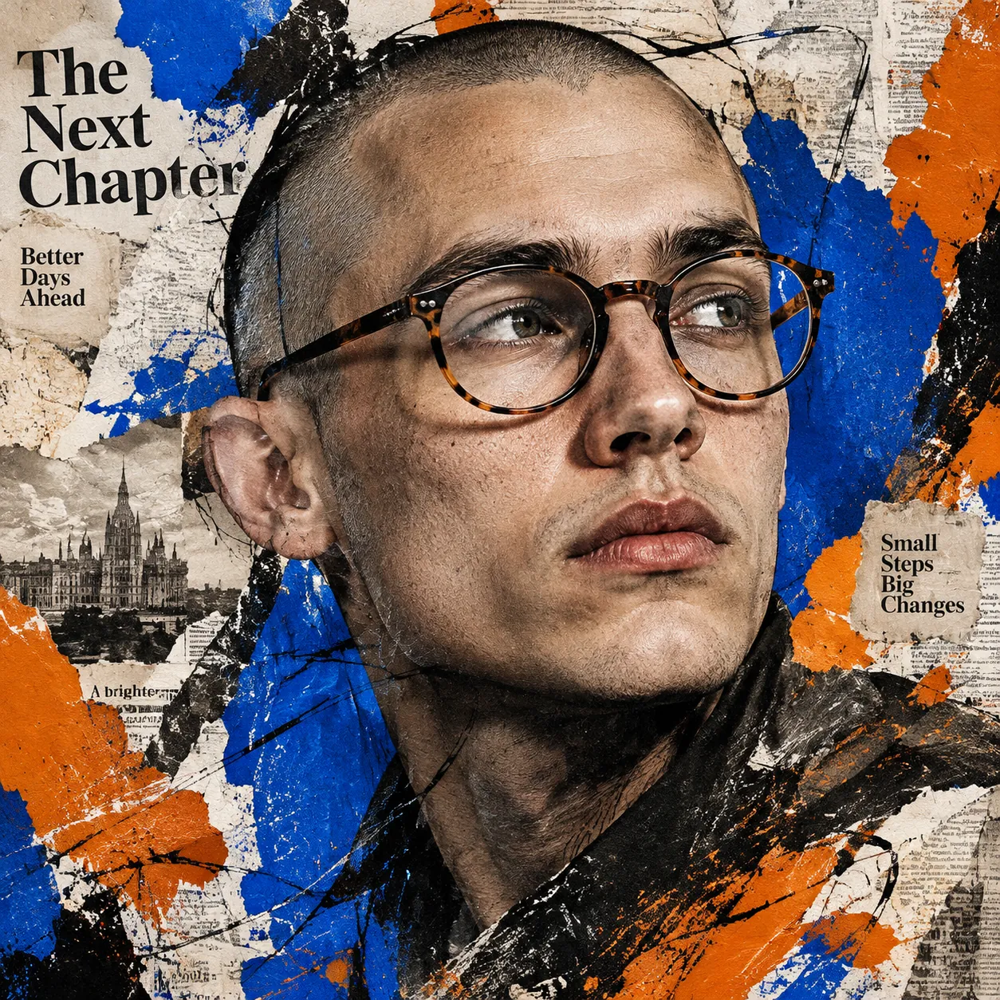</a>

> A compact template that layers four media: a realistic face, black sketch strokes, torn newspaper collage and acrylic paint splashes, finished with print texture. Choosing just two colours (primary and secondary) keeps the energy from turning muddy. We filled it with a fictional young man with a shaved head, round tortoiseshell glasses, a pensive sideways look, cobalt blue and burnt orange. The result looks like a gallery poster: the face is photographic and sharp, while newsprint scraps, sketch lines and paint explode around it, and the model even added headline fragments like 'The Next Chapter'. Use it for magazine covers, event posters, album art or personal brand visuals; describe your subject or attach a photo.

```text
Mixed-media portrait of a fictional young man with a shaved head, pensive, looking off to the side, with round tortoiseshell glasses, realistic identity, black sketch strokes, torn newspaper collage, acrylic paint splashes, editorial print texture, blending realism and abstract expressionism, premium poster aesthetic, tactile handmade feel, high contrast, ultra-detailed face and eyes, cobalt blue and burnt orange
```

- Author: [@MayorKingAI](https://x.com/MayorKingAI)
- Original post: https://x.com/MayorKingAI/status/2036534946433736932
- [View on cinel and generate with this prompt](https://cinel.ai/prompts/p/newspaper-collage-mixed-media-portrait?utm_source=github&utm_medium=awesome&utm_campaign=awesome-gpt-image-2.5-prompts)

### Low-Angle Urban Streetwear Illustration from Your Photo

<a href="https://cinel.ai/prompts/p/urban-hoodie-character-illustration?utm_source=github&utm_medium=awesome&utm_campaign=awesome-gpt-image-2.5-prompts">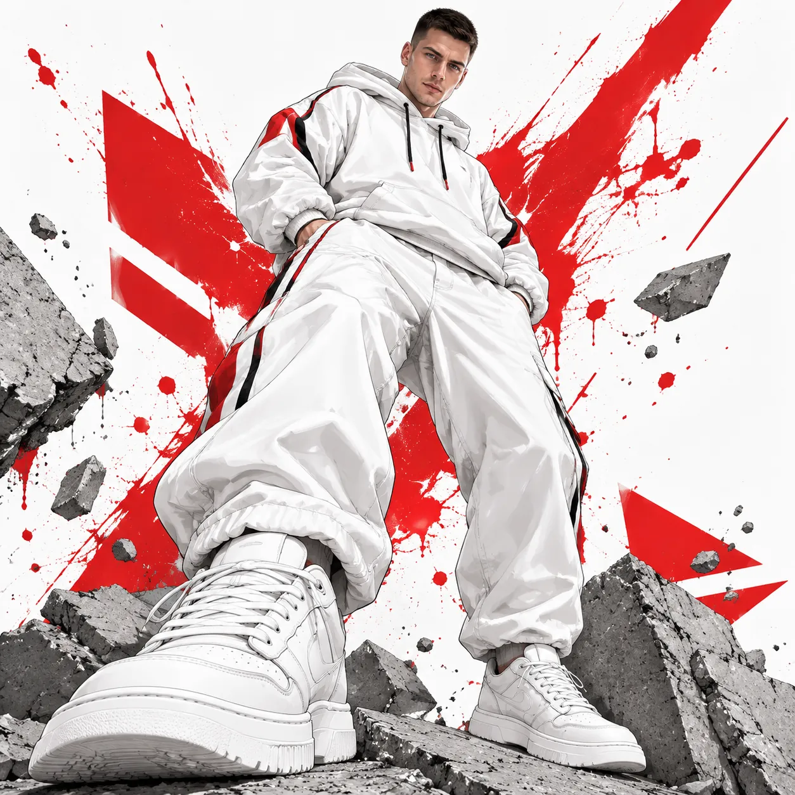</a>

> A dynamic way to turn a selfie into street-art: a full-body figure in an oversized white hoodie and loose white track pants, shot from an extreme low angle so the sneakers loom huge in the foreground, standing among broken concrete chunks on a white canvas slashed with bold red paint and geometric shapes. The style is crisp line art, flat colour and soft cel shading. We swapped the prompt's sneakers for plain unbranded ones. With a fictional reference of a man around 27 with a short fade, the result keeps his face recognisable while the forced perspective delivers power. Ideal for streetwear drops, profile art or esports player cards.

```text
A dynamic full-body urban illustration of a man (use the exact face from the provided reference image, ensuring high facial accuracy and identity preservation). He wears an oversized white hoodie with subtle black and red accents, paired with loose white track pants and bold, eye-catching unbranded white sneakers with no logos.
The character has a sharp, confident gaze directed forward, conveying intensity and self-assurance. The composition is captured from a dramatic low-angle perspective, emphasizing power and dominance. His stance is strong and grounded, with exaggerated perspective on the sneakers in the foreground for added depth.
Surrounding him are fragmented concrete elements and subtle debris, suggesting an urban, gritty environment. The background is a clean white canvas featuring bold red paint splashes and abstract geometric shapes, creating a modern street-art aesthetic.
The visual style combines crisp, clean line art with vibrant flat colors and soft cel shading for depth and dimension. The rendering should feel like a high-end urban illustration or stylized editorial artwork.
Lighting is bright, even, and diffused across the entire scene, minimizing harsh shadows while maximizing clarity and detail.
Ultra-detailed, sharp focus, 8K resolution, vertical composition
```

- Author: [@Goodmanprotocol](https://x.com/Goodmanprotocol)
- Original post: https://x.com/Goodmanprotocol/status/2042609010659201189
- [View on cinel and generate with this prompt](https://cinel.ai/prompts/p/urban-hoodie-character-illustration?utm_source=github&utm_medium=awesome&utm_campaign=awesome-gpt-image-2.5-prompts)

### Blue & Orange Mountain Landscape Painting (Chinese Prompt)

<a href="https://cinel.ai/prompts/p/blue-orange-landscape-painting-zh?utm_source=github&utm_medium=awesome&utm_campaign=awesome-gpt-image-2.5-prompts">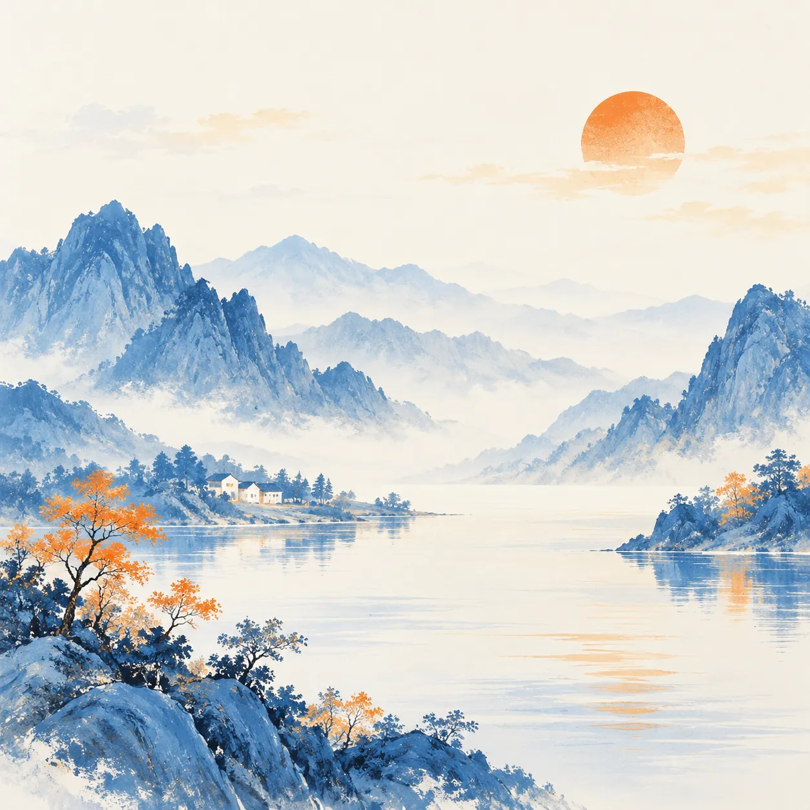</a>

> Proof that a prompt can be one sentence long if it's precise about colour. Written in Chinese, it gives only three instructions: a #f6f4f0 off-white background, #2d6dc3 as the main blue, a few orange accents, and a distant mountain-and-water landscape. Our result interpreted it as a modern take on traditional Chinese blue-green landscape painting: layered blue peaks fading into mist, a calm lake with a small village, orange autumn trees in the foreground and an orange sun low in the sky. Hex codes are a reliable way to match brand palettes, so try your own two colours for posters, wallpapers or tea and stationery packaging.

```text
使用以 #f6f4f0 为主背景，#2d6dc3 为主蓝色，同时也包含一些橙色元素，制作了一张山水远景风景画。
```

- Author: [@ZaynHao](https://x.com/ZaynHao)
- Original post: https://x.com/ZaynHao/status/2034103289185505560
- [View on cinel and generate with this prompt](https://cinel.ai/prompts/p/blue-orange-landscape-painting-zh?utm_source=github&utm_medium=awesome&utm_campaign=awesome-gpt-image-2.5-prompts)

### 16-Sticker 3D Chibi Emoji Pack from Your Photo

<a href="https://cinel.ai/prompts/p/3d-chibi-sticker-pack-from-photo?utm_source=github&utm_medium=awesome&utm_campaign=awesome-gpt-image-2.5-prompts">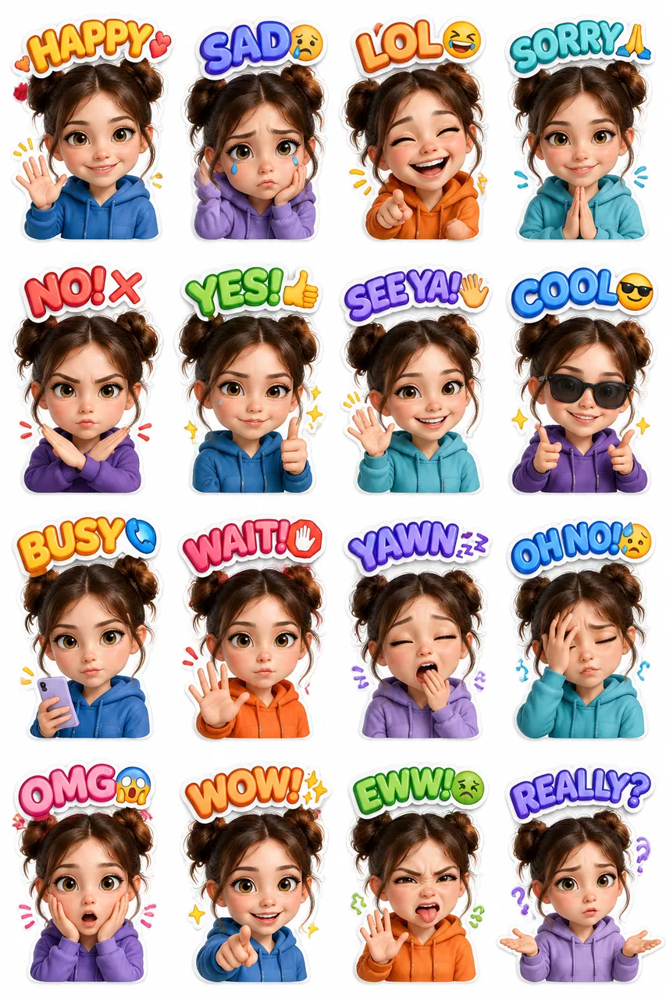</a>

> A compact JSON that outputs a full messaging sticker set: sixteen 3D chibi versions of the person in your photo, arranged in a 4×4 grid on white, each with a white die-cut outline, a bold curved gradient caption on top and a matching pose (waving for HAPPY, hands together for SORRY, finger guns for COOL, facepalm for OH NO!). Clothing varies slightly between blue, purple, orange and teal hoodies while the face stays identical. Using a fictional reference of a woman with twin buns, our result kept her hairstyle and features consistent across all sixteen stickers with lively expressions and little sparkles and sweat drops. Crop each cell to use them in chat apps.

```text
{
  "task": "premium_animated_sticker_pack",
  "ref_image": "use_only_uploaded_identity_preserve_all_features",
  "format": { "grid": "4x4", "count": 16, "aspect": "2:3", "spacing": "clean", "alignment": "perfect", "bg": "white" },
  "style": {
    "character": "chibi_65_70_head_dynamic_pose_rounded_expressive",
    "render": "high_end_3D_pixar_quality",
    "outline": "white_stroke"
  },
  "clothing": {
    "type": "modern_streetwear",
    "items": ["hoodies","jackets"],
    "colors": ["blue","purple","orange","teal"],
    "variation": "slight_consistent"
  },
  "text": {
    "placement": "top",
    "style": "bold_curved_gradient",
    "effects": ["white_outline","shadow","emoji"]
  },
  "stickers": [
    ["HAPPY","wave"], ["SAD","down"], ["LOL","laugh"], ["SORRY","hands_together"],
    ["NO!","cross_arms"], ["YES!","thumbs_up"], ["SEE YA!","bye"], ["COOL","finger_guns"],
    ["BUSY","phone"], ["WAIT!","stop"], ["YAWN","sleepy"], ["OH NO!","facepalm"],
    ["OMG","shock"], ["WOW!","point"], ["EWW!","disgust"], ["REALLY?","shrug"]
  ],
  "lighting": "soft_studio_rim_light_bright_clean",
  "extras": ["sparkles","hearts","sweat","motion_lines"],
  "consistency": "same_identity_face_glasses_grooming_quality_proportions",
  "negative": "no_mismatch_no_identity_change_no_realistic_body_no_stiff_no_dull_no_overlap_no_bad_hands_no_blur_no_low_quality_no_inconsistent_no_watermark"
}
```

- Author: [@doctorwasif](https://x.com/doctorwasif)
- Original post: https://x.com/doctorwasif/status/2039709119150702727
- [View on cinel and generate with this prompt](https://cinel.ai/prompts/p/3d-chibi-sticker-pack-from-photo?utm_source=github&utm_medium=awesome&utm_campaign=awesome-gpt-image-2.5-prompts)

### Poetic Watercolour Children's Book Illustration

<a href="https://cinel.ai/prompts/p/watercolor-childrens-book-illustration?utm_source=github&utm_medium=awesome&utm_campaign=awesome-gpt-image-2.5-prompts">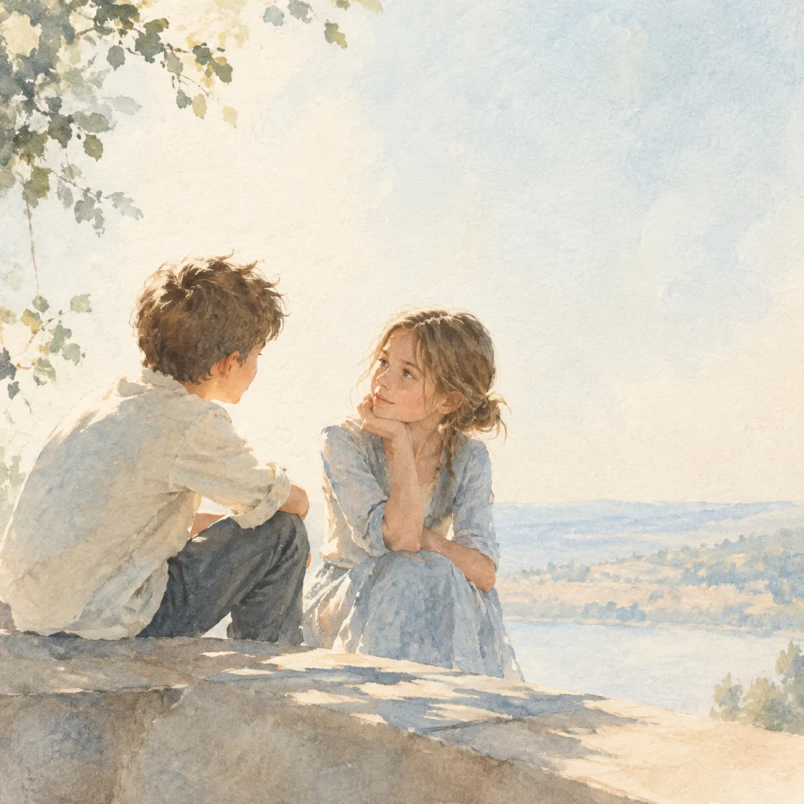</a>

> This prompt describes a mood more than a scene: soft watercolour and gouache with visible brushstrokes and paper grain, muted pastels with gentle blues and warm tones, clear daylight, minimal composition with lots of empty space, and an open-ended, thoughtful atmosphere. It explicitly rules out cartoon, anime and 3D looks, which keeps the result painterly. The subject is simply two children of about twelve in calm conversation. Our result is tender and airy: a boy and a girl sitting on a rock above a hazy valley, leaves framing the top-left corner, faces quiet and attentive. It's well suited to picture books, educational materials, school posters and gentle editorial illustrations.

```text
Soft poetic children's book illustration with watercolor and gouache textures.Clear gentle daylight with slightly brighter highlights.Muted pastel colors with soft blue and warm tones.Visible brush strokes and paper grain.Minimalist composition with large negative space.Calm, thoughtful, slightly open-ended atmosphere.

Child character (around 12 years old).Subtle visual metaphors like light, shadow, perspective, reflection.Hand-painted picture book style, not cartoon, not anime, not 3D.

Two children in calm conversation,soft connection forming.
```

- Author: [@dotey](https://x.com/dotey)
- Original post: https://x.com/dotey/status/2047174895293849972
- [View on cinel and generate with this prompt](https://cinel.ai/prompts/p/watercolor-childrens-book-illustration?utm_source=github&utm_medium=awesome&utm_campaign=awesome-gpt-image-2.5-prompts)

### Real Hand Watering a Seed in an Open Picture Book

<a href="https://cinel.ai/prompts/p/picture-book-seed-coming-to-life?utm_source=github&utm_medium=awesome&utm_campaign=awesome-gpt-image-2.5-prompts">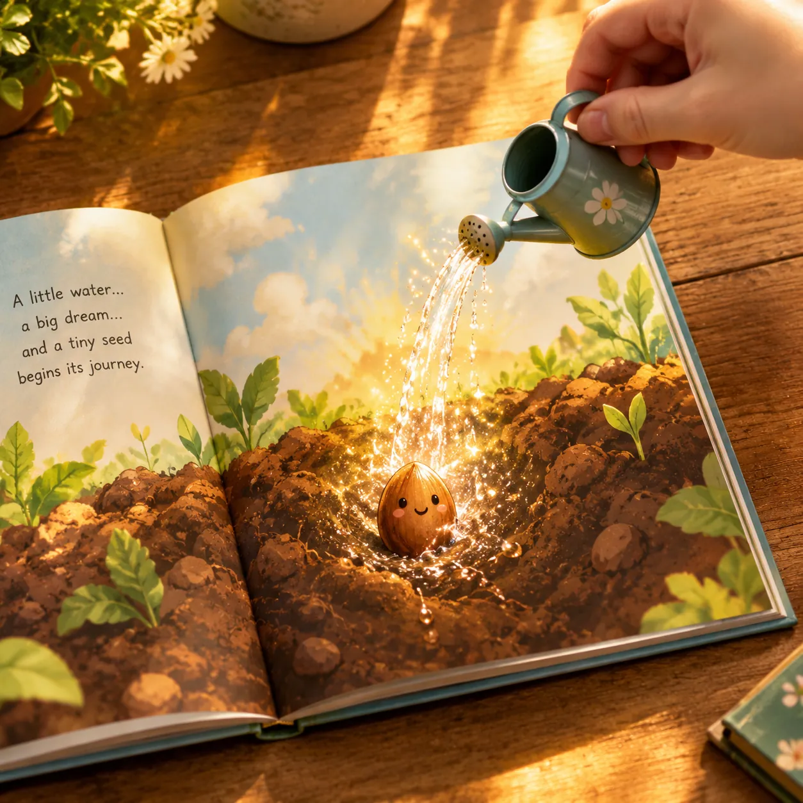</a>

> A sweet blend of photo and illustration: an open picture book on a wooden table shows a cartoon seed in drawn soil, while a real hand tips a tiny watering can over it, the sparkling stream crossing from our world into the page. Warm golden light and an overhead close-up make it feel magical rather than gimmicky. Our result goes a step further than the prompt: the seed has a little smiling face, the illustrated soil sprouts leaves where the water lands, and the left page even carries a short line of story text about a tiny seed beginning its journey. It's lovely for children's publishers, reading campaigns, nurseries and eco or gardening brands.

```text
{
  "prompt": "An open children’s picture book rests on a wooden table, showing a whimsical illustration of a small brown seed in cartoon soil. A realistic human hand pours water from a tiny can, with a sparkling stream. Warm golden light, magical mood, overhead close-up, photorealistic, 4K.",
  "style": "photorealistic",
  "lighting": "warm golden",
  "mood": "magical",
  "perspective": "overhead close-up",
  "resolution": "4K",
  "elements": [
    {
      "type": "book",
      "description": "children’s picture book open on wooden table"
    },
    {
      "type": "illustration",
      "description": "whimsical small brown seed in cartoon soil"
    },
    {
      "type": "hand",
      "description": "realistic human hand pouring water from tiny can"
    },
    {
      "type": "water",
      "description": "sparkling stream"
    }
  ]
}
```

- Author: [@Just_sharon7](https://x.com/Just_sharon7)
- Original post: https://x.com/Just_sharon7/status/2038525426084323378
- [View on cinel and generate with this prompt](https://cinel.ai/prompts/p/picture-book-seed-coming-to-life?utm_source=github&utm_medium=awesome&utm_campaign=awesome-gpt-image-2.5-prompts)

### Glowing Turtle on a Twilight Riverbank Illustration

<a href="https://cinel.ai/prompts/p/glowing-turtle-fantasy-illustration?utm_source=github&utm_medium=awesome&utm_campaign=awesome-gpt-image-2.5-prompts">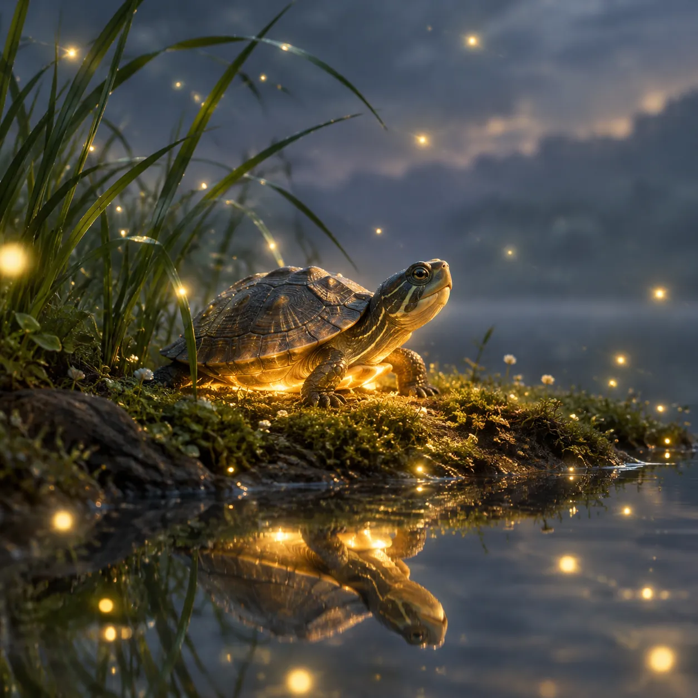</a>

> A gentle, meditative fantasy scene built around a single light source: a small turtle resting on a grassy riverbank at dusk, a warm golden glow spilling out from under its shell onto the moss, with fireflies or glowing pollen drifting through the air and the whole scene mirrored in still water. Tall grass silhouetted against a muted grey-blue sky keeps the palette calm. Our result is serene and detailed: the turtle's textured shell edged in gold light, dozens of soft glowing specks and a crisp reflection beneath. It suits bedtime-story covers, sleep and meditation apps, phone wallpapers and nature-themed prints, and it's easy to swap in another small creature.

```text
A digital fantasy illustration of a small turtle resting on a grassy riverbank at twilight. The turtle has a detailed, textured shell with a soft, warm golden glow emanating from underneath its body, casting light onto the surrounding mossy earth. The scene is filled with magical, floating fireflies or glowing pollen particles that sparkle in the dim, atmospheric light. The turtle's reflection is clearly visible in the calm, still water below. Tall, slender blades of grass rise beside the turtle, silhouetted against a serene, muted gray-blue background. The overall mood is peaceful, ethereal, and cinematic, with high detail and soft, dreamlike lighting.
```

- Author: [@churvikv](https://x.com/churvikv)
- Original post: https://x.com/churvikv/status/2041512847016890622
- [View on cinel and generate with this prompt](https://cinel.ai/prompts/p/glowing-turtle-fantasy-illustration?utm_source=github&utm_medium=awesome&utm_campaign=awesome-gpt-image-2.5-prompts)

### Painterly Exaggerated Cartoon Portrait from Your Photo

<a href="https://cinel.ai/prompts/p/painterly-exaggerated-cartoon-portrait?utm_source=github&utm_medium=awesome&utm_campaign=awesome-gpt-image-2.5-prompts">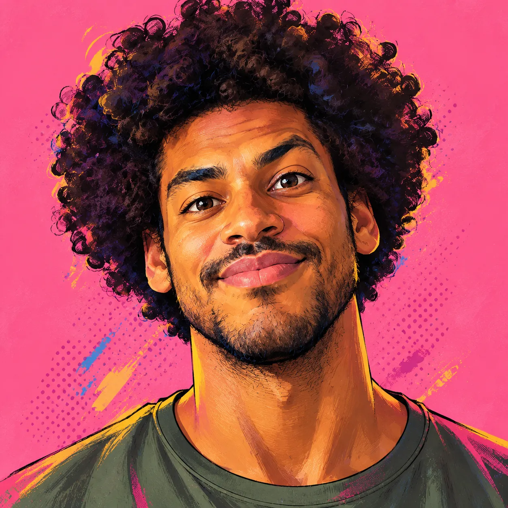</a>

> This prompt pushes a selfie into graphic animated-film territory: sculpted 3D anatomy combined with hand-painted textures, deliberately distorted facial geometry and expressive asymmetry, bold linework, halftone dots and colour splashes, all on a solid hot-pink background. It intentionally breaks realism while keeping identity cues such as skin tone and hairstyle. The source cites a well-known animated film series as inspiration; the descriptive words alone are enough. With our fictional reference of a man around 30 with a curly afro, the result is warm and characterful: a confident half-smile, painted highlights on his cheekbones and dotted halftone shading. Great for avatars and creator branding.

```text
A painterly exaggerated cartoon portrait combining sculpted 3D anatomy with hand-painted illustration textures, spider-verse inspired visual language, distorted facial geometry and expressive asymmetry, intentionally breaking realism while preserving general identity cues such as skin tone and hairstyle, bold line work mixed with painted shadows, halftone textures and color splashes graphic animated illustration aesthetic, solid pink studio background, frontal expressive pose, stylized lighting translated into brush-painted highlights, dynamic composition, rich paint texture and high-end hybrid cartoon render.
```

- Author: [@frametheory058](https://x.com/frametheory058)
- Original post: https://x.com/frametheory058/status/2045081650175058314
- [View on cinel and generate with this prompt](https://cinel.ai/prompts/p/painterly-exaggerated-cartoon-portrait?utm_source=github&utm_medium=awesome&utm_campaign=awesome-gpt-image-2.5-prompts)

### Soft Pastel Watercolour Portrait Illustration

<a href="https://cinel.ai/prompts/p/pastel-watercolor-portrait-illustration?utm_source=github&utm_medium=awesome&utm_campaign=awesome-gpt-image-2.5-prompts">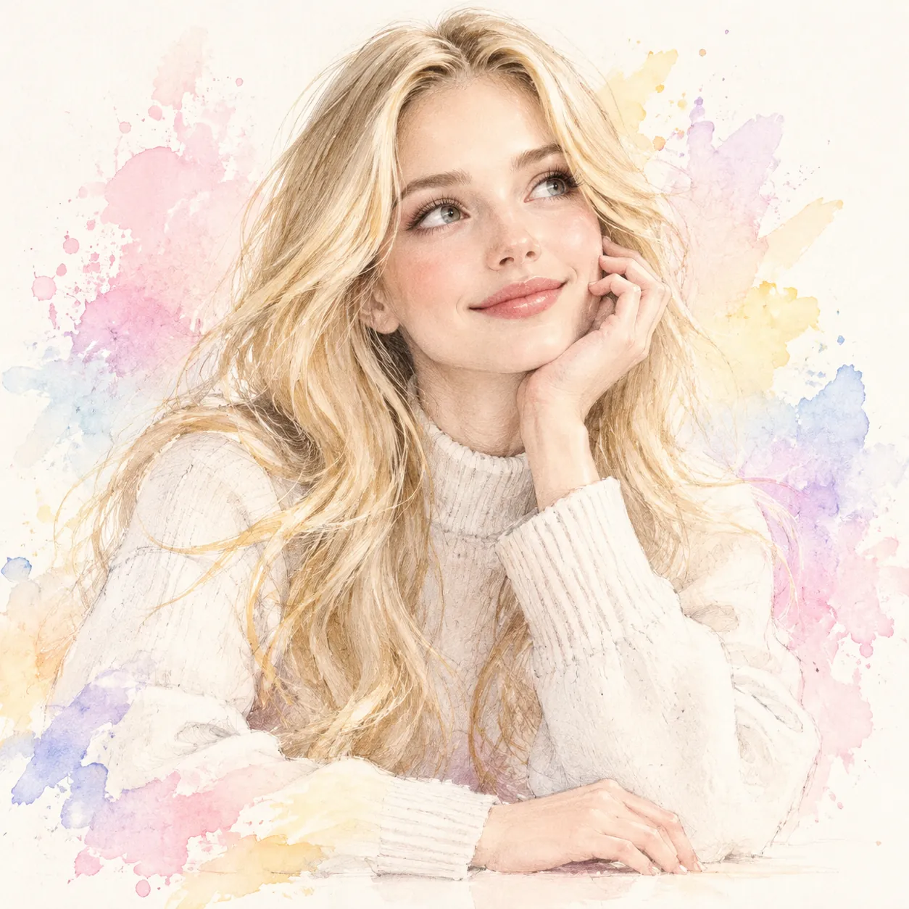</a>

> An airy portrait style that mixes fine pencil linework with loose pastel watercolour. The prompt describes a young woman with long, flowing blonde hair, smiling and glancing up to the side, chin resting on one hand, in a light high-neck sweater, set against splashes of pink, yellow, lavender and pale blue on clean off-white paper. Soft, dreamy light keeps the mood optimistic and serene. Our result is delicate and polished: realistic facial features rendered smoothly, the sweater's knit suggested with sketchy strokes, and colour blooming loosely behind her. It suits beauty and wellness brands, greeting cards, book covers and personalised portrait gifts; try it with your own photo as a reference.

```text
A soft pastel watercolor digital illustration of a young woman with long, flowing blonde hair, gently smiling and looking slightly upward to the side. She has delicate, realistic facial features, smooth glowing skin, light pink lips, and expressive eyes. She is wearing a light-colored, high-neck long-sleeve sweater with subtle fabric texture. One hand is raised near her face in a relaxed, thoughtful pose, the other resting casually on a table or surface.
The art style is a mix of hand-drawn pencil sketch and watercolor painting, with fine linework and soft pastel splashes in pink, yellow, lavender, and light blue behind her. The background is minimal and abstract, with loose watercolor brush strokes and a clean off-white canvas.
Lighting is soft and dreamy, giving a warm, optimistic, serene mood. The illustration has a modern digital watercolor aesthetic, elegant, airy, and feminine, with smooth gradients and painterly textures. High detail, artistic portrait, pastel color palette, aesthetic illustration, soft focus, gentle expression.
```

- Author: [@Mind_Boticni](https://x.com/Mind_Boticni)
- Original post: https://x.com/Mind_Boticni/status/2017096425860215040
- [View on cinel and generate with this prompt](https://cinel.ai/prompts/p/pastel-watercolor-portrait-illustration?utm_source=github&utm_medium=awesome&utm_campaign=awesome-gpt-image-2.5-prompts)

### Korean Pastel Romance Watercolor Illustration

<a href="https://cinel.ai/prompts/p/korean-pastel-romance-watercolor?utm_source=github&utm_medium=awesome&utm_campaign=awesome-gpt-image-2.5-prompts">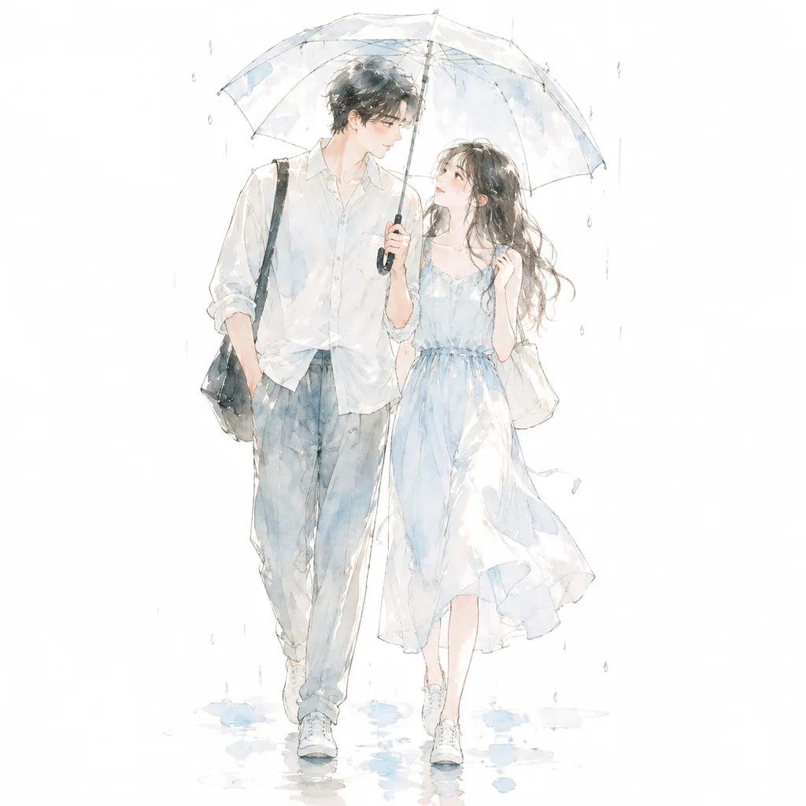</a>

> An airy illustration template from @azed_ai. Choose who is in the scene and what romantic moment they share, and the prompt renders it as loose watercolor line art in a Korean illustration style: delicate flowing strokes, light summer outfits, soft pastel washes, minimal detail and plenty of clean white space. We filled it with a young couple sharing an umbrella on a summer rain walk, and GPT Image 2.5 kept the linework sketchy and the colour washes gentle. Great for wedding invitations, greeting cards, webtoon covers, wallpapers and Valentine campaigns.

```text
Watercolor line art illustration of a young couple sharing an umbrella while walking in a summer rain, Korean illustration aesthetic, light summer outfits, loose delicate linework, vague flowing strokes, soft pastel colors, subtle watercolor washes, tender mood, minimal details, airy composition, clean white background
```

- Author: [@azed_ai](https://x.com/azed_ai)
- Original post: https://x.com/azed_ai/status/2094017304883519926
- [View on cinel and generate with this prompt](https://cinel.ai/prompts/p/korean-pastel-romance-watercolor?utm_source=github&utm_medium=awesome&utm_campaign=awesome-gpt-image-2.5-prompts)

### French Picture-Book Character Sheet

<a href="https://cinel.ai/prompts/p/picture-book-character-sheet?utm_source=github&utm_medium=awesome&utm_campaign=awesome-gpt-image-2.5-prompts">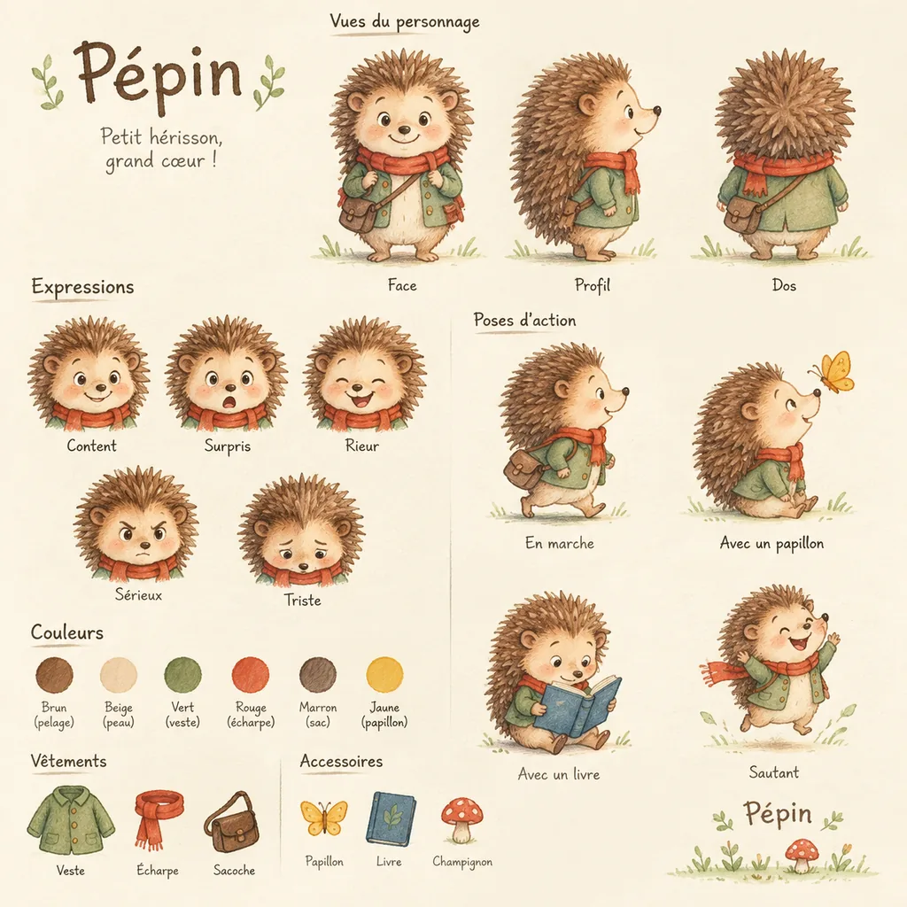</a>

> A full character-design sheet in one prompt from @azed_ai. It asks for an anthropomorphic character with a name, drawn in French picture-book style with watercolor and coloured pencil on light cream paper: front, side and back views, five facial expressions, four action poses, French labels, a colour palette and clothing and accessory callouts. The original targets Midjourney at 3:2; we made it square and chose a hedgehog named Pépin, and GPT Image 2.5 laid out a tidy, hand-painted sheet. Useful for children's book pitches, mascot design, plush toy concepts and animation pre-production.

```text
Children’s picture book character sheet of an anthropomorphic hedgehog named “Pépin”, French picture book style, watercolor, colored pencil, light cream background, full-body portrait, front, side, back views, five facial expressions, four action poses, French labels, color palette, clothing, accessories, expressive character design, hand-painted look, square 1:1 layout
```

- Author: [@azed_ai](https://x.com/azed_ai)
- Original post: https://x.com/azed_ai/status/2088943890284081169
- [View on cinel and generate with this prompt](https://cinel.ai/prompts/p/picture-book-character-sheet?utm_source=github&utm_medium=awesome&utm_campaign=awesome-gpt-image-2.5-prompts)

### 3D Paper-Cut Fashion Illustration

<a href="https://cinel.ai/prompts/p/paper-cut-3d-fashion-illustration?utm_source=github&utm_medium=awesome&utm_campaign=awesome-gpt-image-2.5-prompts">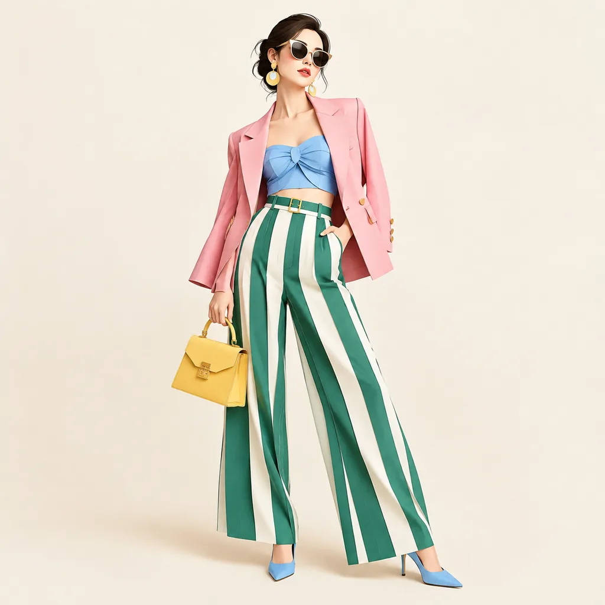</a>

> From a Nano Banana 2.1 prompt shared by @ChillaiKalan__. It asks for an editorial fashion illustration built from smooth layered paper shapes, with pastel and emerald color blocking, polka dots or stripes, statement accessories and soft studio shadows on warm ivory. We only added the square frame. Use it for fashion campaign art, lookbook covers and boutique social posts.

```text
Create a high-end editorial fashion illustration of a stylish woman wearing a bold, contemporary designer outfit. Use a polished 3D paper-cut illustration aesthetic with smooth surfaces, layered shapes, subtle paper-like textures, and clean, elegant edges. Feature vibrant color combinations such as pastel pink, sky blue, mint green, sunshine yellow, and emerald green, paired with contrasting patterns like polka dots or vertical stripes. Add fashionable accessories, including statement sunglasses, earrings, a structured handbag, and modern shoes. Give the character a confident, expressive pose with natural body proportions and a stylish attitude. Use a minimalist warm ivory background with soft studio lighting, gentle shadows beneath the feet, and a refined luxury fashion-campaign composition. Full-body character, beautifully detailed clothing folds, crisp silhouettes, sophisticated color blocking, playful yet elegant styling, premium fashion magazine aesthetic, clean negative space, high-resolution digital illustration. No text, no logos, no watermark. Square 1:1 composition.
```

- Author: [@ChillaiKalan__](https://x.com/ChillaiKalan__)
- Original post: https://x.com/ChillaiKalan__/status/2109534297367724221
- [View on cinel and generate with this prompt](https://cinel.ai/prompts/p/paper-cut-3d-fashion-illustration?utm_source=github&utm_medium=awesome&utm_campaign=awesome-gpt-image-2.5-prompts)

### Selective-Color Travel Sketchbook Spread

<a href="https://cinel.ai/prompts/p/selective-color-travel-sketchbook-spread?utm_source=github&utm_medium=awesome&utm_campaign=awesome-gpt-image-2.5-prompts">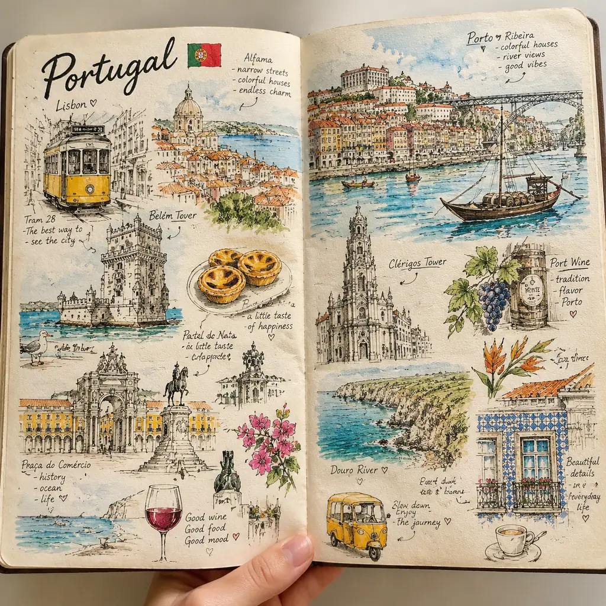</a>

> From a GPT Image 2.5 prompt by @Naiknelofar788. The original builds a handmade two-page travel journal for any country: fine ink landmarks, streets and food, handwritten labels, and color only on a few favorite details. We filled it with Portugal, from Lisbon to Porto, and switched the frame to square. Swap the country for travel blogs, tourism posters and souvenir prints.

```text
Create a beautiful, highly detailed, handmade travel sketchbook spread inspired by an artist’s personal travel journal. Show an open sketchbook with warm ivory paper, slightly imperfect edges, and visible paper texture, filled with intricate hand-drawn illustrations of Portugal, from Lisbon to Porto.
The two-page spread should feel like a collection of little memories gathered during a journey, with famous landmarks, traditional architecture, charming streets, cultural symbols, local food, nature, and tiny everyday details arranged organically across both pages.
Use fine black ink linework, delicate cross-hatching, loose pencil strokes, architectural doodles, handwritten labels, tiny arrows, and small notes pointing toward the illustrated places. Let the drawings feel authentic and handmade, like a real artist sketched them while travelling.
🌈 The Special Touch — Selective Beautiful Colors
Keep most of the artwork in elegant black-and-white ink, but bring selected elements to life with beautiful, carefully placed splashes of color.
🗻 Mountains and landscapes with soft watercolor blues, sage greens, and snowy whites.
🏯 Famous landmarks with subtle terracotta, warm beige, and muted golden tones.
🌸 Flowers and leaves with delicate pinks, coral, and fresh greens.
🍜 Local food illustrated in appetizing, vibrant colors.
🏮 Traditional lanterns, cultural objects, or street signs highlighted with rich reds and warm amber.
🌊 Rivers, lakes, or ocean views accented with dreamy turquoise and soft blue.
🚌 Tiny travel details featuring unexpected pops of mustard yellow, dusty orange, and pastel colors.
Important: The colors should appear selectively, as if the artist used watercolor and colored pencils to highlight their favorite memories. Some illustrations should remain completely monochrome, while others should be partially or beautifully colored. The contrast between black ink and colorful details should make the artwork visually captivating without overwhelming the page.
✍️ Composition & Atmosphere
Include the country name in large, artistic handwritten lettering, accompanied by a tiny national flag. Add a mixture of large landmark sketches and smaller doodles, creating a rich yet balanced composition.
Allow some drawings to overlap slightly or extend toward the edges of the pages. Include spontaneous pencil marks, unfinished outlines, tiny stars, handwritten location names, and subtle artistic imperfections.
Show the sketchbook as a real physical object, opened in someone's hand against a simple, softly lit background. Use a close-up perspective, natural daylight, realistic paper texture, and gentle shadows.
Art style: Travel journal meets architectural ink illustration meets selective watercolor sketching. Sophisticated, cozy, artistic, nostalgic, and irresistibly beautiful.
Aspect ratio: 1:1 square composition.
Final result: A stunning, realistic travel sketchbook that looks handmade rather than digitally designed, with intricate black ink drawings and strategically placed bursts of beautiful color that make every page feel like a treasured travel memory.
```

- Author: [@Naiknelofar788](https://x.com/Naiknelofar788)
- Original post: https://x.com/Naiknelofar788/status/2108768765316092053
- [View on cinel and generate with this prompt](https://cinel.ai/prompts/p/selective-color-travel-sketchbook-spread?utm_source=github&utm_medium=awesome&utm_campaign=awesome-gpt-image-2.5-prompts)

### Girl Reading Under a Tree Watercolor

<a href="https://cinel.ai/prompts/p/girl-reading-under-tree-watercolor?utm_source=github&utm_medium=awesome&utm_campaign=awesome-gpt-image-2.5-prompts">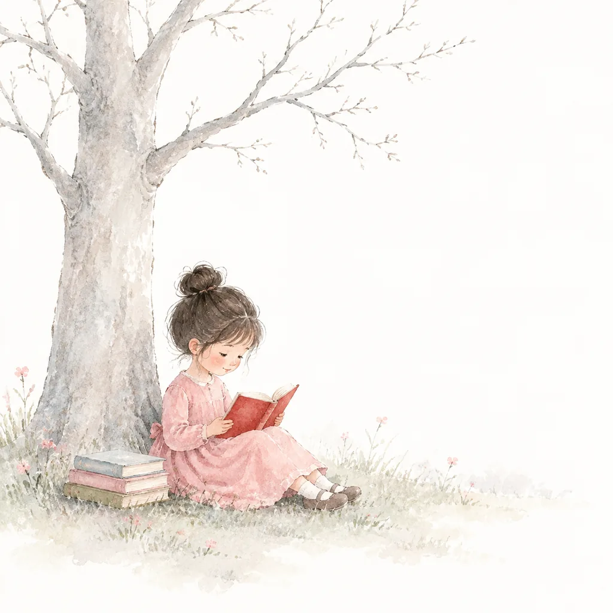</a>

> A reverse-written prompt based on a Midjourney style-reference post by @azed_ai that shared only a style code, not a prompt. We described the look in our own words: a soft children's picture-book watercolor of a girl reading under a pale tree, delicate pencil lines, pastel pink and misty grey, and generous white space. Use it for children's books, reading-campaign posters and greeting cards.

```text
Soft children's picture-book watercolor illustration: a little girl with a dark hair bun and a pink dress sits on the grass under a bare, pale tree, reading a red book, a small stack of books beside her, delicate pencil outlines, pastel pink and misty grey palette, a pale white background with lots of negative space, gentle and calm mood, no text. Square 1:1 composition.
```

- Author: [@azed_ai](https://x.com/azed_ai)
- Original post: https://x.com/azed_ai/status/2109509633383735474
- [View on cinel and generate with this prompt](https://cinel.ai/prompts/p/girl-reading-under-tree-watercolor?utm_source=github&utm_medium=awesome&utm_campaign=awesome-gpt-image-2.5-prompts)

### Seagull and Fries Storybook Illustration

<a href="https://cinel.ai/prompts/p/seagull-and-fries-storybook-illustration?utm_source=github&utm_medium=awesome&utm_campaign=awesome-gpt-image-2.5-prompts">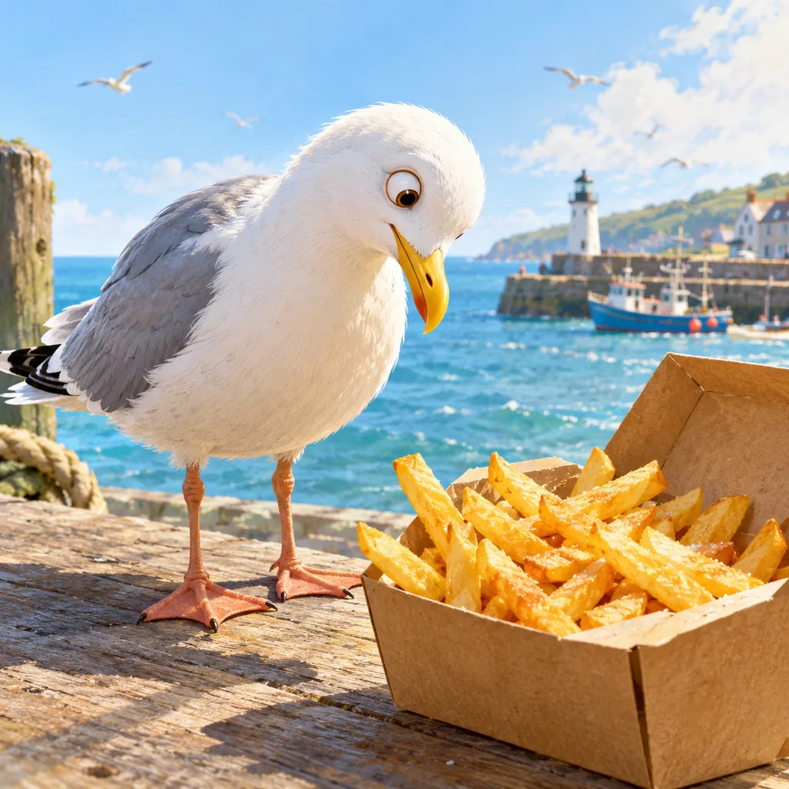</a>

> Copied from a Midjourney prompt share by @heathergreen, with the Midjourney parameters removed. A seagull eyeing a box of fries on the coast, storybook detail, soft light and a bright palette. Use it for children's books, seaside cafe menus and summer cards.

```text
A charming, whimsical storybook illustration of a seagull standing beside an open box of golden French fries, eyeing the tempting snack with playful curiosity. The gull and fries are clear focal points in a lively coastal setting, with soft seaside light, gentle shadows, crisp feather and paper textures, a bright yet tasteful palette, and polished storybook-inspired detail, no text. Square 1:1 composition.
```

- Author: [@heathergreen](https://x.com/heathergreen)
- Original post: https://x.com/heathergreen/status/2109374477167628351
- [View on cinel and generate with this prompt](https://cinel.ai/prompts/p/seagull-and-fries-storybook-illustration?utm_source=github&utm_medium=awesome&utm_campaign=awesome-gpt-image-2.5-prompts)

### Anime Vampire Duel Keyframe

<a href="https://cinel.ai/prompts/p/anime-vampire-duel-keyframe?utm_source=github&utm_medium=awesome&utm_campaign=awesome-gpt-image-2.5-prompts">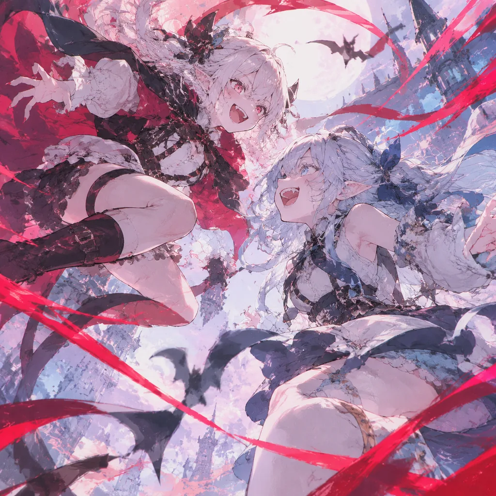</a>

> A keyframe still written from a Seedance anime-combat prompt by @aimikoda, which specified hand-painted 2D sakuga, pastel pinks and icy blues with crimson accents. We froze one mid-air clash. Use it for anime pitches, light-novel covers and action posters.

```text
Premium hand-painted 2D anime keyframe, square 1:1: two playful supernatural vampire tricksters clash mid-air in a supernatural duel, delicate sketch-like linework, expressive character designs, soft pastel pinks and icy blues with vibrant crimson afterimage ribbons, fluttering shadow ribbons and scarlet motion streaks, exaggerated expressions and flashing fangs, dynamic low-angle composition, painterly shading, no text. Square 1:1 composition.
```

- Author: [@aimikoda](https://x.com/aimikoda)
- Original post: https://x.com/aimikoda/status/2110360670944317651
- [View on cinel and generate with this prompt](https://cinel.ai/prompts/p/anime-vampire-duel-keyframe?utm_source=github&utm_medium=awesome&utm_campaign=awesome-gpt-image-2.5-prompts)

### Panda Eating Bamboo Illustration

<a href="https://cinel.ai/prompts/p/panda-eating-bamboo-illustration?utm_source=github&utm_medium=awesome&utm_campaign=awesome-gpt-image-2.5-prompts">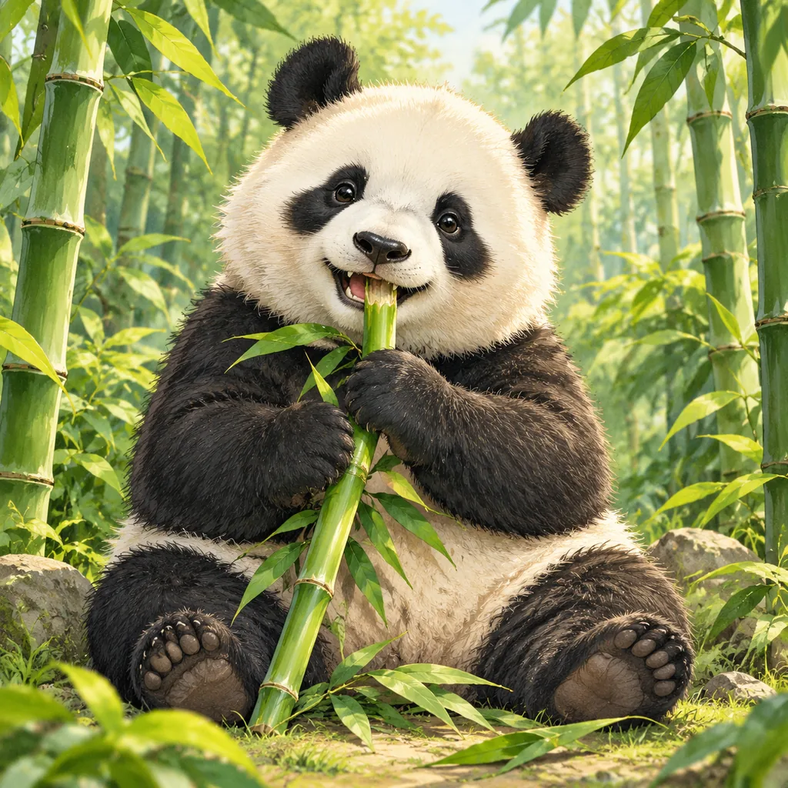</a>

> Copied from a Midjourney prompt share by @heathergreen, with the Midjourney parameters removed. A centred panda with an expressive face in soft grove light. Use it for children's books, zoo posters and lunchbox art.

```text
A charming, detailed storybook illustration of a panda bear happily eating a fresh bamboo stalk, seated amid a lush bamboo grove. Centered composition, expressive face, soft natural light, gentle greenery, delicate fur and leaf details, warm playful mood, polished children's book detail, no text. Square 1:1 composition.
```

- Author: [@heathergreen](https://x.com/heathergreen)
- Original post: https://x.com/heathergreen/status/2109252269090730402
- [View on cinel and generate with this prompt](https://cinel.ai/prompts/p/panda-eating-bamboo-illustration?utm_source=github&utm_medium=awesome&utm_campaign=awesome-gpt-image-2.5-prompts)

### Anime Pasture Cows in Summer Meadow

<a href="https://cinel.ai/prompts/p/anime-pasture-cows-summer-meadow?utm_source=github&utm_medium=awesome&utm_campaign=awesome-gpt-image-2.5-prompts">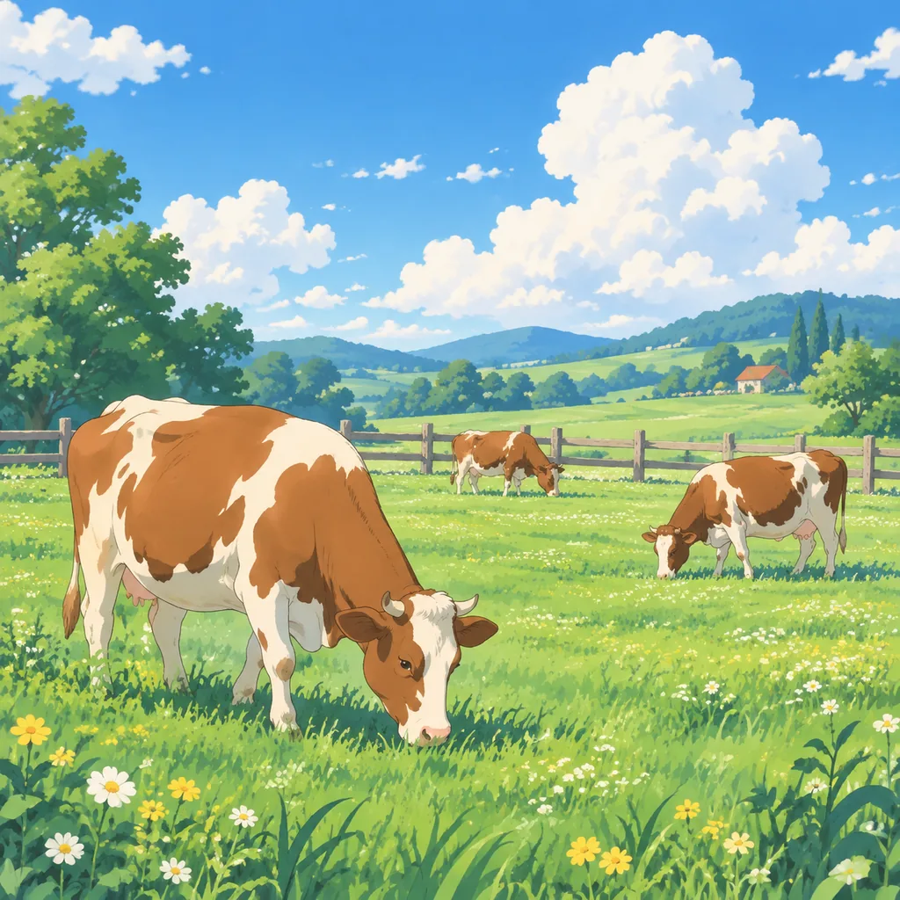</a>

> Reverse-written from a dreamy scene image shared by @NoravaleAI on 2026-10-18; the prompt sat below the post. We described the pasture and cows as seen. Use it for pastoral wallpaper, farm art and gentle covers.

```text
A soft dreamy anime-style illustration, square 1:1: brown and white cows grazing in a lush green summer meadow under a bright blue sky with fluffy clouds, a simple wooden fence, warm afternoon light, clean cel shading, peaceful pastoral scene, no text. Square 1:1 composition.
```

- Author: [@NoravaleAI](https://x.com/NoravaleAI)
- Original post: https://x.com/NoravaleAI/status/2111643105091014776
- [View on cinel and generate with this prompt](https://cinel.ai/prompts/p/anime-pasture-cows-summer-meadow?utm_source=github&utm_medium=awesome&utm_campaign=awesome-gpt-image-2.5-prompts)

### Fauvist Lion in Electric Jungle

<a href="https://cinel.ai/prompts/p/fauvist-lion-electric-jungle?utm_source=github&utm_medium=awesome&utm_campaign=awesome-gpt-image-2.5-prompts">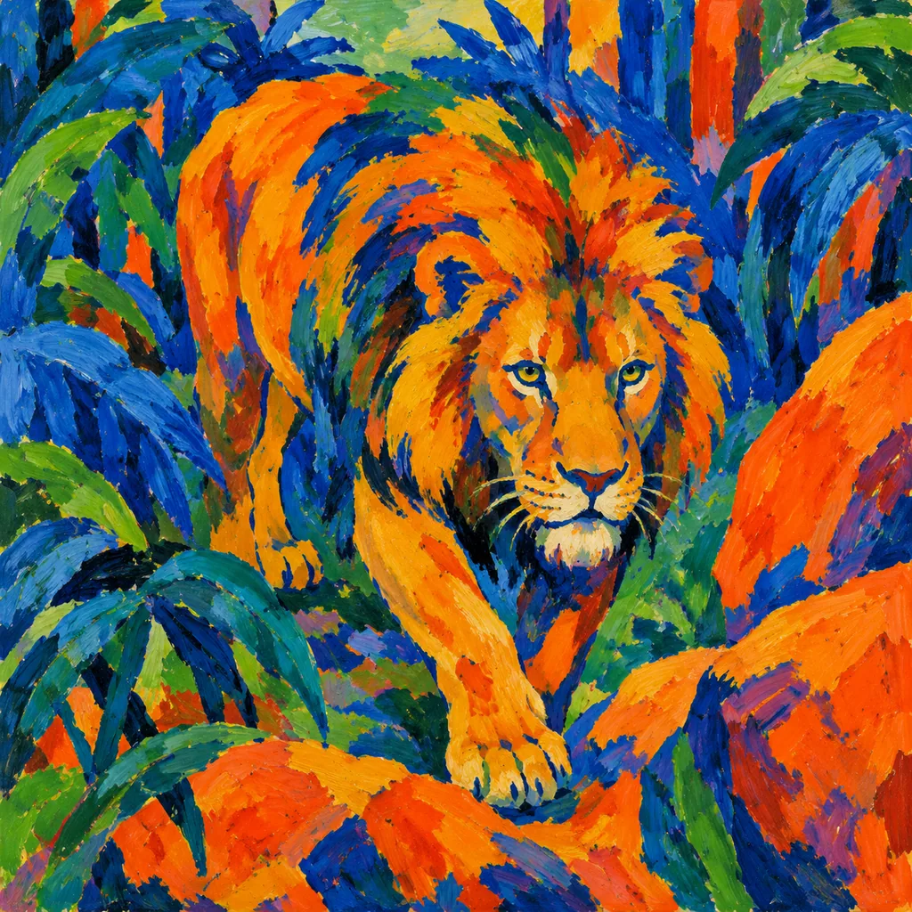</a>

> Adapted from a post by @RockGrokAI on 2026-10-14 (14 likes at capture). We rewrote it as one clean 1:1 still, removing brands, logos, celebrity/IP elements and any need for your own photo. Change one variable at a time.

```text
Early 20th-century Fauvist painting, square 1:1: a wild lion prowling through jungle exploding in electric-blue foliage and fiery orange rocks, bold arbitrary oranges blues and greens, expressive brushwork, no text. Square 1:1 composition.
```

- Author: [@RockGrokAI](https://x.com/RockGrokAI)
- Original post: https://x.com/RockGrokAI/status/2110476237068013952
- [View on cinel and generate with this prompt](https://cinel.ai/prompts/p/fauvist-lion-electric-jungle?utm_source=github&utm_medium=awesome&utm_campaign=awesome-gpt-image-2.5-prompts)

### Cute Robot Heart Bubbles Street

<a href="https://cinel.ai/prompts/p/cute-robot-heart-bubbles-street?utm_source=github&utm_medium=awesome&utm_campaign=awesome-gpt-image-2.5-prompts">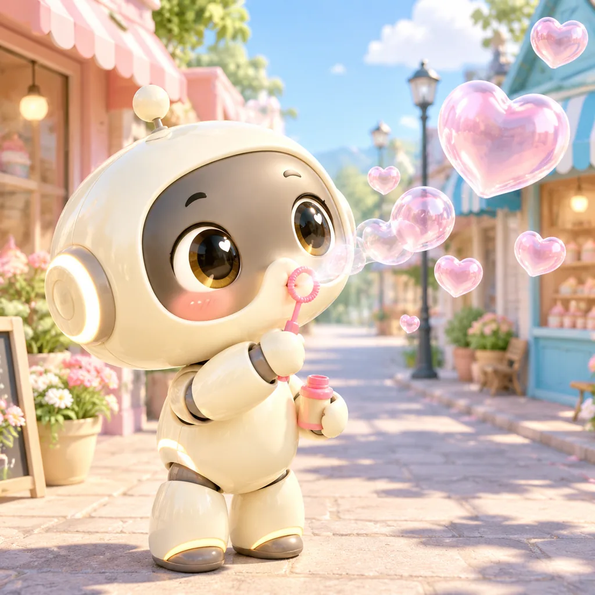</a>

> Adapted from a post by @neroallinai on 2026-10-16 (0 likes at capture). We rewrote it as one clean 1:1 still, removing brands, logos, celebrity/IP elements and any need for your own photo. Change one variable at a time.

```text
Cheerful 3D illustration, square 1:1: a cute glossy cream robot with a large round head and big kind eyes blowing pink heart-shaped bubbles on a sunny pastel street, tiny shops and soft shadows, no text, no logo. Square 1:1 composition.
```

- Author: [@neroallinai](https://x.com/neroallinai)
- Original post: https://x.com/neroallinai/status/2111081390787969210
- [View on cinel and generate with this prompt](https://cinel.ai/prompts/p/cute-robot-heart-bubbles-street?utm_source=github&utm_medium=awesome&utm_campaign=awesome-gpt-image-2.5-prompts)

### Weathered Armored Knight Concept

<a href="https://cinel.ai/prompts/p/weathered-armored-knight-concept?utm_source=github&utm_medium=awesome&utm_campaign=awesome-gpt-image-2.5-prompts">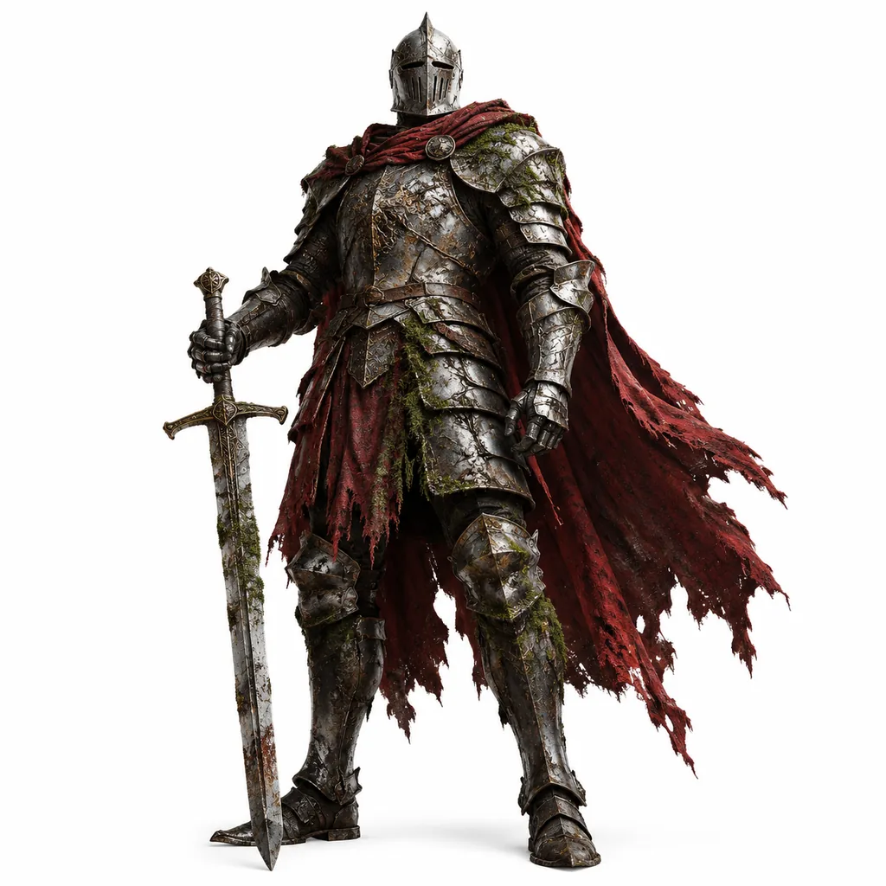</a>

> Adapted from a post by @azed_ai on 2026-10-17 (43 likes at capture). We rewrote it as one clean 1:1 still, removing brands, logos, celebrity/IP elements and any need for your own photo. Change one variable at a time.

```text
Dark fantasy concept art, square 1:1: a weathered armored knight in battered ornate plate armour and a torn red cloak holding a broadsword, full-body heroic stance on white studio background, intricate scratches and moss, no text, no logo. Square 1:1 composition.
```

- Author: [@azed_ai](https://x.com/azed_ai)
- Original post: https://x.com/azed_ai/status/2111411419652804780
- [View on cinel and generate with this prompt](https://cinel.ai/prompts/p/weathered-armored-knight-concept?utm_source=github&utm_medium=awesome&utm_campaign=awesome-gpt-image-2.5-prompts)

### Majestic Horse in Misty Field

<a href="https://cinel.ai/prompts/p/majestic-horse-misty-field-painterly?utm_source=github&utm_medium=awesome&utm_campaign=awesome-gpt-image-2.5-prompts">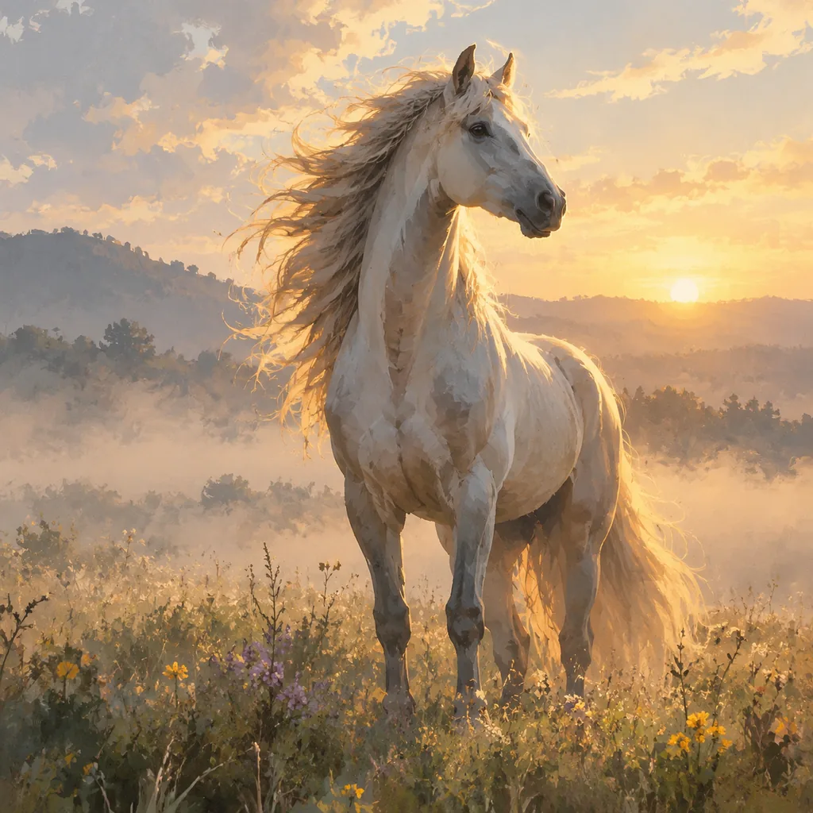</a>

> Adapted from a post by @AllaAisling on 2026-10-16 (41 likes at capture). We rewrote it as one clean 1:1 still, removing brands, logos, celebrity/IP elements and any need for your own photo. Change one variable at a time.

```text
Painterly illustration, square 1:1: a majestic horse standing in a misty dawn field, mane lifting in soft wind, golden rim light and gentle wildflowers, romantic equine art, no text, no logo. Square 1:1 composition.
```

- Author: [@AllaAisling](https://x.com/AllaAisling)
- Original post: https://x.com/AllaAisling/status/2110895750767059420
- [View on cinel and generate with this prompt](https://cinel.ai/prompts/p/majestic-horse-misty-field-painterly?utm_source=github&utm_medium=awesome&utm_campaign=awesome-gpt-image-2.5-prompts)

### Giant's Castle Above the Clouds

<a href="https://cinel.ai/prompts/p/giants-castle-above-clouds-painting?utm_source=github&utm_medium=awesome&utm_campaign=awesome-gpt-image-2.5-prompts">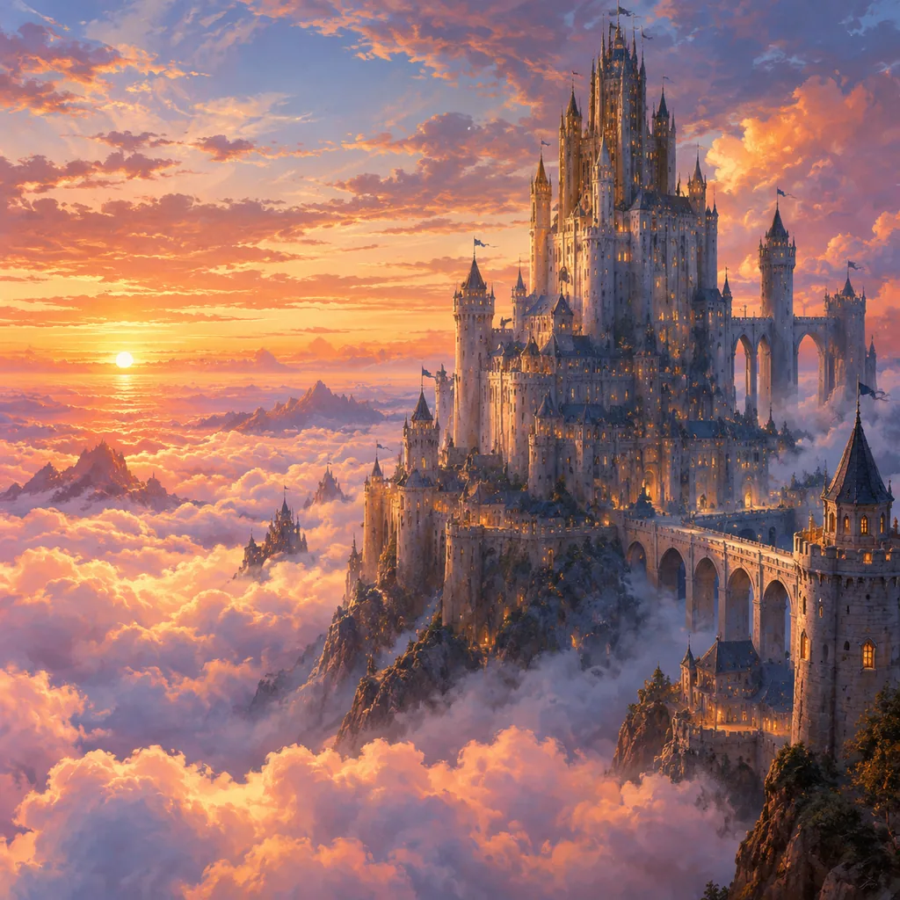</a>

> Adapted from a post by @CliffWade on 2026-10-14 (7 likes at capture). We rewrote it as one clean 1:1 still, removing brands, logos, celebrity/IP elements and any need for your own photo. Change one variable at a time.

```text
Painterly fantasy, square 1:1: a giant's castle above the clouds, vast stone towers and tiny glowing windows, sea of clouds at sunset, edge-to-edge finished painting, no text. Square 1:1 composition.
```

- Author: [@CliffWade](https://x.com/CliffWade)
- Original post: https://x.com/CliffWade/status/2110309913259880941
- [View on cinel and generate with this prompt](https://cinel.ai/prompts/p/giants-castle-above-clouds-painting?utm_source=github&utm_medium=awesome&utm_campaign=awesome-gpt-image-2.5-prompts)

### Cat Holding the Fish in the Kitchen

<a href="https://cinel.ai/prompts/p/kitchen-cat-holding-fish-chef-scene?utm_source=github&utm_medium=awesome&utm_campaign=awesome-gpt-image-2.5-prompts">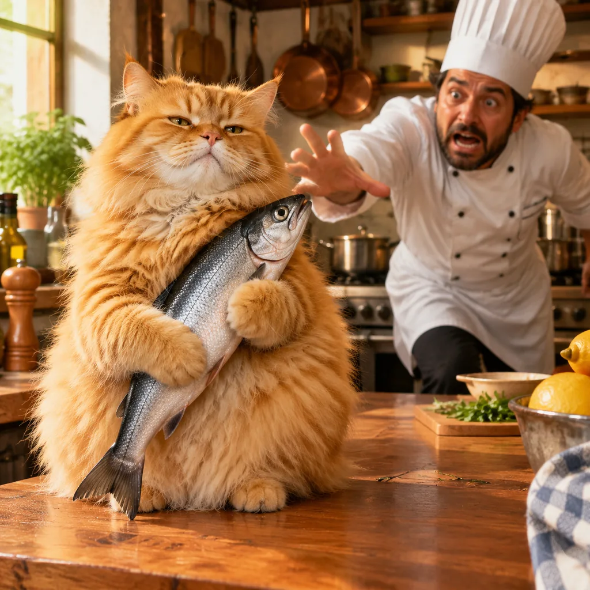</a>

> Adapted from a post by @FilmluneCOM on 2026-10-17 (0 likes at capture). We rewrote it as one clean 1:1 still, removing brands, logos, celebrity/IP elements and any need for your own photo. Change one variable at a time.

```text
Humorous photorealistic scene, square 1:1: one kitchen, one fish, one very unbothered fluffy orange cat holding a fish like it owns the place while a panicked chef lunges in the background, warm kitchen light, no text, no logo. Square 1:1 composition.
```

- Author: [@FilmluneCOM](https://x.com/FilmluneCOM)
- Original post: https://x.com/FilmluneCOM/status/2111351365306138938
- [View on cinel and generate with this prompt](https://cinel.ai/prompts/p/kitchen-cat-holding-fish-chef-scene?utm_source=github&utm_medium=awesome&utm_campaign=awesome-gpt-image-2.5-prompts)

### Haunted Automaton Pumpkin Head

<a href="https://cinel.ai/prompts/p/haunted-automaton-pumpkin-head?utm_source=github&utm_medium=awesome&utm_campaign=awesome-gpt-image-2.5-prompts">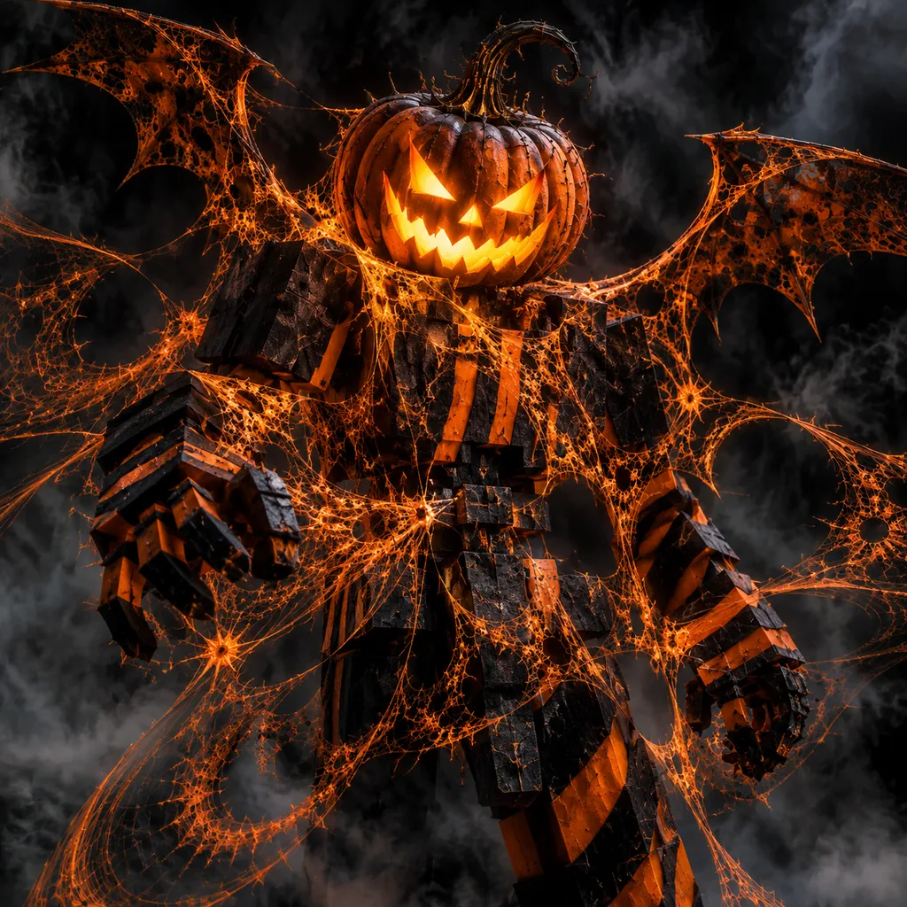</a>

> Adapted from a video post by @GundiThore on 2025-10-01 (2 likes at capture). We rewrote it as one clean 1:1 pumpkin-head photoshoot still, removing brands, logos, celebrity/IP elements and any need for your own photo. Change one variable at a time.

```text
Surreal Halloween portrait, square 1:1: a blocky haunted automaton with a glowing jack-o'-lantern head, spectral fractal cobweb veins and bat-wing accents, high-contrast black and orange shadow stripes, misty void background, hypnotic eerie flow, no brand mascot, no text, no logo. Square 1:1 composition.
```

- Author: [@GundiThore](https://x.com/GundiThore)
- Original post: https://x.com/GundiThore/status/1973396884078129367
- [View on cinel and generate with this prompt](https://cinel.ai/prompts/p/haunted-automaton-pumpkin-head?utm_source=github&utm_medium=awesome&utm_campaign=awesome-gpt-image-2.5-prompts)

### Anime Jack-O'-Lantern Head Closeup

<a href="https://cinel.ai/prompts/p/anime-jackolantern-head-closeup?utm_source=github&utm_medium=awesome&utm_campaign=awesome-gpt-image-2.5-prompts">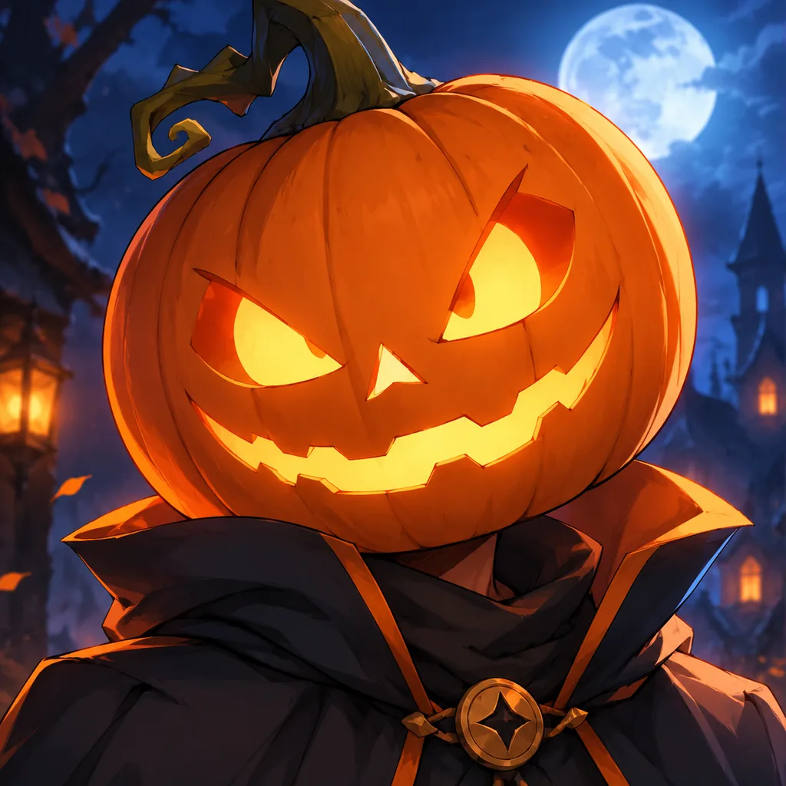</a>

> Adapted from a post by @VinnieM84556 on 2025-10-16 (6 likes at capture). We rewrote it as one clean 1:1 pumpkin-head photoshoot still, removing brands, logos, celebrity/IP elements and any need for your own photo. Change one variable at a time.

```text
Anime-style portrait closeup, square 1:1: a character whose head is a glowing jack-o'-lantern with expressive carved eyes and a crooked smile, soft cel shading, warm orange rim light against cool night blue, clean shoulders-up crop, SFW, no text, no logo, no modern IP. Square 1:1 composition.
```

- Author: [@VinnieM84556](https://x.com/VinnieM84556)
- Original post: https://x.com/VinnieM84556/status/1978639631672381872
- [View on cinel and generate with this prompt](https://cinel.ai/prompts/p/anime-jackolantern-head-closeup?utm_source=github&utm_medium=awesome&utm_campaign=awesome-gpt-image-2.5-prompts)

### Pixel Robot Pumpkin Head

<a href="https://cinel.ai/prompts/p/pixel-robot-pumpkin-head?utm_source=github&utm_medium=awesome&utm_campaign=awesome-gpt-image-2.5-prompts">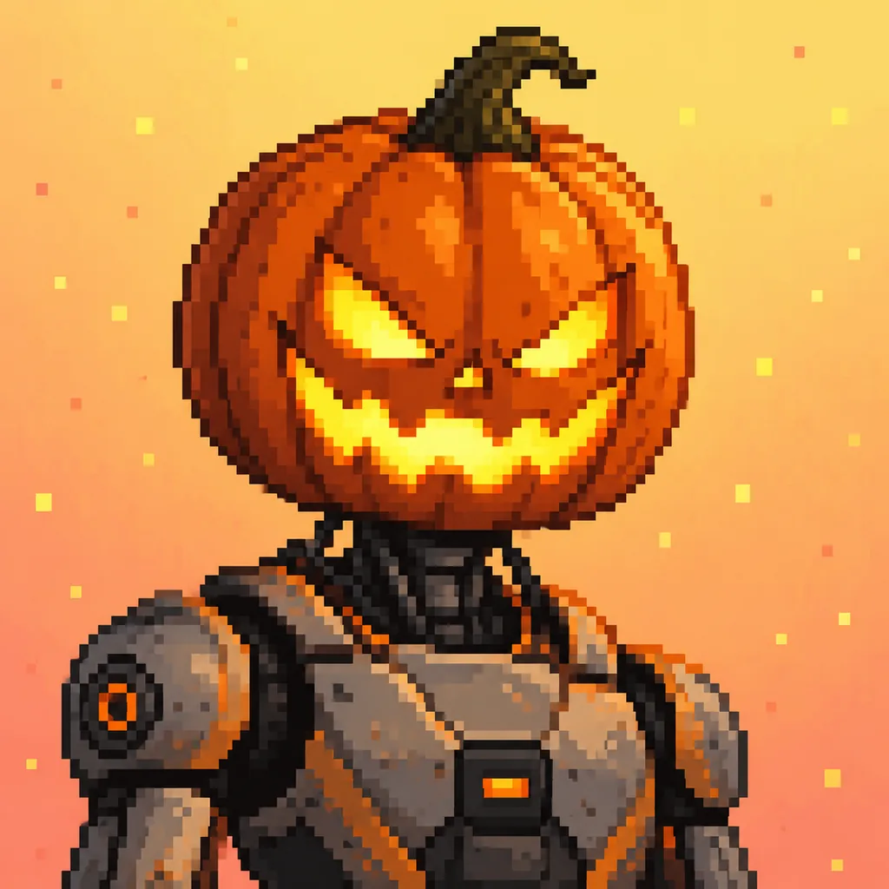</a>

> Adapted from a post by @0x7211 on 2025-10-24 (0 likes at capture). We rewrote it as one clean 1:1 pumpkin-head photoshoot still, removing brands, logos, celebrity/IP elements and any need for your own photo. Change one variable at a time.

```text
Pixel-art style portrait, square 1:1: a humanoid robot with a menacing jack-o'-lantern head, glowing yellow-orange carved eyes, warm yellow-to-peach gradient backdrop with soft pixel dots, clean 1:1 crop, retro game charm, no brand, no text, no logo. Square 1:1 composition.
```

- Author: [@0x7211](https://x.com/0x7211)
- Original post: https://x.com/0x7211/status/1981785229225324849
- [View on cinel and generate with this prompt](https://cinel.ai/prompts/p/pixel-robot-pumpkin-head?utm_source=github&utm_medium=awesome&utm_campaign=awesome-gpt-image-2.5-prompts)

### Jack-O'-Lantern Grim Showgirl

<a href="https://cinel.ai/prompts/p/jackolantern-grim-showgirl?utm_source=github&utm_medium=awesome&utm_campaign=awesome-gpt-image-2.5-prompts">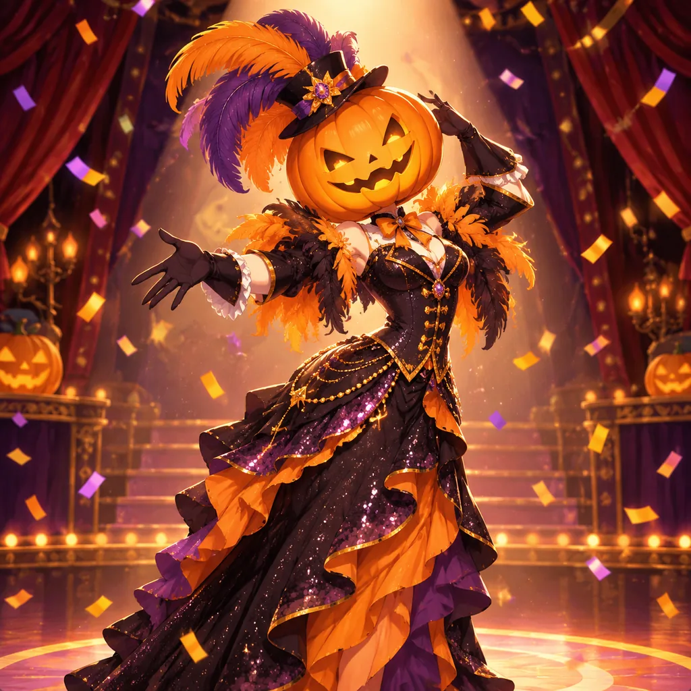</a>

> Adapted from a post by @MelodyMocha0 on 2026-10-16 (116 likes at capture). We rewrote it as one clean 1:1 pumpkin-head photoshoot still, removing brands, logos, celebrity/IP elements and any need for your own photo. Change one variable at a time.

```text
SFW cute illustration, square 1:1: a stylish showgirl whose head is a carved jack-o'-lantern with a playful grim smile, sparkling stage outfit that is elegant not revealing, stage spotlight and confetti, cheerful Halloween cabaret mood, no NSFW, no text, no logo, no modern IP. Square 1:1 composition.
```

- Author: [@MelodyMocha0](https://x.com/MelodyMocha0)
- Original post: https://x.com/MelodyMocha0/status/2111200514851696741
- [View on cinel and generate with this prompt](https://cinel.ai/prompts/p/jackolantern-grim-showgirl?utm_source=github&utm_medium=awesome&utm_campaign=awesome-gpt-image-2.5-prompts)

### Lantern Night Skeleton Pumpkin Head

<a href="https://cinel.ai/prompts/p/lantern-night-skeleton-pumpkin-head?utm_source=github&utm_medium=awesome&utm_campaign=awesome-gpt-image-2.5-prompts">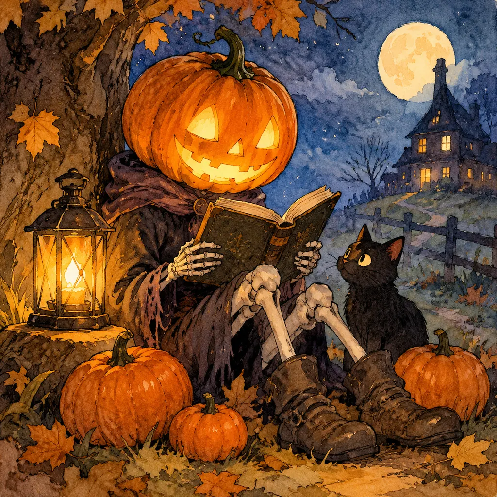</a>

> Adapted from a post by @prernaverse on 2026-10-02 (0 likes at capture). We rewrote it as one clean 1:1 pumpkin-head photoshoot still, removing brands, logos, celebrity/IP elements and any need for your own photo. Change one variable at a time.

```text
Whimsical watercolor illustration, square 1:1: a gentle skeleton figure with a glowing jack-o'-lantern head reading by lantern light, surrounded by small pumpkins, heavy ink outlines and soft washes, spooky-cute storybook Halloween night, no gore, no text, no logo. Square 1:1 composition.
```

- Author: [@prernaverse](https://x.com/prernaverse)
- Original post: https://x.com/prernaverse/status/2105939234485903694
- [View on cinel and generate with this prompt](https://cinel.ai/prompts/p/lantern-night-skeleton-pumpkin-head?utm_source=github&utm_medium=awesome&utm_campaign=awesome-gpt-image-2.5-prompts)

### Floral Painted Horse Illustration

<a href="https://cinel.ai/prompts/p/floral-painted-horse-illustration?utm_source=github&utm_medium=awesome&utm_campaign=awesome-gpt-image-2.5-prompts">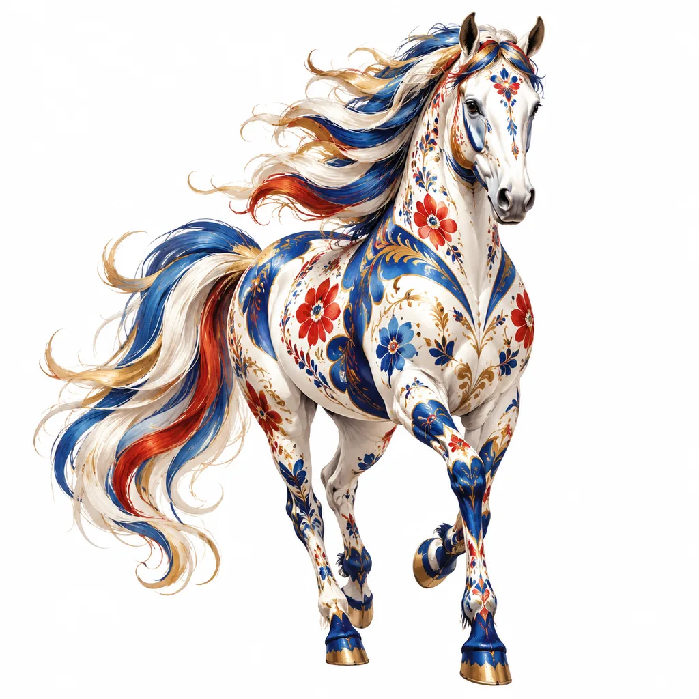</a>

> Adapted from a post by @LauraFlorey on 2026-10-15 (6 likes at capture). We rewrote it as one clean 1:1 still, removing brands, logos, celebrity/IP elements and any need for your own photo. Change one variable at a time.

```text
Full-body digital illustration, square 1:1: a stylized majestic horse trotting forward, rich coat decorated with intricate blue white gold and red floral and abstract painted patterns, flowing mane, clean white background, decorative folk-art energy, no text, no logo. Square 1:1 composition.
```

- Author: [@LauraFlorey](https://x.com/LauraFlorey)
- Original post: https://x.com/LauraFlorey/status/2110747527959986396
- [View on cinel and generate with this prompt](https://cinel.ai/prompts/p/floral-painted-horse-illustration?utm_source=github&utm_medium=awesome&utm_campaign=awesome-gpt-image-2.5-prompts)

### Anime Tennis Match Point Keyframe

<a href="https://cinel.ai/prompts/p/anime-tennis-matchpoint-keyframe?utm_source=github&utm_medium=awesome&utm_campaign=awesome-gpt-image-2.5-prompts">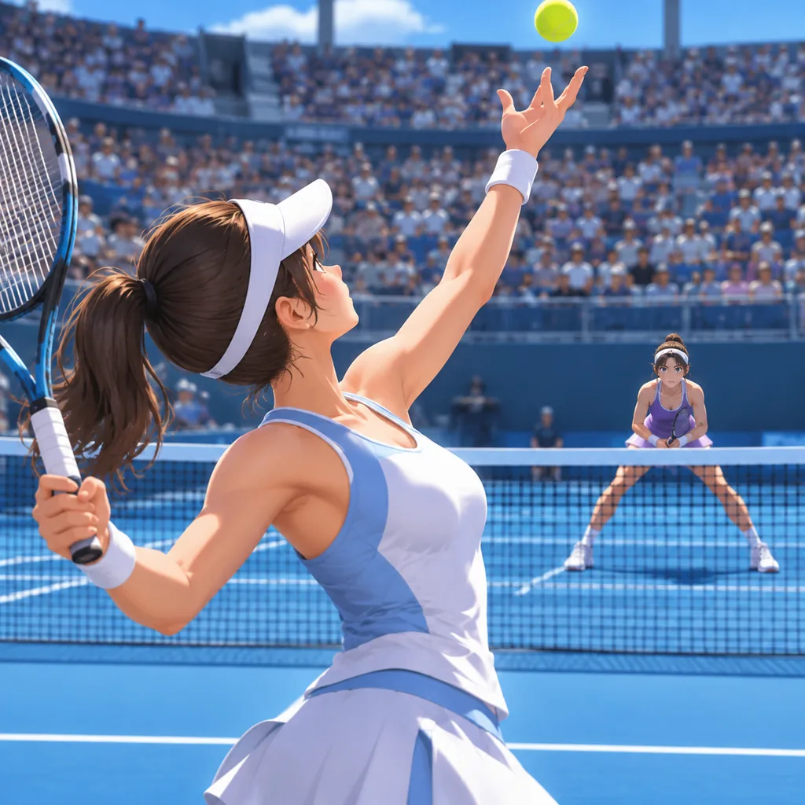</a>

> Adapted from a video post by @Mayz1169 on 2026-10-12 (39 likes at capture). We rewrote it as one clean 1:1 still, removing brands, logos, celebrity/IP elements and any need for your own photo. Change one variable at a time.

```text
Stylized 3D anime video keyframe, square 1:1: two original fictional tennis players locked at match point on a bright blue hard court, packed stadium crowd soft-blurred, soft cel shading and dramatic serve freeze, no real athletes, no text, no logo. Square 1:1 composition.
```

- Author: [@Mayz1169](https://x.com/Mayz1169)
- Original post: https://x.com/Mayz1169/status/2109647912292749521
- [View on cinel and generate with this prompt](https://cinel.ai/prompts/p/anime-tennis-matchpoint-keyframe?utm_source=github&utm_medium=awesome&utm_campaign=awesome-gpt-image-2.5-prompts)

### Whimsical Gothic Cartoon Character

<a href="https://cinel.ai/prompts/p/gothic-cartoon-character-illustration?utm_source=github&utm_medium=awesome&utm_campaign=awesome-gpt-image-2.5-prompts">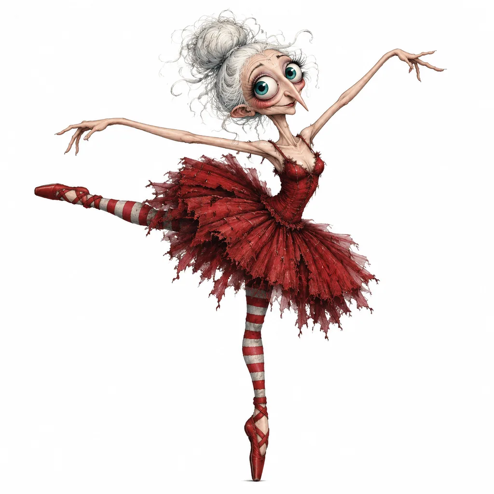</a>

> Adapted from a prompt + image post by @azed_ai on 2026-10-19 (108 likes at capture). We rewrote it as one clean square 1:1 still, removing brands, logos, celebrity/IP elements and any need for your own photo. Change one variable at a time.

```text
A whimsical gothic cartoon illustration of an eccentric old ballerina, featuring huge round teal eyes and a long pointed nose, a wild white bun of wispy hair, expressive glassy eyes, wearing a ragged crimson tutu with red pointe shoes and striped stockings, balancing on one spindly leg with arms flung wide, elongated limbs, exaggerated proportions, quirky personality, dark fairytale aesthetic, delicate sketch-like details, theatrical elegance, subtle macabre humor, stylized character design, full-body composition, clean white background, no text, no logo. Square 1:1 composition.
```

- Author: [@azed_ai](https://x.com/azed_ai)
- Original post: https://x.com/azed_ai/status/2112135940953260039
- [View on cinel and generate with this prompt](https://cinel.ai/prompts/p/gothic-cartoon-character-illustration?utm_source=github&utm_medium=awesome&utm_campaign=awesome-gpt-image-2.5-prompts)

### Cloud Loom Surrealist Tower Painting

<a href="https://cinel.ai/prompts/p/cloud-loom-surrealist-tower?utm_source=github&utm_medium=awesome&utm_campaign=awesome-gpt-image-2.5-prompts">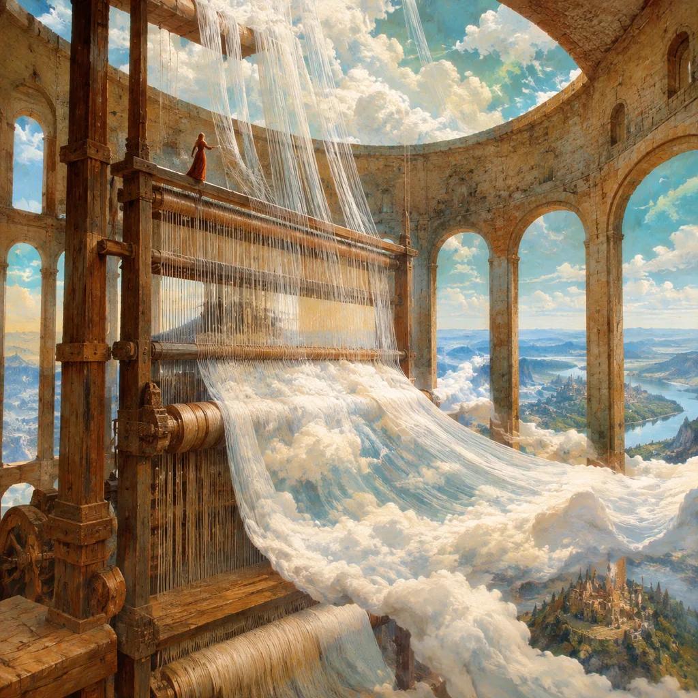</a>

> Adapted from a prompt + image post by @NayaVerseee on 2026-10-19 (26 likes at capture). We rewrote it as one clean square 1:1 still, removing brands, logos, celebrity/IP elements and any need for your own photo. Change one variable at a time.

```text
Mystical surrealist painting, delicate fine glazed brushwork, ochre, rust and pale turquoise, precise and dreamlike, square 1:1. Very wide view inside a colossal round stone tower open to the sky: an immense wooden loom, taller than a cathedral, weaves the clouds themselves, long white threads of cloud pulled down from the sky through its frame and woven into a vast drifting fabric that spills out of the tower windows over the valley. On a narrow wooden ledge high up the loom, a tiny distant red-haired figure in a long rust-coloured dress, face too small to see, guides one thread of cloud with her hand. No text, no logo. Square 1:1 composition.
```

- Author: [@NayaVerseee](https://x.com/NayaVerseee)
- Original post: https://x.com/NayaVerseee/status/2112249925161337154
- [View on cinel and generate with this prompt](https://cinel.ai/prompts/p/cloud-loom-surrealist-tower?utm_source=github&utm_medium=awesome&utm_campaign=awesome-gpt-image-2.5-prompts)

### Geometric Best Friends Fashion Illustration

<a href="https://cinel.ai/prompts/p/geometric-best-friends-fashion-illustration?utm_source=github&utm_medium=awesome&utm_campaign=awesome-gpt-image-2.5-prompts">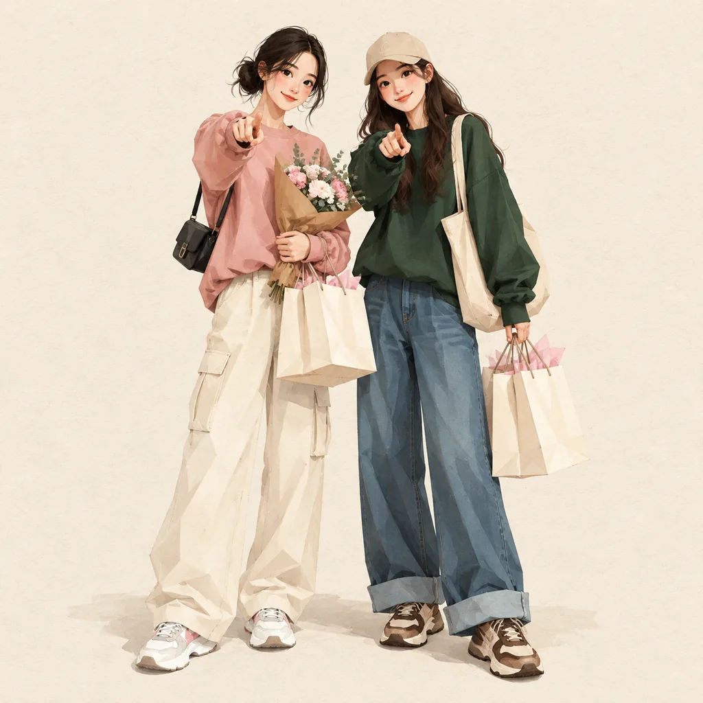</a>

> Adapted from a prompt + image post by @saniaspeaks_ on 2026-10-16 (75 likes at capture). We rewrote it as one clean square 1:1 image, removing brands, logos and any need for your own photo. Change one variable at a time.

```text
Full-body minimalist geometric editorial fashion illustration, square 1:1, of two stylish young fictional female friends standing close together, facing the viewer and playfully pointing their index fingers toward the viewer. Left girl: dark hair in a messy low bun, dusty-pink oversized sweatshirt, cream wide-leg cargo trousers, chunky white sneakers with subtle pink accents and a small black shoulder bag, carrying cream shopping bags with pink tissue paper and a kraft-paper bouquet of pink and white flowers. Right girl: long dark wavy hair, beige baseball cap, oversized deep forest-green sweatshirt, wide-leg denim jeans with folded cuffs, chunky brown-and-cream sneakers and a cream canvas tote, carrying cream shopping bags. Soft elegant proportions, cheerful subtle smiles, clearly visible natural hands. Style: hand-painted digital artwork with angular polygonal shading, faceted clothing folds, subtle brush textures, visible paper grain and simplified facial details, soft diffused light and gentle ground shadows. Palette: dusty pink, warm ivory, cream, beige, deep forest green, denim blue, muted brown and soft black. Full bodies visible from head to toe, centered with generous negative space on a warm ivory textured background. No drink, no extra people, no text, no logo. Square 1:1 composition.
```

- Author: [@saniaspeaks_](https://x.com/saniaspeaks_)
- Original post: https://x.com/saniaspeaks_/status/2110940513209549117
- [View on cinel and generate with this prompt](https://cinel.ai/prompts/p/geometric-best-friends-fashion-illustration?utm_source=github&utm_medium=awesome&utm_campaign=awesome-gpt-image-2.5-prompts)

### Paper-Cut Whale Sky Diorama

<a href="https://cinel.ai/prompts/p/paper-cut-whale-sky-diorama?utm_source=github&utm_medium=awesome&utm_campaign=awesome-gpt-image-2.5-prompts">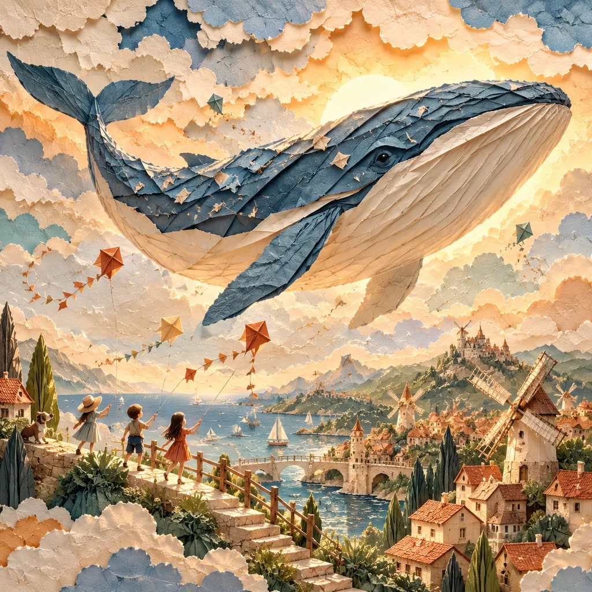</a>

> Adapted from a prompt + image post by @AllaAisling on 2026-10-18 (14 likes at capture). We rewrote it as one clean square 1:1 still, removing brands, logos, celebrity/IP elements and any need for your own photo. Change one variable at a time.

```text
Layered cut paper diorama, square 1:1: a colossal whale made of intricately folded origami paper swimming through a sky above a paper-cut village of rooftops and windmills, dozens of paper layers creating depth, soft cast shadows between layers, tiny paper villagers flying paper kites in the foreground for scale, paper clouds with deckled edges, warm backlight glowing through thin paper, cream, dusty blue, terracotta and sage green palette, handcrafted, delicate, dreamy, massive scale, no text, no logo. Square 1:1 composition.
```

- Author: [@AllaAisling](https://x.com/AllaAisling)
- Original post: https://x.com/AllaAisling/status/2111913708330860583
- [View on cinel and generate with this prompt](https://cinel.ai/prompts/p/paper-cut-whale-sky-diorama?utm_source=github&utm_medium=awesome&utm_campaign=awesome-gpt-image-2.5-prompts)

### Turtle Leaf Glider Valley Keyframe

<a href="https://cinel.ai/prompts/p/turtle-leaf-glider-valley-keyframe?utm_source=github&utm_medium=awesome&utm_campaign=awesome-gpt-image-2.5-prompts">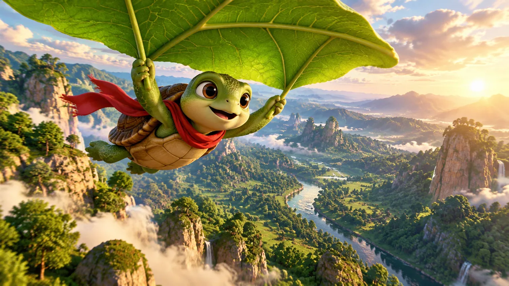</a>

> Adapted from a Seedance 2.5 video post by @AIwithWania on 2026-10-20 (42 likes at capture). We rewrote it as one clean widescreen 16:9 still, removing brands, logos, celebrity/IP elements and any need for your own photo. Change one variable at a time.

```text
Cinematic 3D animation keyframe, widescreen 16:9: a tiny turtle with a brown patterned shell, green skin, big brown eyes and a fluttering red scarf glides through the air holding an enormous green leaf overhead like a hang glider, soaring above a spectacular green valley with towering rocky cliffs and distant mountains, golden sunlight, sweeping aerial camera angle, joyful determined expression, detailed textures, vibrant fantasy landscape, no text, no logo. Widescreen 16:9 composition.
```

- Author: [@AIwithWania](https://x.com/AIwithWania)
- Original post: https://x.com/AIwithWania/status/2112460090024632776
- [View on cinel and generate with this prompt](https://cinel.ai/prompts/p/turtle-leaf-glider-valley-keyframe?utm_source=github&utm_medium=awesome&utm_campaign=awesome-gpt-image-2.5-prompts)

### Anime Rainy Balcony Coffee Keyframe

<a href="https://cinel.ai/prompts/p/anime-rainy-balcony-coffee-keyframe?utm_source=github&utm_medium=awesome&utm_campaign=awesome-gpt-image-2.5-prompts">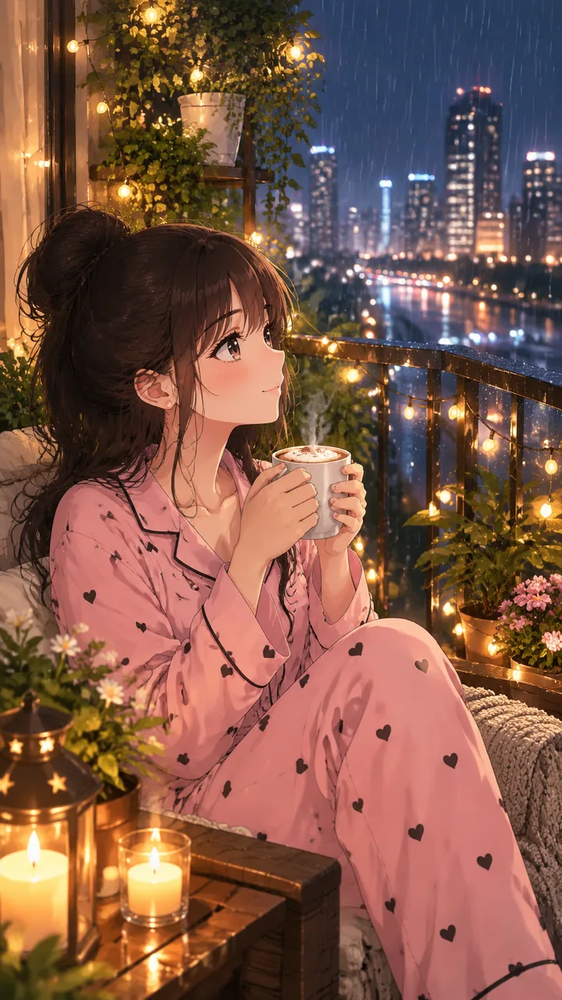</a>

> Adapted from a an unspecified model video post by @JohnSmith5912 on 2026-10-17 (23 likes at capture). We rewrote it as one clean vertical 9:16 still, removing brands, logos, celebrity/IP elements and any need for your own photo. Change one variable at a time.

```text
Cozy anime-style video keyframe, vertical 9:16: a cute fictional young woman in pink pajamas with small black hearts sits comfortably on a chair on a candle-lit balcony decorated with warm fairy lights and potted plants on a rainy night, holding a warm steaming mug of frothy coffee topped with cocoa powder in both hands, looking out at the rainy city lights with a peaceful expression, soft cinematic lighting, rain streaks and glowing bokeh, clean anime linework, no text, no logo. Vertical 9:16 composition.
```

- Author: [@JohnSmith5912](https://x.com/JohnSmith5912)
- Original post: https://x.com/JohnSmith5912/status/2111391726191681700
- [View on cinel and generate with this prompt](https://cinel.ai/prompts/p/anime-rainy-balcony-coffee-keyframe?utm_source=github&utm_medium=awesome&utm_campaign=awesome-gpt-image-2.5-prompts)

### Pi Claymation Math Diorama

<a href="https://cinel.ai/prompts/p/pi-claymation-math-diorama?utm_source=github&utm_medium=awesome&utm_campaign=awesome-gpt-image-2.5-prompts">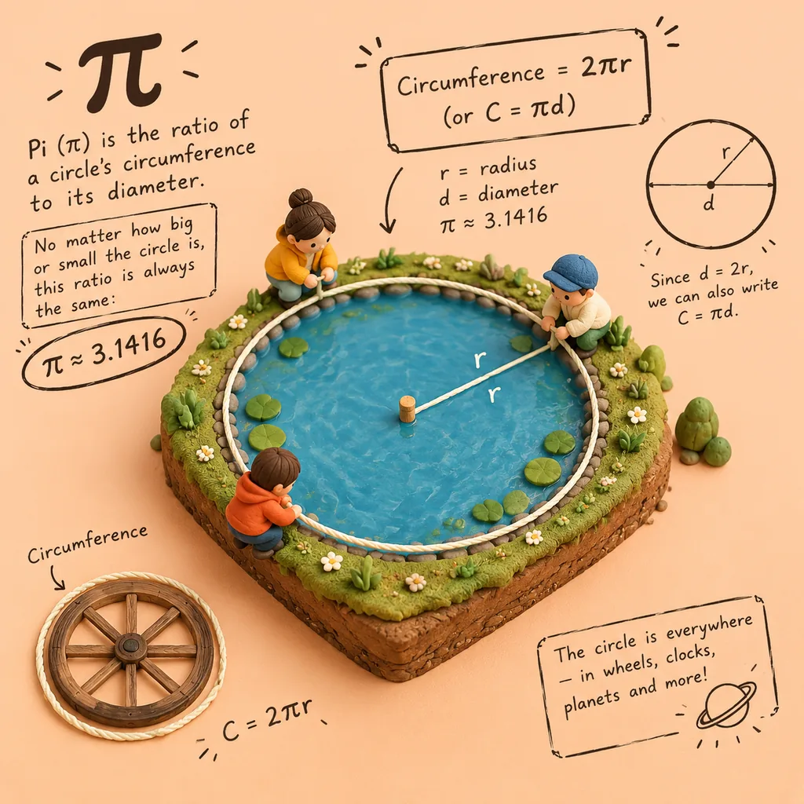</a>

> @Gdgtify isometric claymation math prompt (10 likes). Filled Pi / circle; single 1:1 frame.

```text
Mixed-media educational illustration, isometric claymation, square 1:1. Subject: Pi (π) and the circle. Background: solid warm pastel peach, zero depth. The_3D_Diorama: an isometric clay slice of earth with a circular pond and a clay wheel/compass. Tiny adorable clay figures measuring circumference with string. 2D Overlay: hand-drawn ink call-out boxes and scribbled notes explaining circumference = 2πr, no brand logos. Softbox studio lighting with soft drop-shadows from clay onto flat background.
```

- Author: [@Gdgtify](https://x.com/Gdgtify)
- Original post: https://x.com/Gdgtify/status/2111223411112353853
- [View on cinel and generate with this prompt](https://cinel.ai/prompts/p/pi-claymation-math-diorama?utm_source=github&utm_medium=awesome&utm_campaign=awesome-gpt-image-2.5-prompts)

### French Watercolor Fox Florist Character Sheet

<a href="https://cinel.ai/prompts/p/french-wc-fox-florist-camille?utm_source=github&utm_medium=awesome&utm_campaign=awesome-gpt-image-2.5-prompts">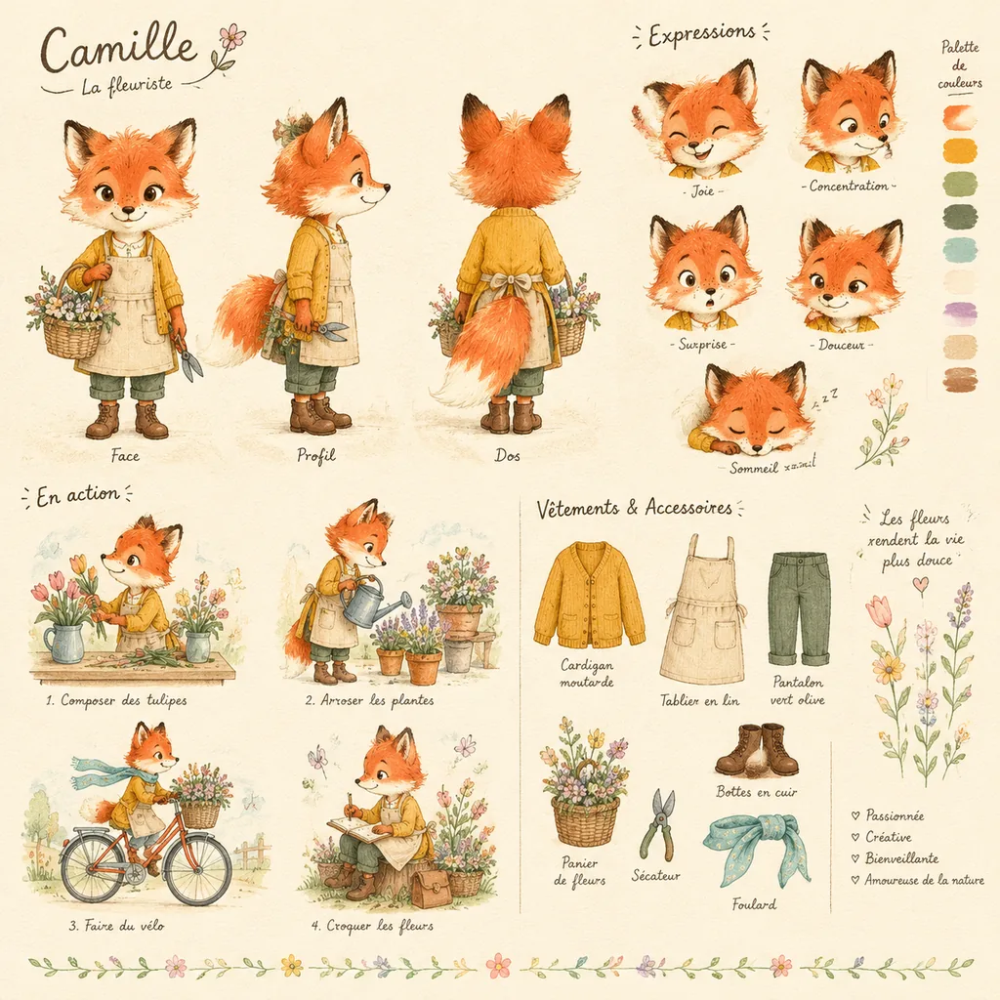</a>

> @azed_ai French Watercolor Character Sheet (294 likes). Filled fox florist Camille; square 1:1.

```text
Children’s picture book character sheet of an anthropomorphic red fox florist named “Camille”, wearing a linen apron over a soft mustard cardigan with a wicker flower basket and garden shears, featuring fluffy cheek fur and a tiny freckled snout, French picture book illustration style, delicate watercolor washes, soft colored pencil textures, charming hand-painted details, light cream background, large full-body character portrait, front, side, back turnaround views, five facial expressions showing joy, focus, surprise, gentle smile, sleepy, four action poses depicting arranging tulips, watering pots, riding a bicycle with flowers, sketching blooms, handwritten French labels, coordinated color palette swatches, separate clothing and accessory studies, consistent character proportions, expressive personality, whimsical editorial layout, professional character design sheet. Square 1:1. No brand logos, no real people, no photo upload.
```

- Author: [@azed_ai](https://x.com/azed_ai)
- Original post: https://x.com/azed_ai/status/2113223607539368049
- [View on cinel and generate with this prompt](https://cinel.ai/prompts/p/french-wc-fox-florist-camille?utm_source=github&utm_medium=awesome&utm_campaign=awesome-gpt-image-2.5-prompts)

### French Watercolor Iguana Artist Gus Sheet

<a href="https://cinel.ai/prompts/p/french-wc-iguana-artist-gus?utm_source=github&utm_medium=awesome&utm_campaign=awesome-gpt-image-2.5-prompts">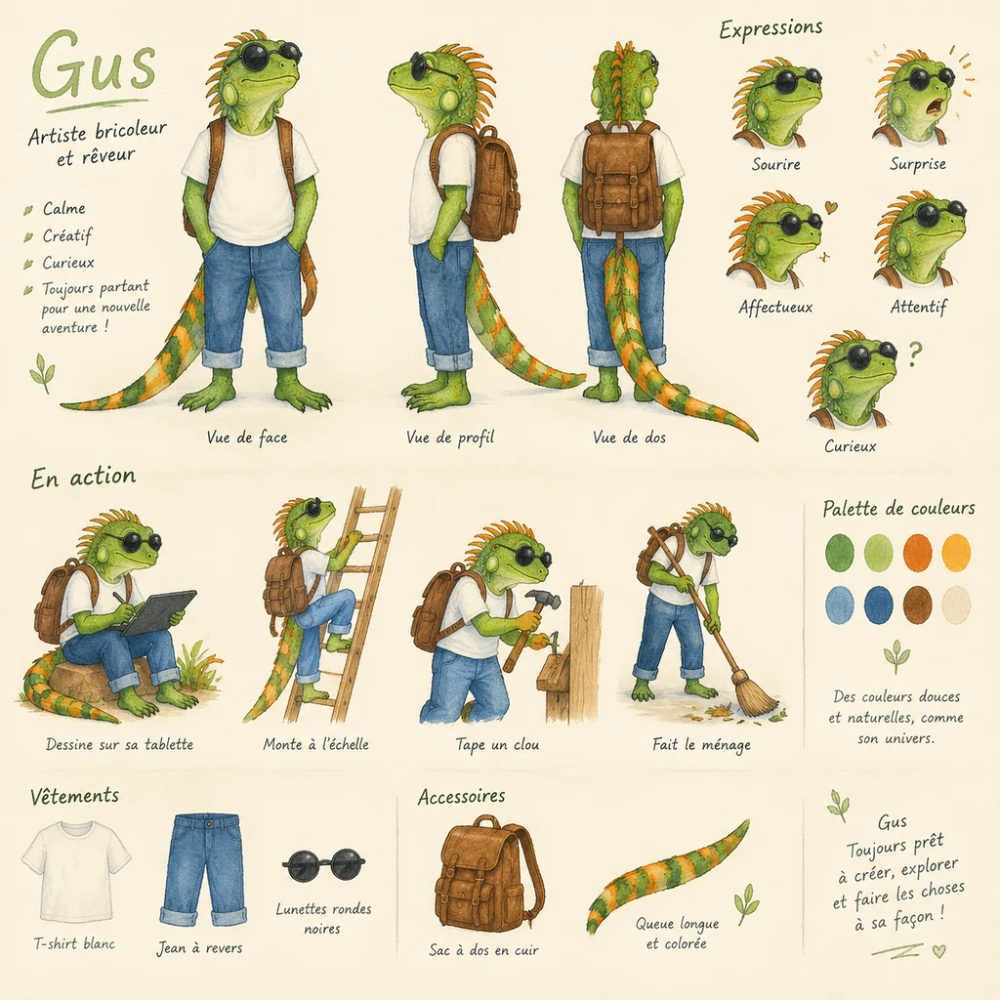</a>

> @francistanajura image reply to @azed_ai French WC sheet (iguana artista). Reverse-wrote Gus sheet; square 1:1; removed phone brand text.

```text
Children’s picture book character sheet of an anthropomorphic green iguana DIY artist named “Gus”, wearing a white t-shirt and cuffed blue jeans with round black sunglasses and a brown leather backpack, featuring long patterned orange-green tail and calm cool demeanor, French picture book illustration style, delicate watercolor washes, soft colored pencil textures, charming hand-painted details, light cream background, large full-body character portrait, front, side, back turnaround views, five facial expressions showing smile, surprise, affectionate, attentive, curious, four action poses depicting drawing on a tablet, climbing a ladder, hammering a nail, sweeping, handwritten French labels, coordinated color palette swatches, separate clothing and accessory studies, consistent character proportions, expressive personality, whimsical editorial layout, professional character design sheet. Square 1:1. No brand logos, no real people, no photo upload.
```

- Author: [@francistanajura](https://x.com/francistanajura)
- Original post: https://x.com/francistanajura/status/2113571880125006311
- [View on cinel and generate with this prompt](https://cinel.ai/prompts/p/french-wc-iguana-artist-gus?utm_source=github&utm_medium=awesome&utm_campaign=awesome-gpt-image-2.5-prompts)

### French Watercolor Melancholy Cat Finch Sheet

<a href="https://cinel.ai/prompts/p/french-wc-melancholy-cat-finch?utm_source=github&utm_medium=awesome&utm_campaign=awesome-gpt-image-2.5-prompts">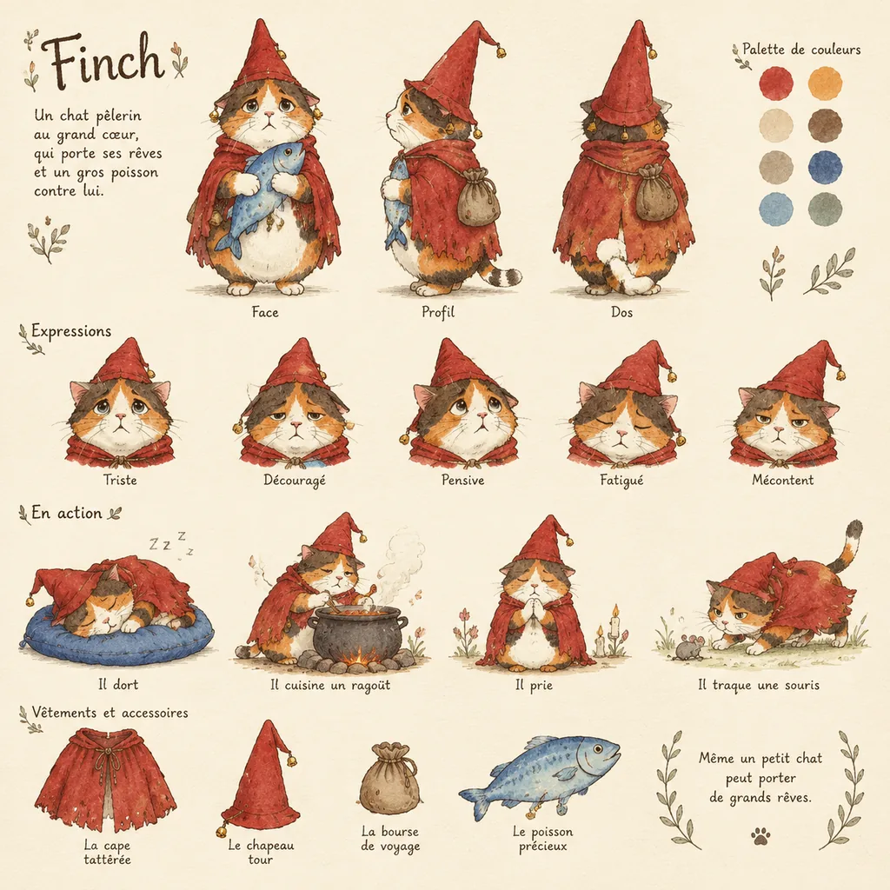</a>

> @dmitriygorin image reply to French WC sheet (tired/melancholy cat). Reverse-wrote Finch; square 1:1.

```text
Children’s picture book character sheet of an anthropomorphic plump calico cat pilgrim named “Finch”, wearing a tattered red cloak with a tall conical red tower hat with tiny bells and a drawstring pouch, featuring wistful eyes and a large blue fish held to the chest, French picture book illustration style, delicate watercolor washes, soft colored pencil textures, charming hand-painted details, light cream background, large full-body character portrait, front, side, back turnaround views, five facial expressions showing sad, discouraged, pensive, tired, discontent, four action poses depicting sleeping on a cushion, cooking stew, kneeling in prayer, stalking a mouse, handwritten French labels, coordinated color palette swatches, separate clothing and accessory studies, consistent character proportions, expressive personality, whimsical editorial layout, professional character design sheet. Square 1:1. No brand logos, no real people, no photo upload.
```

- Author: [@dmitriygorin](https://x.com/dmitriygorin)
- Original post: https://x.com/dmitriygorin/status/2113299398062936575
- [View on cinel and generate with this prompt](https://cinel.ai/prompts/p/french-wc-melancholy-cat-finch?utm_source=github&utm_medium=awesome&utm_campaign=awesome-gpt-image-2.5-prompts)

### French Watercolor Bee Designer Overalls Sheet

<a href="https://cinel.ai/prompts/p/french-wc-bee-designer-overalls?utm_source=github&utm_medium=awesome&utm_campaign=awesome-gpt-image-2.5-prompts">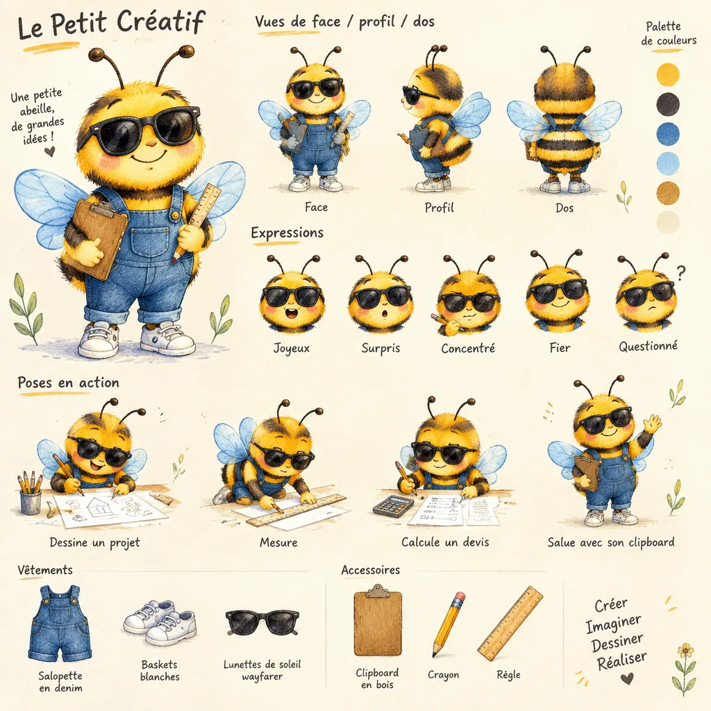</a>

> @Sigilify image reply to French WC sheet (bee in overalls). Reverse-wrote; square 1:1; no brand wordmarks.

```text
Children’s picture book character sheet of an anthropomorphic round bumblebee print designer named “Le Petit Créatif”, wearing blue denim overalls and white sneakers with black wayfarer sunglasses, wooden clipboard, pencil and ruler, featuring fuzzy yellow-black stripes and translucent blue wings, French picture book illustration style, delicate watercolor washes, soft colored pencil textures, charming hand-painted details, light cream background, large full-body character portrait, front, side, back turnaround views, five facial expressions showing joy, surprise, concentration, pride, questioning, four action poses depicting drawing a project, measuring with a ruler, calculating a quote, waving with clipboard, handwritten French labels, coordinated color palette swatches, separate clothing and accessory studies, consistent character proportions, expressive personality, whimsical editorial layout, professional character design sheet. Square 1:1. No brand logos, no real people, no photo upload.
```

- Author: [@Sigilify](https://x.com/Sigilify)
- Original post: https://x.com/Sigilify/status/2113286895308529849
- [View on cinel and generate with this prompt](https://cinel.ai/prompts/p/french-wc-bee-designer-overalls?utm_source=github&utm_medium=awesome&utm_campaign=awesome-gpt-image-2.5-prompts)

### French Watercolor Giraffe Hiker Boryi Sheet

<a href="https://cinel.ai/prompts/p/french-wc-giraffe-hiker-boryi?utm_source=github&utm_medium=awesome&utm_campaign=awesome-gpt-image-2.5-prompts">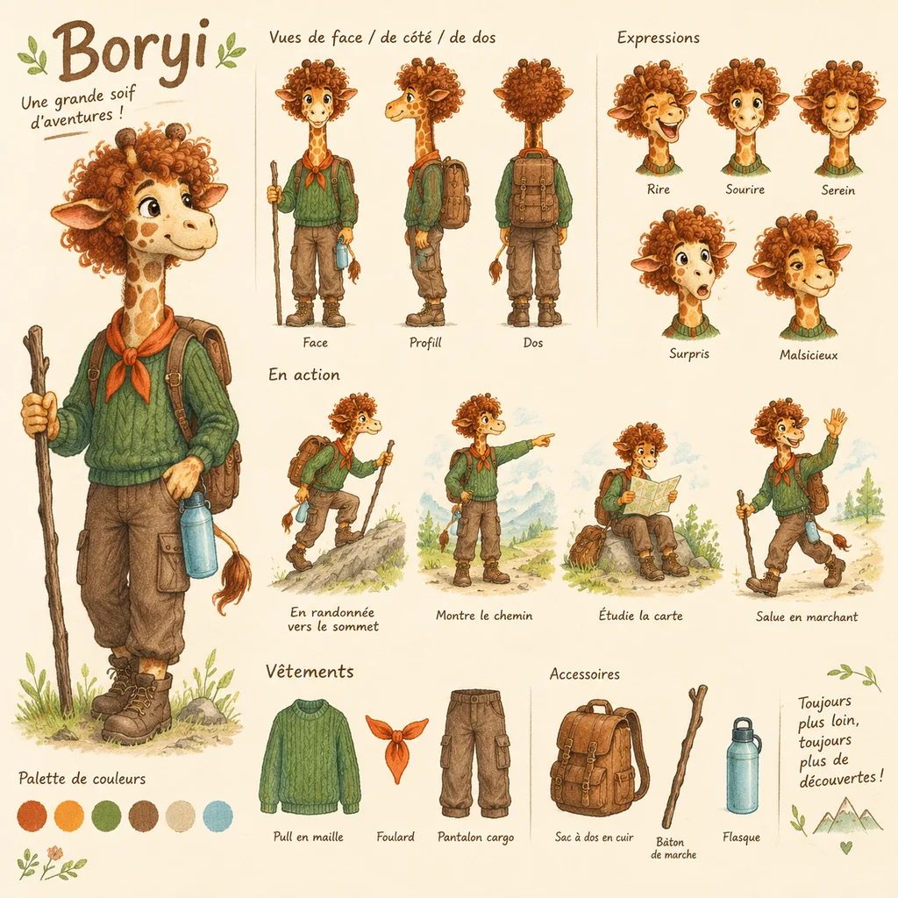</a>

> @PBoryi39644 image reply (Boryi la girafe voyageuse). Reverse-wrote; square 1:1.

```text
Children’s picture book character sheet of an anthropomorphic traveling giraffe hiker named “Boryi”, wearing a green cable-knit sweater, orange neckerchief and brown cargo trousers with a leather backpack, wooden walking stick and light-blue flask, featuring voluminous curly reddish-brown afro and soft giraffe spots, French picture book illustration style, delicate watercolor washes, soft colored pencil textures, charming hand-painted details, light cream background, large full-body character portrait, front, side, back turnaround views, five facial expressions showing laughing, smiling, serene, surprised, mischievous, four action poses depicting hiking uphill, pointing to a path, reading a map on a rock, waving while walking, handwritten French labels, coordinated color palette swatches, separate clothing and accessory studies, consistent character proportions, expressive personality, whimsical editorial layout, professional character design sheet. Square 1:1. No brand logos, no real people, no photo upload.
```

- Author: [@PBoryi39644](https://x.com/PBoryi39644)
- Original post: https://x.com/PBoryi39644/status/2113282681631096928
- [View on cinel and generate with this prompt](https://cinel.ai/prompts/p/french-wc-giraffe-hiker-boryi?utm_source=github&utm_medium=awesome&utm_campaign=awesome-gpt-image-2.5-prompts)

### French Watercolor Badger Painter Marcel Sheet

<a href="https://cinel.ai/prompts/p/french-wc-badger-painter-marcel?utm_source=github&utm_medium=awesome&utm_campaign=awesome-gpt-image-2.5-prompts">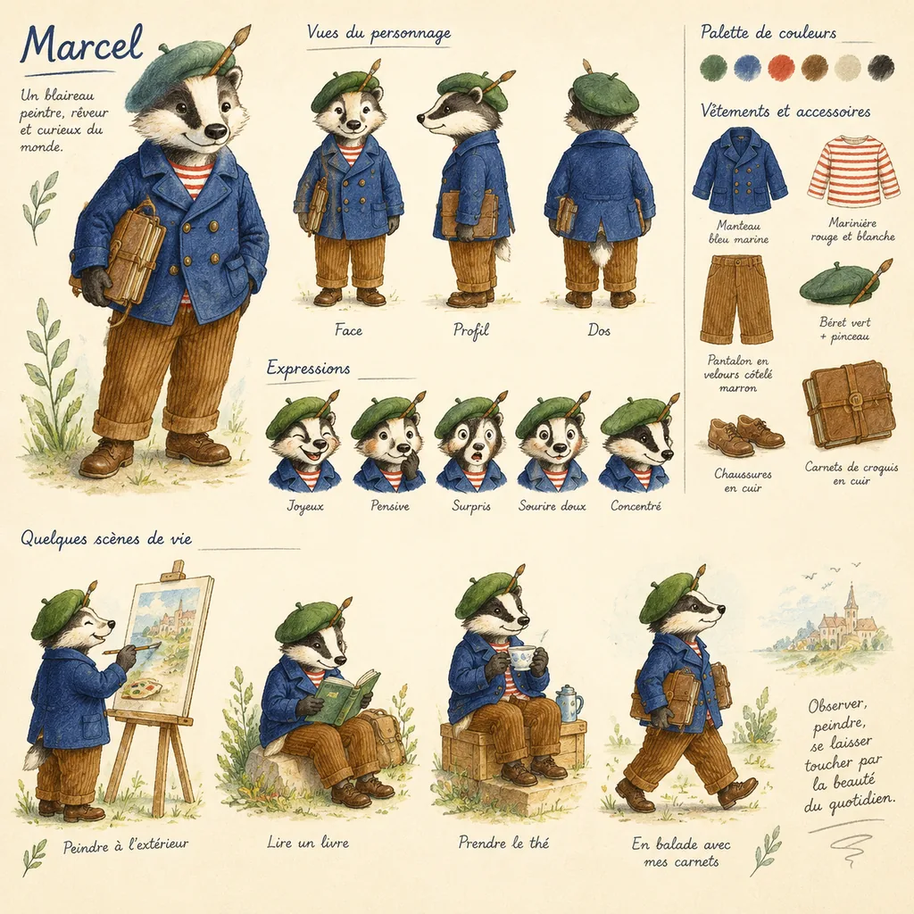</a>

> @asifbipu Gemini reply to French WC sheet (badger painter). Reverse-wrote Marcel; square 1:1.

```text
Children’s picture book character sheet of an anthropomorphic badger painter named “Marcel”, wearing a red-and-white striped marinière under a blue double-breasted pea coat and brown corduroy trousers with a green beret with a paintbrush tucked in and leather sketchbooks, featuring classic black-and-white badger face markings, French picture book illustration style, delicate watercolor washes, soft colored pencil textures, charming hand-painted details, light cream background, large full-body character portrait, front, side, back turnaround views, five facial expressions showing joyful, pensive, surprised, gentle smile, focused, four action poses depicting painting at an easel, reading a book, holding a teacup, walking with sketchbooks, handwritten French labels, coordinated color palette swatches, separate clothing and accessory studies, consistent character proportions, expressive personality, whimsical editorial layout, professional character design sheet. Square 1:1. No brand logos, no real people, no photo upload.
```

- Author: [@asifbipu](https://x.com/asifbipu)
- Original post: https://x.com/asifbipu/status/2113331953219014868
- [View on cinel and generate with this prompt](https://cinel.ai/prompts/p/french-wc-badger-painter-marcel?utm_source=github&utm_medium=awesome&utm_campaign=awesome-gpt-image-2.5-prompts)

### French Watercolor Gnome Woodcutter Lumper Sheet

<a href="https://cinel.ai/prompts/p/french-wc-gnome-woodcutter-lumper?utm_source=github&utm_medium=awesome&utm_campaign=awesome-gpt-image-2.5-prompts">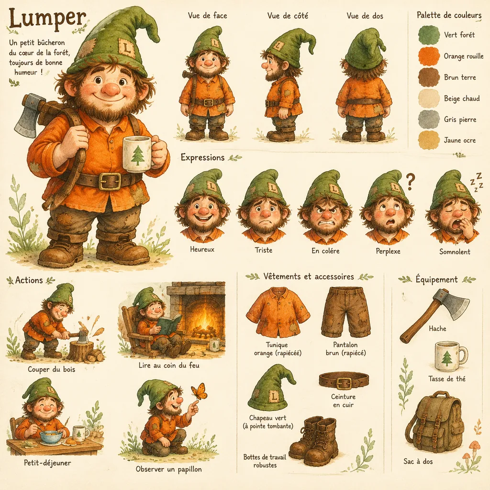</a>

> @deebeeeff reply fill of French WC sheet with original gnome Lumper (4 likes). Square 1:1; fictional only.

```text
Children’s picture book character sheet of an anthropomorphic stout forest gnome woodcutter named “Lumper”, wearing an orange patched tunic, brown patched trousers and heavy work boots with a green floppy pointed hat with an L patch, leather belt, axe and tea mug, featuring messy brown hair, round nose and cheerful folk demeanor, French picture book illustration style, delicate watercolor washes, soft colored pencil textures, charming hand-painted details, light cream background, large full-body character portrait, front, side, back turnaround views, five facial expressions showing happy, sad, angry, confused, sleepy, four action poses depicting chopping wood, reading by the fireplace, eating breakfast, holding a butterfly, handwritten French labels, coordinated color palette swatches, separate clothing and accessory studies, consistent character proportions, expressive personality, whimsical editorial layout, professional character design sheet. Square 1:1. No brand logos, no real people, no photo upload.
```

- Author: [@deebeeeff](https://x.com/deebeeeff)
- Original post: https://x.com/deebeeeff/status/2113264222318772633
- [View on cinel and generate with this prompt](https://cinel.ai/prompts/p/french-wc-gnome-woodcutter-lumper?utm_source=github&utm_medium=awesome&utm_campaign=awesome-gpt-image-2.5-prompts)

### French Watercolor Pear Creature Louis Sheet

<a href="https://cinel.ai/prompts/p/french-wc-pear-creature-louis?utm_source=github&utm_medium=awesome&utm_campaign=awesome-gpt-image-2.5-prompts">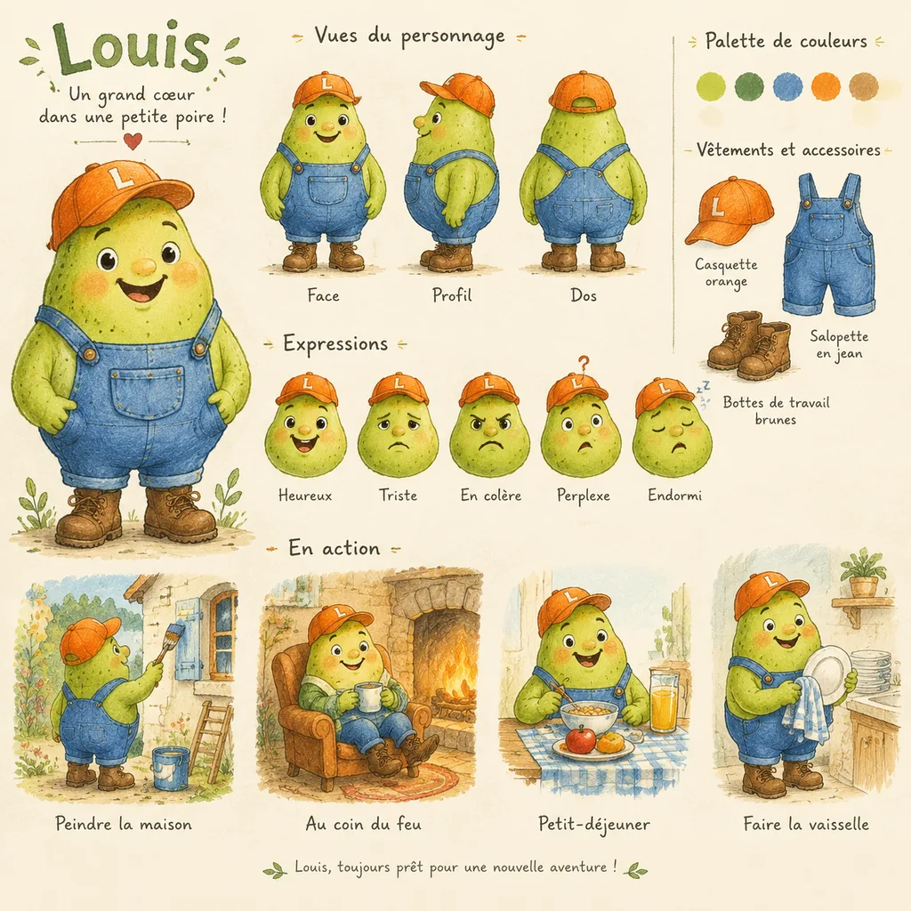</a>

> @deebeeeff image reply “his friend Louis”. Reverse-wrote pear-green creature Louis; square 1:1.

```text
Children’s picture book character sheet of an anthropomorphic lime-green pear-shaped creature named “Louis”, wearing blue denim overalls and brown lace-up work boots with an orange baseball cap with a white L, featuring round cheerful face and soft speckled green skin, French picture book illustration style, delicate watercolor washes, soft colored pencil textures, charming hand-painted details, light cream background, large full-body character portrait, front, side, back turnaround views, five facial expressions showing happy, sad, angry, perplexed, sleepy, four action poses depicting painting a cottage, sitting by the fire, eating breakfast, drying dishes, handwritten French labels, coordinated color palette swatches, separate clothing and accessory studies, consistent character proportions, expressive personality, whimsical editorial layout, professional character design sheet. Square 1:1. No brand logos, no real people, no photo upload.
```

- Author: [@deebeeeff](https://x.com/deebeeeff)
- Original post: https://x.com/deebeeeff/status/2113266071474180490
- [View on cinel and generate with this prompt](https://cinel.ai/prompts/p/french-wc-pear-creature-louis?utm_source=github&utm_medium=awesome&utm_campaign=awesome-gpt-image-2.5-prompts)

### French Watercolor Owl Baker Hibou Sheet

<a href="https://cinel.ai/prompts/p/french-wc-owl-baker-hibou?utm_source=github&utm_medium=awesome&utm_campaign=awesome-gpt-image-2.5-prompts">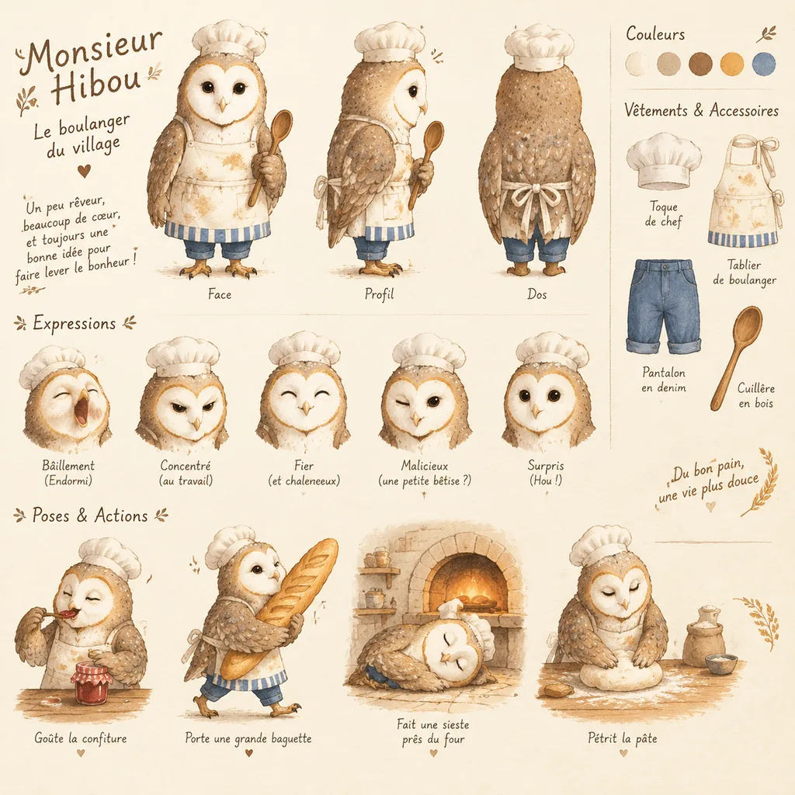</a>

> @_armar_ image reply (night baker owl + harbour captain). Used night baker owl sheet; square 1:1.

```text
Children’s picture book character sheet of an anthropomorphic barn owl baker named “Monsieur Hibou”, wearing a cream flour-dusted apron with blue striped hem and tiny denim trousers with a white chef toque and wooden spoon, featuring heart-shaped white face and speckled taupe feathers, French picture book illustration style, delicate watercolor washes, soft colored pencil textures, charming hand-painted details, light cream background, large full-body character portrait, front, side, back turnaround views, five facial expressions showing sleepy yawn, concentrated, proud warm, mischievous, surprised hoot, four action poses depicting tasting jam, carrying a giant baguette, napping by the oven, kneading dough, handwritten French labels, coordinated color palette swatches, separate clothing and accessory studies, consistent character proportions, expressive personality, whimsical editorial layout, professional character design sheet. Square 1:1. No brand logos, no real people, no photo upload.
```

- Author: [@_armar_](https://x.com/_armar_)
- Original post: https://x.com/_armar_/status/2113232613184000171
- [View on cinel and generate with this prompt](https://cinel.ai/prompts/p/french-wc-owl-baker-hibou?utm_source=github&utm_medium=awesome&utm_campaign=awesome-gpt-image-2.5-prompts)

### French Watercolor Otter Captain Loutre Sheet

<a href="https://cinel.ai/prompts/p/french-wc-otter-captain-loutre?utm_source=github&utm_medium=awesome&utm_campaign=awesome-gpt-image-2.5-prompts">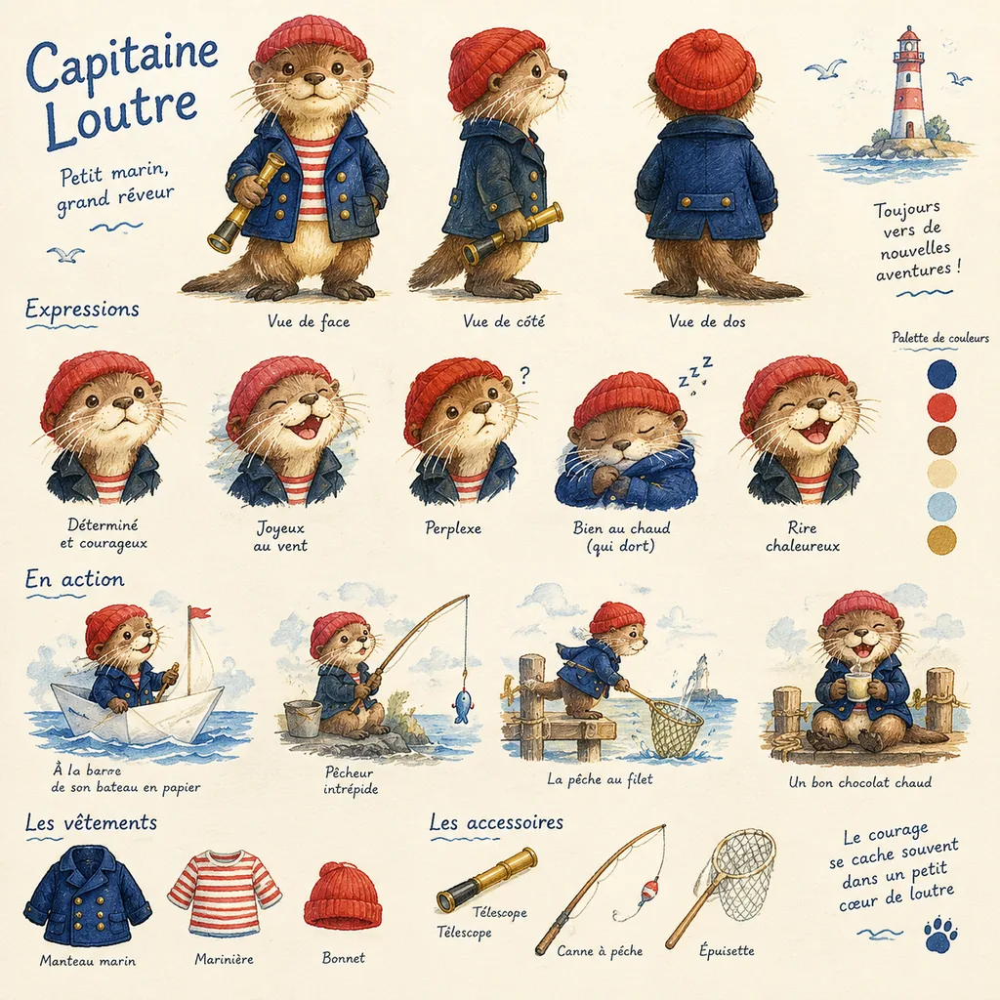</a>

> @AlexCodeRx children’s-book character-sheet creator (7 likes). Filled fictional otter Capitaine Loutre in French WC grammar; square 1:1.

```text
Children’s picture book character sheet of an anthropomorphic harbour otter child captain named “Capitaine Loutre”, wearing a red-and-white Breton striped shirt under a navy peacoat with brass buttons with a red knit beanie and brass telescope, featuring brown fur, cream belly and long white whiskers, French picture book illustration style, delicate watercolor washes, soft colored pencil textures, charming hand-painted details, light cream background, large full-body character portrait, front, side, back turnaround views, five facial expressions showing brave determination, windy joy, perplexed, cozy sleep, warm laughter, four action poses depicting steering a paper boat, fishing with a rod, netting on a dock, drinking hot chocolate, handwritten French labels, coordinated color palette swatches, separate clothing and accessory studies, consistent character proportions, expressive personality, whimsical editorial layout, professional character design sheet. Square 1:1. No brand logos, no real people, no photo upload.
```

- Author: [@AlexCodeRx](https://x.com/AlexCodeRx)
- Original post: https://x.com/AlexCodeRx/status/2095305549487509742
- [View on cinel and generate with this prompt](https://cinel.ai/prompts/p/french-wc-otter-captain-loutre?utm_source=github&utm_medium=awesome&utm_campaign=awesome-gpt-image-2.5-prompts)

### French Watercolor Cozy Dragon Draco Sheet

<a href="https://cinel.ai/prompts/p/french-wc-cozy-dragon-draco?utm_source=github&utm_medium=awesome&utm_campaign=awesome-gpt-image-2.5-prompts">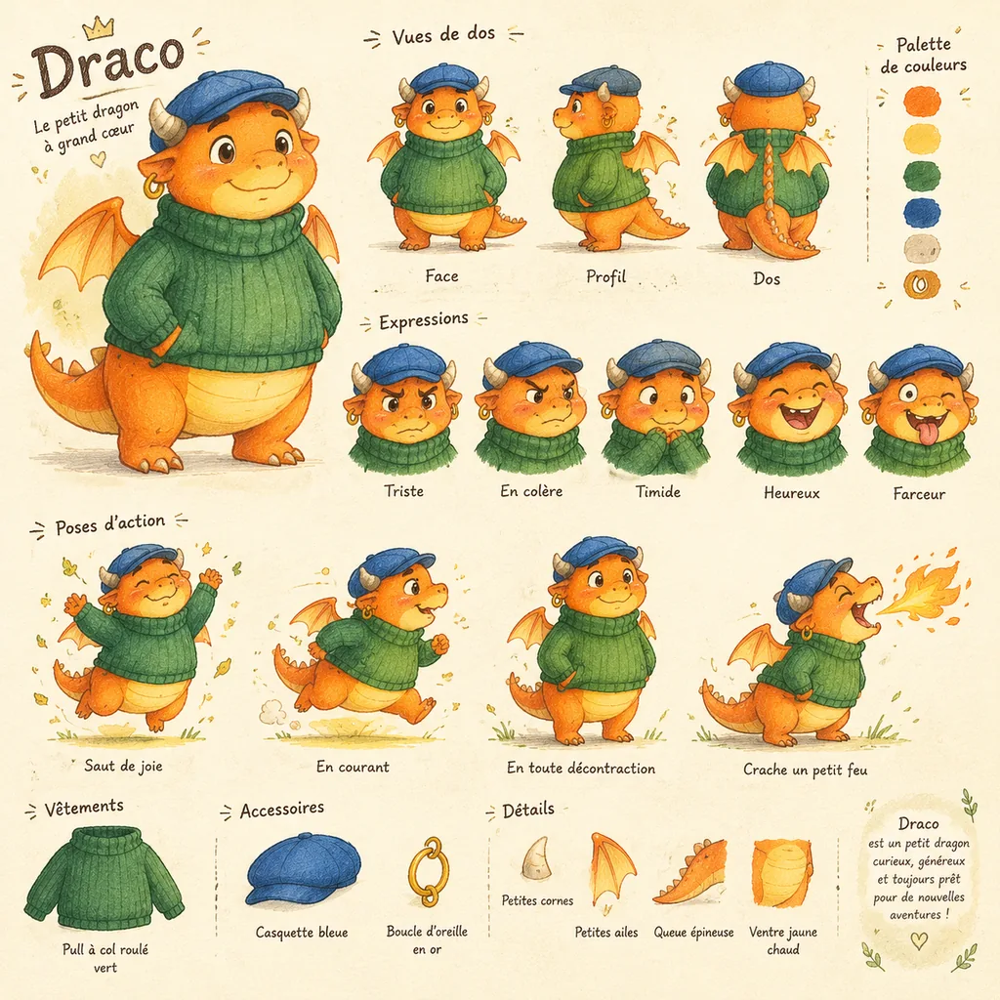</a>

> @Elena38373578 image reply to French WC sheet (cozy dragon). Reverse-wrote Draco; square 1:1; fictional only.

```text
Children’s picture book character sheet of an anthropomorphic chubby orange dragon named “Draco”, wearing a thick green turtleneck sweater with a blue flat cap and a single gold hoop earring, featuring tiny horns, small wings, spiky tail and warm yellow belly, French picture book illustration style, delicate watercolor washes, soft colored pencil textures, charming hand-painted details, light cream background, large full-body character portrait, front, side, back turnaround views, five facial expressions showing sad, angry, shy, happy, silly, four action poses depicting jumping for joy, running, standing casually, breathing a small flame, handwritten French labels, coordinated color palette swatches, separate clothing and accessory studies, consistent character proportions, expressive personality, whimsical editorial layout, professional character design sheet. Square 1:1. No brand logos, no real people, no photo upload.
```

- Author: [@Elena38373578](https://x.com/Elena38373578)
- Original post: https://x.com/Elena38373578/status/2113260145904083066
- [View on cinel and generate with this prompt](https://cinel.ai/prompts/p/french-wc-cozy-dragon-draco?utm_source=github&utm_medium=awesome&utm_campaign=awesome-gpt-image-2.5-prompts)

### Whimsical Watercolor Rabbit With Balloon

<a href="https://cinel.ai/prompts/p/whimsical-wc-rabbit-balloon?utm_source=github&utm_medium=awesome&utm_campaign=awesome-gpt-image-2.5-prompts">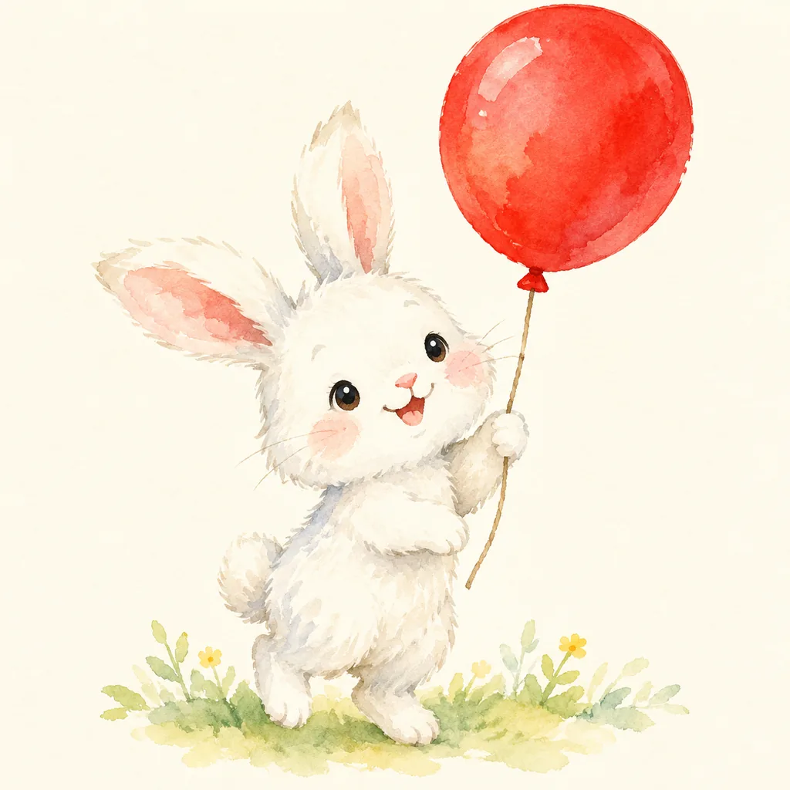</a>

> @azed_ai Whimsical Watercolor Characters (148 likes). Filled rabbit + balloon; square 1:1.

```text
Cute childlike watercolor clip art of a fluffy white rabbit holding a bright red balloon string, playful proportions, soft watercolor washes, loose hand-painted edges, cheerful expression, gentle colorful palette, charming picture-book illustration, light cream background, square 1:1. No text, no logos, no real people.
```

- Author: [@azed_ai](https://x.com/azed_ai)
- Original post: https://x.com/azed_ai/status/2101989836676911273
- [View on cinel and generate with this prompt](https://cinel.ai/prompts/p/whimsical-wc-rabbit-balloon?utm_source=github&utm_medium=awesome&utm_campaign=awesome-gpt-image-2.5-prompts)

### Picture-Book Crow Knight Animal Translation

<a href="https://cinel.ai/prompts/p/picturebook-crow-knight-animal-translate?utm_source=github&utm_medium=awesome&utm_campaign=awesome-gpt-image-2.5-prompts"></a>

> @VoxcatAI animalization→picture-book method (40 likes). Filled fictional crow knight OC (no IP); square 1:1.

```text
Original fictional crow knight, translated into contemporary picture-book / editorial animal character design / naïve expressionist animal illustration. Keep identity anchors: sharp beak silhouette, matte indigo cape, tiny brass shield, vigilant calm mood. Big head, minimal limbs, exaggerated circular eyes with tiny pupils, clumsy stance, full-body centered on cream ground. Gouache-like opaque paint, dry acrylic texture, wax-crayon feel, broken dry-brush edges, 4–6 color limited palette, shadowless flat illumination, pristine contemporary finish. Square 1:1. No brands, no real people, no copyrighted IP.
```

- Author: [@VoxcatAI](https://x.com/VoxcatAI)
- Original post: https://x.com/VoxcatAI/status/2106432340633235956
- [View on cinel and generate with this prompt](https://cinel.ai/prompts/p/picturebook-crow-knight-animal-translate?utm_source=github&utm_medium=awesome&utm_campaign=awesome-gpt-image-2.5-prompts)

### Anime Botanical Mage Character Design Sheet

<a href="https://cinel.ai/prompts/p/anime-botanical-mage-design-sheet?utm_source=github&utm_medium=awesome&utm_campaign=awesome-gpt-image-2.5-prompts"></a>

> @Mayz1169 clean anime botanical mage sheet (7 likes). Original fantasy OC; square 1:1 white ground.

```text
Create a clean professional anime character design sheet on pure white background, square 1:1, presenting ONE original fantasy botanical mage consistently across multiple views. Dusty rose-pink hair with straight bangs and an extremely long soft braid nearly to the ankles; teal-green eyes; calm gentle expression. Fog-blue leaf-shaped sleeveless overdress over warm apricot bishop-sleeve blouse; layered taupe skirt; apricot ankle boots; botanical camellia-and-leaf hair ornament; wooden staff topped with pale camellia blossoms. Front, side, back, three-quarter, and expression close-ups. No brands, no real people, no photo reference upload.
```

- Author: [@Mayz1169](https://x.com/Mayz1169)
- Original post: https://x.com/Mayz1169/status/2101305814447431701
- [View on cinel and generate with this prompt](https://cinel.ai/prompts/p/anime-botanical-mage-design-sheet?utm_source=github&utm_medium=awesome&utm_campaign=awesome-gpt-image-2.5-prompts)

### Crimson Silk Ballgown Ink Couture Sketch

<a href="https://cinel.ai/prompts/p/ink-couture-crimson-ballgown?utm_source=github&utm_medium=awesome&utm_campaign=awesome-gpt-image-2.5-prompts"></a>

> @azed_ai editorial ink couture sketch (23 likes). Filled outfit/palette/pose/headwear/accessories; square 1:1.

```text
Artistic haute couture fashion illustration of a single elegant model wearing a voluminous crimson silk ballgown with sculptural hip drapery and a dramatic train in deep crimson, black ink, ivory highlights, thick expressive black ink outlines, bold solid color fills, elongated fashion proportions, stylized facial features, dramatic flowing fabric, mid-stride runway walk with one hand lightly lifting the skirt, sleek sculpted updo with a thin black ink hairband, long opera gloves and a minimal geometric clutch, sophisticated editorial fashion sketch aesthetic, full-body composition, pure white background Square 1:1. No brand logos, no watermarks, no real celebrity likeness. Fictional adult model only.
```

- Author: [@azed_ai](https://x.com/azed_ai)
- Original post: https://x.com/azed_ai/status/2114310517619921351
- [View on cinel and generate with this prompt](https://cinel.ai/prompts/p/ink-couture-crimson-ballgown?utm_source=github&utm_medium=awesome&utm_campaign=awesome-gpt-image-2.5-prompts)

### Ivory Sculptural Cape Ink Couture Sketch

<a href="https://cinel.ai/prompts/p/ink-couture-ivory-sculptural-cape?utm_source=github&utm_medium=awesome&utm_campaign=awesome-gpt-image-2.5-prompts"></a>

> @azed_ai editorial ink couture sketch (23 likes). Filled outfit/palette/pose/headwear/accessories; square 1:1. Same-template variant (synthetic unique id).

```text
Artistic haute couture fashion illustration of a single elegant model wearing an ivory architectural cape-gown with sharp folded planes and a high collar in warm ivory, charcoal ink, soft gold accents, thick expressive black ink outlines, bold solid color fills, elongated fashion proportions, stylized facial features, dramatic flowing fabric, still three-quarter turn with cape wings extended, smooth center-part bob under a flat architectural headpiece, sculptural cuff bracelets and pointed ivory pumps, sophisticated editorial fashion sketch aesthetic, full-body composition, pure white background Square 1:1. No brand logos, no watermarks, no real celebrity likeness. Fictional adult model only.
```

- Author: [@azed_ai](https://x.com/azed_ai)
- Original post: https://x.com/azed_ai/status/2114310517619921351
- [View on cinel and generate with this prompt](https://cinel.ai/prompts/p/ink-couture-ivory-sculptural-cape?utm_source=github&utm_medium=awesome&utm_campaign=awesome-gpt-image-2.5-prompts)

### Emerald Column Gown Ink Couture Sketch

<a href="https://cinel.ai/prompts/p/ink-couture-emerald-column-gown?utm_source=github&utm_medium=awesome&utm_campaign=awesome-gpt-image-2.5-prompts"></a>

> @azed_ai editorial ink couture sketch (23 likes). Filled outfit/palette/pose/headwear/accessories; square 1:1. Same-template variant (synthetic unique id).

```text
Artistic haute couture fashion illustration of a single elegant model wearing a floor-length emerald column gown with a single asymmetric shoulder drape in jewel emerald, black ink, pale mint accents, thick expressive black ink outlines, bold solid color fills, elongated fashion proportions, stylized facial features, dramatic flowing fabric, contrapposto stance with one arm raised along the drape, sleek low chignon, thin stacked bangles and a slim emerald drop earring pair, sophisticated editorial fashion sketch aesthetic, full-body composition, pure white background Square 1:1. No brand logos, no watermarks, no real celebrity likeness. Fictional adult model only.
```

- Author: [@azed_ai](https://x.com/azed_ai)
- Original post: https://x.com/azed_ai/status/2114310517619921351
- [View on cinel and generate with this prompt](https://cinel.ai/prompts/p/ink-couture-emerald-column-gown?utm_source=github&utm_medium=awesome&utm_campaign=awesome-gpt-image-2.5-prompts)

### Midnight Tuxedo Dress Ink Couture Sketch

<a href="https://cinel.ai/prompts/p/ink-couture-midnight-tuxedo-dress?utm_source=github&utm_medium=awesome&utm_campaign=awesome-gpt-image-2.5-prompts"></a>

> @azed_ai editorial ink couture sketch (23 likes). Filled outfit/palette/pose/headwear/accessories; square 1:1. Same-template variant (synthetic unique id).

```text
Artistic haute couture fashion illustration of a single elegant model wearing a midnight-black tuxedo dress with satin lapels and a slit skirt in midnight black, pure white, silver-gray ink accents, thick expressive black ink outlines, bold solid color fills, elongated fashion proportions, stylized facial features, dramatic flowing fabric, confident stride with jacket open and hands in pockets, slicked-back wet-look hair, skinny satin necktie and polished oxford heels, sophisticated editorial fashion sketch aesthetic, full-body composition, pure white background Square 1:1. No brand logos, no watermarks, no real celebrity likeness. Fictional adult model only.
```

- Author: [@azed_ai](https://x.com/azed_ai)
- Original post: https://x.com/azed_ai/status/2114310517619921351
- [View on cinel and generate with this prompt](https://cinel.ai/prompts/p/ink-couture-midnight-tuxedo-dress?utm_source=github&utm_medium=awesome&utm_campaign=awesome-gpt-image-2.5-prompts)

### Saffron Structured Suit Ink Couture Sketch

<a href="https://cinel.ai/prompts/p/ink-couture-saffron-structured-suit?utm_source=github&utm_medium=awesome&utm_campaign=awesome-gpt-image-2.5-prompts"></a>

> @azed_ai editorial ink couture sketch (23 likes). Filled outfit/palette/pose/headwear/accessories; square 1:1. Same-template variant (synthetic unique id).

```text
Artistic haute couture fashion illustration of a single elegant model wearing a saffron structured pantsuit with oversized peaked shoulders in saffron yellow, black ink, cream highlights, thick expressive black ink outlines, bold solid color fills, elongated fashion proportions, stylized facial features, dramatic flowing fabric, power pose with feet planted and chin lifted, sharp side-part cropped hair, wide-brim minimal hat held in one hand and geometric cufflinks, sophisticated editorial fashion sketch aesthetic, full-body composition, pure white background Square 1:1. No brand logos, no watermarks, no real celebrity likeness. Fictional adult model only.
```

- Author: [@azed_ai](https://x.com/azed_ai)
- Original post: https://x.com/azed_ai/status/2114310517619921351
- [View on cinel and generate with this prompt](https://cinel.ai/prompts/p/ink-couture-saffron-structured-suit?utm_source=github&utm_medium=awesome&utm_campaign=awesome-gpt-image-2.5-prompts)

### Cobalt Pleated Maxi Ink Couture Sketch

<a href="https://cinel.ai/prompts/p/ink-couture-cobalt-pleated-maxi?utm_source=github&utm_medium=awesome&utm_campaign=awesome-gpt-image-2.5-prompts"></a>

> @azed_ai editorial ink couture sketch (23 likes). Filled outfit/palette/pose/headwear/accessories; square 1:1. Same-template variant (synthetic unique id).

```text
Artistic haute couture fashion illustration of a single elegant model wearing a cobalt pleated maxi dress with a liquid metal belt in cobalt blue, black ink, silver belt accents, thick expressive black ink outlines, bold solid color fills, elongated fashion proportions, stylized facial features, dramatic flowing fabric, wind-swept stance with pleats fanning sideways, high ponytail with ink-stroke bangs, sculptural silver cuff and strappy cobalt sandals, sophisticated editorial fashion sketch aesthetic, full-body composition, pure white background Square 1:1. No brand logos, no watermarks, no real celebrity likeness. Fictional adult model only.
```

- Author: [@azed_ai](https://x.com/azed_ai)
- Original post: https://x.com/azed_ai/status/2114310517619921351
- [View on cinel and generate with this prompt](https://cinel.ai/prompts/p/ink-couture-cobalt-pleated-maxi?utm_source=github&utm_medium=awesome&utm_campaign=awesome-gpt-image-2.5-prompts)

### Pearl-Gray Asymmetry Ink Couture Sketch

<a href="https://cinel.ai/prompts/p/ink-couture-pearl-gray-asymmetry?utm_source=github&utm_medium=awesome&utm_campaign=awesome-gpt-image-2.5-prompts"></a>

> @azed_ai editorial ink couture sketch (23 likes). Filled outfit/palette/pose/headwear/accessories; square 1:1. Same-template variant (synthetic unique id).

```text
Artistic haute couture fashion illustration of a single elegant model wearing a pearl-gray asymmetric cocktail dress with one long sleeve and one bare shoulder in pearl gray, charcoal, soft lilac accents, thick expressive black ink outlines, bold solid color fills, elongated fashion proportions, stylized facial features, dramatic flowing fabric, seated on an invisible block with crossed ankles, editorial cool, sculpted finger waves, single oversized abstract earring and slim ankle strap heels, sophisticated editorial fashion sketch aesthetic, full-body composition, pure white background Square 1:1. No brand logos, no watermarks, no real celebrity likeness. Fictional adult model only.
```

- Author: [@azed_ai](https://x.com/azed_ai)
- Original post: https://x.com/azed_ai/status/2114310517619921351
- [View on cinel and generate with this prompt](https://cinel.ai/prompts/p/ink-couture-pearl-gray-asymmetry?utm_source=github&utm_medium=awesome&utm_campaign=awesome-gpt-image-2.5-prompts)

### Burgundy Velvet Coat Ink Couture Sketch

<a href="https://cinel.ai/prompts/p/ink-couture-burgundy-velvet-coat?utm_source=github&utm_medium=awesome&utm_campaign=awesome-gpt-image-2.5-prompts"></a>

> @azed_ai editorial ink couture sketch (23 likes). Filled outfit/palette/pose/headwear/accessories; square 1:1. Same-template variant (synthetic unique id).

```text
Artistic haute couture fashion illustration of a single elegant model wearing an oversized burgundy velvet cocoon coat over a slim black column in burgundy velvet, black, deep wine ink accents, thick expressive black ink outlines, bold solid color fills, elongated fashion proportions, stylized facial features, dramatic flowing fabric, walking pose with coat floating behind like a cape, hidden under a soft velvet beret, leather gloves and a long thin scarf trailing, sophisticated editorial fashion sketch aesthetic, full-body composition, pure white background Square 1:1. No brand logos, no watermarks, no real celebrity likeness. Fictional adult model only.
```

- Author: [@azed_ai](https://x.com/azed_ai)
- Original post: https://x.com/azed_ai/status/2114310517619921351
- [View on cinel and generate with this prompt](https://cinel.ai/prompts/p/ink-couture-burgundy-velvet-coat?utm_source=github&utm_medium=awesome&utm_campaign=awesome-gpt-image-2.5-prompts)

### Teal Metallic Sheath Ink Couture Sketch

<a href="https://cinel.ai/prompts/p/ink-couture-teal-metallic-sheath?utm_source=github&utm_medium=awesome&utm_campaign=awesome-gpt-image-2.5-prompts"></a>

> @azed_ai editorial ink couture sketch (23 likes). Filled outfit/palette/pose/headwear/accessories; square 1:1. Same-template variant (synthetic unique id).

```text
Artistic haute couture fashion illustration of a single elegant model wearing a teal metallic sheath dress with laser-cut side vents in teal metallic, black ink, champagne spark accents, thick expressive black ink outlines, bold solid color fills, elongated fashion proportions, stylized facial features, dramatic flowing fabric, sharp stopped pose with hand on hip, vents flared, sleek high bun with a thin metallic circlet, minimalist drop earrings and pointed metallic heels, sophisticated editorial fashion sketch aesthetic, full-body composition, pure white background Square 1:1. No brand logos, no watermarks, no real celebrity likeness. Fictional adult model only.
```

- Author: [@azed_ai](https://x.com/azed_ai)
- Original post: https://x.com/azed_ai/status/2114310517619921351
- [View on cinel and generate with this prompt](https://cinel.ai/prompts/p/ink-couture-teal-metallic-sheath?utm_source=github&utm_medium=awesome&utm_campaign=awesome-gpt-image-2.5-prompts)

### Pastel Polka Paper-Cut Fashion Editorial

<a href="https://cinel.ai/prompts/p/papercut-fashion-polka-pastel-editorial?utm_source=github&utm_medium=awesome&utm_campaign=awesome-gpt-image-2.5-prompts"></a>

> @Tech_Apex0 3D paper-cut fashion editorial (~101 likes). Varied outfit, color blocking, and pattern; square 1:1.

```text
Create a high-end editorial fashion illustration of a stylish fictional adult woman wearing a tailored pastel blazer over a flared midi skirt. Use a polished 3D paper-cut illustration aesthetic with smooth surfaces, layered shapes, subtle paper-like textures, and clean, elegant edges. Feature vibrant color combinations of pastel pink, sky blue, mint green, and soft ivory, paired with contrasting patterns: large playful polka dots on the skirt and subtle dots on one blazer cuff. Add fashionable accessories including statement oval sunglasses, pearl-like stud earrings, a structured mini handbag, and modern block heels. Give the character a confident, expressive pose with natural body proportions and a stylish attitude. Use a minimalist warm ivory background with soft studio lighting, gentle shadows beneath the feet, and a refined luxury fashion-campaign composition. Full-body character, beautifully detailed clothing folds, crisp silhouettes, sophisticated color blocking, playful yet elegant styling, premium fashion magazine aesthetic, clean negative space, high-resolution digital illustration. No text, no logos, no watermark. Square 1:1. No brand logos, no watermarks, no real celebrity likeness. Fictional adult model only.
```

- Author: [@Tech_Apex0](https://x.com/Tech_Apex0)
- Original post: https://x.com/Tech_Apex0/status/2109687049666347113
- [View on cinel and generate with this prompt](https://cinel.ai/prompts/p/papercut-fashion-polka-pastel-editorial?utm_source=github&utm_medium=awesome&utm_campaign=awesome-gpt-image-2.5-prompts)

### Emerald Stripe Paper-Cut Fashion Editorial

<a href="https://cinel.ai/prompts/p/papercut-fashion-stripe-emerald-editorial?utm_source=github&utm_medium=awesome&utm_campaign=awesome-gpt-image-2.5-prompts"></a>

> @Tech_Apex0 3D paper-cut fashion editorial (~101 likes). Varied outfit, color blocking, and pattern; square 1:1. Same-template variant (synthetic unique id).

```text
Create a high-end editorial fashion illustration of a stylish fictional adult woman wearing a cropped emerald jacket over a high-waist wide-leg trouser. Use a polished 3D paper-cut illustration aesthetic with smooth surfaces, layered shapes, subtle paper-like textures, and clean, elegant edges. Feature vibrant color combinations of emerald green, sunshine yellow, sky blue, and warm ivory, paired with contrasting patterns: bold vertical stripes on the trousers and a thin stripe band on the jacket hem. Add fashionable accessories including geometric sunglasses, gold-tone hoop earrings, a boxy handbag, and pointed flats. Give the character a confident, expressive pose with natural body proportions and a stylish attitude. Use a minimalist warm ivory background with soft studio lighting, gentle shadows beneath the feet, and a refined luxury fashion-campaign composition. Full-body character, beautifully detailed clothing folds, crisp silhouettes, sophisticated color blocking, playful yet elegant styling, premium fashion magazine aesthetic, clean negative space, high-resolution digital illustration. No text, no logos, no watermark. Square 1:1. No brand logos, no watermarks, no real celebrity likeness. Fictional adult model only.
```

- Author: [@Tech_Apex0](https://x.com/Tech_Apex0)
- Original post: https://x.com/Tech_Apex0/status/2109687049666347113
- [View on cinel and generate with this prompt](https://cinel.ai/prompts/p/papercut-fashion-stripe-emerald-editorial?utm_source=github&utm_medium=awesome&utm_campaign=awesome-gpt-image-2.5-prompts)

### Coral Color-Block Paper-Cut Fashion Editorial

<a href="https://cinel.ai/prompts/p/papercut-fashion-colorblock-coral-editorial?utm_source=github&utm_medium=awesome&utm_campaign=awesome-gpt-image-2.5-prompts"></a>

> @Tech_Apex0 3D paper-cut fashion editorial (~101 likes). Varied outfit, color blocking, and pattern; square 1:1. Same-template variant (synthetic unique id).

```text
Create a high-end editorial fashion illustration of a stylish fictional adult woman wearing a color-blocked shift dress with sharp panel seams. Use a polished 3D paper-cut illustration aesthetic with smooth surfaces, layered shapes, subtle paper-like textures, and clean, elegant edges. Feature vibrant color combinations of coral, mint green, cobalt, and cream, paired with contrasting patterns: large geometric color-block panels instead of prints, plus a tiny dotted pocket flap. Add fashionable accessories including cat-eye sunglasses, sculptural earrings, a trapezoid handbag, and ankle-strap heels. Give the character a confident, expressive pose with natural body proportions and a stylish attitude. Use a minimalist warm ivory background with soft studio lighting, gentle shadows beneath the feet, and a refined luxury fashion-campaign composition. Full-body character, beautifully detailed clothing folds, crisp silhouettes, sophisticated color blocking, playful yet elegant styling, premium fashion magazine aesthetic, clean negative space, high-resolution digital illustration. No text, no logos, no watermark. Square 1:1. No brand logos, no watermarks, no real celebrity likeness. Fictional adult model only.
```

- Author: [@Tech_Apex0](https://x.com/Tech_Apex0)
- Original post: https://x.com/Tech_Apex0/status/2109687049666347113
- [View on cinel and generate with this prompt](https://cinel.ai/prompts/p/papercut-fashion-colorblock-coral-editorial?utm_source=github&utm_medium=awesome&utm_campaign=awesome-gpt-image-2.5-prompts)

### Mint Chevron Paper-Cut Fashion Editorial

<a href="https://cinel.ai/prompts/p/papercut-fashion-chevron-mint-editorial?utm_source=github&utm_medium=awesome&utm_campaign=awesome-gpt-image-2.5-prompts"></a>

> @Tech_Apex0 3D paper-cut fashion editorial (~101 likes). Varied outfit, color blocking, and pattern; square 1:1. Same-template variant (synthetic unique id).

```text
Create a high-end editorial fashion illustration of a stylish fictional adult woman wearing a mint trench-inspired open coat over a lemon sheath. Use a polished 3D paper-cut illustration aesthetic with smooth surfaces, layered shapes, subtle paper-like textures, and clean, elegant edges. Feature vibrant color combinations of mint green, sunshine yellow, pastel pink, and ivory, paired with contrasting patterns: chevron zig-zag pattern on the coat lining panels peeking open. Add fashionable accessories including slim rectangular sunglasses, drop earrings, a cylindrical clutch, and knee-high boots. Give the character a confident, expressive pose with natural body proportions and a stylish attitude. Use a minimalist warm ivory background with soft studio lighting, gentle shadows beneath the feet, and a refined luxury fashion-campaign composition. Full-body character, beautifully detailed clothing folds, crisp silhouettes, sophisticated color blocking, playful yet elegant styling, premium fashion magazine aesthetic, clean negative space, high-resolution digital illustration. No text, no logos, no watermark. Square 1:1. No brand logos, no watermarks, no real celebrity likeness. Fictional adult model only.
```

- Author: [@Tech_Apex0](https://x.com/Tech_Apex0)
- Original post: https://x.com/Tech_Apex0/status/2109687049666347113
- [View on cinel and generate with this prompt](https://cinel.ai/prompts/p/papercut-fashion-chevron-mint-editorial?utm_source=github&utm_medium=awesome&utm_campaign=awesome-gpt-image-2.5-prompts)

### Mustard Dot Paper-Cut Fashion Editorial

<a href="https://cinel.ai/prompts/p/papercut-fashion-dot-mustard-editorial?utm_source=github&utm_medium=awesome&utm_campaign=awesome-gpt-image-2.5-prompts"></a>

> @Tech_Apex0 3D paper-cut fashion editorial (~101 likes). Varied outfit, color blocking, and pattern; square 1:1. Same-template variant (synthetic unique id).

```text
Create a high-end editorial fashion illustration of a stylish fictional adult woman wearing a mustard cocoon coat over black slim trousers and a white tee. Use a polished 3D paper-cut illustration aesthetic with smooth surfaces, layered shapes, subtle paper-like textures, and clean, elegant edges. Feature vibrant color combinations of mustard yellow, emerald, soft black, and cream, paired with contrasting patterns: irregular playful dots scattered on the cocoon coat. Add fashionable accessories including bold round sunglasses, hoop earrings, a semi-circle handbag, and chunky sneakers. Give the character a confident, expressive pose with natural body proportions and a stylish attitude. Use a minimalist warm ivory background with soft studio lighting, gentle shadows beneath the feet, and a refined luxury fashion-campaign composition. Full-body character, beautifully detailed clothing folds, crisp silhouettes, sophisticated color blocking, playful yet elegant styling, premium fashion magazine aesthetic, clean negative space, high-resolution digital illustration. No text, no logos, no watermark. Square 1:1. No brand logos, no watermarks, no real celebrity likeness. Fictional adult model only.
```

- Author: [@Tech_Apex0](https://x.com/Tech_Apex0)
- Original post: https://x.com/Tech_Apex0/status/2109687049666347113
- [View on cinel and generate with this prompt](https://cinel.ai/prompts/p/papercut-fashion-dot-mustard-editorial?utm_source=github&utm_medium=awesome&utm_campaign=awesome-gpt-image-2.5-prompts)

### Violet Wave Paper-Cut Fashion Editorial

<a href="https://cinel.ai/prompts/p/papercut-fashion-wave-violet-editorial?utm_source=github&utm_medium=awesome&utm_campaign=awesome-gpt-image-2.5-prompts"></a>

> @Tech_Apex0 3D paper-cut fashion editorial (~101 likes). Varied outfit, color blocking, and pattern; square 1:1. Same-template variant (synthetic unique id).

```text
Create a high-end editorial fashion illustration of a stylish fictional adult woman wearing a violet wrap top with high-waist ivory culottes. Use a polished 3D paper-cut illustration aesthetic with smooth surfaces, layered shapes, subtle paper-like textures, and clean, elegant edges. Feature vibrant color combinations of violet, pastel pink, mint, and warm ivory, paired with contrasting patterns: soft wave stripes across the wrap top and solid ivory culottes. Add fashionable accessories including butterfly sunglasses, spiral earrings, a soft pouch bag, and strappy sandals. Give the character a confident, expressive pose with natural body proportions and a stylish attitude. Use a minimalist warm ivory background with soft studio lighting, gentle shadows beneath the feet, and a refined luxury fashion-campaign composition. Full-body character, beautifully detailed clothing folds, crisp silhouettes, sophisticated color blocking, playful yet elegant styling, premium fashion magazine aesthetic, clean negative space, high-resolution digital illustration. No text, no logos, no watermark. Square 1:1. No brand logos, no watermarks, no real celebrity likeness. Fictional adult model only.
```

- Author: [@Tech_Apex0](https://x.com/Tech_Apex0)
- Original post: https://x.com/Tech_Apex0/status/2109687049666347113
- [View on cinel and generate with this prompt](https://cinel.ai/prompts/p/papercut-fashion-wave-violet-editorial?utm_source=github&utm_medium=awesome&utm_campaign=awesome-gpt-image-2.5-prompts)

### Silent Vampire Pixel Game

<a href="https://cinel.ai/prompts/p/pixel-game-silent-vampire-film?utm_source=github&utm_medium=awesome&utm_campaign=awesome-gpt-image-2.5-prompts"></a>

> Reusable square 1:1 pixel-art video-game key art template filled with a fictional / public-domain-safe film concept (“a silent-era expressionist vampire film”), not a modern studio IP title.

```text
Make me a pixel art version of a silent-era expressionist vampire film if it was a video game. Portrait 2:3 (vertical game cover / card) retro video-game key art: German-expressionist angles, jagged castle silhouettes, chalk-white vampire figure, high-contrast black/white/crimson pixel palette. Dense readable pixels, strong silhouette, limited vibrant palette, cinematic composition suitable as a game title screen. Do not use any real studio film titles, brand logos, watermarks, or trademarked franchise names. No real celebrity likeness. Optional fictional title lettering only if it is clearly invented and not a known trademark. Portrait 2:3 (vertical game cover / card).
```

- Author: [@icreatelife](https://x.com/icreatelife)
- Original post: https://x.com/icreatelife/status/1992598016868720997
- [View on cinel and generate with this prompt](https://cinel.ai/prompts/p/pixel-game-silent-vampire-film?utm_source=github&utm_medium=awesome&utm_campaign=awesome-gpt-image-2.5-prompts)

### Metropolis Workers Pixel Game

<a href="https://cinel.ai/prompts/p/pixel-game-metropolis-workers-scifi?utm_source=github&utm_medium=awesome&utm_campaign=awesome-gpt-image-2.5-prompts"></a>

> Reusable square 1:1 pixel-art video-game key art template filled with a fictional / public-domain-safe film concept (“a 1920s metropolis workers-vs-machines sci-fi”), not a modern studio IP title.

```text
Make me a pixel art version of a 1920s metropolis workers-vs-machines sci-fi if it was a video game. Portrait 2:3 (vertical game cover / card) retro video-game key art: towering art-deco city, workers marching below giant gears and chrome robots, teal-and-amber pixel palette. Dense readable pixels, strong silhouette, limited vibrant palette, cinematic composition suitable as a game title screen. Do not use any real studio film titles, brand logos, watermarks, or trademarked franchise names. No real celebrity likeness. Optional fictional title lettering only if it is clearly invented and not a known trademark. Portrait 2:3 (vertical game cover / card).
```

- Author: [@icreatelife](https://x.com/icreatelife)
- Original post: https://x.com/icreatelife/status/1992598016868720997
- [View on cinel and generate with this prompt](https://cinel.ai/prompts/p/pixel-game-metropolis-workers-scifi?utm_source=github&utm_medium=awesome&utm_campaign=awesome-gpt-image-2.5-prompts)

### Western Train Robbery Pixel Game

<a href="https://cinel.ai/prompts/p/pixel-game-western-train-robbery?utm_source=github&utm_medium=awesome&utm_campaign=awesome-gpt-image-2.5-prompts"></a>

> Reusable square 1:1 pixel-art video-game key art template filled with a fictional / public-domain-safe film concept (“a dusty western train-robbery epic”), not a modern studio IP title.

```text
Make me a pixel art version of a dusty western train-robbery epic if it was a video game. Portrait 2:3 (vertical game cover / card) retro video-game key art: desert mesa, steam locomotive, masked outlaws on horseback, sunset orange pixel palette. Dense readable pixels, strong silhouette, limited vibrant palette, cinematic composition suitable as a game title screen. Do not use any real studio film titles, brand logos, watermarks, or trademarked franchise names. No real celebrity likeness. Optional fictional title lettering only if it is clearly invented and not a known trademark. Portrait 2:3 (vertical game cover / card).
```

- Author: [@icreatelife](https://x.com/icreatelife)
- Original post: https://x.com/icreatelife/status/1992598016868720997
- [View on cinel and generate with this prompt](https://cinel.ai/prompts/p/pixel-game-western-train-robbery?utm_source=github&utm_medium=awesome&utm_campaign=awesome-gpt-image-2.5-prompts)

### Gothic Haunted Mansion Pixel Game

<a href="https://cinel.ai/prompts/p/pixel-game-gothic-haunted-mansion?utm_source=github&utm_medium=awesome&utm_campaign=awesome-gpt-image-2.5-prompts"></a>

> Reusable square 1:1 pixel-art video-game key art template filled with a fictional / public-domain-safe film concept (“a gothic haunted-mansion mystery”), not a modern studio IP title.

```text
Make me a pixel art version of a gothic haunted-mansion mystery if it was a video game. Portrait 2:3 (vertical game cover / card) retro video-game key art: looming Victorian mansion, moonlit wrought-iron gates, candle windows, purple-and-teal gothic pixel palette. Dense readable pixels, strong silhouette, limited vibrant palette, cinematic composition suitable as a game title screen. Do not use any real studio film titles, brand logos, watermarks, or trademarked franchise names. No real celebrity likeness. Optional fictional title lettering only if it is clearly invented and not a known trademark. Portrait 2:3 (vertical game cover / card).
```

- Author: [@icreatelife](https://x.com/icreatelife)
- Original post: https://x.com/icreatelife/status/1992598016868720997
- [View on cinel and generate with this prompt](https://cinel.ai/prompts/p/pixel-game-gothic-haunted-mansion?utm_source=github&utm_medium=awesome&utm_campaign=awesome-gpt-image-2.5-prompts)

### Oceanic Giant Squid Pixel Game

<a href="https://cinel.ai/prompts/p/pixel-game-oceanic-giant-squid?utm_source=github&utm_medium=awesome&utm_campaign=awesome-gpt-image-2.5-prompts"></a>

> Reusable square 1:1 pixel-art video-game key art template filled with a fictional / public-domain-safe film concept (“an oceanic adventure with giant squid”), not a modern studio IP title.

```text
Make me a pixel art version of an oceanic adventure with giant squid if it was a video game. Portrait 2:3 (vertical game cover / card) retro video-game key art: wooden sailing ship dwarfed by a colossal squid, stormy waves, deep-blue and seafoam pixel palette. Dense readable pixels, strong silhouette, limited vibrant palette, cinematic composition suitable as a game title screen. Do not use any real studio film titles, brand logos, watermarks, or trademarked franchise names. No real celebrity likeness. Optional fictional title lettering only if it is clearly invented and not a known trademark. Portrait 2:3 (vertical game cover / card).
```

- Author: [@icreatelife](https://x.com/icreatelife)
- Original post: https://x.com/icreatelife/status/1992598016868720997
- [View on cinel and generate with this prompt](https://cinel.ai/prompts/p/pixel-game-oceanic-giant-squid?utm_source=github&utm_medium=awesome&utm_campaign=awesome-gpt-image-2.5-prompts)

### Noir Rain City Pixel Game

<a href="https://cinel.ai/prompts/p/pixel-game-noir-rain-city?utm_source=github&utm_medium=awesome&utm_campaign=awesome-gpt-image-2.5-prompts"></a>

> Reusable square 1:1 pixel-art video-game key art template filled with a fictional / public-domain-safe film concept (“a noir detective rain-soaked city”), not a modern studio IP title.

```text
Make me a pixel art version of a noir detective rain-soaked city if it was a video game. Portrait 2:3 (vertical game cover / card) retro video-game key art: trench-coat detective under neon streetlamp, wet asphalt reflections, black-and-yellow noir pixel palette. Dense readable pixels, strong silhouette, limited vibrant palette, cinematic composition suitable as a game title screen. Do not use any real studio film titles, brand logos, watermarks, or trademarked franchise names. No real celebrity likeness. Optional fictional title lettering only if it is clearly invented and not a known trademark. Portrait 2:3 (vertical game cover / card).
```

- Author: [@icreatelife](https://x.com/icreatelife)
- Original post: https://x.com/icreatelife/status/1992598016868720997
- [View on cinel and generate with this prompt](https://cinel.ai/prompts/p/pixel-game-noir-rain-city?utm_source=github&utm_medium=awesome&utm_campaign=awesome-gpt-image-2.5-prompts)

### Desert Caravan Fantasy Pixel Game

<a href="https://cinel.ai/prompts/p/pixel-game-desert-caravan-fantasy?utm_source=github&utm_medium=awesome&utm_campaign=awesome-gpt-image-2.5-prompts"></a>

> Reusable square 1:1 pixel-art video-game key art template filled with a fictional / public-domain-safe film concept (“a desert caravan fantasy”), not a modern studio IP title.

```text
Make me a pixel art version of a desert caravan fantasy if it was a video game. Portrait 2:3 (vertical game cover / card) retro video-game key art: camel caravan across golden dunes, floating lanterns, mirage oasis, warm sand-and-violet pixel palette. Dense readable pixels, strong silhouette, limited vibrant palette, cinematic composition suitable as a game title screen. Do not use any real studio film titles, brand logos, watermarks, or trademarked franchise names. No real celebrity likeness. Optional fictional title lettering only if it is clearly invented and not a known trademark. Portrait 2:3 (vertical game cover / card).
```

- Author: [@icreatelife](https://x.com/icreatelife)
- Original post: https://x.com/icreatelife/status/1992598016868720997
- [View on cinel and generate with this prompt](https://cinel.ai/prompts/p/pixel-game-desert-caravan-fantasy?utm_source=github&utm_medium=awesome&utm_campaign=awesome-gpt-image-2.5-prompts)

### Dryad Sylvara Pixel RPG Card

<a href="https://cinel.ai/prompts/p/rpg-card-dryad-sylvara?utm_source=github&utm_medium=awesome&utm_campaign=awesome-gpt-image-2.5-prompts"></a>

> Fantasy RPG game-card portrait template with invented adult OC Sylvara (Dryad). Name “Kris” and any real-person identity removed.

```text
Create a pixel art fantasy RPG game card portrait of a fictional adult character named Sylvara, class Dryad. The character has bark-textured skin, glowing green eyes, flower-crowned hair, vine-woven armor, posed against glowing enchanted grove. The card includes floral borders and leaf patterns and readable RPG-style stats panels (HP, ATK, DEF, MAG) with invented numbers. Old-school nostalgic collectible game card layout, Portrait 2:3 (vertical game cover / card). Fictional original character only — not a real person, not named Kris, no celebrity likeness. No brand logos, no copyrighted franchise marks, no watermarks.
```

- Author: [@icreatelife](https://x.com/icreatelife)
- Original post: https://x.com/icreatelife/status/1972050050105712898
- [View on cinel and generate with this prompt](https://cinel.ai/prompts/p/rpg-card-dryad-sylvara?utm_source=github&utm_medium=awesome&utm_campaign=awesome-gpt-image-2.5-prompts)

### Oracle Mirael Fantasy RPG Card

<a href="https://cinel.ai/prompts/p/rpg-card-oracle-mirael?utm_source=github&utm_medium=awesome&utm_campaign=awesome-gpt-image-2.5-prompts"></a>

> Fantasy RPG game-card portrait template with invented adult OC Mirael (Oracle). Name “Kris” and any real-person identity removed.

```text
Create a hyper-detailed painterly fantasy RPG game card portrait of a fictional adult character named Mirael, class Oracle. The character has star-flecked violet robes, silver third-eye mark, floating constellation orbs, posed against moonlit marble temple balcony. The card includes celestial borders with constellation motifs and readable RPG-style stats panels (HP, ATK, DEF, MAG) with invented numbers. Old-school nostalgic collectible game card layout, Portrait 2:3 (vertical game cover / card). Fictional original character only — not a real person, not named Kris, no celebrity likeness. No brand logos, no copyrighted franchise marks, no watermarks.
```

- Author: [@icreatelife](https://x.com/icreatelife)
- Original post: https://x.com/icreatelife/status/1972047357723480257
- [View on cinel and generate with this prompt](https://cinel.ai/prompts/p/rpg-card-oracle-mirael?utm_source=github&utm_medium=awesome&utm_campaign=awesome-gpt-image-2.5-prompts)

### Knight Thorven Pixel RPG Card

<a href="https://cinel.ai/prompts/p/rpg-card-knight-thorven?utm_source=github&utm_medium=awesome&utm_campaign=awesome-gpt-image-2.5-prompts"></a>

> Fantasy RPG game-card portrait template with invented adult OC Thorven (Knight). Name “Kris” and any real-person identity removed.

```text
Create a pixel art fantasy RPG game card portrait of a fictional adult character named Thorven, class Knight. The character has polished plate armor with crimson cape, scarred jaw, towering kite shield, posed against stormy castle battlements. The card includes iron rivet borders and heraldic corner flourishes and readable RPG-style stats panels (HP, ATK, DEF, MAG) with invented numbers. Old-school nostalgic collectible game card layout, Portrait 2:3 (vertical game cover / card). Fictional original character only — not a real person, not named Kris, no celebrity likeness. No brand logos, no copyrighted franchise marks, no watermarks.
```

- Author: [@icreatelife](https://x.com/icreatelife)
- Original post: https://x.com/icreatelife/status/1972050050105712898
- [View on cinel and generate with this prompt](https://cinel.ai/prompts/p/rpg-card-knight-thorven?utm_source=github&utm_medium=awesome&utm_campaign=awesome-gpt-image-2.5-prompts)

### Alchemist Quillan Fantasy RPG Card

<a href="https://cinel.ai/prompts/p/rpg-card-alchemist-quillan?utm_source=github&utm_medium=awesome&utm_campaign=awesome-gpt-image-2.5-prompts"></a>

> Fantasy RPG game-card portrait template with invented adult OC Quillan (Alchemist). Name “Kris” and any real-person identity removed.

```text
Create a hyper-detailed painterly fantasy RPG game card portrait of a fictional adult character named Quillan, class Alchemist. The character has brass goggles on forehead, stained leather apron, swirling potion vials on belt, posed against cluttered laboratory with glowing alembics. The card includes scrollwork borders with vial icons and readable RPG-style stats panels (HP, ATK, DEF, MAG) with invented numbers. Old-school nostalgic collectible game card layout, Portrait 2:3 (vertical game cover / card). Fictional original character only — not a real person, not named Kris, no celebrity likeness. No brand logos, no copyrighted franchise marks, no watermarks.
```

- Author: [@icreatelife](https://x.com/icreatelife)
- Original post: https://x.com/icreatelife/status/1972047357723480257
- [View on cinel and generate with this prompt](https://cinel.ai/prompts/p/rpg-card-alchemist-quillan?utm_source=github&utm_medium=awesome&utm_campaign=awesome-gpt-image-2.5-prompts)

### Necromancer Vexra Pixel RPG Card

<a href="https://cinel.ai/prompts/p/rpg-card-necromancer-vexra?utm_source=github&utm_medium=awesome&utm_campaign=awesome-gpt-image-2.5-prompts"></a>

> Fantasy RPG game-card portrait template with invented adult OC Vexra (Necromancer). Name “Kris” and any real-person identity removed.

```text
Create a pixel art fantasy RPG game card portrait of a fictional adult character named Vexra, class Necromancer. The character has bone-white mask, tattered black robes, floating green soul-flames, posed against moonlit crypt with skeletal arches. The card includes bone and rune borders and readable RPG-style stats panels (HP, ATK, DEF, MAG) with invented numbers. Old-school nostalgic collectible game card layout, Portrait 2:3 (vertical game cover / card). Fictional original character only — not a real person, not named Kris, no celebrity likeness. No brand logos, no copyrighted franchise marks, no watermarks.
```

- Author: [@icreatelife](https://x.com/icreatelife)
- Original post: https://x.com/icreatelife/status/1972050050105712898
- [View on cinel and generate with this prompt](https://cinel.ai/prompts/p/rpg-card-necromancer-vexra?utm_source=github&utm_medium=awesome&utm_campaign=awesome-gpt-image-2.5-prompts)

### Beast-Tamer Rowan Fantasy RPG Card

<a href="https://cinel.ai/prompts/p/rpg-card-beast-tamer-rowan?utm_source=github&utm_medium=awesome&utm_campaign=awesome-gpt-image-2.5-prompts"></a>

> Fantasy RPG game-card portrait template with invented adult OC Rowan (Beast-Tamer). Name “Kris” and any real-person identity removed.

```text
Create a hyper-detailed painterly fantasy RPG game card portrait of a fictional adult character named Rowan, class Beast-Tamer. The character has leather travel cloak, wolf companion at side, feathered braids, hunting spear, posed against misty mountain ridge at dawn. The card includes paw-print and vine borders and readable RPG-style stats panels (HP, ATK, DEF, MAG) with invented numbers. Old-school nostalgic collectible game card layout, Portrait 2:3 (vertical game cover / card). Fictional original character only — not a real person, not named Kris, no celebrity likeness. No brand logos, no copyrighted franchise marks, no watermarks.
```

- Author: [@icreatelife](https://x.com/icreatelife)
- Original post: https://x.com/icreatelife/status/1972047357723480257
- [View on cinel and generate with this prompt](https://cinel.ai/prompts/p/rpg-card-beast-tamer-rowan?utm_source=github&utm_medium=awesome&utm_campaign=awesome-gpt-image-2.5-prompts)

### Pixel Nature Retro Game Background

<a href="https://cinel.ai/prompts/p/pixel-nature-retro-game-bg?utm_source=github&utm_medium=awesome&utm_campaign=awesome-gpt-image-2.5-prompts"></a>

> Colorful pixel art nature retro game background with heavy halftone/dithering; no text, no UI.

```text
colorful pixel art nature scene with mountains, flowers and blue sky, heavy halftone shading and dithering, vintage comic print texture, vibrant greens and purples, scenic composition, retro video game background, highly detailed, sharp pixels, no text, no UI. Widescreen 16:9 cinematic. No brand logos, no watermarks, no real celebrity likeness.
```

- Author: [@betomoedano](https://x.com/betomoedano)
- Original post: https://x.com/betomoedano/status/2046727843925942564
- [View on cinel and generate with this prompt](https://cinel.ai/prompts/p/pixel-nature-retro-game-bg?utm_source=github&utm_medium=awesome&utm_campaign=awesome-gpt-image-2.5-prompts)

### Retro Gouache Rolling Hills Wallpaper

<a href="https://cinel.ai/prompts/p/illus-retro-gouache-hills?utm_source=github&utm_medium=awesome&utm_campaign=awesome-gpt-image-2.5-prompts"></a>

> Retro gouache hills wallpaper from frameprompts Retro Gouache Wallpapers prompt-review series; empty landscape, no faces.

```text
Vertical 9:16 retro gouache illustrated wallpaper. Soft rolling hills at warm dusk as painted forms with soft airbrush shading and matte grain. Empty landscape, no people, no faces, no text, no logos. Calm lock-screen friendly composition, premium illustrated background.
```

- Author: [@frameprompts](https://x.com/frameprompts)
- Original post: https://x.com/frameprompts/status/2111005222537752910
- [View on cinel and generate with this prompt](https://cinel.ai/prompts/p/illus-retro-gouache-hills?utm_source=github&utm_medium=awesome&utm_campaign=awesome-gpt-image-2.5-prompts)

### Flat Manga Empty City Night Wallpaper

<a href="https://cinel.ai/prompts/p/illus-flat-empty-city-night?utm_source=github&utm_medium=awesome&utm_campaign=awesome-gpt-image-2.5-prompts"></a>

> Flat manga color-block empty night city wallpaper inspired by frameprompts illustrated wallpaper direction; no real faces/characters.

```text
Vertical 9:16 flat manga-style illustrated wallpaper. Empty night city skyline in hard color blocks, simple rectangular windows, limited palette of indigo navy and soft yellow, no neon logos, no people, no faces, no readable signs, no text. Calm empty-scene lock wallpaper, premium flat illustration.
```

- Author: [@frameprompts](https://x.com/frameprompts)
- Original post: https://x.com/frameprompts/status/2111005222537752910
- [View on cinel and generate with this prompt](https://cinel.ai/prompts/p/illus-flat-empty-city-night?utm_source=github&utm_medium=awesome&utm_campaign=awesome-gpt-image-2.5-prompts)

### Gouache Coastal Lighthouse Wallpaper

<a href="https://cinel.ai/prompts/p/illus-gouache-coastal-lighthouse?utm_source=github&utm_medium=awesome&utm_campaign=awesome-gpt-image-2.5-prompts"></a>

> Gouache coastal lighthouse wallpaper variant from frameprompts Retro Gouache Wallpapers series; empty, no faces.

```text
Vertical 3:4 retro gouache illustrated wallpaper. Coastal cliffs with a small lighthouse, painted forms, soft airbrush shading, matte grain, calm empty coast. No people, no faces, no text, no logos. Premium illustrated wallpaper.
```

- Author: [@frameprompts](https://x.com/frameprompts)
- Original post: https://x.com/frameprompts/status/2111005222537752910
- [View on cinel and generate with this prompt](https://cinel.ai/prompts/p/illus-gouache-coastal-lighthouse?utm_source=github&utm_medium=awesome&utm_campaign=awesome-gpt-image-2.5-prompts)

### Paper-Cut Sunrise Silhouette Wallpaper

<a href="https://cinel.ai/prompts/p/illus-paper-cut-sunrise?utm_source=github&utm_medium=awesome&utm_campaign=awesome-gpt-image-2.5-prompts"></a>

> Paper-cut sunrise silhouette wallpaper inspired by frameprompts illustrated wallpaper direction; abstract empty scene.

```text
Vertical 9:16 paper-cut illustrated wallpaper. Layered paper-cut silhouette hills under a rising sun disk, soft shadows between paper layers, craft-paper texture, empty abstract landscape. No people, no animals, no text, no logos. Calm lock-screen friendly composition.
```

- Author: [@frameprompts](https://x.com/frameprompts)
- Original post: https://x.com/frameprompts/status/2111005222537752910
- [View on cinel and generate with this prompt](https://cinel.ai/prompts/p/illus-paper-cut-sunrise?utm_source=github&utm_medium=awesome&utm_campaign=awesome-gpt-image-2.5-prompts)

### Flat Color-Block Mountain Dusk Wallpaper

<a href="https://cinel.ai/prompts/p/illus-flat-block-mountain-dusk?utm_source=github&utm_medium=awesome&utm_campaign=awesome-gpt-image-2.5-prompts"></a>

> Flat color-block mountain dusk wallpaper inspired by frameprompts illustrated wallpaper / flat graphic direction; no faces.

```text
Vertical 3:4 flat illustrated wallpaper. Geometric color-block mountain ranges at dusk, hard edges, limited palette of coral plum and slate, empty abstract landscape. No people, no faces, no text, no logos. Premium flat graphic lock/home wallpaper.
```

- Author: [@frameprompts](https://x.com/frameprompts)
- Original post: https://x.com/frameprompts/status/2111005222537752910
- [View on cinel and generate with this prompt](https://cinel.ai/prompts/p/illus-flat-block-mountain-dusk?utm_source=github&utm_medium=awesome&utm_campaign=awesome-gpt-image-2.5-prompts)

### Molten Gold Midnight Oil Portrait

<a href="https://cinel.ai/prompts/p/molten-gold-midnight-oil-portrait?utm_source=github&utm_medium=awesome&utm_campaign=awesome-gpt-image-2.5-prompts"></a>

> Expressive oil painting editorial; swap light color.

```text
Expressive oil painting, cinematic fine-art portraiture, impressionistic brushwork, dramatic romantic fantasy. Create an image of a woman standing gracefully in an elegant off-the-shoulder ivory gown with softly draped fabric, a fitted waist, and a flowing skirt with a subtle thigh slit. Her head turns gently to one side, eyes closed, conveying a peaceful, contemplative mood. Let long, flowing strands of hair sweep around her shoulders, illuminated by a brilliant golden halo of backlight. Surround her silhouette with delicate, looping golden lines that curve organically through the composition, blending into expressive painterly strokes. Use a dramatic palette of molten gold, warm amber, muted teal, slate blue, and deep charcoal. Emphasize thick impasto brushwork, visible palette-knife textures, layered oil pigments, luminous highlights along the gown and hair, and an atmospheric dark background. Compose a full-length vertical portrait with a sophisticated, dreamlike fine-art quality, vertical portrait format 3:4 No brands, logos, watermarks, or readable text.
```

- Author: [@antrospike](https://x.com/antrospike)
- Original post: https://x.com/antrospike/status/2115364194698854546
- [View on cinel and generate with this prompt](https://cinel.ai/prompts/p/molten-gold-midnight-oil-portrait?utm_source=github&utm_medium=awesome&utm_campaign=awesome-gpt-image-2.5-prompts)

### Pink Headphones Impasto Fashion Portrait

<a href="https://cinel.ai/prompts/p/pink-headphones-impasto-fashion?utm_source=github&utm_medium=awesome&utm_campaign=awesome-gpt-image-2.5-prompts"></a>

> Playful impressionist fashion; swap headphone color.

```text
Expressive impressionist oil painting, vibrant contemporary fine art, thick impasto brushwork, playful retro fashion illustration. Create an image of a stylish woman enjoying music in a carefree, expressive pose, her head tilted slightly backward and one arm raised gracefully above her head, palm open toward the sunlight. Dress her in oversized glossy pink headphones with golden accents, reflective gold sunglasses, a pink headband, chunky gold bracelets, and a flowing rose-pink outfit with dramatic folds. Give her a relaxed, confident expression with softly parted lips, conveying a feeling of freedom and joyful self-expression. Frame the portrait from a slightly low angle, emphasizing the raised arm, sparkling accessories, and elegant neck line. Render the scene as an expressive oil painting with thick palette-knife strokes, layered impasto textures, bold coral and fuchsia accents, turquoise and aqua background tones, warm peach highlights, and shimmering metallic gold details. Preserve visible brushwork throughout the face, clothing, and background for a lively, tactile, gallery-quality finish, vertical portrait format 3:4 No brands, logos, watermarks, or readable text.
```

- Author: [@antrospike](https://x.com/antrospike)
- Original post: https://x.com/antrospike/status/2115341545272644059
- [View on cinel and generate with this prompt](https://cinel.ai/prompts/p/pink-headphones-impasto-fashion?utm_source=github&utm_medium=awesome&utm_campaign=awesome-gpt-image-2.5-prompts)

### Liquid Color Paint Hair Portrait

<a href="https://cinel.ai/prompts/p/liquid-color-paint-hair-portrait?utm_source=github&utm_medium=awesome&utm_campaign=awesome-gpt-image-2.5-prompts"></a>

> Source prompt was image-led; filled from caption + liquid-paint style. Swap paint colors.

```text
Hyper-detailed surreal 3D beauty portrait of a woman with a calm dreamy expression and closed or half-lidded eyes, face centered, hair formed entirely from glossy flowing liquid paint in cobalt blue and amber-orange. Thick molten paint strands swirl and cascade around her head and shoulders like wet ribbons of enamel, with reflective highlights and soft drips. Smooth porcelain skin, soft peach blush, delicate lashes, muted rose lips. Pure black or deep charcoal studio backdrop. Macro detail, octane-style render, soft beauty lighting, high contrast between matte skin and wet paint gloss, vertical 9:16. No brands, logos, watermarks, or readable text.
```

- Author: [@sabzar_Ai](https://x.com/sabzar_Ai)
- Original post: https://x.com/sabzar_Ai/status/2114188447334248500
- [View on cinel and generate with this prompt](https://cinel.ai/prompts/p/liquid-color-paint-hair-portrait?utm_source=github&utm_medium=awesome&utm_campaign=awesome-gpt-image-2.5-prompts)

### Monochrome Holographic Yin-Yang Beauty

<a href="https://cinel.ai/prompts/p/monochrome-holographic-yin-yang-beauty?utm_source=github&utm_medium=awesome&utm_campaign=awesome-gpt-image-2.5-prompts"></a>

> Selective-color surreal beauty; swap holographic accents.

```text
Hyper-detailed surreal beauty portrait of a woman with closed eyes and a serene dreamy expression, face tilted slightly upward, bust-up framing, soft grey gradient background. Smooth grayscale porcelain skin. Hair split yin-yang: flowing white sculpted waves on the left and thick glossy black liquid-like curls on the right, with a black ink tendril curling down the forehead and another trailing from the eye like a tear. Holographic iridescent eyeshadow in violet, teal, gold and rainbow across both lids, bold winged black liner, long lashes. Glossy jet-black lips slightly parted. Gold glitter dust across neck and shoulder; translucent holographic petals burst from the upper right. Surreal fashion illustration, selective color on monochrome base, soft studio lighting, macro detail, vertical 9:16. No brands, logos, watermarks, or readable text.
```

- Author: [@sabzar_Ai](https://x.com/sabzar_Ai)
- Original post: https://x.com/sabzar_Ai/status/2114320568191537182
- [View on cinel and generate with this prompt](https://cinel.ai/prompts/p/monochrome-holographic-yin-yang-beauty?utm_source=github&utm_medium=awesome&utm_campaign=awesome-gpt-image-2.5-prompts)

### Purple Sugar Skull Macro Beauty

<a href="https://cinel.ai/prompts/p/purple-sugar-skull-macro-beauty?utm_source=github&utm_medium=awesome&utm_campaign=awesome-gpt-image-2.5-prompts"></a>

> Gothic-glam calavera beauty; swap gem color.

```text
A hyper-detailed fantasy macro portrait in a tall vertical composition, cropped tightly on one half of a woman's face, Day-of-the-Dead-inspired sugar-skull beauty style. Smooth pale lavender-gray skin with fine leather-like grain. Glowing amber-gold eye with deep golden-orange iris, thick sculpted glossy violet eyeshadow like raised paint, heavy dark lashes. Delicate three-dimensional gold filigree sweeps across brow, temple, cheek and chin. Raised glossy purple floral and butterfly-wing petals in magenta, orchid and violet around the eye. Dark violet lacquered lips with a stitched skeletal smile line of fine tick marks. Long silky purple and pink hair with golden bead ornaments. Soft dreamy magenta-purple bokeh background. Soft diffused beauty lighting, macro detail, shallow depth of field. No brands, logos, watermarks, or readable text.
```

- Author: [@sabzar_Ai](https://x.com/sabzar_Ai)
- Original post: https://x.com/sabzar_Ai/status/2114937635517116565
- [View on cinel and generate with this prompt](https://cinel.ai/prompts/p/purple-sugar-skull-macro-beauty?utm_source=github&utm_medium=awesome&utm_campaign=awesome-gpt-image-2.5-prompts)

### Undead Egyptian Mummy Warrior

<a href="https://cinel.ai/prompts/p/undead-mummy-warrior-portrait?utm_source=github&utm_medium=awesome&utm_campaign=awesome-gpt-image-2.5-prompts"></a>

> Dark fantasy character; swap weapon prop.

```text
Ultra-detailed dark fantasy portrait of an undead Egyptian mummy warrior woman, vertical composition, dynamic pose with one clawed hand reaching toward the viewer in sharp foreground focus, the other gripping a curved dagger, menacing intense stare. Ashen grey-green cracked skin with hieroglyph markings across forehead and cheeks, glowing amber-gold eyes, heavy smoky black eyeliner, dark muted lips, long sharp dark nails. Long black dreadlocks and braids adorned with gold beads, tiny gold cuffs and dangling gold charms. Layered gold and bronze beaded collar necklaces. Body wrapped in aged frayed tan linen mummy bandages with loose hanging strands. Curved ornate black ritual blade with engraved patterns and jeweled crossguard. Ancient dark tomb with hieroglyph-carved stone walls, worn sandstone steps, sandy floor, floating dust. Moody earthy palette of charcoal, sand, bronze and sickly green-grey, dramatic cinematic low-key lighting, 3:4. No brands, logos, watermarks, or readable text.
```

- Author: [@sabzar_Ai](https://x.com/sabzar_Ai)
- Original post: https://x.com/sabzar_Ai/status/2115313360010990074
- [View on cinel and generate with this prompt](https://cinel.ai/prompts/p/undead-mummy-warrior-portrait?utm_source=github&utm_medium=awesome&utm_campaign=awesome-gpt-image-2.5-prompts)

### Pagoda Doorway Double Exposure Face

<a href="https://cinel.ai/prompts/p/pagoda-doorway-double-exposure?utm_source=github&utm_medium=awesome&utm_campaign=awesome-gpt-image-2.5-prompts"></a>

> Surreal double-exposure landscape-in-face; swap architecture.

```text
Ultra-detailed surreal double-exposure fantasy art of a woman's face in extreme close-up, vertical composition, eyes closed, serene dreamy expression, face tilted and cropped on the left. Warm glowing peach and rose skin with golden shimmer particles, long dark lashes, glossy metallic liquid-gold lips. Her cheek and jawline dissolve into a rocky cliff landscape: carved stone staircase winding up to a glowing multi-tiered Japanese pagoda with blue-tiled roofs and warm lantern-lit windows, mossy rocks and bonsai-like shrubs, pink blossoms. A twisted dark tree grows from her brow heavy with lavender cherry blossoms. Cascading turquoise waterfalls beside her face. Cracked kintsugi-style gold veins across the skin with stained-glass mosaic patches in teal, pink and violet. Dramatic sunset sky in pink, violet and orange. Cinematic magical glow, 9:16. No brands, logos, watermarks, or readable text.
```

- Author: [@sabzar_Ai](https://x.com/sabzar_Ai)
- Original post: https://x.com/sabzar_Ai/status/2115251703721124086
- [View on cinel and generate with this prompt](https://cinel.ai/prompts/p/pagoda-doorway-double-exposure?utm_source=github&utm_medium=awesome&utm_campaign=awesome-gpt-image-2.5-prompts)

### Fire Spirit Ember Portrait

<a href="https://cinel.ai/prompts/p/fire-spirit-ember-portrait?utm_source=github&utm_medium=awesome&utm_campaign=awesome-gpt-image-2.5-prompts"></a>

> Fire elemental cinematic portrait; swap ember density.

```text
Hyper-detailed cinematic fire-spirit portrait of a fierce young woman, extreme close-up, face tilted slightly downward with an intense predatory stare, pitch-black background with floating embers, glowing sparks and drifting ash. Pale porcelain skin with light freckles and a warm red glow on one side. Eyes burn with molten gold-orange starburst irises, dark smoky liner, furrowed brows. Soft muted rose lips, stern controlled expression. Long wild hair made of living flames in crimson and ember-orange with bright yellow-white streaks flowing upward. Glowing lava-like cracks and charred scratches across temple and cheek. Neck and shoulders dissolve into smoldering red smoke. Dark fantasy cinematic portrait, volumetric fire and smoke, dramatic rim lighting, 9:16. No brands, logos, watermarks, or readable text.
```

- Author: [@sabzar_Ai](https://x.com/sabzar_Ai)
- Original post: https://x.com/sabzar_Ai/status/2115325996916473938
- [View on cinel and generate with this prompt](https://cinel.ai/prompts/p/fire-spirit-ember-portrait?utm_source=github&utm_medium=awesome&utm_campaign=awesome-gpt-image-2.5-prompts)

### Teal Skin Crimson Cyberpunk Pop Portrait

<a href="https://cinel.ai/prompts/p/teal-crimson-cyberpunk-pop-portrait?utm_source=github&utm_medium=awesome&utm_campaign=awesome-gpt-image-2.5-prompts"></a>

> High-contrast cyberpunk pop; swap background hue.

```text
Hyper-detailed cyberpunk pop-art portrait of a stylish young woman with cool aqua-teal skin tone, head tilted back and to the side with a sultry aloof expression, solid saturated crimson-red background. Oversized round black-framed glasses with translucent red lenses, cat-eye red-lens sunglasses pushed up on her head. Eyes glow molten orange-red inside dramatic red eyeshadow, extra-long spiky black lashes. Bold glossy coral-pink lips with thick black outlines. Messy dark navy-black hair in two voluminous space buns with curly escape strands, thick black hoop earrings. Chunky black choker with translucent crystal blocks over a black bodysuit lined with glowing red-orange neon tubing. Retro-futuristic cyberpunk pop art, neon tube glow, high contrast, 9:16. No brands, logos, watermarks, or readable text.
```

- Author: [@sabzar_Ai](https://x.com/sabzar_Ai)
- Original post: https://x.com/sabzar_Ai/status/2115401148618428816
- [View on cinel and generate with this prompt](https://cinel.ai/prompts/p/teal-crimson-cyberpunk-pop-portrait?utm_source=github&utm_medium=awesome&utm_campaign=awesome-gpt-image-2.5-prompts)

### Cloud Village Double Exposure

<a href="https://cinel.ai/prompts/p/cloud-village-double-exposure?utm_source=github&utm_medium=awesome&utm_campaign=awesome-gpt-image-2.5-prompts"></a>

> Let Thoughts Drift prompt share; torn-paper collage textures.

```text
Surreal double-exposure collage of one broad glowing cloud drifting above a moonlit bay. Inside its translucent silhouette sits a tiny seaside village with three warmly lit houses and a small silver train curling between them. Torn-paper edges, translucent color layers, pearly highlights, and visible handmade collage textures in lilac, blue, and cream. Keep the cloud large and the surroundings spacious. Portrait 3:4, no readable text, no logos, no watermark.
```

- Author: [@RenRose321](https://x.com/RenRose321)
- Original post: https://x.com/RenRose321/status/2115227167994863801
- [View on cinel and generate with this prompt](https://cinel.ai/prompts/p/cloud-village-double-exposure?utm_source=github&utm_medium=awesome&utm_campaign=awesome-gpt-image-2.5-prompts)

### Autumn Fox Double Exposure

<a href="https://cinel.ai/prompts/p/autumn-fox-double-exposure?utm_source=github&utm_medium=awesome&utm_campaign=awesome-gpt-image-2.5-prompts"></a>

> Classic double-exposure wildlife×season template.

```text
A surreal double exposure profile silhouette of a red fox, the inside of the silhouette revealing a fiery autumn forest at sunset with falling leaves, stark white background, highly visual, sharp silhouette edge, cinematic color, landscape 3:2. No text, no logos, no watermark.
```

- Author: [@darthjav](https://x.com/darthjav)
- Original post: https://x.com/darthjav/status/2113757124945928587
- [View on cinel and generate with this prompt](https://cinel.ai/prompts/p/autumn-fox-double-exposure?utm_source=github&utm_medium=awesome&utm_campaign=awesome-gpt-image-2.5-prompts)
