# Infographics & UI · GPT Image 2.5

[← README](../README.md) · 36 · [Category on cinel](https://cinel.ai/prompts/infographic-ui?utm_source=github&utm_medium=awesome&utm_campaign=awesome-gpt-image-2.5-prompts)

### 3D Country Travel Guide Map Infographic Prompt

<a href="https://cinel.ai/prompts/p/3d-country-travel-guide-map-infographic?utm_source=github&utm_medium=awesome&utm_campaign=awesome-gpt-image-2.5-prompts"></a>

> A one-variable template that produces a surprisingly complete travel poster. The prompt stacks layers in a logical order: terrain map, landmarks in their real locations, connecting routes, labelled cities, then attraction checklists beside the map, with props as a frame. Run with Iceland, the result put Reykjavík, Akureyri, Vík and Höfn in the right regions and listed real sights under each; only the glacier labels were loose. Two typos in the source text (COUNTRY without brackets) would print the literal word, so we corrected them in the version we generated. Swap in any country or region, and fact-check the checklist before you publish it.

```text
A hyper-realistic 3D travel guide infographic poster for Iceland. The country shape is rendered as a raised, textured terrain map floating on a clean light gray surface. Iconic landmarks are placed as miniature 3D sculpted models at their correct geographic locations across the map — each one highly detailed and photorealistic. Roads or railway lines connect key cities as white paths across the terrain. Around the map, floating 3D decorative props related to travel are scattered: a vintage leather suitcase with travel stickers, a compass rose, crystal heart charms, and a postage stamp seal reading “Travel to Iceland.” The national flag of Iceland is shown as a small realistic folded flag in the upper right corner. Each major city has a bold black label on the map, and beside the map, each city has a neat checklist of its top attractions in clean sans-serif typography. A large bold title at the top reads: “TRAVEL GUIDE TO ICELAND” in black uppercase typography with the word Iceland in heavy bold. The overall aesthetic is premium editorial travel content — soft studio lighting, photorealistic 3D render, white/light gray background, clean layout.
```

- Author: [@TechieBySA](https://x.com/TechieBySA)
- Original post: https://x.com/TechieBySA/status/2043047413770809708
- [View on cinel and generate with this prompt](https://cinel.ai/prompts/p/3d-country-travel-guide-map-infographic?utm_source=github&utm_medium=awesome&utm_campaign=awesome-gpt-image-2.5-prompts)

### Isometric Technical Infographic of Any Object Prompt

<a href="https://cinel.ai/prompts/p/isometric-technical-infographic-annotated-object?utm_source=github&utm_medium=awesome&utm_campaign=awesome-gpt-image-2.5-prompts"></a>

> This template blends two visual languages, a photoreal 3D render and black technical-pen annotation, and the contrast is what makes the result feel like a museum exhibit. The checklist of what to include (cutaways, dimensions, material quantities, colour-coded flow arrows) gives the model a full page to fill. Our coffee-grinder example came out with a cutaway grinding chamber, a cross-section sketch and a four-step grinding process, but the electronics-oriented arrow legend (power, data, sensors) made less sense for a hand tool. For mechanical objects, rewrite the colour legend to match, for example force, flow and heat, and expect the numbers to be illustrative.

```text
Create a technical infographic of a classic hand-crank coffee grinder with a 45-degree isometric 3D perspective showing the device slightly tilted to reveal depth and dimension.
Combine a realistic photoreal render with black ink technical annotations on pure white background. Include:
Key component labels with color-coded callout boxes
Internal component visibility through transparent/cutaway sections
Measurements, dimensions, and precise scale markers
Material callouts and quantities
Color-coded arrows for function/flow: RED (power/battery), BLUE (data/connectivity), ORANGE (thermal/processor), GREEN (sensors/haptics)
Simple schematics or cross-sectional diagrams where relevant

Place “MANUAL COFFEE GRINDER” title in a hand-drawn technical box (top-left corner).
Style: Black linework (technical pen/architectural), sketched but precise. Object remains clearly visible. Educational museum-exhibit vibe. Clean composition, balanced negative space.
Perspective: Isometric 3D angle—tilted to show depth, dimension, and internal architecture dramatically. Like a professional product teardown or engineering manual.
Colors: ~10-15% accent density. Black dominant. White background.
Output: 1080×1080, ultra-crisp, social-feed optimized.
```

- Author: [@TechieBySA](https://x.com/TechieBySA)
- Original post: https://x.com/TechieBySA/status/2017928823497453789
- [View on cinel and generate with this prompt](https://cinel.ai/prompts/p/isometric-technical-infographic-annotated-object?utm_source=github&utm_medium=awesome&utm_campaign=awesome-gpt-image-2.5-prompts)

### Tactile 3D Icon Set in a 3×3 Grid Prompt

<a href="https://cinel.ai/prompts/p/tactile-3d-icon-set-grid?utm_source=github&utm_medium=awesome&utm_campaign=awesome-gpt-image-2.5-prompts"></a>

> At under 50 words this is one of the shortest prompts in the library, and it works because it fixes only what matters: one theme, a 3×3 grid, white background, a 'colourful and tactile 3D' finish and no text. The bullet list after it is the author's set of example themes, not part of the brief. We left it in for our camping run, and the model blended them: puppies with backpacks, a snowy calendar for January, bananas and a cat sit beside a tent and campfire. That is a useful lesson. Delete the list and write a single theme, and you'll get a coherent set ready for stickers, app empty-states or slides.

```text
Create a collection of icons representing a cozy camping trip, they belong together as a single theme. Put them in a 3x3 grid. The background is white. Make the icons in a colorful and tactile 3D style. No text.

- dogs with different emotions
- bananas
- January
- the same cat in different emotions
```

- Author: [@NanoBanana](https://x.com/NanoBanana)
- Original post: https://x.com/NanoBanana/status/2009660363227152653
- [View on cinel and generate with this prompt](https://cinel.ai/prompts/p/tactile-3d-icon-set-grid?utm_source=github&utm_medium=awesome&utm_campaign=awesome-gpt-image-2.5-prompts)

### Photo with Technical Sketch Annotations Infographic

<a href="https://cinel.ai/prompts/p/photo-with-technical-annotation-infographic?utm_source=github&utm_medium=awesome&utm_campaign=awesome-gpt-image-2.5-prompts"></a>

> A sister template to the isometric teardown, with one important difference: it is strictly black ink on white, with no accent colours. That restriction makes the result calmer and closer to an engineering notebook. The list of overlays (labels, exploded outlines, dimensions, material callouts, flow arrows) is broad enough to suit almost any object. With a ceramic teapot, the model produced a cross-section showing steam and water, an exploded lid–filter–body view and a material panel. It also printed a typo ('heat reistant') and a slightly pseudo-scientific flow diagram, so proofread small labels. Everyday objects with a clear function, like kettles, bikes or cameras, make the best subjects.

```text
Create an infographic image of a ceramic teapot, combining a realistic photograph or photoreal render of the object with technical annotation overlays placed directly on top.

Use black ink–style line drawings and text (technical pen / architectural sketch look) on a pure white studio background, including:
•Key component labels
•Internal cutaway or exploded-view outlines
•Measurements, dimensions, and scale markers
•Material callouts and quantities
•Arrows indicating function, force, or flow (air, sound, power, pressure)
•Simple schematic or sectional diagrams where relevant

Place the title a ceramic teapot inside a hand-drawn technical annotation box in one corner.

Style & layout rules:
•The real object remains clearly visible beneath the annotations
•Annotations feel sketched, technical, and architectural
•Clean composition with balanced negative space
•Educational, museum-exhibit / engineering-manual vibe

Visual style:
Minimal technical illustration aesthetic, black linework over realistic imagery, precise but slightly hand-drawn feel.

Color palette:
White background, black annotation lines and text only. No colors.

Output:
1080×1080, ultra-crisp, social-feed optimized, no watermark.
```

- Author: [@TechieBySA](https://x.com/TechieBySA)
- Original post: https://x.com/TechieBySA/status/2013316513701216688
- [View on cinel and generate with this prompt](https://cinel.ai/prompts/p/photo-with-technical-annotation-infographic?utm_source=github&utm_medium=awesome&utm_campaign=awesome-gpt-image-2.5-prompts)

### Landmark Photo with Blueprint Annotations Prompt

<a href="https://cinel.ai/prompts/p/landmark-blueprint-annotation-infographic?utm_source=github&utm_medium=awesome&utm_campaign=awesome-gpt-image-2.5-prompts"></a>

> This one-paragraph template gets its look from a single inversion: instead of dark lines on white, it draws white chalk-style blueprint sketches over a real photograph, so the landmark and its sky stay visible behind the diagrams. The list of overlays (measurements, material quantities, internal diagrams, load-flow arrows, cross-sections and floor plans) fills the frame like an architect's presentation board. Our Dutch windmill result has a front elevation, sail detail, a 'how it works' sequence and floor plans around a photoreal mill at golden hour. The numbers are invented, and one unit was wrong (thatch in cubic metres), so treat the data as decoration unless you verify it.

```text
Create an infographic image of a traditional Dutch windmill, combining a real photograph of the landmark with blueprint-style technical annotations and diagrams overlaid on the image. Include the title “a traditional Dutch windmill” in a hand-drawn box in the corner. Add white chalk-style sketches showing key structural data, important measurements, material quantities, internal diagrams, load-flow arrows, cross-sections, floor plans, and notable architectural or engineering features. Style: blueprint aesthetic with white line drawings on the photograph, technical/architectural annotation style, educational infographic feel, with the real environment visible behind the annotations.
```

- Author: [@TechieBySA](https://x.com/TechieBySA)
- Original post: https://x.com/TechieBySA/status/2007523056822939698
- [View on cinel and generate with this prompt](https://cinel.ai/prompts/p/landmark-blueprint-annotation-infographic?utm_source=github&utm_medium=awesome&utm_campaign=awesome-gpt-image-2.5-prompts)

### Exploded View Product Ad with Inner Mechanics

<a href="https://cinel.ai/prompts/p/exploded-product-inner-mechanics-ad?utm_source=github&utm_medium=awesome&utm_campaign=awesome-gpt-image-2.5-prompts"></a>

> Exploded views are expensive to produce in 3D software, and this short prompt gets surprisingly close. The key phrases are 'outer shell hovering above core', 'micro screws and components suspended' and 'perfect alignment guides implied'. Together they tell the model to separate layers vertically along one axis, which keeps the result orderly instead of chaotic. Camera language (100mm look, f/8) keeps everything sharp. Our mechanical keyboard example stacks keycaps, switches, plate, PCB, foam and case in perfect vertical alignment, with tiny screws floating at the corners. Products with clear layers, like keyboards, headphones, watches or speakers, work best. The bracket is inserted mid-sentence, so mind the grammar when filling it.

```text
Create an exploded products with inner mechanics of a mechanical keyboard, high-end product advertising, white seamless background, exploded view with inner mechanics revealed, outer shell hovering above core, micro screws and components suspended, perfect alignment guides implied, crisp soft shadow, ultra realistic, macro product photography, 100mm lens look, f/8, 8k, 1:1
```

- Author: [@azed_ai](https://x.com/azed_ai)
- Original post: https://x.com/azed_ai/status/2010350005870276897
- [View on cinel and generate with this prompt](https://cinel.ai/prompts/p/exploded-product-inner-mechanics-ad?utm_source=github&utm_medium=awesome&utm_campaign=awesome-gpt-image-2.5-prompts)

### 3D Fictional World Map Guide Poster Prompt

<a href="https://cinel.ai/prompts/p/3d-fictional-world-map-guide-poster?utm_source=github&utm_medium=awesome&utm_campaign=awesome-gpt-image-2.5-prompts">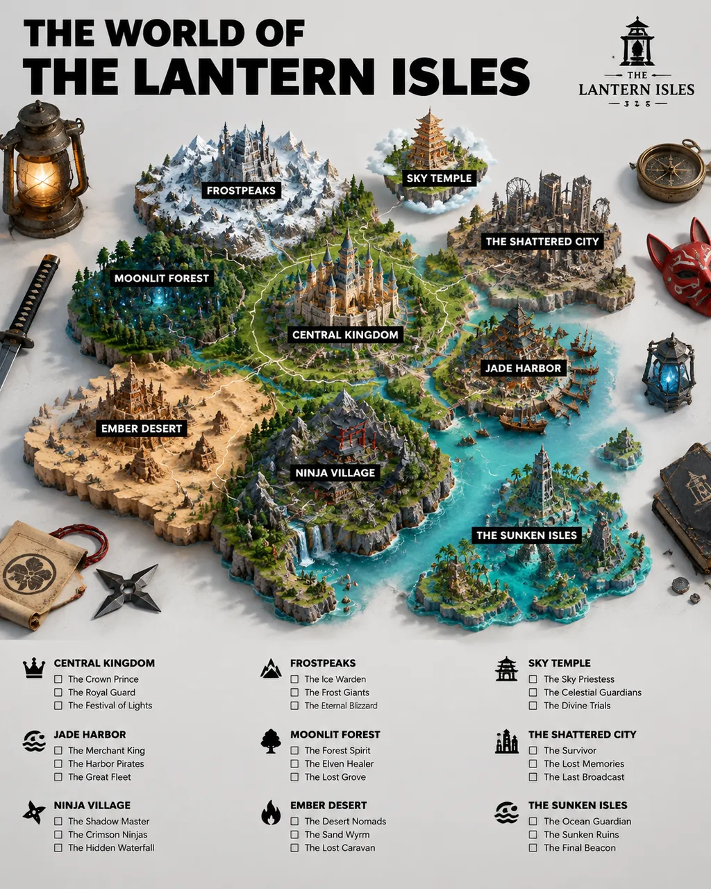</a>

> Originally written for fan art of existing TV shows, this template is more useful, and safer, when you point it at your own world. It reuses the travel-guide structure (terrain map, miniature landmarks, white paths, labels and side checklists) but swaps attractions for characters and moments tied to each place. We invented 'The Lantern Isles', and the model produced a coherent archipelago with a Central Kingdom, Sky Temple, Frostpeaks, Ember Desert and Sunken Isles, plus lantern and compass props and a matching emblem. For game designers and novelists, it is an instant pitch visual. Replace every SHOW mention, including the bare one in the title line.

```text
A hyper-realistic 3D world guide infographic poster for The Lantern Isles. The fictional world of The Lantern Isles is rendered as a raised, textured terrain map floating on a clean light gray surface — the map shape and landscape must reflect the actual geography and visual aesthetic of The Lantern Isles (fantasy kingdoms, post-apocalyptic cities, island archipelagos, ninja villages etc). Iconic locations from The Lantern Isles are placed as miniature 3D sculpted models at their correct canonical positions across the map — each one highly detailed, photorealistic and instantly recognizable to fans. Roads or paths connect key locations as white lines across the terrain. Around the map, floating 3D decorative props and iconic items from The Lantern Isles are scattered on the light gray surface. The official logo of The Lantern Isles is shown in the upper right corner. Each major location has a bold black label on the map, and beside the map, each location has a neat checklist of its most iconic characters or moments associated with that place, in clean sans-serif typography. A large bold title at the top reads: “THE WORLD OF THE LANTERN ISLES” in black uppercase typography with The Lantern Isles in heavy bold. The overall aesthetic is premium editorial — soft studio lighting, photorealistic 3D render, white/light gray background, clean layout, 4:5 aspect ratio.
```

- Author: [@TechieBySA](https://x.com/TechieBySA)
- Original post: https://x.com/TechieBySA/status/2045107949639455223
- [View on cinel and generate with this prompt](https://cinel.ai/prompts/p/3d-fictional-world-map-guide-poster?utm_source=github&utm_medium=awesome&utm_campaign=awesome-gpt-image-2.5-prompts)

### Museum-Style Chinese Heritage Breakdown Infographic

<a href="https://cinel.ai/prompts/p/museum-style-breakdown-infographic-zh?utm_source=github&utm_medium=awesome&utm_campaign=awesome-gpt-image-2.5-prompts">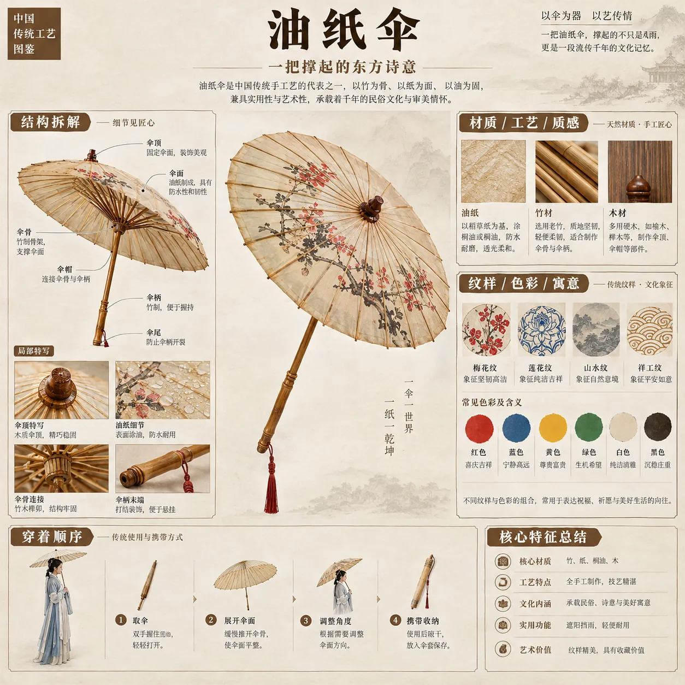</a>

> Written in Chinese, this template fixes the layout like a museum panel: title and introduction on top, a structure breakdown with leader lines on the left, materials and craft swatches top right, motifs and colour symbolism mid-right, and a process strip plus summary at the bottom. It deliberately rejects poster, studio-portrait, e-commerce and anime looks, and asks for paper-white, silk and tea-coloured backgrounds. With the topic 'traditional oil-paper umbrella', our result looks like a real exhibition board, though a couple of characters were garbled and the bottom strip kept its clothing-oriented heading ('dressing order'). It is best for crafts, garments and artefacts; proofread every caption before publishing.

```text
请根据传统油纸伞自动生成一张博物馆图鉴式中文拆解信息图。

要求整张图兼具真实写实主视觉、结构拆解、中文标注、材质说明、纹样寓意、色彩含义和核心特征总结。你需要根据传统油纸伞自动判断最合适的主体对象、服饰体系、器物结构、时代风格、关键部件、材质工艺、颜色方案与版式结构，用户无需再提供其他信息。

整体风格应为：国家博物馆展板、历史服饰图鉴、文博专题信息图，而不是普通海报、古风写真、电商详情页或动漫插画。背景采用米白、绢纸白、浅茶色等纸张质感，整体高级、克制、专业、可收藏。

版式固定为：
- 顶部：中文主标题 + 副标题 + 导语
- 左侧：结构拆解区，中文引线标注关键部件，并配局部特写
- 右上：材质 / 工艺 / 质感区，展示真实纹理小样并附说明
- 右中：纹样 / 色彩 / 寓意区，展示主色板、纹样样本和文化解释
- 底部：穿着顺序 / 构成流程图 + 核心特征总结

若主题适合人物展示，则以真实人物全身站姿为中央主体；若更适合器物或单体结构，则改为中心主体拆解图，但整体仍保持完整中文信息图形式。所有文字必须为简体中文，清晰、规整、可读，不要乱码、错字、英文或拼音。重点突出真实结构、材质差异、文化说明与图鉴气质。

避免：海报感、影楼感、电商感、动漫感、cosplay感、乱标注、错结构、糊字、假材质、过度装饰。
```

- Author: [@MrLarus](https://x.com/MrLarus)
- Original post: https://x.com/MrLarus/status/2045504669401653414
- [View on cinel and generate with this prompt](https://cinel.ai/prompts/p/museum-style-breakdown-infographic-zh?utm_source=github&utm_medium=awesome&utm_campaign=awesome-gpt-image-2.5-prompts)

### Dark Fintech Dashboard UI Mockup Prompt

<a href="https://cinel.ai/prompts/p/glassmorphism-ui-mockup-design?utm_source=github&utm_medium=awesome&utm_campaign=awesome-gpt-image-2.5-prompts"></a>

> This is less a prompt than a design spec: almost 6,000 characters covering visual language, target perception, global layout, then pixel-level details for the nav bar, sidebar and each card. That depth is why the output looks like a real product screen rather than a vague 'dashboard': our 3:2 render has a balance card, deposit and buy actions, a VIP tier panel, a holdings table with sparklines and an announcements list. Gold-orange accents on a monochrome dark base give the institutional feel the brief asks for. The fictional brand name in the spec plays on a real fintech name, so change it to your own. Rewrite the card list to mock up any SaaS dashboard.

```text
You are an experienced UI designer embracing modern, minimalistic design, shadows, glass, and soft colors.

Your role is to create a professional, beautiful mockup that is ready for delivery based on these requirements: 

<requirements>
## 1. Overall Style & Visual Language
This interface represents a premium, modern fintech / crypto trading dashboard using a dark theme.  
The visual language combines **soft neumorphism**, and **luxury Web3 aesthetics**.

Core characteristics:
- Warm gold/orange accent highlights
- Monochromatic color palette with minimalistic effects and shadows
- Card-based layout with depth and subtle backgrounds
- Minimal borders, separation via shadows or light backgrounds

Target perception:
- Secure
- Professional
- High-end / institutional-grade
- Optimized for experienced traders

---

## 2. Layout Structure

### Global Layout
- Desktop-first dashboard
- Output proportions: 3:2
- Three main regions:
  1. Top navigation bar (horizontal)
  2. Left sidebar navigation (vertical)
  3. Main content area (multi-column grid of cards)

Spacing is generous, prioritizing clarity and visual breathing room.

---

## 3. Top Navigation Bar
- Height: 72px
- Left:
  - Brand logo text "Mevolut"
  - Stylized "M"
  - Gold/orange accent
- Center:
  - Navigation links: Dashboard, Security, Referral, Trading Fees, API management
- Right:
  - Order link
  - Primary CTA: “Deposit” (gold pill button)
  - User avatar (circular)
  - Theme toggle (moon icon)

Typography:
- Clean sans-serif
- Medium weight
- White primary text, muted gray inactive states

---

## 4. Left Sidebar Navigation
- Width: 240px
- Background: near-black
- Vertical navigation items with icons:
  - Dashboard (active)
  - Security
  - Referral
  - Trading Fees
  - API management
- Bottom-aligned:
  - Settings

Active item:
- Subtle background highlight
- Slight background tint
- Rounded container

Icons:
- Outline style
- Gold accent on active state

---

## 5. Main Content Area

### 5.1 User Overview Card
- Large rounded card at top
- Left:
  - Circular avatar
  - Greeting text (“Hello…”)
  - User name
- Inline info blocks:
  - UID (copy icon)
  - Identity verification status
  - Security level
  - Time zone
  - Last login timestamp
- Right:
  - “Hide info” toggle

Style:
- Subtle inner shadows

---

### 5.2 Deposit / Buy Card
- Medium-sized card
- Title text explaining deposit options
- Two action rows:
  - Deposit (dollars or crypto)
  - Buy stocks (local currency)
- Each row:
  - Icon
  - Label
  - Arrow action button (gold accent)

---

### 5.3 Total Asset Card
- Displays USD balance and USD equivalent
- Large, faded Dollar symbol watermark in background
- Action tabs:
  - Buy stocks
  - Deposit
  - Withdraw
- Numeric values are large

---

### 5.4 VIP Level Card
- Shows current VIP level
- Spot and futures fee rates
- Progress bar for token holdings
- “View more” link

Progress bar:
- Rounded
- Dark background track

---

### 5.5 Current Holdings Table
- Card containing a table layout
- Columns:
  - Coin (icon + name)
  - Price
  - 24h Change
  - 4h Trend (sparkline)
  - Actions (Deposit, Withdraw, Trade)

Sparklines:
- Green for positive trend
- Red for negative trend

Hover:
- Subtle background highlight per row

---

### 5.6 Affiliate Program Card
- Promotional card
- Gold coin illustration
- Short description and CTA button (“Apply now”)

---

### 5.7 Information / News Card
- Vertical list of announcements
- Headline + timestamp
- “View more” link at top

---

## 6. Color Palette
- Primary background: deep charcoal / black
- Card surfaces: slightly lighter
- Accent color: warm gold
- Text hierarchy:
  - White (primary)
  - Muted gray (secondary)
  - Dark gray (disabled)
- Status colors:
  - Green for positive
  - Red for negative

---

## 7. Effects & Interaction
- Rounded corners throughout (sm)

# Design tokens:
{
  // Global theme definition
  "theme": {
    "mode": "dark",
    "style": [
      "soft-neumorphism",
      "premium-fintech"
    ]
  },

  // Layout measurements and structure
  "layout": {
    "type": "desktop-dashboard",
    "grid": "three-column",
    "sidebarWidth": 240,
    "topbarHeight": 68,
    "contentPadding": 24
  },

  // Color system
  "colors": {
    "background": "#0B0D10",        // Main app background
    "primaryAccent": "#F5A623",     // Gold/orange highlight
    "secondaryAccent": "#FFB547",
    "textPrimary": "#FFFFFF",
    "textSecondary": "#B0B3B8",
    "textMuted": "#6B6F76",
    "success": "#22C55E",
    "danger": "#EF4444"
  },

  // Typography scale
  "typography": {
    "fontFamily": "SF Pro, system-ui, sans-serif",
    "weights": {
      "heading": 600,
      "body": 400,
      "numeric": 500
    },
    "sizes": {
      "h1": 24,
      "h2": 20,
      "h3": 16,
      "body": 14,
      "caption": 12
    }
  },

  // Core UI components
  "components": {
    "card": {
      "borderRadius": 16,
      "shadow": "0 20px 40px rgba(0,0,0,0.4)",
      "border": "none",
      "background": "#14171C",
    },

    "button": {
      "primary": {
        "textColor": "#0B0D10",
        "borderRadius": 999,
      },
      "secondary": {
        "background": "transparent",
        "textColor": "#F5A623"
      }
    },

    "sidebar": {
      "background": "#0E1014",
      "itemRadius": 12,
      "iconStyle": "outline"
    },

    "table": {
      "rowHeight": 56,
      "divider": "subtle",
      "hoverHighlight": true,
      "sparkline": {
        "positiveColor": "#22C55E",
        "negativeColor": "#EF4444"
      }
    },

    "progressBar": {
      "height": 6,
      "radius": 999,
      "fillColor": "#22C55E",
      "backgroundColor": "#2A2E35"
    }
  },

  // Icon system
  "icons": {
    "style": "outline",
    "size": 18,
    "colorInactive": "#6B6F76",
    "colorActive": "#F5A623"
  }
}
</requirements>
```

- Author: [@d4m1n](https://x.com/d4m1n)
- Original post: https://x.com/d4m1n/status/2027064868847689902
- [View on cinel and generate with this prompt](https://cinel.ai/prompts/p/glassmorphism-ui-mockup-design?utm_source=github&utm_medium=awesome&utm_campaign=awesome-gpt-image-2.5-prompts)

### Map with a 3D City Diorama Rising from It Prompt

<a href="https://cinel.ai/prompts/p/country-map-with-3d-city-diorama?utm_source=github&utm_medium=awesome&utm_campaign=awesome-gpt-image-2.5-prompts">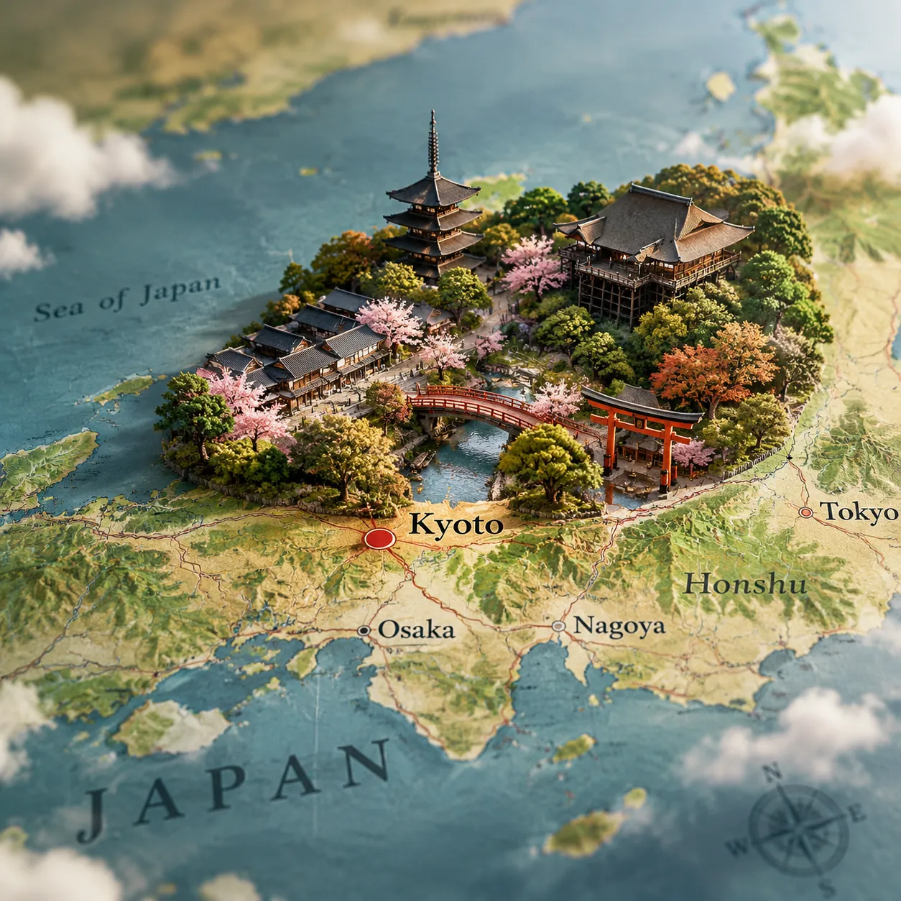</a>

> Two variables, country and city, produce a striking tilt-shift image: a relief map seen from above, with a miniature diorama of the city emerging at its real position. The prompt's best decision is to treat it as macro photography (fine textures, depth of field, soft studio shadows), which makes the map feel like a physical object on a table. With Japan and Kyoto, our result shows a pagoda, a wooden stage temple, a torii gate and a red bridge rising from the map, with Osaka, Nagoya and Tokyo labelled nearby. Distances are compressed and the coastline is stylised, so present it as art rather than cartography. It is great for travel content and city guides.

```text
A realistic, highly detailed geographic map viewed from above, accurately representing the region where Japan is located. Rising from the map is a miniature 3D diorama of Kyoto, precisely positioned at its real geographic location. The diorama features iconic architecture, natural landmarks, and cultural elements seamlessly emerging from the map surface. Ultra-realistic materials, fine textures, and depth of field. Soft studio lighting with subtle shadows, cinematic composition, premium macro photography style. Square 1:1 format, high detail, realistic scale.
```

- Author: [@Kerroudjm](https://x.com/Kerroudjm)
- Original post: https://x.com/Kerroudjm/status/2008937653694013753
- [View on cinel and generate with this prompt](https://cinel.ai/prompts/p/country-map-with-3d-city-diorama?utm_source=github&utm_medium=awesome&utm_campaign=awesome-gpt-image-2.5-prompts)

### Blueprint to House Split Architectural Visualization

<a href="https://cinel.ai/prompts/p/blueprint-to-house-split-visualization?utm_source=github&utm_medium=awesome&utm_campaign=awesome-gpt-image-2.5-prompts">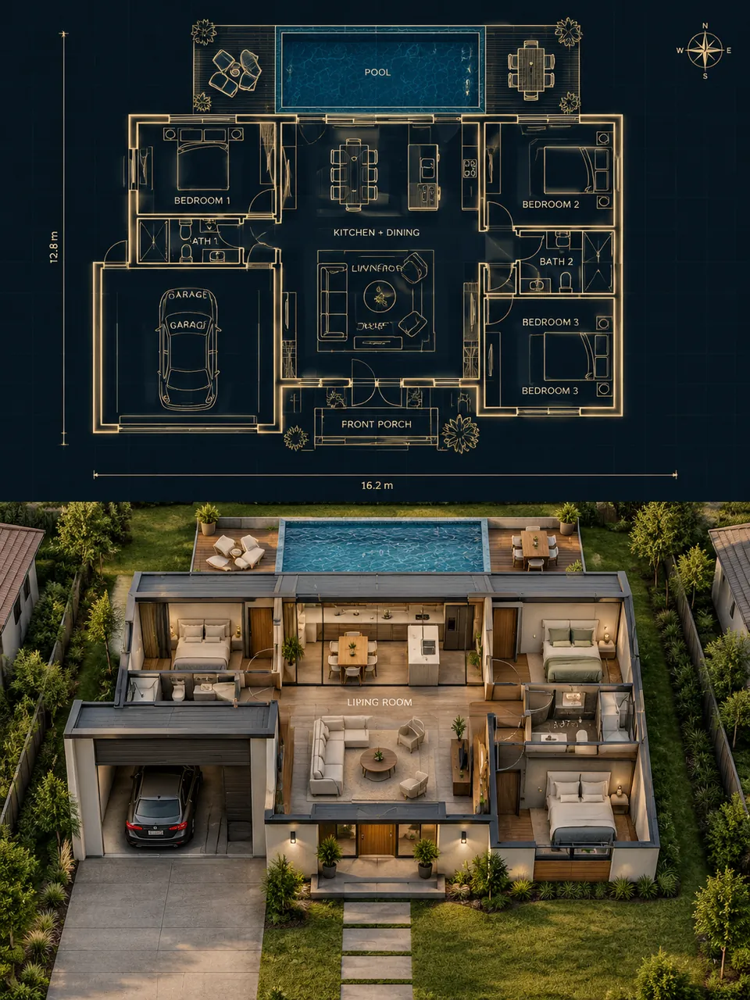</a>

> The objective line says it all: the bottom render must match the blueprint exactly. The JSON enumerates the room programme (three bedrooms, central living room, kitchen-dining, two baths, garage, porch, pool with deck) and plan details such as door swings and furniture outlines, which gives the model a concrete layout to mirror. Our result pairs a glowing navy-and-gold plan with an aerial cutaway of a modern house with pool and garage, and the room positions broadly correspond. The original mentions 'reference image 2' for the blueprint style; without that image the written style description still works. It is useful for real-estate teasers, architecture students and renovation pitches.

```text
{
  "objective": "Create a split architectural visualization where the top is a detailed dark-themed blueprint and the bottom is a photorealistic house that matches the blueprint EXACTLY",

  "aspect_ratio": "3:4",

  "composition": {
    "layout": "vertical split",
    "top_section": "blueprint",
    "bottom_section": "realistic render",
    "alignment": "perfect structural correspondence between both sections"
  },

  "top_section": {
    "type": "architectural blueprint",
    "style": "dark luxury blueprint (similar to reference image 2)",

    "visual_style": {
      "background": "deep navy / charcoal blue",
      "lines": "thin glowing beige/gold lines",
      "walls": "slightly extruded 3D effect",
      "labels": "clean modern sans-serif",
      "lighting": "soft ambient glow"
    },

    "content": {
      "rooms": [
        "3 bedrooms (left, right, bottom-right)",
        "central living room",
        "kitchen + dining (top center)",
        "2 bathrooms",
        "garage (left side connected)",
        "front porch",
        "backyard pool with deck"
      ],
      "details": [
        "furniture outlines (beds, sofa, dining table)",
        "door swings and openings",
        "window placements",
        "circulation paths",
        "exact proportions and spacing"
      ]
    }
  },

  "bottom_section": {
    "type": "photorealistic house render",

    "constraint": "MUST MATCH THE BLUEPRINT EXACTLY — no added, removed, or shifted rooms",

    "architecture": {
      "style": "modern single-story house",
      "roof": "flat layered roof",
      "materials": [
        "smooth concrete walls",
        "wood panel accents",
        "large glass windows"
      ]
    },

    "layout_mapping_rules": [
      "garage must be on the left side exactly as blueprint",
      "main entrance aligned with living room",
      "pool positioned in backyard matching blueprint dimensions",
      "window placements correspond to each room location",
      "bedroom volumes visible externally in correct positions"
    ],

    "environment": {
      "setting": "suburban neighborhood",
      "elements": [
        "green lawn",
        "minimal landscaping",
        "clean driveway leading to garage",
        "pool deck matching blueprint footprint"
      ]
    },

    "lighting": {
      "time": "golden hour",
      "style": "soft natural light with realistic shadows"
    },

    "camera": {
      "angle": "slightly elevated front perspective",
      "lens": "35mm architectural view"
    }
  },

  "consistency_rules": [
    "room positions must be identical between blueprint and render",
    "no extra structures added in render",
    "all doors and windows must align logically",
    "pool size and placement must match exactly",
    "garage placement must match blueprint"
  ],

  "style": {
    "top": "architectural visualization (dark premium)",
    "bottom": "photorealistic modern house",
    "overall": "clean, high-end architectural presentation"
  },

  "negative_constraints": [
    "no mismatch between blueprint and render",
    "no extra rooms",
    "no fantasy elements",
    "no unrealistic proportions",
    "no cluttered environment"
  ]
}
```

- Author: [@craftian_keskin](https://x.com/craftian_keskin)
- Original post: https://x.com/craftian_keskin/status/2040757362382798888
- [View on cinel and generate with this prompt](https://cinel.ai/prompts/p/blueprint-to-house-split-visualization?utm_source=github&utm_medium=awesome&utm_campaign=awesome-gpt-image-2.5-prompts)

### Encyclopedia-Style Science Infographic Card Prompt

<a href="https://cinel.ai/prompts/p/encyclopedia-style-science-infographic-zh?utm_source=github&utm_medium=awesome&utm_campaign=awesome-gpt-image-2.5-prompts">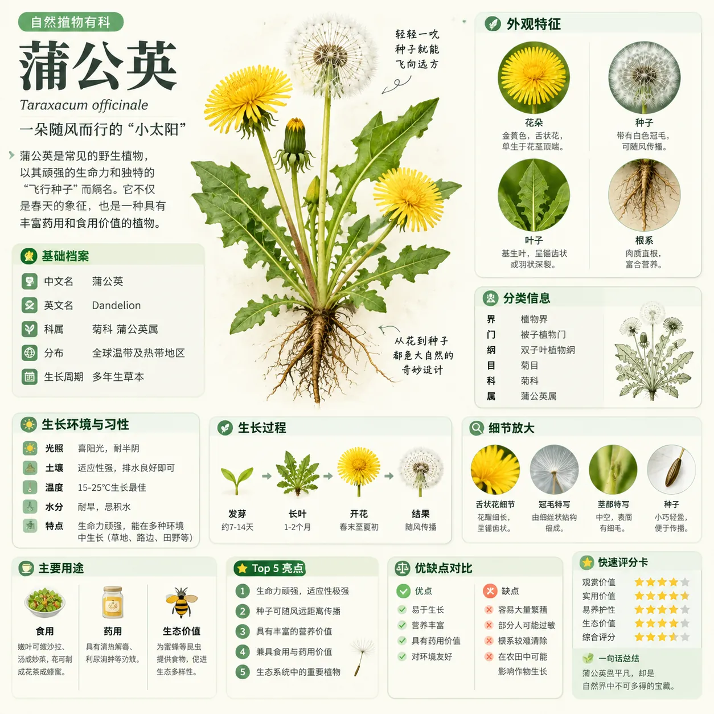</a>

> Written in Chinese, this prompt asks for a vertical knowledge card that feels collectible, somewhere between a natural-history field guide, a modern encyclopedia page and a shareable social infographic. It lists the building blocks (hero visual, close-up detail callouts, rounded modules, clear heading hierarchy, a score card or Top 5) and lets the model pick sections that suit the topic. We used the dandelion: the card covers the Latin name, a classification table, flower, seed, leaf and root details, growing conditions, a life-cycle strip and uses. The taxonomy and morphology are correct, though one small header came out garbled. Frame medicinal lines as traditional use, and proofread all small text.

```text
请根据蒲公英生成一张高质量竖版「科普百科图」。 

这张图不是普通海报，也不是单纯插画，而是一张兼具“图鉴感、百科感、信息结构感、收藏感”的模块化科普信息图。整体风格参考高级博物图鉴、现代百科书页、生活方式知识卡和社交媒体高传播信息图的结合。

请让画面包含：
- 一个清晰漂亮的主题主视觉
- 若干局部特征放大细节
- 多个圆角模块化信息分区
- 清楚的标题层级与重点标签
- 简洁但丰富的百科内容
- 可视化评分、要点总结或Top 5模块

内容栏目请根据主题自动适配，优先从这些方向中选择并合理组合：
基础档案、分类信息、外观特征、习性/生态、形成机制/结构组成、生长或使用条件、养护或维护建议、风险与注意事项、适合人群或适用场景、优缺点对比、快速评分卡。

视觉要求：
浅色干净背景，柔和配色，轻阴影，精致小图标，圆角信息框，整洁排版，信息密度高但不拥挤，阅读体验好。整体必须像真正可以发布、阅读、收藏、系列化生产的科普百科卡，而不是广告图。

请不要做成普通商业宣传海报。要突出“知识整理 + 模块信息 + 图鉴式展示”的特征。
```

- Author: [@MrLarus](https://x.com/MrLarus)
- Original post: https://x.com/MrLarus/status/2046231542817497392
- [View on cinel and generate with this prompt](https://cinel.ai/prompts/p/encyclopedia-style-science-infographic-zh?utm_source=github&utm_medium=awesome&utm_campaign=awesome-gpt-image-2.5-prompts)

### Heritage Architecture Survey Board Prompt

<a href="https://cinel.ai/prompts/p/architect-survey-board-infographic?utm_source=github&utm_medium=awesome&utm_campaign=awesome-gpt-image-2.5-prompts">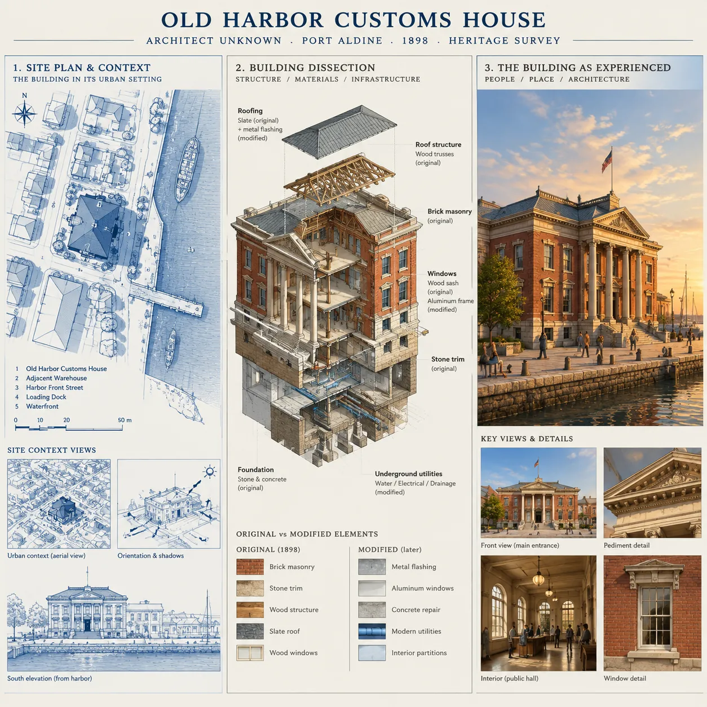</a>

> A three-part board that reads left to right like an architect's story: context, then anatomy, then experience. The site plan sits in blue survey linework, the centre shows a cutaway axonometric with callouts separating original from modified elements, and the right panel is a warm, inhabited photograph from the classic viewpoint. The shift from blue to grey to golden light is written into the prompt and gives the board its polish. We invented a building, the Old Harbor Customs House in a fictional port, 1898, and the result looks convincingly like a real heritage report, legend and detail views included. If you use a real building, every label must be verified by someone who knows it.

```text
A preservation architect's survey board for the Old Harbor Customs House — late-19th-century brick neoclassical. Left section: site plan and context, showing the structure in its urban or landscape setting with orientation, shadows, and neighboring relationships mapped. Center section: the building dissected, a cutaway axonometric revealing structural system, material layers, hidden infrastructure, with callouts identifying original versus modified elements. Right section: the building as experienced, photographed from the canonical viewpoint in ideal light, with human figures for scale and life, the architecture inhabited. Visual style transitions from technical survey blue-line through neutral analytical greys to golden-hour warmth. Title block reading "OLD HARBOR CUSTOMS HOUSE — ARCHITECT UNKNOWN, PORT ALDINE, 1898, HERITAGE SURVEY".
```

- Author: [@AllaAisling](https://x.com/AllaAisling)
- Original post: https://x.com/AllaAisling/status/2008559432016286198
- [View on cinel and generate with this prompt](https://cinel.ai/prompts/p/architect-survey-board-infographic?utm_source=github&utm_medium=awesome&utm_campaign=awesome-gpt-image-2.5-prompts)

### Radial Exploded View Product Teardown Prompt

<a href="https://cinel.ai/prompts/p/radial-exploded-view-product?utm_source=github&utm_medium=awesome&utm_campaign=awesome-gpt-image-2.5-prompts">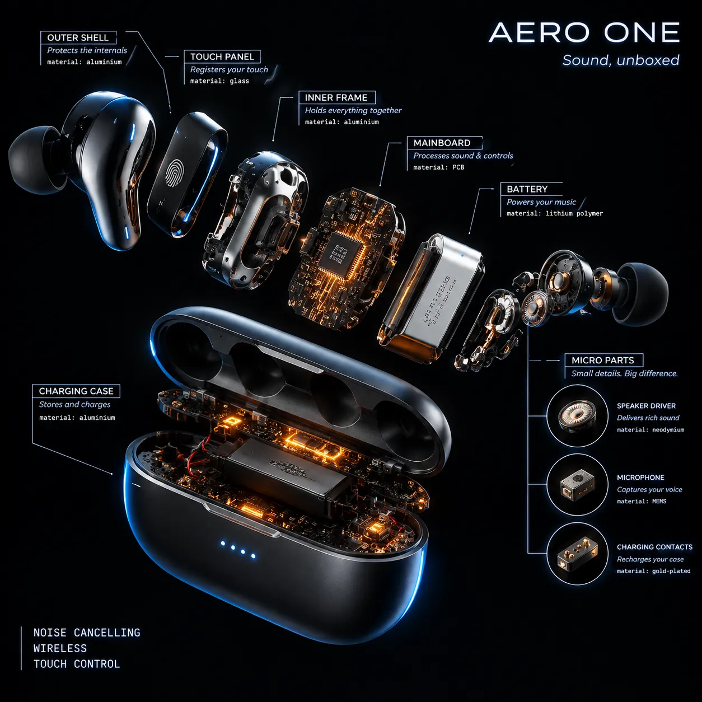</a>

> Most exploded-view prompts stack parts vertically; this one asks for a true radial burst with depth and parallax, components flying outward from a central axis in a set order from shell to micro parts. It specifies material behaviour (refracting glass, brushed aluminium, faintly glowing PCB traces), a three-light setup, label typography and a monospace spec block, and that precision is why the board looks engineered. We used fictional wireless earbuds, 'AERO ONE', and the result shows shells, touch panels, frames, mainboards and batteries flying out of a charging case, with callout circles for the driver, microphone and contacts. Labels are illustrative; never present them as real specifications.

```text
Hyperrealistic 3D radial exploded view of a pair of wireless earbuds with charging case  6 components  bursting outward from a central axis in every direction, frozen in mid-air.  True spatial explosion, not a vertical stack, depth and parallax visible.  COMPONENTS (core outward): OUTER SHELL → TOUCH PANEL → INNER FRAME → MAINBOARD →  BATTERY → MICRO PARTS (speaker driver, microphone, charging contacts) shown in 3x floating callout circles  MATERIALS: glass refracts and catches specular highlights, aluminium shows  brushed grain and machined edges, PCB traces glow faintly amber,   rubber gaskets matte with micro-texture, cables with soft bend physics.  LABELS: hairline leader to floating box. each label shows the part name in uppercase, a short function note in italic and its material in monospace. Radiate outward, no overlaps.  LIGHTING: cool diffused overhead + warm amber underlighting on internals +  thin blue rim on outer shell. Displays emit soft UI glow. Circuits self-illuminate.  BACKGROUND: midnight black, deep, non-reflective. Midnight black recommended. TITLE: "AERO ONE" top right. SUBTITLE: "Sound, unboxed".  SPEC BLOCK: "NOISE CANCELLING / WIRELESS / TOUCH CONTROL" bottom left in monospace.  Mood: iFixit teardown meets NASA manual meets WIRED cover. 4K, tack sharp, extraordinary material fidelity.
```

- Author: [@AllaAisling](https://x.com/AllaAisling)
- Original post: https://x.com/AllaAisling/status/2032126653309030481
- [View on cinel and generate with this prompt](https://cinel.ai/prompts/p/radial-exploded-view-product?utm_source=github&utm_medium=awesome&utm_campaign=awesome-gpt-image-2.5-prompts)

### Miniature City Growing Out of a Street Map

<a href="https://cinel.ai/prompts/p/city-map-with-miniature-city-diorama?utm_source=github&utm_medium=awesome&utm_campaign=awesome-gpt-image-2.5-prompts">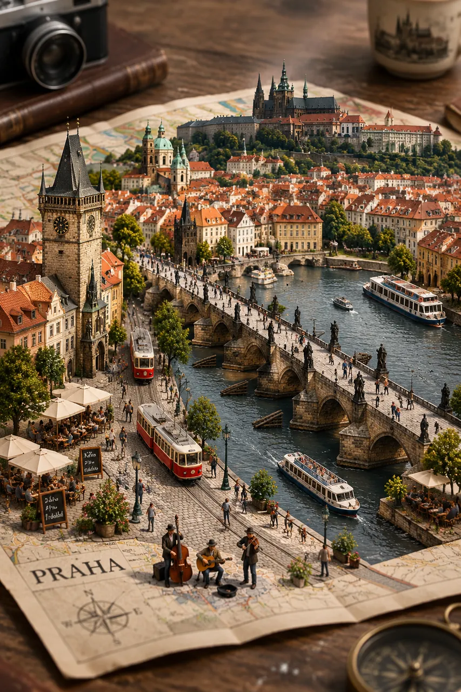</a>

> A compact template for travel content: a street map lies on a surface and a photorealistic miniature of the same city grows out of it, with landmarks, a natural feature, everyday street life and the city's signature transport. We filled it for Prague on a worn wooden desk: the castle and cathedral sit on the hill, a statue-lined stone bridge spans the river with tour boats, red trams run through the old town, and a clock tower rises near café tables and street musicians. The map's 'PRAHA' label anchors it. The geography is artistically rearranged, so it suits travel blogs and tourism posters rather than navigation. Swap in any city and its top landmarks.

```text
A street-style map of Prague placed on a worn wooden desk, with a photorealistic miniature version of Prague emerging from it a stone bridge lined with statues,a hilltop castle complex,an old-town clock tower, the river winding through the city, street cafés, red trams,and street musicians.All elements grow from the map like a 3D urban diorama. Studio soft lighting, cinematic depth, 2:3 format
```

- Author: [@Sheldon056](https://x.com/Sheldon056)
- Original post: https://x.com/Sheldon056/status/2019618076246090053
- [View on cinel and generate with this prompt](https://cinel.ai/prompts/p/city-map-with-miniature-city-diorama?utm_source=github&utm_medium=awesome&utm_campaign=awesome-gpt-image-2.5-prompts)

### Editorial Anatomy Infographic Poster (Human Liver)

<a href="https://cinel.ai/prompts/p/editorial-health-infographic-poster?utm_source=github&utm_medium=awesome&utm_campaign=awesome-gpt-image-2.5-prompts">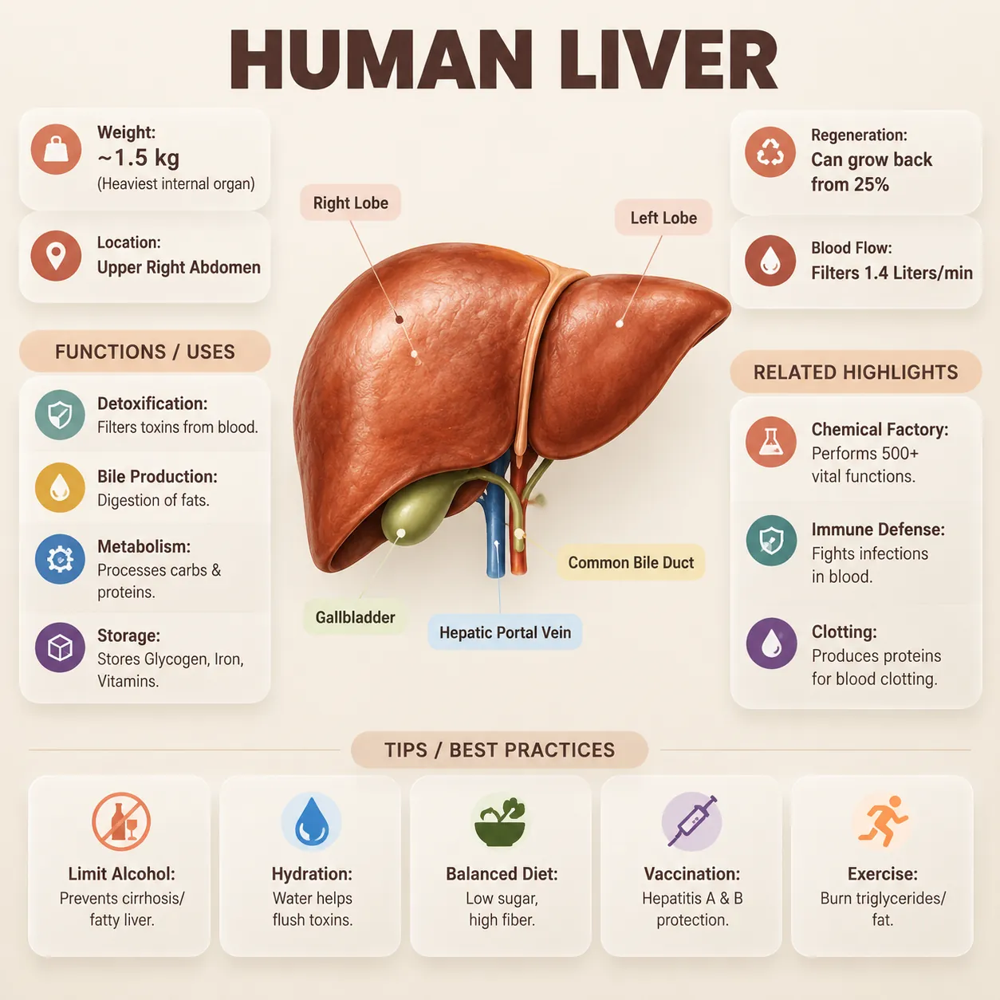</a>

> A fully written-out infographic: the prompt supplies every heading and line of copy, from quick facts (weight, regeneration, location, blood flow) and labelled parts to functions, highlights and five lifestyle tips, plus the visual system of terracotta and coral on beige with glassmorphism cards. Because the text is given, the model mostly has to typeset it, and it did so cleanly, around a glossy 3D liver with gallbladder and vessels. The facts match common reference figures, but this is an AI illustration, not medical material; add a 'for general information, not medical advice' line if you publish it. Swap the organ and copy to build a series on the heart, lungs or kidneys.

```text
Ultra-clean modern editorial infographic poster (1080x1080), premium magazine layout meets lifestyle photography/illustration.

**TITLE:**
Large, bold sans-serif text at top center: "HUMAN LIVER"

**CENTRAL VISUAL:**
A realistic, high-fidelity 3D illustration of the Human Liver (showing Right/Left lobes and Gallbladder). Color palette: Terracotta, deep brownish-red, and soft coral, set against a clean soft beige/off-white background. Lighting is studio-soft.

**LAYOUT SECTIONS (Matching the reference):**

* **Section 1 - Quick Facts (Top Left/Right floating bubbles):**
    * "Weight: ~1.5 kg (Heaviest internal organ)"
    * "Regeneration: Can grow back from 25%"
    * "Location: Upper Right Abdomen"
    * "Blood Flow: Filters 1.4 Liters/min"

* **Section 2 - Core Parts / Systems (Labels pointing to central organ):**
    * Right Lobe
    * Left Lobe
    * Gallbladder (Greenish sac underneath)
    * Common Bile Duct
    * Hepatic Portal Vein

* **Section 4 - Functions / Uses (Left side list with minimal icons):**
    * **Detoxification:** Filters toxins from blood.
    * **Bile Production:** Digestion of fats.
    * **Metabolism:** Processes carbs & proteins.
    * **Storage:** Stores Glycogen, Iron, Vitamins.

* **Section 5 - Related Highlights (Right side list with minimal icons):**
    * **Chemical Factory:** Performs 500+ vital functions.
    * **Immune Defense:** Fights infections in blood.
    * **Clotting:** Produces proteins for blood clotting.

* **Section 6 - Tips / Best Practices (Bottom row, card style with icons):**
    1.  **Limit Alcohol:** Prevents cirrhosis/fatty liver.
    2.  **Hydration:** Water helps flush toxins.
    3.  **Balanced Diet:** Low sugar, high fiber.
    4.  **Vaccination:** Hepatitis A & B protection.
    5.  **Exercise:** Burn triglycerides/fat.

**STYLE:**
Glassmorphism effects on text boxes, soft drop shadows, medical accuracy mixed with high-end graphic design aesthetics.
```

- Author: [@Strength04_X](https://x.com/Strength04_X)
- Original post: https://x.com/Strength04_X/status/2015630390887895118
- [View on cinel and generate with this prompt](https://cinel.ai/prompts/p/editorial-health-infographic-poster?utm_source=github&utm_medium=awesome&utm_campaign=awesome-gpt-image-2.5-prompts)

### Exploded Chocolate Coffee Drink Layers (Chinese Prompt)

<a href="https://cinel.ai/prompts/p/exploded-chocolate-drink-layers-zh?utm_source=github&utm_medium=awesome&utm_campaign=awesome-gpt-image-2.5-prompts">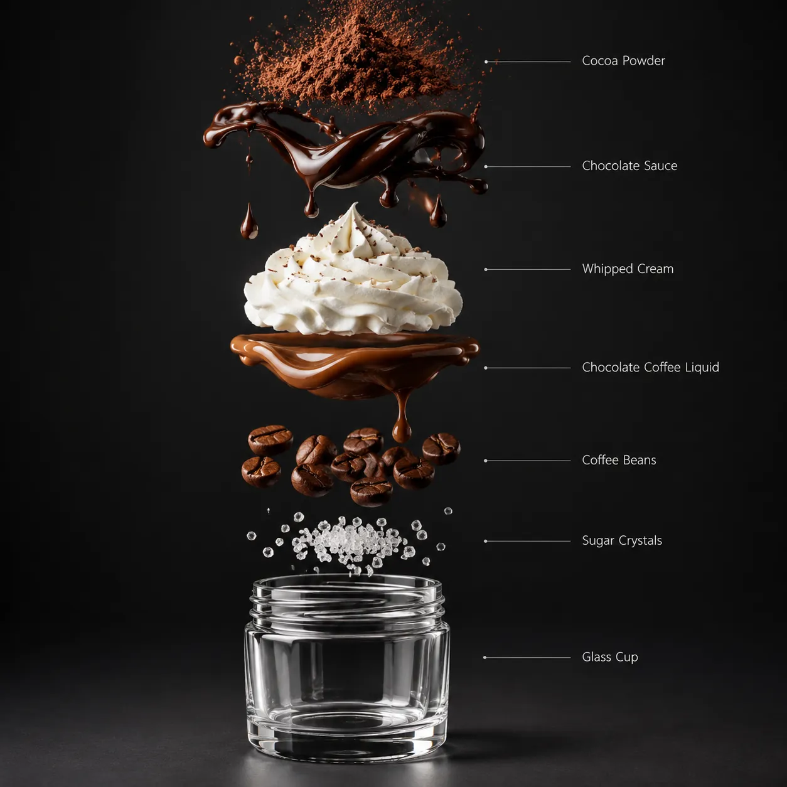</a>

> Written in Chinese as structured JSON, this prompt deconstructs a drink into seven floating layers stacked on a centre line: cocoa powder at the top, glossy chocolate sauce ribbons, a swirl of whipped cream, the chocolate coffee liquid, roasted beans, sugar crystals and finally an empty glass at the bottom. It asks for a near-black graphite gradient, controlled studio light with a clear shadow under each layer, and thin leader lines with English labels on the right. Our result is clean and premium, every layer sharp, the empty jar-like glass grounding the stack. It's ideal for café menus, product launch posts or ingredient storytelling. Swap the layers to deconstruct any drink.

```text
{
“subject”: “巧克力咖啡饮品的超写实垂直爆炸分解图”,
“layout”: “中心垂直对齐，各组件独立悬浮且间距清晰”,
“layers”: [
{
“component”: “可可粉微粒”,
“position”: “顶部”
},
{
“component”: “光泽深色巧克力酱丝带与滴落状”,
“position”: “独立层”
},
{
“component”: “轻盈的打发奶油堆”,
“position”: “独立层”
},
{
“component”: “丝滑的巧克力咖啡液态层”,
“position”: “独立层”
},
{
“component”: “烘焙咖啡豆”,
“position”: “独立层”
},
{
“component”: “糖晶体”,
“position”: “独立层”
},
{
“component”: “带配重底座的小型透明螺纹玻璃杯（空杯）”,
“position”: “底部”
}
],
“background”: “高级深色背景：干净的影棚背景，近黑色的石墨色至木炭色渐变，柔和且平滑”,
“lighting_and_style”: {
“lighting”: “柔和且受控的影棚光，每层下方有清晰的分层阴影”,
“detail”: “超锐利微距写实主义，右侧极简细指示线与英文标签”,
“category”: “高端产品信息图”,
“resolution”: “8K”
}
}
```

- Author: [@ttmouse](https://x.com/ttmouse)
- Original post: https://x.com/ttmouse/status/2008986705962123774
- [View on cinel and generate with this prompt](https://cinel.ai/prompts/p/exploded-chocolate-drink-layers-zh?utm_source=github&utm_medium=awesome&utm_campaign=awesome-gpt-image-2.5-prompts)

### Isometric Miniature City Diorama on a Vintage Map

<a href="https://cinel.ai/prompts/p/isometric-miniature-city-on-paper-map?utm_source=github&utm_medium=awesome&utm_campaign=awesome-gpt-image-2.5-prompts">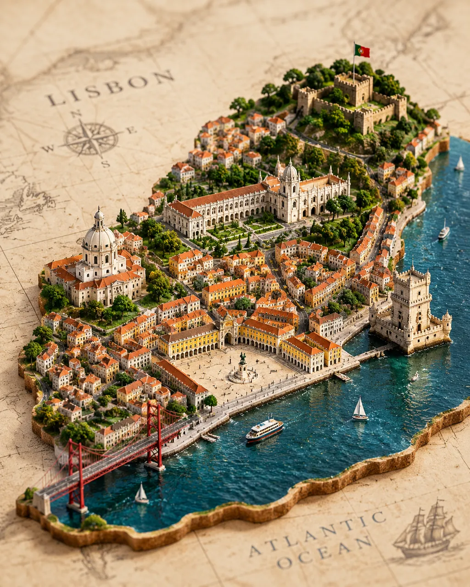</a>

> Type a city name and this JSON builds a tilt-shift miniature of it, rising out of an old cartographic paper map with grid lines and printed place names: oversized landmarks, simplified streets, greenery, rivers and coastline, soft cinematic daylight. We filled it with Lisbon. The result is charming and instantly recognisable as Lisbon in spirit: terracotta roofs, a hilltop castle, a domed church, a riverside tower, a red suspension bridge and boats on the water, with 'LISBON' and 'ATLANTIC OCEAN' lettered on the map. Treat it as a souvenir illustration rather than a map: the city's shape and landmark positions are compressed and rearranged. Great for travel content and tourism posters.

```text
{
"description": "Create a highly detailed, photorealistic miniature diorama style isometric map of Lisbon placed on a vintage textured paper map.",
  "perspective": {
    "type": "isometric",
    "angle": "45 degree top down",
    "look": "macro photography with tilt-shift miniature effect"
  },
  "geography": {
    "shape": "follows real geographic shape of Lisbon",
    "landmarks": {
      "oversized": true,
      "dominant": true,
      "primary_focus": "monuments",
      "secondary_elements": "smaller and simplified"
    },
    "architecture": "ultra detailed miniature",
    "roads": "selective",
    "greenery": true,
    "water_bodies": true,
    "terrain": true,
    "materials": ["stone", "wood", "concrete", "glass", "foliage"]
  },
  "lighting": {
    "type": "soft cinematic daylight",
    "effects": ["natural shadows", "warm highlights", "subtle atmospheric depth"]
  },
  "water": {
    "rivers": true,
    "coastlines": true,
    "depth_gradients": "smooth",
    "reflections": "gentle"
  },
  "map_base": {
    "type": "old world cartographic paper",
    "features": ["visible grid lines", "paper grain", "printed place names"]
  },
  "focus": {
    "sharp_on_landmarks": true,
    "edge_falloff": "gentle"
  },
  "quality": {
    "museum_quality": true,
    "handcrafted_diorama_realism": true,
    "ultra_high_resolution": true
  },
  "background": {
    "color": "clean pure white",
    "restrictions": ["no floating text", "no logos", "no watermarks", "no futuristic or cartoon elements"]
  },
  "aspect_ratio": "4:5"
}
```

- Author: [@Just_sharon7](https://x.com/Just_sharon7)
- Original post: https://x.com/Just_sharon7/status/2016087583999361297
- [View on cinel and generate with this prompt](https://cinel.ai/prompts/p/isometric-miniature-city-on-paper-map?utm_source=github&utm_medium=awesome&utm_campaign=awesome-gpt-image-2.5-prompts)

### Isometric Subway Station Miniature with Service Status

<a href="https://cinel.ai/prompts/p/isometric-subway-line-miniature-map?utm_source=github&utm_medium=awesome&utm_campaign=awesome-gpt-image-2.5-prompts">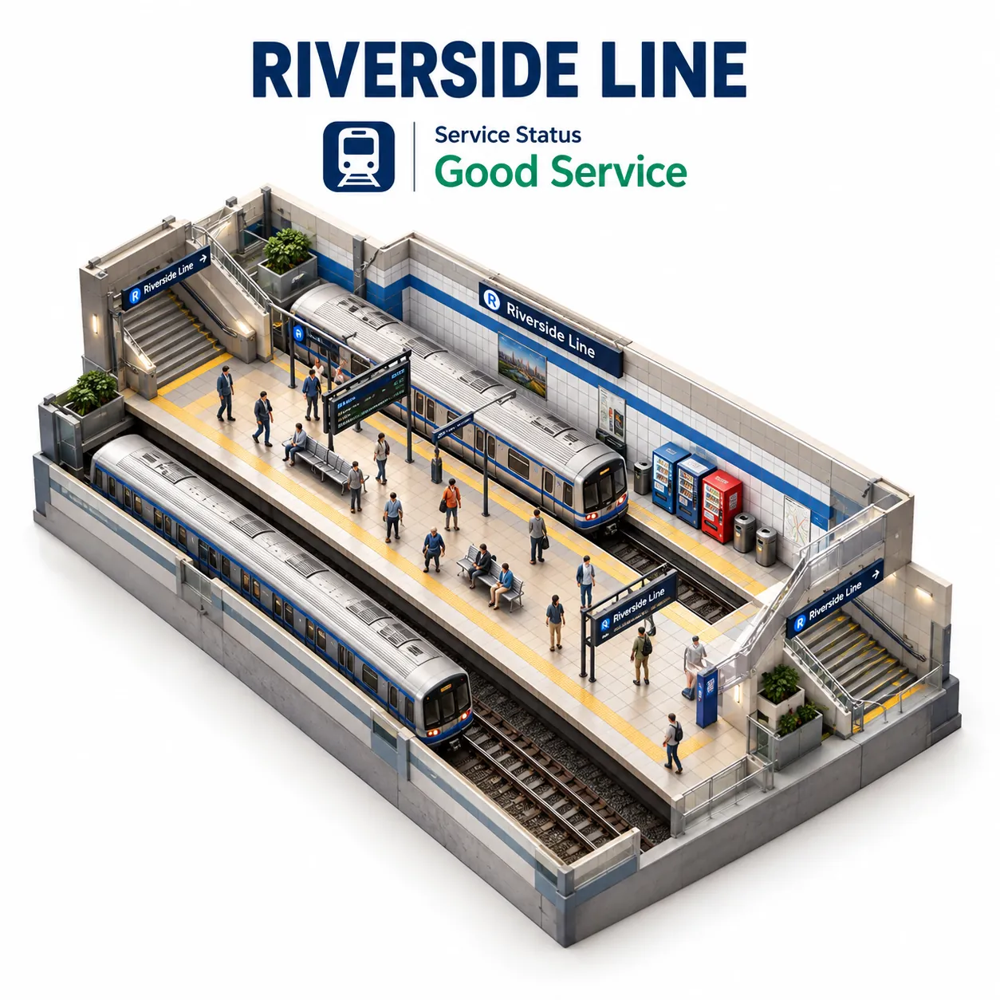</a>

> A neat transit infographic template: name a line and a status message, and the prompt builds a 45° isometric diorama of a station (platforms, miniature trains, stairwells, tiled walls, signage, vending machines, waiting passengers) on a soft white background, topped by a bold title and a small 'Service Status' readout in green for on time or red for delays. We used an invented 'Riverside Line' with 'Good Service'. The result is crisp and toy-like: two silver trains at an island platform, tiny commuters, stairs at both ends and a header with a train icon. Useful for transit apps, city guides and commute-themed posts, as long as you use fictional or properly licensed line names.

```text
8K Ultra-Realistic Promotional
Present a clear, 45° top-down isometric miniature 3D scene of the Riverside Line metro. The scene includes stylized diorama elements such as platforms, miniature trains, stairwells, signage, tiled walls, vending machines, and people waiting.
Use soft, refined textures, realistic PBR materials, and lifelike lighting with subtle shadows to enhance dimensional clarity.
At the top center, place the title “RIVERSIDE LINE” in bold sans-serif text. Below it, add a train icon followed by “Service Status” (small text) and “Good Service”  red medium text for delays or green for on-time service.
Use a soft, solid tile white background for clarity. Clean, centered, editorial infographic style.
Square format 1080×1080, ultra-detailed 3D render, miniature realism, 8K look, image size 1: 1
```

- Author: [@Milo_Bahi_02](https://x.com/Milo_Bahi_02)
- Original post: https://x.com/Milo_Bahi_02/status/2011751906318958830
- [View on cinel and generate with this prompt](https://cinel.ai/prompts/p/isometric-subway-line-miniature-map?utm_source=github&utm_medium=awesome&utm_campaign=awesome-gpt-image-2.5-prompts)

### Product Cross-Section Cutaway Illustration Prompt

<a href="https://cinel.ai/prompts/p/product-cross-section-cutaway-infographic?utm_source=github&utm_medium=awesome&utm_campaign=awesome-gpt-image-2.5-prompts">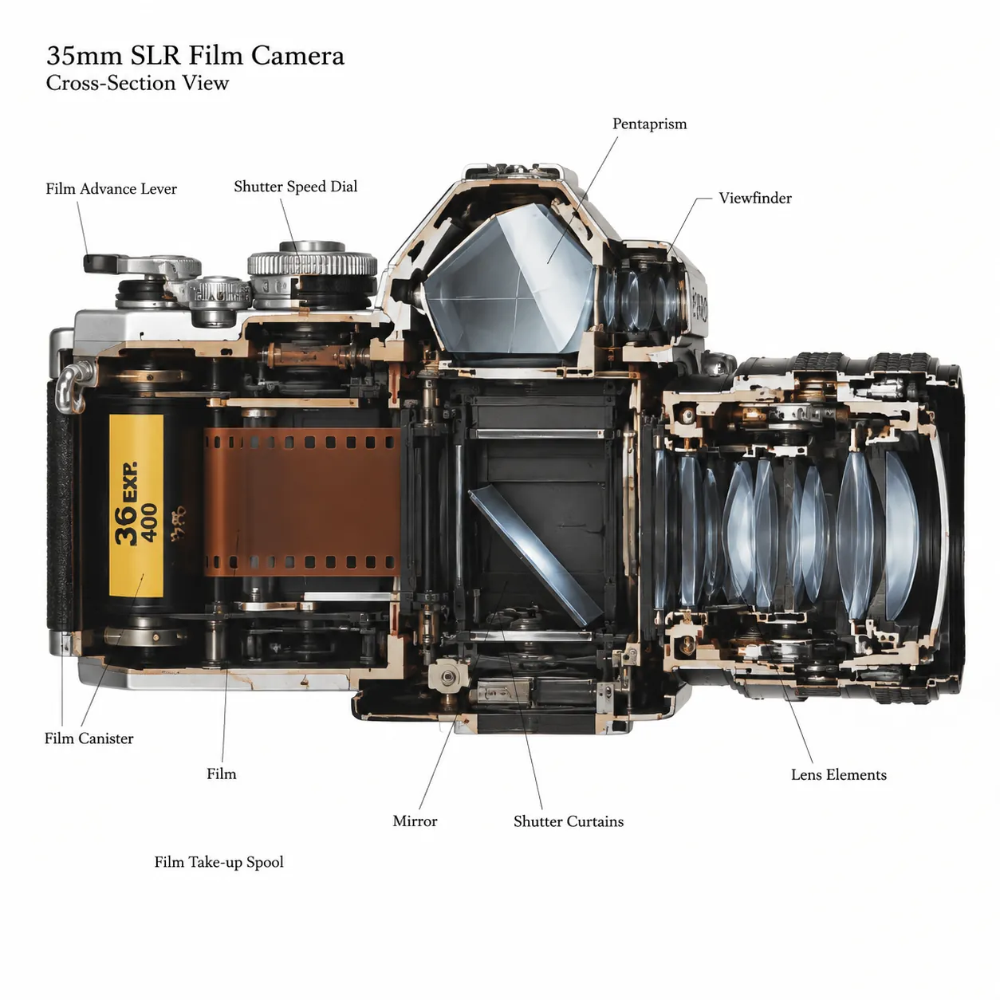</a>

> Barely two lines long, this prompt gets a lot from four phrases: 'cross-section cutaway view', 'internal anatomy revealed', 'museum specimen aesthetic' and 'scientific illustration style'. We filled the object slot with a vintage film camera. The result looks like a beautiful catalogue plate: a 35mm SLR sliced open on white, with a pentaprism, mirror, shutter curtains, lens elements and a film canister, each with a thin leader line and a neat label. Our fact-check found the part names are right but the layout isn't physically possible (the film runs along the lens axis, and one label points at empty space), so present results as stylised art, not technical diagrams.

```text
product design, a vintage film camera, cross-section cutaway view, internal anatomy revealed, 
white background, museum specimen aesthetic, scientific illustration style
```

- Author: [@0x00_Krypt](https://x.com/0x00_Krypt)
- Original post: https://x.com/0x00_Krypt/status/2028376944996470842
- [View on cinel and generate with this prompt](https://cinel.ai/prompts/p/product-cross-section-cutaway-infographic?utm_source=github&utm_medium=awesome&utm_campaign=awesome-gpt-image-2.5-prompts)

### Risograph-Style Themed Icon Set in a 2×2 Grid

<a href="https://cinel.ai/prompts/p/risograph-themed-icon-set?utm_source=github&utm_medium=awesome&utm_campaign=awesome-gpt-image-2.5-prompts">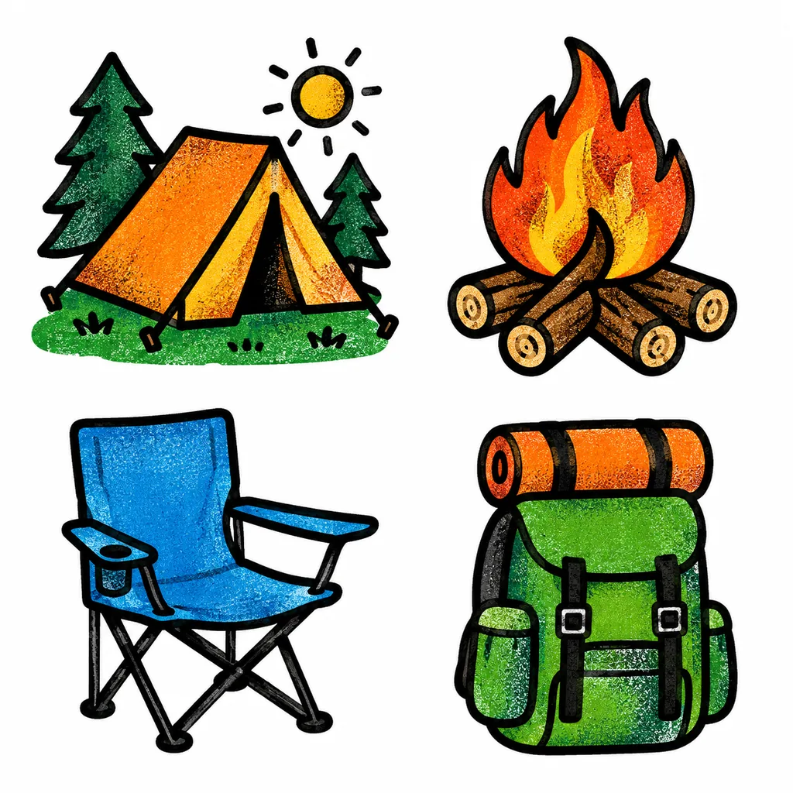</a>

> A short, highly reusable prompt for cohesive icon sets. Give it a theme and it returns four related icons in a borderless 2×2 grid on pure white, styled as risograph prints: thick black outlines, vibrant ink fills and stochastic stippling with a sandy grain. No text keeps it clean for reuse. We tried "a summer camping trip" and GPT Image 2.5 produced a tent, campfire, folding chair and backpack with consistent line weight and that grainy print texture. Use it for app onboarding, blog headers, stickers, merch or presentation slides; it pairs well with the 3D tactile icon prompt for a different look.

```text
Create a collection of icons representing a summer camping trip, they belong together as a single theme. Put them in a 2x2 grid (no lines). The background is pure white. Make the icons as risograph prints. No text. No color distortion. Vibrant and not faded. Stochastic stippling and sand-like noise pattern within color fills. Each icon has a thick black outline.
```

- Author: [@NanoBanana](https://x.com/NanoBanana)
- Original post: https://x.com/NanoBanana/status/2011857121835458929
- [View on cinel and generate with this prompt](https://cinel.ai/prompts/p/risograph-themed-icon-set?utm_source=github&utm_medium=awesome&utm_campaign=awesome-gpt-image-2.5-prompts)

### Quantum Entanglement Grid Concept Art

<a href="https://cinel.ai/prompts/p/quantum-entanglement-grid-concept-art?utm_source=github&utm_medium=awesome&utm_campaign=awesome-gpt-image-2.5-prompts">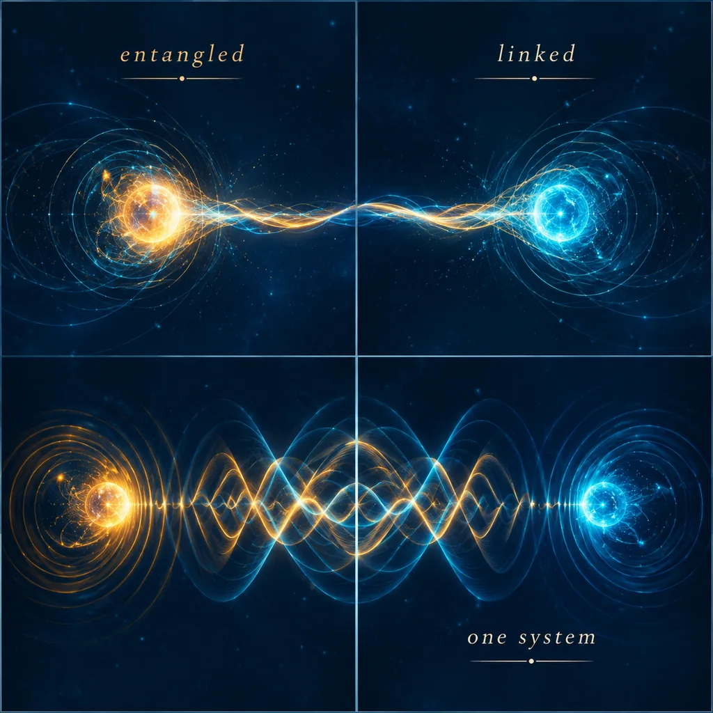</a>

> Expanded from a code-style experimental template @Gdgtify shared with x = 'Quantum Entanglement'. We turned the CLASSIFY template into a runnable four-panel grid: linked particles, mirrored waves and three small labels. Use it for science posters, textbook covers and talk slides.

```text
A four-panel grid concept artwork about quantum entanglement, square 1:1: scientific visualization meets fine art, two glowing particles linked by a luminous thread across all four panels, mirrored waves interfering, deep navy and cyan palette with warm gold highlights, clean diagram-like composition with small labels 'entangled', 'linked' and 'one system', educational and aesthetic, no other text. Square 1:1 composition.
```

- Author: [@Gdgtify](https://x.com/Gdgtify)
- Original post: https://x.com/Gdgtify/status/2108984658717450554
- [View on cinel and generate with this prompt](https://cinel.ai/prompts/p/quantum-entanglement-grid-concept-art?utm_source=github&utm_medium=awesome&utm_campaign=awesome-gpt-image-2.5-prompts)

### Papercraft Cube Landmark Template

<a href="https://cinel.ai/prompts/p/papercraft-cube-landmark-template?utm_source=github&utm_medium=awesome&utm_campaign=awesome-gpt-image-2.5-prompts">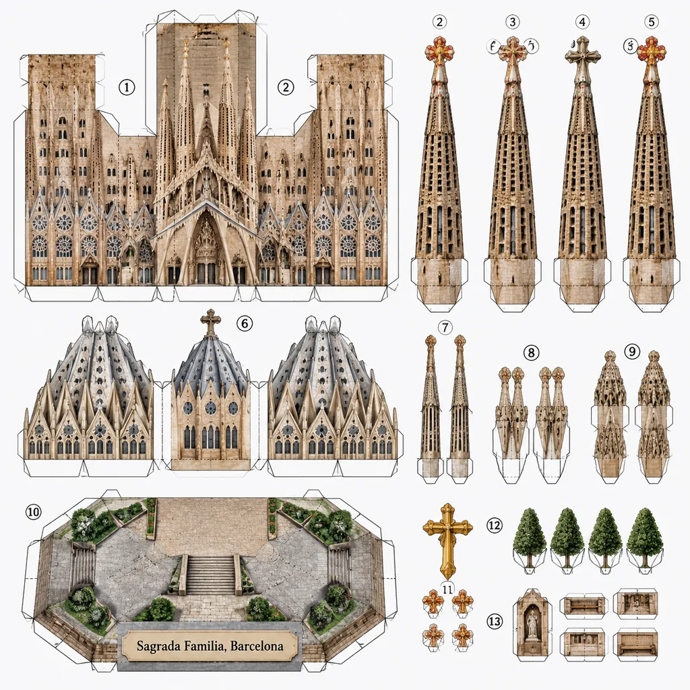</a>

> A filled example of a papercraft-cube template @Naiknelofar788 shared with GPT Image 2.5. We set the landmark to the Sagrada Familia: unfolded facade, towers and base with a small label, printed stone textures and assembly marks. Use it for craft kits, museum shops and DIY posters.

```text
Create a realistic, printable papercraft cube model template of the Sagrada Familia in Barcelona, Spain, laid flat on a clean white background. Show the complete unfolded cut-out pieces: a cube-shaped central building with the landmark's distinctive facade, separate foldable roof and tower pieces with spires, printed windows and entrances, small decorative elements, and a supporting base with a small engraved-style label reading 'Sagrada Familia, Barcelona'. Visible solid cutting lines, dashed folding lines, numbered assembly sections and glue tabs, realistic printed stone textures, professional DIY papercraft kit aesthetic. Square 1:1 composition.
```

- Author: [@Naiknelofar788](https://x.com/Naiknelofar788)
- Original post: https://x.com/Naiknelofar788/status/2111319572859249042
- [View on cinel and generate with this prompt](https://cinel.ai/prompts/p/papercraft-cube-landmark-template?utm_source=github&utm_medium=awesome&utm_campaign=awesome-gpt-image-2.5-prompts)

### Character Style 3-Panel Infographic

<a href="https://cinel.ai/prompts/p/character-style-3panel-infographic?utm_source=github&utm_medium=awesome&utm_campaign=awesome-gpt-image-2.5-prompts">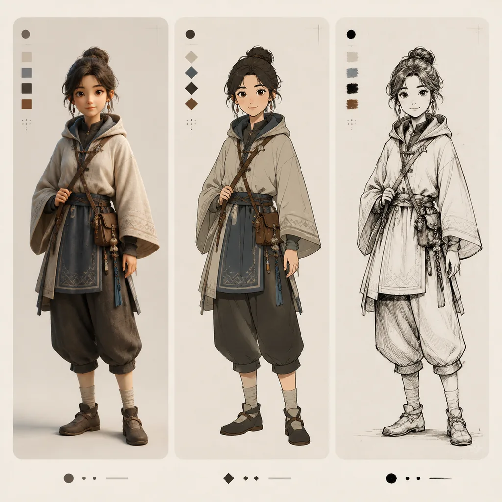</a>

> Adapted from a post by @neroallinai on 2026-10-15 (0 likes at capture). We rewrote it as one clean 1:1 still, removing brands, logos, celebrity/IP elements and any need for your own photo. Change one variable at a time.

```text
Clean infographic layout, square 1:1: a three-panel comparison of the same original fictional character rendered as 3D, flat 2D, and ink sketch, labelled only with tiny abstract marks (no readable words), soft studio backdrop, teaching-style sheet, no logo. Square 1:1 composition.
```

- Author: [@neroallinai](https://x.com/neroallinai)
- Original post: https://x.com/neroallinai/status/2110718598222385329
- [View on cinel and generate with this prompt](https://cinel.ai/prompts/p/character-style-3panel-infographic?utm_source=github&utm_medium=awesome&utm_campaign=awesome-gpt-image-2.5-prompts)

### Kid-Friendly Physics Comic Infographic

<a href="https://cinel.ai/prompts/p/kid-friendly-physics-comic-infographic?utm_source=github&utm_medium=awesome&utm_campaign=awesome-gpt-image-2.5-prompts">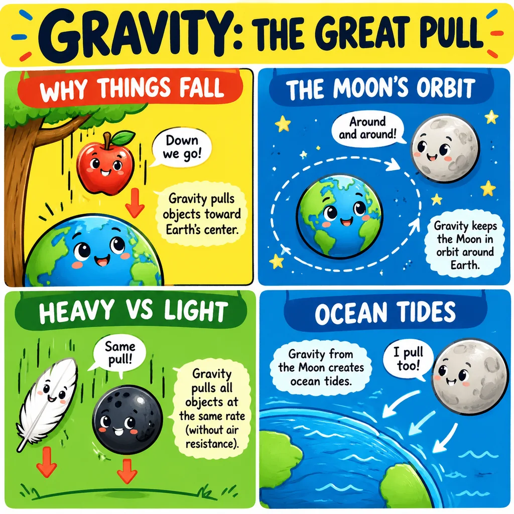</a>

> Adapted from a prompt + image post by @Gdgtify on 2026-10-19 (8 likes at capture). We rewrote it as one clean square 1:1 image, removing brands, logos and any need for your own photo. Change one variable at a time.

```text
Bold educational comic infographic poster about gravity for kids, square 1:1. One main hand-lettered headline "GRAVITY: THE GREAT PULL" across the top; below it, a segmented comic layout of four bright colour-zone panels, each with a short hand-lettered header: "WHY THINGS FALL", "THE MOON'S ORBIT", "HEAVY VS LIGHT" and "OCEAN TIDES". Core figures drawn in cartoon language with thick outlines — a cheerful apple dropping from a tree toward a cute round Earth, a smiling Moon on a dotted orbit path, a feather and a bowling ball falling side by side, ocean waves pulled toward the Moon — with a few props rendered as soft glossy 3D toy-like objects. Arrows, simple icons, small speech bubbles of one or two words, doodles and callout boxes. Strong poster palette of bright yellow, red, cyan, blue, green, white and black. Clear explainer-chart readability, minimal correctly spelled text, no logos. Square 1:1 composition.
```

- Author: [@Gdgtify](https://x.com/Gdgtify)
- Original post: https://x.com/Gdgtify/status/2112129130799968578
- [View on cinel and generate with this prompt](https://cinel.ai/prompts/p/kid-friendly-physics-comic-infographic?utm_source=github&utm_medium=awesome&utm_campaign=awesome-gpt-image-2.5-prompts)

### Stay Rental App Explore Home UI

<a href="https://cinel.ai/prompts/p/rental-app-explore-home-ui?utm_source=github&utm_medium=awesome&utm_campaign=awesome-gpt-image-2.5-prompts">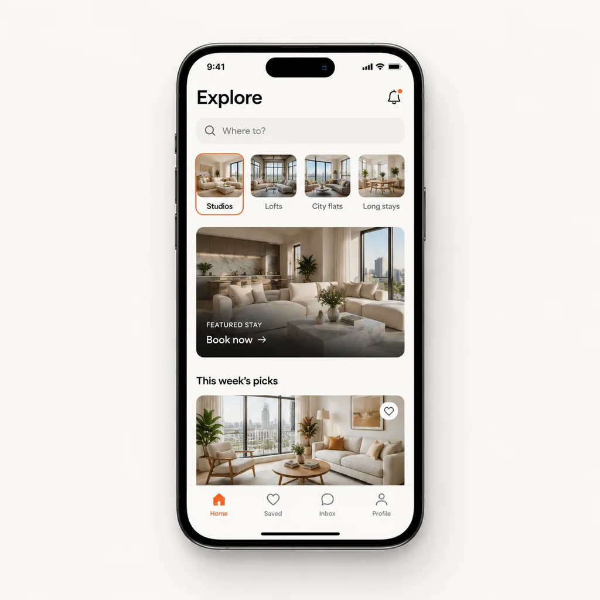</a>

> Adapted from a prompt-only post by @Tegadesigns on 2026-10-14 (18 likes at capture). We rewrote it as one clean square 1:1 still, removing brands, logos, celebrity/IP elements and any need for your own photo. Change one variable at a time.

```text
High-fidelity mobile app UI mockup, square 1:1 canvas: one modern unbranded smartphone floating centered on a soft warm off-white background with a gentle shadow, showing a minimal, premium, image-led 'Explore' home screen for a short-stay apartment rental app. Colours: background #FCFBF9, text #111111, accent #F0642D. Header title "Explore" with a notification bell with an orange dot; a rounded search bar "Where to?"; a row of small apartment thumbnail chips labelled "Studios", "Lofts", "City flats", "Long stays" with Studios outlined in orange; a full-width rounded featured card with a luxury modern apartment photo (cream sofa, marble, plants), dark gradient overlay and white text "FEATURED STAY" and "Book now"; a section "This week's picks" with a bright living-room photo and a heart icon; bottom navigation "Home", "Saved", "Inbox", "Profile". Clean sans-serif typography, 8px spacing, rounded cards, subtle shadows, crisp legible text, no brand names, no logos. Square 1:1 composition.
```

- Author: [@Tegadesigns](https://x.com/Tegadesigns)
- Original post: https://x.com/Tegadesigns/status/2110415342489211208
- [View on cinel and generate with this prompt](https://cinel.ai/prompts/p/rental-app-explore-home-ui?utm_source=github&utm_medium=awesome&utm_campaign=awesome-gpt-image-2.5-prompts)

### Café Dessert Social Post Pack

<a href="https://cinel.ai/prompts/p/cafe-dessert-social-post-pack?utm_source=github&utm_medium=awesome&utm_campaign=awesome-gpt-image-2.5-prompts">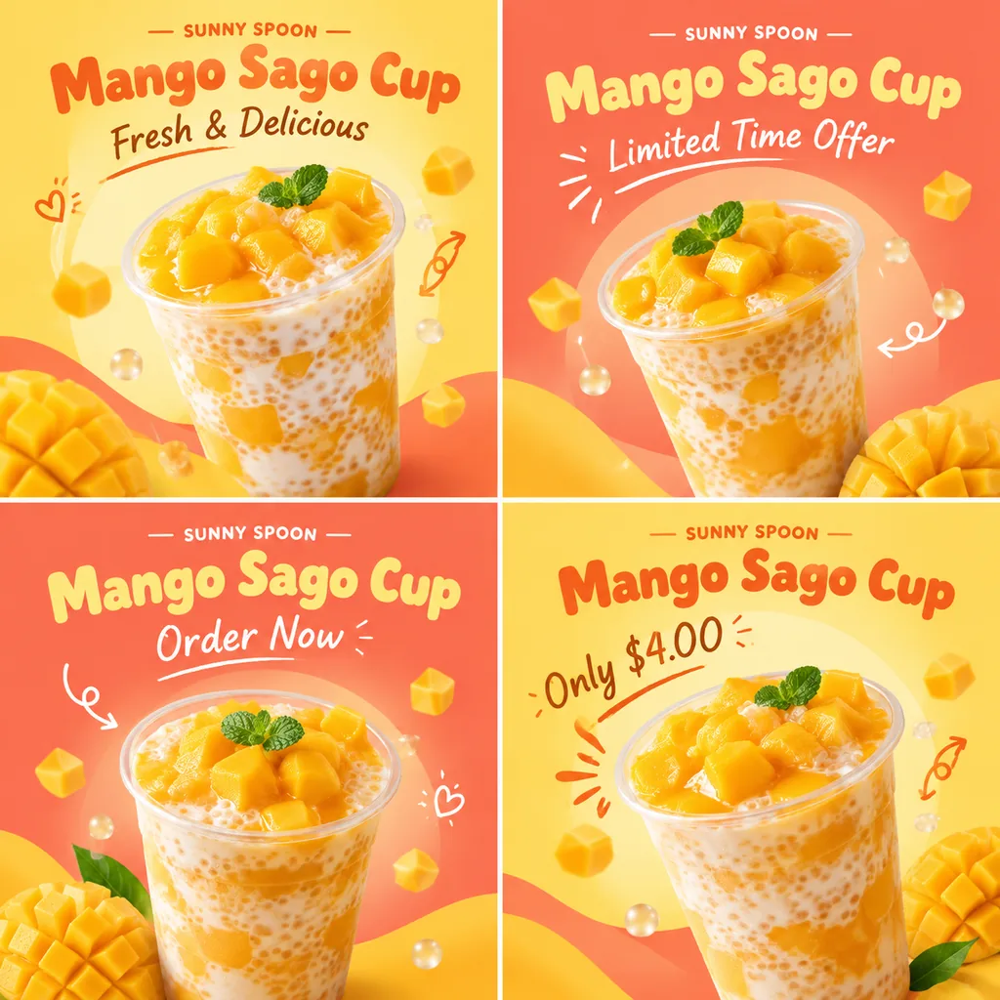</a>

> Adapted from a prompt + image post by @Zyrellix on 2026-05-10 (234 likes at capture). We rewrote it as one clean square 1:1 design with fictional brand names, so there are no real logos and no need to upload your own photo or logo. Change one variable at a time.

```text
A stylish social media post collection for "Mango Sago Cup" from a fictional café "SUNNY SPOON", shown as a 2×2 grid of four square promotional post designs. Each post uses a mango-yellow and coral background with smooth gradients, circular highlights behind the cup, flowing wave shapes, floating mango cubes and sago pearls, decorative arrows and playful accents. Soft commercial studio lighting, glossy realistic dessert rendering, macro detail, slight tilted product angles. Bold rounded headline type with a handwritten subtitle; short promo lines across the four posts: "Fresh & Delicious", "Limited Time Offer", "Order Now", "Only $4.00". Clean spacing, trendy Gen Z café marketing style, crisp readable text, no real brands or app logos. Square 1:1 composition.
```

- Author: [@Zyrellix](https://x.com/Zyrellix)
- Original post: https://x.com/Zyrellix/status/2053309842727833959
- [View on cinel and generate with this prompt](https://cinel.ai/prompts/p/cafe-dessert-social-post-pack?utm_source=github&utm_medium=awesome&utm_campaign=awesome-gpt-image-2.5-prompts)

### Vintage Dog Breed Encyclopedia Poster

<a href="https://cinel.ai/prompts/p/vintage-dog-breed-encyclopedia-poster?utm_source=github&utm_medium=awesome&utm_campaign=awesome-gpt-image-2.5-prompts">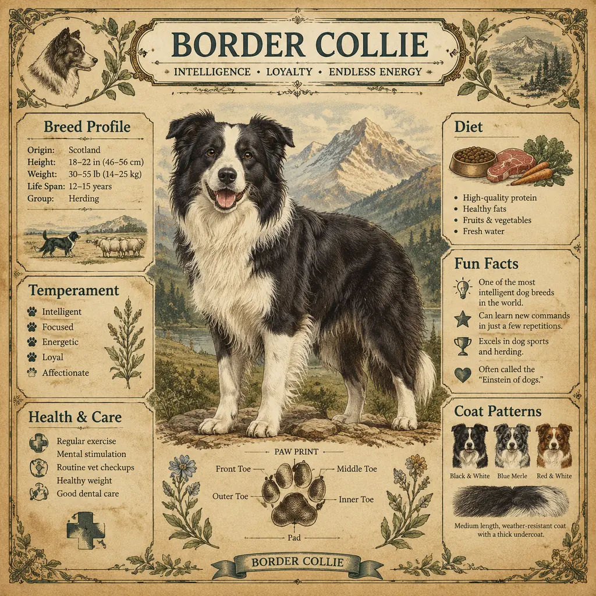</a>

> Adapted from a prompt + image post by @Naiknelofar788 on 2026-05-07 (151 likes at capture). We rewrote it as one clean square 1:1 design with fictional brand names, so there are no real logos and no need to upload your own photo or logo. Change one variable at a time.

```text
Highly detailed vintage encyclopedia-style dog breed poster for the Border Collie. Style: old natural history chart, Victorian encyclopedia plate, museum wall poster. Aged parchment texture, ornate vintage border, elegant serif typography, a realistic detailed Border Collie standing in the center in front of a soft painted mountain background. Earthy palette of muted forest green, navy, faded gold and warm brown. Small infographic sections around it with short readable labels: "Breed Profile", "Temperament", "Health & Care", "Diet", "Fun Facts", "Coat Patterns", plus a paw print diagram, engraved icons and botanical sketch details. Balanced symmetrical layout, collectible printable look, realistic fur. No QR code, no modern UI. Square 1:1 composition.
```

- Author: [@Naiknelofar788](https://x.com/Naiknelofar788)
- Original post: https://x.com/Naiknelofar788/status/2052209599210799325
- [View on cinel and generate with this prompt](https://cinel.ai/prompts/p/vintage-dog-breed-encyclopedia-poster?utm_source=github&utm_medium=awesome&utm_campaign=awesome-gpt-image-2.5-prompts)

### Three-Day City Travel Itinerary Poster

<a href="https://cinel.ai/prompts/p/three-day-city-travel-itinerary-poster?utm_source=github&utm_medium=awesome&utm_campaign=awesome-gpt-image-2.5-prompts">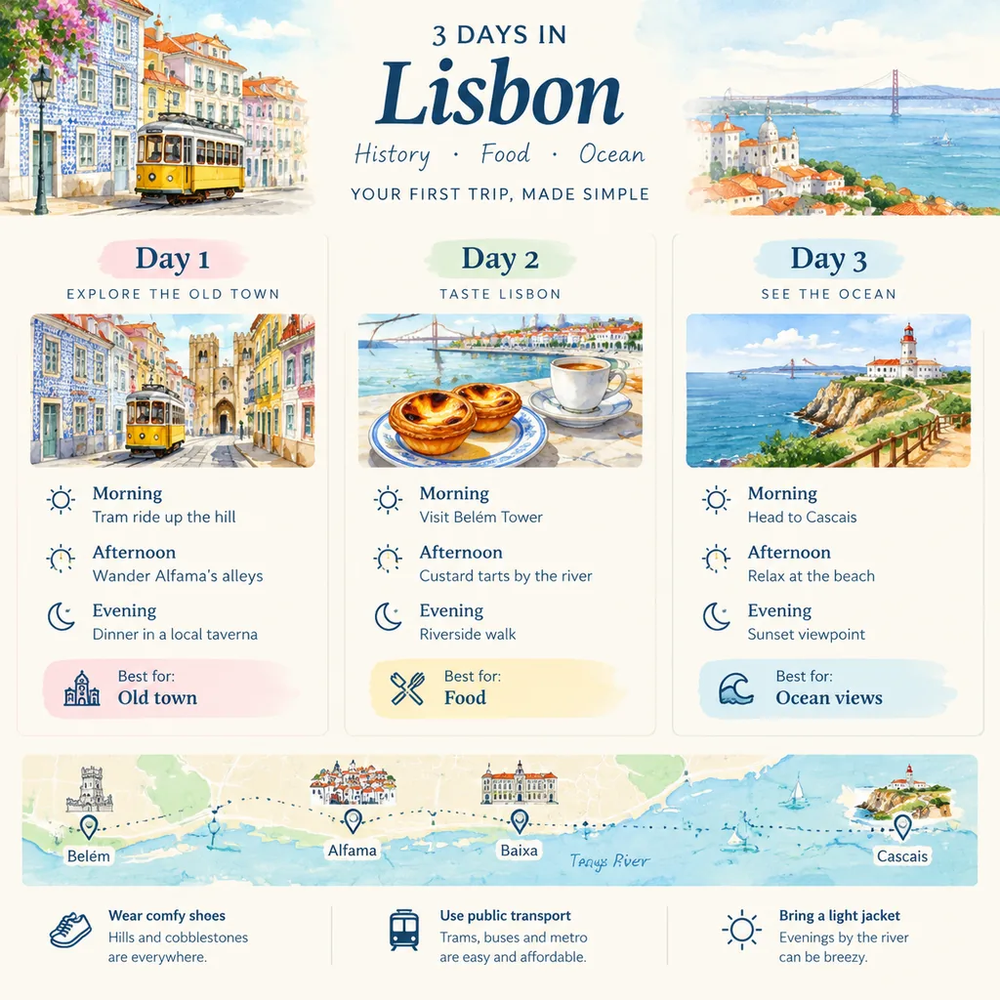</a>

> Adapted from a prompt + image post by @tisch_eins on 2026-05-06 (107 likes at capture). We rewrote it as one clean square 1:1 design with fictional brand names, so there are no real logos and no need to upload your own photo or logo. Change one variable at a time.

```text
Beautiful 3-day travel itinerary visual for a first-time trip to Lisbon. Premium travel-guide layout with three clear columns: Day 1, Day 2, Day 3, each split into Morning, Afternoon and Evening with one short activity line each (for example "Tram ride up the hill", "Custard tarts by the river", "Sunset viewpoint"). A simple map-inspired strip with dotted routes and small pins along the bottom, a short "best for" label per day ("Old town", "Food", "Ocean views"), and three small practical tips with tiny icons. Soft colors, small watercolor illustrations of tiled facades, a yellow tram and the river, clean typography, editorial magazine feel, not overloaded with text, crisp readable spelling. Square 1:1 composition.
```

- Author: [@tisch_eins](https://x.com/tisch_eins)
- Original post: https://x.com/tisch_eins/status/2052026781566132280
- [View on cinel and generate with this prompt](https://cinel.ai/prompts/p/three-day-city-travel-itinerary-poster?utm_source=github&utm_medium=awesome&utm_campaign=awesome-gpt-image-2.5-prompts)

### Early-Internet Personal Résumé Homepage

<a href="https://cinel.ai/prompts/p/early-internet-personal-resume-homepage?utm_source=github&utm_medium=awesome&utm_campaign=awesome-gpt-image-2.5-prompts">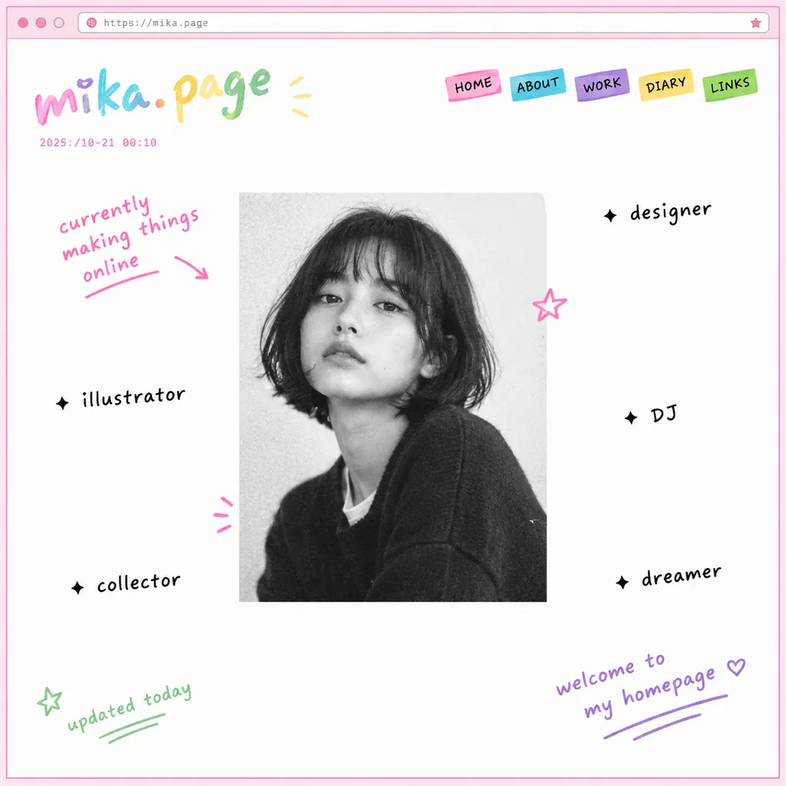</a>

> Adapted from a prompt + image post by @Emmma___0 on 2026-06-14 (102 likes at capture). We rewrote it as one clean square 1:1 design with fictional brand names, so there are no real logos and no need to upload your own photo or logo. Change one variable at a time.

```text
Minimal early-internet personal profile webpage / digital portfolio landing page on a large white canvas with generous negative space and a thin pastel pink browser-style frame. In the center, a black-and-white editorial portrait of a fictional young designer with a short bob, soft film grain and subtle scanner texture. Around the portrait, scattered profile labels with small star bullets like a playful résumé: "✦ designer", "✦ illustrator", "✦ DJ", "✦ collector", "✦ dreamer". Top-left: a colorful hand-drawn original name mark "mika.page" with a tiny timestamp beneath. Top-right: irregular sticker-like navigation tabs in pink, cyan, purple, yellow and green: HOME, ABOUT, WORK, DIARY, LINKS. Handwritten marker notes: "currently making things online", "welcome to my homepage", "updated today". Anti-grid playful placement, portrait fully monochrome, color only on the mark, tabs and small accents, crisp readable text. Square 1:1 composition.
```

- Author: [@Emmma___0](https://x.com/Emmma___0)
- Original post: https://x.com/Emmma___0/status/2065992579502747850
- [View on cinel and generate with this prompt](https://cinel.ai/prompts/p/early-internet-personal-resume-homepage?utm_source=github&utm_medium=awesome&utm_campaign=awesome-gpt-image-2.5-prompts)

### Bagel Café Menu & Ordering System Page

<a href="https://cinel.ai/prompts/p/bagel-cafe-menu-ordering-system-page?utm_source=github&utm_medium=awesome&utm_campaign=awesome-gpt-image-2.5-prompts">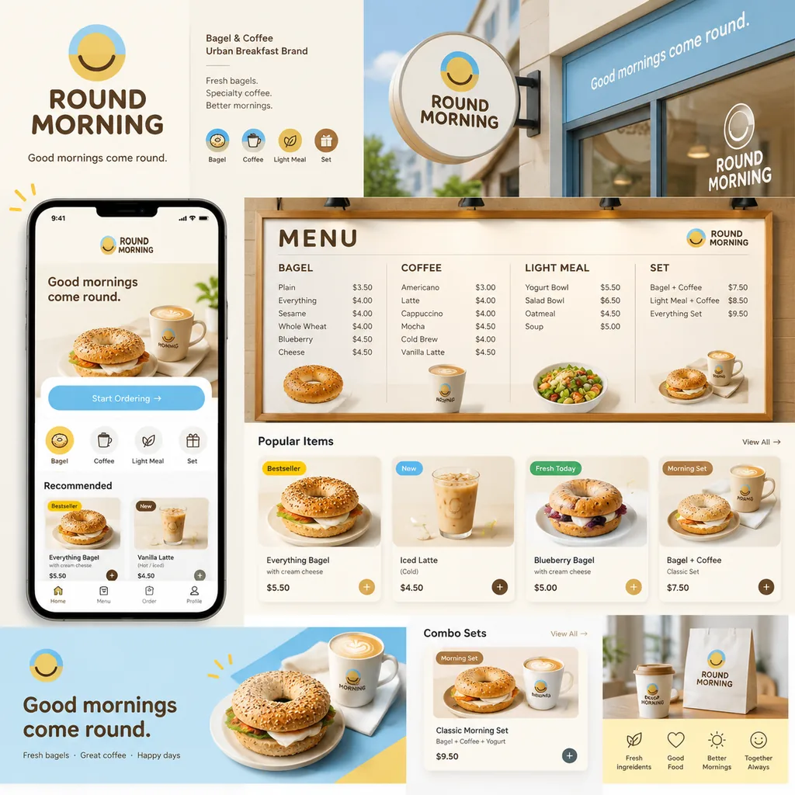</a>

> Adapted from a prompt + image post by @MrLarus on 2026-06-08 (150 likes at capture). We rewrote it as one clean square 1:1 design with fictional brand names, so there are no real logos and no need to upload your own photo or logo. Change one variable at a time.

```text
One brand proposal page showing the menu and ordering system for a fictional bagel & coffee brand "ROUND MORNING" (urban breakfast brand, slogan "Good mornings come round"). Palette: cream white, sky blue, bakery yellow and latte brown. Show a realistic mobile ordering UI screen, a menu board, product categories (Bagel / Coffee / Light Meal / Set), product cards with realistic bagel and coffee photos and prices, recommendation tags ("Bestseller", "New", "Fresh Today", "Morning Set"), a combo set section and small icons. Same simple original round logo throughout. Clean modular grid, clear hierarchy, professional Behance-style brand case study, commercially realistic, mostly readable text, no real brands or app-store logos. Square 1:1 composition.
```

- Author: [@MrLarus](https://x.com/MrLarus)
- Original post: https://x.com/MrLarus/status/2063889572308631775
- [View on cinel and generate with this prompt](https://cinel.ai/prompts/p/bagel-cafe-menu-ordering-system-page?utm_source=github&utm_medium=awesome&utm_campaign=awesome-gpt-image-2.5-prompts)

### Engineering Handbook Vehicle Infographic

<a href="https://cinel.ai/prompts/p/engineering-handbook-transport-infographic?utm_source=github&utm_medium=awesome&utm_campaign=awesome-gpt-image-2.5-prompts">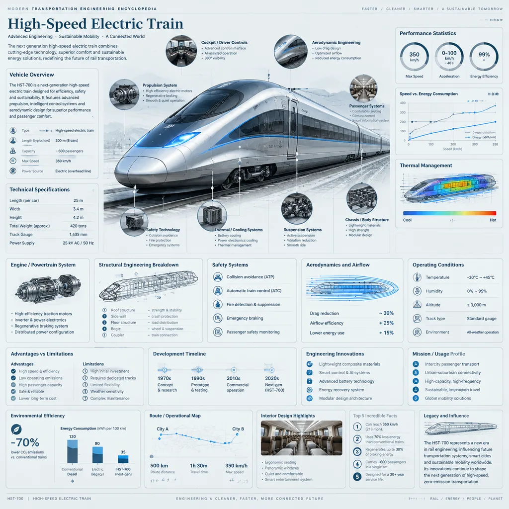</a>

> A widely reshared GPT Image 2 prompt from @john_my07 that builds a museum-quality reference page around one vehicle: an ultra-detailed three-quarter render in the center, thin annotation lines to propulsion, aerodynamics and safety systems, and rounded modular cards for specs, timeline, facts and cutaway diagrams on a soft blueprint background. We filled it with a generic high-speed electric train. Great for explainer posts, classroom handouts and transport fan pages.

```text
Create a premium square “reference-style transportation infographic” centered around fictional generic high-speed electric train (original design, all labels in English), designed as a beautifully curated engineering handbook page rather than a commercial poster.
The composition should feel like a modern visual encyclopedia mixed with a high-end industrial design manual and elite editorial infographic system.
Visual Direction:
• 1:1 square composition
• Soft light-toned technical background with subtle blueprint textures and schematic overlays
• Elegant muted palette using graphite gray, titanium silver, deep navy, steel blue, and soft white accents
• Refined editorial typography hierarchy
• Rounded modular information cards with clean spacing
• Gentle realistic shadows and premium UI-style dividers
• Minimal technical iconography
• Extremely detailed central vehicle render viewed in dramatic three-quarter perspective
• Thin precision annotation lines pointing toward engineering systems and structural details
• Clean, organized “knowledge-first” layout with high information density but breathable spacing
Main Subject Presentation:
A stunning ultra-detailed realistic render of the high-speed electric train placed at the center, featuring highly accurate materials, reflections, panel lines, aerodynamic shaping, lighting systems, mechanical detailing, and premium industrial realism.
Surround the vehicle with scientific callouts and magnified detail circles explaining features such as:
• propulsion system
• aerodynamic engineering
• chassis/body structure
• cockpit or driver controls
• suspension systems
• safety technology
• thermal/cooling systems
• fuel or energy management
• passenger or operational systems
• structural engineering innovations
Include modular infographic sections such as:
• Vehicle Overview
• Technical Specifications
• Performance statistics
• Engine / powertrain system
• Structural engineering breakdown
• Safety systems
• Aerodynamics and airflow
• Operating conditions
• Advantages vs limitations
• Development timeline
• Engineering innovations
• Mission / usage profile
• Environmental efficiency
• Route or operational map
• Interior design highlights
• “Top 5 Incredible Facts” section
• Legacy and influence on modern engineering
Add small premium visualization modules like:
• performance charts
• speed or power gauges
• thermal visualization diagrams
• airflow breakdown graphics
• cutaway engineering diagrams
• miniature blueprint side views
• comparison charts
• system flow diagrams
• operational workflow graphics
Style Keywords:
“premium engineering encyclopedia”
“editorial transportation handbook”
“high-end industrial infographic”
“museum-quality reference page”
“scientific transportation poster”
“modular technical knowledge system”
“clean editorial infographic design”
“ultra-detailed engineering visualization”
Avoid:
• action movie poster aesthetics
• dramatic explosions or cinematic destruction
• heavy grunge textures
• cluttered layouts
• propaganda styling
• generic advertising poster composition
The final result should resemble a professionally published engineering reference-book page created for enthusiasts, collectors, designers, and educational archives.
```

- Author: [@john_my07](https://x.com/john_my07)
- Original post: https://x.com/john_my07/status/2052697683916419169
- [View on cinel and generate with this prompt](https://cinel.ai/prompts/p/engineering-handbook-transport-infographic?utm_source=github&utm_medium=awesome&utm_campaign=awesome-gpt-image-2.5-prompts)

### Magazine-Style 3D Cutaway Infographic

<a href="https://cinel.ai/prompts/p/magazine-cutaway-infographic-zh?utm_source=github&utm_medium=awesome&utm_campaign=awesome-gpt-image-2.5-prompts">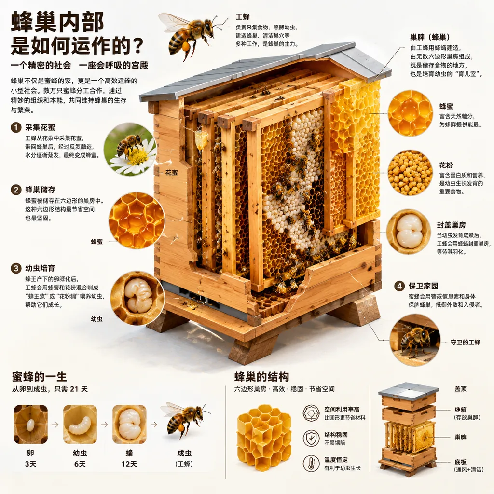</a>

> A one-line Chinese prompt from @ZeroZ_JQ that shows how little you need: ask for a 3D cutaway infographic in isometric illustration style, like a magazine spread with lots of labels, and give it a topic. We used “how a beehive works inside”. Great for science explainers, kids' content and quick concept visuals.

```text
我要一张 3D cutaway infographic / isometric illustration，像杂志里那种带大量标注的剖面信息图。内容关蜂巢内部如何运作
```

- Author: [@ZeroZ_JQ](https://x.com/ZeroZ_JQ)
- Original post: https://x.com/ZeroZ_JQ/status/1997841693765480494
- [View on cinel and generate with this prompt](https://cinel.ai/prompts/p/magazine-cutaway-infographic-zh?utm_source=github&utm_medium=awesome&utm_campaign=awesome-gpt-image-2.5-prompts)

### Isometric City Weather Card

<a href="https://cinel.ai/prompts/p/isometric-city-weather-card-zh?utm_source=github&utm_medium=awesome&utm_campaign=awesome-gpt-image-2.5-prompts">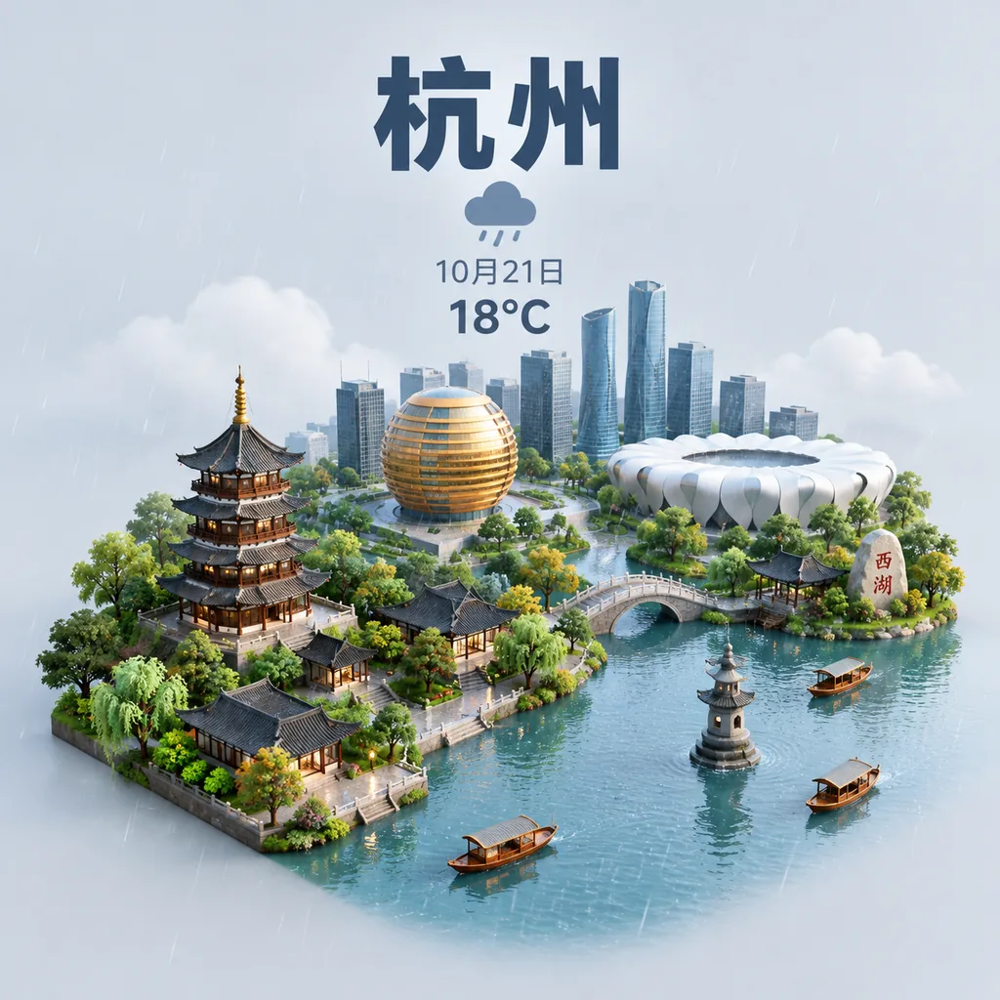</a>

> A Chinese version, shared by @ttmouse, of the 45° top-down isometric city weather template that spread widely as a weather-app look: a cartoon miniature of the city's most iconic landmarks with soft PBR materials, the current weather blended into the scene, and a centered bold city name, weather icon, date and temperature on a clean solid background. We filled it with Hangzhou in light rain. Great for daily weather posts, travel accounts and geography content.

```text
城市名称：杭州
呈现一幅清晰、呈45°俯视角的等距迷你3D卡通场景，展现杭州最具标志性的地标与建筑元素。采用细腻柔和的纹理搭配真实物理渲染(PBR)材质，配合自然柔和的光影效果。将当前天气（小雨）无缝融入城市环境，营造身临其境的氛围。

构图简洁留白，使用纯色柔光背景。

在画面上方居中位置放置粗体大标题"杭州"，其下方配显眼的天气图标，接着以小号文字显示日期「10月21日」，中号文字标注温度「18°C」。所有文本需保持居中排版与统一间距，可轻微叠盖建筑顶部。

正方形画布尺寸1080×1080像素。

（关键要素说明：）

等距透视：采用45°斜俯视角呈现立体城市微缩景观
风格处理：卡通化建模配合PBR材质实现细腻质感
动态天气：渲染小雨天气特效
信息层级：标题>天气图标>日期温度的三段式排版
视觉平衡：建筑群与文字形成有机叠加又不喧宾夺主
```

- Author: [@ttmouse](https://x.com/ttmouse)
- Original post: https://x.com/ttmouse/status/1995243880326029556
- [View on cinel and generate with this prompt](https://cinel.ai/prompts/p/isometric-city-weather-card-zh?utm_source=github&utm_medium=awesome&utm_campaign=awesome-gpt-image-2.5-prompts)

### Attention Economy Data Machine

<a href="https://cinel.ai/prompts/p/attention-economy-data-machine?utm_source=github&utm_medium=awesome&utm_campaign=awesome-gpt-image-2.5-prompts">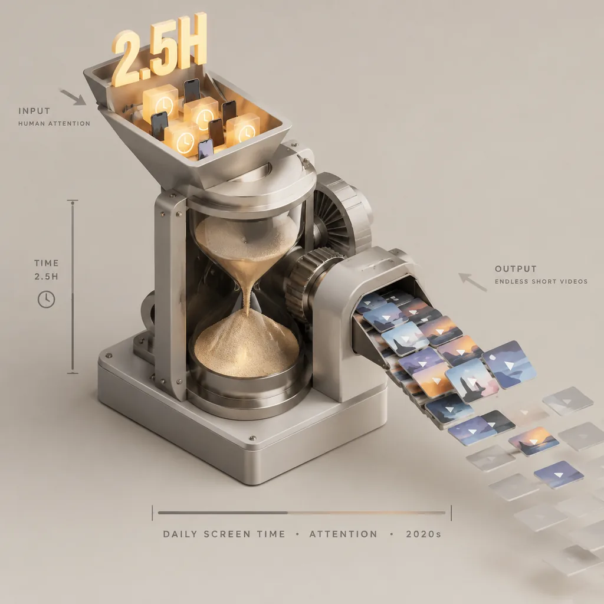</a>

> @Gdgtify data physication prompt (8 likes). Filled attention / daily screen time; no real app logos.

```text
Surreal but clean isometric 3D render, square 1:1, where the attention economy is shown as an elegant symbolic machine consuming human attention. A giant refined hourglass-grinder machine: on the input side, glowing clock blocks and tiny phone silhouettes enter a chute; on the output side, endless short video tiles and empty space spill out. One oversized numeral "2.5H" above the input chute. Caption small: "DAILY SCREEN TIME · ATTENTION · 2020s". Premium isometric 3D, matte clay and brushed metal, soft studio lighting, neutral background, subtle arrows and measurement bars. No logos of real apps, no real people faces.
```

- Author: [@Gdgtify](https://x.com/Gdgtify)
- Original post: https://x.com/Gdgtify/status/2100681698530746736
- [View on cinel and generate with this prompt](https://cinel.ai/prompts/p/attention-economy-data-machine?utm_source=github&utm_medium=awesome&utm_campaign=awesome-gpt-image-2.5-prompts)

### Bicycle L-Shaped Evolution Infographic

<a href="https://cinel.ai/prompts/p/bicycle-l-evolution-infographic?utm_source=github&utm_medium=awesome&utm_campaign=awesome-gpt-image-2.5-prompts">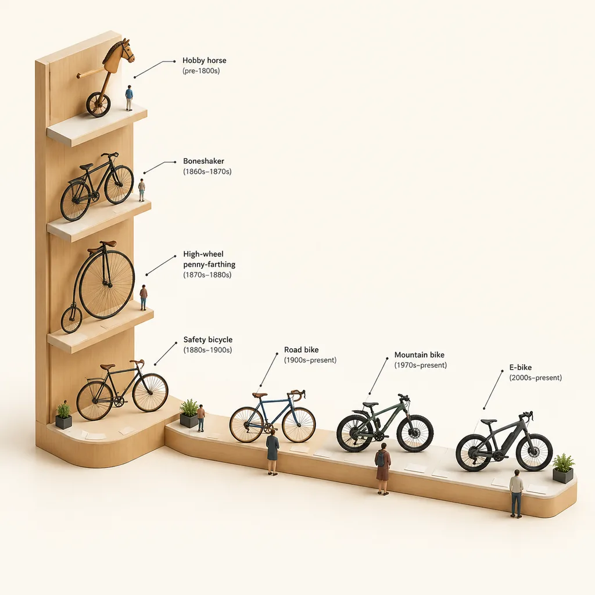</a>

> @Gdgtify L-shaped evolution infographic (17 likes). Filled bicycle; generic e-bike silhouette, no brand.

```text
Clean minimalist isometric miniature infographic for TOPIC = the bicycle, using a distinctive L-shaped evolutionary layout, square 1:1.
Vertical leg: earliest stages stacked on tall upright spine shelves — hobby horse, boneshaker, high-wheel penny-farthing.
Corner: 90-degree conceptual turn at the safety bicycle pivot.
Horizontal leg: later stages along a low runway — diamond-frame road bike, mountain bike, modern e-bike silhouette (generic, no brand).
Each stage one dominant miniature artifact with fine leader lines and small elegant labels. Warm-white background, restrained wood/matte materials, soft studio lighting, tiny people for scale without facial detail. Physical exhibit is the timeline — no giant chart panels, no brand logos.
```

- Author: [@Gdgtify](https://x.com/Gdgtify)
- Original post: https://x.com/Gdgtify/status/2112259739317055886
- [View on cinel and generate with this prompt](https://cinel.ai/prompts/p/bicycle-l-evolution-infographic?utm_source=github&utm_medium=awesome&utm_campaign=awesome-gpt-image-2.5-prompts)
