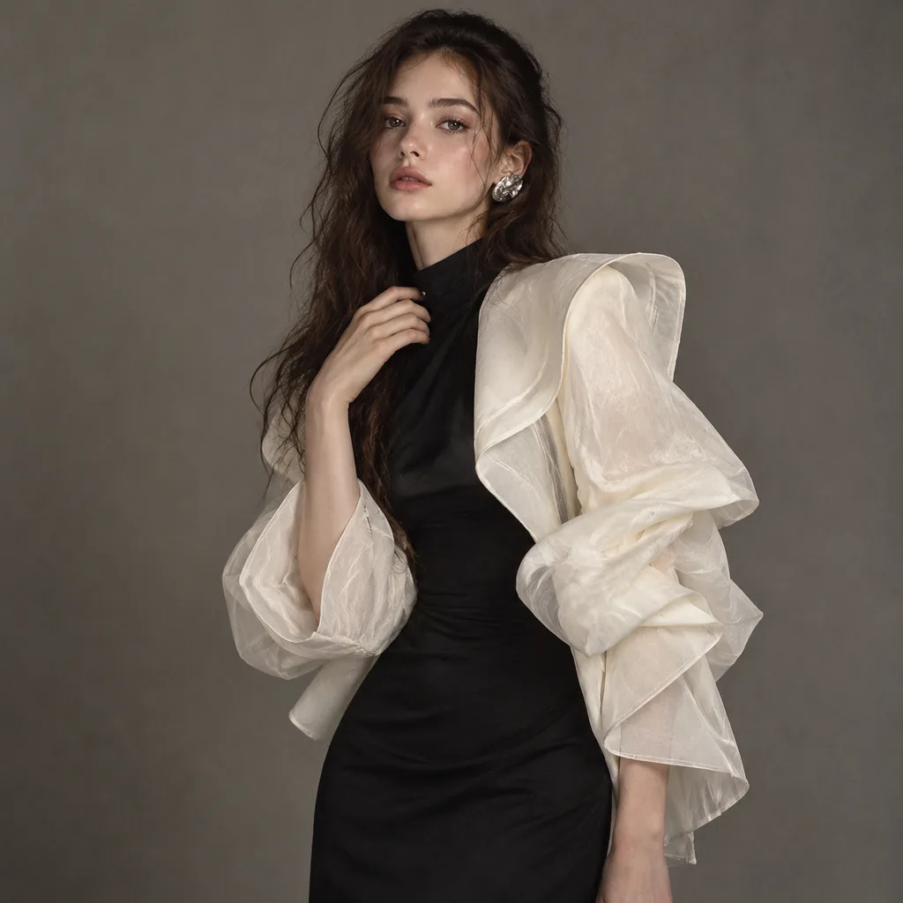
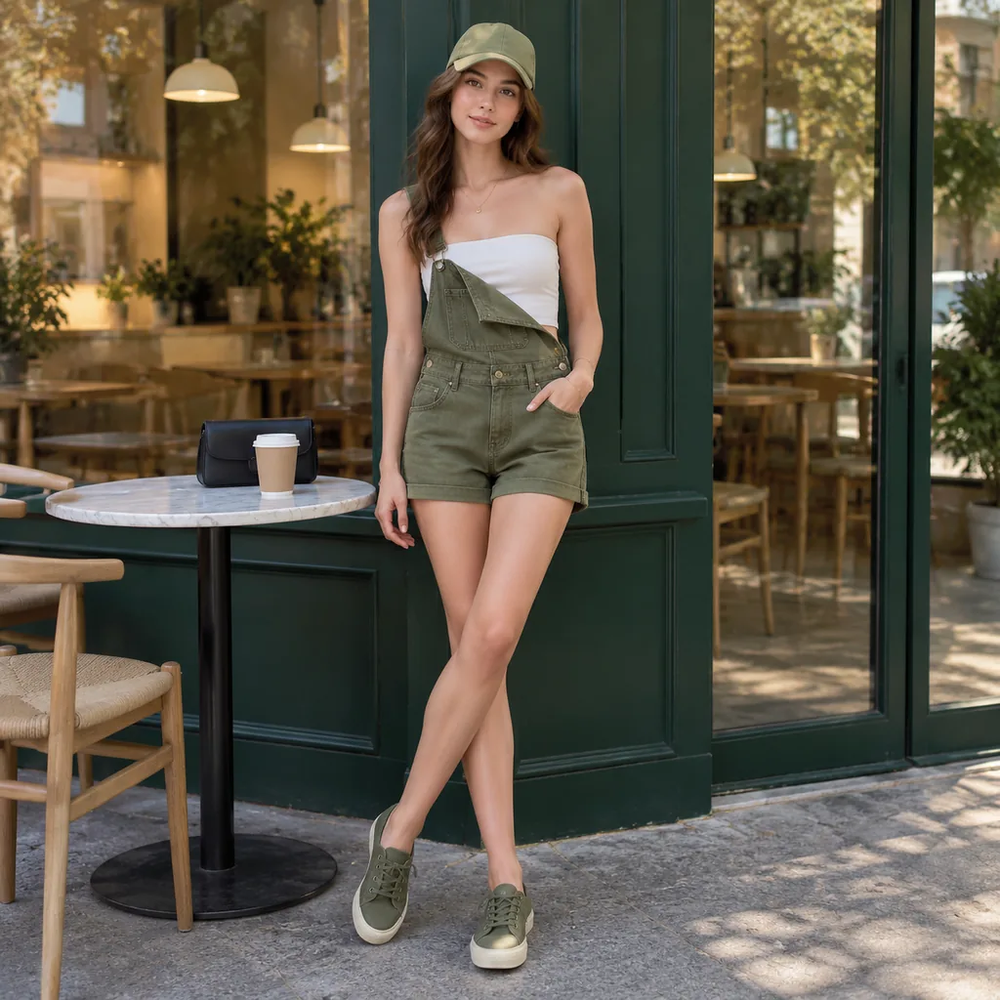
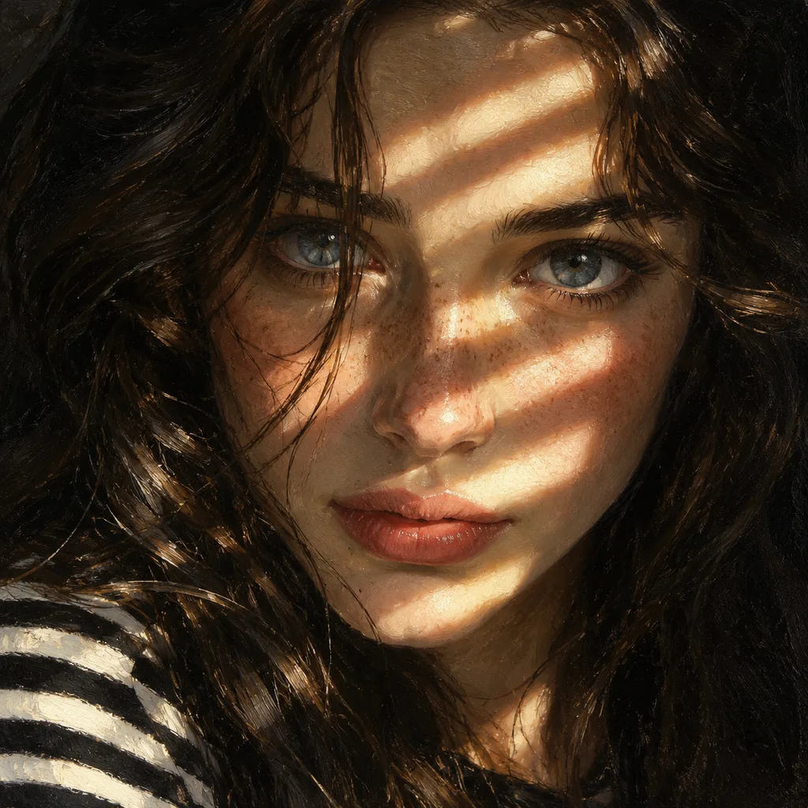
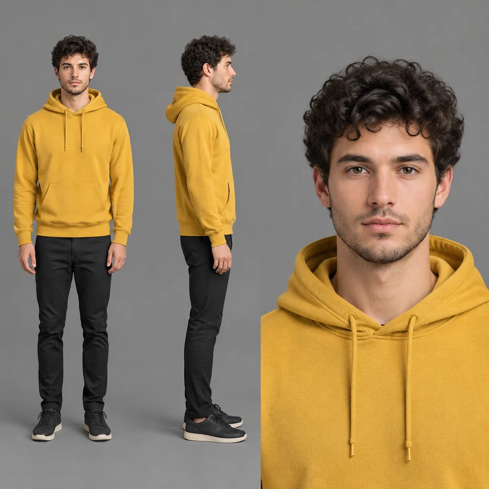

# Portrait & Headshot · GPT Image 2.5

[← README](../README.md) · 78 · [Category on cinel](https://cinel.ai/prompts/portrait?utm_source=github&utm_medium=awesome&utm_campaign=awesome-gpt-image-2.5-prompts)

### Olive Velvet Saree High-Fashion Studio Portrait

<a href="https://cinel.ai/prompts/p/velvet-saree-fashion-studio-portrait?utm_source=github&utm_medium=awesome&utm_campaign=awesome-gpt-image-2.5-prompts"></a>

> Proof that a portrait prompt does not need to be long. In about 90 words it fixes the garment (olive velvet, draped over one shoulder), the styling details that make it specific (embroidered sleeveless blouse, dark mehndi, gold earrings), the light (moody, dramatic, raking across velvet) and the expression (direct, confident gaze). Velvet is a smart choice of fabric: under low-key light its pile catches highlights, which is exactly what the model rendered in our example. To adapt it, keep the sentence about lighting and texture and swap the outfit: a silk lehenga, a brocade jacket or a satin gown work the same way. Change the colour of the velvet before anything else.

```text
A detailed, high-fashion studio photograph of a woman posing gracefully, wearing a luxurious olive green velvet saree draped elegantly over her shoulder, paired with a matching heavily embroidered sleeveless blouse that highlights her midriff. The lighting is moody and dramatic, accentuating the rich texture of the velvet and giving her skin a subtle, dewy sheen. Her hands are adorned with intricate, dark henna (mehndi) designs, and she is wearing traditional gold  earrings, looking directly into the camera with a confident expression.
```

- Author: [@Flora_Janer8](https://x.com/Flora_Janer8)
- Original post: https://x.com/Flora_Janer8/status/2021300975248736723
- [View on cinel and generate with this prompt](https://cinel.ai/prompts/p/velvet-saree-fashion-studio-portrait?utm_source=github&utm_medium=awesome&utm_campaign=awesome-gpt-image-2.5-prompts)

### Luxury Wellness Lifestyle Four-Photo Series Prompt

<a href="https://cinel.ai/prompts/p/luxury-wellness-lifestyle-photo-series?utm_source=github&utm_medium=awesome&utm_campaign=awesome-gpt-image-2.5-prompts"></a>

> Built for creators and wellness brands who need a consistent set rather than a single hero shot. The JSON separates the constants (one subject, her hair and makeup, a cream ribbed activewear set, warm window light, a beige-cream-marble palette with green and gold accents) from the variables, which are the four scenes. Because the constants are so tightly defined, our 2×2 result shows the same woman cooking in a marble kitchen, at a vanity, stretching and eating a salad without any jarring change of look. Swap the activewear colour or the four activities to fit another brand, but keep the colour-palette block; it is what makes the series feel art-directed.

```text
{
  "overall_theme": {
    "description": "A curated series of four ultra-photorealistic vignettes showcasing a luxurious, wellness-focused lifestyle.",
    "mood": "Calm, serene, balanced, sophisticated, peaceful, rejuvenating.",
    "style": "Minimalist, high-end, contemporary, clean aesthetic, aspirational."
  },
  "subject": {
    "description": "Young woman.",
    "appearance": {
      "hair": "Long, dark brown, wavy, natural texture.",
      "skin": "Clear, glowing, natural.",
      "makeup": "No-makeup makeup look, dewy finish.",
      "physique": "Fit, toned."
    },
    "expression": "Serene, composed, gently smiling, focused."
  },
  "wardrobe": {
    "outfit_base": "Matching ribbed beige/cream activewear set.",
    "variations": [
      "Sleeveless crop top and high-waisted leggings.",
      "Long-sleeve crop top and high-waisted leggings."
    ],
    "style": "Comfortable, stylish, high-quality fabric."
  },
  "environmental_details": {
    "lighting": {
      "type": "Natural daylight.",
      "quality": "Soft, diffused, warm, bright.",
      "source": "Large windows (implied or visible)."
    },
    "color_palette": {
      "dominant": ["Warm Beige", "Cream", "White", "Marble Grey"],
      "accents": ["Green (plants)", "Gold (fixtures, details)", "Natural Wood", "Soft Purple (smoothie)"]
    },
    "materials": ["White Marble", "Light Wood", "Stone", "Ceramic", "Glass", "Linen"]
  },
  "scenes": [
    {
      "location": "Modern Luxury Kitchen",
      "environment": "White marble island and countertops, white shaker cabinets, gold hardware, integrated wine fridge, large window.",
      "pose": "Standing at the island, body angled slightly, looking down.",
      "action": "Whisking a hot beverage in a small bowl.",
      "props": ["Ceramic bowl", "Wooden whisk", "Steam", "Mug with 'H'", "Wine fridge"]
    },
    {
      "location": "High-End Bathroom",
      "environment": "Large backlit mirror, white marble vanity, white walls, orchid plant.",
      "pose": "Standing facing the mirror, one hand applying product to face.",
      "action": "Applying skincare.",
      "props": ["Cotton pad", "Skincare bottle", "Lit Diptyque candle", "Whole coconut", "Glass jars"]
    },
    {
      "location": "Minimalist Wellness Space",
      "environment": "Textured beige walls with curved arches, stone water fountain, eucalyptus in a vase.",
      "pose": "Full-body stretch, arms extended overhead, head tilted back, eyes closed.",
      "action": "Stretching.",
      "props": ["Stone water feature", "Large perfume bottle", "Eucalyptus vase"]
    },
    {
      "location": "Bright Café Corner",
      "environment": "Round white marble table, cane chair, large window overlooking a street.",
      "pose": "Sitting at the table, smiling while eating, holding a fork.",
      "action": "Eating avocado toast.",
      "props": ["Avocado toast on plate", "Purple smoothie in glass", "Fork", "Assouline book", "Notebooks", "Small flowers"]
    }
  ],
  "camera_and_technical": {
    "type": "DSLR Photography",
    "style": "Editorial lifestyle",
    "lens": "Prime lens (e.g., 50mm or 85mm f/1.4)",
    "focus": "Sharp focus on the subject in each frame.",
    "depth_of_field": "Shallow, creating a soft, creamy bokeh in the background.",
    "resolution": "Ultra-high resolution, photorealistic textures.",
    "composition": "Four-panel grid collage."
  }
}
```

- Author: [@xmliisu](https://x.com/xmliisu)
- Original post: https://x.com/xmliisu/status/2008486850378293427
- [View on cinel and generate with this prompt](https://cinel.ai/prompts/p/luxury-wellness-lifestyle-photo-series?utm_source=github&utm_medium=awesome&utm_campaign=awesome-gpt-image-2.5-prompts)

### Chinese New Year Nine-Grid Greeting Portrait Prompt

<a href="https://cinel.ai/prompts/p/new-year-greeting-portrait-grid?utm_source=github&utm_medium=awesome&utm_campaign=awesome-gpt-image-2.5-prompts"></a>

> This Chinese prompt is a neat example of numbered design. Each of the nine cells gets a pose and a four-character New Year blessing whose first character is the number of that cell: 一帆风顺 (smooth sailing), 双喜临门 (double happiness), 三阳开泰 and so on up to 九. The JSON separates subject consistency, pose list and text overlays, and it insists on restraint: a clean white wall, soft light, a 'sunny but not greasy' look and calm smiles. Our result keeps one young man in a red sweater across all nine cells, with red calligraphy and a navy year beneath. Swap the subject, outfit colour or year; the blessing list works for any Lunar New Year.

```text
{
  "project_settings": {
    "task_type": "九宫格新年祝福肖像（男生版）",
    "aspect_ratio": "1:1",
    "grid_layout": "3x3",
    "batch_size": 1
  },

  "overall_style": {
    "整体风格": "极简新年祝福风",
    "视觉基调": "干净、温和、克制的节日感",
    "背景": "纯色白墙面，无装饰",
    "光线": "自然柔光，均匀无强阴影",
    "色彩重点": "中国红（服装 + 文字）"
  },

  "subject_base": {
    "人物一致性": "九宫格内为同一位人物",
    "人物类型": "亚洲男性",
    "性别气质": "干净、阳光、自然，不油腻",
    "发型": "黑色短发，自然蓬松，简洁利落",
    "服装": "红色针织毛衣或卫衣，简洁无图案",
    "妆容": "无明显妆感，真实自然肤质",
    "表情气质": "开心，克制的微笑，不夸张"
  },

  "pose_variations": {
    "grid_1": "食指竖于嘴前，轻松安静手势",
    "grid_2": "单手比 V 手势靠近脸部",
    "grid_3": "单手做 OK 或三指手势",
    "grid_4": "双手举起做轻松俏皮手势（不过度卖萌）",
    "grid_5": "单手张开遮住半边脸",
    "grid_6": "单手做电话手势靠近脸侧",
    "grid_7": "单手轻点脸颊或下巴",
    "grid_8": "单手托下巴，轻微思考姿势",
    "grid_9": "双手指向脸部或克制比心变体"
  },

  "text_overlays": {
    "字体风格": "传统中文新年书法字体",
    "文字颜色": "中国红",
    "年份颜色": "深蓝色",
    "文字位置": "每一格顶部居中",
    "文字结构": "四字祝福语 + 年份"
  },

  "text_content": [
    { "position": "grid_1", "text": "一帆风顺", "year": "2026" },
    { "position": "grid_2", "text": "双喜临门", "year": "2026" },
    { "position": "grid_3", "text": "三阳开泰", "year": "2026" },
    { "position": "grid_4", "text": "四季发财", "year": "2026" },
    { "position": "grid_5", "text": "五福临门", "year": "2026" },
    { "position": "grid_6", "text": "六六大顺", "year": "2026" },
    { "position": "grid_7", "text": "七星高照", "year": "2026" },
    { "position": "grid_8", "text": "八方来财", "year": "2026" },
    { "position": "grid_9", "text": "九九同心", "year": "2026" }
  ],

  "constraints": {
    "禁止项": [
      "不改变人物身份",
      "不夸张表情",
      "不女性化姿态",
      "不使用复杂背景",
      "不添加节日道具",
      "不风格化面部"
    ],
    "一致性要求": [
      "人物脸型五官保持完全一致",
      "服装颜色与材质一致",
      "拍摄角度与距离基本一致"
    ]
  },

  "use_cases": [
    "男生新年纪念照",
    "个人春节祝福九宫格",
    "社交平台头像矩阵",
    "品牌新年男生模板"
  ]
}
```

- Author: [@wanerfu](https://x.com/wanerfu)
- Original post: https://x.com/wanerfu/status/2008421241091154115
- [View on cinel and generate with this prompt](https://cinel.ai/prompts/p/new-year-greeting-portrait-grid?utm_source=github&utm_medium=awesome&utm_campaign=awesome-gpt-image-2.5-prompts)

### Long-Exposure Crowd Street Portrait Prompt

<a href="https://cinel.ai/prompts/p/long-exposure-crowd-street-portrait?utm_source=github&utm_medium=awesome&utm_campaign=awesome-gpt-image-2.5-prompts"></a>

> The idea is a classic photographic trick, one sharp still figure inside a blurred, rushing crowd, and the prompt describes both halves explicitly so the model doesn't blur the subject too. 'Standing still', 'perfectly still' and 'sharp focus on her face' anchor her, while 'strong directional motion blur' and 'streaked crowd movement' set the background in motion. Small realism cues (subtle freckles, neutral makeup, a dark winter coat and scarf) keep the face from looking airbrushed. Our result nails the contrast: a calm, direct gaze framed by horizontal streaks of commuters. Change the city, season or outfit freely, but keep the stillness wording intact; it is doing the heavy lifting.

```text
Ultra-realistic cinematic street portrait of a young woman standing still in a crowded city street, sharp focus on her face with calm, intense expression. Long-exposure effect with people moving around her creating strong directional motion blur, streaked crowd movement while the subject remains perfectly still. Natural soft daylight, shallow depth of field, creamy bokeh, realistic skin texture, subtle freckles, neutral makeup, dark winter coat and scarf. Emotional, introspective mood, urban storytelling photography, DSLR quality, 85mm lens look, f/1.8, high dynamic range, 8K, professional color grading.
```

- Author: [@Taaruk_](https://x.com/Taaruk_)
- Original post: https://x.com/Taaruk_/status/2018685474131562751
- [View on cinel and generate with this prompt](https://cinel.ai/prompts/p/long-exposure-crowd-street-portrait?utm_source=github&utm_medium=awesome&utm_campaign=awesome-gpt-image-2.5-prompts)

### Candid Blurry Smartphone Night Snapshot Prompt

<a href="https://cinel.ai/prompts/p/candid-smartphone-selfie-photo?utm_source=github&utm_medium=awesome&utm_campaign=awesome-gpt-image-2.5-prompts"></a>

> Everything here is designed to look unplanned, which is harder to prompt than perfection. The author lists combined reactions (head turned back, a hand rising to block the lens, a suppressed laugh), then deliberately degrades the capture with uncontrolled shake, smeared features, ghosting and a subject almost leaving the frame. It also tells the model to treat the reference only as loose inspiration so the face stays original. Our run, from a fictional reference, delivers a convincingly accidental frame: a blurred hand in front of white tiles and a half-hidden smile. Use it for social content that needs to feel real, and keep the blur instructions; without them it turns into a posed photo.

```text
Ultra-realistic candid smartphone photograph, 9:16 vertical.
Use the attached image only as a strong visual inspiration for general facial proportions and vibe,
while ensuring the generated subject remains fully original, non-identifiable, and not a face copy.
Scene
Nighttime on a quiet Tokyo city sidewalk beside a building with white ceramic tile walls.
The subject is walking past the camera, partially side-on, captured mid-step in a rushed, accidental moment.
Poses & Gestures (combined naturally)
The subject reacts instinctively to being photographed:
turning her head back mid-walk as if surprised,
raising one hand close to the lens to partially block the camera,
shy, restrained smile forming as she suppresses laughter,
body angled in half-profile while continuing to walk forward,
motion carries her slightly out of frame, imperfect framing.
Expressions are subtle and spontaneous — embarrassed, playful, fleeting — never posed.
Camera & Motion
Shot on a modern smartphone, handheld, rushed capture. Strong uncontrolled camera shake. Heavy directional motion blur across the raised hand, hair, and face. Facial features appear smeared and streaked by movement, faintly recognizable but distorted. Partial ghosting around the body. Imperfect framing, subject nearly leaving the frame.
Lighting
Flash-only lighting fired mid-motion. Harsh flash highlights on skin and hand. Deep surrounding darkness. Uneven exposure, blown highlights, hard shadows typical of hurried night phone photography.
Background
White ceramic tile wall stretches into streaked light bands due to motion blur. Street surroundings fade into darkness with minimal readable detail.
Mood
Candid, shy, slightly playful. Feels intrusive, raw, imperfect, and authentic — like a fleeting memory accidentally captured and never meant to be perfect.
Image Quality
Extremely noisy. Heavily blurred. Raw smartphone look. Not cinematic. Not editorial. Not polished.
Negative Prompt
anime, illustration, painting, stylized,
studio lighting, beauty lighting, soft portrait,
sharp focus, clean face, perfect anatomy, smooth skin,
fashion editorial, posed portrait, cinematic grading, film still,
tripod shot, professional photography,
identity match, face copy, real person replication
```

- Author: [@HustleXR](https://x.com/HustleXR)
- Original post: https://x.com/HustleXR/status/2011675822076411914
- [View on cinel and generate with this prompt](https://cinel.ai/prompts/p/candid-smartphone-selfie-photo?utm_source=github&utm_medium=awesome&utm_campaign=awesome-gpt-image-2.5-prompts)

### Monochrome Men's Fashion Editorial Triptych

<a href="https://cinel.ai/prompts/p/monochrome-fashion-editorial-triptych?utm_source=github&utm_medium=awesome&utm_campaign=awesome-gpt-image-2.5-prompts"></a>

> Three frames, three emotional registers: introspective with a hand near the collarbone, a crisp upward profile and a direct frontal look. That is the structure of a magazine spread, and the prompt specifies each one's light and gaze. Continuity props (a white T-shirt and a gold necklace) tie the frames together. Rembrandt lighting in frame one adds sculpting. Our version, built from a fictional reference of a bearded man, keeps the face consistent across all three stacked panels, with visible pores and soft background falloff. Use it for actor headshot packs, personal branding or a lookbook cover, and swap the continuity props to suit, for example a black turtleneck and silver ring.

```text
Preserve the face, proportions, and external features of the model as in the reference. A minimalist monochrome fashion editorial triptych featuring three stacked cinematic frames. The subject is a young man with short dark hair and a groomed beard. Frame 1: Emotional and introspective, looking downward with a hand near the collarbone, highlighting bone structure with Rembrandt lighting. Frame 2: A crisp profile shot with a focus on the nose, lips, and masculine jawline, gaze directed slightly upward. Frame 3: A frontal, thoughtful portrait with shoulders relaxed and direct eye contact. The composition is clean and modern, using a white T-shirt and gold necklace for visual continuity. Commercial magazine quality, high-end mirrorless camera, authentic skin pores, soft bokeh, and elegant masculinity.
```

- Author: [@harboriis](https://x.com/harboriis)
- Original post: https://x.com/harboriis/status/2023230471061315992
- [View on cinel and generate with this prompt](https://cinel.ai/prompts/p/monochrome-fashion-editorial-triptych?utm_source=github&utm_medium=awesome&utm_campaign=awesome-gpt-image-2.5-prompts)

### Color Box Room Fashion Editorial from Your Photo

<a href="https://cinel.ai/prompts/p/color-box-room-fashion-editorial?utm_source=github&utm_medium=awesome&utm_campaign=awesome-gpt-image-2.5-prompts"></a>

> The set is a hollow, saturated, single-colour cube, and the prompt asks the model to randomise three things on each run: the colour, a dynamic pose and a dramatic wide-angle camera. That randomisation makes it a great prompt for generating a varied campaign series from one reference photo. The lighting notes are thoughtful too, asking for bounce light and reflections from the coloured walls, so the subject looks lit by the room. In our run, a fictional woman with a sleek bob braces against the walls of an orange box in a mid-leg-kick pose, wearing a black suit and white sneakers. To keep a series on-brand, replace 'randomly choose' with your fixed colour.

```text
INPUT IMAGE: the attached reference photo. Use the person in the input image as the ONLY subject. Preserve their identity and facial features clearly.

Create a hyper-realistic high-fashion editorial photo inside a surreal 3D geometric “color box” room (a hollow cube / tilted cube set). Each render MUST randomly choose:
1) a bold single-color box (monochrome environment, vivid and saturated),
2) a dynamic “cool” fashion pose (gravity-defying or extreme stretch / leap / sideways bracing against the walls),
3) a dramatic camera angle (wide-angle 24–35mm equivalent, tilted horizon, strong perspective).

The subject appears full-body and sharp, wearing an avant-garde fashion styling that feels modern and editorial (clean silhouette, stylish layering, premium fabric texture). Keep clothing tasteful and fashion-forward. The subject’s pose should feel athletic, stylish, and unusual—like a magazine campaign shot.

Lighting: studio quality, crisp and cinematic; strong key light with controlled soft shadows, subtle rim light; realistic reflections and bounce light from the colored walls. Ultra-detailed skin texture, natural pores, realistic fabric weave, clean edges, high dynamic range. 
Composition: subject centered with plenty of negative space and strong geometric lines; the box perspective frames the subject. 
Color: the box color is a SINGLE bold color and MUST be different each run (random vivid hue). The subject’s outfit contrasts well with the box color.

Output: hyper-real, photorealistic, 8k detail, editorial campaign quality, sharp focus on subject, no motion blur, no distortion of face, natural proportions.
```

- Author: [@Samann_ai](https://x.com/Samann_ai)
- Original post: https://x.com/Samann_ai/status/2017598696678895882
- [View on cinel and generate with this prompt](https://cinel.ai/prompts/p/color-box-room-fashion-editorial?utm_source=github&utm_medium=awesome&utm_campaign=awesome-gpt-image-2.5-prompts)

### Identity-Locked Heroic Low-Angle Portrait in Red-Orange

<a href="https://cinel.ai/prompts/p/identity-locked-editorial-portrait?utm_source=github&utm_medium=awesome&utm_campaign=awesome-gpt-image-2.5-prompts"></a>

> Two ideas make this prompt reliable. First, an explicit 'identity lock' (exact likeness, facial geometry, natural skin, 'no beautification') plus an instruction to keep the reference clothing identical, which stops the model from restyling the person. Second, a fully specified lighting look: low heroic angle, gaze up and beyond the frame, saturated orange-red chiaroscuro and a rim light that separates the head from the gradient. From our fictional reference of a wavy-haired man in an olive jacket, the result keeps his face and jacket and turns him into a film-poster lead. Swap the palette (teal and blue, green and gold) for different genres while keeping the structure.

```text
Editorial portrait from the attached reference photo, photorealistic. Use uploaded selfie as ONLY face reference. Identity lock: exact likeness, facial geometry/proportions, natural skin texture. No beautification. Keep clothing style, color, material, and fit identical to the reference. Medium close-up (face and shoulders), low angle looking up (heroic/dominant perspective), sharp focus on face/eyes.Serious, intense, focused expression, gaze directed upward and away from camera (beyond the frame). Dramatic saturated studio lighting, high-contrast chiaroscuro with deep shadows, vibrant oranges and deep reds palette, strong rim light creating a halo separation. Solid studio backdrop, rich orange-red smooth gradient, pattern-free, hot radiant atmosphere. High skin texture fidelity (pores visible), 8k, portrait aspect ratio, cinematic lighting, 4:5.
```

- Author: [@harboriis](https://x.com/harboriis)
- Original post: https://x.com/harboriis/status/2017479603921600730
- [View on cinel and generate with this prompt](https://cinel.ai/prompts/p/identity-locked-editorial-portrait?utm_source=github&utm_medium=awesome&utm_campaign=awesome-gpt-image-2.5-prompts)

### Red Neon Strip Across the Eyes Studio Portrait

<a href="https://cinel.ai/prompts/p/red-neon-strip-studio-portrait?utm_source=github&utm_medium=awesome&utm_campaign=awesome-gpt-image-2.5-prompts"></a>

> One light, one idea. A horizontal red neon strip is placed exactly at eye level, and everything else is kept dark: low-key lighting, a black turtleneck, a minimal background and shadow over the lower face. That restraint makes the eyes the only bright point in the frame, which is why the result feels so intense. Our version shows a young man with messy textured hair, the red line slicing across his face and reflecting in his irises. It is an easy look for album covers, event posters or a dramatic profile picture. Swap the neon colour (cyan, violet, amber) or the outfit, but keep 'strong contrast shadows covering lower face'; without it, the drama flattens.

```text
Cinematic studio portrait of a young man with messy textured hair, wearing a black turtleneck, centered composition, dark minimal background, dramatic low-key lighting, a horizontal red neon light strip cutting across his eyes, strong contrast shadows covering lower face, intense gaze, moody atmosphere, cyberpunk aesthetic, ultra-realistic, sharp focus, 85mm lens, shallow depth of field, high detail, editorial photography style.
```

- Author: [@Kashberg_0](https://x.com/Kashberg_0)
- Original post: https://x.com/Kashberg_0/status/2035918574674665977
- [View on cinel and generate with this prompt](https://cinel.ai/prompts/p/red-neon-strip-studio-portrait?utm_source=github&utm_medium=awesome&utm_campaign=awesome-gpt-image-2.5-prompts)

### Red Motion-Blur Silhouette Portrait Prompt

<a href="https://cinel.ai/prompts/p/red-motion-blur-silhouette-portrait?utm_source=github&utm_medium=awesome&utm_campaign=awesome-gpt-image-2.5-prompts"></a>

> This prompt is almost all atmosphere, and that is its strength. It never describes a face. It asks for a blurry silhouette, motion trailing behind her, soft-focus features, film grain and a deep red haze, and lets those effects carry the image. The phrase 'panning shot' matters, because it tells the model the camera moved with the subject, so the figure smears horizontally rather than vanishing. Our output is a ghostly profile dissolving into crimson light, ideal as a music single cover, a moody story background or a book jacket. Change only the background colour to shift the emotion: deep blue reads lonely, amber nostalgic, green unsettling.

```text
panning shot of a blurry female silhouette, soft motion blur trailing behind her, gentle film grain, diffused edge lighting, deep red gradient background with glowing haze, soft-focus facial features, smooth atmospheric glow,

slow-shutter cinematic effect
```

- Author: [@nextstepst](https://x.com/nextstepst)
- Original post: https://x.com/nextstepst/status/2026308234420666586
- [View on cinel and generate with this prompt](https://cinel.ai/prompts/p/red-motion-blur-silhouette-portrait?utm_source=github&utm_medium=awesome&utm_campaign=awesome-gpt-image-2.5-prompts)

### Blue Puffer Jacket Still in a Rushing Crowd

<a href="https://cinel.ai/prompts/p/blue-puffer-crowd-street-portrait?utm_source=github&utm_medium=awesome&utm_campaign=awesome-gpt-image-2.5-prompts"></a>

> A close cousin of the long-exposure crowd portrait, but with two differences that change the feel. A single saturated garment, a bright blue puffer, makes the subject pop instantly against a cool, overcast city, and 'intense eye contact with camera' turns the mood from introspective to confrontational. Specific urban cues (traffic lights, tall buildings) place it downtown. In our result the cobalt jacket is the only strong colour in the frame, while commuters blur into grey streaks. Use it for fashion and outerwear campaigns, where the product colour should be the hero. Swap blue for any brand colour and keep the rest of the scene muted.

```text
Ultra-realistic cinematic street portrait of a young woman in a bright blue puffer jacket standing still in the middle of a busy city crowd, intense eye contact with camera, shallow depth of field, motion-blurred pedestrians rushing around her, urban background with traffic lights and tall buildings, cool color grading, natural skin tones, soft overcast lighting, 85mm lens, f/1.8, high detail, sharp focus on subject, dynamic motion blur, editorial photography, 8k.
```

- Author: [@Kashberg_0](https://x.com/Kashberg_0)
- Original post: https://x.com/Kashberg_0/status/2026100670500339830
- [View on cinel and generate with this prompt](https://cinel.ai/prompts/p/blue-puffer-crowd-street-portrait?utm_source=github&utm_medium=awesome&utm_campaign=awesome-gpt-image-2.5-prompts)

### Sticker-Covered Face Bubblegum Portrait Prompt

<a href="https://cinel.ai/prompts/p/sticker-covered-face-bubblegum-portrait?utm_source=github&utm_medium=awesome&utm_campaign=awesome-gpt-image-2.5-prompts"></a>

> This one is written as a long structured JSON scene description, the kind produced by reverse-engineering a reference photo: global context, lighting direction and quality, estimated hex colours, framing, and an object list down to individual sticker types. That level of specification is why the result is so controlled. Our output is an extreme close-up of a freckled young woman, face dotted with smileys, cherries, stars and word stickers ('POP ME', 'Sweet'), with a glossy pink bubble in front of her lips and visible pores and adhesive sheen. Use it for playful beauty, Gen-Z fashion or snack campaigns. To adapt it, edit the sticker text values, not the structure.

```text
{
  "meta": {
    "image_quality": "High",
    "image_type": "Photo"
  },
  "global_context": {
    "scene_description": "Close-up portrait of a young person's face covered with colorful paper stickers and glossy adhesive residue. Central focus on eyes, nose, lips; subject blowing a pink bubblegum bubble. Stickers vary in size, text, icons and layered overlap; hair strands frame face at edges. Skin shows freckles, pores, and sheen from adhesive or moisture.",
    "time_of_day": "Neutral/studio lighting",
    "weather_atmosphere": "Indoors/controlled",
    "lighting": {
      "source": "Artificial",
      "direction": "Frontal with slight top",
      "quality": "Soft",
      "color_temp": "Neutral"
    }
  },
  "color_palette": {
    "dominant_hex_estimates": ["#E7B1B6", "#F6C0D0", "#C9A38C"],
    "accent_colors": ["Pink","Magenta"],
    "contrast_level": "Medium"
  },
  "composition": {
    "camera_angle": "Eye-level",
    "framing": "Extreme close-up (face fills frame)",
    "depth_of_field": "Shallow (background indistinct)",
    "focal_point": "Eyes and central bubble"
  },
  "objects": [
    {
      "id": "obj_001",
      "label": "Face",
      "category": "Person (head)",
      "location": "Center",
      "prominence": "Foreground",
      "visual_attributes": {
        "color": "Light beige skin with pink undertones and freckles",
        "texture": "Smooth with visible pores, glossy adhesive patches",
        "material": "Skin",
        "state": "Sticker-covered, slightly wet/glossy",
        "dimensions_relative": "Large relative to frame"
      },
      "micro_details": [
        "Freckles concentrated on nose and cheeks",
        "Shiny adhesive residue streaks on forehead and cheeks",
        "Fine vellus hairs visible",
        "Pores visible on nose and cheeks"
      ],
      "pose_or_orientation": "Frontal",
      "text_content": null
    },
    {
      "id": "obj_002",
      "label": "Eyes (pair)",
      "category": "Facial feature",
      "location": "Upper-center",
      "prominence": "Foreground",
      "visual_attributes": {
        "color": "Gray-green irises with dark limbal ring",
        "texture": "Wet/glossy cornea, visible eyelashes",
        "material": "Biological",
        "state": "Open, neutral expression",
        "dimensions_relative": "Medium"
      },
      "micro_details": [
        "Tiny specular highlights on each cornea",
        "Sparse lower lashes, fuller upper lashes",
        "Slight shadow under lower lids"
      ],
      "pose_or_orientation": "Facing camera",
      "text_content": null
    },
    {
      "id": "obj_003",
      "label": "Pink bubble",
      "category": "Object (gum)",
      "location": "Lower-center",
      "prominence": "Foreground",
      "visual_attributes": {
        "color": "Pastel pink",
        "texture": "Smooth, slightly translucent",
        "material": "Gum",
        "state": "Inflated/intact",
        "dimensions_relative": "Large relative to mouth"
      },
      "micro_details": [
        "Two bright specular reflections on sphere",
        "Seamless edge against lips"
      ],
      "pose_or_orientation": "Centered over mouth",
      "text_content": null
    },
    {
      "id": "obj_004",
      "label": "Stickers (assorted)",
      "category": "Adhesive stickers",
      "location": "Entire face and neck, concentrated forehead and cheeks",
      "prominence": "Foreground",
      "visual_attributes": {
        "color": "Multicolor: magenta, yellow, blue, white",
        "texture": "Paper/plastic with glossy varnish, torn edges",
        "material": "Paper/plastic adhesive",
        "state": "Layered, partially torn, some wrinkled",
        "dimensions_relative": "Varied small-to-medium"
      },
      "micro_details": [
        "Large 'POP ME' magenta sticker on forehead",
        "Partial torn sticker fragments near nasolabial fold",
        "Small rectangular stickers with tiny printed text",
        "Edges lifting, adhesive shine around perimeters"
      ],
      "pose_or_orientation": "Affixed flat or slightly peeled",
      "text_content": "Multiple small logos and words (e.g., 'POP ME')"
    },
    {
      "id": "obj_005",
      "label": "Hair strands",
      "category": "Hair",
      "location": "Left and right edges framing face",
      "prominence": "Background/foreground overlap",
      "visual_attributes": {
        "color": "Light brown",
        "texture": "Fine, slightly wet",
        "material": "Hair",
        "state": "Loose strands",
        "dimensions_relative": "Thin relative to face"
      },
      "micro_details": [
        "Individual strands crossing forehead edges",
        "Slight adhesive sheen on some strands"
      ],
      "pose_or_orientation": "Hanging down"
    }
  ],
  "text_ocr": {
    "present": true,
    "content": [
      {
        "text": "POP ME",
        "location": "Forehead",
        "font_style": "Bold/Decorative",
        "legibility": "Clear"
      }
    ]
  },
  "semantic_relationships": [
    "Stickers are affixed to Face",
    "Bubble covers mouth, partially obscuring lips",
    "Adhesive residue creates glossy highlights on skin",
    "Hair strands frame and partly overlay stickers"
  ]
}
```

- Author: [@Ankit_patel211](https://x.com/Ankit_patel211)
- Original post: https://x.com/Ankit_patel211/status/2016189962090381695
- [View on cinel and generate with this prompt](https://cinel.ai/prompts/p/sticker-covered-face-bubblegum-portrait?utm_source=github&utm_medium=awesome&utm_campaign=awesome-gpt-image-2.5-prompts)

### Windswept Grass Field Editorial Portrait Prompt

<a href="https://cinel.ai/prompts/p/windswept-grass-field-editorial-portrait?utm_source=github&utm_medium=awesome&utm_campaign=awesome-gpt-image-2.5-prompts"></a>

> A reference-based portrait with a strong, poetic brief: the subject stands in tall grass that moves 'like ocean waves', partly hiding the body, with no horizon, so the frame is filled entirely with texture. A loose white shirt, a bowed head and downcast eyes set a quiet, melancholic tone, while telephoto compression, film grain and a muted sage-olive palette make it read like a magazine spread. We used a fictional reference of a woman with long dark hair. The result keeps her likeness and the wind-blown hair, with the grass streaming diagonally around her. It is a good template for musicians, authors and personal branding. Keep the 'no visible horizon' line; it creates the immersion.

```text
Create a 3:4 cinematic, atmospheric editorial portrait using the attached photo as the exact face and identity reference. A solitary man/woman stands alone in the middle of vast, wind-swept sage green grass fields. Tall grass surrounds the subject completely, flowing in strong currents like ocean waves, partially obscuring the body and creating motion,depth, and solitude. The subject wears a simple, loose white shirt that softly contrasts with the rich green landscape.
Dark hair is slightly messy, with natural strands moving in the wind. The head is gently tilted downward, eyes cast toward the ground, conveying a quiet, introspective, melancholic mood. Expression is calm, distant, and emotionally restrained. Compose the frame slightly off-center, from a subtle elevated angle. No visible horizon, the frame is fully immersed in grass texture. Use a muted natural palette of sage green, deep olive, and soft off-white. Shoot vertical 3:4, telephoto perspective, shallow depth of field, cinematic framing. Film photography aesthetic with visible grain, soft edge falloff, atmospheric light, wind-driven motion blur in the grass. Quiet, poetic storytelling; ultra-detailed yet natural, magazine-cover editorial quality. No text, no watermark.
```

- Author: [@Goodmanprotocol](https://x.com/Goodmanprotocol)
- Original post: https://x.com/Goodmanprotocol/status/2038617381388583283
- [View on cinel and generate with this prompt](https://cinel.ai/prompts/p/windswept-grass-field-editorial-portrait?utm_source=github&utm_medium=awesome&utm_campaign=awesome-gpt-image-2.5-prompts)

### Candid Seaside Couple Sharing Simit Prompt

<a href="https://cinel.ai/prompts/p/seaside-street-romance-candid-photo?utm_source=github&utm_medium=awesome&utm_campaign=awesome-gpt-image-2.5-prompts"></a>

> Most 'couple' prompts produce glossy engagement-shoot images. This one is written to avoid exactly that: it asks for ordinary, not model-like people, a 35mm eye-level frame with imperfect composition, real skin without retouching, subtle halation and gate weave, and a negative list that bans studio light, HDR, 'AI glow' and posed romance-poster looks. The scene is very specific (Istanbul's Moda seafront, a cherry-print dress, simit crumbs on hands), and that specificity is what makes it believable. Our result shows the couple laughing over their bread with gulls and the sea behind them. Adapt the location, food and clothing for local tourism, cafés or lifestyle brands.

```text
{
  "generation_request": {
    "meta_data": {
      "tool": "NanoBanana Pro",
      "task_type": "photoreal_candid_street_romance",
      "version": "v1.2_MODA_SEASIDE_SIMIT_SUNNY_CHERRY_DRESS_EN",
      "priority": "highest"
    },

    "output_settings": {
      "aspect_ratio": "4:5",
      "orientation": "portrait",
      "resolution_target": "ultra_high_res",
      "render_style": "ultra_photoreal_candid_street_film_still",
      "sharpness": "crisp_but_natural",
      "film_grain": "subtle_35mm",
      "color_grade": "true_to_life_sunny_natural",
      "dynamic_range": "natural_not_hdr",
      "skin_rendering": "real_texture_no_retouch"
    },

    "global_rules": {
      "camera_language": "35mm lens equivalent, eye-level, imperfect framing, candid documentary feel, focus on eyes when people are present",
      "authenticity_markers": "subtle halation on highlights, tiny film gate weave, real street clutter, slight background motion blur only, no studio look",
      "lighting_language": "motivated natural light only (sunlight + sky fill), deep but detailed shadows"
    },

    "creative_prompt": {
      "scene_summary": "Moda seaside in Istanbul on a sunny day. A young couple in their early 20s sits near the shore eating simit. A candid, unposed film-still moment—quiet love inside everyday life.",

      "subjects": {
        "count": 2,
        "description": "the same young man and woman (early 20s), ordinary and real, not model-like; faces visible and eyes sharp",
        "expression": "small genuine smiles, relaxed presence, natural micro-expressions",
        "skin_and_face": "natural skin texture, no beauty retouch, no plastic skin, slight imperfections preserved"
      },

      "wardrobe_and_props": {
        "female": "pink dress with colorful cherry pattern, simple fit, slightly moving in sea breeze, natural minimal makeup, long wavy hair",
        "male": "blue denim jeans and a plain white t-shirt, slightly wrinkled, no logos",
        "props": "two simits in their hands, a simple tote/backpack nearby, no branding"
      },

      "micro_action": "they break pieces of simit, share a bite, laugh softly; the wind lifts the dress hem slightly; crumbs fall naturally onto their hands",

      "environment_details": {
        "location": "Moda coast, Istanbul",
        "background": "sea horizon, gentle waves, a few distant people walking softly out of focus, seagulls in the sky, sunlit railing and rocks",
        "ground_details": "worn stone or concrete edge, small everyday clutter (a bottle cap or leaf), but clean and believable, no staged props"
      },

      "lighting": "bright sunny daylight with soft sky fill; controlled highlights; subtle halation on sunlit edges; deep but detailed shadows under chins and clothing folds",

      "composition": "eye-level medium shot, slightly off-center, imperfect framing like real street photography; faces sharp; background gently receding; no perfect symmetry",

      "mood": "warm, simple, human—an everyday Istanbul love scene"
    },

    "negative_prompt": [
      "studio lighting",
      "beauty retouch",
      "plastic skin",
      "model faces",
      "posed romance poster look",
      "perfect symmetry",
      "HDR",
      "AI glow",
      "fake bokeh shapes",
      "overly clean staged scene",
      "text",
      "logo",
      "watermark",
      "cartoon",
      "painterly"
    ]
  }
}
```

- Author: [@astronomerozge1](https://x.com/astronomerozge1)
- Original post: https://x.com/astronomerozge1/status/2010681577987055947
- [View on cinel and generate with this prompt](https://cinel.ai/prompts/p/seaside-street-romance-candid-photo?utm_source=github&utm_medium=awesome&utm_campaign=awesome-gpt-image-2.5-prompts)

### Street Portrait with a Cartoon Version of Yourself

<a href="https://cinel.ai/prompts/p/street-portrait-with-cartoon-companion?utm_source=github&utm_medium=awesome&utm_campaign=awesome-gpt-image-2.5-prompts"></a>

> Real and illustrated meet on one sidewalk: the subject sits on a curb, chin in hand, while a smaller cartoon version of him copies the outfit, pose and expression beside him. The prompt specifies the outfit in detail (maroon cable-knit sweater, dark jeans, brown boots, glasses, cap, a dog-tag chain with a name), and that detail is what lets the cartoon match. We used a fictional reference of a young man and set the tag name to 'LEO'. The result nails the duo, with the drawn figure in clean outlines against cobblestones and a yellow wall, though our subject came out clean-shaven rather than bearded. Great for creators' profile images or 'inner self' campaigns.

```text
Transform this image (the attached reference image) into a 64K DSLR shot resolution of A creative urban street portrait featuring a young man (same face as the uploaded image) sitting on a curb in a quiet city street, paired with a stylized cartoon illustration of himself placed beside him. The real-life subject (same face as the uploaded image) is seated casually on a concrete sidewalk edge, resting his head on one hand in a bored, contemplative pose. He looks slightly upward with a neutral, introspective expression, conveying a sense of quiet thoughtfulness and urban solitude. He wears a muted maroon cable-knit sweater with a relaxed fit, dark loose-fitting denim jeans with subtle stitched details near the cuffs, and worn brown leather boots. Accessories include layered silver chain dog tag with the name "LEO" written on it, rings on his fingers, black-framed glasses, and a light-coloured baseball cap with bold embroidered lettering on the front. His hair is short, dark hair, a well-groomed beard texture and character. Next to him on the sidewalk sits a small cartoon version (same face as the uploaded image) of himself, matching his outfit and pose exactly—same sweater, jeans, boots, cap, glasses, and facial expression. The illustrated character has clean outlines, warm muted colors, and a soft shaded, hand-drawn animation style, creating a playful contrast between realism and illustration. The cartoon figure is proportionally smaller, emphasizing a companion-like or inner-self concept. The background features textured cobblestone pavement, a curb edge, and a building facade with muted yellow walls and green-tiled brickwork near a window. The color palette is earthy and subdued, with natural daylight providing soft, even lighting and realistic shadows. The overall composition blends street photography, fashion portraiture, and mixed-media digital art, evoking themes of identity, self-reflection, and creativity.
Style & Mood Keywords: Urban street photography, casual fashion portrait, mixed media art, real and cartoon character duo, introspective mood, muted earthy tones, soft natural light, realistic textures, creative storytelling, high-resolution detail, cinematic realism. Octane render & Unreal Engine
```

- Author: [@Sheldon056](https://x.com/Sheldon056)
- Original post: https://x.com/Sheldon056/status/2009458579305267681
- [View on cinel and generate with this prompt](https://cinel.ai/prompts/p/street-portrait-with-cartoon-companion?utm_source=github&utm_medium=awesome&utm_campaign=awesome-gpt-image-2.5-prompts)

### 3x3 Headphone Lifestyle Storyboard Grid Prompt

<a href="https://cinel.ai/prompts/p/teal-studio-lifestyle-storyboard-grid?utm_source=github&utm_medium=awesome&utm_campaign=awesome-gpt-image-2.5-prompts"></a>

> A shot list turned into a prompt. It fixes everything that should stay constant (one model, one outfit, pastel-blue headphones, a teal backdrop, soft diffused light) and then numbers nine panels with a pose and framing each: standing, a close-up touching the earcup, side profile on a stool, lying with cassette tapes, an extreme close-up, a forced-perspective product shot and so on. That structure is why our grid stays consistent; the same woman and outfit appear in all nine panels, and the poses follow the order closely. Use it to pitch a campaign, brief a photographer or produce a quick social carousel. Swap the product and colour palette; keep the numbered sequence.

```text
3×3 storyboard grid, nine panels, same subject and outfit, consistent teal studio background, soft diffused lighting, clean editorial lifestyle photography
young East Asian woman, natural makeup, black hair tied back, wearing white fitted top, blue/cream color-block cardigan with red strap, blue jeans, sneakers, pastel blue over-ear wireless headphones
panel sequence (left→right, top→bottom): 1 standing adjusting headphones, front view
2 close-up portrait touching earcup
3 side profile sitting on tall stool
4 lying on stomach with cassette tapes + retro player
5 extreme close-up headphones + face detail
6 tilted head smiling portrait
7 low-angle crouch reaching headphones toward camera
8 forced perspective product shot, headphones close to lens
9 lying on back relaxed pose
style: minimal, pastel tones, soft shadows, sharp focus, commercial product photography, consistent framing, balanced grid layout, mix of wide/medium/close shots
```

- Author: [@oggii_0](https://x.com/oggii_0)
- Original post: https://x.com/oggii_0/status/2042288316868149748
- [View on cinel and generate with this prompt](https://cinel.ai/prompts/p/teal-studio-lifestyle-storyboard-grid?utm_source=github&utm_medium=awesome&utm_campaign=awesome-gpt-image-2.5-prompts)

### 1970s Autumn Café Steps Fashion Portrait Prompt

<a href="https://cinel.ai/prompts/p/1970s-cafe-steps-fashion-portrait?utm_source=github&utm_medium=awesome&utm_campaign=awesome-gpt-image-2.5-prompts"></a>

> A wardrobe-led editorial prompt that works because every item shares one earthy palette: forest-green knit, long black tulle skirt, a brown, orange and red plaid scarf, a dark green leather bag with a gold clasp, and an ornate green cup with a gold rim. Fallen leaves on the steps and amber light from the café windows repeat those colours, and '1970s film tone, warm grainy texture' pulls it together. Our render shows a woman with loose waves and matte red lips sipping from the cup on stone steps, a chalkboard sign blurred behind her. Use it for autumn lookbooks, café promotions or boutique social posts, and swap individual pieces while keeping the palette.

```text
Aesthetic 1970s-inspired fashion portrait of a stylish young woman sitting on outdoor cafe steps, holding a premium ornate green coffee cup with gold rim detailing, gazing softly at the camera. Her hair is styled in soft loose strands framing her face with vintage makeup, matte red lips, and subtle eyeliner. She is wearing a cozy forest green premium knit sweater paired with a long flowing black tutu skirt. A warm vintage plaid scarf in earthy brown, burnt orange, and muted red tones is wrapped loosely around her neck. A premium dark green leather crossbody bag with a gold filigree clasp and chain strap is placed beside her. Autumn street café setting with scattered fallen leaves and warm amber café lights glowing behind glass windows. 1970s film tone, warm grainy texture, muted earthy color palette, cinematic atmosphere, shallow depth of field, soft natural lighting, analog film look, fashion editorial photography, ultra-realistic, high detail, 85mm lens, f/1.8, vintage aesthetic, dreamy mood.
```

- Author: [@2abhisheknaks](https://x.com/2abhisheknaks)
- Original post: https://x.com/2abhisheknaks/status/2008537400083939763
- [View on cinel and generate with this prompt](https://cinel.ai/prompts/p/1970s-cafe-steps-fashion-portrait?utm_source=github&utm_medium=awesome&utm_campaign=awesome-gpt-image-2.5-prompts)

### Chiaroscuro Windswept Hair Close-Up Portrait

<a href="https://cinel.ai/prompts/p/windswept-hair-cinematic-close-up?utm_source=github&utm_medium=awesome&utm_campaign=awesome-gpt-image-2.5-prompts"></a>

> Chiaroscuro means letting most of the frame fall into darkness, and this prompt commits to it: one sharp diagonal beam lights only the high points of cheekbone, nose and lips, while the rest of the face and background sink into deep shadow. Her gaze goes up and to the right, into the light, which makes the eyes catch a bright reflection. Note that the prompt contradicts itself, describing dark clothing and then ending with 'Outfit should white'; the model followed the last instruction, giving her a white silk shirt that picks up some of the light. Our result has strands of hair across the face and pale eyes glowing in the beam. Clean up the outfit line before you use it.

```text
Hyper-realistic cinematic Create an 8k close-up portrait of a beautiful woman with medium, brown, slightly wind-swept hair falling across her face. Her striking, light-colored eyes gaze upwards and to the right, catching a sharp, diagonal beam of natural light that illuminates the high points of her cheekbone, nose, and plump, fair skin, glossy, mauve-toned lips a slightly light weight silk shirt. The rest of her face and the background are cast in deep,dramatic shadow (chiaroscuro) emphasizing the play of light and shadow Subtle textures of her dark clothing are visible on her left shoulder. The image should capture a mysterious and introspective mood, with incredible detail in her skin, hair strands, and the subtle reflections in her eyes and lips.
Outfit should white.
```

- Author: [@Naiknelofar788](https://x.com/Naiknelofar788)
- Original post: https://x.com/Naiknelofar788/status/2028853502358003808
- [View on cinel and generate with this prompt](https://cinel.ai/prompts/p/windswept-hair-cinematic-close-up?utm_source=github&utm_medium=awesome&utm_campaign=awesome-gpt-image-2.5-prompts)

### Multi-Arm Professional Studio Portrait Prompt

<a href="https://cinel.ai/prompts/p/professional-office-chair-studio-portrait?utm_source=github&utm_medium=awesome&utm_campaign=awesome-gpt-image-2.5-prompts"></a>

> A playful way to show everything a job involves at once: the subject sits cross-legged on a white ergonomic chair while six to eight photorealistic arms fan out behind the torso, each holding a tool of the profession. The prompt does the hard work with rules for anatomy (correct joints, five fingers), a profession-matched backdrop colour, a large silver reflector disk and a clear lighting setup. We used a fictional reference of a woman in her late thirties and set the profession to architect. She holds a smartphone in front, with rolled drawings, a compass, a camera, a tablet, a laptop and material swatches around her. Great for LinkedIn banners, team pages or recruitment posts.

```text
Create a hyper-real, studio portrait using the attached reference image as the exact identity reference (same face, hairstyle, skin texture, and age). Depict the person as a confident architect sitting casually on a modern white ergonomic office chair, legs crossed, centered in frame. Add a stylized “multi-arm” illusion (6–8 arms total) radiating behind the torso like a modern Shiva/Vishnu-inspired silhouette, but photorealistic: each extra arm must have correct anatomy, believable joints, tendons, skin pores, and natural shadowing; no warped fingers.

PROPS (must be profession-relevant): Automatically choose and place different tools that a real architect would use, one per hand/arm, all clearly readable and accurate in design. Examples of categories: primary tool, secondary tool, communication device, measurement/diagnostic tool, accessory, and a “hero” prop. Keep one real smartphone in the main/front hand. Avoid generic random objects—every prop must logically belong to architect. If architect is digital/tech: include items like laptop, tablet, camera/monitor, light meter, stylus, keyboard, mic, etc. If architect is medical: stethoscope, clipboard, otoscope, syringe (safe/clinical), etc. If architect is culinary: chef knife, tongs, plating tweezers, recipe tablet, etc. (Always match architect.)

BACKGROUND COLOR (topic-matched): Use a seamless paper studio backdrop with a single dominant color that matches the profession theme (e.g., warm mustard for creative/media, cool teal for healthcare, graphite/steel for engineering, rich olive for outdoors, deep burgundy for luxury). The color should complement skin tones and wardrobe. Add subtle gradient falloff and soft bounce for depth (no flat background).

LIGHTING & SET: High-end commercial studio look. One large soft key light from camera-left, controlled fill from right, crisp rim light to separate subject, and realistic specular highlights on props. Include a large circular silver reflector disk behind the subject (partially visible) for visual punch. Add a subtle shadow on the floor consistent with light direction.

WARDROBE & STYLING: Outfit must be believable for a top-tier architect (clean, modern, slightly stylized), with texture detail (fabric weave, seams). Add minimal accessories (watch/bracelet) that feel premium. Expression: focused, slightly intense, “in the zone.”

COMPOSITION & CAMERA: Full-body vertical portrait (4:5), 50mm lens look, eye-level camera, sharp focus on face, shallow depth of field but props still readable. Ultra-detailed skin, natural color grading, high dynamic range, crisp micro-contrast.

REALISM RULES: No cartoon, no CGI look. No extra faces, no duplicated heads. Hands must be anatomically correct (5 fingers), no melted objects, no unreadable text logos unless naturally present. Keep the scene clean and premium.

Output: hyper-real editorial photograph, 8K detail, studio-quality retouching, natural skin texture preserved.
```

- Author: [@Samann_ai](https://x.com/Samann_ai)
- Original post: https://x.com/Samann_ai/status/2017190762346078697
- [View on cinel and generate with this prompt](https://cinel.ai/prompts/p/professional-office-chair-studio-portrait?utm_source=github&utm_medium=awesome&utm_campaign=awesome-gpt-image-2.5-prompts)

### People Walking on Glass, Shot from Below

<a href="https://cinel.ai/prompts/p/people-walking-on-glass-from-below?utm_source=github&utm_medium=awesome&utm_campaign=awesome-gpt-image-2.5-prompts"></a>

> The trick here is subtraction: the prompt keeps removing anything that would explain the scene, with no buildings, no edges and no seams in the plexiglass, 'as if the plexiglass isn't even there'. What remains is a sky full of people seemingly walking on air, with shoe soles almost touching the lens. Specifying that they walk 'generally from left to right' gives the crowd a direction, so it feels like a moment rather than a collage. Our result has five people in jeans and sneakers striding overhead, worn rubber soles in sharp focus, against a clean blue sky. It's a striking frame for footwear brands, urban festivals or concept covers. Try a sunset sky.

```text
View from under a plane of completely transparent plexiglass. We are looking straight up. Many people are walking on the plexiglass. In the background is a pure blue sky. No buildings visible. No edges or separations in the plexiglass. It’s as if the plexiglass isn’t even there. We are very close to the people. The people are in the process of walking. The people are walking generally from left to right. The soles of their shoes are very close to the foreground.
```

- Author: [@cfryant](https://x.com/cfryant)
- Original post: https://x.com/cfryant/status/2008198858405462492
- [View on cinel and generate with this prompt](https://cinel.ai/prompts/p/people-walking-on-glass-from-below?utm_source=github&utm_medium=awesome&utm_campaign=awesome-gpt-image-2.5-prompts)

### Night Train Platform Portrait with Chibi Doodles

<a href="https://cinel.ai/prompts/p/train-platform-mixed-media-portrait?utm_source=github&utm_medium=awesome&utm_campaign=awesome-gpt-image-2.5-prompts"></a>

> Three visual languages stacked in one frame: a realistic photo of the subject on a lit station platform at night, cute 3D chibi copies of him playing around his body, and a flat layer of white hand-drawn doodles: outlines, stars, sparks and handwritten slogans. The chibis are given specific jobs (one on the shoulder, one climbing a leg, one peeking from the backpack), which keeps them from piling up. The original names a specific Jakarta commuter line; we generalised it to a modern commuter train with red striping and swapped one slogan to 'last train'. With a fictional reference of a young man in a black hoodie, the result is a lively, scrapbook-like social post.

```text
A high quality mixed media portrait of a trendy young man (using my uploaded person photo) standing on a train station platform at night. The subject is posing coolly, holding the strap of an olive backpack with one hand. He is wearing a stylish streetwear outfit with an oversized layered black hoodie, gray sweatpants, and chunky sneakers.

The background features a realistic modern commuter train side view with red striping and no operator logos, with the train doors wide open, bathed in bright cinematic station lighting and city night ambiance.

Surrounding the realistic main subject are several cute 3D style chibi versions of himself, same outfit and same face. These chibis are interacting playfully, one sitting on his shoulder, one climbing his leg, and another peeking out from the backpack.

Overlay the image with vibrant hand drawn doodle effects, white drawn outlines around the subject, playful scribbles, stars, sparkles, electric sparks, and floating white and black handwritten slogans like “forever young”, “last train”, “night”, and “gen z vibes”. The style should seamlessly blend hyper realistic photography with colorful flat cartoon illustrations while keeping the face and body shape unchanged.
```

- Author: [@harboriis](https://x.com/harboriis)
- Original post: https://x.com/harboriis/status/2021810779348140286
- [View on cinel and generate with this prompt](https://cinel.ai/prompts/p/train-platform-mixed-media-portrait?utm_source=github&utm_medium=awesome&utm_campaign=awesome-gpt-image-2.5-prompts)

### Coastal Cliff Menswear Diptych Portrait Prompt

<a href="https://cinel.ai/prompts/p/coastal-cliff-side-by-side-portrait?utm_source=github&utm_medium=awesome&utm_campaign=awesome-gpt-image-2.5-prompts"></a>

> A short JSON brief that produces a ready-made lookbook diptych: one man, one outfit, two poses side by side. The structure keeps identity and wardrobe consistent across both frames (mid-thirties, groomed beard, voluminous pompadour, rust corduroy trucker jacket, crisp white tee, dark trousers), while the setting adds mood with a rugged cliff, misty horizon and soft overcast light. Our render shows him looking away with hands in pockets on the left and adjusting his collar on the right, with grey sea and rocks behind, and the jacket's warm rust colour is the only strong hue in the frame. Use it for menswear product pages, barber or grooming brands and outdoor apparel.

```text
{
  "image_description": "A high-quality side-by-side comparison of a handsome man posing on a coastal cliffside.",
  "subject": {
    "gender": "male",
    "appearance": "mid-30s, well-groomed beard, thick dark hair styled in a modern voluminous pompadour",
    "poses": [
      "standing with hands in pockets looking away from the camera",
      "standing with one hand adjusting the collar of his jacket"
    ]
  },
  "outfit": {
    "outerwear": "burnt orange or rust-colored corduroy trucker jacket with metal buttons",
    "base_layer": "crisp white crew-neck t-shirt",
    "bottoms": "dark navy blue or black slim-fit trousers"
  },
  "setting": {
    "location": "rugged coastal cliff overlooking the ocean",
    "background": "misty horizon, calm sea, rocky shoreline",
    "lighting": "overcast, soft diffused natural light, moody atmospheric fog"
  },
  "technical_details": {
    "camera_angle": "eye-level medium shot",
    "composition": "diptych (two images side-by-side)",
    "aesthetic": "lifestyle photography, cinematic color grading, shallow depth of field with soft background bokeh"
  }
}
```

- Author: [@2abhisheknaks](https://x.com/2abhisheknaks)
- Original post: https://x.com/2abhisheknaks/status/2008113093117894773
- [View on cinel and generate with this prompt](https://cinel.ai/prompts/p/coastal-cliff-side-by-side-portrait?utm_source=github&utm_medium=awesome&utm_campaign=awesome-gpt-image-2.5-prompts)

### Giant Top-Down Selfie at a Crosswalk with Product

<a href="https://cinel.ai/prompts/p/cinematic-selfie-identity-preserved?utm_source=github&utm_medium=awesome&utm_campaign=awesome-gpt-image-2.5-prompts"></a>

> A product-placement selfie with ambitious geometry: the camera looks straight down from above, one arm stretches up out of frame as if holding it, and the other pushes the product toward the lens, so it is the largest thing in the frame, then the face, the full body and the street below. The prompt wants forced perspective so dramatic that buildings stop at her knees. We supplied two owned references, a fictional woman with glasses and an unbranded mirrorless camera. The result nails the layered depth and keeps her likeness, though the 'giant' effect is milder than described: she reads as tall, not towering. Good for creator collaborations and gadget launches.

```text
{
  "type": "image_generation_prompt",
  "language": "en",
  "style": "hyper-realistic cinematic selfie photography",
  "aspect_ratio": "9:16",
  "identity_preservation": {
    "use_reference_image": true,
    "strict_identity_lock": true,
    "alter_face": false,
    "alter_skin": false,
    "alter_hair": false,
    "alter_gender": false,
    "notes": "Preserve identical facial features, skin texture, hair, glasses, age, and gender from the uploaded reference image. No synthetic skin or sculptural look."
  },
  "subject": {
    "gender": "female",
    "capture_method": "selfie taken by the subject herself",
    "pose": {
      "selfie_arm": {
        "description": "one arm fully straight and completely extended upward holding the camera that takes the selfie",
        "visibility": "arm clearly visible, straight and dominant in frame",
        "camera_visibility": "the selfie camera device itself must NOT be visible in the frame"
      },
      "product_arm": {
        "description": "the other arm fully extended toward the camera holding the attached camera from the second reference image",
        "importance": "product is closest to the camera and visually dominant"
      },
      "head": {
        "tilt": "slightly tilted toward the selfie camera"
      },
      "expression": "natural and relaxed facial expression"
    },
    "body_visibility": "full body visible from head to toe",
    "feet": "feet clearly touching the road surface"
  },
  "composition": {
    "perspective": "natural selfie perspective at chest height",
    "camera_angle": "extreme top-down angle, camera above the subject looking directly downward",
    "layer_depth": [
      "product (closest to camera)",
      "face",
      "full body",
      "city environment (background)"
    ]
  },
  "scale_and_perspective": {
    "effect": "forced perspective",
    "subject_scale": "the woman appears extremely giant",
    "buildings_scale": "buildings appear much smaller, reaching no higher than her knees",
    "dominance": "the subject visually dominates the entire scene",
    "realism": "inspiring scale while remaining physically believable"
  },
  "environment": {
    "location": "real urban intersection",
    "elements": [
      "pedestrian crosswalk",
      "road markings",
      "traffic signs",
      "cars",
      "bicycles",
      "pedestrians at realistic human scale"
    ],
    "setting": "ground-level urban environment"
  },
  "lighting": {
    "type": "natural daylight",
    "conditions": "clear or lightly cloudy sky",
    "shadows": "soft and realistic",
    "restrictions": "no fantasy or dramatic lighting"
  },
  "product_rules": {
    "usage": "use the camera from the second reference image exactly as provided",
    "distortion": "none",
    "logo": "none",
    "appearance": "natural reflections and realistic highlights only"
  },
  "camera_quality": {
    "realism": "maximum photorealism",
    "depth": "clear separation of foreground, subject, and background",
    "artifacts": "none"
  },
  "constraints": [
    "No AI-art look",
    "No plastic or sculpted skin",
    "No distortion of face or body",
    "No extra limbs or incorrect anatomy",
    "No text or watermarks",
    "No visible selfie camera device"
  ],
  "output_goal": "Create a hyper-realistic cinematic selfie image of a woman using her exact reference identity, captured from an extreme top-down perspective in a real urban crosswalk, with forced perspective scale, natural daylight, and the camera prominently held toward the lens."
}
```

- Author: [@saniaspeaks_](https://x.com/saniaspeaks_)
- Original post: https://x.com/saniaspeaks_/status/2009834337043394622
- [View on cinel and generate with this prompt](https://cinel.ai/prompts/p/cinematic-selfie-identity-preserved?utm_source=github&utm_medium=awesome&utm_campaign=awesome-gpt-image-2.5-prompts)

### Black Suit and Aviators Moody Studio Portrait

<a href="https://cinel.ai/prompts/p/black-suit-warm-light-cinematic-portrait?utm_source=github&utm_medium=awesome&utm_campaign=awesome-gpt-image-2.5-prompts"></a>

> A tightly specified fashion portrait in JSON: a man in his late twenties with a glossy slicked-back pompadour and boxed beard, a matte black blazer over a dark tee, gold aviators with strong amber lenses, hand under chin, shot slightly from below for a commanding presence. The palette is the key decision: everything is black and charcoal except the warm yellow-orange in the lenses and the out-of-focus vanity bulbs behind, so the eyes and background echo each other. Our result follows the brief closely, with hard side and rim light carving the jaw and hair. Use it for barber shops, eyewear, menswear or personal branding; swap the lens colour to shift the mood.

```text
{
  "objective": "Create a dramatic, high-contrast cinematic portrait of a stylish young man in a premium black suit with selective warm lighting and intense mood",
  "subject": {
    "type": "Young adult male",
    "age_appearance": "25-30",
    "hair": "Black, voluminous, slicked back pompadour style, perfectly styled with high shine",
    "facial_hair": "Well-groomed short boxed beard and mustache",
    "expression": "Intense, confident, serious, slightly mysterious",
    "pose": "Hand under chin thoughtful/contemplative pose, looking directly at camera",
    "accessories": {
      "sunglasses": "Classic aviator style, gold metal frame, strong yellow/orange tinted lenses",
      "clothing": {
        "outerwear": "Premium matte black tailored blazer/jacket, sharp lapels, high-end luxurious fabric texture",
        "innerwear": "Dark charcoal or black crew-neck t-shirt"
      }
    }
  },
  "lighting": {
    "style": "Cinematic studio lighting",
    "main": "Strong side and rim lighting creating deep shadows and dramatic highlights",
    "background": "Dark gradient with circular warm spotlight array (vanity/makeup studio lights)",
    "contrast": "Very high contrast, deep blacks, bright highlights on face and hair",
    "mood": "Moody, masculine, powerful, film-noir inspired"
  },
  "composition": {
    "framing": "Tight mid-close-up portrait, head and shoulders",
    "angle": "Slightly below eye level for commanding presence",
    "depth_of_field": "Shallow, sharp focus on face and sunglasses, soft background"
  },
  "color_palette": {
    "dominant": "Black & deep charcoal",
    "accents": "Warm yellow-orange from sunglasses lenses and background lights",
    "skin_tone": "Natural with subtle cinematic glow"
  },
  "style_references": [
    "Modern film-noir",
    "High-end fashion editorial",
    "Hollywood dramatic portrait",
    "David LaChapelle meets classic menswear advertising"
  ],
  "image_quality": {
    "resolution": "Ultra-high detail, 8K",
    "sharpness": "Crisp facial features, hair strands visible",
    "texture": "Detailed skin pores, fabric weave, hair shine"
  },
  "negative_prompt": [
    "low quality",
    "blurry",
    "overexposed",
    "underexposed",
    "cartoon",
    "anime",
    "distorted face",
    "extra limbs",
    "bad anatomy",
    "logo",
    "text",
    "watermark",
    "bright colored clothing",
    "casual outfit"
  ],
  "aspect_ratio": "2:3 (portrait orientation)"
}
```

- Author: [@2abhisheknaks](https://x.com/2abhisheknaks)
- Original post: https://x.com/2abhisheknaks/status/2012888202760384949
- [View on cinel and generate with this prompt](https://cinel.ai/prompts/p/black-suit-warm-light-cinematic-portrait?utm_source=github&utm_medium=awesome&utm_campaign=awesome-gpt-image-2.5-prompts)

### Wine Bar Polka-Dot Dress Portrait from Your Photo

<a href="https://cinel.ai/prompts/p/wine-bar-polka-dot-dress-portrait?utm_source=github&utm_medium=awesome&utm_campaign=awesome-gpt-image-2.5-prompts"></a>

> A lifestyle portrait with a clear sense of place: a wine bar counter, a backlit wall of bottles, warm low light, and a black-and-white polka-dot midi dress that stands out against the amber tones. The pose, seated with a hand near the lips, reads thoughtful rather than posed. The source named a luxury fashion house's bag; we generalised it to a navy designer mini bag with a silk scarf. With a fictional reference of a woman with long chestnut waves, our result keeps her likeness and places a glass of red wine and the navy bag on the marble counter. Use it for restaurant or wine-bar marketing, or for a personal 'evening out' profile shot.

```text
Young beautiful woman with long wavy hair, elegant sleeveless polka dot midi dress black and white pattern, sitting thoughtfully at stylish wine bar counter, hand near lips, luxury wine bottles wall background, navy blue designer mini bag with silk scarf, gold jewelry, sophisticated chic atmosphere, soft warm lighting, cinematic, highly detailed, realistic

Use my uploaded face image as the ONLY facial and identity reference. No other faces, models, datasets, or references are allowed.
```

- Author: [@2abhisheknaks](https://x.com/2abhisheknaks)
- Original post: https://x.com/2abhisheknaks/status/2011378277001363610
- [View on cinel and generate with this prompt](https://cinel.ai/prompts/p/wine-bar-polka-dot-dress-portrait?utm_source=github&utm_medium=awesome&utm_campaign=awesome-gpt-image-2.5-prompts)

### Low-Angle Olive Suit Studio Portrait from a Photo

<a href="https://cinel.ai/prompts/p/low-angle-full-body-studio-portrait?utm_source=github&utm_medium=awesome&utm_campaign=awesome-gpt-image-2.5-prompts"></a>

> A confident executive-style portrait with theatre lighting: one powerful volumetric spotlight from the upper left slices through haze and dust, leaving the rest of the studio in velvety darkness, while a slightly low 35mm angle adds stature. The subject leans on a dark plinth with arms crossed, in a slim olive suit and open-collar white shirt. The JSON lists a 7680×4320 resolution, but that is a quality hint rather than a frame, so we used the original post's 9:16 vertical ratio. With a fictional reference of a clean-shaven man in his mid-thirties, our result shows him head to toe, ankles crossed against the plinth, smoke swirling in the light beam and reflections on a polished floor. Use it for founder bios and speaker posters.

```text
{
  "prompt": "Cinematic full-body studio portrait of a subject using the uploaded face as exact reference (preserve identity, facial structure, and proportions). Slightly low-angle perspective with a 35mm lens for a commanding, sophisticated presence. Subject leaning casually against a dark minimalist plinth, arms crossed. Wearing a perfectly tailored slim-fit olive green suit and a crisp white dress shirt, top buttons undone. Intense chiaroscuro lighting with a single powerful volumetric spotlight from the upper-left, cutting through subtle atmospheric haze with swirling smoke and micro-dust particles. Sharp rim highlights along shoulders and silhouette, deep velvety shadows across the body, high-contrast moody aesthetic. Hyper-realistic textures, visible fabric weave, subtle reflections on a polished studio floor, professional cinematic lighting, ultra-detailed, 8K resolution, no text, no watermark.",
  "resolution": "7680x4320",
  "camera": {
    "lens": "35mm",
    "angle": "slightly low-angle",
    "aperture": "f/2.0",
    "iso": "100",
    "shutter_speed": "1/125"
  },
  "quality": "ultra-high",
  "style": "cinematic, hyper-realistic, studio photography",
  "negative_prompt": "blurry, low-resolution, overexposed, underexposed, flat lighting, cartoon, CGI, plastic skin, extra limbs, distorted hands, bad anatomy, asymmetry, watermark, logo, text"
}
```

- Author: [@r4jjesh](https://x.com/r4jjesh)
- Original post: https://x.com/r4jjesh/status/2020480621026705858
- [View on cinel and generate with this prompt](https://cinel.ai/prompts/p/low-angle-full-body-studio-portrait?utm_source=github&utm_medium=awesome&utm_campaign=awesome-gpt-image-2.5-prompts)

### Blue and Red Split-Light Neon Studio Portrait

<a href="https://cinel.ai/prompts/p/symmetrical-head-and-shoulders-studio-portrait?utm_source=github&utm_medium=awesome&utm_campaign=awesome-gpt-image-2.5-prompts"></a>

> This JSON reads like a reverse-engineered style sheet: it records framing, symmetry, a cyan key light from the front left, a saturated red rim from behind right, almost no fill and a pure black background, then lists 'style recreation keywords' at the end. Because the lighting is so precisely placed, the result is easy to repeat on any face. Ours is a middle-aged man with brushed-back greying hair, light eyes and salt-and-pepper stubble, staring straight into the lens, with blue washing his face and red catching his hair and jaw. It is excellent for album covers, speaker posters or a bold profile picture. Swap the two colours (teal and amber, purple and lime) for variations.

```text
{
"image_type": "studio portrait",
"composition": {
"framing": "tight head-and-shoulders close-up",
"camera_angle": "eye-level",
"orientation": "vertical",
"symmetry": "near-perfect central symmetry",
"focus": "sharp focus on eyes and facial features",
"depth_of_field": "shallow, background fully blurred to black"
},
"subject": {
"description": "middle-aged male-presenting subject",
"pose": "frontal, facing camera directly",
"expression": "calm, confident, intense gaze",
"eye_direction": "looking straight into lens",
"facial_features": {
"facial_hair": "short salt-and-pepper stubble and trimmed goatee",
"skin_texture": "visible pores and fine lines, realistic skin detail",
"eyes": "light-colored eyes emphasized by catchlights"
},
"hair": {
"style": "medium-length, brushed back",
"texture": "natural, slightly tousled",
"color": "dark brown with subtle gray highlights"
}
},
"wardrobe": {
"top": "white crew-neck t-shirt",
"outerwear": "dark jacket or coat with soft texture",
"accessories": "thin chain necklace partially visible"
},
"lighting": {
"style": "cinematic, high-contrast neon lighting",
"key_light": {
"position": "front-left",
"color": "cool cyan/blue",
"effect": "dominant illumination across face and torso"
},
"rim_light": {
"position": "rear-right",
"color": "saturated red/magenta",
"effect": "strong edge highlight on hair and face contour"
},
"fill_light": "minimal to none",
"contrast_level": "high",
"mood": "dramatic, futuristic, intense"
},
"color_palette": {
"dominant_colors": ["cyan blue", "deep red", "black"],
"color_temperature": "mixed cool and warm neon tones",
"saturation": "high saturation on lighting, neutral clothing tones",
"color_grading": "stylized cyberpunk-inspired grading"
},
"background": {
"environment": "studio",
"details": "pure black background with no visible texture or objects",
"separation": "strong subject-background separation via rim lighting"
},
"technical_details": {
"camera_style": "professional studio photography",
"lens_effect": "slight compression typical of portrait lens",
"estimated_focal_length": "85mm equivalent",
"image_sharpness": "high",
"noise": "minimal",
"dynamic_range": "controlled highlights with deep shadows"
},
"artistic_style": {
"genre": "cinematic portrait",
"influences": ["cyberpunk", "neo-noir", "editorial fashion"],
"visual_aesthetic": "bold, modern, high-impact",
"post_processing": {
"skin_retouching": "subtle, realistic",
"color_enhancement": "strong split-toning blue/red",
"clarity": "enhanced micro-contrast"
}
},
"overall_impression": {
"tone": "powerful and enigmatic",
"intended_use": "editorial, album cover, cinematic poster, AI style reference",
"style_recreation_keywords": [
"cinematic neon portrait",
"blue and red split lighting",
"black background",
"intense direct gaze",
"cyberpunk color grading",
"high-contrast studio lighting"
]
}
}
```

- Author: [@Sheldon056](https://x.com/Sheldon056)
- Original post: https://x.com/Sheldon056/status/2002763964476965234
- [View on cinel and generate with this prompt](https://cinel.ai/prompts/p/symmetrical-head-and-shoulders-studio-portrait?utm_source=github&utm_medium=awesome&utm_campaign=awesome-gpt-image-2.5-prompts)

### Flash Home-Party Nine-Grid Photo Collage Prompt

<a href="https://cinel.ai/prompts/p/home-party-flash-nine-grid-portrait?utm_source=github&utm_medium=awesome&utm_campaign=awesome-gpt-image-2.5-prompts"></a>

> This prompt recreates a popular 'home photoshoot party' trend as a 3×3 collage: direct on-camera flash for hard shadows, a white wall with taped photos, silver disco balls, metallic confetti, a teddy bear and a pink retro phone, with nine numbered poses from lying on the bed to whispering into the phone. It even lists camera settings (35mm, f/5.6, 1/200 s flash sync) to freeze the confetti. The original described a young woman ambiguously, so we made the subject explicitly an adult in her late twenties. Our grid keeps one consistent person and outfit across all nine frames, with flash glare on the disco balls. Use it for party-studio or photo-booth promotions.

```text
3x3 Photo Collage / 9-Panel Grid.",
      "layout": "Nine vertical portrait images arranged in a square grid.",
      "consistency": "Same subject, same outfit, and same lighting across all 9 panels."
    },
    "aesthetic_style": {
      "theme": "Gen Z Home Party / 'Maiden Pavilion' Photoshoot.",
      "lighting_technique": "Direct On-Camera Flash (Hard Light).",
      "visuals": "High contrast, sharp shadows, chaotic fun, vibrant colors against a white background."
    },
    "subject_details": {
      "appearance": "An adult Asian woman in her late 20s, fair skin, long dark wavy hair with volume.",
      "outfit": "White floral camisole top, blue denim shorts.",
      "makeup": "Heavy pink blush (Igari style), red lips, glitter on cheeks."
    },
    "environment_and_props": {
      "background": "White wall with taped photos, white bed sheets.",
      "decor": "Silver disco balls (various sizes), colorful metallic confetti scattered everywhere, brown teddy bear, pink retro corded phone."
    },
    "panel_pose_breakdown": {
      "1_top_left": "Lying on stomach (prone), resting chin on crossed arms, looking at camera. Confetti in hair.",
      "2_top_center": "Top-down view lying on back, winking one eye, making a peace sign near face. Hair fanned out.",
      "3_top_right": "Sitting sideways, knees bent, laughing candidly while throwing a handful of confetti in the air.",
      "4_middle_left": "Leaning upper body over a large silver disco ball, looking intensely at the camera.",
      "5_middle_center": "Close-up portrait. Hands touching cheeks in a 'surprised' or 'shy' gesture. Confetti stuck to cheeks.",
      "6_middle_right": "Lying on back amongst the disco balls, one arm reaching up towards the ceiling/camera.",
      "7_bottom_left": "Upside-down perspective (head at bottom of frame), playful expression, hair cascading down.",
      "8_bottom_center": "Sitting cross-legged (Lotus position), hugging the brown teddy bear tight, pouting slightly.",
      "9_bottom_right": "Sitting up, holding the pink retro telephone receiver to ear, looking sideways as if listening to gossip."
    },
    "camera_technical_values": {
      "focal_length": "35mm (Versatile environmental portrait lens).",
      "aperture": "f/5.6 (Ensures subject and props are in focus).",
      "shutter_speed": "1/200s (Flash sync to freeze confetti motion).",
      "iso": "ISO 200.",
      "lighting": "Hard flash creates a distinct drop shadow behind the subject on the white wall and specular highlights on the disco balls."
    }
  },
  "midjourney_string": "3x3 photo grid collage of a stylish adult Asian woman in her late 20s at a home party, wearing white floral top and
```

- Author: [@IqraSaifiii](https://x.com/IqraSaifiii)
- Original post: https://x.com/IqraSaifiii/status/2010083845761314964
- [View on cinel and generate with this prompt](https://cinel.ai/prompts/p/home-party-flash-nine-grid-portrait?utm_source=github&utm_medium=awesome&utm_campaign=awesome-gpt-image-2.5-prompts)

### Vintage Café Street Portrait with Analog Film Grain

<a href="https://cinel.ai/prompts/p/1970s-street-cafe-fashion-portrait?utm_source=github&utm_medium=awesome&utm_campaign=awesome-gpt-image-2.5-prompts"></a>

> This prompt describes almost the same outfit and setting as our other 1970s café-steps portrait, but it is written as flowing prose with more attention to makeup and mood: matte crimson lips, winged liner, warm blush, a 'serene, thoughtful, timeless' expression and 'soft urban stillness'. Comparing the two outputs is a useful lesson: this version came out moodier and more painterly, with the woman's hair in loose auburn waves, the cup held close to her face, a café chalkboard behind her and stronger film grain. If you are choosing between them, use this one when atmosphere matters more than exact wardrobe detail, and the other for clean lookbook framing.

```text
A cinematic 1970s-inspired fashion portrait of a graceful young woman seated on worn stone steps outside a cozy street café. She holds an ornate deep-green ceramic coffee cup with delicate gold rim accents, gently resting it in her hands as she gazes softly toward the camera with calm confidence. Her expression feels serene, thoughtful, and timeless.
Her hair falls in soft, natural waves with loose strands framing her face, styled in a classic vintage manner. Makeup reflects 1970s elegance: matte crimson-red lips, subtle winged eyeliner, warm-toned blush, and softly defined brows. She wears a luxurious forest-green knitted sweater with a relaxed fit, paired with a flowing black tulle skirt that moves lightly with the air.
A warm plaid scarf in earthy browns, burnt orange, and muted reds is draped casually around her neck. Beside her rests a premium dark-green leather crossbody bag with gold filigree hardware and a delicate chain strap.
The background features an autumn café street with scattered fallen leaves, glowing amber lights behind glass windows, and a soft urban stillness. Shot with an 85mm lens at f/1.8, shallow depth of field, warm analog film grain, muted earthy palette, dreamy cinematic mood, ultra-realistic fashion editorial photography inspired by classic 1970s film aesthetics.
```

- Author: [@me_Aarvi](https://x.com/me_Aarvi)
- Original post: https://x.com/me_Aarvi/status/2008687707946709129
- [View on cinel and generate with this prompt](https://cinel.ai/prompts/p/1970s-street-cafe-fashion-portrait?utm_source=github&utm_medium=awesome&utm_campaign=awesome-gpt-image-2.5-prompts)

### Black-and-White Sunlight Ripple Close-Up Portrait

<a href="https://cinel.ai/prompts/p/sunlight-ripple-black-white-close-up?utm_source=github&utm_medium=awesome&utm_campaign=awesome-gpt-image-2.5-prompts"></a>

> A study in light rather than a portrait: sunlight breaks into soft, wavy lines that ripple across the skin like reflections at the bottom of a pool, wrapping diagonally around the cheekbone, eye and lips. Two choices make it feel photographic rather than effects-heavy: shadows dissolve into mid-grey instead of black, and a razor-thin depth of field keeps one ridge of skin sharp while the rest melts away. The prompt also asks for real texture (pores, faint freckles, stubble) and fine grain. Our black-and-white result frames the eye and nose of a young man with dark brows, criss-crossed by bright caustic lines. Use it for fragrance, swimwear or poetic editorial covers.

```text
A hyperrealistic 8K black and white extreme close-up portrait of a young man's face, focusing tightly on his eye, cheekbone, and lips. Bright sunlight breaks into soft, wavy luminous lines that ripple across his skin like underwater reflections. The light flows diagonally, wrapping around the contours of his face in surreal patterns, while the shadows dissolve into smooth mid-gray tones instead of deep black. The skin is rendered in lifelike detail-visible pores, faint freckles, subtle stubble, and natural imperfections catch the glowing light realistically. The lips are softly highlighted, and the eye reflects fragments of the luminous waves, adding depth and emotion without artificial glow. The camera framing feels macro, pressed close to the face, with razor-thin depth of field: one illuminated ridge of skin is perfectly sharp, while the rest melts into velvety blur. The glassy, fluid quality of the light lines gives the portrait a surreal dreamlike aesthetic while remaining grounded in photographic realism. The background disappears into soft gray gradients, leaving only the interplay of skin texture and luminous wave-like rays. Fine cinematic grain overlays the frame, enhancing the tactile analog feel. The overall mood is intimate, surreal, and emotionally evocative - a monochrome portrait.
```

- Author: [@harboriis](https://x.com/harboriis)
- Original post: https://x.com/harboriis/status/2021058505885745401
- [View on cinel and generate with this prompt](https://cinel.ai/prompts/p/sunlight-ripple-black-white-close-up?utm_source=github&utm_medium=awesome&utm_campaign=awesome-gpt-image-2.5-prompts)

### Dreamy Motion-Blur Portrait by a Newsstand

<a href="https://cinel.ai/prompts/p/black-dress-newsstand-flowers-portrait?utm_source=github&utm_medium=awesome&utm_campaign=awesome-gpt-image-2.5-prompts"></a>

> Written with more poetry than technical structure, this prompt layers several analogue 'imperfections' on purpose: panning motion blur, a double-image ghost, trailing shadows, soft focus, vintage grain and a warm, low-saturation filter. The scene is specific: a high-necked black dress, an armful of dried branches and orange-pink flowers, and a weathered newsstand. Our test used a fictional reference of a woman with long straight black hair, and the result is beautifully hazy: her profile half-dissolves in motion, backlit strands sweep across her jaw, and the newsstand's magazines smear into streaks behind her. Expect likeness to soften by design. It suits fashion editorials, florists and music covers.

```text
The generated image uses the uploaded image as a reference for the character, wearing a high-necked, tight-fitting black long-sleeved dress. A cluster of withered wood and orange-pink flowers lies beside an old newsstand, the grainy texture of vintage film interwoven, the blurred background with noticeable trailing shadows, and the double-image effect creating a fantastical atmosphere. A bewitchingly beautiful girl, carrying flowers, is shown in profile, her fair skin delicate and translucent. Her exquisite face is blurred with motion, the outline of her figure slightly swaying with the panning camera, the soft focus making the image even more hazy and languid. A warm-toned, low-saturation filter enhances the effect, her long, backlit hair glowing with a soft glow, the messy strands sweeping wildly across her jawline, the details concealing a captivating yet dangerous allure. Cute movements add dynamism, the motion blur blending with the film grain, creating a trendy, Instagram-worthy image while the blurred image outlines a dynamic scene full of story, cleverly balancing bewitching and sweetness.
```

- Author: [@HustleXR](https://x.com/HustleXR)
- Original post: https://x.com/HustleXR/status/2009214441083019511
- [View on cinel and generate with this prompt](https://cinel.ai/prompts/p/black-dress-newsstand-flowers-portrait?utm_source=github&utm_medium=awesome&utm_campaign=awesome-gpt-image-2.5-prompts)

### Direct-Flash Concrete Wall Editorial Portrait

<a href="https://cinel.ai/prompts/p/flash-concrete-wall-editorial-portrait?utm_source=github&utm_medium=awesome&utm_campaign=awesome-gpt-image-2.5-prompts"></a>

> On-camera flash is usually avoided in portraits, but this prompt embraces it: harsh frontal light, a sheen on the skin, a hard shadow on a textured grey concrete wall, and the 'caught at night' feel of a fashion snapshot. Detailed styling notes do the rest (head tilted back, chin lifted, wispy strands across one eye, glossy lips, an oversized white tee with bold red 'CALIFORNIA' lettering). The palette is deliberately narrow: grey, white and red. With a fictional reference of a young woman with loosely tied dark hair, our result keeps her face and nails the cool, detached expression. Swap the tee graphic for your own merch to turn it into a streetwear product shot.

```text
A high-resolution, close-up editorial-style portrait of a young woman standing against a textured gray concrete wall, captured with direct on-camera flash that creates a raw, moody, high-contrast aesthetic. She is positioned slightly angled to the side with her head tilted back and chin lifted, giving an effortlessly cool, candid expression. Her face has a fair, smooth complexion with a natural sheen from the flash, soft rosy blush across the cheeks, minimal eye makeup, lightly defined brows, and glossy natural pink lips that are slightly parted, conveying a relaxed yet confident mood. Wispy strands of her dark brown hair fall loosely across her face, partially covering one eye, while the rest of her hair is pulled back into a low, casual style, enhancing the spontaneous, fashion-editorial feel. Her eyes look slightly upward and past the camera, adding to the detached, artistic vibe. She is wearing a loose-fitting white oversized T-shirt with bold red typography reading “CALIFORNIA” across the chest, along with smaller black text underneath, giving a casual streetwear aesthetic. Small, subtle stud earrings are visible, adding minimal detail without distracting from the overall look. The lighting is harsh and frontal, producing sharp shadows behind her on the wall and emphasizing skin texture, hair strands, and fabric folds, while the background remains simple and uncluttered. The color palette is muted and neutral—gray wall, white shirt, and red lettering—allowing the subject’s face and expression to remain the focal point. The overall atmosphere feels intimate, modern, slightly gritty, and effortlessly stylish, like a candid fashion snapshot captured at night with flash photography. Use this uploaded photo as the only and exact face reference. The generated image must use this same face exactly as shown, without any changes to identity, facial structure, or expression.
```

- Author: [@ZaraIrahh](https://x.com/ZaraIrahh)
- Original post: https://x.com/ZaraIrahh/status/2010661146349756814
- [View on cinel and generate with this prompt](https://cinel.ai/prompts/p/flash-concrete-wall-editorial-portrait?utm_source=github&utm_medium=awesome&utm_campaign=awesome-gpt-image-2.5-prompts)

### Stillness in a Bright Crowd: Fashion Portrait

<a href="https://cinel.ai/prompts/p/stillness-in-crowd-magazine-portrait?utm_source=github&utm_medium=awesome&utm_campaign=awesome-gpt-image-2.5-prompts"></a>

> The third of our 'still subject, moving crowd' prompts, and the most minimal. Instead of a city street or neon at night, it asks for a clean, bright, slightly abstract background, so the passers-by become soft grey ghosts rather than recognisable people. A black minimalist outfit, a stoic expression and a head turned to the camera keep the mood quiet and high-fashion. Our result shows a woman with her hair pulled back in a long black coat, sharp against pale, streaky silhouettes, in a vertical 4:5 frame that's ready for a magazine page. Choose this version for luxury or minimalist brands; choose the street versions when you want urban energy and colour.

```text
A high fashion magazine pictorial of an Alpine-looking woman in her early 20s who stands still, looking at the camera, turning her head in the center, surrounded by a blurry silhouette of people passing by. She has a calm, stoic look on her face and is wearing a black minimalist outfit. The background is clean, bright and slightly abstract, and emphasizes the contrast between motion blur and static appearance. Editing style, film composition, pure art photography, soft magazine texture, high resolution. --ar 4:5
```

- Author: [@ChillaiKalan__](https://x.com/ChillaiKalan__)
- Original post: https://x.com/ChillaiKalan__/status/2020715808939549011
- [View on cinel and generate with this prompt](https://cinel.ai/prompts/p/stillness-in-crowd-magazine-portrait?utm_source=github&utm_medium=awesome&utm_campaign=awesome-gpt-image-2.5-prompts)

### Fisheye 2x2 Grid with Doodles and Wacky Faces

<a href="https://cinel.ai/prompts/p/fisheye-sneaker-angles-2x2-grid?utm_source=github&utm_medium=awesome&utm_campaign=awesome-gpt-image-2.5-prompts"></a>

> Four frames, four camera positions: medium, close-up, a high angle looking down and an extreme low angle from the sneakers looking up, all through a fisheye lens with exaggerated foreshortening. A new wacky expression in each frame and white hand-drawn doodles turn it into a fun, Y2K-flavoured contact sheet. The last line, 'no circular framing', prevents the round vignette fisheye often produces. The source named a sportswear brand for the shoes; we used plain white high-tops. Our result shows a young woman in a dark red bomber and jeans flashing peace signs, pouting and sticking out her tongue, with sneakers looming huge in the low-angle frame. Great for streetwear drops.

```text
Create a 2x2 grid image. In each frame include a medium shot, closeup shot, high angle looking down and extreme low angle view looking up from the sneakers. Utilize a fish eye lens perspective in each frame as well as an aesthetic pose with foreshortening. The character is wearing a dark red bomber jacket, blue jeans and white high top sneakers and posing with a different wacky facial expression in each frame. Include white doodle hand drawn elements around them in each frame. Studio photography against a dark blue background. Ensure the background encompasses the entire background, no circular framing.
```

- Author: [@MrDavids1](https://x.com/MrDavids1)
- Original post: https://x.com/MrDavids1/status/2012224276900851827
- [View on cinel and generate with this prompt](https://cinel.ai/prompts/p/fisheye-sneaker-angles-2x2-grid?utm_source=github&utm_medium=awesome&utm_campaign=awesome-gpt-image-2.5-prompts)

### Black-and-White Headshot with Amber Glasses Only

<a href="https://cinel.ai/prompts/p/minimal-mens-studio-headshot?utm_source=github&utm_medium=awesome&utm_campaign=awesome-gpt-image-2.5-prompts"></a>

> Selective colour done tastefully: everything in the frame is black and white except one accessory, translucent amber-orange glasses. The rest of the prompt is classic minimalist menswear (black turtleneck, dark tailored coat, a plain light background, neutral expression, an 85mm lens, high-contrast soft light), which gives the colour accent maximum impact. Our result is a centred, symmetrical headshot of a dark-haired man with sculpted cheekbones, the orange frames glowing against grey skin tones. It's a perfect format for eyewear brands and opticians, or for any product you want to isolate, such as a watch, lipstick or earrings. Just name the item and its colour in the parentheses.

```text
Ultra-realistic studio portrait of a man, close-up headshot, centered composition, neutral expression, sharp facial details, textured skin, clean grooming, wearing a black turtleneck and dark tailored coat, modern minimalist fashion, monochrome black and white photography style, only the glasses in color (Translucent amber-orange frame and lenses
), high contrast lighting, soft studio light, cinematic shadows, editorial fashion photography, plain light background, 85mm lens, shallow depth of field, ultra detailed, photorealistic, magazine quality, 8K.
```

- Author: [@Sheldon056](https://x.com/Sheldon056)
- Original post: https://x.com/Sheldon056/status/2026214554083242053
- [View on cinel and generate with this prompt](https://cinel.ai/prompts/p/minimal-mens-studio-headshot?utm_source=github&utm_medium=awesome&utm_campaign=awesome-gpt-image-2.5-prompts)

### Golden-Hour Window Light 3x3 Portrait Collage

<a href="https://cinel.ai/prompts/p/face-preserved-reference-portrait?utm_source=github&utm_medium=awesome&utm_campaign=awesome-gpt-image-2.5-prompts"></a>

> A self-portrait set that looks like an afternoon with a good photographer: nine poses (looking up into the light, side profiles, an over-the-shoulder glance, hand in hair, head tilted back), warm golden window light, soft shadow patterns on a plain wall and a simple dark tee. The JSON insists on consistent identity, lighting and background across frames, which is what makes the grid feel like one session. One quirk: the prompt says 'male', but we supplied a fictional reference of a woman with long honey-brown hair, and the model sensibly followed the reference. The result is a warm, cohesive grid. Edit the gender line to match your photo, and use it for profile refreshes or dating apps.

```text
{
  "image_generation": {
    "face": {
      "preserve_original": true,
      "reference_match": true,
      "description": "Maintain the same facial structure, skin tone, eye shape, and natural expressions across all frames, with consistent identity in each pose."
    },
    "photo_style": {
      "type": "golden hour portrait collage",
      "camera_angle": "varied close-up and medium portrait angles",
      "lighting": "warm golden hour sunlight casting soft window shadows",
      "mood": "soft, calm, intimate, aesthetic",
      "texture": "natural skin texture, soft highlights, gentle contrast",
      "focus": "sharp focus on face with smooth background falloff"
    },
    "subject": {
      "gender": "male",
      "age": "young adult",
      "poses": [
        "looking upward toward light",
        "soft smile facing camera",
        "side profile with downward gaze",
        "over-the-shoulder glance",
        "direct close-up with relaxed lips",
        "hand in hair casual pose",
        "head tilted back toward light",
        "clean side profile portrait",
        "thoughtful pose with hand near chin"
      ],
      "expression": "natural, minimal, relaxed, emotionally subtle",
      "hair": {
        "style": "long straight hair worn loose",
        "color": "light to medium brown",
        "details": "natural shine with soft light highlights"
      },
      "clothing": {
        "type": "casual minimalist outfit",
        "details": "simple dark t-shirt with no visible branding"
      }
    },
    "composition": {
      "layout": "3x3 grid collage",
      "consistency": "uniform lighting and background across all frames",
      "framing": "clean portrait framing with slight pose variation"
    },
    "environment": {
      "setting": "indoor space near a window",
      "background": "plain wall with warm sunlight and shadow patterns",
      "atmosphere": "quiet, minimal, artistic indoor ambiance"
    },
    "aesthetic": {
      "style": "Instagram aesthetic portrait set",
      "features": [
        "golden hour light",
        "window shadow patterns",
        "minimal makeup",
        "natural expressions",
        "clean editorial portrait look"
      ]
    }
  }
}
```

- Author: [@harboriis](https://x.com/harboriis)
- Original post: https://x.com/harboriis/status/2008484790287430022
- [View on cinel and generate with this prompt](https://cinel.ai/prompts/p/face-preserved-reference-portrait?utm_source=github&utm_medium=awesome&utm_campaign=awesome-gpt-image-2.5-prompts)

### Same Face, Many Hairstyles: Grid Collage Prompt

<a href="https://cinel.ai/prompts/p/same-face-hairstyle-collage?utm_source=github&utm_medium=awesome&utm_campaign=awesome-gpt-image-2.5-prompts"></a>

> A practical format for salons and stylists: keep the face, expression, outfit, makeup and lighting identical, and change only the hair in each panel. The prompt lists ten styles (long straight, high ponytail, messy bun, pixie cut, braided crown, soft waves, bob with bangs, low bun, side braid, loose curls) but asks for a 4×3 grid, so the model fills the extra two cells with its own variations. Our result keeps the same woman remarkably consistent across all twelve frames on a warm blurred background. Upload a client's photo as a reference to make it a 'try before you cut' preview. For any published version, describe the subject as an adult explicitly.

```text
A high-quality photo collage featuring the same person with identical facial features and expression, shown in multiple frames with different hairstyles. Each panel displays a unique hairstyle such as long straight hair, high ponytail, messy bun, pixie cut, braided crown, soft waves, short bob with bangs, low bun, side braid, and loose curls. Consistent neutral outfit and makeup across all images, soft studio lighting, warm blurred background, realistic skin texture, symmetrical face consistency, ultra-detailed, editorial beauty look, 4x3 grid layout, professional portrait photograph
```

- Author: [@AIwithSynthia](https://x.com/AIwithSynthia)
- Original post: https://x.com/AIwithSynthia/status/2013225585297043665
- [View on cinel and generate with this prompt](https://cinel.ai/prompts/p/same-face-hairstyle-collage?utm_source=github&utm_medium=awesome&utm_campaign=awesome-gpt-image-2.5-prompts)

### Sunlit Beige Wall Fashion Portrait from Your Photo

<a href="https://cinel.ai/prompts/p/identity-preserved-woman-portrait?utm_source=github&utm_medium=awesome&utm_campaign=awesome-gpt-image-2.5-prompts"></a>

> A calm, summery editorial with a tight colour story: pastel blue shirt with rolled sleeves, relaxed white trousers, white sneakers and a single white daisy, set against a warm beige textured wall. Side sunlight draws soft shadows across the plaster, giving the airy, sunlit feel of a lifestyle campaign. The prompt opens with very strict identity rules ('100% accuracy, no beautification'), which is why the result looks like the reference rather than a generic model. Our fictional reference was a woman in her thirties with dark shoulder-length curls; she leans on the wall with a hand in her pocket, daisy at her chest, gazing off-camera. Ideal for clothing brands and personal branding.

```text
Using the uploaded reference image STRICTLY, preserve the same woman’s face, identity, age, facial structure, skin tone, and natural expression with 100% accuracy. No facial alteration, beautification, or identity change.\n\nGenerate a highly realistic cinematic fashion editorial photoshoot featuring a stylish adult woman leaning casually against a warm beige textured wall. Her body is slightly angled, one shoulder gently resting on the wall, conveying relaxed confidence, elegance, and quiet strength.\n\nOutfit:\nShe wears a loose pastel blue button-down shirt with softly rolled-up sleeves, styled effortlessly. Paired with tailored white relaxed-fit trousers that drape naturally. Footwear consists of clean minimalist white or soft blue-white sneakers, maintaining a modern, understated luxury feel.\n\nPose & Expression:\nShe stands with natural posture — one hand casually placed in her trouser pocket, the other delicately holding a small white daisy flower. Her facial expression is calm, self-assured, and serene, with a soft editorial gaze slightly away from the camera. Emotion feels confident yet gentle.\n\nHair & Makeup:\nHair is neatly styled in a natural, modern look (soft waves, low ponytail, or loose bun). Makeup is minimal and refined — clean skin, subtle blush, neutral lips, no heavy contouring or glow.\n\nLighting & Atmosphere:\nWarm natural sunlight streams from the side, creating soft highlights along her face and clothing, with gentle shadows adding depth to the textured wall. The mood is airy, sunlit, and cinematic.\n\nVisual Style:\nHigh-end fashion editorial aesthetic with realistic skin texture, crisp fabric details, refined neutral color palette, and elegant composition.\n\nCamera & Quality:\nProfessional fashion photography style, shallow depth of field, cinematic framing, ultra-realistic 8K quality, sharp focus on subject with smooth background falloff.\n\nOverall Feel:\nModern, minimal, sun-drenched lifestyle fashion campaign — confident, graceful, and timeless.",
  
  "style": "cinematic, high-end female fashion editorial",
  "lighting": "warm natural sunlight with soft shadows",
  "background": "minimal beige textured wall, sunlit",
  "quality": "ultra-realistic, 8K, ultra-sharp",
  "camera": "professional fashion photography, shallow depth of field",
  "mood": "clean, modern, elegant, confident, relaxed"
```

- Author: [@me_Aarvi](https://x.com/me_Aarvi)
- Original post: https://x.com/me_Aarvi/status/2011444759605510287
- [View on cinel and generate with this prompt](https://cinel.ai/prompts/p/identity-preserved-woman-portrait?utm_source=github&utm_medium=awesome&utm_campaign=awesome-gpt-image-2.5-prompts)

### Photo Booth 2x2 Strip of Two Friends from a Photo

<a href="https://cinel.ai/prompts/p/photobooth-2x2-collage-from-reference?utm_source=github&utm_medium=awesome&utm_campaign=awesome-gpt-image-2.5-prompts"></a>

> Recreates the fun of a self-service photo box: a tight blue booth, a slightly fisheye wide-angle lens, bright neutral flash and four scripted goofy poses (a strongman flex, a half-heart arm, a piggyback, claw-hand 'horns' over a friend's head). It also insists on no borders or gaps between frames, so the grid looks like one seamless 9:16 print. The source specified a particular phone model for the look; we generalised it to a flagship smartphone. Using a fictional reference of two adult friends, a blonde woman in glasses and a man in a striped tee, our result keeps both faces and outfits consistent across all four frames. Great for event booths, friendship-day posts or couple content.

```text
{
  "task": "Create an smartphone-realistic photobooth collage (4 photos in a 2x2 grid)",
  "subjects": [
    {
      "id": "Subject 1",
      "description": "EXACTLY from the Reference Image (same face, hairstyle, skin tone, body proportions, overall look).",
      "outfit": "EXACTLY the same as in the Reference Image. Do not change clothing, glasses, or accessories."
    },
    {
      "id": "Subject 2",
      "description": "EXACTLY from the Reference Image (same face, hairstyle, skin tone, body proportions, overall look).",
      "outfit": "EXACTLY the same as in the Reference Image. Do not change clothing, glasses, or accessories."
    }
  ],
  "scene": {
    "location": "Inside a small BOX photo booth",
    "background": "Matte blue walls and blue floor, tight enclosed corner, clean minimal environment",
    "camera_look": "Ultra wide / slight fisheye lens look with subtle perspective distortion typical of photobox cameras. flagship smartphone, photobooth wide-angle.",
    "lighting": "Bright neutral-white flash lighting, evenly illuminating faces, soft shadow falloff on blue walls, crisp detail, realistic skin texture. Direct neutral white flash (no yellow / no warm tone).",
    "aesthetic": "4K, amateur photobooth aesthetic, high contrast but still natural, no cinematic grading, no heavy beauty filter, no blur, no text, no watermark."
  },
  "layout": {
    "type": "2x2 grid collage",
    "aspect_ratio": "9:16 (vertical collage)",
    "style": "Clean, with NO white borders, NO frame lines, NO gaps, and NO outlines between photos (seamless collage). Each frame fills its quadrant edge-to-edge."
  },
  "frames": [
    {
      "position": "top-left",
      "content": "Subject 1 leans diagonally toward the camera from the front-left, one arm stretched down, playful serious face; Subject 2 stands behind in the center, arms raised and flexing like “strongman”, smiling."
    },
    {
      "position": "top-right",
      "content": "Subject 2 leans forward toward the camera, hands on knees, curious expression; Subject 1 enters from the right side very close to camera, tilting her head, one arm arched above her head like a half-heart pose, soft smile."
    },
    {
      "position": "bottom-left",
      "content": "Piggyback pose — Subject 1 on Subject 2’s back, arms wrapped around shoulders; both laughing big, faces close to camera, dynamic motion vibe."
    },
    {
      "position": "bottom-right",
      "content": "Subject 2 bends sideways/leans forward with a goofy face; Subject 1 stands behind making playful “claw/horns” hand gestures above Subject 2’s head, slightly pouting for fun."
    }
  ]
}
```

- Author: [@NameIsSudee](https://x.com/NameIsSudee)
- Original post: https://x.com/NameIsSudee/status/2008809931550716249
- [View on cinel and generate with this prompt](https://cinel.ai/prompts/p/photobooth-2x2-collage-from-reference?utm_source=github&utm_medium=awesome&utm_campaign=awesome-gpt-image-2.5-prompts)

### Fitness Portrait Inside a 3D Social Post Frame

<a href="https://cinel.ai/prompts/p/ponytail-stool-sneaker-studio-portrait?utm_source=github&utm_medium=awesome&utm_campaign=awesome-gpt-image-2.5-prompts"></a>

> A popular creator format: the subject sits inside a physical, 3D-rendered white post card that floats in front of a dim gym, complete with avatar, username, a blue follow button, a liked heart, 785 likes and a motivational caption. The JSON spells out every UI element, which is why the text renders cleanly. Our result shows a brown-haired woman on a bench hugging one knee, in a beige tee, navy leggings and white trainers, softly spotlit against blurred racks. The original named a sportswear brand's logo; we replaced it with a small minimalist mark, and the model drew a tiny generic peak icon. Swap the caption and username to fit your own channel.

```text
{
  "image_generation_prompt": {
    "subject": {
      "description": "A photorealistic young woman with brown hair tied back in a ponytail, sitting on a stool.",
      "pose": "Sitting with one knee raised, hands clasped around her shin, looking slightly to the side with a calm, focused expression.",
      "clothing": {
        "top": "Beige t-shirt with a small white minimalist logo on the chest.",
        "bottoms": "Dark blue leggings with a small white minimalist logo on the thigh.",
        "footwear": "White athletic sneakers."
      }
    },
    "composition": {
      "foreground_element": "A large, 3D-rendered white social media frame resembling an Instagram post, physically framing the subject.",
      "ui_details": {
        "header": {
          "profile_picture": "Profile picture of the woman",
          "username": "Maria",
          "follow_button": {
            "text": "FOLLOW",
            "color": "Blue"
          }
        },
        "footer_icons": [
          {
            "type": "like",
            "icon": "Heart",
            "color": "Red",
            "state": "Liked"
          },
          {
            "type": "comment",
            "icon": "Comment bubble"
          },
          {
            "type": "share",
            "icon": "Paper plane"
          },
          {
            "type": "bookmark",
            "icon": "Bookmark"
          }
        ],
        "likes_count": 785,
        "caption": "Freedom isn’t found in comfort. It’s built in the quiet moments where discipline meets belief."
      }
    },
    "environment": {
      "setting": "A dimly lit, atmospheric gym background.",
      "details": "Blurred gym equipment in the shadows, creating a strong depth of field."
    },
    "style": {
      "visual_style": "3D realistic render using Unreal Engine 5, cinematic and high fidelity.",
      "lighting": {
        "subject": "Soft spotlight focused on the woman",
        "background": "Cool ambient lighting with subtle shadows"
      }
    }
  }
}
```

- Author: [@2abhisheknaks](https://x.com/2abhisheknaks)
- Original post: https://x.com/2abhisheknaks/status/2016154222765527482
- [View on cinel and generate with this prompt](https://cinel.ai/prompts/p/ponytail-stool-sneaker-studio-portrait?utm_source=github&utm_medium=awesome&utm_campaign=awesome-gpt-image-2.5-prompts)

### Profile Portrait in a Crimson Flower Field with Frame

<a href="https://cinel.ai/prompts/p/crimson-flower-field-profile-portrait?utm_source=github&utm_medium=awesome&utm_campaign=awesome-gpt-image-2.5-prompts"></a>

> Two ideas make this portrait memorable: a sea of deep crimson flowers under a heavy grey sky, and a thin white rectangle laid over the centre that the subject's head breaks through. That frame-break trick turns a moody landscape portrait into something that looks designed, like an album cover or a gallery print. Our result shows a woman with a short platinum bob in profile, dark coat, soft rim light on her hair, the frame line crossing behind her head and the red flowers dissolving into blur, with misty mountains on the horizon. The high-grain filmic finish adds melancholy. Change the flower colour (lavender, mustard) to shift the mood entirely.

```text
A cinematic, high-contrast profile portrait of a woman with short, platinum-blonde hair, standing in a vast field of deep crimson flowers. The scene is set under a heavy, overcast grey sky with a moody, melancholic atmosphere. A thin, white rectangular frame is superimposed in the center of the composition; the woman's head and shoulders overlap and break the top and bottom edges of the frame for a modern, artistic effect. The lighting is soft and diffused from behind, creating a subtle rim light on her profile and hair. The foreground flowers are softly blurred with a shallow depth of field, and a faint, misty mountain silhouette is visible in the distant background. High-grain, filmic aesthetic.
```

- Author: [@rovvmut_](https://x.com/rovvmut_)
- Original post: https://x.com/rovvmut_/status/2024712387132346673
- [View on cinel and generate with this prompt](https://cinel.ai/prompts/p/crimson-flower-field-profile-portrait?utm_source=github&utm_medium=awesome&utm_campaign=awesome-gpt-image-2.5-prompts)

### Bearded Man Profile with Sci-Fi HUD Background

<a href="https://cinel.ai/prompts/p/sci-fi-hud-bearded-man-side-profile?utm_source=github&utm_medium=awesome&utm_campaign=awesome-gpt-image-2.5-prompts"></a>

> A moody poster-style portrait that pairs a rugged subject with a busy holographic world: a man with a tied-back bun, full beard, round dark sunglasses and a textured leather jacket, seen in profile against orange-red data streams, star charts, celestial navigation diagrams, grids and HUD panels, with ember-like particles swirling around him. Keeping the palette to dark tones plus one fiery colour stops the busy background from turning messy. Our result is dramatic and crisp: warm rim light on the beard and jacket, a glowing red sun-like orb and planets in the interface behind him. Good for podcast covers, gaming profiles, music artwork or event key visuals.

```text
A cinematic side-profile portrait of a rugged man with a tied-back bun and full beard, wearing round dark sunglasses and a textured leather jacket. His skin is detailed and slightly weathered. The background is a futuristic sci-fi interface filled with glowing orange and red data streams, star maps, celestial navigation diagrams, grids, and holographic UI elements. Fiery particle effects and ember-like energy swirl around him, creating a cosmic, high-tech atmosphere. Dark color palette with strong contrast, dramatic lighting, ultra-detailed, sharp focus, 8K, cyberpunk aesthetic, cinematic composition, depth of field.
```

- Author: [@iamsofiaijaz](https://x.com/iamsofiaijaz)
- Original post: https://x.com/iamsofiaijaz/status/2047882171336253928
- [View on cinel and generate with this prompt](https://cinel.ai/prompts/p/sci-fi-hud-bearded-man-side-profile?utm_source=github&utm_medium=awesome&utm_campaign=awesome-gpt-image-2.5-prompts)

### Paparazzi Flash Close-Up Fashion Week Portrait

<a href="https://cinel.ai/prompts/p/paparazzi-flash-closeup-portrait?utm_source=github&utm_medium=awesome&utm_campaign=awesome-gpt-image-2.5-prompts"></a>

> This prompt recreates the raw energy of a 2000s tabloid shot. A woman with striking features is caught off-guard as she turns toward the lens, framed face-and-shoulders from a low angle, lit by a blown-out on-camera flash while the crowd behind her streaks into motion blur. Grain, slight lens distortion and imperfect framing sell the candid look. Our GPT Image 2.5 result swapped the original outfit for a black blazer and placed her outside a Paris show at night, with photographers visible in the blur. Use it for fashion editorials, street-style moodboards or album art that needs an unposed, flash-lit feel.

```text
Paparazzi-style extreme close-up photo of a woman with striking facial features, caught off-guard while turning toward the camera. Face and shoulders only, shot from a low angle. Strong harsh on-camera flash, grainy high-ISO, raw candid street-photography feel. Background shows a crowded scene with motion blur (Paris Fashion Week atmosphere). Intense, spontaneous energy, imperfect and real. She is an adult woman wearing a tailored black blazer. Ultra-realistic, cinematic realism, high detail skin texture, slight lens distortion.

Camera style: “35mm paparazzi lens, f/2.8, flash blown highlights”
Look: “2000s tabloid photo aesthetic”
Quality: “sharp focus on face, background heavily blurred and streaked”
```

- Author: [@oggii_0](https://x.com/oggii_0)
- Original post: https://x.com/oggii_0/status/2011304086847832089
- [View on cinel and generate with this prompt](https://cinel.ai/prompts/p/paparazzi-flash-closeup-portrait?utm_source=github&utm_medium=awesome&utm_campaign=awesome-gpt-image-2.5-prompts)

### Overhead 35° Studio-Void Fashion Portrait

<a href="https://cinel.ai/prompts/p/overhead-studio-void-fashion?utm_source=github&utm_medium=awesome&utm_campaign=awesome-gpt-image-2.5-prompts"></a>

> A clean, reusable editorial template from @azed_ai. The camera looks down at about 35 degrees on a single subject standing in an off-white seamless void, lit by one beauty-dish flash that throws a crisp shadow, with stylised proportions, reflective textures and a touch of Kodak Portra-style grain. Because the subject is a single placeholder, it works for people, characters or even products. We filled it with a model in an oversized metallic silver trench and chunky red boots; GPT Image 2.5 delivered the slightly foreshortened, looking-up pose and hard shadow that make the look. Great for lookbooks, campaign tests and character concepts.

```text
A fashion model in an oversized metallic silver trench coat and chunky red boots photographed from a 35-degree overhead angle, standing alone in an off-white studio void, with a confident pose and clean silhouette. Stylised proportions, sleek fashion styling, reflective textures, bold accessories, soft studio light, single beauty-dish flash casting crisp shadows, subtle Kodak Portra-inspired grain, candid editorial energy, minimalist composition, sharp detail, premium studio photography
```

- Author: [@azed_ai](https://x.com/azed_ai)
- Original post: https://x.com/azed_ai/status/2040745533858574471
- [View on cinel and generate with this prompt](https://cinel.ai/prompts/p/overhead-studio-void-fashion?utm_source=github&utm_medium=awesome&utm_campaign=awesome-gpt-image-2.5-prompts)

### Red Circle Camera Editorial Portrait

<a href="https://cinel.ai/prompts/p/red-circle-camera-editorial-portrait?utm_source=github&utm_medium=awesome&utm_campaign=awesome-gpt-image-2.5-prompts"></a>

> From a GPT Image 2.5 prompt by @harboriis. It describes a clean studio portrait: a young man with curly hair in an oversized red tee, holding a DSLR and smiling down at it, framed by a large red circle on warm cream, with the small headline 'OWN YOUR VIBE.' on top. We changed only the frame from 4:5 to square. Use it for creator branding, photography-course ads and poster-style profile images.

```text
Create Photorealistic editorial 1:1 square portrait of a young man standing mostly straight in a relaxed, stylish pose, body turned slightly sideways so his chest is not directly facing the camera, with one shoulder subtly angled forward. He is not too thin, with natural, balanced proportions. He wears an oversized red short-sleeve T-shirt, black pants, black wristwatch, and black camera strap, holding an unbranded black DSLR camera (no visible logo or lettering on the camera) naturally with both hands, slightly away from his face. He looks slightly downward at the camera he is holding, not at his eyes, with a soft, happy, confident smile. Thick curly dark hair. Clean warm off-white/cream background with a large red circle positioned directly behind his upper shoulders and head, with his hair and shoulder overlapping into the circle. Soft studio lighting, subtle vintage texture, clean minimal composition, realistic proportions. Small black uppercase text "OWN YOUR VIBE." centered at the very top above the circle.
```

- Author: [@harboriis](https://x.com/harboriis)
- Original post: https://x.com/harboriis/status/2110714603965726893
- [View on cinel and generate with this prompt](https://cinel.ai/prompts/p/red-circle-camera-editorial-portrait?utm_source=github&utm_medium=awesome&utm_campaign=awesome-gpt-image-2.5-prompts)

### Hands Tying a Satin Bow Close-Up Key Frame

<a href="https://cinel.ai/prompts/p/hands-tying-satin-bow-closeup-keyframe?utm_source=github&utm_medium=awesome&utm_campaign=awesome-gpt-image-2.5-prompts"></a>

> Inspired by a Seedance 2.5 test by @Salmaaboukarr, who tried one of AI video's hardest tasks: keeping hands and string consistent while tying a knot. No prompt was shared, so we wrote this frame ourselves as a bright maximalist fashion close-up. It's a good stress test for hand detail. Use it for fashion lookbooks, accessory ads and model comparisons.

```text
A single fashion-film key frame, close-up of an adult woman's hands carefully tying a pink satin ribbon into a bow at the waist of a glossy pink skirt, a colorful knit top with bold red, yellow and blue graphic patterns and a leopard-print sleeve, a red beret just visible at the top edge, crisp white studio background, soft even light, sharp detail on fingers and ribbon, playful maximalist styling, no text. Square 1:1 composition.
```

- Author: [@Salmaaboukarr](https://x.com/Salmaaboukarr)
- Original post: https://x.com/Salmaaboukarr/status/2110101528442732745
- [View on cinel and generate with this prompt](https://cinel.ai/prompts/p/hands-tying-satin-bow-closeup-keyframe?utm_source=github&utm_medium=awesome&utm_campaign=awesome-gpt-image-2.5-prompts)

### Ornate Porcelain Face with Gold Jewelry

<a href="https://cinel.ai/prompts/p/ornate-porcelain-face-gold-jewelry?utm_source=github&utm_medium=awesome&utm_campaign=awesome-gpt-image-2.5-prompts"></a>

> A reverse-written prompt based on an image @AllaAisling posted with only 'No words. Just art' (no prompt was shared). We wrote it ourselves: an extreme close-up of an otherworldly being with cracked ivory porcelain skin, an engraved bronze medallion on the forehead and strands of black, gold and bone beads. Use it for fantasy character art, album covers and collectible card designs.

```text
An extreme close-up dark-fantasy portrait of an otherworldly being with cracked ivory porcelain skin, an ornate engraved bronze medallion set in the forehead, strands of black, gold and bone beads hanging around the face, fine filigree metalwork along the cheek, half-closed eyes, warm cream background softly blurred, intricate textures, museum-sculpture realism, no text. Square 1:1 composition.
```

- Author: [@AllaAisling](https://x.com/AllaAisling)
- Original post: https://x.com/AllaAisling/status/2109337734821146942
- [View on cinel and generate with this prompt](https://cinel.ai/prompts/p/ornate-porcelain-face-gold-jewelry?utm_source=github&utm_medium=awesome&utm_campaign=awesome-gpt-image-2.5-prompts)

### Gym Vlog Plank Keyframe

<a href="https://cinel.ai/prompts/p/gym-vlog-plank-keyframe?utm_source=github&utm_medium=awesome&utm_campaign=awesome-gpt-image-2.5-prompts"></a>

> A keyframe still written from a full Seedance gym-vlog storyboard by @Naiknelofar788. We froze the plank moment: camera resting on the mat, mirror wall and evening gym lights,自然抓拍 camcorder grain. Use it for fitness covers, workout apps and vlog thumbnails.

```text
Photorealistic video keyframe, square 1:1: a young woman with a high brunette ponytail wearing a cobalt-blue athletic top and matching shorts holds a plank on a gym mat in the evening, glancing at a camera resting on the mat, mirror wall and soft overhead gym lights behind her, natural handheld camcorder feel, slight grain, candid and playful mood, no text, no logo. Square 1:1 composition.
```

- Author: [@Naiknelofar788](https://x.com/Naiknelofar788)
- Original post: https://x.com/Naiknelofar788/status/2109295099800907848
- [View on cinel and generate with this prompt](https://cinel.ai/prompts/p/gym-vlog-plank-keyframe?utm_source=github&utm_medium=awesome&utm_campaign=awesome-gpt-image-2.5-prompts)

### Zentangle Profile Art Deco Portrait

<a href="https://cinel.ai/prompts/p/zentangle-profile-art-deco-portrait?utm_source=github&utm_medium=awesome&utm_campaign=awesome-gpt-image-2.5-prompts"></a>

> Copied from a portrait prompt @deebeeeff shared for Midjourney, ChatGPT and Gemini, already specified as 1:1. Intricate ink patterns flow through hair and cheek inside a deco border. Use it for colouring books, tattoo references and journal covers.

```text
Extreme close-up profile of a young girl's face in a zentangle illustration style, intricate black ink patterns flowing through her hair and across the cheek, an elegant art-deco border framing the portrait, fine line work, monochrome with delicate gold accents, decorative and calm, no text. Square 1:1 composition.
```

- Author: [@deebeeeff](https://x.com/deebeeeff)
- Original post: https://x.com/deebeeeff/status/2109792114465034477
- [View on cinel and generate with this prompt](https://cinel.ai/prompts/p/zentangle-profile-art-deco-portrait?utm_source=github&utm_medium=awesome&utm_campaign=awesome-gpt-image-2.5-prompts)

### Flamenco Dancer in a Red Dress

<a href="https://cinel.ai/prompts/p/flamenco-dancer-red-dress?utm_source=github&utm_medium=awesome&utm_campaign=awesome-gpt-image-2.5-prompts"></a>

> A reverse-written prompt based on an image @azed_ai posted as 'Share your flamenco dancer' (no prompt was shared). We described the mid-twirl red dress and dark ground ourselves. Use it for dance posters, music covers and fashion editorials.

```text
A dramatic portrait, square 1:1: a flamenco dancer in a flowing deep-red ruffled dress captured mid-twirl, the skirt sweeping into a painterly wave around her, dark simple background, expressive pose and strong warm light, fashion editorial photography, no text. Square 1:1 composition.
```

- Author: [@azed_ai](https://x.com/azed_ai)
- Original post: https://x.com/azed_ai/status/2110279951069151479
- [View on cinel and generate with this prompt](https://cinel.ai/prompts/p/flamenco-dancer-red-dress?utm_source=github&utm_medium=awesome&utm_campaign=awesome-gpt-image-2.5-prompts)

### Motion Blur Fashion in the Rain

<a href="https://cinel.ai/prompts/p/motion-blur-fashion-in-the-rain?utm_source=github&utm_medium=awesome&utm_campaign=awesome-gpt-image-2.5-prompts"></a>

> Filled from the title of a GPT Image 2.5 post by @AiwithLariab, Motion Blur Fashion in the Rain, whose full prompt sat in the comments. We kept her face sharp against blurred umbrellas. Use it for fashion editorials, rain campaigns and city portraits.

```text
Photorealistic fashion portrait, square 1:1: a young woman in a dark trench coat walking through rainy city streets at dusk, artistic motion blur on passing umbrellas and lights while her face stays sharp, wet reflections, cinematic rain, editorial photography, no text, no logo. Square 1:1 composition.
```

- Author: [@AiwithLariab](https://x.com/AiwithLariab)
- Original post: https://x.com/AiwithLariab/status/2109602481198305536
- [View on cinel and generate with this prompt](https://cinel.ai/prompts/p/motion-blur-fashion-in-the-rain?utm_source=github&utm_medium=awesome&utm_campaign=awesome-gpt-image-2.5-prompts)

### Neon Street Dance Peak Keyframe

<a href="https://cinel.ai/prompts/p/neon-street-dance-peak-keyframe?utm_source=github&utm_medium=awesome&utm_campaign=awesome-gpt-image-2.5-prompts"></a>

> Rewritten as one 1:1 keyframe from a Seedance dance video shared by @mehvishs25. We froze the widest arm, swinging hair and neon reflections. Use it for music covers, dance posters and nightlife portraits.

```text
Photorealistic video keyframe, square 1:1: a young woman dancer frozen at the peak of a stylish street-dance move on a neon-lit city street at night, one arm thrown wide, hair swinging, pink and cyan neon reflecting on wet pavement, cinematic music-video still, dynamic pose and joyful confidence, realistic skin and fabric, no text, no logo. Square 1:1 composition.
```

- Author: [@mehvishs25](https://x.com/mehvishs25)
- Original post: https://x.com/mehvishs25/status/2110939101071593664
- [View on cinel and generate with this prompt](https://cinel.ai/prompts/p/neon-street-dance-peak-keyframe?utm_source=github&utm_medium=awesome&utm_campaign=awesome-gpt-image-2.5-prompts)

### Vintage Vanity Mirror Portrait Painting

<a href="https://cinel.ai/prompts/p/vintage-vanity-mirror-portrait-painting?utm_source=github&utm_medium=awesome&utm_campaign=awesome-gpt-image-2.5-prompts"></a>

> Expanded from a Vintage Romantic Vanity Portrait theme @punkhuri1 compared across three image models. We kept the vanity, candlelight and faded palette. Use it for romantic covers, portrait commissions and vintage decor.

```text
A dreamy romantic vintage oil painting, square 1:1: a beautiful adult woman in her mid-twenties with soft dark hair sits at an ornate vanity mirror in warm candlelight, lace dress and pearl earrings, reflected roses and old letters on the table, faded turquoise and antique gold palette, visible brushstrokes, timeless romantic portrait, no text. Square 1:1 composition.
```

- Author: [@punkhuri1](https://x.com/punkhuri1)
- Original post: https://x.com/punkhuri1/status/2111469984350359723
- [View on cinel and generate with this prompt](https://cinel.ai/prompts/p/vintage-vanity-mirror-portrait-painting?utm_source=github&utm_medium=awesome&utm_campaign=awesome-gpt-image-2.5-prompts)

### Micro-Expression First Tear Keyframe

<a href="https://cinel.ai/prompts/p/micro-expression-first-tear-keyframe?utm_source=github&utm_medium=awesome&utm_campaign=awesome-gpt-image-2.5-prompts"></a>

> Rewritten as one 1:1 keyframe from a micro-expression video concept by @Kiana_Liang0609, calm to first tear in five frames. We froze the tear frame. Use it for acting studies, drama covers and emotion portraits.

```text
Photorealistic emotional video keyframe, square 1:1: an adult woman in extreme close-up frozen at the moment a first tear gathers, a shaky almost-smile, soft window light, realistic skin texture and catchlights, quiet performance still, cinematic and tender, no text. Square 1:1 composition.
```

- Author: [@Kiana_Liang0609](https://x.com/Kiana_Liang0609)
- Original post: https://x.com/Kiana_Liang0609/status/2109933762473496774
- [View on cinel and generate with this prompt](https://cinel.ai/prompts/p/micro-expression-first-tear-keyframe?utm_source=github&utm_medium=awesome&utm_campaign=awesome-gpt-image-2.5-prompts)

### Mirror Self Confrontation Portrait

<a href="https://cinel.ai/prompts/p/mirror-self-confrontation-shadow-portrait?utm_source=github&utm_medium=awesome&utm_campaign=awesome-gpt-image-2.5-prompts"></a>

> Adapted from a post by @OrhanGhazi65942 on 2026-10-16 (23 likes at capture). We rewrote it as one clean 1:1 still, removing brands, logos, celebrity/IP elements and any need for your own photo. Change one variable at a time.

```text
Moody cinematic portrait, square 1:1: a fictional adult man in dark clothes facing his own reflection in a tall mirror, the reflection lit differently like an inner battle, dramatic shadow and soft window light, no text, no logo. Square 1:1 composition.
```

- Author: [@OrhanGhazi65942](https://x.com/OrhanGhazi65942)
- Original post: https://x.com/OrhanGhazi65942/status/2111079966133895442
- [View on cinel and generate with this prompt](https://cinel.ai/prompts/p/mirror-self-confrontation-shadow-portrait?utm_source=github&utm_medium=awesome&utm_campaign=awesome-gpt-image-2.5-prompts)

### Neon Studio Pumpkin Head Editorial

<a href="https://cinel.ai/prompts/p/neon-studio-pumpkin-head-editorial?utm_source=github&utm_medium=awesome&utm_campaign=awesome-gpt-image-2.5-prompts"></a>

> Adapted from a post by @nthfuture_x on 2026-10-18 (14 likes at capture). We rewrote it as one clean 1:1 pumpkin-head photoshoot still, removing brands, logos, celebrity/IP elements and any need for your own photo. Change one variable at a time.

```text
Editorial fashion photoshoot, square 1:1: a model whose head is a glowing carved pumpkin standing in a wooden-accent Halloween studio, sequined deep-red blazer dress with black lapels and corset belt, playful salute pose, vibrant orange neon signs and soft-focus pumpkins behind, 85mm shallow depth of field, vivid cinematic contrast, no real-person identity lock, no text, no logo. Square 1:1 composition.
```

- Author: [@nthfuture_x](https://x.com/nthfuture_x)
- Original post: https://x.com/nthfuture_x/status/2111742078199718222
- [View on cinel and generate with this prompt](https://cinel.ai/prompts/p/neon-studio-pumpkin-head-editorial?utm_source=github&utm_medium=awesome&utm_campaign=awesome-gpt-image-2.5-prompts)

### Moonlit Porch Pumpkin Head Couple

<a href="https://cinel.ai/prompts/p/moonlit-porch-pumpkin-head-couple?utm_source=github&utm_medium=awesome&utm_campaign=awesome-gpt-image-2.5-prompts"></a>

> Adapted from a post by @StormriderStory on 2026-10-07 (14 likes at capture). We rewrote it as one clean 1:1 pumpkin-head photoshoot still, removing brands, logos, celebrity/IP elements and any need for your own photo. Change one variable at a time.

```text
Painterly Halloween portrait, square 1:1: an older couple with matching carved pumpkin heads on a moonlit porch, vintage formal clothes that are original costumes not famous characters, warm jack-o'-lantern light on the pumpkin faces, cool blue moonlight behind, autumn leaves on the steps, a black cat at their feet, faint fog, one glowing carved pumpkin in the foreground, rich oil-painting texture, kind cinematic mood, no text, no logo. Square 1:1 composition.
```

- Author: [@StormriderStory](https://x.com/StormriderStory)
- Original post: https://x.com/StormriderStory/status/2107902068459790479
- [View on cinel and generate with this prompt](https://cinel.ai/prompts/p/moonlit-porch-pumpkin-head-couple?utm_source=github&utm_medium=awesome&utm_campaign=awesome-gpt-image-2.5-prompts)

### Victorian Door Greeter Pumpkin Head

<a href="https://cinel.ai/prompts/p/victorian-door-greeter-pumpkin-head?utm_source=github&utm_medium=awesome&utm_campaign=awesome-gpt-image-2.5-prompts"></a>

> Adapted from a post by @pixexid on 2025-10-28 (0 likes at capture). We rewrote it as one clean 1:1 pumpkin-head photoshoot still, removing brands, logos, celebrity/IP elements and any need for your own photo. Change one variable at a time.

```text
Photoreal character portrait, square 1:1: a carved pumpkin head figure standing upright as a door greeter on a Victorian porch, holding an oversized candy bowl, playful eerie welcome lean toward the door, warm porch lantern light, autumn wreath on the door, theatrical costume body, no text, no logo. Square 1:1 composition.
```

- Author: [@pixexid](https://x.com/pixexid)
- Original post: https://x.com/pixexid/status/1983021209328459882
- [View on cinel and generate with this prompt](https://cinel.ai/prompts/p/victorian-door-greeter-pumpkin-head?utm_source=github&utm_medium=awesome&utm_campaign=awesome-gpt-image-2.5-prompts)

### Orange Suit Pumpkin Fashion Keyframe

<a href="https://cinel.ai/prompts/p/orange-suit-pumpkin-fashion-keyframe?utm_source=github&utm_medium=awesome&utm_campaign=awesome-gpt-image-2.5-prompts"></a>

> Adapted from a video post by @MindySarver on 2025-09-29 (23 likes at capture). We rewrote it as one clean 1:1 pumpkin-head photoshoot still, removing brands, logos, celebrity/IP elements and any need for your own photo. Change one variable at a time.

```text
Hyperreal fashion editorial still, square 1:1: full-body figure with a smiling carved pumpkin head wearing a vivid orange suit patterned with tiny pumpkins, saturated orange pink lime and gold palette, brilliant luminous highlights, elegant surreal harmony on a clean light backdrop, frozen video keyframe energy, no text, no logo, no celebrity. Square 1:1 composition.
```

- Author: [@MindySarver](https://x.com/MindySarver)
- Original post: https://x.com/MindySarver/status/1972491969579651383
- [View on cinel and generate with this prompt](https://cinel.ai/prompts/p/orange-suit-pumpkin-fashion-keyframe?utm_source=github&utm_medium=awesome&utm_campaign=awesome-gpt-image-2.5-prompts)

### Stitched Pumpkin Head Video Keyframe

<a href="https://cinel.ai/prompts/p/stitched-pumpkin-head-video-keyframe?utm_source=github&utm_medium=awesome&utm_campaign=awesome-gpt-image-2.5-prompts"></a>

> Adapted from a video post by @crafter_mind on 2025-11-01 (0 likes at capture). We rewrote it as one clean 1:1 pumpkin-head photoshoot still, removing brands, logos, celebrity/IP elements and any need for your own photo. Change one variable at a time.

```text
Cinematic video keyframe, square 1:1: mysterious figure with a stitched jack-o'-lantern head turning slightly toward camera, glowing carved eyes, Victorian dark coat, subtle film grain and soft volumetric light, frozen from an AI image-to-video loop, haunting elegance, no text, no logo. Square 1:1 composition.
```

- Author: [@crafter_mind](https://x.com/crafter_mind)
- Original post: https://x.com/crafter_mind/status/1984502220071780692
- [View on cinel and generate with this prompt](https://cinel.ai/prompts/p/stitched-pumpkin-head-video-keyframe?utm_source=github&utm_medium=awesome&utm_campaign=awesome-gpt-image-2.5-prompts)

### Menacing Studio Pumpkin Head Portrait

<a href="https://cinel.ai/prompts/p/menacing-studio-pumpkin-head-portrait?utm_source=github&utm_medium=awesome&utm_campaign=awesome-gpt-image-2.5-prompts"></a>

> Adapted from a post by @Runee96 on 2026-10-04 (0 likes at capture). We rewrote it as one clean 1:1 pumpkin-head photoshoot still, removing brands, logos, celebrity/IP elements and any need for your own photo. Change one variable at a time.

```text
Studio portrait, square 1:1: a carved jack-o'-lantern head on a human body in a dark turtleneck, slightly menacing with one corner of the mouth carved up, soft Rembrandt key light and deep shadow, clean charcoal seamless backdrop, fashion-photoshoot restraint, no text, no logo. Square 1:1 composition.
```

- Author: [@Runee96](https://x.com/Runee96)
- Original post: https://x.com/Runee96/status/2106735881470067094
- [View on cinel and generate with this prompt](https://cinel.ai/prompts/p/menacing-studio-pumpkin-head-portrait?utm_source=github&utm_medium=awesome&utm_campaign=awesome-gpt-image-2.5-prompts)

### Pumpkin Head Family Porch Portrait

<a href="https://cinel.ai/prompts/p/pumpkin-head-family-porch-portrait?utm_source=github&utm_medium=awesome&utm_campaign=awesome-gpt-image-2.5-prompts"></a>

> Adapted from a post by @bewisetojudge_ on 2025-10-14 (0 likes at capture). We rewrote it as one clean 1:1 pumpkin-head photoshoot still, removing brands, logos, celebrity/IP elements and any need for your own photo. Change one variable at a time.

```text
Warm family photoshoot, square 1:1: three figures — two adults and one child — each with a cheerfully carved pumpkin head, standing together on a suburban porch with string lights and hay bales, autumn evening glow, cozy holiday card mood, SFW, no text, no logo, no celebrity. Square 1:1 composition.
```

- Author: [@bewisetojudge_](https://x.com/bewisetojudge_)
- Original post: https://x.com/bewisetojudge_/status/1977990037687177670
- [View on cinel and generate with this prompt](https://cinel.ai/prompts/p/pumpkin-head-family-porch-portrait?utm_source=github&utm_medium=awesome&utm_campaign=awesome-gpt-image-2.5-prompts)

### White Cyclorama Pumpkin Head Studio

<a href="https://cinel.ai/prompts/p/white-cyclorama-pumpkin-head-studio?utm_source=github&utm_medium=awesome&utm_campaign=awesome-gpt-image-2.5-prompts"></a>

> Adapted from a post by @photowhoa on 2025-09-02 (1 likes at capture). We rewrote it as one clean 1:1 pumpkin-head photoshoot still, removing brands, logos, celebrity/IP elements and any need for your own photo. Change one variable at a time.

```text
Clean studio photoshoot, square 1:1: a fashion model with a perfectly carved glowing pumpkin head standing on a pure white cyclorama, oversized black turtleneck and tailored trousers, soft dual softbox lighting, soft shadow underfoot, high-fashion pumpkin-head photoshoot look, no text, no logo, no brand. Square 1:1 composition.
```

- Author: [@photowhoa](https://x.com/photowhoa)
- Original post: https://x.com/photowhoa/status/1962983858904682911
- [View on cinel and generate with this prompt](https://cinel.ai/prompts/p/white-cyclorama-pumpkin-head-studio?utm_source=github&utm_medium=awesome&utm_campaign=awesome-gpt-image-2.5-prompts)

### Sleepy Pumpkin Head Video Keyframe

<a href="https://cinel.ai/prompts/p/sleepy-pumpkin-head-video-keyframe?utm_source=github&utm_medium=awesome&utm_campaign=awesome-gpt-image-2.5-prompts"></a>

> Adapted from a video post by @JujubeTing on 2025-10-27 (5 likes at capture). We rewrote it as one clean 1:1 pumpkin-head photoshoot still, removing brands, logos, celebrity/IP elements and any need for your own photo. Change one variable at a time.

```text
Cinematic video keyframe, square 1:1: a soft anthropomorphic figure with a carved pumpkin head looking drowsy, half-lidded glowing eyes, cozy oversized sweater, warm indoor lamp and autumn window light, gentle sleepy mood frozen mid-yawn, no text, no logo. Square 1:1 composition.
```

- Author: [@JujubeTing](https://x.com/JujubeTing)
- Original post: https://x.com/JujubeTing/status/1982948913213780180
- [View on cinel and generate with this prompt](https://cinel.ai/prompts/p/sleepy-pumpkin-head-video-keyframe?utm_source=github&utm_medium=awesome&utm_campaign=awesome-gpt-image-2.5-prompts)

### Cinematic Power Pumpkin Head Portrait

<a href="https://cinel.ai/prompts/p/cinematic-power-pumpkin-head-portrait?utm_source=github&utm_medium=awesome&utm_campaign=awesome-gpt-image-2.5-prompts"></a>

> Adapted from a post by @Y_orruu on 2026-10-09 (10 likes at capture). We rewrote it as one clean 1:1 pumpkin-head photoshoot still, removing brands, logos, celebrity/IP elements and any need for your own photo. Change one variable at a time.

```text
Cinematic AI portrait, square 1:1: a legendary pumpkin-headed figure in a dark cloak, carved face glowing with molten orange light, powerful stance, mysterious atmosphere with volumetric rays, epic but clean composition, no crypto branding, no text, no logo. Square 1:1 composition.
```

- Author: [@Y_orruu](https://x.com/Y_orruu)
- Original post: https://x.com/Y_orruu/status/2108660384903344263
- [View on cinel and generate with this prompt](https://cinel.ai/prompts/p/cinematic-power-pumpkin-head-portrait?utm_source=github&utm_medium=awesome&utm_campaign=awesome-gpt-image-2.5-prompts)

### Dual Pumpkin and Skull Portrait

<a href="https://cinel.ai/prompts/p/dual-pumpkin-and-skull-portrait?utm_source=github&utm_medium=awesome&utm_campaign=awesome-gpt-image-2.5-prompts"></a>

> Adapted from a post by @vnomenon on 2025-09-29 (12 likes at capture). We rewrote it as one clean 1:1 pumpkin-head photoshoot still, removing brands, logos, celebrity/IP elements and any need for your own photo. Change one variable at a time.

```text
Surreal studio diptych feel in one square, square 1:1: two side-by-side Halloween portrait figures — left a carved glowing pumpkin head, right a refined decorative skull face — matching dark formal wear, soft studio key light, clean charcoal backdrop, no gore, no text, no logo. Square 1:1 composition.
```

- Author: [@vnomenon](https://x.com/vnomenon)
- Original post: https://x.com/vnomenon/status/1972668934668394713
- [View on cinel and generate with this prompt](https://cinel.ai/prompts/p/dual-pumpkin-and-skull-portrait?utm_source=github&utm_medium=awesome&utm_campaign=awesome-gpt-image-2.5-prompts)

### Macabre All Hallows Pumpkin Head

<a href="https://cinel.ai/prompts/p/macabre-all-hallows-pumpkin-head?utm_source=github&utm_medium=awesome&utm_campaign=awesome-gpt-image-2.5-prompts"></a>

> Adapted from a post by @AzraelSeraph on 2025-10-05 (1 likes at capture). We rewrote it as one clean 1:1 pumpkin-head photoshoot still, removing brands, logos, celebrity/IP elements and any need for your own photo. Change one variable at a time.

```text
Macabre fine-art portrait, square 1:1: a pale figure with an elaborately carved jack-o'-lantern head, candlelit orange glow from within, black lace and aged fabric details, deep shadow gothic mood, All Hallows' Eve atmosphere, no gore closeups, no text, no logo. Square 1:1 composition.
```

- Author: [@AzraelSeraph](https://x.com/AzraelSeraph)
- Original post: https://x.com/AzraelSeraph/status/1974877442818052256
- [View on cinel and generate with this prompt](https://cinel.ai/prompts/p/macabre-all-hallows-pumpkin-head?utm_source=github&utm_medium=awesome&utm_campaign=awesome-gpt-image-2.5-prompts)

### Pumpkin Patch Fashion Pumpkin Head

<a href="https://cinel.ai/prompts/p/pumpkin-patch-fashion-pumpkin-head?utm_source=github&utm_medium=awesome&utm_campaign=awesome-gpt-image-2.5-prompts"></a>

> Adapted from a post by @sayonaracash on 2026-10-09 (2662 likes at capture). We rewrote it as one clean 1:1 pumpkin-head photoshoot still, removing brands, logos, celebrity/IP elements and any need for your own photo. Change one variable at a time.

```text
Sunny fashion editorial, square 1:1: a stylish figure whose head is a cheerfully carved pumpkin walking through a pumpkin patch between hay bales, cream linen outfit and small bag, golden afternoon light, crowd softly blurred picking pumpkins behind, high-fashion photoshoot energy, no celebrity likeness, no text, no logo. Square 1:1 composition.
```

- Author: [@sayonaracash](https://x.com/sayonaracash)
- Original post: https://x.com/sayonaracash/status/2108464719740699012
- [View on cinel and generate with this prompt](https://cinel.ai/prompts/p/pumpkin-patch-fashion-pumpkin-head?utm_source=github&utm_medium=awesome&utm_campaign=awesome-gpt-image-2.5-prompts)

### Ballet Studio Pumpkin Head Dancer

<a href="https://cinel.ai/prompts/p/ballet-studio-pumpkin-head-dancer?utm_source=github&utm_medium=awesome&utm_campaign=awesome-gpt-image-2.5-prompts"></a>

> Adapted from a post by @T_st_love_love on 2025-10-30 (185 likes at capture). We rewrote it as one clean 1:1 pumpkin-head photoshoot still, removing brands, logos, celebrity/IP elements and any need for your own photo. Change one variable at a time.

```text
Elegant dance photoshoot, square 1:1: a dancer with a delicately carved glowing pumpkin head in a soft tulle practice outfit, mid-arabesque in a mirrored ballet studio, warm wood floors and cool window light, graceful Halloween editorial, SFW, no text, no logo. Square 1:1 composition.
```

- Author: [@T_st_love_love](https://x.com/T_st_love_love)
- Original post: https://x.com/T_st_love_love/status/1984019984700293179
- [View on cinel and generate with this prompt](https://cinel.ai/prompts/p/ballet-studio-pumpkin-head-dancer?utm_source=github&utm_medium=awesome&utm_campaign=awesome-gpt-image-2.5-prompts)

### Red Carpet Paparazzi Pumpkin Head

<a href="https://cinel.ai/prompts/p/red-carpet-paparazzi-pumpkin-head?utm_source=github&utm_medium=awesome&utm_campaign=awesome-gpt-image-2.5-prompts"></a>

> Adapted from a post by @SageValmere on 2026-10-17 (25 likes at capture). We rewrote it as one clean 1:1 pumpkin-head photoshoot still, removing brands, logos, celebrity/IP elements and any need for your own photo. Change one variable at a time.

```text
Celebrity-style photoshoot parody, square 1:1: a glamorous figure with a perfectly carved glowing pumpkin head on a red carpet, tailored tuxedo, paparazzi flash bursts and bokeh, confident half-turn pose, playful Halloween red-carpet energy, fictional person only, no real celebrity likeness, no text, no logo. Square 1:1 composition.
```

- Author: [@SageValmere](https://x.com/SageValmere)
- Original post: https://x.com/SageValmere/status/2111480626323014019
- [View on cinel and generate with this prompt](https://cinel.ai/prompts/p/red-carpet-paparazzi-pumpkin-head?utm_source=github&utm_medium=awesome&utm_campaign=awesome-gpt-image-2.5-prompts)

### Business Suit Boardroom Pumpkin Head

<a href="https://cinel.ai/prompts/p/business-suit-boardroom-pumpkin-head?utm_source=github&utm_medium=awesome&utm_campaign=awesome-gpt-image-2.5-prompts"></a>

> Adapted from a post by @T_st_love_love on 2025-10-19 (173 likes at capture). We rewrote it as one clean 1:1 pumpkin-head photoshoot still, removing brands, logos, celebrity/IP elements and any need for your own photo. Change one variable at a time.

```text
Surreal corporate photoshoot, square 1:1: a confident executive with a neatly carved glowing pumpkin head sitting at the head of a glass boardroom table, sharp charcoal suit and tie, cool daylight through blinds, serious humorous contrast, clean editorial lighting, no brand logos, no text. Square 1:1 composition.
```

- Author: [@T_st_love_love](https://x.com/T_st_love_love)
- Original post: https://x.com/T_st_love_love/status/1980031208290742327
- [View on cinel and generate with this prompt](https://cinel.ai/prompts/p/business-suit-boardroom-pumpkin-head?utm_source=github&utm_medium=awesome&utm_campaign=awesome-gpt-image-2.5-prompts)

### Leather Motorcycle Pumpkin Head

<a href="https://cinel.ai/prompts/p/leather-motorcycle-pumpkin-head?utm_source=github&utm_medium=awesome&utm_campaign=awesome-gpt-image-2.5-prompts"></a>

> Adapted from a post by @VivienYam on 2026-10-18 (0 likes at capture). We rewrote it as one clean 1:1 pumpkin-head photoshoot still, removing brands, logos, celebrity/IP elements and any need for your own photo. Change one variable at a time.

```text
Cinematic street portrait, square 1:1: a cool figure with a carved glowing pumpkin head straddling a black motorcycle at night, leather jacket and gloves, neon city bokeh behind, confident stoic pose, Halloween night ride mood, no brand logos on the bike, no text. Square 1:1 composition.
```

- Author: [@VivienYam](https://x.com/VivienYam)
- Original post: https://x.com/VivienYam/status/2111794620585951408
- [View on cinel and generate with this prompt](https://cinel.ai/prompts/p/leather-motorcycle-pumpkin-head?utm_source=github&utm_medium=awesome&utm_campaign=awesome-gpt-image-2.5-prompts)

### Cozy Armchair Pumpkin Head Reader

<a href="https://cinel.ai/prompts/p/cozy-armchair-pumpkin-head-reader?utm_source=github&utm_medium=awesome&utm_campaign=awesome-gpt-image-2.5-prompts"></a>

> Adapted from a post by @heathergreen on 2026-08-21 (1 likes at capture). We rewrote it as one clean 1:1 pumpkin-head photoshoot still, removing brands, logos, celebrity/IP elements and any need for your own photo. Change one variable at a time.

```text
Cozy Halloween living-room photoshoot, square 1:1: a friendly carved pumpkin head figure curled in an oversized armchair reading an old storybook, chunky knit sweater, glowing jack-o'-lantern nearby, warm candlelight, whimsical storybook mood, soft blankets, no text, no logo. Square 1:1 composition.
```

- Author: [@heathergreen](https://x.com/heathergreen)
- Original post: https://x.com/heathergreen/status/2090906793203421420
- [View on cinel and generate with this prompt](https://cinel.ai/prompts/p/cozy-armchair-pumpkin-head-reader?utm_source=github&utm_medium=awesome&utm_campaign=awesome-gpt-image-2.5-prompts)

### Pearl Mask High-Fashion Portrait

<a href="https://cinel.ai/prompts/p/pearl-mask-fashion-portrait?utm_source=github&utm_medium=awesome&utm_campaign=awesome-gpt-image-2.5-prompts"></a>

> Adapted from a post by @joey_tail on 2026-10-16 (4 likes at capture). We rewrote it as one clean 1:1 still, removing brands, logos, celebrity/IP elements and any need for your own photo. Change one variable at a time.

```text
Haunting high-fashion portrait, square 1:1: a fictional young East Asian woman cradling a pearl-encrusted porcelain mask beside her face, near-identical serene expressions, broken-mirror shards and drifting reflections, jeweled highlights, cool blue-pink light, modest attire, no text, no logo. Square 1:1 composition.
```

- Author: [@joey_tail](https://x.com/joey_tail)
- Original post: https://x.com/joey_tail/status/2111129894931648832
- [View on cinel and generate with this prompt](https://cinel.ai/prompts/p/pearl-mask-fashion-portrait?utm_source=github&utm_medium=awesome&utm_campaign=awesome-gpt-image-2.5-prompts)

### Avant-Garde Film-Grain Editorial Portrait

<a href="https://cinel.ai/prompts/p/avant-garde-film-grain-editorial-portrait?utm_source=github&utm_medium=awesome&utm_campaign=awesome-gpt-image-2.5-prompts"></a>

> Adapted from a prompt + image post by @olivercribs on 2026-10-20 (180 likes at capture). We rewrote it as one clean square 1:1 image, removing brands, logos and any need for your own photo. Change one variable at a time.

```text
Avant-garde high-fashion editorial photograph, square 1:1, captured on a medium-format digital camera with an 85mm f/1.4 lens, 35mm film grain, 5200K daylight. Three-quarter body portrait of a strikingly beautiful fictional 20-year-old Argentinian woman with natural, unretouched fair skin and raw skin texture — visible pores, faint freckles, fine baby hairs. She wears a sculptural avant-garde couture look: an asymmetric ivory organza jacket with exaggerated folded shoulders over a high-neck black column dress and a single oversized silver ear cuff. Calm direct gaze, one hand resting at her collar. Plain warm-grey seamless studio backdrop, soft window-like key light from the left with gentle falloff, refined magazine mood. No text, no logo, no watermark. Square 1:1 composition.
```

- Author: [@olivercribs](https://x.com/olivercribs)
- Original post: https://x.com/olivercribs/status/2112380288047194217
- [View on cinel and generate with this prompt](https://cinel.ai/prompts/p/avant-garde-film-grain-editorial-portrait?utm_source=github&utm_medium=awesome&utm_campaign=awesome-gpt-image-2.5-prompts)

### Emerald Café Casual Fashion Portrait

<a href="https://cinel.ai/prompts/p/emerald-cafe-casual-fashion-portrait?utm_source=github&utm_medium=awesome&utm_campaign=awesome-gpt-image-2.5-prompts"></a>

> Adapted from a prompt + image post by @hey_am_cherry on 2026-10-19 (102 likes at capture). We rewrote it as one clean square 1:1 image, removing brands, logos and any need for your own photo. Change one variable at a time.

```text
Realistic lifestyle fashion portrait, square 1:1: a fictional young woman stands casually outside a premium modern café with deep emerald green exterior panels and large glass windows revealing a warm, softly lit interior — minimal Scandinavian café aesthetic with hanging pendant lights, wooden furniture and subtle reflections on the glass. She wears a pastel sage-green baseball cap, a fitted white tube top, olive-green denim overall shorts with one strap unfastened, plain unbranded olive canvas sneakers with no side marks and delicate gold jewelry; a plain smooth black leather mini bag with a simple flap and no hardware sits on a small marble café table beside a plain takeaway coffee cup. Natural relaxed pose with one leg slightly crossed and one hand in her pocket, calm confident expression looking at the camera. Eye-level full-body framing, shallow depth of field, creamy bokeh, soft golden-hour daylight, premium editorial fashion photography, realistic skin texture, crisp details. No brand, no logo, no text, no watermark. Square 1:1 composition.
```

- Author: [@hey_am_cherry](https://x.com/hey_am_cherry)
- Original post: https://x.com/hey_am_cherry/status/2112044506514440506
- [View on cinel and generate with this prompt](https://cinel.ai/prompts/p/emerald-cafe-casual-fashion-portrait?utm_source=github&utm_medium=awesome&utm_campaign=awesome-gpt-image-2.5-prompts)

### Striped Light Oil Portrait

<a href="https://cinel.ai/prompts/p/striped-light-oil-portrait?utm_source=github&utm_medium=awesome&utm_campaign=awesome-gpt-image-2.5-prompts"></a>

> Adapted from an image post by @AllaAisling on 2026-10-18 (82 likes at capture). We rewrote it as one clean square 1:1 still, removing brands, logos, celebrity/IP elements and any need for your own photo. Change one variable at a time.

```text
Hyperrealistic oil painting portrait, square 1:1: tight close-up of a fictional young woman with dark wavy hair falling across her face and grey-blue eyes, bold vertical stripes of warm sunlight through window blinds falling across her face and hair, visible fine brushwork and skin texture with faint freckles, calm intense gaze straight at the viewer, a black-and-white striped top just visible at the bottom edge, deep shadow background, no text, no logo. Square 1:1 composition.
```

- Author: [@AllaAisling](https://x.com/AllaAisling)
- Original post: https://x.com/AllaAisling/status/2111859350235214309
- [View on cinel and generate with this prompt](https://cinel.ai/prompts/p/striped-light-oil-portrait?utm_source=github&utm_medium=awesome&utm_campaign=awesome-gpt-image-2.5-prompts)

### Photoreal Character Turnaround Sheet

<a href="https://cinel.ai/prompts/p/photoreal-character-turnaround-sheet?utm_source=github&utm_medium=awesome&utm_campaign=awesome-gpt-image-2.5-prompts"></a>

> Adapted from an image post by @DavoCreates on 2026-10-17 (22 likes at capture). We rewrote it as one clean square 1:1 image, removing brands, logos and any need for your own photo. Change one variable at a time.

```text
Photorealistic character turnaround reference sheet, square 1:1, on a seamless mid-grey studio background: the same fictional young man with short dark curly hair, light stubble and a calm neutral expression shown three times side by side — a full-body front view, a full-body right-side profile view and a large head-and-shoulders close-up — wearing a mustard-yellow pullover hoodie, black slim trousers and dark sneakers. Identical face, hair, proportions and clothing in every view, neutral standing pose with relaxed arms, even soft studio lighting, crisp realistic fabric and skin texture, clean casting-sheet layout with even spacing. No text, no labels, no logo. Square 1:1 composition.
```

- Author: [@DavoCreates](https://x.com/DavoCreates)
- Original post: https://x.com/DavoCreates/status/2111490754665239032
- [View on cinel and generate with this prompt](https://cinel.ai/prompts/p/photoreal-character-turnaround-sheet?utm_source=github&utm_medium=awesome&utm_campaign=awesome-gpt-image-2.5-prompts)
