# Creative Scenes · GPT Image 2.5

[← README](../README.md) · 106 · [Category on cinel](https://cinel.ai/prompts/scenes-creative?utm_source=github&utm_medium=awesome&utm_campaign=awesome-gpt-image-2.5-prompts)

### Giant Fountain Pen Writing a Book's World into Life

<a href="https://cinel.ai/prompts/p/giant-fountain-pen-story-world-scene?utm_source=github&utm_medium=awesome&utm_campaign=awesome-gpt-image-2.5-prompts"></a>

> A lovely visual metaphor, the story literally emerging from the ink, made convincing by scale contrast. The hand and nib are shot as an extreme close-up with skin texture and ink bleeding into paper fibre, while the characters are specified as 'no larger than a fingernail', cascading down the page with wet ink at their edges. Warm, raking amber light ties the two scales together. The template's bracket asks the model to pick iconic elements itself; we wrote them out for a public-domain classic, Moby-Dick (a peg-legged captain, a white whale, harpoon boats, a whaling ship), and they all appear. Public-domain books are the safe choice, since modern franchises bring rights issues.

```text
A colossal hand gripping an enormous vintage fountain pen, captured in vertical portrait format (9:16), writing on endless textured paper that fills the frame. Where the ink flows, the story of Moby-Dick bursts into vivid life — a captain with a peg leg, a great white whale, harpoons, a three-masted whaling ship and stormy waves emerging as tiny miniature figures on the paper, each no larger than a fingernail, ultra-miniature scale. The miniature world cascades downward across the page as the pen moves, characters frozen mid-story, ink still wet at the edges where they emerge. Extreme close-up of the enormous pen nib touching paper, ink bleeding into fiber, fingertips with visible skin texture. Warm amber and soft golden light raking across the paper surface, deep shadows, cinematic depth of field, magical realism, hyper-detailed, photorealistic, 8K, --ar 9:16
```

- Author: [@0x00_Krypt](https://x.com/0x00_Krypt)
- Original post: https://x.com/0x00_Krypt/status/2028390369902174550
- [View on cinel and generate with this prompt](https://cinel.ai/prompts/p/giant-fountain-pen-story-world-scene?utm_source=github&utm_medium=awesome&utm_campaign=awesome-gpt-image-2.5-prompts)

### Ball-Shaped Cute Animal Photo Prompt

<a href="https://cinel.ai/prompts/p/ball-shaped-cute-animal-photo?utm_source=github&utm_medium=awesome&utm_campaign=awesome-gpt-image-2.5-prompts"></a>

> Simple and endlessly reusable: swap one word and you get a new character. The prompt's clever instruction is anatomical: the animal 'has no head, instead its face is part of the ball', which forces a single sphere rather than a round body with a head on top. Putting it in its usual habitat keeps it photographic, and the upward 'cheeky' eyes add personality. Our red panda came out as a fluffy russet sphere with white cheek markings and big glossy eyes on a mossy log, instantly sticker-worthy. Animals with distinctive markings (red pandas, penguins, tigers, owls) make the most recognisable balls. Try a series across species for a cohesive set.

```text
Make a photo of a cute ball-shaped version of a red panda, with big adorable over-sized eyes, it has no head, instead its face is part of the ball, its head and body are one. They are in their usual habitat. Must be almost spherical and cartoonishly cute. Its eyes are looking up in the most adorable cheeky fashion.
```

- Author: [@NanoBanana](https://x.com/NanoBanana)
- Original post: https://x.com/NanoBanana/status/2027298143134478451
- [View on cinel and generate with this prompt](https://cinel.ai/prompts/p/ball-shaped-cute-animal-photo?utm_source=github&utm_medium=awesome&utm_campaign=awesome-gpt-image-2.5-prompts)

### Panning Motion-Blur Soccer Kick Prompt

<a href="https://cinel.ai/prompts/p/panning-soccer-player-motion-blur?utm_source=github&utm_medium=awesome&utm_campaign=awesome-gpt-image-2.5-prompts"></a>

> A compact sports-poster prompt that relies on two things: 'panning shot' and 'streaking lights'. Together they keep the athlete fairly sharp while the background and edges smear into speed lines, the classic look of a camera tracking a fast subject. The light green gradient replaces a stadium, so the red kit pops and there is room for text. The original wording asks for a professional jersey; we added 'plain, unbranded kit and boots, no logos or crest' after our first render produced marks resembling real sportswear and federation badges. Keep that clause for anything you publish. Change the kit colour, the sport or the action (header, dive save) to build a series.

```text
Panning shot of a mysterious soccer player in a plain unbranded red soccer kit and plain all-white boots, with no logos, no crest, no stripes and no brand marks anywhere mid air kicking a ball, motion blur, cinematic lighting agains a Light gree gradient background with streaking
lights --ar 4:5 --raw --stylize 700
```

- Author: [@ChillaiKalan__](https://x.com/ChillaiKalan__)
- Original post: https://x.com/ChillaiKalan__/status/2019364350151234040
- [View on cinel and generate with this prompt](https://cinel.ai/prompts/p/panning-soccer-player-motion-blur?utm_source=github&utm_medium=awesome&utm_campaign=awesome-gpt-image-2.5-prompts)

### Real Space with Floating Concept Sketch Lines

<a href="https://cinel.ai/prompts/p/person-at-frame-edge-empty-environment?utm_source=github&utm_medium=awesome&utm_campaign=awesome-gpt-image-2.5-prompts"></a>

> Photography and drawing meet to show potential. A person stands at the edge of the frame, seen from behind, looking into an unfinished, empty or damaged real space, and black ink sketch lines float inside it in correct perspective, drawing what is missing or what could be. The prompt insists the strokes be loose and slightly imperfect, like a real concept sketch, and lets some lines cross the person to merge imagination and reality. We set it in a half-demolished brick warehouse with broken skylights; the sketches draw a library with mezzanines, shelving and reading tables. It suits architects, interior designers, developers and urban-renewal stories, and works equally for 'what once stood here'.

```text
A young female architect standing full-body near the edge of the frame, slightly to the left, in an empty, half-demolished brick warehouse. The camera is positioned behind and slightly to the right of the person, capturing them from a three-quarter rear angle. The person stands calmly and thoughtfully, looking toward the space ahead.

The environment is empty and decayed, with bare brick walls, broken skylights and a dusty concrete floor. The atmosphere feels quiet and raw. Natural light illuminates the scene, creating realistic shadows and depth. Floating hand-drawn sketch lines appear over and within the environment, aligned precisely in perspective with the real space. These sketches represent what could exist in the future: a bright library with mezzanines, bookshelves and reading tables.

The sketch lines are black, clean, and hand-drawn, resembling architectural and interior concept sketches made with pencil or ink. The strokes are expressive, slightly imperfect, and organic — not rigid or mechanical. The sketched elements occupy the foreground and midground, appearing closer to the person than expected. Some sketch lines subtly overlap the person’s silhouette and the real surfaces, visually merging imagination with reality. The sketches float naturally within the scene, seamlessly blending with the environment and conveying the idea of transformation coming to life.
```

- Author: [@Arminn_Ai](https://x.com/Arminn_Ai)
- Original post: https://x.com/Arminn_Ai/status/2002826415939682584
- [View on cinel and generate with this prompt](https://cinel.ai/prompts/p/person-at-frame-edge-empty-environment?utm_source=github&utm_medium=awesome&utm_campaign=awesome-gpt-image-2.5-prompts)

### Exploded Room: Walls and Furniture Floating in 3D

<a href="https://cinel.ai/prompts/p/exploded-room-3d-floating-objects?utm_source=github&utm_medium=awesome&utm_campaign=awesome-gpt-image-2.5-prompts"></a>

> An exploded-view diagram applied to an interior: the ceiling lifts, the four walls slide outward, the floor drops, and furniture and objects hover in their original positions, so you can still read the room. The poetic touch is that every light source keeps working, with window light crossing the gap and lamps throwing cones into empty space. Labels are restricted to architectural elements, which keeps the image uncluttered. We built an 1890s townhouse reading room: a coffered ceiling with chandelier floats above bookcases, a fireplace, armchairs and a green sofa, while the oak floor below is labelled with material and size. Great for interior designers, real-estate storytelling or museum period rooms.

```text
A reading room pulled apart in 3D, every surface and object  floating at its exact position, slightly separated.  EXPLOSION: ceiling lifted, four walls sliding outward,  floor dropped, furniture floating in place,  objects orbiting their surfaces, light sources  still emitting across the exploded void.  The ghost of the room readable in the arrangement.  Labels on architectural elements only: "FLOOR" / "OAK" / "4.2 M"  LIGHTING: each element still lit by its original source,  windows casting light across the gap, lamps throwing cones  into empty space.  BACKGROUND: deep dark, the room floats in void. TITLE: "THE READING ROOM" / SUBTITLE: "Townhouse 1890s"  Mood: architectural model that became a universe. 4K, extraordinary spatial clarity, tack sharp.
```

- Author: [@AllaAisling](https://x.com/AllaAisling)
- Original post: https://x.com/AllaAisling/status/2035390729527378146
- [View on cinel and generate with this prompt](https://cinel.ai/prompts/p/exploded-room-3d-floating-objects?utm_source=github&utm_medium=awesome&utm_campaign=awesome-gpt-image-2.5-prompts)

### Fishermen on Istanbul's Galata Bridge at Sunset

<a href="https://cinel.ai/prompts/p/fishermen-bridge-sunset-silhouette?utm_source=github&utm_medium=awesome&utm_campaign=awesome-gpt-image-2.5-prompts"></a>

> A travel-photography prompt that tells a small human story in a famous place: anglers lining the Galata Bridge at sunset, one weary fisherman leaning on the railing in the foreground, the hazy silhouette of the Süleymaniye Mosque across the Golden Horn and gulls wheeling overhead, all in warm orange and deep blue. We generalised the original camera brand and lens to a generic full-frame 85mm f/1.4 description. Our result captures the mood beautifully: the sun dropping behind a domed, minaret-lined skyline, rods arcing over the water and figures in silhouette along the ornate rail. Place names like these steer the model well; treat the skyline as evocative, not architecturally exact.

```text
A cinematic silhouette shot of local fishermen lining the Galata Bridge in Istanbul during sunset. In the foreground, a weary fisherman leans against the railing, looking at the sea. The background features the hazy, dreamlike silhouette of the Süleymaniye Mosque and seagulls flying over the Golden Horn. Warm orange and deep blue color palette. Shot on a full-frame mirrorless camera with an 85mm f/1.4 lens at f/1.8. Atmospheric haze, emotional storytelling, award-winning travel photography.
```

- Author: [@ozan_sihay](https://x.com/ozan_sihay)
- Original post: https://x.com/ozan_sihay/status/2001003144566681621
- [View on cinel and generate with this prompt](https://cinel.ai/prompts/p/fishermen-bridge-sunset-silhouette?utm_source=github&utm_medium=awesome&utm_campaign=awesome-gpt-image-2.5-prompts)

### Mystical Ancient Tree with a Glowing Golden Orb

<a href="https://cinel.ai/prompts/p/mystical-ancient-tree-landscape?utm_source=github&utm_medium=awesome&utm_campaign=awesome-gpt-image-2.5-prompts">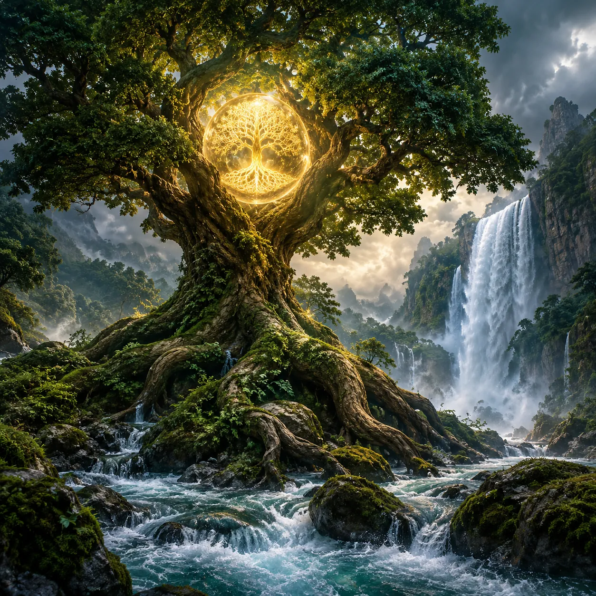</a>

> High fantasy with photographic texture: a massive gnarled tree whose twisting roots grip moss-covered rocks in a foaming stream, a radiant golden orb glowing in its dark canopy with a tree-of-life silhouette inside, and a towering waterfall plunging down a misty cliff behind. The orb is the only warm light source, which sets up a lovely contrast with the overcast sky and deep greens. Our result delivers exactly that: golden light spilling through the leaves onto the bark, white water rushing between the roots and a tall cascade on the right. It works well as a book cover, game key art, meditation app background or a poster for nature and wellness themes.

```text
A majestic, ancient gnarled tree with thick, twisting roots sits at the center of a lush, mystical landscape, its roots anchoring into a vibrant, foaming stream flowing over moss-covered rocks. Suspended within the dense, dark green canopy of the tree is a radiant, glowing golden orb containing a detailed, ethereal silhouette of a tree of life. In the background, a massive, towering waterfall cascades down a rugged, misty cliffside into the river below. The scene is illuminated by the soft, warm light emanating from the golden orb, contrasting with the moody, overcast sky and the deep, rich greens of the surrounding forest. Photorealistic, cinematic lighting, high fantasy art style, intricate textures on the bark and water, 8k resolution.
```

- Author: [@churvikv](https://x.com/churvikv)
- Original post: https://x.com/churvikv/status/2039728974092243121
- [View on cinel and generate with this prompt](https://cinel.ai/prompts/p/mystical-ancient-tree-landscape?utm_source=github&utm_medium=awesome&utm_campaign=awesome-gpt-image-2.5-prompts)

### Night City Walk 4-Panel Film-Still Collage

<a href="https://cinel.ai/prompts/p/city-walk-four-panel-collage?utm_source=github&utm_medium=awesome&utm_campaign=awesome-gpt-image-2.5-prompts">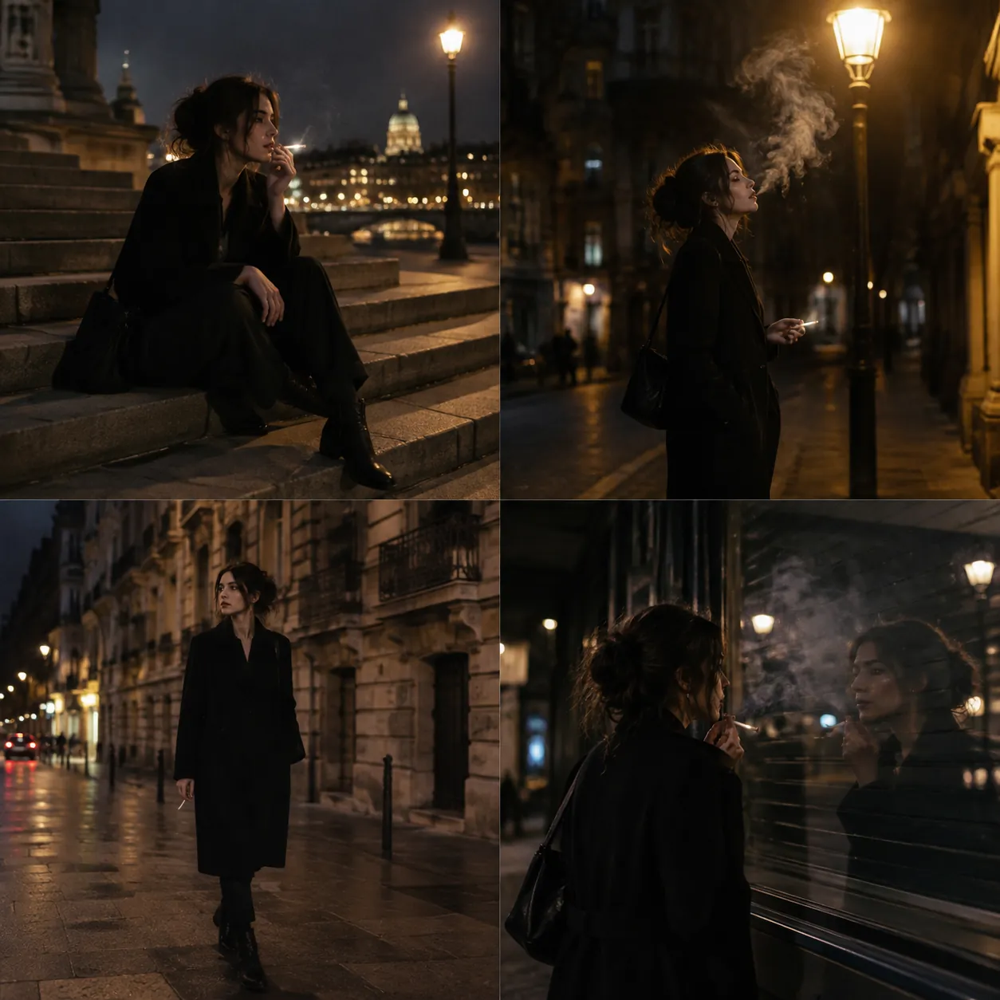</a>

> A moody storytelling grid that follows one character through a single evening: resting on wide stone stairs with city lights behind, standing under a warm streetlamp, walking past old European facades and pausing at a dark shop window with her reflection. The outfit stays fixed (a minimalist black look with ankle boots) and low-key lighting with soft bokeh gives it a film-still feel. The source uses smoking as a character detail; our result shows a dark-haired woman in a long black coat with drifting smoke in each frame. If you need brand-safe or ad-platform-friendly visuals, replace the cigarette with a coffee cup, headphones or a camera. Good for fashion lookbooks.

```text
A cinematic 4-panel photo collage showing a quiet, introspective city walk with smoking as a character detail.
• Frame 1: Sitting briefly on wide stone stairs, cigarette lit, city lights behind
• Frame 2: Standing still under a warm streetlamp, slow smoke drifting upward
• Frame 3: Walking past old European buildings, cigarette between fingers
• Frame 4: Pausing near a closed shop window, reflection visible with smoke haze
Consistent outfit — minimalist black outfit, ankle boots. Low-key lighting, soft bokeh, cinematic shadows, film-still realism, editorial mood, 1:1 aspect ratio.
```

- Author: [@AIwithkhan](https://x.com/AIwithkhan)
- Original post: https://x.com/AIwithkhan/status/2008177924651044876
- [View on cinel and generate with this prompt](https://cinel.ai/prompts/p/city-walk-four-panel-collage?utm_source=github&utm_medium=awesome&utm_campaign=awesome-gpt-image-2.5-prompts)

### Desert Camper Van Picnic in a White Linen Dress

<a href="https://cinel.ai/prompts/p/desert-camper-van-linen-dress?utm_source=github&utm_medium=awesome&utm_campaign=awesome-gpt-image-2.5-prompts">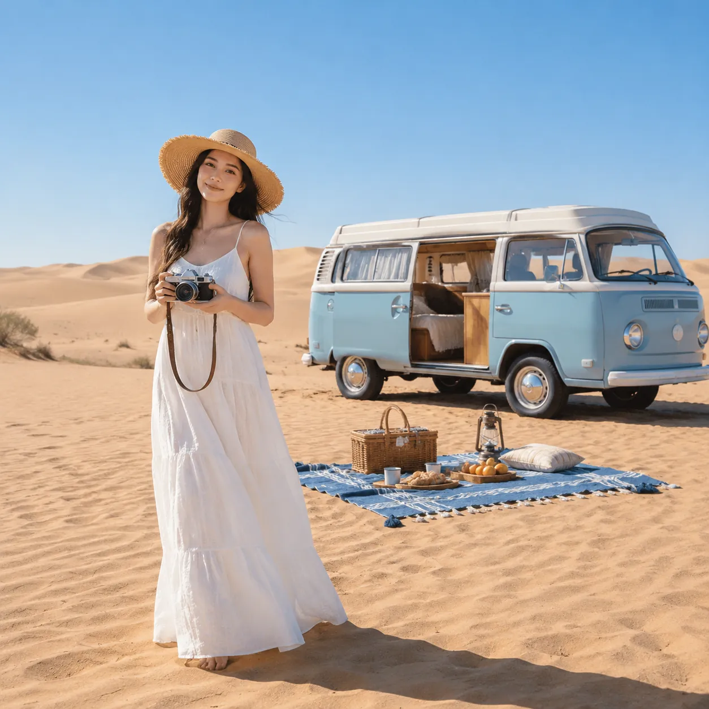</a>

> A short, sunny lifestyle prompt with a clear colour story: white linen, golden sand, pale blue van, blue picnic blanket and a cloudless blue sky. A smiling woman in an airy maxi dress and wide straw hat holds a vintage camera in the foreground, while the van and a picnic spread sit behind her. Our first render put a real carmaker's emblem on the van, so we asked for a retro-style van of original design with no badges; the final image has a blank roundel, though the silhouette still recalls classic split-window buses. Everything else lands well: rippled dunes, a wicker basket and lantern. Ideal for travel brands, summer fashion and van-life content.

```text
A wide shot of a woman in an airy white linen maxi dress and a wide-brimmed straw hat, standing in a vast, sun-drenched desert. She holds a vintage camera, smiling softly. Behind her, a light blue retro-style camper van of original design with no badges or logos is parked next to a picnic spread on a blue blanket. Soft ripples in the sand and a clear blue sky create a peaceful, bohemian travel aesthetic.
```

- Author: [@AbidkingB](https://x.com/AbidkingB)
- Original post: https://x.com/AbidkingB/status/2023968383021314440
- [View on cinel and generate with this prompt](https://cinel.ai/prompts/p/desert-camper-van-linen-dress?utm_source=github&utm_medium=awesome&utm_campaign=awesome-gpt-image-2.5-prompts)

### Surreal Zipper Unzipping Winter into Spring

<a href="https://cinel.ai/prompts/p/zipper-winter-to-spring-surreal?utm_source=github&utm_medium=awesome&utm_campaign=awesome-gpt-image-2.5-prompts"></a>

> A visual metaphor you can grasp in a second: a huge, realistic metal zipper pulled open across a snowfield, revealing a lush green meadow full of pink flowers underneath, as if spring had been hiding under winter's coat. The prompt doubles the idea in the sky, with a bright sun and lens flare on the left and a starry twilight on the right. Our result is crisp and convincing: the zipper teeth curve through deep snow towards the viewer, frosted pines line both sides, and the green strip glows with blossoms beneath a sky split between day and night. Great for seasonal campaigns, spring sale banners, greeting cards and 'new beginnings' messaging.

```text
A surreal, high-resolution conceptual image depicting the transition from winter to spring. In the center, a large, realistic metal zipper is unzipped on a snow-covered landscape, revealing a vibrant, lush meadow of green grass and blooming pink spring flowers underneath. The surrounding area is a winter forest with frost-covered trees and deep snow. The sky above is a magical blend of day and night, featuring a bright, radiant sun with lens flares on the left and a deep blue twilight sky filled with sparkling stars on the right. The lighting is cinematic, highlighting the contrast between the cold, icy texture of the snow and the warm, lively colors of the spring meadow.
```

- Author: [@churvikv](https://x.com/churvikv)
- Original post: https://x.com/churvikv/status/2044379507948159081
- [View on cinel and generate with this prompt](https://cinel.ai/prompts/p/zipper-winter-to-spring-surreal?utm_source=github&utm_medium=awesome&utm_campaign=awesome-gpt-image-2.5-prompts)

### Calm in the Chaos: Desert Truck Action Shot from Your Photo

<a href="https://cinel.ai/prompts/p/high-speed-action-photo-identity-kept?utm_source=github&utm_medium=awesome&utm_campaign=awesome-gpt-image-2.5-prompts">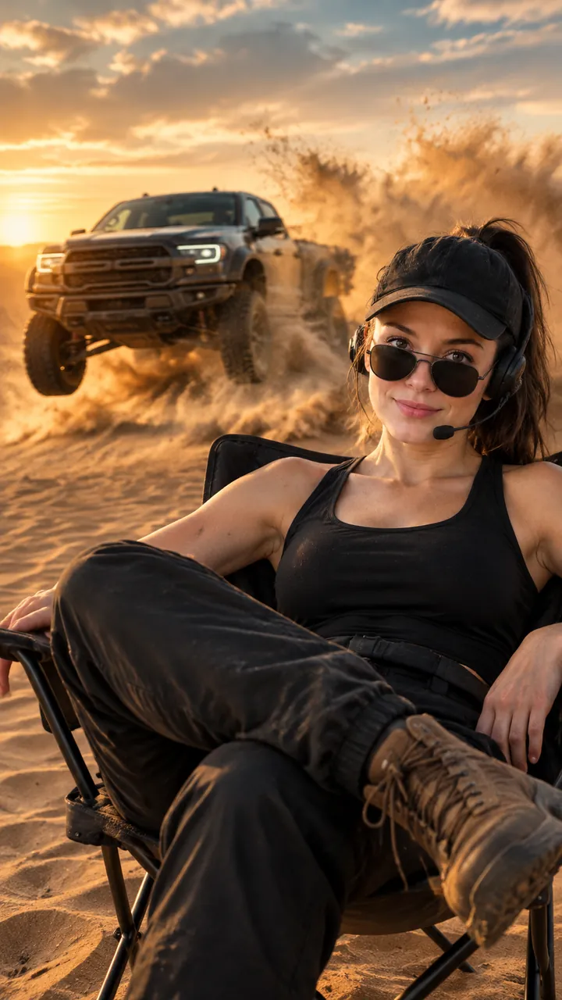</a>

> The appeal is contrast: a calm, confident person lounging in a folding camp chair on a dune, legs crossed, in a cap, sunglasses and a headset mic, while an off-road pickup launches over the sand behind them in an explosion of dust. The JSON locks identity tightly, then specifies an 85mm telephoto at a low angle, golden-hour teal-and-orange grading and a slightly motion-blurred truck. The source named a real truck model, and our first render printed the maker's name on the grille, so we rewrote it as an unbadged pickup of original design. The final image shows the woman from our fictional reference smiling in black, the airborne truck kicking up a golden plume.

```text
{
  "type": "image_generation_prompt",
  "language": "English",
  "aspect_ratio": "9:16",
  "style": "cinematic, ultra-realistic, high-speed action photography",
  "identity_preservation": {
    "use_reference_image": true,
    "strict_identity_lock": true,
    "notes": "Do not change face, hair, or facial features. Preserve the exact facial identity, hairstyle, proportions, and expression from the reference image."
  },
  "subject": {
    "gender": "female",
    "position_in_frame": "foreground, right side",
    "pose": {
      "seating": "sitting in a small folding camping chair on top of a sand dune",
      "legs": "crossed casually",
      "posture": "leaning back comfortably"
    },
    "expression": "confident, playful, relaxed with a subtle smile",
    "appearance": {
      "outfit": {
        "clothing": "black outfit (top and pants)",
        "boots": "brown boots",
        "headwear": "dark baseball cap",
        "accessories": [
          "sunglasses",
          "headset microphone"
        ]
      }
    }
  },
  "secondary_subject": {
    "vehicle": {
      "type": "powerful off-road pickup truck",
      "style_reference": "rugged unbadged off-road pickup of original design, with no logos, no lettering and no brand marks on the grille or body",
      "action": "driving aggressively at full speed over the sand dune",
      "motion_state": "slightly airborne",
      "effects": [
        "dramatic explosion of sand and dust",
        "visible motion blur emphasizing speed"
      ],
      "position_in_frame": "background, slightly left and centered"
    }
  },
  "environment": {
    "location": "desert sand dunes",
    "time_of_day": "golden hour",
    "atmosphere": "warm, cinematic, dramatic contrast between calm and chaos"
  },
  "lighting": {
    "type": "natural golden hour sunlight",
    "quality": "soft and warm",
    "effects": [
      "gentle highlights on flying sand particles",
      "soft shadows",
      "cinematic teal and orange color balance"
    ]
  },
  "camera": {
    "angle": "low, cinematic angle",
    "lens": "telephoto ~85mm",
    "depth_of_field": "shallow",
    "focus": {
      "foreground": "woman in sharp focus",
      "background": "truck slightly motion-blurred"
    }
  },
  "color_grading": {
    "palette": [
      "warm beige sand",
      "muted sky tones",
      "subtle teal and orange accents"
    ],
    "style": "filmic, natural, HDR"
  },
  "quality": {
    "resolution": "8K",
    "detail_level": "ultra-high",
    "texture": "realistic sand, fabric, skin, and dust textures",
    "grain": "subtle film grain",
    "rendering": "photorealistic, no CGI look"
  },
  "constraints": [
    "No cartoon or illustrated style",
    "No artificial sharpening",
    "No exaggerated effects",
    "Maintain natural skin tones",
    "Do not alter facial identity"
  ],
  "output_goal": "Create a cinematic, ultra-realistic desert action image featuring a calm, confident woman seated in the foreground while a powerful off-road truck explodes through the dunes behind her, emphasizing contrast, motion, and cinematic storytelling."
}
```

- Author: [@saniaspeaks_](https://x.com/saniaspeaks_)
- Original post: https://x.com/saniaspeaks_/status/2013211205268312521
- [View on cinel and generate with this prompt](https://cinel.ai/prompts/p/high-speed-action-photo-identity-kept?utm_source=github&utm_medium=awesome&utm_campaign=awesome-gpt-image-2.5-prompts)

### Worm's-Eye Portrait in a Wildflower Field

<a href="https://cinel.ai/prompts/p/worms-eye-flower-field-photo?utm_source=github&utm_medium=awesome&utm_campaign=awesome-gpt-image-2.5-prompts">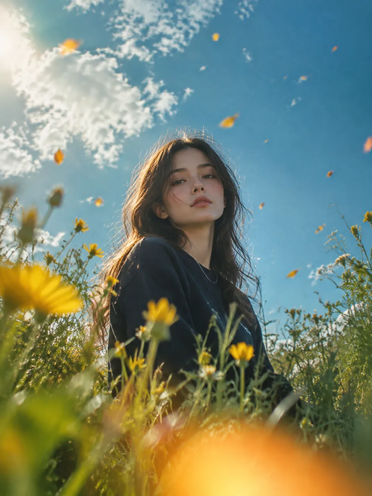</a>

> A camera-first prompt that reads like a shot list. It puts the lens right down in the grass (24–28mm, worm's-eye), places a young woman chest-deep in the frame looking down at the viewer, fills the foreground with blurred yellow flowers, stems and a warm orange glare, and scatters small orange petals through a turquoise sky with big white cumulus clouds. Lighting, grading and a thorough negative list (no plastic skin, no wires, no large inscriptions on clothes) complete it. Our result captures the summery, dreamy perspective: dark hair lifting slightly, a navy sweatshirt, flowers bursting into soft bokeh at the edges. Great for fashion, music artwork and lifestyle campaigns.

```text
Photorealistic cinematic photo, 3:4 vertical frame, shooting from a very low point of grass/flowers (worm's-eye view) on a wide-angle lens-24-28mm. In the center of the frame, chest-deep, is a 25-year-old young woman with fair skin and dark  brown hair, wearing a dark blue/black sweatshirt with a small white inscription on the chest, and a thin chain around his neck. The pose is calm, the body is slightly

turned to the right, the head looks straight at the viewer and is raised; the focus is on the upper body. Foreground: large blurred yellow bees, yellow flowers and green stems, strong sideways, one large warm orange glare/spot at the bottom of the frame. Middle ground: around the model there are wild plants and flowers, some of the stems are sharp, some are in a soft blur.

Background/sky: a large turquoise-blue open sky with large white cumulus clouds on the left and above. There are a lot of small orange petals/seeds/leaves in the air above and around the model, as if they were picked up by the wind; they are at different distances and partially blurred (motion blur + shallow DOF), creating the effect of "floating particles".

Lighting: natural daylight, the sun is high / slightly behind on the left; soft contour illumination of hair and shoulders, sun is on accents + cool sky, light teal-orange grading, moderate vignette.

Parameters/style: shallow depth of field, foreground bokeh, crisp subject, cinematic, ultra realistic, high detail, natural film look, slight haze, no text overlays, no logos, no watermark.

Negative promt: illustration, CGI, cartoon, plastic skin, overexposure, strong noise, dirty background, superfluous people, buildings, wires, large readable inscriptions on clothes, artifacts, deformity of arms/shoulders.
```

- Author: [@ZaraIrahh](https://x.com/ZaraIrahh)
- Original post: https://x.com/ZaraIrahh/status/2044373789107163308
- [View on cinel and generate with this prompt](https://cinel.ai/prompts/p/worms-eye-flower-field-photo?utm_source=github&utm_medium=awesome&utm_campaign=awesome-gpt-image-2.5-prompts)

### Cafeteria Standoff Action Key Frame

<a href="https://cinel.ai/prompts/p/cafeteria-standoff-action-keyframe?utm_source=github&utm_medium=awesome&utm_campaign=awesome-gpt-image-2.5-prompts">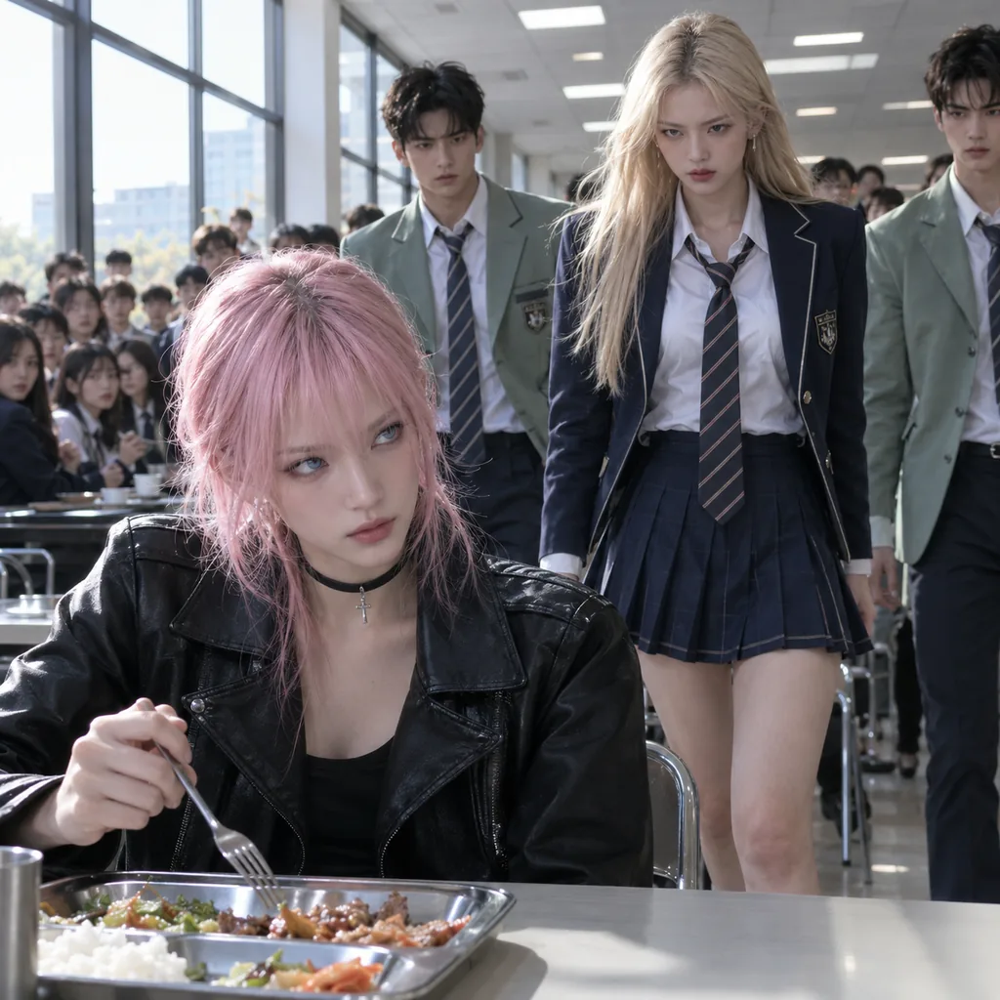</a>

> Adapted from a Seedance 2.5 video prompt by @Just_sharon7. The original is a fast Korean-style school action scene where a fearless heroine gets cornered by a rich blonde rival and her crew, then fights back. Its character looks came from the creator's own uploaded images, so we described the heroine, rival and crew in words, all as adults. We froze the tense moment before the fight starts. Use it for short-drama thumbnails, webtoon covers and action storyboards.

```text
A single cinematic key frame from a photorealistic Korean-style school action drama: in a bright modern academy cafeteria with large windows, long tables, metal chairs and food trays, a fearless young adult woman about 22 with messy pastel-pink bangs, blue eyes, a black leather jacket and a black choker with a small silver cross pendant sits alone at a table holding a fork over her lunch tray and looks up with a cold, unimpressed stare, while an arrogant blonde young adult woman in a navy academy blazer, white shirt, striped tie and pleated skirt storms toward her, flanked by athletic young men in light green blazers. Dozens of uniformed students watch from the background. Natural daylight mixed with fluorescent ceiling panels, 50mm lens, shallow depth of field, tense calm-before-the-fight moment. All characters are adults. Square 1:1 composition.
```

- Author: [@Just_sharon7](https://x.com/Just_sharon7)
- Original post: https://x.com/Just_sharon7/status/2109975160623378737
- [View on cinel and generate with this prompt](https://cinel.ai/prompts/p/cafeteria-standoff-action-keyframe?utm_source=github&utm_medium=awesome&utm_campaign=awesome-gpt-image-2.5-prompts)

### Autumn Maple Leaf on Pavement Key Frame

<a href="https://cinel.ai/prompts/p/autumn-maple-leaf-pavement-keyframe?utm_source=github&utm_medium=awesome&utm_campaign=awesome-gpt-image-2.5-prompts">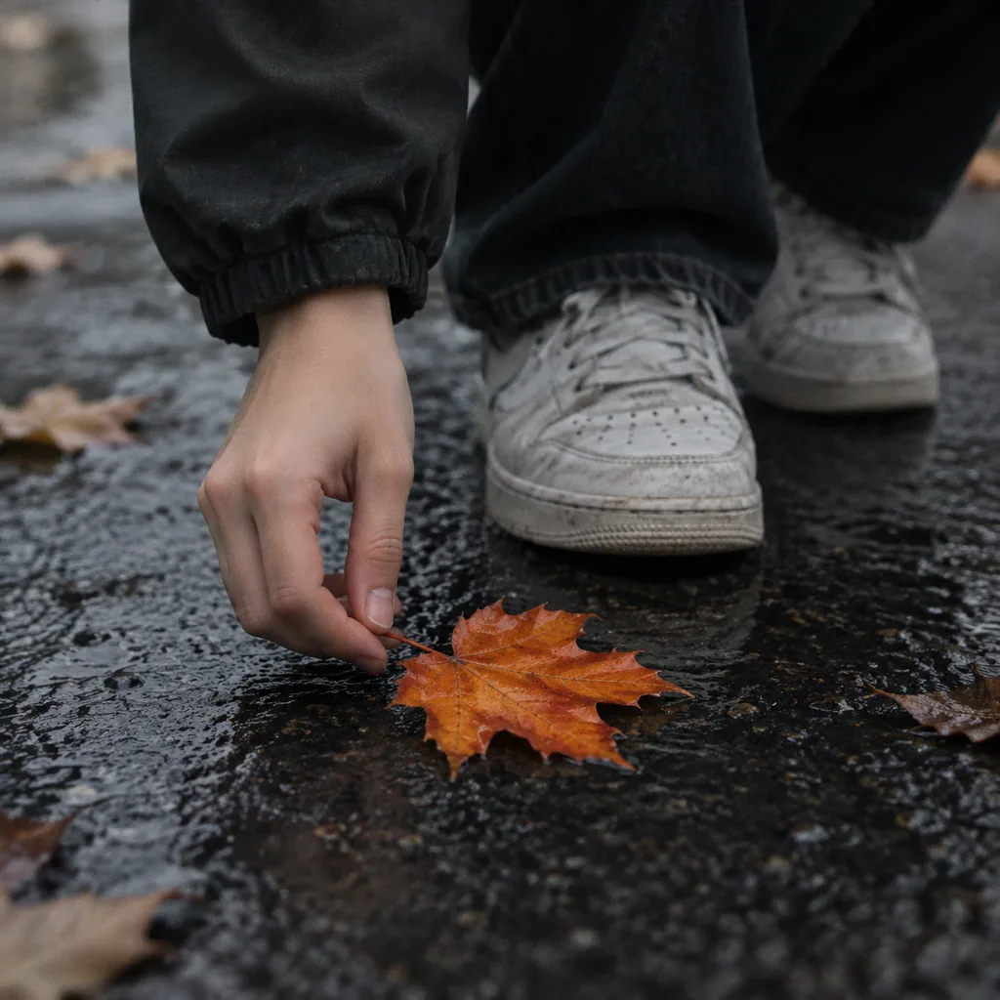</a>

> Inspired by 'AUTUMN - The season changed', a Seedance 2.5 video @rovvmut_ made on Dreamina. No prompt was shared, so we wrote this ground-level frame ourselves: a hand reaching for one orange maple leaf beside white sneakers on wet asphalt. Use it for seasonal campaigns, poetry posts and short-film title cards.

```text
A single cinematic key frame, ground-level close-up: a hand reaches down to pick up one bright orange maple leaf lying on dark wet asphalt beside a pair of worn white sneakers, soft overcast light, shallow depth of field, muted greys with the leaf as the only warm color, quiet change-of-season mood, film grain, no text. Square 1:1 composition.
```

- Author: [@rovvmut_](https://x.com/rovvmut_)
- Original post: https://x.com/rovvmut_/status/2110670788303163417
- [View on cinel and generate with this prompt](https://cinel.ai/prompts/p/autumn-maple-leaf-pavement-keyframe?utm_source=github&utm_medium=awesome&utm_campaign=awesome-gpt-image-2.5-prompts)

### Haunted VHS Neon Fog Street Key Frame

<a href="https://cinel.ai/prompts/p/haunted-vhs-neon-fog-street-keyframe?utm_source=github&utm_medium=awesome&utm_campaign=awesome-gpt-image-2.5-prompts">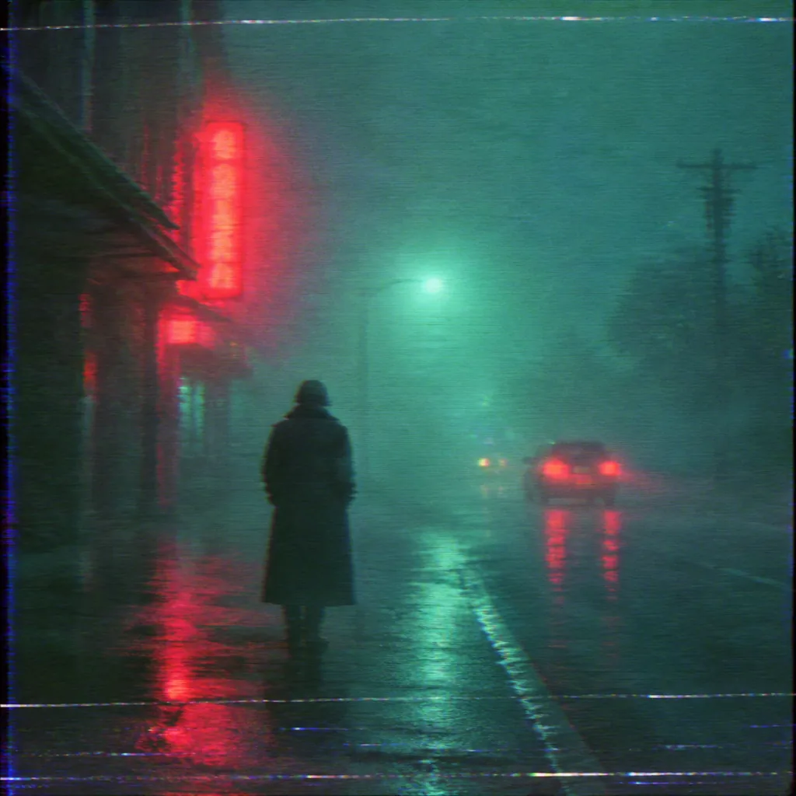</a>

> Inspired by a Seedance 2.5 short film by @umesh_ai that 'feels like a dream recorded on haunted VHS tape'. The prompt was shared in a reply with image references, so we wrote this frame ourselves: a silhouette in teal fog, a red neon sign and worn-tape artifacts. Use it for horror thumbnails, music video art and retro posters.

```text
A single key frame that looks like haunted VHS footage: a lone silhouetted figure in a long coat stands on a foggy night street, a red neon sign glowing through thick teal mist, blurred car taillights in the distance, washed-out colors, tape noise, chroma bleed, soft scan lines and slight tracking distortion, dreamlike and eerie, no readable text. Square 1:1 composition.
```

- Author: [@umesh_ai](https://x.com/umesh_ai)
- Original post: https://x.com/umesh_ai/status/2109897848406048795
- [View on cinel and generate with this prompt](https://cinel.ai/prompts/p/haunted-vhs-neon-fog-street-keyframe?utm_source=github&utm_medium=awesome&utm_campaign=awesome-gpt-image-2.5-prompts)

### Samurai Tracking Shot Key Frame

<a href="https://cinel.ai/prompts/p/samurai-tracking-shot-banner-wipe-keyframe?utm_source=github&utm_medium=awesome&utm_campaign=awesome-gpt-image-2.5-prompts">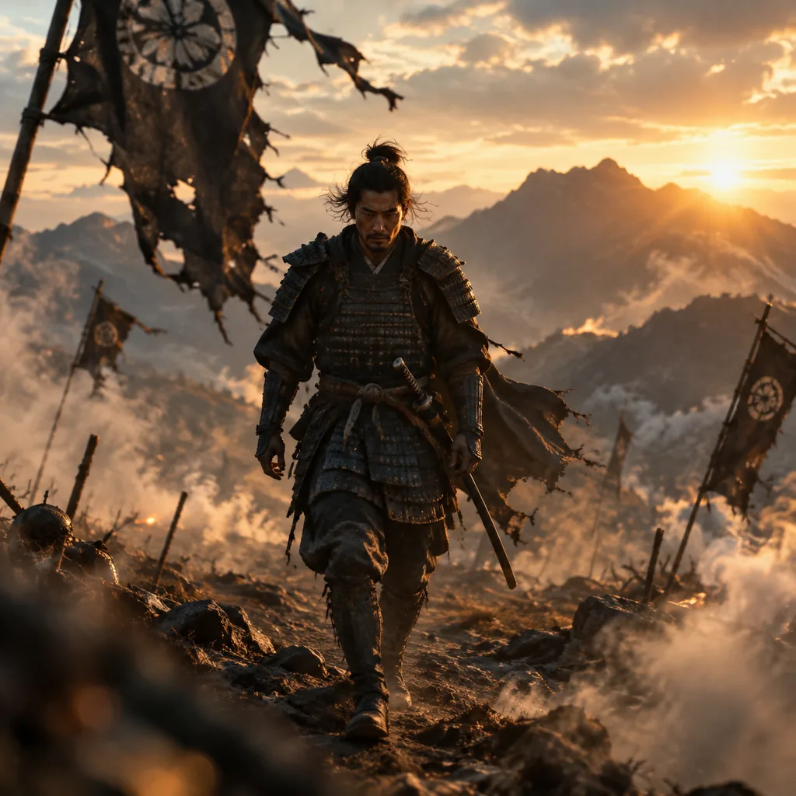</a>

> Inspired by a Seedance 2.5 video by @CharaspowerAI: 30 seconds of one samurai crossing four environments, with every cut hidden behind banners, smoke, columns and snow. The full prompt was shared in a reply, not in the post, so we wrote this frame ourselves from the video. Use it for game key art, film posters and storyboards.

```text
A single cinematic key frame from a continuous tracking shot: a lone samurai in dark layered armor walks forward through a windswept mountain battlefield at golden hour, katana at his side, tattered war banners snapping in the wind in the foreground and drifting smoke partly crossing the frame, rocky slopes and distant peaks behind him, warm low sun cutting through dust, epic blockbuster film look, shallow depth of field, no text. Square 1:1 composition.
```

- Author: [@CharaspowerAI](https://x.com/CharaspowerAI)
- Original post: https://x.com/CharaspowerAI/status/2110068129288122698
- [View on cinel and generate with this prompt](https://cinel.ai/prompts/p/samurai-tracking-shot-banner-wipe-keyframe?utm_source=github&utm_medium=awesome&utm_campaign=awesome-gpt-image-2.5-prompts)

### Misty Water Town Lane Walk Key Frame

<a href="https://cinel.ai/prompts/p/misty-water-town-lane-walk-keyframe?utm_source=github&utm_medium=awesome&utm_campaign=awesome-gpt-image-2.5-prompts">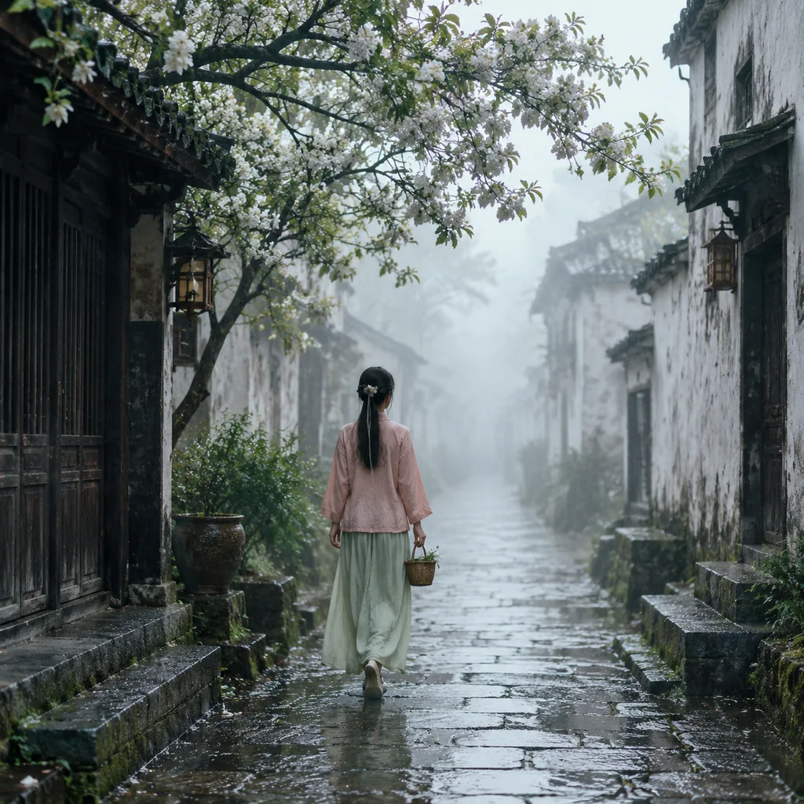</a>

> Inspired by a realistic short video @PixelAigc shared of a stroll through an old town lane. The prompt was in a linked reply, so we described this frame in our own words: a woman seen from behind with a small basket, whitewashed walls, white blossoms overhead and thick morning mist. Use it for travel reels, Chinese-style brand visuals and calm wallpapers.

```text
A single cinematic key frame: seen from behind, a young adult woman in a soft rose-pink jacket and pale green long skirt walks with a small basket down a narrow rain-wet stone lane in an old Chinese water town, whitewashed walls and dark wooden doors on both sides, white blossoms overhanging from a tree above, thick morning mist swallowing the far end of the lane, glistening cobblestones, muted grey-green palette, tranquil and poetic, no text. Square 1:1 composition.
```

- Author: [@PixelAigc](https://x.com/PixelAigc)
- Original post: https://x.com/PixelAigc/status/2108520852647977037
- [View on cinel and generate with this prompt](https://cinel.ai/prompts/p/misty-water-town-lane-walk-keyframe?utm_source=github&utm_medium=awesome&utm_campaign=awesome-gpt-image-2.5-prompts)

### Golden Leaf Skeleton Moon Landscape

<a href="https://cinel.ai/prompts/p/golden-leaf-skeleton-moon-landscape?utm_source=github&utm_medium=awesome&utm_campaign=awesome-gpt-image-2.5-prompts">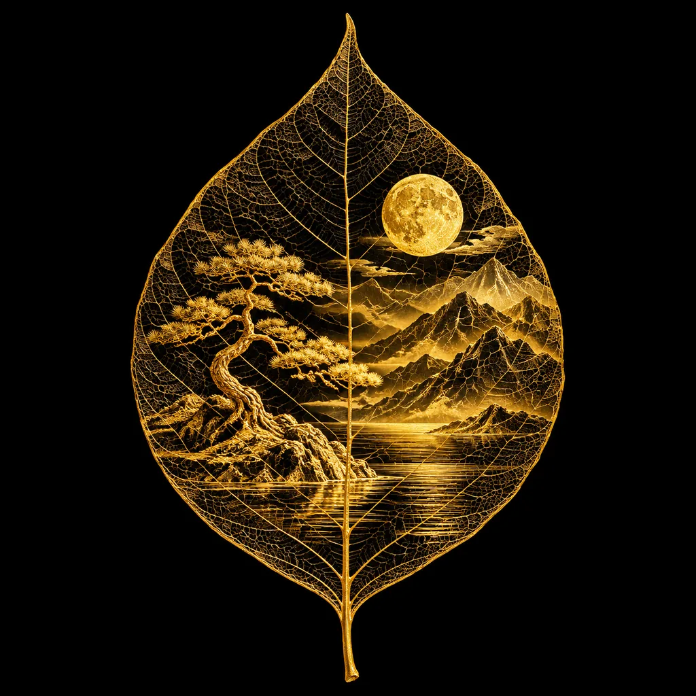</a>

> A reverse-written prompt based on a wallpaper @churvikv posted as 'Gold on a black sheet' (no prompt was shared). We described it ourselves: a single skeleton leaf with glowing gold veins floating on black, and inside it a miniature gold-foil scene of a windswept pine, a small island, layered mountains and a full moon. Use it for phone wallpapers, luxury packaging art and autumn campaigns.

```text
A single skeletonized leaf floating on a pure black background, its translucent lattice of veins rendered in glowing gold, and inside the leaf a miniature gold-leaf landscape: a windswept bonsai-like pine on a small island, a full golden moon and layered golden mountains, luxurious gold foil filigree, crisp macro detail, elegant dark wallpaper, no text. Square 1:1 composition.
```

- Author: [@churvikv](https://x.com/churvikv)
- Original post: https://x.com/churvikv/status/2110074103415861468
- [View on cinel and generate with this prompt](https://cinel.ai/prompts/p/golden-leaf-skeleton-moon-landscape?utm_source=github&utm_medium=awesome&utm_campaign=awesome-gpt-image-2.5-prompts)

### Paint Stroke Miniature Winter Landscape

<a href="https://cinel.ai/prompts/p/paint-stroke-miniature-winter-landscape?utm_source=github&utm_medium=awesome&utm_campaign=awesome-gpt-image-2.5-prompts">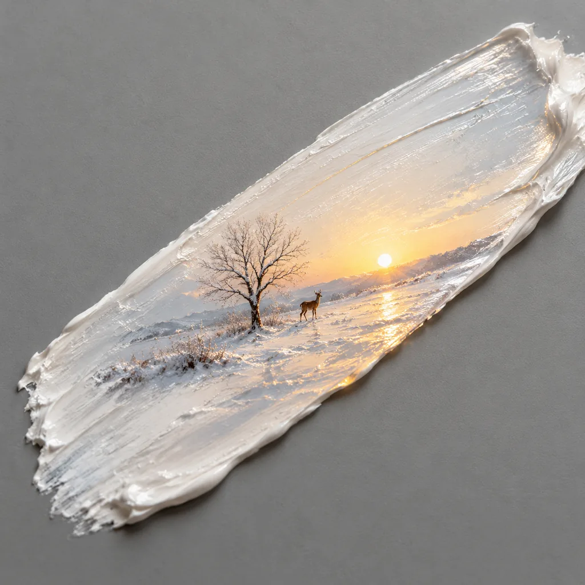</a>

> A reverse-written prompt based on images @churvikv posted with the line 'One touch is enough for beauty' (no prompt was shared). We wrote our own version: a single glossy sweep of white oil paint on matte gray, with a miniature winter sunrise inside it, a bare tree, a little deer and warm light catching the impasto ridges. Use it for art-supply ads, minimalist wallpapers and seasonal greeting cards.

```text
A single thick diagonal sweep of glossy white oil paint across a smooth matte gray surface, and inside the paint stroke a tiny miniature winter landscape at sunrise: a lone bare tree, a small deer, snowy ground and warm golden light reflecting on the wet paint, visible impasto ridges and bristle marks, minimal conceptual still life, soft studio light, no text. Square 1:1 composition.
```

- Author: [@churvikv](https://x.com/churvikv)
- Original post: https://x.com/churvikv/status/2110004016360853548
- [View on cinel and generate with this prompt](https://cinel.ai/prompts/p/paint-stroke-miniature-winter-landscape?utm_source=github&utm_medium=awesome&utm_campaign=awesome-gpt-image-2.5-prompts)

### Cracked Mask with an Inner Landscape

<a href="https://cinel.ai/prompts/p/cracked-mask-inner-landscape?utm_source=github&utm_medium=awesome&utm_campaign=awesome-gpt-image-2.5-prompts"></a>

> A reverse-written prompt based on a wallpaper @churvikv posted as 'Inside each of us, behind a cracked mask, lives our own landscape' (no prompt was shared). We described it ourselves: a cracked stone mask on charcoal, its top half open like a window onto a sunset hill with one round tree. Use it for phone wallpapers, poetry covers and mental-health campaigns.

```text
A surreal phone-wallpaper artwork: a pale cracked stone face mask on a deep charcoal background, the upper half of the mask broken open like a window to reveal a glowing sunset landscape inside, a single round tree on a green hill against a warm orange-to-teal sky, fine cracks spreading across the stone cheeks, soft dramatic light, minimal and poetic, no text. Square 1:1 composition.
```

- Author: [@churvikv](https://x.com/churvikv)
- Original post: https://x.com/churvikv/status/2109384087387717934
- [View on cinel and generate with this prompt](https://cinel.ai/prompts/p/cracked-mask-inner-landscape?utm_source=github&utm_medium=awesome&utm_campaign=awesome-gpt-image-2.5-prompts)

### Lone Tree and Cabin Under a Swirling Sky

<a href="https://cinel.ai/prompts/p/lone-tree-cabin-swirling-sky?utm_source=github&utm_medium=awesome&utm_campaign=awesome-gpt-image-2.5-prompts">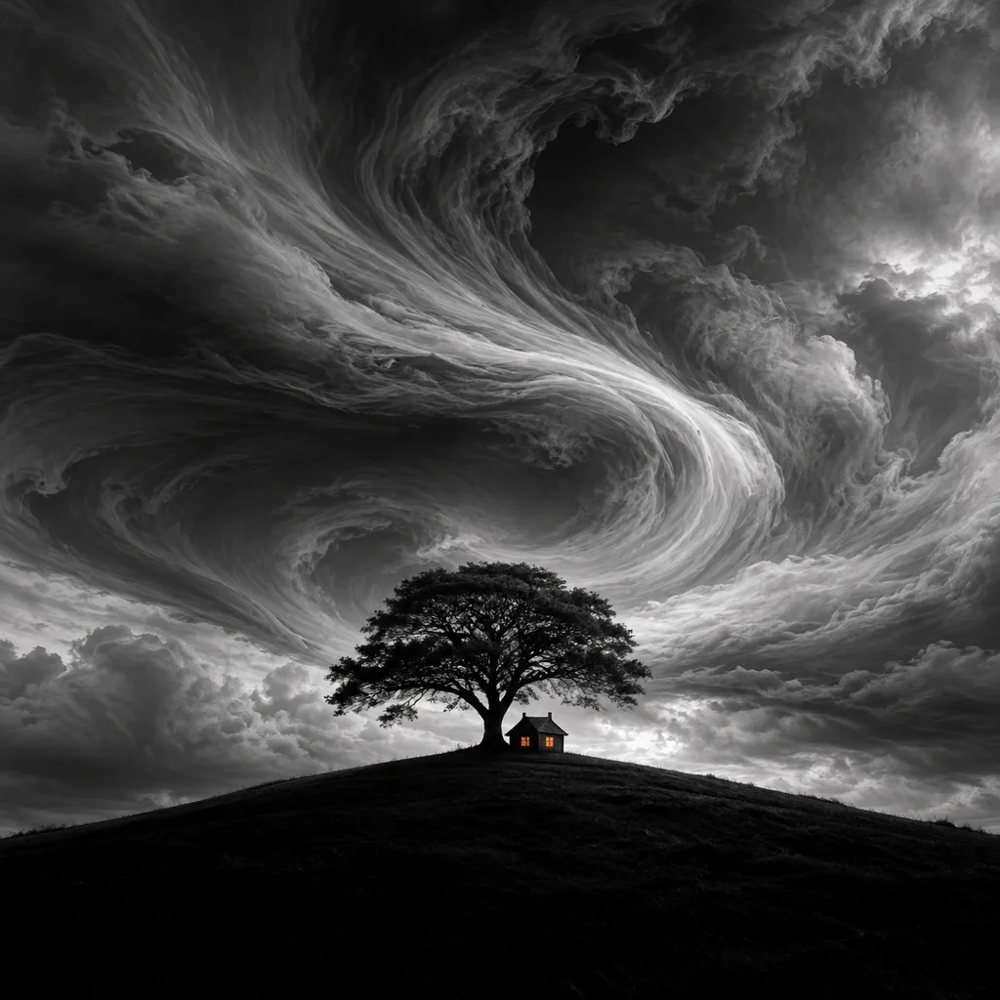</a>

> A reverse-written prompt based on an image @AllaAisling posted with only 'No words. Just art' (no prompt was shared). We described it ourselves: a broad lone tree on a black hill, a tiny cabin with warm orange windows, and a vast sky of layered silver clouds curving like smoke. Use it for wallpapers, book covers and ambient music art.

```text
A dramatic monochrome landscape: a lone broad tree on a dark rounded hill, a tiny cabin beneath it with warm orange light glowing from its windows, above it an enormous sky of swirling layered smoke-like clouds in grey and silver curving across the frame, deep black foreground, strong contrast, quiet and otherworldly, no text. Square 1:1 composition.
```

- Author: [@AllaAisling](https://x.com/AllaAisling)
- Original post: https://x.com/AllaAisling/status/2109700122661749019
- [View on cinel and generate with this prompt](https://cinel.ai/prompts/p/lone-tree-cabin-swirling-sky?utm_source=github&utm_medium=awesome&utm_campaign=awesome-gpt-image-2.5-prompts)

### Impasto Oil Alpine Cabin

<a href="https://cinel.ai/prompts/p/impasto-oil-alpine-cabin?utm_source=github&utm_medium=awesome&utm_campaign=awesome-gpt-image-2.5-prompts">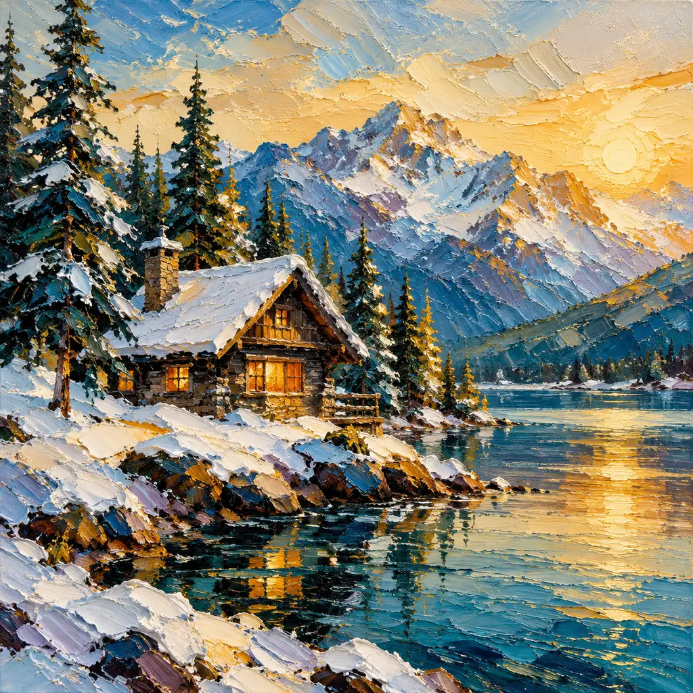</a>

> A filled example of an impasto template @azed_ai shared as 'Prompt share: Impasto Oil Painting'. We set the subject to an alpine cabin by a lake at dawn, with sculptural snow, pines and a cobalt-teal-ochre palette. Thick knife ridges and layered pigment do the work. Use it for cabin art, winter cards and art-supply ads.

```text
Expressive impasto oil painting of a small alpine cabin beside a still lake at dawn, featuring sculptural palette-knife snow on the roof, pine trees and a pale gold sky, dynamic diagonal composition, rich cobalt, teal and warm ochre palette, thick sculptural brushstrokes, heavily layered oil pigments, dramatic palette knife textures, bold gestural mark-making, visible paint ridges, expressive movement, tactile three-dimensional paint buildup, striking contrasts, dramatic directional lighting, contemporary fine art aesthetic, no text. Square 1:1 composition.
```

- Author: [@azed_ai](https://x.com/azed_ai)
- Original post: https://x.com/azed_ai/status/2110324004523515947
- [View on cinel and generate with this prompt](https://cinel.ai/prompts/p/impasto-oil-alpine-cabin?utm_source=github&utm_medium=awesome&utm_campaign=awesome-gpt-image-2.5-prompts)

### Moonlit Sailboat and City Watercolor

<a href="https://cinel.ai/prompts/p/moonlit-sailboat-city-watercolor?utm_source=github&utm_medium=awesome&utm_campaign=awesome-gpt-image-2.5-prompts">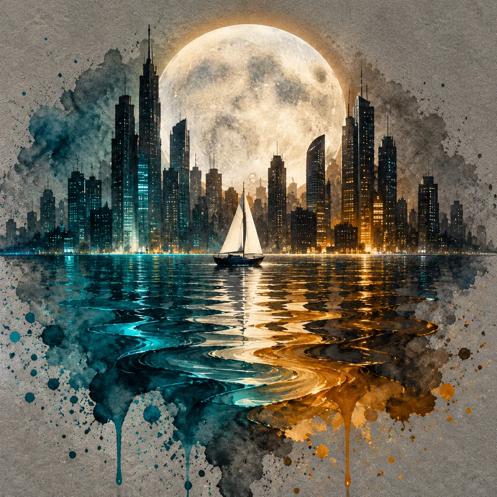</a>

> Copied from a full prompt @churvikv shared for a sailboat under a moonlit skyline, adapted from tall vertical to square. Watercolor and ink wash on grey paper, a vast stippled moon, teal-and-amber towers and晶亮ripple ribbons below the boat. Use it for wallpapers, poetry covers and city-night posters.

```text
Semi-abstract mixed-media watercolor and ink wash artwork, square 1:1 composition, matte mid-grey paper background. A lone white sailboat with a dark hull sits on the waterline just below the centre, in front of a dark futuristic skyline and an enormous cream-white full moon with finely grained craters and a soft warm halo. Dark skyscrapers with teal and warm amber windows rise across the middle. Below the boat, sculpted ripple ribbons of glossy liquid ink spread toward the viewer, teal on the left and warm amber on the right, breaking into drips and splatter. Ink wash bleeding, granulated pigment, stipple dots, high contrast, no text, no signature. Square 1:1 composition.
```

- Author: [@churvikv](https://x.com/churvikv)
- Original post: https://x.com/churvikv/status/2109054962667864073
- [View on cinel and generate with this prompt](https://cinel.ai/prompts/p/moonlit-sailboat-city-watercolor?utm_source=github&utm_medium=awesome&utm_campaign=awesome-gpt-image-2.5-prompts)

### 1920s Living Room Through Pocket Doors

<a href="https://cinel.ai/prompts/p/living-room-through-pocket-doors-1920s?utm_source=github&utm_medium=awesome&utm_campaign=awesome-gpt-image-2.5-prompts">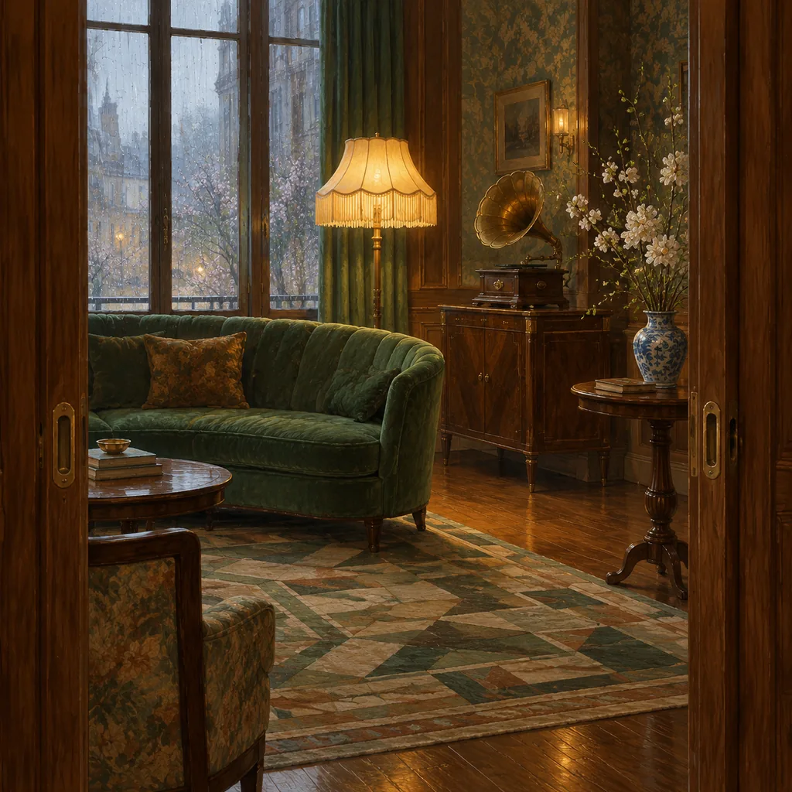</a>

> Expanded from a prompt-share post by @RenRose321, whose text was cut off mid-sentence; we completed it with a vase of flowering branches. Viewed diagonally through pocket doors: velvet sofa, fringed lamp, geometric rug and a walnut gramophone. Use it for period interiors, novel covers and set-design references.

```text
Step into an imagined 1920s living room on a rainy spring afternoon, viewed diagonally through open pocket doors: a curved green velvet sofa, a fringed lampshade glowing warm, a geometric rug, a walnut cabinet gramophone, patterned wallpaper, and a vase of flowering branches on a side table. Rain-soft light through tall windows, rich wood tones, quiet vintage atmosphere, painterly illustration, no people, no text. Square 1:1 composition.
```

- Author: [@RenRose321](https://x.com/RenRose321)
- Original post: https://x.com/RenRose321/status/2110767357601661160
- [View on cinel and generate with this prompt](https://cinel.ai/prompts/p/living-room-through-pocket-doors-1920s?utm_source=github&utm_medium=awesome&utm_campaign=awesome-gpt-image-2.5-prompts)

### NYC Character Vlog Morning Keyframe

<a href="https://cinel.ai/prompts/p/nyc-character-vlog-morning-keyframe?utm_source=github&utm_medium=awesome&utm_campaign=awesome-gpt-image-2.5-prompts">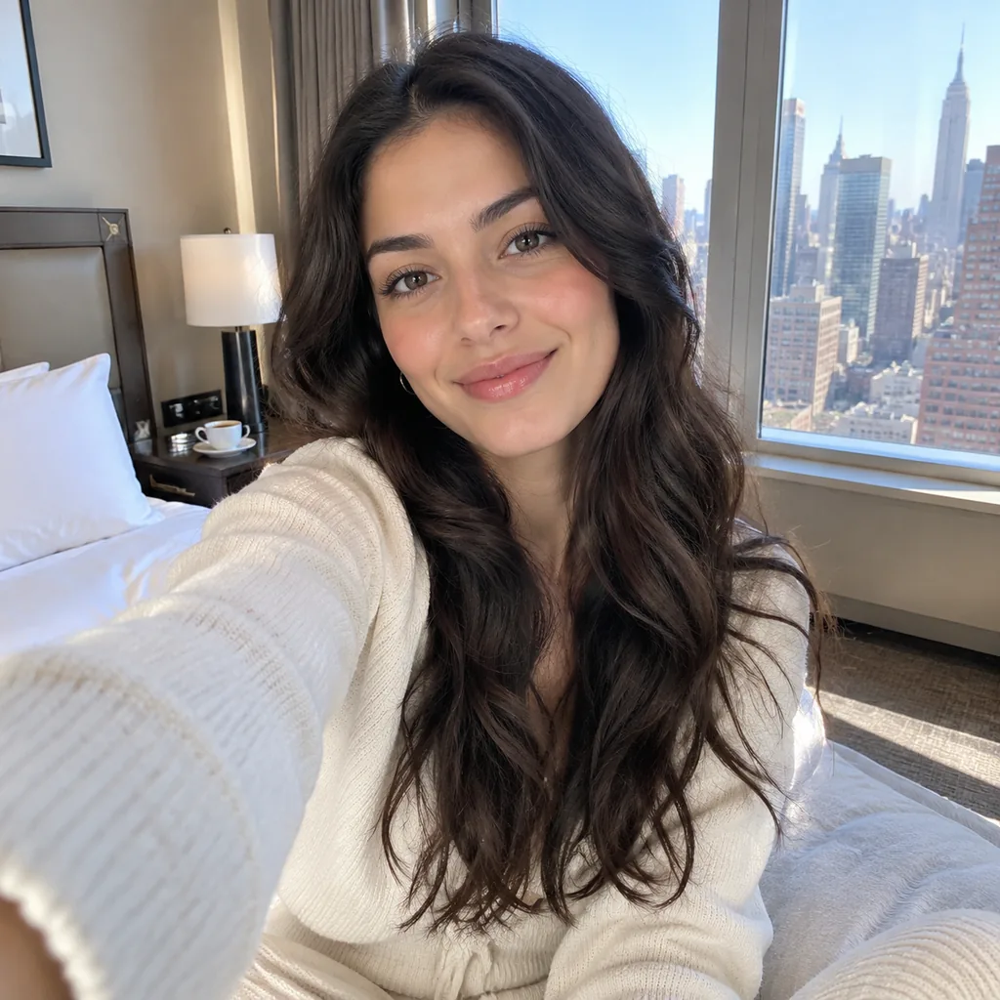</a>

> A keyframe still written from a Seedance character-vlog post by @EvoLinkAi, which paired GPT Image 2.5 identity frames with Seedance animation. We froze the morning hotel moment: self-shot framing, coffee and a skyline window. Use it for vlog covers, travel content and character-consistency tests.

```text
Photorealistic video keyframe, square 1:1: a young woman vlogger with long dark wavy hair holds a camera at arm's length in a bright New York hotel room in the morning, a coffee cup on the bedside table, city buildings visible through a large window behind her, natural daylight, candid self-shot framing, realistic skin texture, casual cream knit outfit, no text, no logo. Square 1:1 composition.
```

- Author: [@EvoLinkAi](https://x.com/EvoLinkAi)
- Original post: https://x.com/EvoLinkAi/status/2108809695087710283
- [View on cinel and generate with this prompt](https://cinel.ai/prompts/p/nyc-character-vlog-morning-keyframe?utm_source=github&utm_medium=awesome&utm_campaign=awesome-gpt-image-2.5-prompts)

### Elf Forest Song Followers Keyframe

<a href="https://cinel.ai/prompts/p/elf-forest-song-followers-keyframe?utm_source=github&utm_medium=awesome&utm_campaign=awesome-gpt-image-2.5-prompts">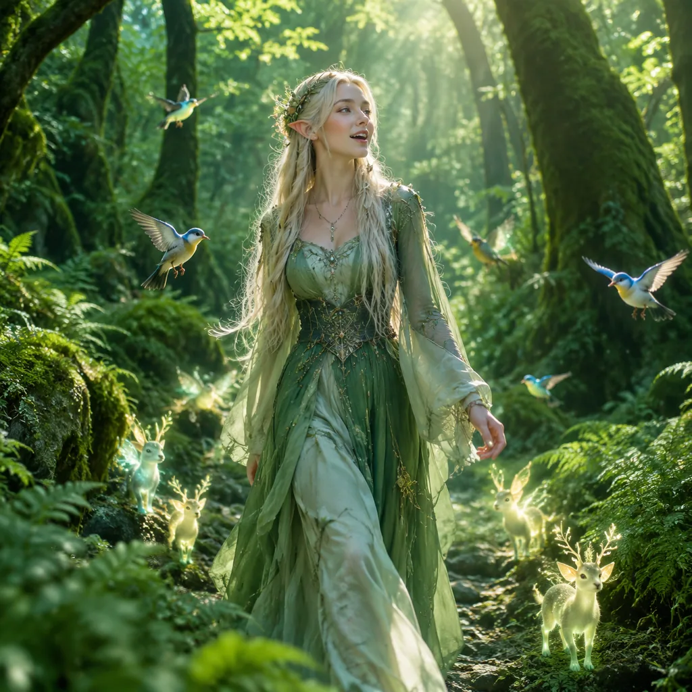</a>

> A keyframe still written from a Seedance video caption by @azed_ai: an elf walks through the forest singing and the tiny creatures cannot stop following her. We froze the sunlit moment between mossy trees. Use it for fantasy film pitches, music covers and storybook openings.

```text
Cinematic fantasy video keyframe, square 1:1: a young elf woman with long pale hair and pointed ears walks through a lush green forest singing, tiny glowing forest creatures and small birds following her between mossy trees and ferns, soft shafts of sunlight, emerald palette, photorealistic fantasy film still, no text. Square 1:1 composition.
```

- Author: [@azed_ai](https://x.com/azed_ai)
- Original post: https://x.com/azed_ai/status/2110370239775207888
- [View on cinel and generate with this prompt](https://cinel.ai/prompts/p/elf-forest-song-followers-keyframe?utm_source=github&utm_medium=awesome&utm_campaign=awesome-gpt-image-2.5-prompts)

### Season in a Drop of Light

<a href="https://cinel.ai/prompts/p/season-in-a-drop-of-light?utm_source=github&utm_medium=awesome&utm_campaign=awesome-gpt-image-2.5-prompts"></a>

> A reverse-written prompt based on wallpaper images @churvikv posted as 'A whole season held in a single drop of light' (no prompt was shared). We described it ourselves: a glowing drop with a maple leaf inside on a warm cream ground. Use it for phone wallpapers, autumn campaigns and packaging art.

```text
A minimalist surreal artwork, square 1:1: a single luminous water drop held in warm light, and inside the drop a tiny autumn maple leaf and a whole miniature season of gold and red trees, soft cream background with a sweeping warm paint stroke behind the drop, delicate reflections, elegant wallpaper, no text. Square 1:1 composition.
```

- Author: [@churvikv](https://x.com/churvikv)
- Original post: https://x.com/churvikv/status/2111036834725666918
- [View on cinel and generate with this prompt](https://cinel.ai/prompts/p/season-in-a-drop-of-light?utm_source=github&utm_medium=awesome&utm_campaign=awesome-gpt-image-2.5-prompts)

### Slow Water Moonlit Boat Landscape

<a href="https://cinel.ai/prompts/p/slow-water-moonlit-boat-landscape?utm_source=github&utm_medium=awesome&utm_campaign=awesome-gpt-image-2.5-prompts">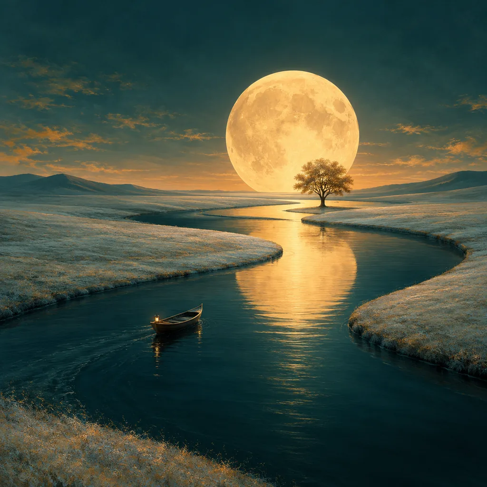</a>

> A reverse-written prompt based on a quiet landscape @AllaAisling posted as 'Slow Water', noting the curve leads the eye to the tree. We described it ourselves: moonlit water winding to one tree, a huge moon and a tiny boat. Use it for wallpapers, meditation art and poetry covers.

```text
A quiet surreal landscape, square 1:1: a slow curve of dark water winds through pale moonlit terrain toward a single small tree, a huge full moon low on the horizon reflected in the water, a tiny boat drifting on the curve, muted teal and warm amber palette, painterly and calm, no text. Square 1:1 composition.
```

- Author: [@AllaAisling](https://x.com/AllaAisling)
- Original post: https://x.com/AllaAisling/status/2110870333461033240
- [View on cinel and generate with this prompt](https://cinel.ai/prompts/p/slow-water-moonlit-boat-landscape?utm_source=github&utm_medium=awesome&utm_campaign=awesome-gpt-image-2.5-prompts)

### Valley Window Light at Night

<a href="https://cinel.ai/prompts/p/valley-window-light-at-night?utm_source=github&utm_medium=awesome&utm_campaign=awesome-gpt-image-2.5-prompts">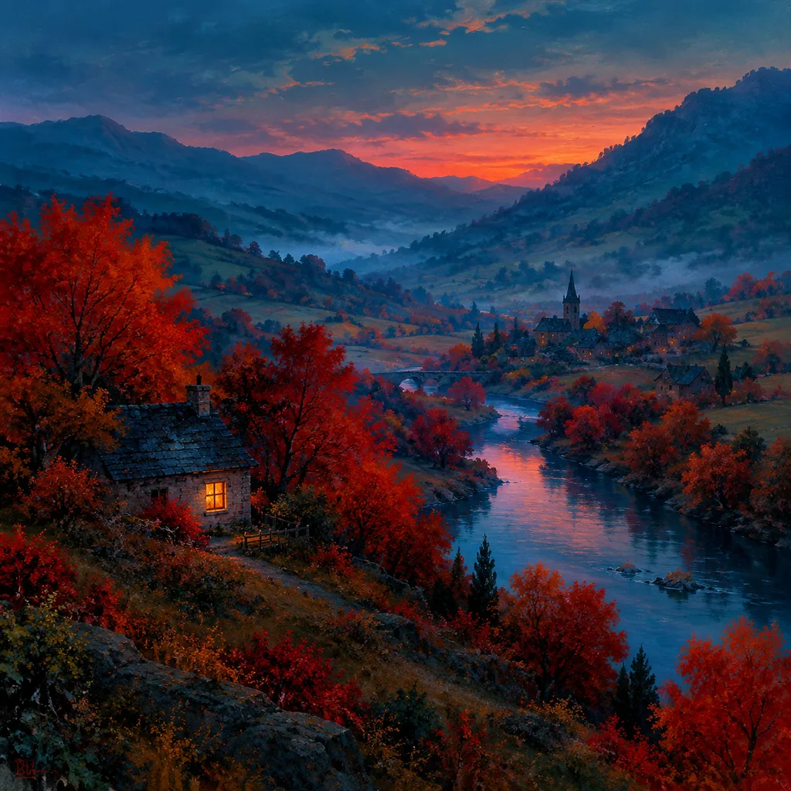</a>

> A reverse-written prompt based on a valley scene @AllaAisling posted as 'Someone's Up Late', about building a whole valley and staring at the one lit window. We described it ourselves: red autumn trees, a winding river and one warm window. Use it for wallpapers, story covers and travel mood art.

```text
A painterly valley landscape at dusk, square 1:1: rolling hills and a small village in a wide valley, autumn-red trees along a winding river, and one single cottage window glowing warm yellow in the blue evening, soft mist, quiet and nostalgic mood, rich red and deep teal palette, no text. Square 1:1 composition.
```

- Author: [@AllaAisling](https://x.com/AllaAisling)
- Original post: https://x.com/AllaAisling/status/2111193211003642249
- [View on cinel and generate with this prompt](https://cinel.ai/prompts/p/valley-window-light-at-night?utm_source=github&utm_medium=awesome&utm_campaign=awesome-gpt-image-2.5-prompts)

### Impasto Autumn Lake Reflection

<a href="https://cinel.ai/prompts/p/impasto-autumn-lake-reflection?utm_source=github&utm_medium=awesome&utm_campaign=awesome-gpt-image-2.5-prompts">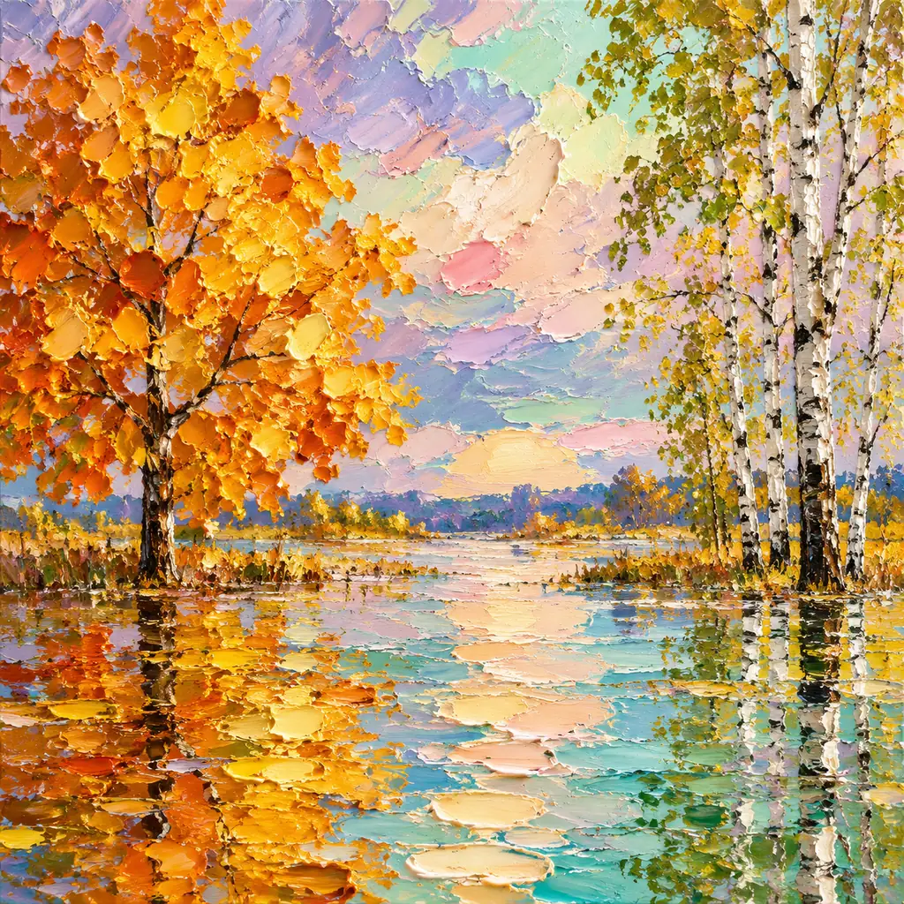</a>

> Copied from a full impasto prompt @churvikv shared for an autumn lake, adapted from wide panoramic to square. Sculptural knife-petals on the maple, birch dabs and marbled reflections as separate paint slabs. Use it for autumn wallpapers, gallery posters and seasonal cards.

```text
Extremely thick impasto oil painting on rough grainy ground, square 1:1, edge to edge, no frame. A luminous iridescent sky in pastel lavender, mint and blush fills the upper middle. On the left, one young maple tree in brilliant golden-orange, its leaves raised into thick knife-petals of amber and ochre. On the right, slender white birches with small green-yellow leaves. Below, a still flooded surface reflects everything in broken marbled bands of gold, amber, mint and turquoise paint slabs, each edged with a bright rim. Heavy tactile ridges, glossy thick paint, no text. Square 1:1 composition.
```

- Author: [@churvikv](https://x.com/churvikv)
- Original post: https://x.com/churvikv/status/2111082882315755584
- [View on cinel and generate with this prompt](https://cinel.ai/prompts/p/impasto-autumn-lake-reflection?utm_source=github&utm_medium=awesome&utm_campaign=awesome-gpt-image-2.5-prompts)

### Two Peacocks Become One Keyframe

<a href="https://cinel.ai/prompts/p/two-peacocks-become-one-keyframe?utm_source=github&utm_medium=awesome&utm_campaign=awesome-gpt-image-2.5-prompts"></a>

> A keyframe still written from a Grok video @churvikv posted as 'Two become one. Not by losing themselves — but by opening fully', with its preview frame of two white peacocks. We described the merging filigree trains ourselves. Use it for wedding art, luxury covers and symbolic posters.

```text
Surreal video keyframe, square 1:1: two ornate white peacocks face each other with their sculpted feather trains merging into one symmetrical golden pattern between them, intricate filigree feathers like carved lace, soft warm light on a pale background, elegant and poetic, two becoming one without losing themselves, no text. Square 1:1 composition.
```

- Author: [@churvikv](https://x.com/churvikv)
- Original post: https://x.com/churvikv/status/2109579333367107972
- [View on cinel and generate with this prompt](https://cinel.ai/prompts/p/two-peacocks-become-one-keyframe?utm_source=github&utm_medium=awesome&utm_campaign=awesome-gpt-image-2.5-prompts)

### Warehouse Fight Slow-Motion Keyframe

<a href="https://cinel.ai/prompts/p/warehouse-fight-slow-motion-keyframe?utm_source=github&utm_medium=awesome&utm_campaign=awesome-gpt-image-2.5-prompts">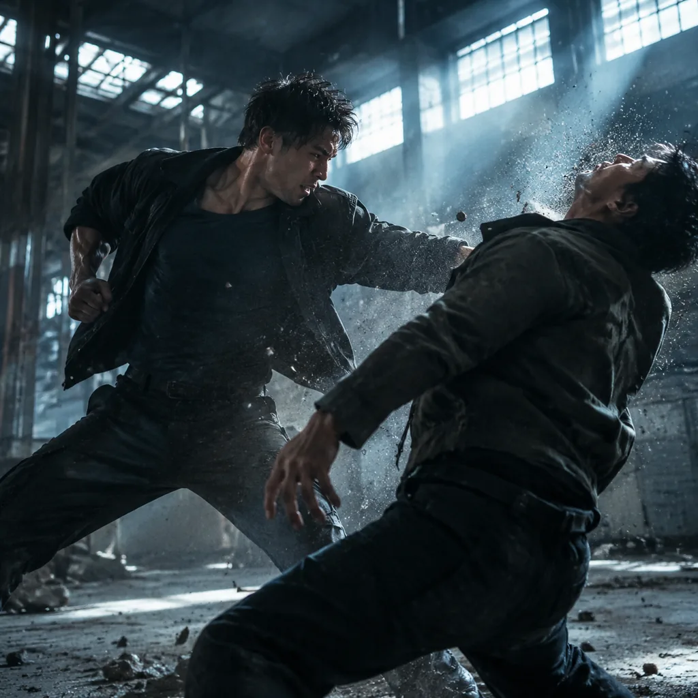</a>

> A keyframe still written from a Minimax H3 video caption by @azed_ai: fast real-time combat that drops into ultra-slow motion on every big hit. We froze the impact frame with dust in warehouse light. Use it for action pitches, film posters and game key art.

```text
Photorealistic video keyframe, square 1:1: two fighters in a dark warehouse frozen at the moment of a big hit in ultra-slow motion, dust and debris hanging in the air, shafts of cold light through high windows, gritty cinematic action film still, dynamic poses, realistic motion energy, no text, no logo. Square 1:1 composition.
```

- Author: [@azed_ai](https://x.com/azed_ai)
- Original post: https://x.com/azed_ai/status/2110732214497620454
- [View on cinel and generate with this prompt](https://cinel.ai/prompts/p/warehouse-fight-slow-motion-keyframe?utm_source=github&utm_medium=awesome&utm_campaign=awesome-gpt-image-2.5-prompts)

### Thorn Lord Dark Fantasy Keyframe

<a href="https://cinel.ai/prompts/p/thorn-lord-dark-fantasy-keyframe?utm_source=github&utm_medium=awesome&utm_campaign=awesome-gpt-image-2.5-prompts">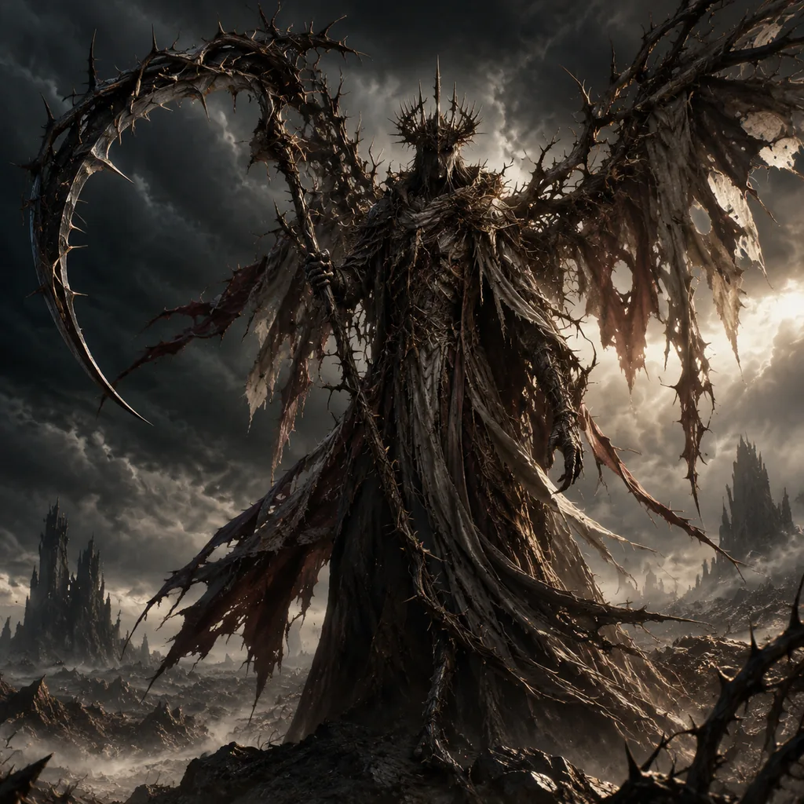</a>

> A keyframe still written from a video @AllaAisling posted as 'The Thorn Lord', with its preview frame. We described the towering thorn-covered figure, curved scythe and破烂branch wings ourselves. Use it for fantasy covers, game bosses and album art.

```text
Dark fantasy video keyframe, square 1:1: a towering thorn lord figure in tattered thorn-covered robes stands in a stormy wasteland, a huge curved thorn scythe in hand, torn wings of branches and cloth behind him, dramatic chiaroscuro light, hyper-detailed digital painting, mysterious and ominous, no text. Square 1:1 composition.
```

- Author: [@AllaAisling](https://x.com/AllaAisling)
- Original post: https://x.com/AllaAisling/status/2110842650970456540
- [View on cinel and generate with this prompt](https://cinel.ai/prompts/p/thorn-lord-dark-fantasy-keyframe?utm_source=github&utm_medium=awesome&utm_campaign=awesome-gpt-image-2.5-prompts)

### Farewell Walk Open Landscape Keyframe

<a href="https://cinel.ai/prompts/p/farewell-walk-open-landscape-keyframe?utm_source=github&utm_medium=awesome&utm_campaign=awesome-gpt-image-2.5-prompts">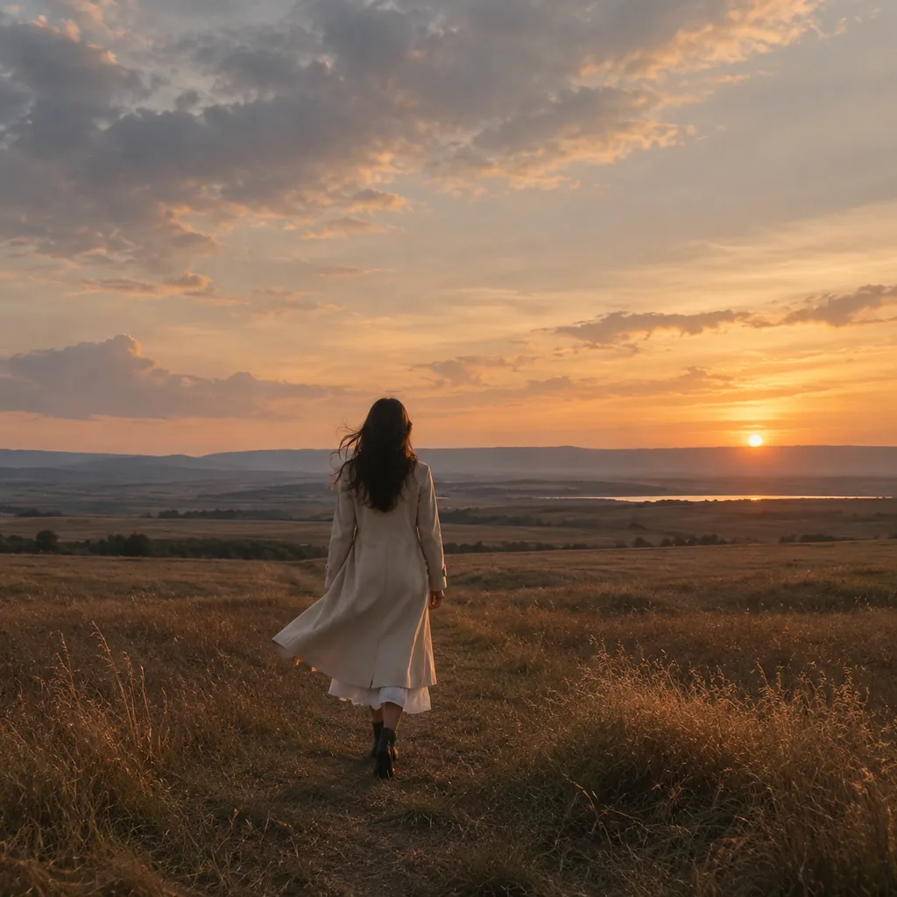</a>

> A keyframe still written from a video caption by @AllaAisling, who wondered if the walk was a goodbye to someone or to an old version of herself. We froze the wide evening walk. Use it for story covers, music visuals and沉思感wallpapers.

```text
Cinematic video keyframe, square 1:1: a lone woman walks away across a wide open landscape toward a distant horizon at soft evening light, her coat moving gently in the wind, vast sky and quiet fields, a farewell mood, painterly photorealism, muted warm palette, no text. Square 1:1 composition.
```

- Author: [@AllaAisling](https://x.com/AllaAisling)
- Original post: https://x.com/AllaAisling/status/2110966970308854083
- [View on cinel and generate with this prompt](https://cinel.ai/prompts/p/farewell-walk-open-landscape-keyframe?utm_source=github&utm_medium=awesome&utm_campaign=awesome-gpt-image-2.5-prompts)

### Autumn Leaves Changing Colours

<a href="https://cinel.ai/prompts/p/autumn-leaves-change-your-colors?utm_source=github&utm_medium=awesome&utm_campaign=awesome-gpt-image-2.5-prompts"></a>

> A reverse-written prompt based on wallpaper images @churvikv posted as 'The law of nature: change your colors' (no prompt was shared). We described the branch of three leaves ourselves, each a different colour stage. Use it for phone wallpapers, autumn cards and minimal posters.

```text
A minimalist nature artwork, square 1:1: three autumn maple leaves in red, gold and orange hanging from a thin dark branch on a clean off-white background, each leaf a different stage of changing colour, delicate shadows, calm seasonal wallpaper, lots of negative space, no text. Square 1:1 composition.
```

- Author: [@churvikv](https://x.com/churvikv)
- Original post: https://x.com/churvikv/status/2108841251101634663
- [View on cinel and generate with this prompt](https://cinel.ai/prompts/p/autumn-leaves-change-your-colors?utm_source=github&utm_medium=awesome&utm_campaign=awesome-gpt-image-2.5-prompts)

### Drop of Water with a Night Window

<a href="https://cinel.ai/prompts/p/drop-of-water-night-window?utm_source=github&utm_medium=awesome&utm_campaign=awesome-gpt-image-2.5-prompts">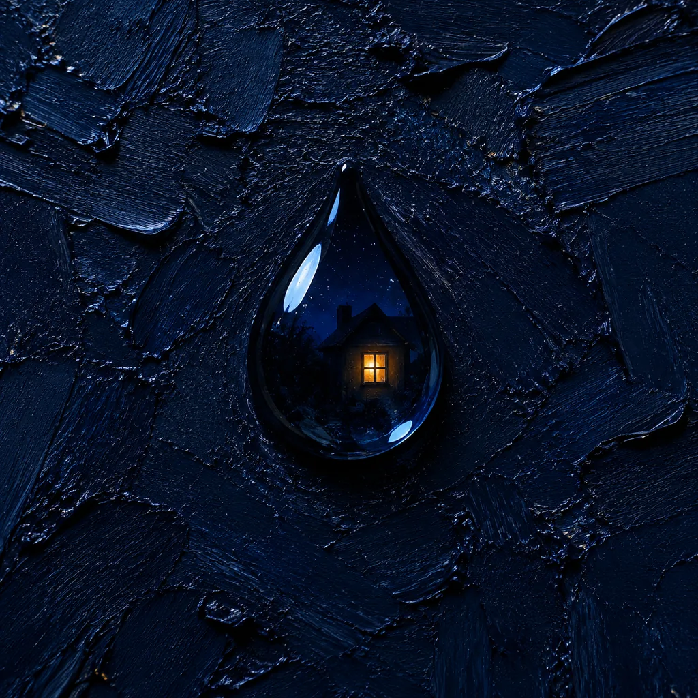</a>

> A reverse-written prompt based on wallpaper images @churvikv posted as 'A drop of water with a night window' (no prompt was shared). We described it ourselves: a晶亮drop on dark paint with a lit window inside. Use it for phone wallpapers, night-themed covers and calm posters.

```text
A minimalist surreal artwork, square 1:1: a single dark water drop on a deep navy impasto surface, and inside the drop a tiny warm-lit window of a night house, glossy reflections on the drop, thick dark paint texture around it, quiet and mysterious wallpaper, no text. Square 1:1 composition.
```

- Author: [@churvikv](https://x.com/churvikv)
- Original post: https://x.com/churvikv/status/2111151955976527887
- [View on cinel and generate with this prompt](https://cinel.ai/prompts/p/drop-of-water-night-window?utm_source=github&utm_medium=awesome&utm_campaign=awesome-gpt-image-2.5-prompts)

### Surreal Trompe-l'oeil Grid Panels

<a href="https://cinel.ai/prompts/p/surreal-trompe-loeil-grid-panels?utm_source=github&utm_medium=awesome&utm_campaign=awesome-gpt-image-2.5-prompts">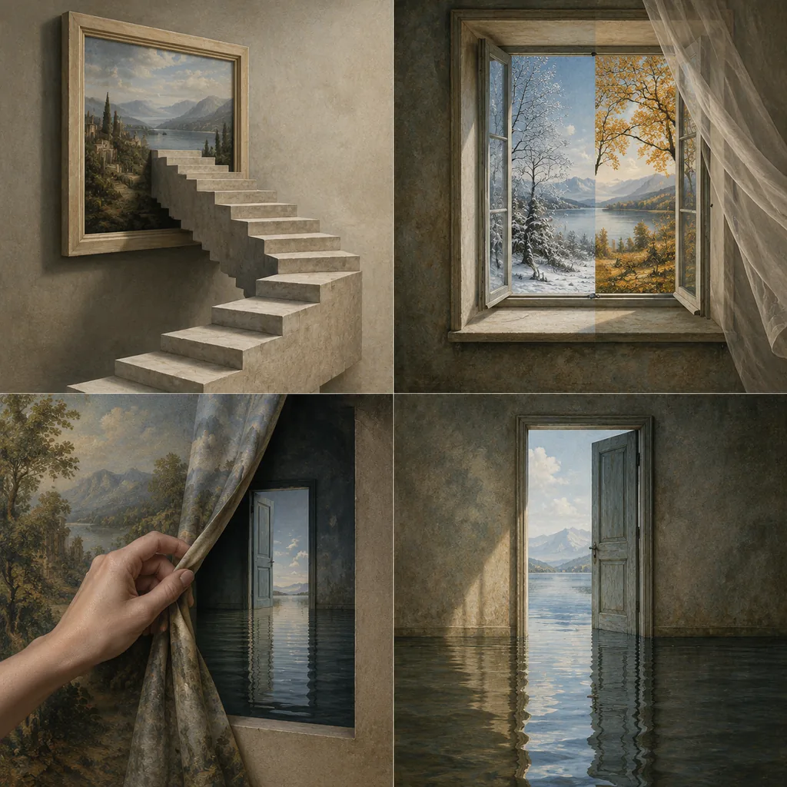</a>

> Expanded from a code-style grid template @Gdgtify shared for surrealist décollage and trompe-l'oeil. We turned it into four runnable illusion panels in one grid. Use it for art posters, exhibition covers and illusion-themed editorials.

```text
A 2x2 grid of surreal trompe-l'oeil panels, square 1:1 overall: each panel is a painted illusion where flat surfaces fold into impossible depth, a staircase escaping its frame, a window opening onto a different season, a hand lifting a painted curtain and a door reflected in water, muted editorial palette, fine-art synthesis, clean grid composition, no text. Square 1:1 composition.
```

- Author: [@Gdgtify](https://x.com/Gdgtify)
- Original post: https://x.com/Gdgtify/status/2109030209009950892
- [View on cinel and generate with this prompt](https://cinel.ai/prompts/p/surreal-trompe-loeil-grid-panels?utm_source=github&utm_medium=awesome&utm_campaign=awesome-gpt-image-2.5-prompts)

### Fractured Moon with a Bright Seam

<a href="https://cinel.ai/prompts/p/fractured-moon-bright-seam?utm_source=github&utm_medium=awesome&utm_campaign=awesome-gpt-image-2.5-prompts">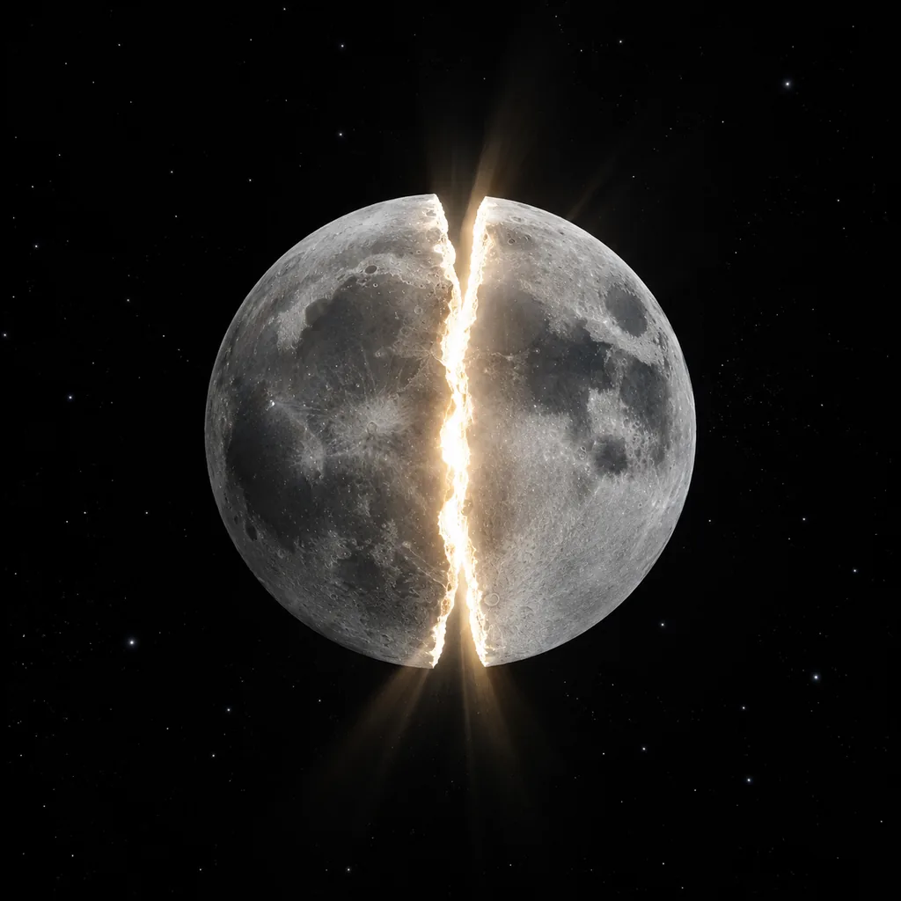</a>

> Expanded from a subject-and-core-idea template @aiacademyus shared about a moon split along one bright seam that stays suspended. We turned it into a runnable minimalist wallpaper prompt. Use it for phone wallpapers, poetry covers and night posters.

```text
A surreal minimalist artwork, square 1:1: a full moon split along one brilliant seam of light, the two halves staying suspended close together instead of falling, thin rays escaping through the crack, deep black sky with faint stars, calm and poetic, high contrast, elegant wallpaper, no text. Square 1:1 composition.
```

- Author: [@aiacademyus](https://x.com/aiacademyus)
- Original post: https://x.com/aiacademyus/status/2109679608509722664
- [View on cinel and generate with this prompt](https://cinel.ai/prompts/p/fractured-moon-bright-seam?utm_source=github&utm_medium=awesome&utm_campaign=awesome-gpt-image-2.5-prompts)

### Impasto Rainy Avenue with Gold Maple

<a href="https://cinel.ai/prompts/p/impasto-rainy-avenue-gold-maple?utm_source=github&utm_medium=awesome&utm_campaign=awesome-gpt-image-2.5-prompts">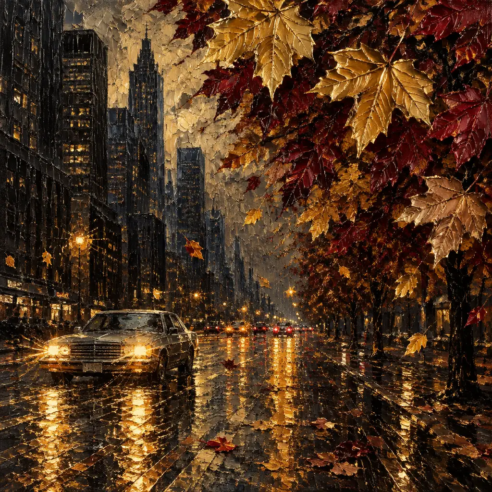</a>

> Copied from a full GPT Image 2.5 prompt @churvikv shared, Even the long road ends, adapted from wide panoramic to square. Rainy towers, a headlit sedan and sculpted maple leaves share one canvas. Use it for city art, book covers and autumn campaigns.

```text
Textured impasto oil painting on coarse canvas, square 1:1, edge to edge, no frame. A wet downtown avenue in heavy rain, tall dark skyscrapers on the left, a boxy silver-grey sedan with headlights flaring warm yellow low in the frame, and across the upper right a dense canopy of large maple leaves in metallic gold and burgundy, each leaf a thick knife-sculpted plaque, loose leaves drifting down. Long knife-scraped wet asphalt with gold reflections, near-black, ochre, gold and burgundy palette, heavy tactile ridges, moody and cinematic, no text. Square 1:1 composition.
```

- Author: [@churvikv](https://x.com/churvikv)
- Original post: https://x.com/churvikv/status/2111408437963694264
- [View on cinel and generate with this prompt](https://cinel.ai/prompts/p/impasto-rainy-avenue-gold-maple?utm_source=github&utm_medium=awesome&utm_campaign=awesome-gpt-image-2.5-prompts)

### Floating Cyberpunk Entertainment Harbor

<a href="https://cinel.ai/prompts/p/floating-cyberpunk-entertainment-harbor?utm_source=github&utm_medium=awesome&utm_campaign=awesome-gpt-image-2.5-prompts">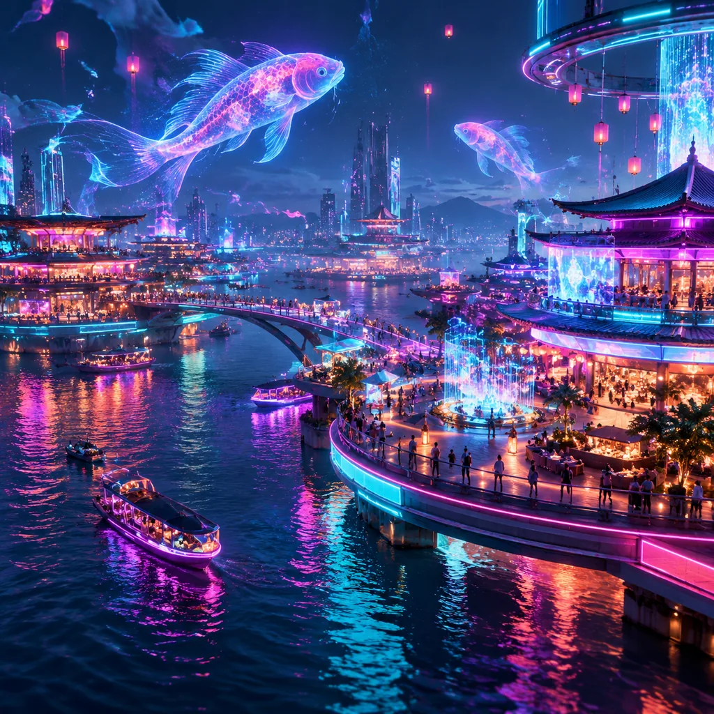</a>

> Expanded from a Nano Banana harbor post by @artingent, whose detailed prompt sat in the first reply. We built the floating decks, bridges and holographic koi into one frame. Use it for game worlds, event art and sci-fi covers.

```text
A floating entertainment harbor in an artistic cyberpunk style, square 1:1: tiered neon-lit platforms and curved bridges hovering above dark water, glowing signs without readable words, tiny crowds on decks, holographic koi drifting in the air, teal and magenta light reflecting on ripples, detailed digital painting, festive and futuristic, no readable text, no logo. Square 1:1 composition.
```

- Author: [@artingent](https://x.com/artingent)
- Original post: https://x.com/artingent/status/2110358809969602570
- [View on cinel and generate with this prompt](https://cinel.ai/prompts/p/floating-cyberpunk-entertainment-harbor?utm_source=github&utm_medium=awesome&utm_campaign=awesome-gpt-image-2.5-prompts)

### Tightrope Acrobat Peak Trick Keyframe

<a href="https://cinel.ai/prompts/p/tightrope-acrobat-peak-trick-keyframe?utm_source=github&utm_medium=awesome&utm_campaign=awesome-gpt-image-2.5-prompts">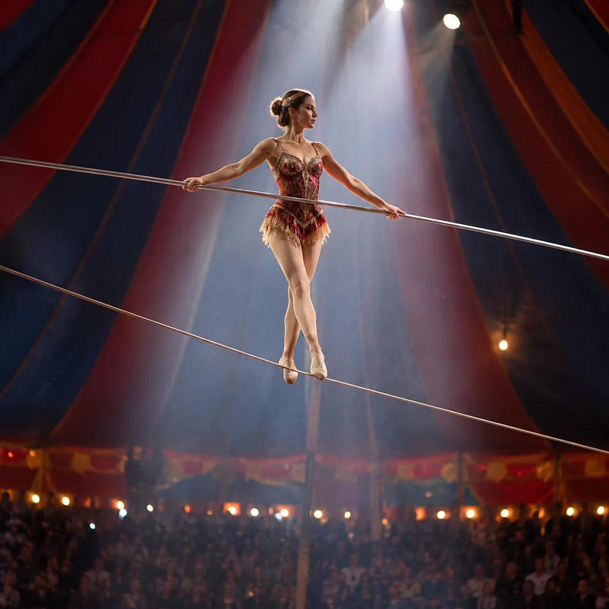</a>

> Rewritten as one 1:1 keyframe from a Seedance tightrope video by @azed_ai. We froze the balancing trick, spotlight and dust. Use it for circus posters, courage themes and event covers.

```text
Photorealistic video keyframe, square 1:1: a circus acrobat frozen mid-trick high on a tightrope under a big-top spotlight, arms out with a balancing pole, colourful tent stripes and a hushed crowd far below in soft blur, dramatic shaft of light and floating dust, the bravest frame of the act, no text, no logo. Square 1:1 composition.
```

- Author: [@azed_ai](https://x.com/azed_ai)
- Original post: https://x.com/azed_ai/status/2110882508950880525
- [View on cinel and generate with this prompt](https://cinel.ai/prompts/p/tightrope-acrobat-peak-trick-keyframe?utm_source=github&utm_medium=awesome&utm_campaign=awesome-gpt-image-2.5-prompts)

### Drawing Jumps Off the Page Keyframe

<a href="https://cinel.ai/prompts/p/drawing-jumps-off-page-transition-keyframe?utm_source=github&utm_medium=awesome&utm_campaign=awesome-gpt-image-2.5-prompts"></a>

> Rewritten as one 1:1 keyframe from a video post by @Artedeingenio about a drawing jumping off the page and becoming real. We froze the halfway transformation. Use it for creativity posters, writing covers and illusion art.

```text
Surreal video transition keyframe, square 1:1: a hand-drawn pencil figure halfway stepping out of an open sketchbook page into a real sunlit desk scene, the left half still black pencil lines on paper, the right half becoming a real person in colour, paper edge curling where the drawing crosses over, magical optical-illusion moment frozen at the exact transformation, warm daylight, photorealistic mixed media, no readable text. Square 1:1 composition.
```

- Author: [@Artedeingenio](https://x.com/Artedeingenio)
- Original post: https://x.com/Artedeingenio/status/2111087202968998337
- [View on cinel and generate with this prompt](https://cinel.ai/prompts/p/drawing-jumps-off-page-transition-keyframe?utm_source=github&utm_medium=awesome&utm_campaign=awesome-gpt-image-2.5-prompts)

### Luxembourg Valley Vlog Cover Keyframe

<a href="https://cinel.ai/prompts/p/luxembourg-valley-vlog-cover-keyframe?utm_source=github&utm_medium=awesome&utm_campaign=awesome-gpt-image-2.5-prompts">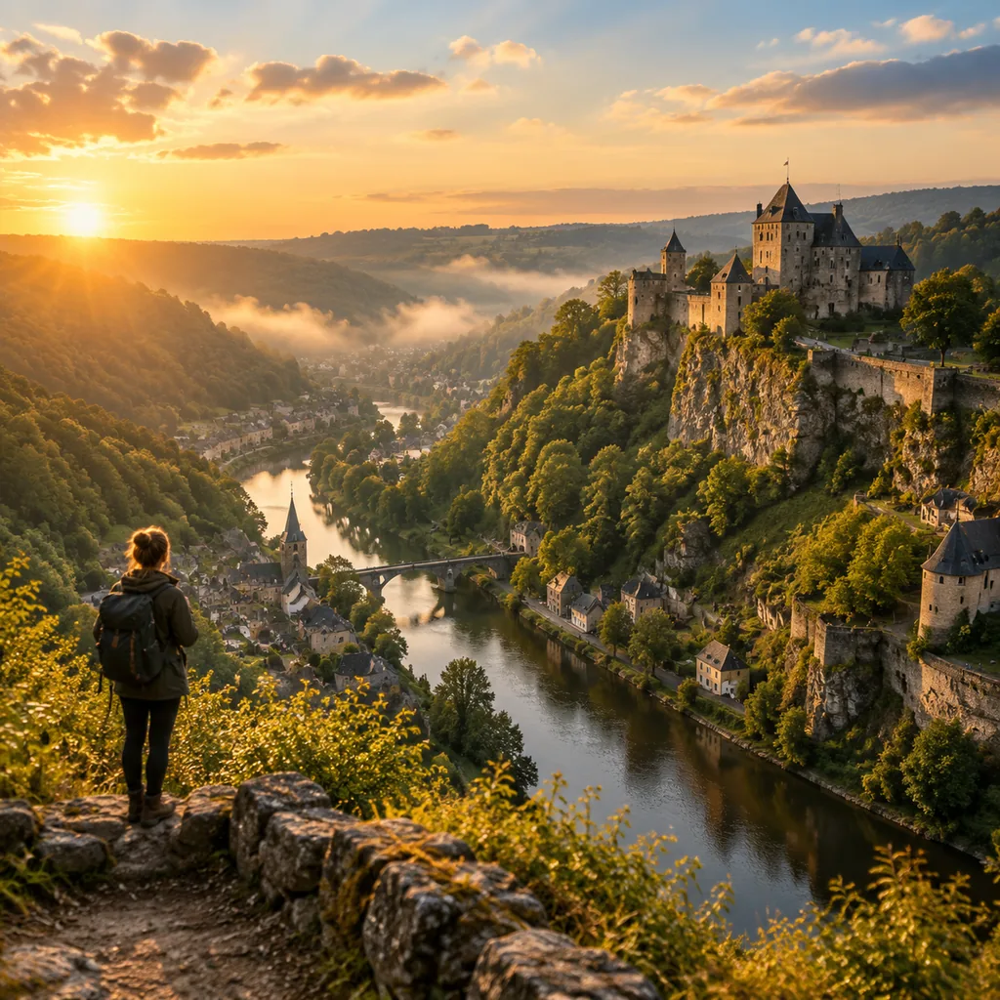</a>

> Rewritten as one 1:1 vlog cover frame from a travel video by @AllaAisling about Luxembourg feeling bigger than expected. We froze the valley, castle and golden light. Use it for travel covers, vlog thumbnails and guide art.

```text
Cinematic travel-vlog cover frame, square 1:1: a deep green Luxembourg valley at golden hour, old stone fortifications and a castle on the cliff above a winding river, a tiny traveller with a backpack standing on a viewpoint in the foreground, warm light and soft mist, photorealistic film still that makes a small country feel vast, no text. Square 1:1 composition.
```

- Author: [@AllaAisling](https://x.com/AllaAisling)
- Original post: https://x.com/AllaAisling/status/2110815220323291219
- [View on cinel and generate with this prompt](https://cinel.ai/prompts/p/luxembourg-valley-vlog-cover-keyframe?utm_source=github&utm_medium=awesome&utm_campaign=awesome-gpt-image-2.5-prompts)

### Padel Overhead Smash Slow-Motion Keyframe

<a href="https://cinel.ai/prompts/p/padel-overhead-smash-slow-motion-keyframe?utm_source=github&utm_medium=awesome&utm_campaign=awesome-gpt-image-2.5-prompts"></a>

> Rewritten as one 1:1 keyframe from a cinematic padel video by @sympannse. We froze the smash at its highest point. Use it for sports posters, club socials and fitness covers.

```text
Photorealistic sports video keyframe, square 1:1: a padel athlete frozen at the top of an overhead smash, racket high, ball just above the strings, dramatic low angle, orange and cyan court lighting, elegant slow-motion energy, sweat and fabric detail, cinematic sports film still, no text, no logo. Square 1:1 composition.
```

- Author: [@sympannse](https://x.com/sympannse)
- Original post: https://x.com/sympannse/status/2110027587150061628
- [View on cinel and generate with this prompt](https://cinel.ai/prompts/p/padel-overhead-smash-slow-motion-keyframe?utm_source=github&utm_medium=awesome&utm_campaign=awesome-gpt-image-2.5-prompts)

### Sci-Fi Portal Over a Misty Valley

<a href="https://cinel.ai/prompts/p/sci-fi-portal-valley-travellers?utm_source=github&utm_medium=awesome&utm_campaign=awesome-gpt-image-2.5-prompts">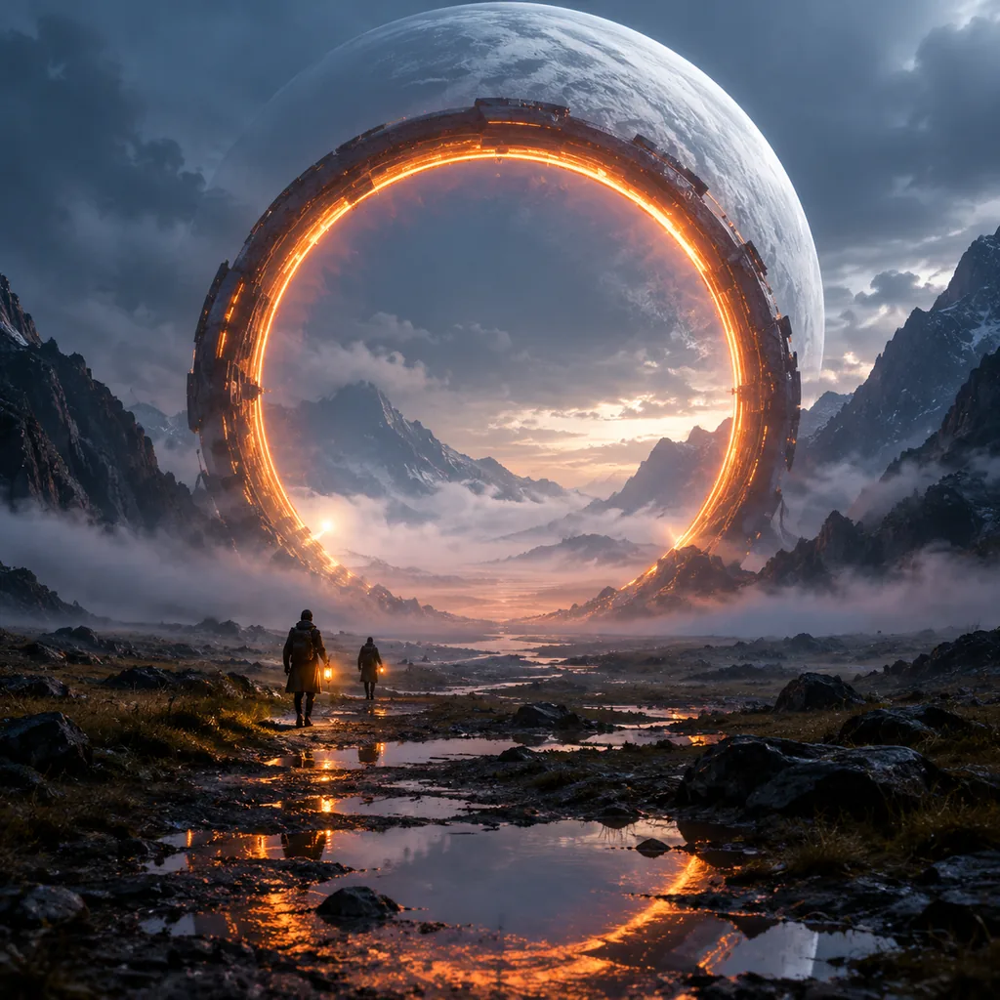</a>

> Reverse-written from the image alone in a GPT Image 2.5 photo set by @azed_ai; the post gave no prompt. We described the portal ring, planet and lantern path as seen. Use it for sci-fi covers, game key art and wallpaper.

```text
A cinematic sci-fi landscape, square 1:1: a huge circular portal ring glowing orange above a misty valley, a giant pale planet behind it, two tiny travellers with lanterns walking a wet path toward the ring, dark mountains and reflective puddles, epic scale and quiet wonder, photorealistic digital painting, no text. Square 1:1 composition.
```

- Author: [@azed_ai](https://x.com/azed_ai)
- Original post: https://x.com/azed_ai/status/2110806948354400551
- [View on cinel and generate with this prompt](https://cinel.ai/prompts/p/sci-fi-portal-valley-travellers?utm_source=github&utm_medium=awesome&utm_campaign=awesome-gpt-image-2.5-prompts)

### Giant Octopus Over a Flooded Street

<a href="https://cinel.ai/prompts/p/giant-octopus-flooded-classical-street?utm_source=github&utm_medium=awesome&utm_campaign=awesome-gpt-image-2.5-prompts">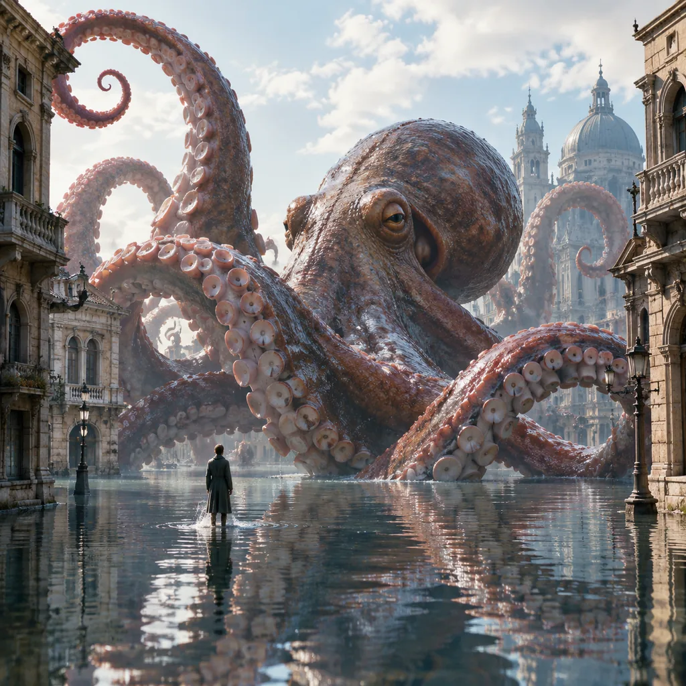</a>

> Reverse-written from the image alone in an Octopus-art post by @AllaAisling; the post gave no prompt. We described the tentacles, flooded street and tiny figure as seen. Use it for surreal covers, exhibition art and wallpaper.

```text
A surreal photorealistic artwork, square 1:1: a giant octopus with vast curling tentacles rising over a flooded classical European street, suckers and wet skin in detail, calm water reflecting old stone facades, a tiny lone figure standing in the shallows, dreamlike daylight, epic yet gentle, no text. Square 1:1 composition.
```

- Author: [@AllaAisling](https://x.com/AllaAisling)
- Original post: https://x.com/AllaAisling/status/2110943314270629918
- [View on cinel and generate with this prompt](https://cinel.ai/prompts/p/giant-octopus-flooded-classical-street?utm_source=github&utm_medium=awesome&utm_campaign=awesome-gpt-image-2.5-prompts)

### One Word: Connect — Light Bridge Islands

<a href="https://cinel.ai/prompts/p/one-word-connect-light-bridge-islands?utm_source=github&utm_medium=awesome&utm_campaign=awesome-gpt-image-2.5-prompts"></a>

> Expanded from a one-word prompt, Connect, shared by @AllaAisling. We turned the word into two islands and a bridge of light. Use it for connection themes, book covers and calm wallpaper.

```text
A surreal minimalist artwork, square 1:1: two small rocky islands in a calm sea connected by a single glowing bridge of light, tiny figures meeting in the middle, soft dawn sky, lots of negative space, calm and hopeful, elegant wallpaper, no text. Square 1:1 composition.
```

- Author: [@AllaAisling](https://x.com/AllaAisling)
- Original post: https://x.com/AllaAisling/status/2111166031813394882
- [View on cinel and generate with this prompt](https://cinel.ai/prompts/p/one-word-connect-light-bridge-islands?utm_source=github&utm_medium=awesome&utm_campaign=awesome-gpt-image-2.5-prompts)

### Sketchbook Landmark Aligned: Hallstatt

<a href="https://cinel.ai/prompts/p/sketchbook-landmark-aligned-hallstatt?utm_source=github&utm_medium=awesome&utm_campaign=awesome-gpt-image-2.5-prompts">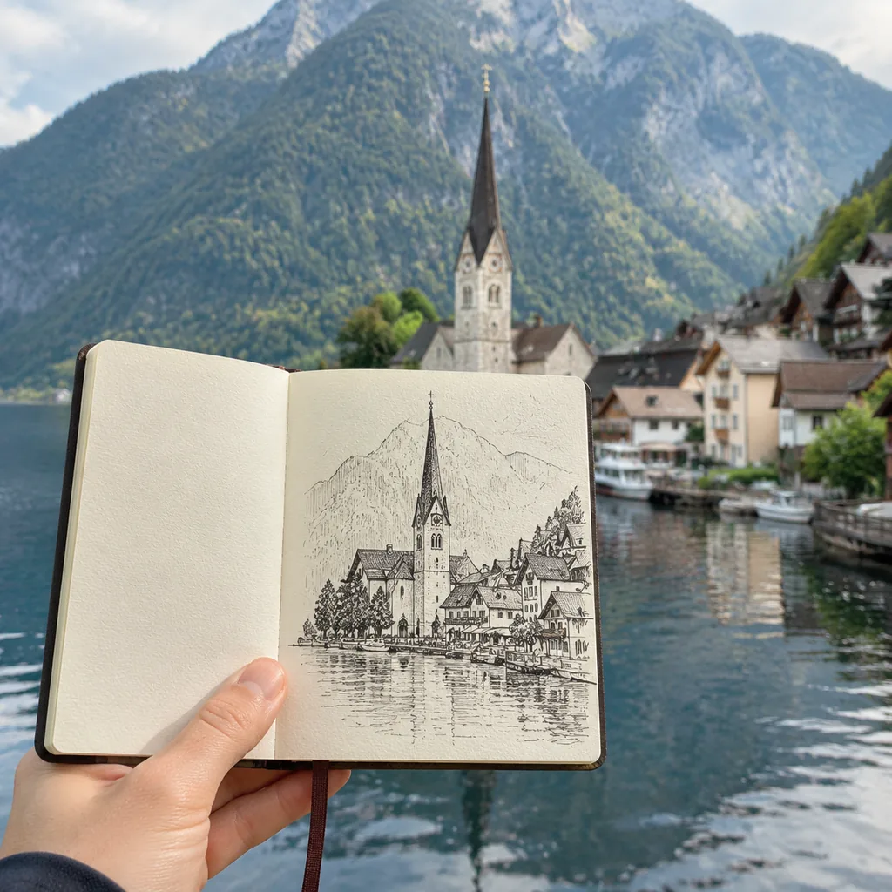</a>

> A filled example of a sketch-of-the-place prompt @Naiknelofar788 shared with GPT Image 2.5. We set the landmark to Hallstatt's lakeside church. Use it for travel journals, sketchbook art and souvenir photos.

```text
Photorealistic travel photograph, square 1:1: a hand holding an open pocket sketchbook in the foreground, the page showing a black-ink sketch of a lakeside church tower in Hallstatt, Austria, the real church standing directly behind the sketchbook perfectly aligned with its drawing, cream textured pages and a ribbon bookmark, shallow depth of field, soft daylight, subtle film grain, no other text. Square 1:1 composition.
```

- Author: [@Naiknelofar788](https://x.com/Naiknelofar788)
- Original post: https://x.com/Naiknelofar788/status/2109867363743215809
- [View on cinel and generate with this prompt](https://cinel.ai/prompts/p/sketchbook-landmark-aligned-hallstatt?utm_source=github&utm_medium=awesome&utm_campaign=awesome-gpt-image-2.5-prompts)

### Silent Machine in a Misty Hall Keyframe

<a href="https://cinel.ai/prompts/p/silent-machine-misty-hall-keyframe?utm_source=github&utm_medium=awesome&utm_campaign=awesome-gpt-image-2.5-prompts">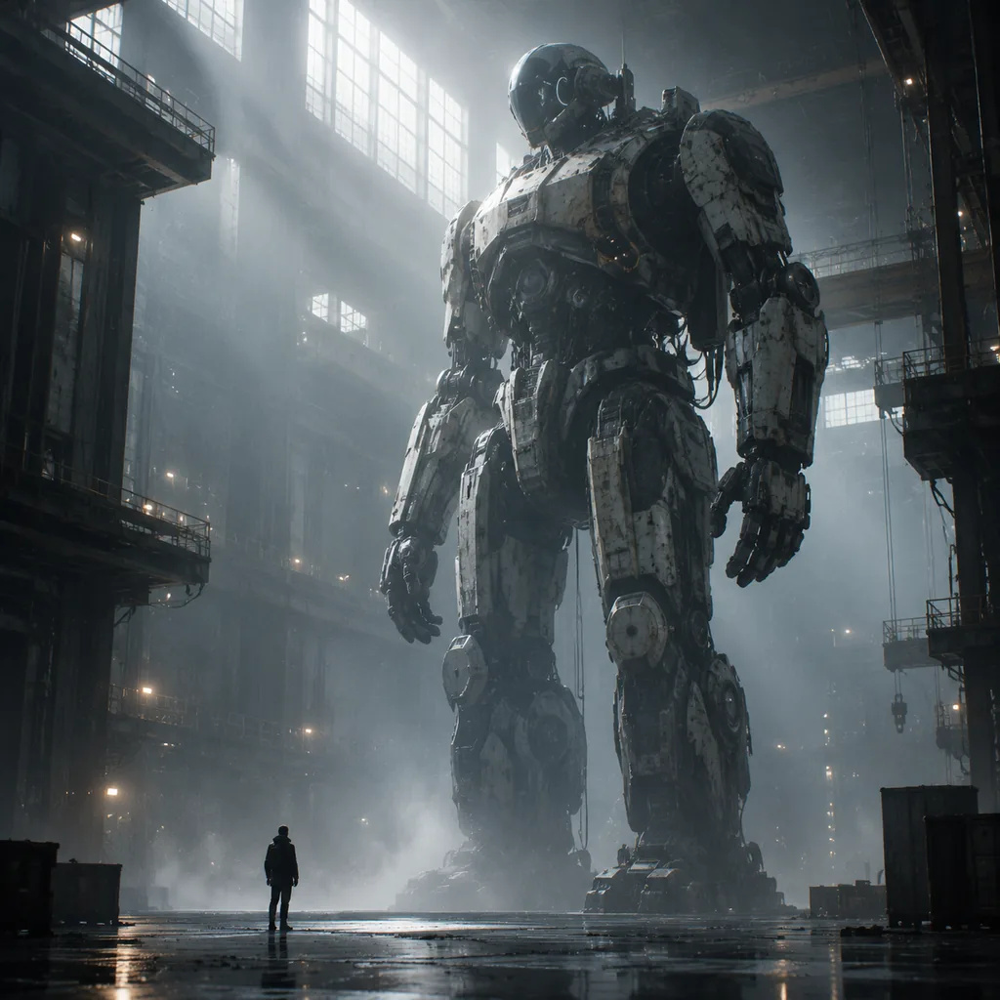</a>

> Rewritten as one 1:1 keyframe from The Silent Machine video by @AllaAisling. We froze the scale contrast and pale light. Use it for sci-fi covers, concept art and quiet dystopia themes.

```text
Cinematic sci-fi video keyframe, square 1:1: a towering silent machine standing still in a misty industrial hall, soft shafts of pale light through high windows, tiny human silhouette looking up from below, dust and quiet scale, photorealistic film still, mysterious and calm, no text, no logo. Square 1:1 composition.
```

- Author: [@AllaAisling](https://x.com/AllaAisling)
- Original post: https://x.com/AllaAisling/status/2111076189834297570
- [View on cinel and generate with this prompt](https://cinel.ai/prompts/p/silent-machine-misty-hall-keyframe?utm_source=github&utm_medium=awesome&utm_campaign=awesome-gpt-image-2.5-prompts)

### Aerial Drone Coastal Festival Keyframe

<a href="https://cinel.ai/prompts/p/aerial-drone-coastal-festival-keyframe?utm_source=github&utm_medium=awesome&utm_campaign=awesome-gpt-image-2.5-prompts"></a>

> Rewritten as one 1:1 drone frame from a banner-to-cinematic-ad video by @digitalskillsws. We froze the overhead pattern and long shadows. Use it for festival covers, tourism art and event posters.

```text
Cinematic aerial video keyframe, square 1:1: a top-down drone frame over a coastal festival at golden hour, colourful tents and a large plain banner canopy in the centre, tiny crowds casting long shadows, turquoise water along one edge, coordinated movement frozen into a graphic pattern, photorealistic drone still, no readable text. Square 1:1 composition.
```

- Author: [@digitalskillsws](https://x.com/digitalskillsws)
- Original post: https://x.com/digitalskillsws/status/2109315751848948065
- [View on cinel and generate with this prompt](https://cinel.ai/prompts/p/aerial-drone-coastal-festival-keyframe?utm_source=github&utm_medium=awesome&utm_campaign=awesome-gpt-image-2.5-prompts)

### Cat Pounce Feather Toy Keyframe

<a href="https://cinel.ai/prompts/p/cat-pounce-feather-toy-keyframe?utm_source=github&utm_medium=awesome&utm_campaign=awesome-gpt-image-2.5-prompts">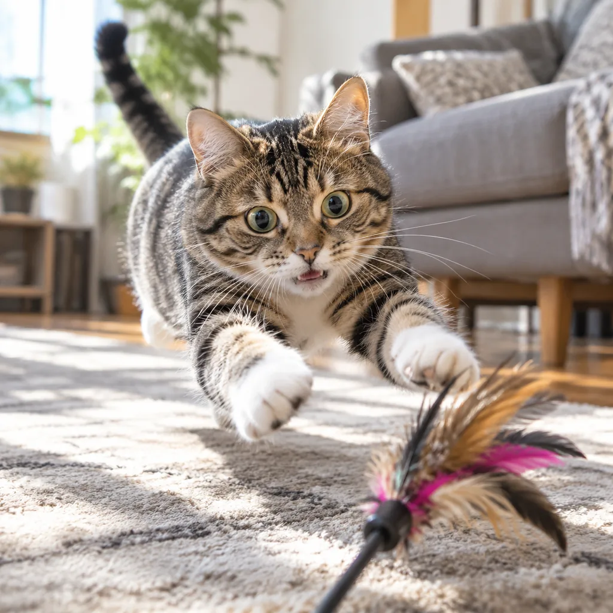</a>

> Rewritten as one 1:1 keyframe from a Seedance cat video by @Alexneyef titled Never show this to your cat. We froze a generic feather-toy pounce. Use it for pet covers, vet socials and cute wallpaper.

```text
Photorealistic pet video keyframe, square 1:1: a tabby cat frozen mid-pounce toward a feather toy in a sunlit living room, paws out, whiskers forward, rug and sofa softly blurred, joyful mischievous energy, the funniest frame of the clip, realistic fur, no text, no logo. Square 1:1 composition.
```

- Author: [@Alexneyef](https://x.com/Alexneyef)
- Original post: https://x.com/Alexneyef/status/2110488465557062143
- [View on cinel and generate with this prompt](https://cinel.ai/prompts/p/cat-pounce-feather-toy-keyframe?utm_source=github&utm_medium=awesome&utm_campaign=awesome-gpt-image-2.5-prompts)

### Mexico Painted Doorway Market Keyframe

<a href="https://cinel.ai/prompts/p/mexico-painted-doorway-market-keyframe?utm_source=github&utm_medium=awesome&utm_campaign=awesome-gpt-image-2.5-prompts"></a>

> Rewritten as one 1:1 vlog cover frame from a Mexico travel video by @AllaAisling. We froze the doorway, market colours and midday light. Use it for travel covers, food-market art and vlog thumbnails.

```text
Cinematic travel-vlog cover frame, square 1:1: a vividly painted doorway in a Mexican street at midday, a colourful market spilling past with fabrics and handmade food stalls, warm sun and deep shadows, a musician blurred in the distance, photorealistic film still full of small lively details, no readable text. Square 1:1 composition.
```

- Author: [@AllaAisling](https://x.com/AllaAisling)
- Original post: https://x.com/AllaAisling/status/2111242535993737411
- [View on cinel and generate with this prompt](https://cinel.ai/prompts/p/mexico-painted-doorway-market-keyframe?utm_source=github&utm_medium=awesome&utm_campaign=awesome-gpt-image-2.5-prompts)

### Fog Sweeper Dawn Town Keyframe

<a href="https://cinel.ai/prompts/p/fog-sweeper-dawn-town-keyframe?utm_source=github&utm_medium=awesome&utm_campaign=awesome-gpt-image-2.5-prompts">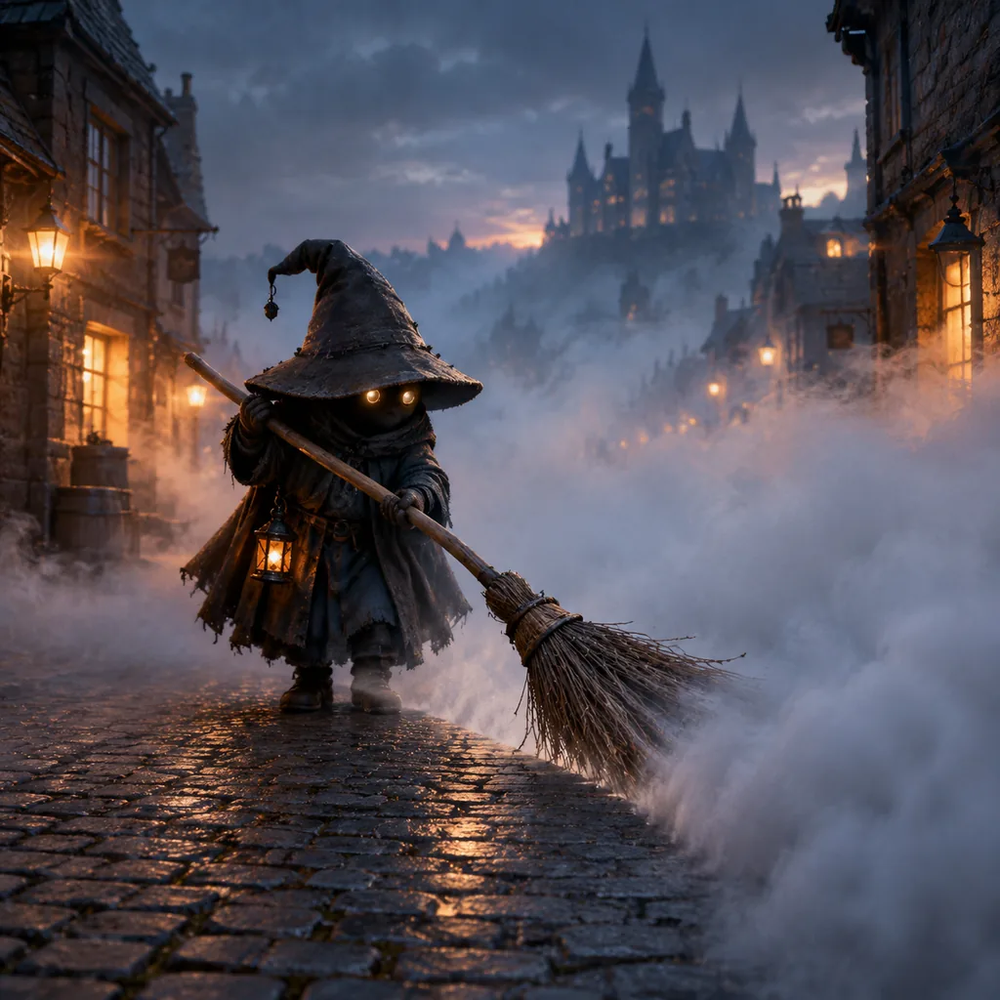</a>

> Rewritten as one 1:1 keyframe from The Fog Sweeper video by @AllaAisling. We froze the broom stroke and the clear path. Use it for Halloween tales, fantasy covers and cozy-spooky art.

```text
Cinematic fantasy video keyframe, square 1:1: a small cloaked fog sweeper with a wide broom frozen mid-sweep on a cobbled town street before sunrise, a clean swept path of clear air cutting through thick fog, warm windows glowing behind the mist, whimsical and slightly spooky, photorealistic film still, no text. Square 1:1 composition.
```

- Author: [@AllaAisling](https://x.com/AllaAisling)
- Original post: https://x.com/AllaAisling/status/2111139843375825307
- [View on cinel and generate with this prompt](https://cinel.ai/prompts/p/fog-sweeper-dawn-town-keyframe?utm_source=github&utm_medium=awesome&utm_campaign=awesome-gpt-image-2.5-prompts)

### Photo and Ink Wash Mountain Diptych

<a href="https://cinel.ai/prompts/p/photo-ink-wash-mountain-diptych?utm_source=github&utm_medium=awesome&utm_campaign=awesome-gpt-image-2.5-prompts">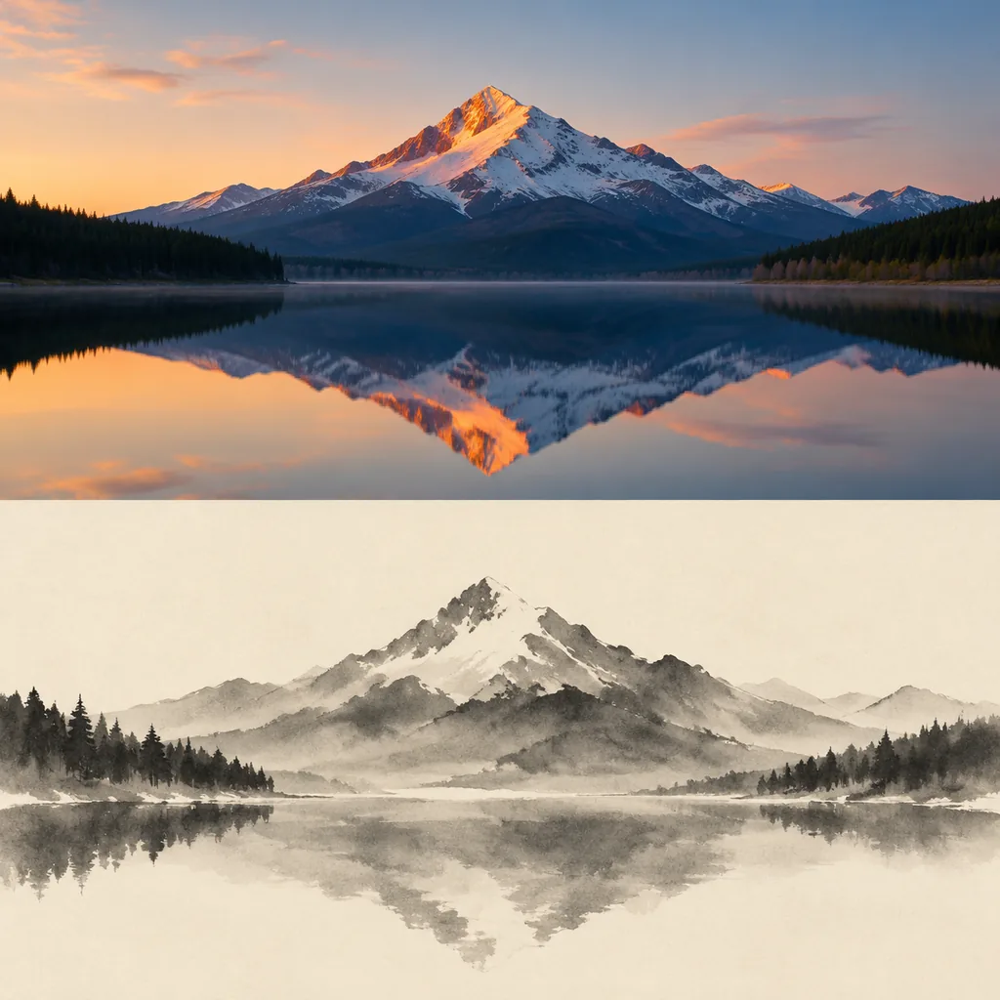</a>

> Expanded from a Photo and Ink Wash Diptych image shared by @OimiAIStudio with GPT-Image-2.5; the post gave only a title. We described the photo/ink split as seen. Use it for calm posters, poetry covers and wallpaper.

```text
A photo and ink-wash diptych, square 1:1 overall: the top half is a photorealistic mountain peak reflected perfectly in a still lake at dawn, the bottom half is the same mountain as a minimal black ink-wash painting on cream paper with soft bleeding edges, calm and poetic, clean split composition, no text. Square 1:1 composition.
```

- Author: [@OimiAIStudio](https://x.com/OimiAIStudio)
- Original post: https://x.com/OimiAIStudio/status/2110533344329179491
- [View on cinel and generate with this prompt](https://cinel.ai/prompts/p/photo-ink-wash-mountain-diptych?utm_source=github&utm_medium=awesome&utm_campaign=awesome-gpt-image-2.5-prompts)

### Corgi Autumn Park Pet Template Poster

<a href="https://cinel.ai/prompts/p/corgi-autumn-park-pet-template-poster?utm_source=github&utm_medium=awesome&utm_campaign=awesome-gpt-image-2.5-prompts">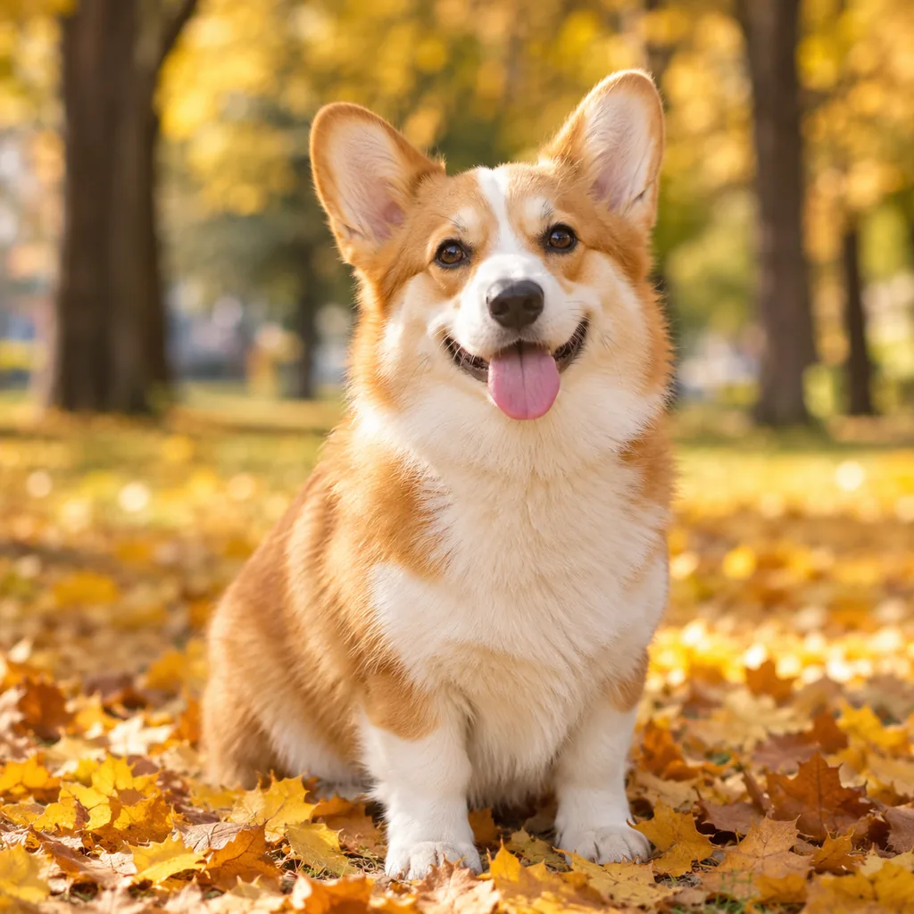</a>

> A filled example of a JSON pet/pose/background template @Maercihh shared for GPT Image 2.5. We set the pet to a corgi in an autumn park. Use it for pet portraits, calendars and rescue socials.

```text
Photorealistic pet portrait, square 1:1: a happy corgi sitting proudly in an autumn park scattered with golden leaves, tongue out, soft afternoon light, shallow depth of field, detailed fur, joyful and clean studio-like outdoor portrait, no text, no logo. Square 1:1 composition.
```

- Author: [@Maercihh](https://x.com/Maercihh)
- Original post: https://x.com/Maercihh/status/2111459277756084352
- [View on cinel and generate with this prompt](https://cinel.ai/prompts/p/corgi-autumn-park-pet-template-poster?utm_source=github&utm_medium=awesome&utm_campaign=awesome-gpt-image-2.5-prompts)

### Tiny Traveller Facing a Giant Mech

<a href="https://cinel.ai/prompts/p/tiny-traveller-giant-mech-low-angle?utm_source=github&utm_medium=awesome&utm_campaign=awesome-gpt-image-2.5-prompts">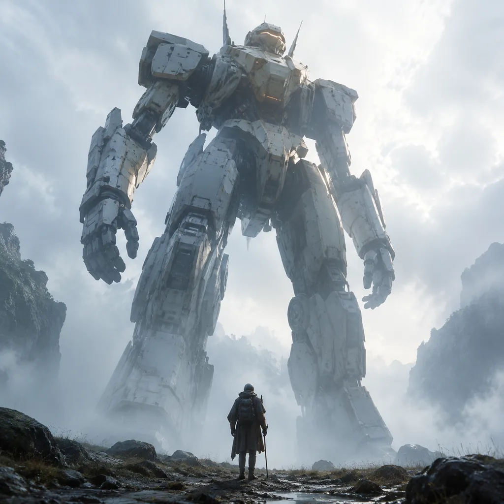</a>

> Adapted from a post by @RockGrokAI on 2026-10-14 (11 likes at capture). We rewrote it as one clean 1:1 still, removing brands, logos, celebrity/IP elements and any need for your own photo. Change one variable at a time.

```text
Dramatic low ground-level view, square 1:1: a tiny solitary traveller seen from behind in the foreground looking up at an enormous tall bipedal mech robot in pale misty light, epic scale contrast, cinematic, no text, no logo. Square 1:1 composition.
```

- Author: [@RockGrokAI](https://x.com/RockGrokAI)
- Original post: https://x.com/RockGrokAI/status/2110407788983718233
- [View on cinel and generate with this prompt](https://cinel.ai/prompts/p/tiny-traveller-giant-mech-low-angle?utm_source=github&utm_medium=awesome&utm_campaign=awesome-gpt-image-2.5-prompts)

### Bicycle Grown From a Flower Stem

<a href="https://cinel.ai/prompts/p/bicycle-grown-from-flower-stem?utm_source=github&utm_medium=awesome&utm_campaign=awesome-gpt-image-2.5-prompts">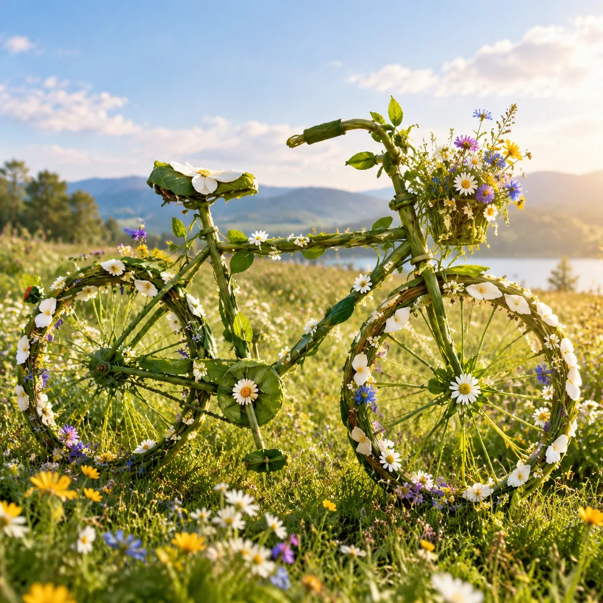</a>

> Adapted from a post by @CliffWade on 2026-10-14 (7 likes at capture). We rewrote it as one clean 1:1 still, removing brands, logos, celebrity/IP elements and any need for your own photo. Change one variable at a time.

```text
Wide whimsical photograph, square 1:1: a bicycle grown naturally from a green flower stem, petals and leaves woven into the frame and wheels, in a sunlit meadow, edge-to-edge finished picture, no text. Square 1:1 composition.
```

- Author: [@CliffWade](https://x.com/CliffWade)
- Original post: https://x.com/CliffWade/status/2110370531438391718
- [View on cinel and generate with this prompt](https://cinel.ai/prompts/p/bicycle-grown-from-flower-stem?utm_source=github&utm_medium=awesome&utm_campaign=awesome-gpt-image-2.5-prompts)

### Lisbon Tram Between the Rails

<a href="https://cinel.ai/prompts/p/lisbon-tram-between-rails-low-angle?utm_source=github&utm_medium=awesome&utm_campaign=awesome-gpt-image-2.5-prompts"></a>

> Adapted from a post by @aiartalley on 2026-10-14 (0 likes at capture). We rewrote it as one clean 1:1 still, removing brands, logos, celebrity/IP elements and any need for your own photo. Change one variable at a time.

```text
Photorealistic street scene, square 1:1: a vintage yellow Lisbon tram climbing a narrow Alfama lane, camera placed very low between the rails looking up, cobblestones and laundry lines above, warm late light, no readable text, no logo. Square 1:1 composition.
```

- Author: [@aiartalley](https://x.com/aiartalley)
- Original post: https://x.com/aiartalley/status/2110370187123843167
- [View on cinel and generate with this prompt](https://cinel.ai/prompts/p/lisbon-tram-between-rails-low-angle?utm_source=github&utm_medium=awesome&utm_campaign=awesome-gpt-image-2.5-prompts)

### Luxury Sleeper Train Disaster Keyframe

<a href="https://cinel.ai/prompts/p/luxury-sleeper-train-disaster-keyframe?utm_source=github&utm_medium=awesome&utm_campaign=awesome-gpt-image-2.5-prompts">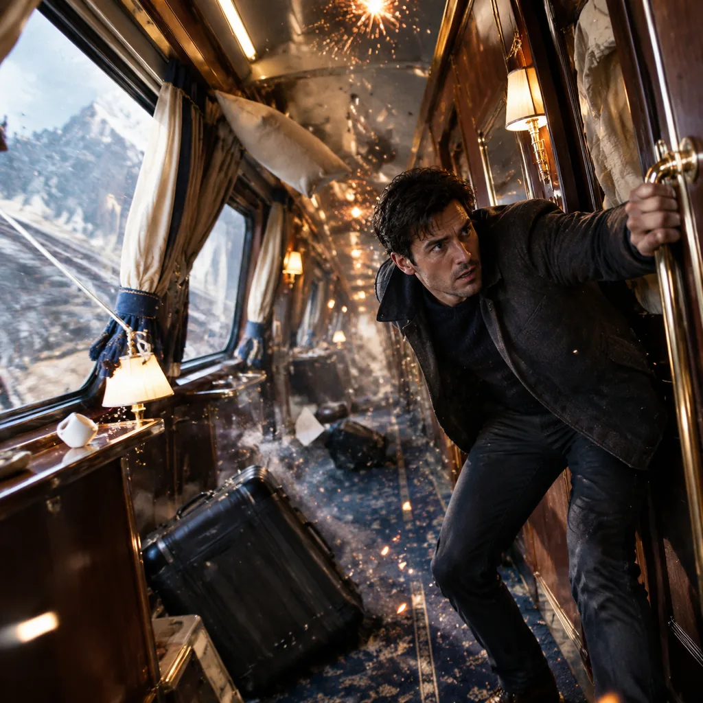</a>

> Adapted from a video post by @john_my07 on 2026-10-17 (46 likes at capture). We rewrote it as one clean 1:1 still, removing brands, logos, celebrity/IP elements and any need for your own photo. Change one variable at a time.

```text
Cinematic video keyframe, square 1:1: inside a real luxury sleeper train during a sudden catastrophic jolt, a tilted elegant carriage interior, luggage sliding, practical-effects dust and sparks, a fictional passenger bracing in the corridor, live-action movie-set realism, frozen hero frame, no text, no logo. Square 1:1 composition.
```

- Author: [@john_my07](https://x.com/john_my07)
- Original post: https://x.com/john_my07/status/2111464255509893474
- [View on cinel and generate with this prompt](https://cinel.ai/prompts/p/luxury-sleeper-train-disaster-keyframe?utm_source=github&utm_medium=awesome&utm_campaign=awesome-gpt-image-2.5-prompts)

### Floating Torii Island Diorama Keyframe

<a href="https://cinel.ai/prompts/p/floating-torii-island-diorama-keyframe?utm_source=github&utm_medium=awesome&utm_campaign=awesome-gpt-image-2.5-prompts"></a>

> Adapted from a video post by @AIBoticssq on 2026-10-13 (12 likes at capture). We rewrote it as one clean 1:1 still, removing brands, logos, celebrity/IP elements and any need for your own photo. Change one variable at a time.

```text
Cinematic video keyframe, square 1:1: a tiny floating diorama island with a red torii gate standing in clear water, a small pagoda, colour-changing reflections on the water, miniature world frozen at its most magical frame, no text, no logo. Square 1:1 composition.
```

- Author: [@AIBoticssq](https://x.com/AIBoticssq)
- Original post: https://x.com/AIBoticssq/status/2110090003703378023
- [View on cinel and generate with this prompt](https://cinel.ai/prompts/p/floating-torii-island-diorama-keyframe?utm_source=github&utm_medium=awesome&utm_campaign=awesome-gpt-image-2.5-prompts)

### Colour Throw Peacock Festival Keyframe

<a href="https://cinel.ai/prompts/p/colour-throw-peacock-festival-keyframe?utm_source=github&utm_medium=awesome&utm_campaign=awesome-gpt-image-2.5-prompts"></a>

> Adapted from a video post by @TiyashiAI on 2026-10-18 (1 likes at capture). We rewrote it as one clean 1:1 still, removing brands, logos, celebrity/IP elements and any need for your own photo. Change one variable at a time.

```text
Festival video keyframe, square 1:1: a joyful colour-throw festival moment frozen as coloured powder blooms into a giant peacock shape in the sky above a street crowd in modest festival clothes, vivid pink teal and gold powder, no text, no logo. Square 1:1 composition.
```

- Author: [@TiyashiAI](https://x.com/TiyashiAI)
- Original post: https://x.com/TiyashiAI/status/2111738244945879360
- [View on cinel and generate with this prompt](https://cinel.ai/prompts/p/colour-throw-peacock-festival-keyframe?utm_source=github&utm_medium=awesome&utm_campaign=awesome-gpt-image-2.5-prompts)

### Nine-Pose Aerial Dive Peak Keyframe

<a href="https://cinel.ai/prompts/p/nine-pose-aerial-dive-peak-keyframe?utm_source=github&utm_medium=awesome&utm_campaign=awesome-gpt-image-2.5-prompts">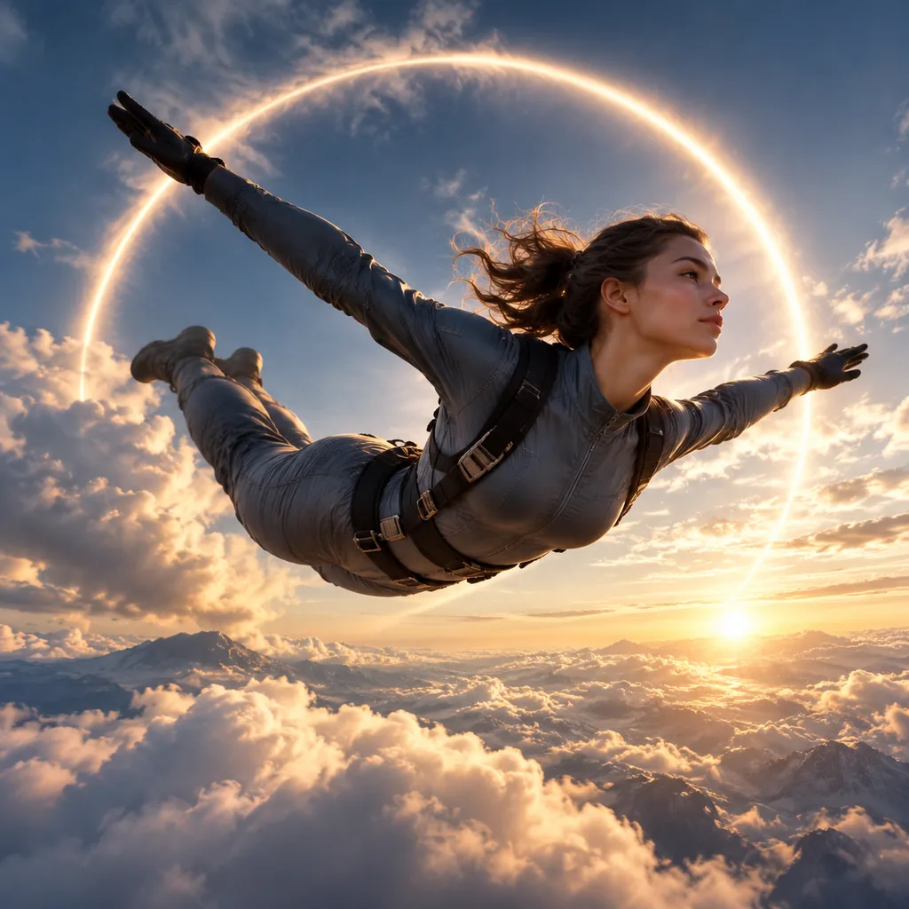</a>

> Adapted from a video post by @MxCaptures on 2026-10-18 (0 likes at capture). We rewrote it as one clean 1:1 still, removing brands, logos, celebrity/IP elements and any need for your own photo. Change one variable at a time.

```text
Cinematic video keyframe, square 1:1: an aerial performer frozen at the peak of a dive, body arched like wings above clouds, dramatic ring of light, one continuous-shot hero pose chosen from a nine-pose sequence, fictional performer in a modest flight suit, no text, no logo. Square 1:1 composition.
```

- Author: [@MxCaptures](https://x.com/MxCaptures)
- Original post: https://x.com/MxCaptures/status/2111774776532373778
- [View on cinel and generate with this prompt](https://cinel.ai/prompts/p/nine-pose-aerial-dive-peak-keyframe?utm_source=github&utm_medium=awesome&utm_campaign=awesome-gpt-image-2.5-prompts)

### Sandstone Amphitheater Miniature Desert

<a href="https://cinel.ai/prompts/p/sandstone-amphitheater-miniature-desertpunk?utm_source=github&utm_medium=awesome&utm_campaign=awesome-gpt-image-2.5-prompts">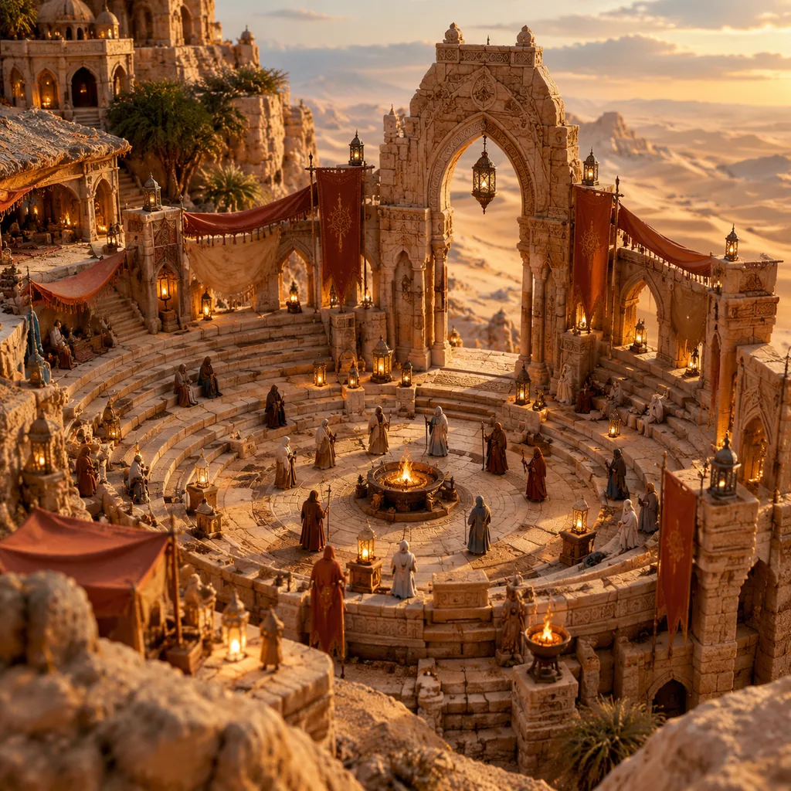</a>

> Adapted from a post by @artingent on 2026-10-14 (33 likes at capture). We rewrote it as one clean 1:1 still, removing brands, logos, celebrity/IP elements and any need for your own photo. Change one variable at a time.

```text
Whimsical miniature world, square 1:1: a sandstone amphitheater ritual complex in artistic desertpunk style, tiny robed figures and warm lanterns, carved arches and desert dunes beyond, detailed diorama, no text, no logo. Square 1:1 composition.
```

- Author: [@artingent](https://x.com/artingent)
- Original post: https://x.com/artingent/status/2110358321941332023
- [View on cinel and generate with this prompt](https://cinel.ai/prompts/p/sandstone-amphitheater-miniature-desertpunk?utm_source=github&utm_medium=awesome&utm_campaign=awesome-gpt-image-2.5-prompts)

### Fisherman Mending Nets at Dawn Dock

<a href="https://cinel.ai/prompts/p/fisherman-mending-nets-dawn-dock?utm_source=github&utm_medium=awesome&utm_campaign=awesome-gpt-image-2.5-prompts">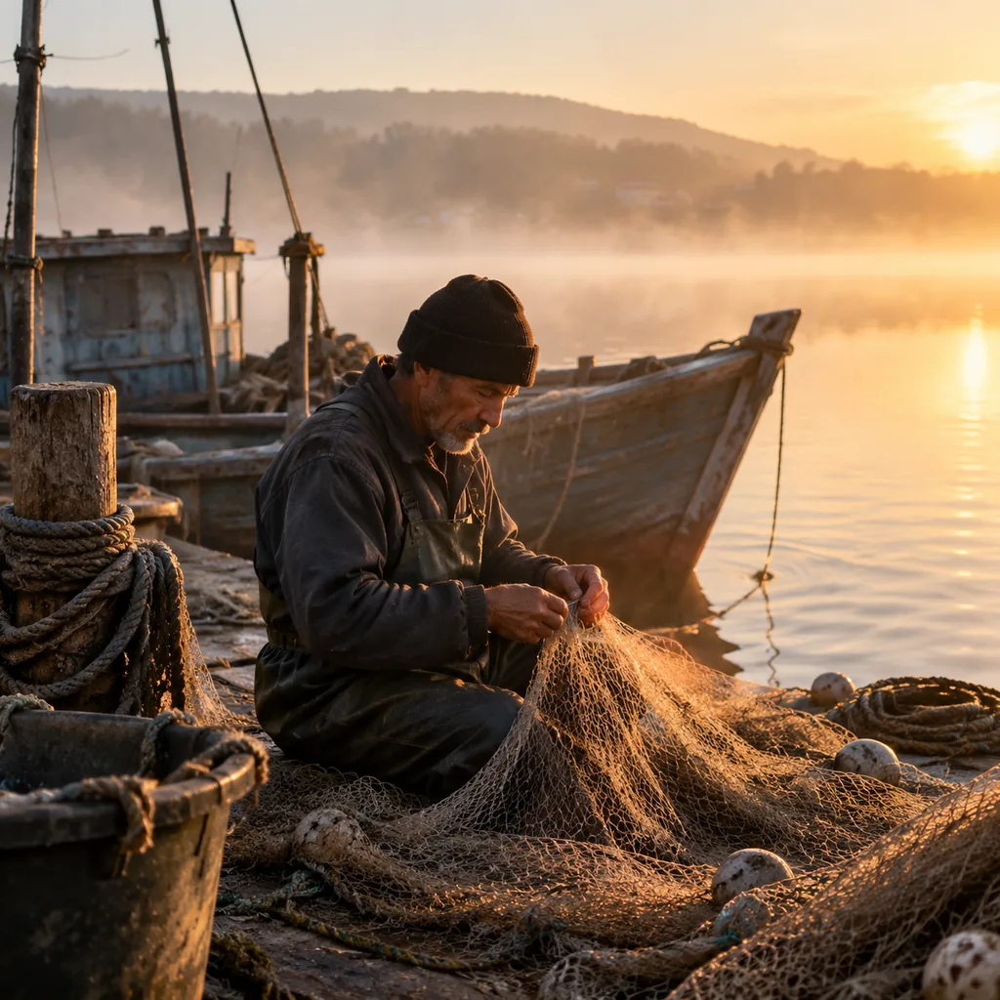</a>

> Adapted from a post by @Noir592 on 2026-10-18 (0 likes at capture). We rewrote it as one clean 1:1 still, removing brands, logos, celebrity/IP elements and any need for your own photo. Change one variable at a time.

```text
Photorealistic scene, square 1:1: a fisherman mending nets on a riverside dock at dawn, mist over calm water, golden rim light, weathered boats and coiled ropes, 85mm cinematic look, no text, no logo. Square 1:1 composition.
```

- Author: [@Noir592](https://x.com/Noir592)
- Original post: https://x.com/Noir592/status/2111711627007725715
- [View on cinel and generate with this prompt](https://cinel.ai/prompts/p/fisherman-mending-nets-dawn-dock?utm_source=github&utm_medium=awesome&utm_campaign=awesome-gpt-image-2.5-prompts)

### Downtown Street Performer Freeze Keyframe

<a href="https://cinel.ai/prompts/p/downtown-street-performer-freeze-keyframe?utm_source=github&utm_medium=awesome&utm_campaign=awesome-gpt-image-2.5-prompts">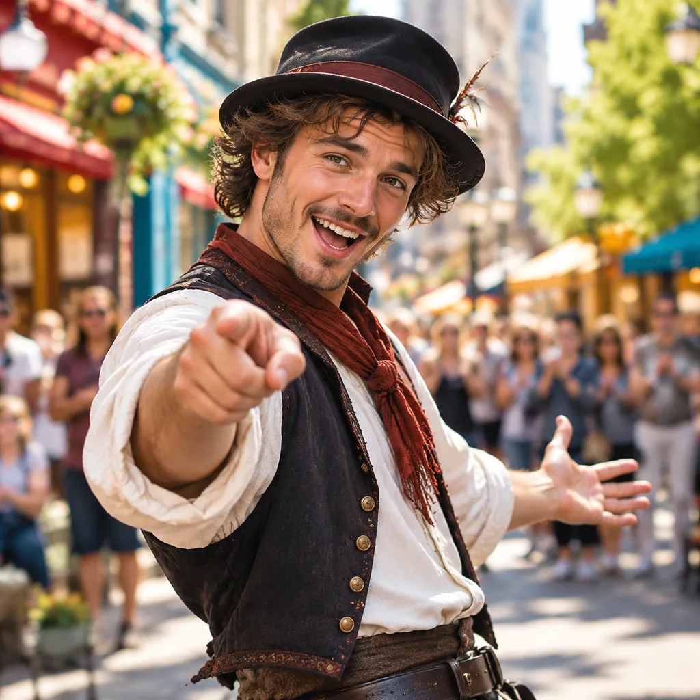</a>

> Adapted from a video post by @Soaima_Ai on 2026-10-17 (762 likes at capture). We rewrote it as one clean 1:1 still, removing brands, logos, celebrity/IP elements and any need for your own photo. Change one variable at a time.

```text
Cinematic video keyframe, square 1:1: a fictional street performer frozen mid-gesture pointing joyfully toward camera in a bright downtown shopping street, crowd bokeh and colourful shopfronts with no readable text, energetic hero frame, no logo. Square 1:1 composition.
```

- Author: [@Soaima_Ai](https://x.com/Soaima_Ai)
- Original post: https://x.com/Soaima_Ai/status/2111388958496014697
- [View on cinel and generate with this prompt](https://cinel.ai/prompts/p/downtown-street-performer-freeze-keyframe?utm_source=github&utm_medium=awesome&utm_campaign=awesome-gpt-image-2.5-prompts)

### Fireworks Through a Cafe Window Keyframe

<a href="https://cinel.ai/prompts/p/fireworks-cafe-window-night-keyframe?utm_source=github&utm_medium=awesome&utm_campaign=awesome-gpt-image-2.5-prompts"></a>

> Adapted from a video post by @liluocheng13 on 2026-10-18 (70 likes at capture). We rewrote it as one clean 1:1 still, removing brands, logos, celebrity/IP elements and any need for your own photo. Change one variable at a time.

```text
Cinematic video keyframe, square 1:1: fireworks bursting over a night harbour seen through a warm cafe window, silhouettes of two fictional friends at a table in soft bokeh, reflections on glass, frozen celebratory frame, no text, no logo. Square 1:1 composition.
```

- Author: [@liluocheng13](https://x.com/liluocheng13)
- Original post: https://x.com/liluocheng13/status/2111697579440480540
- [View on cinel and generate with this prompt](https://cinel.ai/prompts/p/fireworks-cafe-window-night-keyframe?utm_source=github&utm_medium=awesome&utm_campaign=awesome-gpt-image-2.5-prompts)

### White Dragon Village Encounter Keyframe

<a href="https://cinel.ai/prompts/p/white-dragon-village-encounter-keyframe?utm_source=github&utm_medium=awesome&utm_campaign=awesome-gpt-image-2.5-prompts">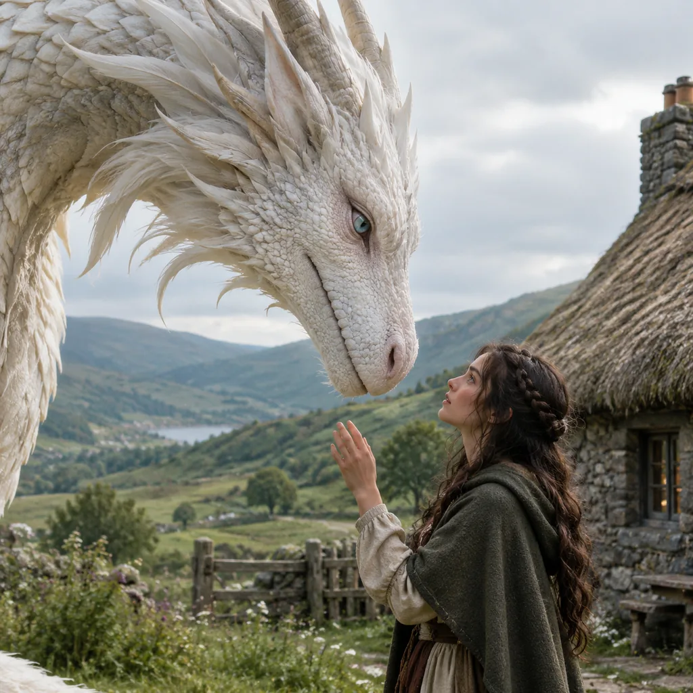</a>

> Adapted from a video post by @AiWithSaira on 2026-10-18 (37 likes at capture). We rewrote it as one clean 1:1 still, removing brands, logos, celebrity/IP elements and any need for your own photo. Change one variable at a time.

```text
Cinematic video keyframe, square 1:1: a gentle white dragon lowering its head face-to-face with a fictional villager outside a thatched cottage, soft overcast light and green hills, wonder not fear, frozen hero frame, no text, no logo. Square 1:1 composition.
```

- Author: [@AiWithSaira](https://x.com/AiWithSaira)
- Original post: https://x.com/AiWithSaira/status/2111632517040325077
- [View on cinel and generate with this prompt](https://cinel.ai/prompts/p/white-dragon-village-encounter-keyframe?utm_source=github&utm_medium=awesome&utm_campaign=awesome-gpt-image-2.5-prompts)

### Sunset Fish Spiral Fisherwoman Keyframe

<a href="https://cinel.ai/prompts/p/sunset-fish-spiral-fisherwoman-keyframe?utm_source=github&utm_medium=awesome&utm_campaign=awesome-gpt-image-2.5-prompts"></a>

> Adapted from a video post by @TiyashiAI on 2026-10-17 (0 likes at capture). We rewrote it as one clean 1:1 still, removing brands, logos, celebrity/IP elements and any need for your own photo. Change one variable at a time.

```text
Cinematic video keyframe, square 1:1: a fictional fisherwoman in modest orange fishing clothes throwing feed at sunset as fish follow in a living spiral around a small boat, golden water and leaping fish, frozen magical frame, no text, no logo. Square 1:1 composition.
```

- Author: [@TiyashiAI](https://x.com/TiyashiAI)
- Original post: https://x.com/TiyashiAI/status/2111501144606605613
- [View on cinel and generate with this prompt](https://cinel.ai/prompts/p/sunset-fish-spiral-fisherwoman-keyframe?utm_source=github&utm_medium=awesome&utm_campaign=awesome-gpt-image-2.5-prompts)

### Giant Sunflower at the Fair

<a href="https://cinel.ai/prompts/p/giant-sunflower-follows-fair-visitor?utm_source=github&utm_medium=awesome&utm_campaign=awesome-gpt-image-2.5-prompts">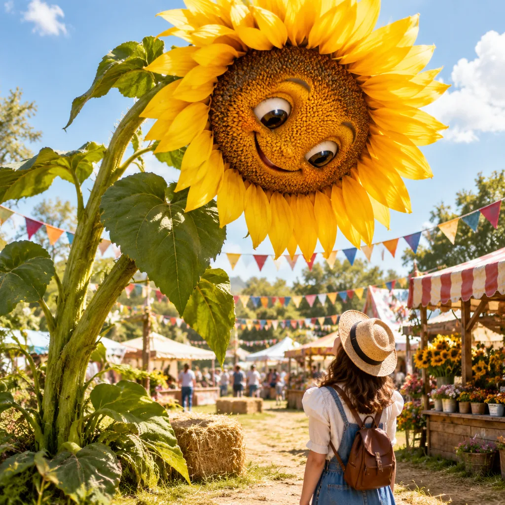</a>

> Adapted from a post by @TiyashiAI on 2026-10-17 (0 likes at capture). We rewrote it as one clean 1:1 still, removing brands, logos, celebrity/IP elements and any need for your own photo. Change one variable at a time.

```text
Whimsical photorealistic scene, square 1:1: one sunflower at a country fair grown far too ambitious, its huge smiling flower head leaning down following a fictional visitor like a personal sun, bunting and stalls behind, no text, no logo. Square 1:1 composition.
```

- Author: [@TiyashiAI](https://x.com/TiyashiAI)
- Original post: https://x.com/TiyashiAI/status/2111323274450022612
- [View on cinel and generate with this prompt](https://cinel.ai/prompts/p/giant-sunflower-follows-fair-visitor?utm_source=github&utm_medium=awesome&utm_campaign=awesome-gpt-image-2.5-prompts)

### Ballroom Snow Through Tall Windows

<a href="https://cinel.ai/prompts/p/ballroom-first-snow-window-scene?utm_source=github&utm_medium=awesome&utm_campaign=awesome-gpt-image-2.5-prompts">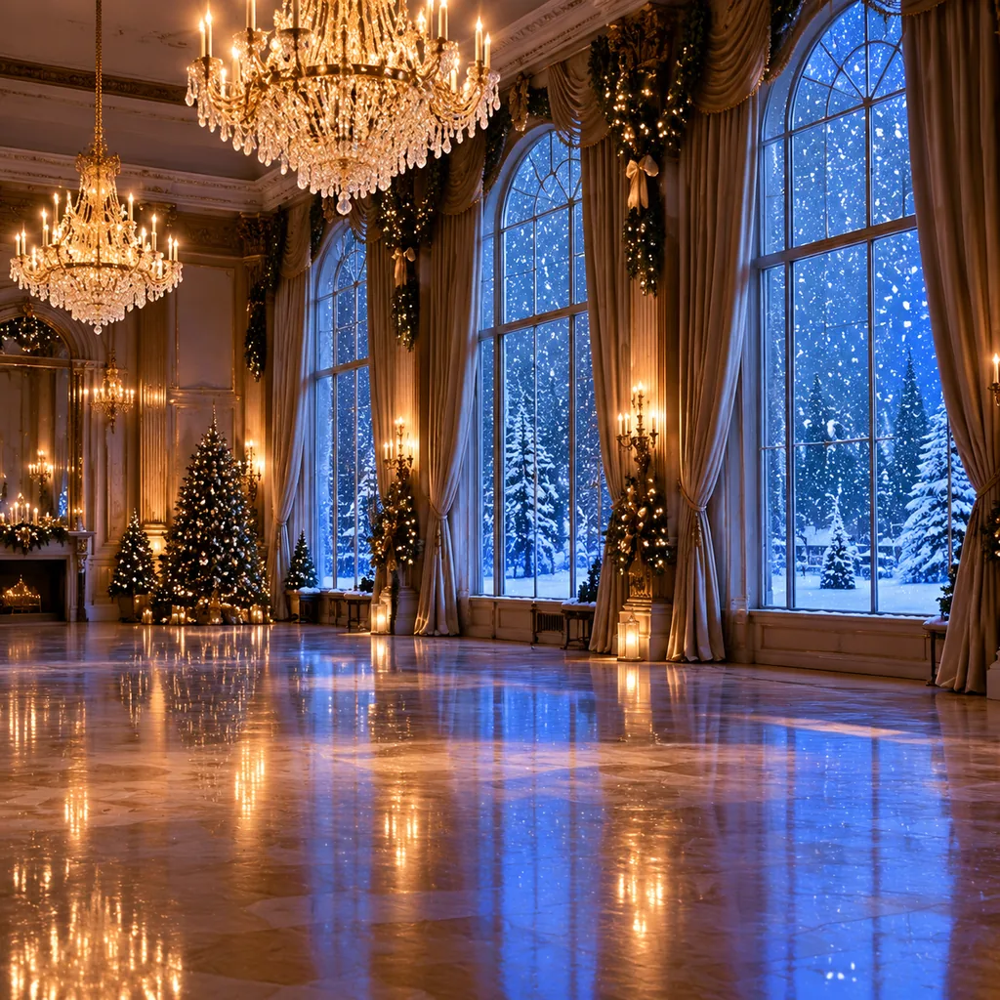</a>

> Adapted from a post by @TiyashiAI on 2026-10-16 (0 likes at capture). We rewrote it as one clean 1:1 still, removing brands, logos, celebrity/IP elements and any need for your own photo. Change one variable at a time.

```text
Elegant photorealistic scene, square 1:1: a grand ballroom decorated for winter while real snow falls beyond tall windows, warm chandeliers against blue snowfall, empty dance floor with soft reflections, no people close-up, no text, no logo. Square 1:1 composition.
```

- Author: [@TiyashiAI](https://x.com/TiyashiAI)
- Original post: https://x.com/TiyashiAI/status/2111082184471908442
- [View on cinel and generate with this prompt](https://cinel.ai/prompts/p/ballroom-first-snow-window-scene?utm_source=github&utm_medium=awesome&utm_campaign=awesome-gpt-image-2.5-prompts)

### Vintage Watchmaker Lathe Workshop

<a href="https://cinel.ai/prompts/p/vintage-watchmaker-lathe-workshop?utm_source=github&utm_medium=awesome&utm_campaign=awesome-gpt-image-2.5-prompts">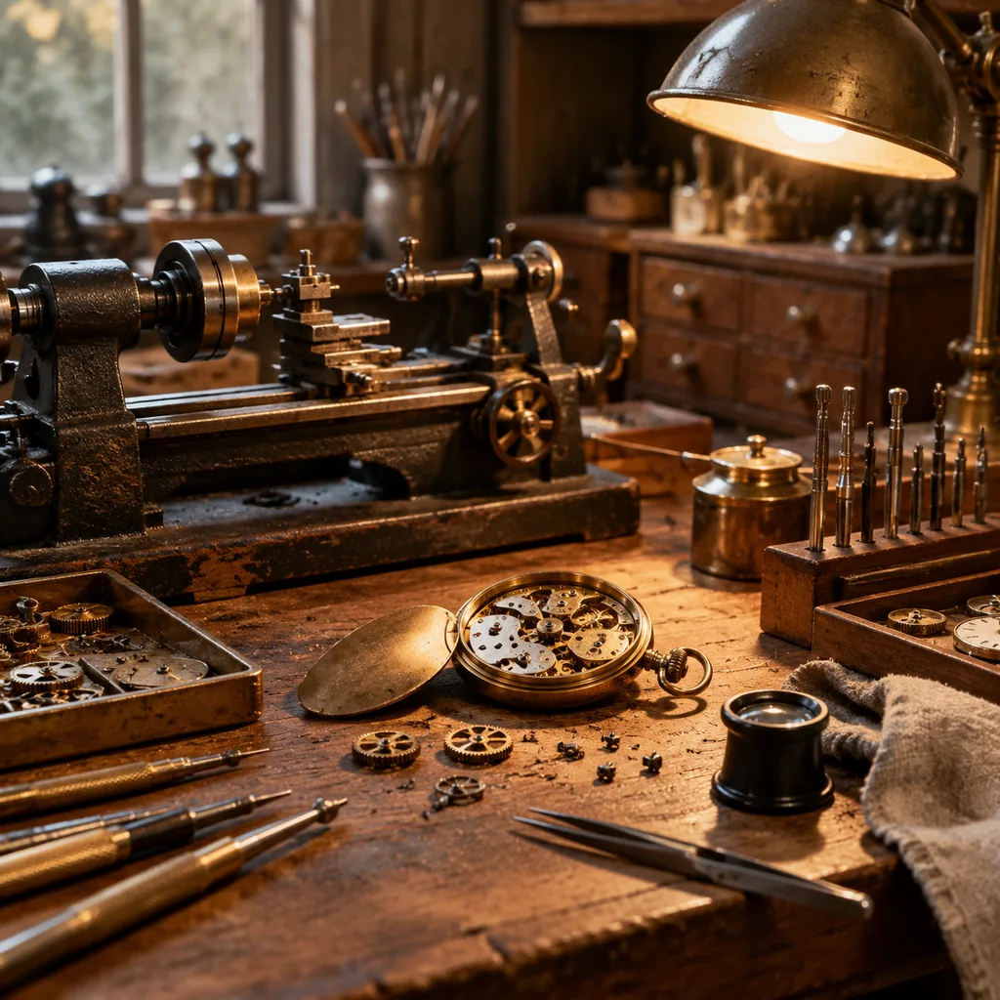</a>

> Adapted from a post by @Rana_Farooq_kz on 2026-10-18 (0 likes at capture). We rewrote it as one clean 1:1 still, removing brands, logos, celebrity/IP elements and any need for your own photo. Change one variable at a time.

```text
Atmospheric still, square 1:1: a vintage watchmaker's lathe workshop, brass tools, tiny gears and a half-repaired pocket watch under a warm desk lamp, wood and dust in soft light, no people, no text, no logo. Square 1:1 composition.
```

- Author: [@Rana_Farooq_kz](https://x.com/Rana_Farooq_kz)
- Original post: https://x.com/Rana_Farooq_kz/status/2111613992758309045
- [View on cinel and generate with this prompt](https://cinel.ai/prompts/p/vintage-watchmaker-lathe-workshop?utm_source=github&utm_medium=awesome&utm_campaign=awesome-gpt-image-2.5-prompts)

### Misty Cinematic Valley World

<a href="https://cinel.ai/prompts/p/misty-cinematic-valley-world-scene?utm_source=github&utm_medium=awesome&utm_campaign=awesome-gpt-image-2.5-prompts"></a>

> Adapted from a post by @Edenwoodfilm on 2026-10-18 (0 likes at capture). We rewrote it as one clean 1:1 still, removing brands, logos, celebrity/IP elements and any need for your own photo. Change one variable at a time.

```text
Cinematic landscape, square 1:1: a misty green valley world with a winding river, tiny stone bridge and distant mountains opening like a film establishing shot, soft dawn light, epic but calm, no text, no logo. Square 1:1 composition.
```

- Author: [@Edenwoodfilm](https://x.com/Edenwoodfilm)
- Original post: https://x.com/Edenwoodfilm/status/2111702381473992831
- [View on cinel and generate with this prompt](https://cinel.ai/prompts/p/misty-cinematic-valley-world-scene?utm_source=github&utm_medium=awesome&utm_campaign=awesome-gpt-image-2.5-prompts)

### Field Scarecrow Pumpkin Heads

<a href="https://cinel.ai/prompts/p/field-scarecrow-pumpkin-heads?utm_source=github&utm_medium=awesome&utm_campaign=awesome-gpt-image-2.5-prompts"></a>

> Adapted from a post by @Nishit_alt on 2025-10-26 (6 likes at capture). We rewrote it as one clean 1:1 pumpkin-head photoshoot still, removing brands, logos, celebrity/IP elements and any need for your own photo. Change one variable at a time.

```text
Horror-tinged landscape, square 1:1: scarecrows standing in an open night field, each with a jack-o'-lantern for a head and a straw hat, long brown trench coats, striking poses under a large moon and cloudy sky, glowing lanterns on posts and bunting across the field, cinematic horror mood, no text, no logo. Square 1:1 composition.
```

- Author: [@Nishit_alt](https://x.com/Nishit_alt)
- Original post: https://x.com/Nishit_alt/status/1982423445452304613
- [View on cinel and generate with this prompt](https://cinel.ai/prompts/p/field-scarecrow-pumpkin-heads?utm_source=github&utm_medium=awesome&utm_campaign=awesome-gpt-image-2.5-prompts)

### Pumpkin Head Skater Mid-Kickflip

<a href="https://cinel.ai/prompts/p/pumpkin-head-skater-mid-kickflip?utm_source=github&utm_medium=awesome&utm_campaign=awesome-gpt-image-2.5-prompts"></a>

> Adapted from a post by @pixexid on 2025-10-28 (0 likes at capture). We rewrote it as one clean 1:1 pumpkin-head photoshoot still, removing brands, logos, celebrity/IP elements and any need for your own photo. Change one variable at a time.

```text
Photoreal street photo, square 1:1: a pumpkin-headed skater mid-kickflip over fallen autumn leaves on a quiet suburban cul-de-sac, thrifted flannel, ripped black jeans and chain wallet, carved jack-o'-lantern head with a playful grin, warm orange street glow against pale blue moonlight, confident energy, no text, no logo. Square 1:1 composition.
```

- Author: [@pixexid](https://x.com/pixexid)
- Original post: https://x.com/pixexid/status/1982975857653158060
- [View on cinel and generate with this prompt](https://cinel.ai/prompts/p/pumpkin-head-skater-mid-kickflip?utm_source=github&utm_medium=awesome&utm_campaign=awesome-gpt-image-2.5-prompts)

### Vine-Limb Pumpkin Lantern Figure

<a href="https://cinel.ai/prompts/p/vine-limb-pumpkin-lantern-figure?utm_source=github&utm_medium=awesome&utm_campaign=awesome-gpt-image-2.5-prompts"></a>

> Adapted from a post by @bewisetojudge_ on 2025-10-21 (0 likes at capture). We rewrote it as one clean 1:1 pumpkin-head photoshoot still, removing brands, logos, celebrity/IP elements and any need for your own photo. Change one variable at a time.

```text
Haunting Halloween scene, square 1:1: a tall skeletal figure with a glowing jack-o'-lantern head, carved eyes and wide grin emitting orange light, twisted vine-like limbs and claw hands in a theatrical pose, smaller grinning pumpkin lanterns and autumn leaves around, misty night under a full moon, dark blue and orange palette, no named IP creatures, no text, no logo. Square 1:1 composition.
```

- Author: [@bewisetojudge_](https://x.com/bewisetojudge_)
- Original post: https://x.com/bewisetojudge_/status/1980583968991830527
- [View on cinel and generate with this prompt](https://cinel.ai/prompts/p/vine-limb-pumpkin-lantern-figure?utm_source=github&utm_medium=awesome&utm_campaign=awesome-gpt-image-2.5-prompts)

### Volcano Inferno Pumpkin Head

<a href="https://cinel.ai/prompts/p/volcano-inferno-pumpkin-head?utm_source=github&utm_medium=awesome&utm_campaign=awesome-gpt-image-2.5-prompts"></a>

> Adapted from a video post by @malsyboy on 2025-10-31 (1 likes at capture). We rewrote it as one clean 1:1 pumpkin-head photoshoot still, removing brands, logos, celebrity/IP elements and any need for your own photo. Change one variable at a time.

```text
Dramatic fantasy still, square 1:1: a colossal carved pumpkin head erupting like a raging volcano, lava and sparks spewing from the top, molten glow inside the eyes and mouth, dark stormy sky, epic scale Halloween spectacle, no text, no logo. Square 1:1 composition.
```

- Author: [@malsyboy](https://x.com/malsyboy)
- Original post: https://x.com/malsyboy/status/1984403040305074579
- [View on cinel and generate with this prompt](https://cinel.ai/prompts/p/volcano-inferno-pumpkin-head?utm_source=github&utm_medium=awesome&utm_campaign=awesome-gpt-image-2.5-prompts)

### Magician Chasing Pumpkin Head Keyframe

<a href="https://cinel.ai/prompts/p/magician-chasing-pumpkin-head-keyframe?utm_source=github&utm_medium=awesome&utm_campaign=awesome-gpt-image-2.5-prompts"></a>

> Adapted from a video post by @TheGameSeekers on 2026-08-29 (0 likes at capture). We rewrote it as one clean 1:1 pumpkin-head photoshoot still, removing brands, logos, celebrity/IP elements and any need for your own photo. Change one variable at a time.

```text
Comical Halloween animation keyframe, square 1:1: a headless magician in a tuxedo reaching for his stolen glowing pumpkin head mid-chase, tiny goblin silhouettes fleeing with the pumpkin, moonlit cobblestone street, playful rather than gory, frozen hero frame, no text, no logo. Square 1:1 composition.
```

- Author: [@TheGameSeekers](https://x.com/TheGameSeekers)
- Original post: https://x.com/TheGameSeekers/status/2093687556286365703
- [View on cinel and generate with this prompt](https://cinel.ai/prompts/p/magician-chasing-pumpkin-head-keyframe?utm_source=github&utm_medium=awesome&utm_campaign=awesome-gpt-image-2.5-prompts)

### City Siege Desperate Reach Keyframe

<a href="https://cinel.ai/prompts/p/city-siege-desperate-reach-keyframe?utm_source=github&utm_medium=awesome&utm_campaign=awesome-gpt-image-2.5-prompts"></a>

> Adapted from a video post by @AiwithBloodline on 2026-10-16 (39 likes at capture). We rewrote it as one clean 1:1 still, removing brands, logos, celebrity/IP elements and any need for your own photo. Change one variable at a time.

```text
Ultra-realistic cinematic video keyframe, square 1:1: a fictional figure reaching desperately toward camera as a burning city skyline collapses behind them, ash and ember streaks, epic low-angle chaos frozen mid-reach, modest clothes, no celebrity likeness, no text, no logo. Square 1:1 composition.
```

- Author: [@AiwithBloodline](https://x.com/AiwithBloodline)
- Original post: https://x.com/AiwithBloodline/status/2110976535213822161
- [View on cinel and generate with this prompt](https://cinel.ai/prompts/p/city-siege-desperate-reach-keyframe?utm_source=github&utm_medium=awesome&utm_campaign=awesome-gpt-image-2.5-prompts)

### Grandma Scooter First Ride Keyframe

<a href="https://cinel.ai/prompts/p/grandma-scooter-first-ride-keyframe?utm_source=github&utm_medium=awesome&utm_campaign=awesome-gpt-image-2.5-prompts"></a>

> Adapted from a video post by @Mayz1169 on 2026-10-16 (20 likes at capture). We rewrote it as one clean 1:1 still, removing brands, logos, celebrity/IP elements and any need for your own photo. Change one variable at a time.

```text
Cinematic video keyframe, square 1:1: a joyful fictional grandmother on a bright mobility scooter speeding through a sunny suburban street, wind in her scarf, neighbours blurred behind, energetic practical-effects dust, frozen hero frame of her first wild ride, no text, no logo. Square 1:1 composition.
```

- Author: [@Mayz1169](https://x.com/Mayz1169)
- Original post: https://x.com/Mayz1169/status/2111150948638941290
- [View on cinel and generate with this prompt](https://cinel.ai/prompts/p/grandma-scooter-first-ride-keyframe?utm_source=github&utm_medium=awesome&utm_campaign=awesome-gpt-image-2.5-prompts)

### Botanical Greenhouse Cattlepunk

<a href="https://cinel.ai/prompts/p/botanical-greenhouse-cattlepunk?utm_source=github&utm_medium=awesome&utm_campaign=awesome-gpt-image-2.5-prompts"></a>

> Adapted from a post by @artingent on 2026-10-13 (31 likes at capture). We rewrote it as one clean 1:1 still, removing brands, logos, celebrity/IP elements and any need for your own photo. Change one variable at a time.

```text
Artistic cattlepunk interior, square 1:1: a lush botanical greenhouse with brass pipes, leather straps and wild tropical plants under fogged glass, warm dust and sunbeams, intricate miniature detail, no text, no logo. Square 1:1 composition.
```

- Author: [@artingent](https://x.com/artingent)
- Original post: https://x.com/artingent/status/2109997107197407360
- [View on cinel and generate with this prompt](https://cinel.ai/prompts/p/botanical-greenhouse-cattlepunk?utm_source=github&utm_medium=awesome&utm_campaign=awesome-gpt-image-2.5-prompts)

### Moss Valley Mythpunk Altar

<a href="https://cinel.ai/prompts/p/moss-valley-mythpunk-altar?utm_source=github&utm_medium=awesome&utm_campaign=awesome-gpt-image-2.5-prompts"></a>

> Adapted from a post by @artingent on 2026-10-12 (38 likes at capture). We rewrote it as one clean 1:1 still, removing brands, logos, celebrity/IP elements and any need for your own photo. Change one variable at a time.

```text
Whimsical miniature world, square 1:1: a mossy forest valley with an ancient stone altar, hybrid mythpunk-forestpunk style, tiny glowing offerings and mist between ferns, detailed diorama, no text, no logo. Square 1:1 composition.
```

- Author: [@artingent](https://x.com/artingent)
- Original post: https://x.com/artingent/status/2109629666894151684
- [View on cinel and generate with this prompt](https://cinel.ai/prompts/p/moss-valley-mythpunk-altar?utm_source=github&utm_medium=awesome&utm_campaign=awesome-gpt-image-2.5-prompts)

### Underwater Train Station Scene

<a href="https://cinel.ai/prompts/p/underwater-train-station-scene?utm_source=github&utm_medium=awesome&utm_campaign=awesome-gpt-image-2.5-prompts"></a>

> Adapted from a post by @Rana_Farooq_kz on 2026-10-17 (2 likes at capture). We rewrote it as one clean 1:1 still, removing brands, logos, celebrity/IP elements and any need for your own photo. Change one variable at a time.

```text
Surreal cinematic scene, square 1:1: an ornate train station fully underwater, shafts of turquoise light through the surface, a still subway train and tiny fish around platform lamps, quiet wonder, no people close-up, no text, no logo. Square 1:1 composition.
```

- Author: [@Rana_Farooq_kz](https://x.com/Rana_Farooq_kz)
- Original post: https://x.com/Rana_Farooq_kz/status/2111537664033948153
- [View on cinel and generate with this prompt](https://cinel.ai/prompts/p/underwater-train-station-scene?utm_source=github&utm_medium=awesome&utm_campaign=awesome-gpt-image-2.5-prompts)

### Aurora Ice Staircase Romantic Painting

<a href="https://cinel.ai/prompts/p/aurora-ice-staircase-painting?utm_source=github&utm_medium=awesome&utm_campaign=awesome-gpt-image-2.5-prompts"></a>

> Adapted from a prompt + image post by @NayaVerseee on 2026-10-15 (36 likes at capture). We rewrote it as one clean square 1:1 still, removing brands, logos, celebrity/IP elements and any need for your own photo. Change one variable at a time.

```text
Romantic landscape oil painting in the sublime 19th-century tradition, cold night light, fine oil glazing, square 1:1. Very wide shot, overwhelming scale: an endless staircase of translucent ice rises from a frozen sea straight up into a towering green and violet aurora, vanishing among the stars. On the lowest steps, a tiny distant red-haired figure seen from behind in a long dark-blue cloak, face too small to see, begins to climb with one hand on the frozen railing. She is the only figure in the scene. No text, no logo. Square 1:1 composition.
```

- Author: [@NayaVerseee](https://x.com/NayaVerseee)
- Original post: https://x.com/NayaVerseee/status/2110800375607632229
- [View on cinel and generate with this prompt](https://cinel.ai/prompts/p/aurora-ice-staircase-painting?utm_source=github&utm_medium=awesome&utm_campaign=awesome-gpt-image-2.5-prompts)

### Vintage Camera Turned Inhabitable Building

<a href="https://cinel.ai/prompts/p/vintage-camera-inhabitable-building?utm_source=github&utm_medium=awesome&utm_campaign=awesome-gpt-image-2.5-prompts"></a>

> Adapted from a prompt + image post by @Gdgtify on 2026-10-16 (11 likes at capture). We rewrote it as one clean square 1:1 still, removing brands, logos, celebrity/IP elements and any need for your own photo. Change one variable at a time.

```text
High-end architectural photography, square 1:1: a vintage rangefinder film camera transformed into a real inhabitable building while keeping its signature silhouette — the lens barrel becomes a round glass-walled atrium café, the body becomes a two-storey leather-textured facade with brushed-aluminium trim, the shutter dial becomes a rooftop terrace, the viewfinder becomes a long panoramic window. Set on a green hillside park overlooking a city at golden hour, at least five human-scale cues (people walking, bicycles, benches, trees, lit interiors). Architectural plausibility, cinematic realism, no brand names, no logos, no text. Square 1:1 composition.
```

- Author: [@Gdgtify](https://x.com/Gdgtify)
- Original post: https://x.com/Gdgtify/status/2111008745874452615
- [View on cinel and generate with this prompt](https://cinel.ai/prompts/p/vintage-camera-inhabitable-building?utm_source=github&utm_medium=awesome&utm_campaign=awesome-gpt-image-2.5-prompts)

### Halloween Camcorder Skeleton Dance Keyframe

<a href="https://cinel.ai/prompts/p/halloween-camcorder-skeleton-dance-keyframe?utm_source=github&utm_medium=awesome&utm_campaign=awesome-gpt-image-2.5-prompts"></a>

> Adapted from a Seedance 2.5 video post by @Just_sharon7 on 2026-10-19 (448 likes at capture). We rewrote it as one clean vertical 9:16 still, removing brands, logos, celebrity/IP elements and any need for your own photo. Change one variable at a time.

```text
Photoreal raw flash camcorder video keyframe, vertical 9:16, like a found Halloween night tape: front-row fisheye view of a packed barn Halloween party, harsh on-camera flash blasting what is close to the lens, blown highlights and hard shadows, everything far away falls into near-black. A full-body skeleton character with bleached off-white bones, mirrored aviator sunglasses, a black vest, a bright orange baseball cap and plain white sneakers is frozen mid-headspin on the straw-strewn dance floor; behind him a crowd in witch hats and bedsheet ghost costumes screams and cheers. Strong barrel distortion, heavy camcorder noise and grain, slight interlacing, smeared motion blur, slightly crushed green-tinted digital colour, absurd moment played totally real. No on-screen text, no timestamp, no brand, no logo. Vertical 9:16 composition.
```

- Author: [@Just_sharon7](https://x.com/Just_sharon7)
- Original post: https://x.com/Just_sharon7/status/2112154192534241709
- [View on cinel and generate with this prompt](https://cinel.ai/prompts/p/halloween-camcorder-skeleton-dance-keyframe?utm_source=github&utm_medium=awesome&utm_campaign=awesome-gpt-image-2.5-prompts)

### Classroom Showdown Aftermath Keyframe

<a href="https://cinel.ai/prompts/p/classroom-showdown-aftermath-keyframe?utm_source=github&utm_medium=awesome&utm_campaign=awesome-gpt-image-2.5-prompts"></a>

> Adapted from a video post (Seedance 2.5) by @Alina_with_Ai on 2026-10-18 (237 likes at capture). We rewrote it as one clean widescreen 16:9 key-frame still, removing brands, logos and any need for your own photo. Change one variable at a time.

```text
Cinematic live-action thriller video keyframe, widescreen 16:9, realistic gritty Korean-thriller look: an old, run-down school classroom at night with a teal-green chalkboard, worn grey concrete floor, overturned wooden desks and chairs, a brown leather sofa and wooden cabinets, loose papers frozen mid-air and thin dust hanging under cold flickering fluorescent tubes. In the middle stands a fictional young woman in a black baseball cap pulled low over her eyes, her long black ponytail whipping mid-turn, fitted black long-sleeve top, black pants and dark glossy arm wraps, cold emotionless face, calm after the fight. Desaturated green-teal colour grade, slow-motion feel, natural film grain, handheld camera at waist height. No other people, no blood, no weapons, no text, no subtitles, no logo. Widescreen 16:9 composition.
```

- Author: [@Alina_with_Ai](https://x.com/Alina_with_Ai)
- Original post: https://x.com/Alina_with_Ai/status/2111661075590684814
- [View on cinel and generate with this prompt](https://cinel.ai/prompts/p/classroom-showdown-aftermath-keyframe?utm_source=github&utm_medium=awesome&utm_campaign=awesome-gpt-image-2.5-prompts)

### 2003 Camcorder Mall Ice Cream Date Keyframe

<a href="https://cinel.ai/prompts/p/camcorder-2003-mall-ice-cream-date-keyframe?utm_source=github&utm_medium=awesome&utm_campaign=awesome-gpt-image-2.5-prompts"></a>

> Adapted from a video post (Seedance 2.5) by @AIwithkhan on 2026-10-20 (80 likes at capture). We rewrote it as one clean widescreen 16:9 key-frame still, removing brands, logos and any need for your own photo. Change one variable at a time.

```text
Ultra-realistic early-2000s MiniDV camcorder video keyframe, widescreen 16:9, like a friend's home video from 2003: a sweet candid moment between a fictional young adult Korean couple in a busy Seoul shopping mall. She has long black hair, natural makeup, a fitted pastel-pink top, low-rise blue jeans and a small shoulder bag, a big teddy bear tucked under one arm, laughing as she offers him a bite of one large shared vanilla soft-serve cone; he wears a casual striped T-shirt and loose jeans, holds a tiny stuffed rabbit and smiles shyly with a little ice cream on his lip. Fluorescent mall lighting, a toy store of colourful plushies and passing shoppers behind them, handheld framing slightly off-centre, soft digital detail, faded colours, mild compression noise, autofocus softness and natural motion blur. Unbranded shops, no readable signs, no text, no timestamp, no logo. Widescreen 16:9 composition.
```

- Author: [@AIwithkhan](https://x.com/AIwithkhan)
- Original post: https://x.com/AIwithkhan/status/2112383970478522877
- [View on cinel and generate with this prompt](https://cinel.ai/prompts/p/camcorder-2003-mall-ice-cream-date-keyframe?utm_source=github&utm_medium=awesome&utm_campaign=awesome-gpt-image-2.5-prompts)

### Glowing Snail Sunset Water Wallpaper

<a href="https://cinel.ai/prompts/p/glowing-snail-sunset-water-wallpaper?utm_source=github&utm_medium=awesome&utm_campaign=awesome-gpt-image-2.5-prompts"></a>

> Adapted from an image post by @churvikv on 2026-10-17 (128 likes at capture). We rewrote it as one clean square 1:1 still, removing brands, logos, celebrity/IP elements and any need for your own photo. Change one variable at a time.

```text
Serene minimal wallpaper photograph, square 1:1: a snail with a translucent amber shell that glows from within glides across mirror-still water at dusk, the low sun sitting on the horizon behind it, its perfect reflection below, tall feathery reeds on one side, soft lavender and peach sky, calm gradient water, quiet poetic mood, no text, no logo. Square 1:1 composition.
```

- Author: [@churvikv](https://x.com/churvikv)
- Original post: https://x.com/churvikv/status/2111561461306917097
- [View on cinel and generate with this prompt](https://cinel.ai/prompts/p/glowing-snail-sunset-water-wallpaper?utm_source=github&utm_medium=awesome&utm_campaign=awesome-gpt-image-2.5-prompts)

### Elevator Shortcut Impossible Stairs Keyframe

<a href="https://cinel.ai/prompts/p/elevator-shortcut-impossible-stairs-keyframe?utm_source=github&utm_medium=awesome&utm_campaign=awesome-gpt-image-2.5-prompts"></a>

> Adapted from a video post by @umesh_ai on 2026-10-18 (117 likes at capture). We rewrote it as one clean widescreen 16:9 key-frame still, removing brands, logos and any need for your own photo. Change one variable at a time.

```text
Cinematic surreal action-comedy video keyframe, widescreen 16:9, photoreal: an impatient office worker with short dark hair, a cobalt-blue suit, white shirt, loose mustard-yellow tie, black sneakers and a charcoal messenger bag across his body bounds up an immense vertical shaft filled with cantilevered staircases that twist off in impossible directions, one hand gripping a continuous glossy red tubular handrail that loops through the whole space; his tie and hair fly with the speed. Far below, a tiny ordinary office lobby with closed elevator doors and a calm woman in a cream coat holding a plain coffee cup. Dramatic low camera rocketing upward just behind his trailing foot, strong parallax, cool daylight falling from above, crisp concrete and steel textures. No text, no signs, no logo. Widescreen 16:9 composition.
```

- Author: [@umesh_ai](https://x.com/umesh_ai)
- Original post: https://x.com/umesh_ai/status/2111683472897225067
- [View on cinel and generate with this prompt](https://cinel.ai/prompts/p/elevator-shortcut-impossible-stairs-keyframe?utm_source=github&utm_medium=awesome&utm_campaign=awesome-gpt-image-2.5-prompts)

### Jam Lid Twisting Pastry World Keyframe

<a href="https://cinel.ai/prompts/p/jam-lid-twisting-pastry-world-keyframe?utm_source=github&utm_medium=awesome&utm_campaign=awesome-gpt-image-2.5-prompts"></a>

> Adapted from a video post by @umesh_ai on 2026-10-20 (64 likes at capture). We rewrote it as one clean widescreen 16:9 key-frame still, removing brands, logos and any need for your own photo. Change one variable at a time.

```text
Cinematic surreal action-comedy video keyframe, widescreen 16:9, photoreal: an adult woman with dark hair in a messy bun, plum-coloured pajamas and cream slippers rides her small wooden breakfast counter and stool through an impossible landscape of colossal golden croissants and spiralling ribbons of laminated pastry, the counter banking between two enormous flaky curls. She leans hard against the turn, wrestling with an ordinary glass jar of strawberry jam with a bright red metal screw lid through a blue-and-white checked tea towel, face set in absurd determination; a slice of toast on a plain plate rides on the counter beside her. Crumbs drift like sand, warm morning light, crisp buttery pastry textures rushing past on both sides, dynamic low tracking camera with motion blur at the edges. No text, no labels, no logo. Widescreen 16:9 composition.
```

- Author: [@umesh_ai](https://x.com/umesh_ai)
- Original post: https://x.com/umesh_ai/status/2112397267017810346
- [View on cinel and generate with this prompt](https://cinel.ai/prompts/p/jam-lid-twisting-pastry-world-keyframe?utm_source=github&utm_medium=awesome&utm_campaign=awesome-gpt-image-2.5-prompts)

### Open Window Coastal View Painting

<a href="https://cinel.ai/prompts/p/open-window-coastal-view-painting?utm_source=github&utm_medium=awesome&utm_campaign=awesome-gpt-image-2.5-prompts"></a>

> Adapted from an image post by @AllaAisling on 2026-10-17 (47 likes at capture). We rewrote it as one clean square 1:1 still, removing brands, logos, celebrity/IP elements and any need for your own photo. Change one variable at a time.

```text
Painterly illustration, square 1:1: view through a tall open double window with white frames from a terracotta-red room, potted plants and a small white radiator below the sill, lush leaves and orange flowers framing the edges; outside, a sunlit Mediterranean garden with dark cypress trees slopes down to a calm blue bay and distant islands, towering white cumulus clouds in a deep blue sky, crisp summer daylight, rich saturated colours, no people, no text, no logo. Square 1:1 composition.
```

- Author: [@AllaAisling](https://x.com/AllaAisling)
- Original post: https://x.com/AllaAisling/status/2111492181018186059
- [View on cinel and generate with this prompt](https://cinel.ai/prompts/p/open-window-coastal-view-painting?utm_source=github&utm_medium=awesome&utm_campaign=awesome-gpt-image-2.5-prompts)

### Sunrise Desk Doodle Planner Flat Lay

<a href="https://cinel.ai/prompts/p/sunrise-desk-doodle-planner-flatlay?utm_source=github&utm_medium=awesome&utm_campaign=awesome-gpt-image-2.5-prompts"></a>

> Adapted from a prompt + image post by @Taaruk_ on 2026-05-07 (281 likes at capture). We rewrote it as one clean square 1:1 design with fictional brand names, so there are no real logos and no need to upload your own photo or logo. Change one variable at a time.

```text
Top-down cozy desk flat lay near a sunrise window: a wooden table with a coffee cup, an open weekly planner notebook with a few handwritten to-dos, a film camera, headphones, a small fruit bowl, a cassette player, glasses and a phone. Warm sunrise reflections, nostalgic morning atmosphere. Handwritten doodle annotations around every object with pastel sketch overlays, cute arrows, stars and short motivational phrases ("slow morning", "plan the week", "you got this"). Realistic lifestyle photography mixed with diary aesthetics, soft golden light, vintage indie mood, warm creamy tones, highly detailed textures, no logos. Square 1:1 composition.
```

- Author: [@Taaruk_](https://x.com/Taaruk_)
- Original post: https://x.com/Taaruk_/status/2052422212423196925
- [View on cinel and generate with this prompt](https://cinel.ai/prompts/p/sunrise-desk-doodle-planner-flatlay?utm_source=github&utm_medium=awesome&utm_campaign=awesome-gpt-image-2.5-prompts)

### Isometric Micro-World Archive Cutaway

<a href="https://cinel.ai/prompts/p/isometric-micro-world-archive-zh?utm_source=github&utm_medium=awesome&utm_campaign=awesome-gpt-image-2.5-prompts"></a>

> A long structured Chinese template from @MrLarus for “micro-world cutaway halls”: an isometric, sliced-open multi-level building where every room has a job (research, storage, display, energy, living), linked by stairs, pipes and walkways and packed with readable game-asset props. It feels like a management sim, a dollhouse and a kids' science book at once. We filled it with an insect research institute in mint and cream. Great for worldbuilding, science covers and series art.

```text
请根据昆虫研究所创作一张高完成度、高信息密度、适合系列化发布的「微缩世界剖面馆 / Isometric Micro-World Archive」视觉图。

这不是普通房间插画，也不是单纯的建筑图，而是一张结合“等距轴测视角 + 建筑剖面结构 + 多层功能空间 + 高密度主题道具 + 微缩模型感 + 游戏场景设定集感”的主题空间总览图。画面需要像一个被剖开的微缩世界、经营模拟游戏场景、玩具屋模型或世界观设定图，让观者可以一眼看懂整体结构，又能反复观察其中的小细节。

【基础设定】
主题：昆虫研究所
空间名称 / 品牌名：（空）
世界观方向：自然生态 / 实验室
建筑类型：多层实验室
核心功能：研究、饲养与展示昆虫
主色调：薄荷绿
辅助色：奶油黄
点缀色：珊瑚橙
画幅比例：1:1
信息密度：高密度
整体气质：治愈、精密、科普、探索感

如果某些字段没有填写，请根据昆虫研究所自动合理推导，不要让画面留空。所有内容都要围绕主题统一生成，避免加入无关元素。

【画面结构】
采用清晰的等距轴测视角 / isometric view / axonometric view，主体是一个被剖开的多层主题建筑或功能基地。观者可以同时看到建筑的正面、侧面、顶面和内部空间。整体建筑位于画面中心，占据画面主要面积，背景环境适度淡化，用来衬托主体。

建筑内部需要分成多个功能区域，每个区域都要有明确用途，而不是随机堆放装饰。可以包含：
1. 主工作区 / 核心操作区
2. 展示区 / 收藏区 / 标本区
3. 研究区 / 实验区 / 控制区
4. 储藏区 / 货架区 / 物资区
5. 生活区 / 休息区 / 小型居住区
6. 能源区 / 机器区 / 管道区
7. 种植区 / 培养区 / 生态区
8. 入口区 / 运输区 / 维修区
9. 楼梯、平台、走廊、栏杆、梯子等空间连接结构

各个区域之间要通过楼梯、走廊、平台、管道、桥架或电缆形成清晰的空间关系，让画面像一个真实可以运转的小型系统。

【道具与细节】
根据昆虫研究所生成大量相关道具，并让它们分布在不同功能区中。道具需要具体、可识别、有主题关联，不能只是泛泛的装饰。每个小物件都应像游戏资产一样清晰可读，具有可点击、可互动、可收集的感觉。

道具类型可以包括：
- 主题设备：机器、仪器、工具、控制台、容器、屏幕、工作台
- 生活物件：桌椅、书架、床铺、杯子、箱子、柜子、灯具
- 展示物件：标本、模型、海报、说明牌、玻璃柜、陈列架
- 连接结构：管道、电线、梯子、楼梯、输送带、滑轨、平台
- 生态元素：植物、水箱、培养箱、土壤、树枝、岩石、标本
- 角色元素：少量小人物、小动物、机器人或主题生物，用来提供尺度感和故事感

道具数量要丰富，但要保持秩序。所有道具都应服务于空间功能和主题世界观。

【风格要求】
整体风格为清晰、可爱、精密的手绘卡通等距插画。线条干净，边缘略圆润，色彩明亮柔和，整体具有轻松、治愈、探索感。画面应有经营模拟游戏、儿童科普绘本、微缩模型、设定集页面的感觉。

避免过度写实，避免强烈暗黑光影，避免厚重油画感，避免复杂噪点。重点是清楚、精致、有层次、可读性强。

【颜色与光影】
使用高明度、低到中等饱和度的柔和配色。主色调统一，辅助色用于区分不同空间，点缀色用于突出关键设备和小道具。线稿颜色不要使用死黑，可使用深灰、蓝灰、棕灰等柔和描边。

光影保持轻量，不需要强烈真实投影。通过色块、结构、线条和局部高亮来建立层次。背景使用浅色、低对比度处理，使主体建筑更加突出。

【构图与阅读路径】
画面主体居中或略微偏上，建筑呈多层剖面结构。视觉阅读路径应从整体建筑轮廓开始，再进入各楼层功能区，最后观察细节道具。可以通过楼梯、平台、走廊、管线、轨道等元素引导视线。

整体画面要饱满但不拥挤，丰富但不混乱。每个房间、平台和角落都应该有内容，但仍然保持清晰的空间边界。

【背景环境】
背景可以根据主题加入弱化的外部环境，例如森林、城市、街道、地下岩层、实验园区、海底、太空、校园、工厂外墙等。背景不要抢主体，建议使用淡色、低透明度、低对比度处理，形成“主体清晰、背景退后”的效果。

【最终效果】
最终画面应像一张完整的主题空间设定图，既有建筑剖面图的结构感，又有游戏场景资产图的细节感，还带有微缩玩具屋的可爱探索感。它应该适合用于系列化视觉创作、IP世界观展示、游戏场景设定、品牌空间概念图、科普内容封面或小红书/Pinterest风格视觉发布。

请确保画面：
1. 等距轴测视角明确
2. 建筑剖面结构清楚
3. 多层功能区完整
4. 道具丰富且主题统一
5. 色彩柔和明亮
6. 线稿清晰干净
7. 背景弱化、主体突出
8. 信息密度高但不混乱
9. 具有可探索、可运营、可反复观察的微缩世界感
```

- Author: [@MrLarus](https://x.com/MrLarus)
- Original post: https://x.com/MrLarus/status/2047709029804155226
- [View on cinel and generate with this prompt](https://cinel.ai/prompts/p/isometric-micro-world-archive-zh?utm_source=github&utm_medium=awesome&utm_campaign=awesome-gpt-image-2.5-prompts)

### Frankenstein Cutaway Book Diorama

<a href="https://cinel.ai/prompts/p/frankenstein-cutaway-book-diorama?utm_source=github&utm_medium=awesome&utm_campaign=awesome-gpt-image-2.5-prompts"></a>

> @Gdgtify isometric cutaway book diorama (6 likes). Public-domain Frankenstein fill; single hero angle at 1:1 (not 2x2 grid).

```text
Clean isometric 3D render, 2.5D dollhouse cutaway, parallel projection, soft studio light, gentle ambient occlusion, pure white cyclorama. Muted architectural neutrals + one storm-teal accent.
Single hero angle of an isometric cutaway diorama for the public-domain novel Frankenstein; or, The Modern Prometheus.
Slice an Ingolstadt lab tower on a razor-clean vertical plane revealing stacked doll-sized rooms: base = charnel cellar with grave-robbing props; mid = galvanic laboratory with creature rising on a slab under lightning arcs; top = Victor's study with fleeing scholar silhouette. Tiny stylized figures mid-action, no readable faces. No logos. Square 1:1.
```

- Author: [@Gdgtify](https://x.com/Gdgtify)
- Original post: https://x.com/Gdgtify/status/2095778389454143792
- [View on cinel and generate with this prompt](https://cinel.ai/prompts/p/frankenstein-cutaway-book-diorama?utm_source=github&utm_medium=awesome&utm_campaign=awesome-gpt-image-2.5-prompts)

### Ramen Letter Campus Diorama

<a href="https://cinel.ai/prompts/p/ramen-letter-campus-diorama?utm_source=github&utm_medium=awesome&utm_campaign=awesome-gpt-image-2.5-prompts"></a>

> @Gdgtify letter-architecture campus prompt (12 likes) demoed on street foods. Filled TOPIC=RAMEN; dark studio.

```text
Square 1:1. Create a premium isometric miniature campus where TOPIC = RAMEN becomes a walkable architectural ecosystem. DISPLAY_WORD = RAMEN as dominant central structure; each letter is a thick inhabitable building with doors, windows, interior cutaways, terraces, bowls of noodles displayed, steam vents. Surrounding ecosystem: tiny noodle stalls, broth cauldrons, chopstick workshops, chili oil garden, seating courtyards. Tiny people without facial detail. Dark studio background, soft product lighting, polished architectural model realism. Word must remain readable. No brand logos. No hardcoded celebrity or chain.
```

- Author: [@Gdgtify](https://x.com/Gdgtify)
- Original post: https://x.com/Gdgtify/status/2096596530601906195
- [View on cinel and generate with this prompt](https://cinel.ai/prompts/p/ramen-letter-campus-diorama?utm_source=github&utm_medium=awesome&utm_campaign=awesome-gpt-image-2.5-prompts)

### Apollo 11 Typographic History Diorama

<a href="https://cinel.ai/prompts/p/apollo11-typographic-history-diorama?utm_source=github&utm_medium=awesome&utm_campaign=awesome-gpt-image-2.5-prompts"></a>

> @Gdgtify typographic civilization history prompt (11 likes). Filled APOLLO 11; generic astronaut silhouettes only.

```text
Square 1:1 legendary typographic civilization miniature for SUBJECT = APOLLO 11. Giant readable word architecture where letters become monuments and habitats; carved relief panels of launch and moonwalk; tiny workforce, lunar module, crawlerway, and mythic clouds; museum model lighting; materials of carved stone, plaster relief, matte clay, resin water, engraved plaques. No flat logo, no corporate building clutter. Soft studio shadows. No real-person likeness — use generic astronaut silhouettes only. Educational isometric miniature campus.
```

- Author: [@Gdgtify](https://x.com/Gdgtify)
- Original post: https://x.com/Gdgtify/status/2099503183835828453
- [View on cinel and generate with this prompt](https://cinel.ai/prompts/p/apollo11-typographic-history-diorama?utm_source=github&utm_medium=awesome&utm_campaign=awesome-gpt-image-2.5-prompts)

### Relativity Museum Tabletop Diorama

<a href="https://cinel.ai/prompts/p/relativity-museum-tabletop-diorama?utm_source=github&utm_medium=awesome&utm_campaign=awesome-gpt-image-2.5-prompts"></a>

> @Gdgtify museum tabletop concept diorama (11 likes). Filled general relativity gravity well; toyified expert, no real likeness.

```text
Cinematic miniature museum tabletop diorama, square 1:1, explaining general relativity. Base artifact: open physics notebook as stage floor. Central physical 3D wire-grid rubber sheet warped by a heavy metal sphere (gravity well). Supporting props: pocket watch, light-beam token, eclipse newspaper clipping prop (generic), measuring calipers. One toyified miniature expert figurine measuring the curve of the grid — stylized, no real likeness. Warm cinematic still life, shallow depth of field, tactile wood/metal/paper, isometric macro high angle. No floating hologram text, no logos.
```

- Author: [@Gdgtify](https://x.com/Gdgtify)
- Original post: https://x.com/Gdgtify/status/2088179568792436760
- [View on cinel and generate with this prompt](https://cinel.ai/prompts/p/relativity-museum-tabletop-diorama?utm_source=github&utm_medium=awesome&utm_campaign=awesome-gpt-image-2.5-prompts)

### Silk Road Hybrid Exhibit Diorama

<a href="https://cinel.ai/prompts/p/silk-road-hybrid-exhibit-diorama?utm_source=github&utm_medium=awesome&utm_campaign=awesome-gpt-image-2.5-prompts"></a>

> @Gdgtify hybrid cutaway/dossier/poster equation prompt (13 likes). Filled Silk Road trade network.

```text
Square 1:1 hybrid annotated miniature exhibit for SUBJECT = the Silk Road trade network. Part isometric cutaway dollhouse caravanserai, part open-book annotated dossier, part monochrome deco exhibit card, part pastel discovery diorama, part layered paper-cut travel poster. Labels, inset boxes, arrows, small study panels. Materials: paper, clay, plaster, cardstock, foam-board, miniature resin. Clear title "SILK ROAD", focal camel-caravan miniature scene, supporting notes on routes and goods. No photoreal full-scale environment, no generic corporate infographic, no logos. Collectible museum charm.
```

- Author: [@Gdgtify](https://x.com/Gdgtify)
- Original post: https://x.com/Gdgtify/status/2089510086280671367
- [View on cinel and generate with this prompt](https://cinel.ai/prompts/p/silk-road-hybrid-exhibit-diorama?utm_source=github&utm_medium=awesome&utm_campaign=awesome-gpt-image-2.5-prompts)

### 1920s Decade Cutaway Townhouse Diorama

<a href="https://cinel.ai/prompts/p/decade-1920s-cutaway-diorama?utm_source=github&utm_medium=awesome&utm_campaign=awesome-gpt-image-2.5-prompts"></a>

> @Gdgtify decade/franchise cutaway prompt (16 likes) — filled with 1920s history (not movie IP). Stylized residents only.

```text
Square 1:1 miniature isometric cutaway of an iconic 1920s multi-room townhouse block with two adjoining walls and roof cut away on a clean section line, floating in a plain neutral void. Rooms: jazz lounge with radio and records, kitchen with early electric appliances, study with newspapers, rooftop terrace with city lights. Tiny stylized residents mid-action without facial likeness of real people. Dense period props readable per room. Clean 3D render, soft GI, true isometric 45° camera, neutral seamless backdrop. No movie/game IP, no logos.
```

- Author: [@Gdgtify](https://x.com/Gdgtify)
- Original post: https://x.com/Gdgtify/status/2108491912168567167
- [View on cinel and generate with this prompt](https://cinel.ai/prompts/p/decade-1920s-cutaway-diorama?utm_source=github&utm_medium=awesome&utm_campaign=awesome-gpt-image-2.5-prompts)

### Photosynthesis Knowledge Popup Book

<a href="https://cinel.ai/prompts/p/photosynthesis-knowledge-popup-book?utm_source=github&utm_medium=awesome&utm_campaign=awesome-gpt-image-2.5-prompts"></a>

> @Gdgtify knowledge popup-book diorama (9 likes). Filled photosynthesis leaf cross-section.

```text
Physical open-book diorama where TOPIC = photosynthesis becomes a tactile educational artifact, square 1:1. Open thick archival book; central 3D pop-up of a leaf cross-section with chloroplasts as glossy green chambers, sun rays as brass wires, CO2 and O2 molecule tokens, tiny water droplets. Diagrams and notes belong to photosynthesis only. Museum still-life lighting, tabletop product angle, paper age and ink wear. No hard-coded unrelated props, no logos, no real people.
```

- Author: [@Gdgtify](https://x.com/Gdgtify)
- Original post: https://x.com/Gdgtify/status/2095469605829382530
- [View on cinel and generate with this prompt](https://cinel.ai/prompts/p/photosynthesis-knowledge-popup-book?utm_source=github&utm_medium=awesome&utm_campaign=awesome-gpt-image-2.5-prompts)

### Storybook Wayfinder Mechanic Tova Concept Sheet

<a href="https://cinel.ai/prompts/p/storybook-wayfinder-mechanic-tova-sheet?utm_source=github&utm_medium=awesome&utm_campaign=awesome-gpt-image-2.5-prompts"></a>

> @itsPixieVerse high-fashion storybook-3D character sheet (21 likes). Filled fictional wayfinder mechanic Tova; removed upload-reference requirement; square 1:1.

```text
Create a premium character concept art sheet, square 1:1, soft plain warm background. Style: soft hand-painted storybook 3D, simplified rounded forms, smooth painted surfaces, soft gradient shading, NO outlines, matte finish, gentle ambient occlusion, warm naturalistic digitized-watercolor game texture. Subject: TOVA — adult woman late 20s, wayfinder mechanic, warm curiosity mood, sun-bleached toolbelt as visual signature, sun-browned skin, practical short wind-tossed hair, soft work gloves, patched canvas jacket. Include hero portrait, full-body turnaround, hand/tool callouts, and two expression studies. No photo upload, no brands, no real celebrities.
```

- Author: [@itsPixieVerse](https://x.com/itsPixieVerse)
- Original post: https://x.com/itsPixieVerse/status/2105949472983568738
- [View on cinel and generate with this prompt](https://cinel.ai/prompts/p/storybook-wayfinder-mechanic-tova-sheet?utm_source=github&utm_medium=awesome&utm_campaign=awesome-gpt-image-2.5-prompts)

### Ember Knight vs Obsidian Colossus

<a href="https://cinel.ai/prompts/p/ue5-boss-ember-knight-vs-obsidian-colossus?utm_source=github&utm_medium=awesome&utm_campaign=awesome-gpt-image-2.5-prompts"></a>

> Cinematic Unreal Engine 5 boss-fight gameplay screenshot template with fictional hero and boss only.

```text
cinematic boss fight gameplay screenshot, fictional ember knight in scorched crimson plate facing a fictional towering obsidian lava colossus, dramatic lighting, sparks and particles, epic scale, dynamic camera angle, motion blur, high contrast, Unreal Engine 5 graphics, intense atmosphere. Widescreen 16:9 cinematic. Original fictional characters only — no real people, no celebrity likeness, no brand logos, no copyrighted game IP, no watermarks.
```

- Author: [@TopviewAIhq](https://x.com/TopviewAIhq)
- Original post: https://x.com/TopviewAIhq/status/2046770035994370357
- [View on cinel and generate with this prompt](https://cinel.ai/prompts/p/ue5-boss-ember-knight-vs-obsidian-colossus?utm_source=github&utm_medium=awesome&utm_campaign=awesome-gpt-image-2.5-prompts)

### Storm Ranger vs Sky Serpent

<a href="https://cinel.ai/prompts/p/ue5-boss-storm-ranger-vs-sky-serpent?utm_source=github&utm_medium=awesome&utm_campaign=awesome-gpt-image-2.5-prompts"></a>

> Cinematic Unreal Engine 5 boss-fight gameplay screenshot template with fictional hero and boss only.

```text
cinematic boss fight gameplay screenshot, fictional storm ranger with crackling bow facing a fictional massive sky serpent coiled through storm clouds, dramatic lighting, sparks and particles, epic scale, dynamic camera angle, motion blur, high contrast, Unreal Engine 5 graphics, intense atmosphere. Widescreen 16:9 cinematic. Original fictional characters only — no real people, no celebrity likeness, no brand logos, no copyrighted game IP, no watermarks.
```

- Author: [@TopviewAIhq](https://x.com/TopviewAIhq)
- Original post: https://x.com/TopviewAIhq/status/2046770035994370357
- [View on cinel and generate with this prompt](https://cinel.ai/prompts/p/ue5-boss-storm-ranger-vs-sky-serpent?utm_source=github&utm_medium=awesome&utm_campaign=awesome-gpt-image-2.5-prompts)

### Frost Mage vs Glacier Titan

<a href="https://cinel.ai/prompts/p/ue5-boss-frost-mage-vs-glacier-titan?utm_source=github&utm_medium=awesome&utm_campaign=awesome-gpt-image-2.5-prompts"></a>

> Cinematic Unreal Engine 5 boss-fight gameplay screenshot template with fictional hero and boss only.

```text
cinematic boss fight gameplay screenshot, fictional frost mage wrapped in ice-crystal robes facing a fictional glacier titan rising from a frozen lake, dramatic lighting, sparks and particles, epic scale, dynamic camera angle, motion blur, high contrast, Unreal Engine 5 graphics, intense atmosphere. Widescreen 16:9 cinematic. Original fictional characters only — no real people, no celebrity likeness, no brand logos, no copyrighted game IP, no watermarks.
```

- Author: [@TopviewAIhq](https://x.com/TopviewAIhq)
- Original post: https://x.com/TopviewAIhq/status/2046770035994370357
- [View on cinel and generate with this prompt](https://cinel.ai/prompts/p/ue5-boss-frost-mage-vs-glacier-titan?utm_source=github&utm_medium=awesome&utm_campaign=awesome-gpt-image-2.5-prompts)

### Shadow Blade vs Void Wraith

<a href="https://cinel.ai/prompts/p/ue5-boss-shadow-blade-vs-void-wraith?utm_source=github&utm_medium=awesome&utm_campaign=awesome-gpt-image-2.5-prompts"></a>

> Cinematic Unreal Engine 5 boss-fight gameplay screenshot template with fictional hero and boss only.

```text
cinematic boss fight gameplay screenshot, fictional shadow blade assassin cloaked in purple mist facing a fictional void wraith with fracturing reality tendrils, dramatic lighting, sparks and particles, epic scale, dynamic camera angle, motion blur, high contrast, Unreal Engine 5 graphics, intense atmosphere. Widescreen 16:9 cinematic. Original fictional characters only — no real people, no celebrity likeness, no brand logos, no copyrighted game IP, no watermarks.
```

- Author: [@TopviewAIhq](https://x.com/TopviewAIhq)
- Original post: https://x.com/TopviewAIhq/status/2046770035994370357
- [View on cinel and generate with this prompt](https://cinel.ai/prompts/p/ue5-boss-shadow-blade-vs-void-wraith?utm_source=github&utm_medium=awesome&utm_campaign=awesome-gpt-image-2.5-prompts)

### Mech Pilot vs Iron Leviathan

<a href="https://cinel.ai/prompts/p/ue5-boss-mech-pilot-vs-iron-leviathan?utm_source=github&utm_medium=awesome&utm_campaign=awesome-gpt-image-2.5-prompts"></a>

> Cinematic Unreal Engine 5 boss-fight gameplay screenshot template with fictional hero and boss only.

```text
cinematic boss fight gameplay screenshot, fictional mech pilot in a sleek bipedal combat frame facing a fictional iron leviathan war-machine the size of a city block, dramatic lighting, sparks and particles, epic scale, dynamic camera angle, motion blur, high contrast, Unreal Engine 5 graphics, intense atmosphere. Widescreen 16:9 cinematic. Original fictional characters only — no real people, no celebrity likeness, no brand logos, no copyrighted game IP, no watermarks.
```

- Author: [@TopviewAIhq](https://x.com/TopviewAIhq)
- Original post: https://x.com/TopviewAIhq/status/2046770035994370357
- [View on cinel and generate with this prompt](https://cinel.ai/prompts/p/ue5-boss-mech-pilot-vs-iron-leviathan?utm_source=github&utm_medium=awesome&utm_campaign=awesome-gpt-image-2.5-prompts)
