# 3D 角色与手办 · GPT Image 2.5

[← README](../../README_zh.md) · 54 · [cinel 分类页](https://cinel.ai/zh/prompts/3d-figurines?utm_source=github&utm_medium=awesome&utm_campaign=awesome-gpt-image-2.5-prompts)

### 照片转极简 3D 玩具角色风格提示词

<a href="https://cinel.ai/zh/prompts/p/photo-to-minimal-3d-toy-character?utm_source=github&utm_medium=awesome&utm_campaign=awesome-gpt-image-2.5-prompts"></a>

> 这条风格迁移提示词的魅力在于“态度”。它没有用常见的大眼卡通，而是指定了沉重的眼皮、平直的嘴和“不以为然、平静、无聊”的情绪，让角色立刻有了性格。JSON 锁定了身份、姿势和构图，只把渲染换成哑光、带柔和次表面散射的“塑料”皮肤，以及无 Logo 的街头服饰。我们用一张 AI 生成的卷发、芥末黄毛衣女性参考图测试，成品保留了发型、毛衣和棒球帽，同时简化了五官。原文把某知名工作室列为灵感，其实只写“极简玩具手办渲染”就够了。想要更像本人，请用正面照。

```text
{
 "task": "image_style_transfer_3d_character",
 "input": {
 "source_image": "ATTACHED_REFERENCE_IMAGE",
 "preserve_identity": true,
 "preserve_pose": true,
 "preserve_composition": true
 },
 "style_reference": {
 "render_style": "stylized_3d_character",
 "aesthetic": "soft_minimal_cartoon_3d",
 "inspiration": [
 "pixar_like_but_more_minimal",
 "toy_figure_render",
 "clean_product_character_design"
 ]
 },
 "character_design": {
 "skin": {
 "material": "smooth_matte_plastic",
 "texture": "soft_uniform",
 "subsurface_scattering": "gentle"
 },
 "facial_features": {
 "eyes": "half_closed_bored_expression",
 "eyelids": "heavy",
 "nose": "rounded_simplified",
 "mouth": "flat_neutral",
 "ears": "simplified_rounded"
 },
 "emotion": "unimpressed_calm_bored"
 },
 "clothing": {
 "style": "minimal_streetwear",
 "details": "no_logos_no_patterns",
 "fabric": "soft_matte"
 },
 "accessories": {
 "headwear": "simple_baseball_cap_optional",
 "ear_accessories": "wireless_earbuds_optional"
 },
 "lighting": {
 "setup": "studio_softbox",
 "shadows": "very_soft",
 "contrast": "low",
 "highlights": "subtle"
 },
 "background": {
 "type": "solid_color",
 "color_palette": [
 "muted_green",
 "pastel_tone"
 ],
 "gradient": "none"
 },
 "camera": {
 "angle": "front_facing",
 "framing": "medium_close_up",
 "lens": "50mm_equivalent",
 "distortion": "none"
 },
 "render_quality": {
 "resolution": "high",
 "edges": "clean",
 "noise": "none",
 "realism_balance": "stylized_over_realistic"
 },
 "output": {
 "consistency": "high",
 "style_strength": "strong",
 "photorealism": false
 }
}
```

- 原作者: [@firatbilal](https://x.com/firatbilal)
- 原帖: https://x.com/firatbilal/status/2020856678351065532
- [在 cinel 上查看详情并一键生成](https://cinel.ai/zh/prompts/p/photo-to-minimal-3d-toy-character?utm_source=github&utm_medium=awesome&utm_campaign=awesome-gpt-image-2.5-prompts)

### 照片生成夸张 3D 漫画人物提示词

<a href="https://cinel.ai/zh/prompts/p/exaggerated-3d-caricature-from-photo?utm_source=github&utm_medium=awesome&utm_campaign=awesome-gpt-image-2.5-prompts"></a>

> 这条提示词追求一种具体又略带怪异的收藏感：“怪、时尚、角色驱动，而不是可爱”。它列出了变形方式（拉长的脖子、超大的头、下垂的眼皮、厚嘴唇、轻微不对称）和造型（圆框眼镜、大耳环、金链、头巾、街头奢华服饰），同时禁止噪点和颗粒，保持表面干净。我们用一位穿 Polo 衫的虚构光头男性测试，成品保留了相似度，加上了佩斯利头巾、茶色圆框镜、金耳环和粗金链，但变形程度比文字描述的要弱。想要更强的夸张效果，把变形列表移到最前面，并加上数字，例如“头部为正常的 1.5 倍”。

```text
Create an exaggerated stylized 3D caricature character portrait with strong intentional deformation and a clean, controlled surface finish. Use the person from the ATTACHED REFERENCE PHOTO. Preserve the subject’s identity, facial likeness, skin tone, and defining features, but reinterpret them into a bold caricatured 3D form with an elongated neck, oversized head-to-neck ratio, droopy eyelids, heavy lips, and slightly asymmetrical facial structure.Render as a human-like 3D character with smooth, studio-clean skin and intentionally designed detail, avoiding random texture or noise. Style with bold accessories such as round or oval glasses, hoop earrings, gold chains, headscarves or bandanas, and street-luxury clothing.

Use neutral studio lighting with soft shadows and even illumination, no dramatic contrast, against a plain neutral grey or off-white background. The overall aesthetic should feel weird, fashion-forward, collectible, and character-driven rather than cute or realistic.

Ultra high definition, premium cinematic 3D render quality, hyper-realistic hyper realism, clean materials, no freckles, no dirt, no grain, no noise, no speckling, no text, no logos, no watermarks.

Aspect ratio 4:5.
```

- 原作者: [@Naiknelofar788](https://x.com/Naiknelofar788)
- 原帖: https://x.com/Naiknelofar788/status/2032256273782358153
- [在 cinel 上查看详情并一键生成](https://cinel.ai/zh/prompts/p/exaggerated-3d-caricature-from-photo?utm_source=github&utm_medium=awesome&utm_campaign=awesome-gpt-image-2.5-prompts)

### 任意流程的等距 3D 科普微缩景观提示词

<a href="https://cinel.ai/zh/prompts/p/isometric-educational-3d-diorama?utm_source=github&utm_medium=awesome&utm_campaign=awesome-gpt-image-2.5-prompts"></a>

> 一个非常适合老师和科普内容的模板。它要求阶梯式或分层的底座，每一层展示一个阶段，用细箭头连接，并用没有面部细节的小人表现尺度——注意力因此留在流程上，而不是角色上。标题、副标题和图标放在顶部，背景为单一颜色，文字对比度自动适配。以“雨是怎么形成的”配浅天蓝色，我们的成品是一块剖开的地形，有海洋、河流、山脉和雨云，四个编号阶段（蒸发、凝结、降水、汇集），说明文字也准确。还可以用于光合作用、垃圾回收、咖啡生产，或者一项法案如何通过。

```text
Create a clear, 45° top-down isometric miniature 3D educational diorama explaining how rain forms (the water cycle).

Use soft refined textures, realistic PBR materials, and gentle lifelike lighting.

Build a stepped or layered diorama base showing each stage of the process with subtle arrows or paths.

Include tiny stylized figures interacting with each stage (no facial details).

Use a clean solid pale sky blue background.
At the top-center, display HOW RAIN FORMS in large bold text, directly beneath it show a short explanation subtitle, and place a minimal symbolic icon below.

All text must automatically match the background contrast (white or black).
```

- 原作者: [@aleenaamiir](https://x.com/aleenaamiir)
- 原帖: https://x.com/aleenaamiir/status/2013493349156823287
- [在 cinel 上查看详情并一键生成](https://cinel.ai/zh/prompts/p/isometric-educational-3d-diorama?utm_source=github&utm_medium=awesome&utm_campaign=awesome-gpt-image-2.5-prompts)

### 自拍生成 3D 卡通表情包贴纸（九宫格）提示词

<a href="https://cinel.ai/zh/prompts/p/selfie-to-3d-cartoon-sticker-set?utm_source=github&utm_medium=awesome&utm_campaign=awesome-gpt-image-2.5-prompts"></a>

> 情绪清单是这条提示词的核心：九种具体、略带负面的状态（惊讶、烦躁、困惑、抓狂、沉思、阴阳怪气、担心、无聊、好奇），比常见的喜怒哀乐更能覆盖聊天中的各种反应。它要求表情夸张、在小尺寸下也能看清，并且每格的发型、服装和比例完全一致。用虚构的卷发男性参考图生成，模型给出了九个清晰的表情，但渲染效果更接近写实照片而不是风格化 3D 卡通，背景也是白色而非真正透明。想要更卡通，可以用中性措辞描述风格（“风格化 3D 动画角色、大头、简化五官”），并做好事后抠图的准备。

```text
Using the uploaded selfie as the ONLY and exclusive face reference, generate a Pixar-style 3D character sticker set. The character must be clearly recognizable as the person from the selfie. Create a neat 3×3 grid collage (nine stickers total). Final aspect ratio is strictly 4:5. Each cell shows a distinct pose and facial expression. Style and tone: Pixar-style 3D animation with a meme-oriented feel. Exaggerated, slightly absurd emotions, playful overacting. 

Highly readable expressions at small sizes, with expressive eyes, eyebrows, and mouth. Subtle hand gestures where appropriate. Background and output: Fully transparent background (PNG). No backdrop, no background shadows. No text, captions, logos, or UI elements. Stickers must be ready for direct use in messengers. Consistency: Same hairstyle, clothing, colors, and character proportions across all nine stickers. Only facial expression and pose change.

Clean, polished 3D sticker look. Emotions (one per sticker, 3×3 grid): Surprised, Annoyed, Confused, Frustrated, Thoughtful, Sarcastic, Worried, Bored, Curious.
```

- 原作者: [@oggii_0](https://x.com/oggii_0)
- 原帖: https://x.com/oggii_0/status/2034263750539411550
- [在 cinel 上查看详情并一键生成](https://cinel.ai/zh/prompts/p/selfie-to-3d-cartoon-sticker-set?utm_source=github&utm_medium=awesome&utm_campaign=awesome-gpt-image-2.5-prompts)

### 照片变友好 3D 卡通头像提示词

<a href="https://cinel.ai/zh/prompts/p/photo-to-3d-cartoon-avatar?utm_source=github&utm_medium=awesome&utm_campaign=awesome-gpt-image-2.5-prompts"></a>

> 一条基于参考图的头像提示词：上传照片，要求生成开朗的 3D 版本——温暖笑容、明亮眼睛、光滑质感、略带夸张的比例，像干净的棚拍人像一样打光。我们用一位三十岁出头、留精灵短发的虚构女性参考图测试。成品忠实保留了她的发型、笑容和灰色毛衣，但更接近精致的半写实渲染，而不是完全的卡通——比例只做了轻微风格化。想要更强的动画感，就明确写出夸张特征（大而有神的眼睛、圆润的头型、简化的鼻子），并指定纯色粉彩背景。团队可以让每位成员都跑一遍，得到风格统一的头像。

```text
Create a high-quality 3D avatar of the person in the uploaded image with a cheerful, expressive face. The character should have a warm smile, bright eyes, and soft facial features that feel friendly and approachable. Render in a Pixar-style aesthetic with smooth textures, subtle skin shading, and slightly exaggerated proportions for a cute, animated look. Lighting should be soft and even, creating a clean studio look with gentle shadows for depth.
```

- 原作者: [@rovvmut_](https://x.com/rovvmut_)
- 原帖: https://x.com/rovvmut_/status/2013295220440654142
- [在 cinel 上查看详情并一键生成](https://cinel.ai/zh/prompts/p/photo-to-3d-cartoon-avatar?utm_source=github&utm_medium=awesome&utm_campaign=awesome-gpt-image-2.5-prompts)

### 等距演变时间轴微缩场景提示词

<a href="https://cinel.ai/zh/prompts/p/isometric-evolution-timeline-diorama?utm_source=github&utm_medium=awesome&utm_campaign=awesome-gpt-image-2.5-prompts"></a>

> 做“XX 发展史”内容的好格式。提示词搭建一个按时代分段的横向阶梯底座，每段放上符合时代的物件和小人，用箭头表示时间顺序，上方是醒目的标题和“从……到……”副标题。我们试了自行车的演变，从早期木制滑行车到今天的电助力车。标签和年份基本符合史实（1817、1860 年代、1880 年代、1970 年代、今天），场景也很可爱，但有两处画面与标签不符：1817 年那台更像小推车，1860 年代的自行车已经有了链条传动。发布前务必核对每个时代的物件是否正确。

```text
Create a clean isometric miniature 3D diorama visualizing the evolution of THE BICYCLE from the early wooden running machine to today's electric bike. Use a 45° top-down perspective. Materials are soft and refined with realistic PBR shading.

Lighting is neutral and evenly balanced. Design a horizontally stepped base divided into clear time periods. Each section includes era-specific objects, tools, environments, or technology.

Add tiny stylized figures interacting with each stage with heavy facial details). Use subtle arrows or dividers to show chronological flow.

Background remains solid warm cream. Top center text displays THE BICYCLE in bold. Below it show “From the early wooden running machine to today's electric bike.” Add a minimal timeline icon underneath. Text adapts automatically for contras.
```

- 原作者: [@aleenaamiir](https://x.com/aleenaamiir)
- 原帖: https://x.com/aleenaamiir/status/2022178815955636413
- [在 cinel 上查看详情并一键生成](https://cinel.ai/zh/prompts/p/isometric-evolution-timeline-diorama?utm_source=github&utm_medium=awesome&utm_campaign=awesome-gpt-image-2.5-prompts)

### 风格化 3D 卡通角色多格设定图提示词

<a href="https://cinel.ai/zh/prompts/p/stylized-3d-cartoon-character-sheet?utm_source=github&utm_medium=awesome&utm_campaign=awesome-gpt-image-2.5-prompts">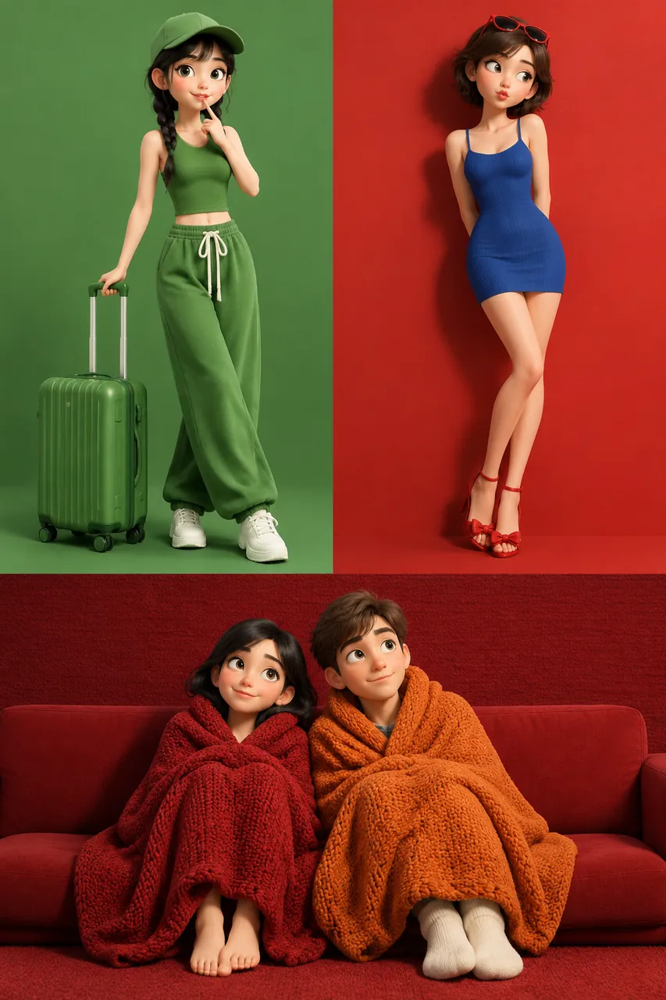</a>

> 这条 JSON 提示词定义的不是一张图，而是几个“模块”，每个模块是一格独立画面，有自己的角色、服装、姿势、配色和背景。模块一是扎双麻花辫、一身绿色旅行装、拉着行李箱的女孩，背景绿色；模块二是穿蓝色罗纹连衣裙和红色高跟鞋的棕发女孩，靠在红色背景上；模块三是两个角色分别裹着红色和橙色毯子坐在红沙发上。我们的成品把它们合成了一张色块分明的设定图，呈光亮的玩具感 3D 风格。每一格都以单一颜色为主，这正是整组显得有设计感的原因。适合探索吉祥物造型，或规划贴纸、周边系列。

```text
{
  "global_settings": {
    "resolution": "8K",
    "quality": "ultra-high definition",
    "aspect_ratio": "2:3",
    "render_style": "AI-edited, high-detail 3D render",
    "lighting_quality": "soft studio lighting with realistic shadows",
    "sharpness": "extreme clarity, crisp edges",
    "noise": "none",
    "compression": "none"
  },

  "Module_1_Image_1_Style": {
    "subject": {
      "character_type": "stylized 3D cartoon female",
      "pose": "standing, body slightly angled, one hand raised with index finger touching lips",
      "expression": "cheerful smile, wide eyes",
      "hair": {
        "color": "black",
        "style": "two braided pigtails",
        "accessories": "green cap"
      },
      "face": {
        "eyes": "large, rounded, dark pupils",
        "skin": "smooth, matte, stylized texture"
      }
    },
    "clothing": {
      "top": "sleeveless green crop top",
      "bottom": "loose green jogger-style pants with drawstring",
      "footwear": "white sneakers"
    },
    "accessories": {
      "luggage": "green hard-shell suitcase with extended handle"
    },
    "color_palette": [
      "multiple shades of green",
      "white accents"
    ],
    "background": {
      "color": "solid green",
      "texture": "soft, slightly grainy studio backdrop"
    },
    "composition": {
      "framing": "full body",
      "camera_angle": "eye-level",
      "depth": "subject sharply separated from background"
    }
  },

  "Module_2_Image_2_Style": {
    "subject": {
      "character_type": "stylized 3D cartoon female",
      "pose": "leaning slightly backward against background",
      "expression": "playful, lips slightly pursed, eyes looking sideways",
      "hair": {
        "color": "brown",
        "style": "short, tousled",
        "accessories": "red sunglasses resting on head"
      }
    },
    "clothing": {
      "dress": "form-fitting blue ribbed dress with thin straps",
      "footwear": "red high-heel sandals with bow detail"
    },
    "color_palette": [
      "bold red",
      "deep blue"
    ],
    "background": {
      "color": "solid red",
      "texture": "smooth matte surface"
    },
    "lighting": {
      "direction": "soft directional light from one side",
      "shadow": "defined shadow cast on red background"
    },
    "composition": {
      "framing": "full body",
      "pose_emphasis": "curved posture, crossed legs"
    }
  },

  "Module_3_Image_3_Style": {
    "subject": {
      "characters": [
        {
          "type": "stylized 3D cartoon female",
          "position": "left",
          "wrapped_in": "red textured blanket",
          "expression": "calm, slight smile, eyes looking upward"
        },
        {
          "type": "stylized 3D cartoon male",
          "position": "right",
          "wrapped_in": "orange textured blanket",
          "expression": "neutral, gentle gaze upward"
        }
      ]
    },
    "environment": {
      "furniture": "red sofa",
      "floor": "red surface",
      "background": {
        "color": "deep red",
        "texture": "fabric-like horizontal texture"
      }
    },
    "details": {
      "feet": "female barefoot, male wearing socks",
      "blanket_texture": "thick, knitted fabric"
    },
    "composition": {
      "framing": "centered, medium-wide shot",
      "symmetry": "balanced left and right composition"
    }
  },
```

- 原作者: [@meng_dagg695](https://x.com/meng_dagg695)
- 原帖: https://x.com/meng_dagg695/status/2012437899955097836
- [在 cinel 上查看详情并一键生成](https://cinel.ai/zh/prompts/p/stylized-3d-cartoon-character-sheet?utm_source=github&utm_medium=awesome&utm_campaign=awesome-gpt-image-2.5-prompts)

### 蓝图升起变成 3D 建筑的创意提示词

<a href="https://cinel.ai/zh/prompts/p/blueprint-to-building-3d-construction?utm_source=github&utm_medium=awesome&utm_campaign=awesome-gpt-image-2.5-prompts">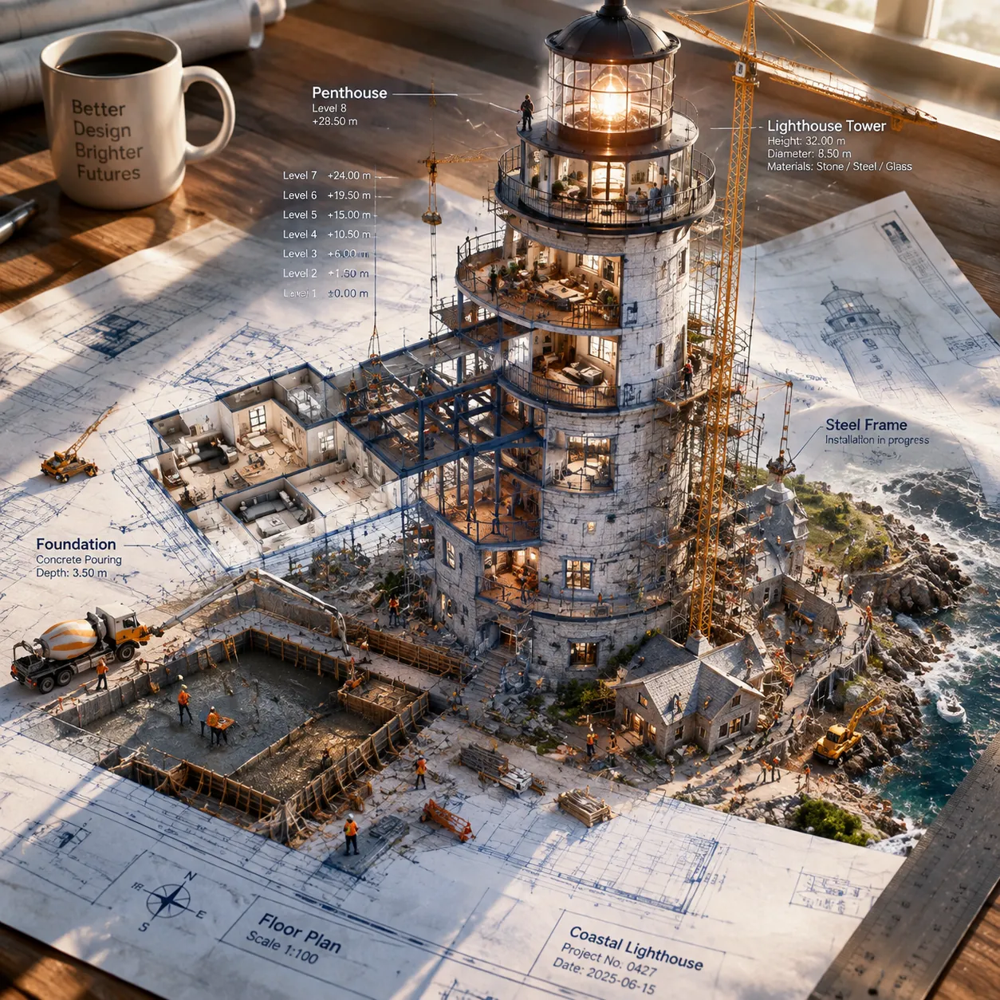</a>

> 这个场景把项目的所有阶段同时搬上台：蓝图线条从绘图桌上升起变成钢梁，平面图膨胀成带家具的房间，一角还在浇筑地基，顶部却已经完工，小工人和塔吊在结构上忙碌。桌边一只投下长影的咖啡杯点明了尺度。我们选了一座海岸灯塔：顶部灯室发着光，中段包着钢架和脚手架，图纸上是地基坑，浮动标签标出每一层。适合建筑事务所、施工企业招聘、地产项目发布或“是怎样建成的”科普。造型简单、有标志性的建筑效果最好。

```text
Epic 3D scene: a massive architectural blueprint of a coastal lighthouse pinned to a drafting table, its ink lines rising off the paper into fully realized construction. Blue lines become steel beams mid-weld, floor plans inflate into furnished rooms, elevation drawings push outward into facades with working windows. Construction phases coexist simultaneously: foundation being poured in one corner while the penthouse is already inhabited in another. Tiny workers, cranes, and scaffolding swarm the rising structure. The flat drawing and the living building merge at impossible angles. Technical annotations float as dimensional signage. Architect's coffee cup sits at the edge, casting shadow across unbuilt sections. Extreme scale contrast, construction dust catching afternoon light, 8K, photorealistic.
```

- 原作者: [@AllaAisling](https://x.com/AllaAisling)
- 原帖: https://x.com/AllaAisling/status/2010009737816162736
- [在 cinel 上查看详情并一键生成](https://cinel.ai/zh/prompts/p/blueprint-to-building-3d-construction?utm_source=github&utm_medium=awesome&utm_campaign=awesome-gpt-image-2.5-prompts)

### 珐琅彩西湖冰箱贴文创提示词

<a href="https://cinel.ai/zh/prompts/p/enamel-fridge-magnet-west-lake?utm_source=github&utm_medium=awesome&utm_campaign=awesome-gpt-image-2.5-prompts">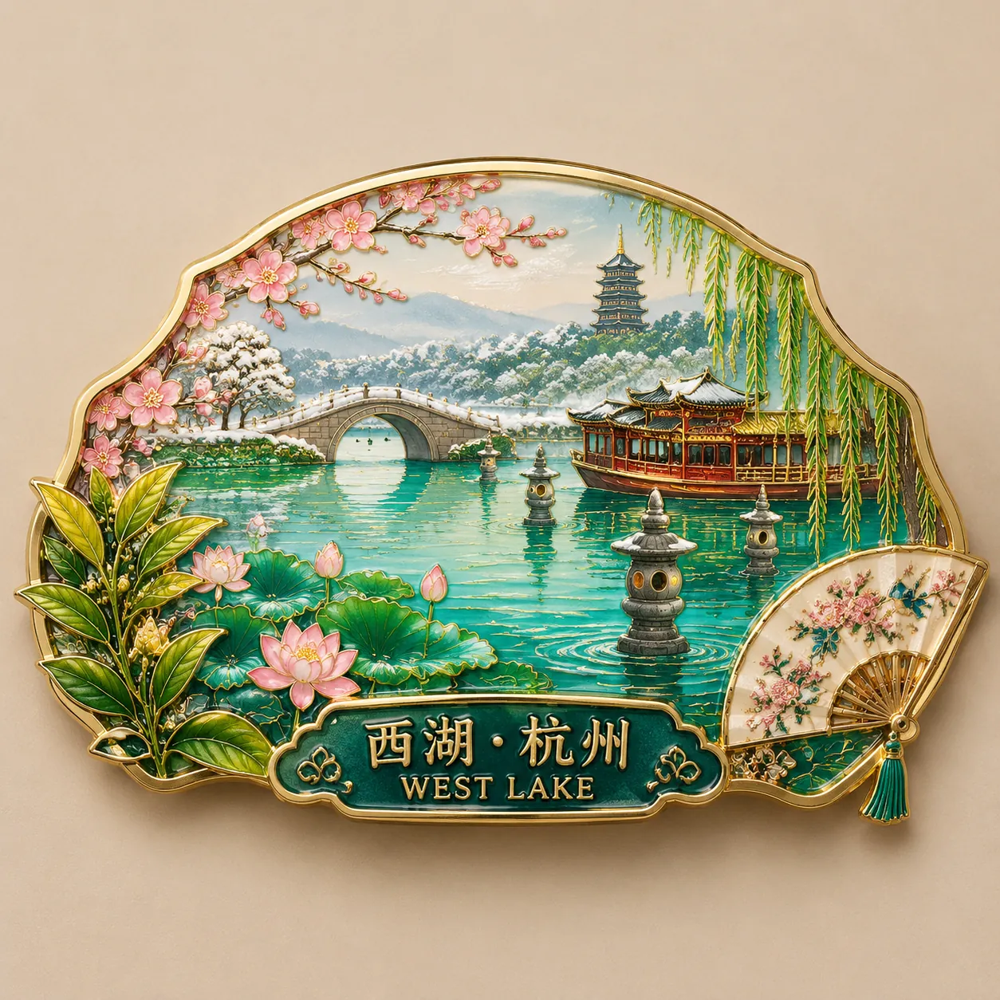</a>

> 冰箱贴是热门的文创产品，这条简短的中文提示词用珐琅加金属工艺设计了一枚：外轮廓沿用断桥的拱形，金色金属包边，画面里装进西湖经典景致——断桥残雪、湖面莲叶、画舫、雷峰塔剪影、三潭印月石灯、桃花与垂柳，再点缀龙井茶叶和杭绣扇面。湖水是半透明的翠绿珐琅，由细金属线勾出波纹。我们的成品像一张真实的产品照，中英双语铭牌上的地名也写对了。把景点和铭牌文字换成任何城市或景区，就能设计一整套文创系列。

```text
珐琅彩琉璃艺术风格，金属质感，制作一枚冰箱贴，写着"西湖·杭州 WEST LAKE"字样。冰箱贴以断桥拱形轮廓为基底外形，金色金属边框包边。画面描绘西湖经典风景：断桥残雪、湖面莲叶、楼外楼画舫、雷峰塔剪影、三潭印月石灯、粉色桃花与垂柳。左侧点缀龙井茶叶图案，右侧装饰杭绣扇面。采用珐琅彩填色工艺：湖水呈透明翠绿，金属线勾勒波纹细节。浅咖色背景，正面展示，所有元素严格控制在基底轮廓范围内，布局美观协调，产品摄影质感，8K细节
```

- 原作者: [@VigoCreativeAI](https://x.com/VigoCreativeAI)
- 原帖: https://x.com/VigoCreativeAI/status/2026301375249105195
- [在 cinel 上查看详情并一键生成](https://cinel.ai/zh/prompts/p/enamel-fridge-magnet-west-lake?utm_source=github&utm_medium=awesome&utm_campaign=awesome-gpt-image-2.5-prompts)

### 3D 街头潮流狗狗角色设计提示词

<a href="https://cinel.ai/zh/prompts/p/3d-streetwear-dog-character?utm_source=github&utm_medium=awesome&utm_campaign=awesome-gpt-image-2.5-prompts">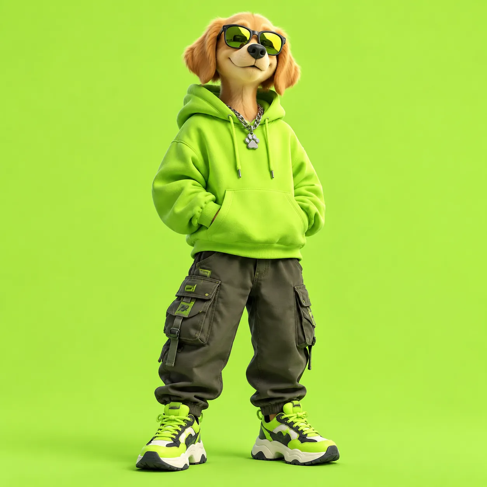</a>

> 一份干净的角色设计简报：一种动物、一套服装、一个姿势、一个背景色。服装清单（荧光绿宽松卫衣、工装裤、厚底运动鞋、反光墨镜、银色链条）具体到足以赋予角色态度，“双手插兜”则定下了自信放松的站姿。青柠绿背景与卫衣同色，形成单色时尚感。我们的成品是一只金色毛发、耷拉耳朵、戴绿色墨镜的狗狗，全身站立，卫衣和工装口袋的布料细节清晰。很适合作为吉祥物、数字藏品式系列、贴纸包或服装品牌角色的起点。同时替换动物和颜色，就能做成一个系列。

```text
Full-body 3D stylized anthropomorphic cartoon dog character wearing modern streetwear, oversized neon green hoodie, cargo pants, chunky sneakers, reflective sunglasses, silver chain necklace. Confident relaxed pose with hands in pockets. Minimal studio background in solid lime green. Soft studio lighting, smooth shadows, high detail fabric texture, Pixar-quality 3D render, ultra-clean composition, centered framing, fashion editorial character design, 8K resolution.
```

- 原作者: [@Taaruk_](https://x.com/Taaruk_)
- 原帖: https://x.com/Taaruk_/status/2022179786580537521
- [在 cinel 上查看详情并一键生成](https://cinel.ai/zh/prompts/p/3d-streetwear-dog-character?utm_source=github&utm_medium=awesome&utm_campaign=awesome-gpt-image-2.5-prompts)

### 石与金分裂雕塑面具人像提示词

<a href="https://cinel.ai/zh/prompts/p/split-stone-gold-sculptural-mask-portrait?utm_source=github&utm_medium=awesome&utm_campaign=awesome-gpt-image-2.5-prompts">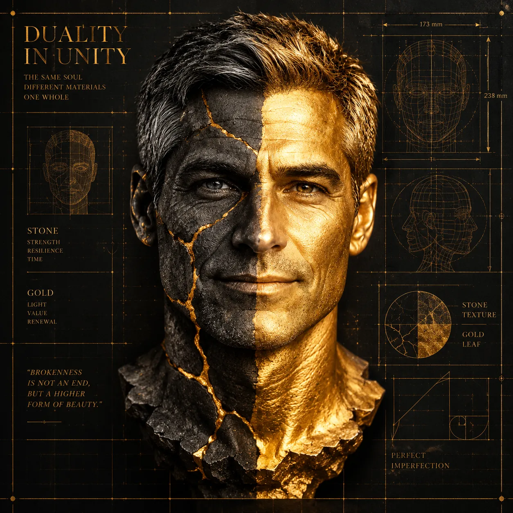</a>

> 一张基于参考图的概念人像，建立在一个强烈的对比上：脸从中间垂直分开，一侧是开裂的哑光炭黑石材，另一侧是抛光金箔，金缮般的金色纹路贯穿裂缝。深色蓝图背景配金色网格、尺寸标注和衬线字体，像一份设计研究稿。我们用了一位四十五岁左右、灰发的虚构男性参考图；半身像很好地保留了他的五官，模型还自己加了文案：“Duality in Unity”、关于石与金的短注，以及一句关于破碎之美的引言。底部有一个小单词拼错了，印刷前请检查文字。很适合书封和展览海报。

```text
A high-detail artistic 3D portrait of the person in the photo, reimagined as a fragmented sculptural mask. The face is vertically split: one side is made of matte charcoal-black stone with deep cracks, while the other side is polished, radiant leaf gold. The entire composition is overlaid on a dark architectural blueprint background featuring intricate gold grid lines, technical diagrams, and elegant golden serif typography. Cinematic lighting, hyper-realistic textures, Kintsugi-inspired aesthetic, luxury conceptual art, 8k resolution, moody and sophisticated atmosphere.
```

- 原作者: [@Samann_ai](https://x.com/Samann_ai)
- 原帖: https://x.com/Samann_ai/status/2018708807371628802
- [在 cinel 上查看详情并一键生成](https://cinel.ai/zh/prompts/p/split-stone-gold-sculptural-mask-portrait?utm_source=github&utm_medium=awesome&utm_campaign=awesome-gpt-image-2.5-prompts)

### 指尖上的 3D 卡通迷你分身人像提示词

<a href="https://cinel.ai/zh/prompts/p/portrait-with-3d-cartoon-mini-me?utm_source=github&utm_medium=awesome&utm_campaign=awesome-gpt-image-2.5-prompts">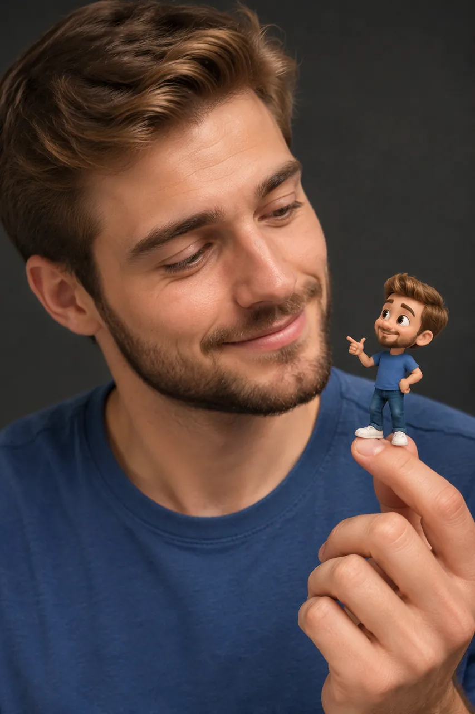</a>

> 头像照的一个可爱变体：一位照片级写实的男士举起指尖，上面站着一个大眼睛、姿势俏皮的动画电影风小版本自己，发型、胡子和蓝色 T 恤都一致。JSON 清楚地区分了主次主体，并用负面词禁止“卡通化的人”和“恐怖谷”，让真人的脸保持真实，只把迷你分身风格化。我们的成品里，一位浅棕发男士笑着低头看向挥手的迷你分身，背景是深色中性色，两张脸都清晰锐利。替换服装和人物，或附上你自己的照片，就能用作创作者头像和品牌代言人帖子。

```text
{
  "Objective": "Create a hyper-realistic studio portrait blending photorealism with a whimsical 3D cartoon miniature character",
  "PersonaDetails": {
    "PrimarySubject": {
      "Type": "Young man",
      "Appearance": {
        "Hair": "Light brown hair, neatly styled",
        "FacialHair": "Neatly trimmed beard",
        "Skin": "Photorealistic, natural texture"
      },
      "Expression": "Soft, warm smile",
      "Gaze": "Looking at the miniature character on his fingertips",
      "Wardrobe": "Blue t-shirt"
    },
    "SecondarySubject": {
      "Type": "Tiny 3D cartoon version of the man",
      "Scale": "Miniature, resting on fingertips",
      "Style": "Pixar-style 3D character design",
      "Proportions": "Exaggerated cute proportions",
      "Features": {
        "Eyes": "Large, expressive",
        "Expression": "Friendly, playful pose"
      },
      "Consistency": "Matching hairstyle and outfit of the main subject"
    }
  },
  "Composition": {
    "Framing": "Close-up studio portrait",
    "Focus": "Ultra-sharp focus on both faces",
    "DepthOfField": "Shallow depth of field with soft background blur",
    "Balance": "Clean, centered composition emphasizing interaction"
  },
  "LightingAndMood": {
    "LightingStyle": "Cinematic soft studio lighting",
    "Highlights": "Gentle highlights on skin and miniature character",
    "Background": "Dark neutral backdrop",
    "Mood": "Modern, whimsical, warm"
  },
  "ArtDirection": {
    "StyleFusion": [
      "Photorealistic human portrait",
      "Pixar-style 3D character rendering"
    ],
    "DetailLevel": "High detail with clean textures",
    "RealismBalance": "Realistic human combined with stylized miniature"
  },
  "PhotographyStyle": {
    "Genre": "Professional studio portrait photography",
    "LensLook": "85mm lens perspective",
    "ImageQuality": "High resolution, ultra-sharp clarity"
  },
  "ColorAndTone": {
    "ColorPalette": "Natural skin tones with soft, modern colors",
    "Contrast": "Balanced contrast, smooth tonal transitions"
  },
  "NegativePrompt": [
    "cartoon human",
    "uncanny valley",
    "harsh lighting",
    "oversaturated colors",
    "blurry faces",
    "low detail",
    "messy composition"
  ],
  "ResponseFormat": {
    "Type": "Single image",
    "Orientation": "Portrait",
    "AspectRatio": "2:3"
  }
}
```

- 原作者: [@Taaruk_](https://x.com/Taaruk_)
- 原帖: https://x.com/Taaruk_/status/2008818683234361811
- [在 cinel 上查看详情并一键生成](https://cinel.ai/zh/prompts/p/portrait-with-3d-cartoon-mini-me?utm_source=github&utm_medium=awesome&utm_campaign=awesome-gpt-image-2.5-prompts)

### 从笔记本素描中走出的 3D 角色提示词

<a href="https://cinel.ai/zh/prompts/p/3d-girl-stepping-out-of-notebook?utm_source=github&utm_medium=awesome&utm_campaign=awesome-gpt-image-2.5-prompts">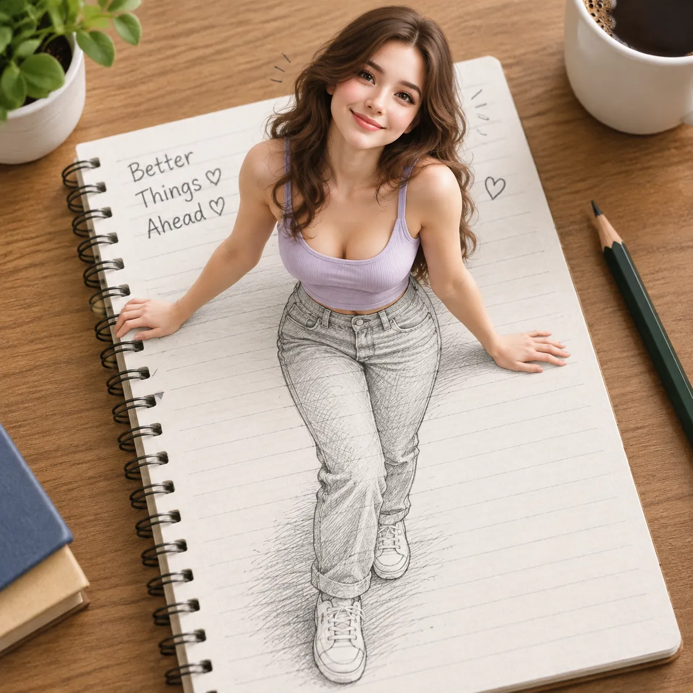</a>

> 这个错觉依赖一个分界：下半身仍是横线纸上的铅笔素描，上半身变成全彩 3D 角色，从纸面跳出来。木桌上的笔记本、顶部的手写字和周围的道具，让这张画显得真实可触。原文写的是“可爱的小女孩”，我们改成了二十五岁左右的成年女性，让主体不再有歧义。我们的成品里，她双手撑在纸上探身而出，淡紫色上衣和棕色波浪发是彩色的，灰色牛仔裤和运动鞋则是铅笔排线，上方写着“Better Things Ahead”。适合手账品牌、文具店或励志类帖子。

```text
A creative 3D illusion artwork of a cheerful adult woman in her mid-20s stepping out of a spiral notebook page placed on a wooden desk. The notebook has lined paper with handwritten text at the top. The woman looks semi-realistic 3D cartoon style, soft wavy brown hair, natural makeup, sweet smile, wearing a pastel crop top and high-waisted light grey jeans with white sneakers. Her lower body appears sketched in pencil on the notebook while the upper body looks realistic and popping out of the page.
```

- 原作者: [@oggii_0](https://x.com/oggii_0)
- 原帖: https://x.com/oggii_0/status/2028389324677611935
- [在 cinel 上查看详情并一键生成](https://cinel.ai/zh/prompts/p/3d-girl-stepping-out-of-notebook?utm_source=github&utm_medium=awesome&utm_campaign=awesome-gpt-image-2.5-prompts)

### 蓝图上的微缩施工现场提示词

<a href="https://cinel.ai/zh/prompts/p/blueprint-with-miniature-construction?utm_source=github&utm_medium=awesome&utm_campaign=awesome-gpt-image-2.5-prompts">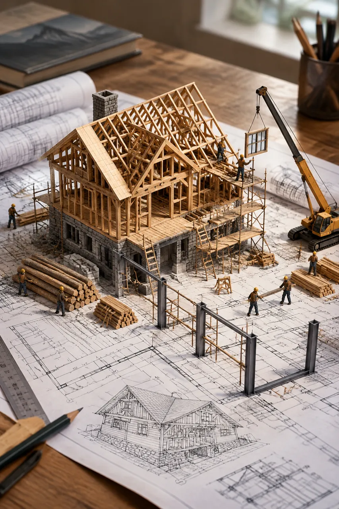</a>

> 一个整洁的填空模板：写上建筑名称，列出三个结构构件、一个施工细节、一个工人场景、建材和一个额外点缀，模型就会搭出从图纸上升起的微缩工地。和更混乱的“蓝图变建筑”提示词相比，这一条更平静，更像微缩模型。我们填的是绘图桌上的一座木框架山间小屋：石砌地基、木墙框架和屋架从图纸上升起，小工人扛着木梁，旁边堆着原木，一台小塔吊正吊起一扇窗。图纸底部的立面图依然可见。适合建筑商、木结构供应商或建筑学生的方案展示。

```text
An architectural blueprint of a timber-frame mountain cabin placed on a drafting table, with a photorealistic miniature under-construction version of a timber-frame mountain cabin emerging from it — a stone foundation, timber wall frames, roof trusses, a small wooden scaffold, tiny workers carrying beams, stacked logs, and a little crane lifting a window. All elements grow from the blueprint like a 3D architectural diorama, steel beams rising from the drawn lines, scaffolding threading through the paper. Studio soft lighting, cinematic depth, 2:3
```

- 原作者: [@0x00_Krypt](https://x.com/0x00_Krypt)
- 原帖: https://x.com/0x00_Krypt/status/2033887066363502882
- [在 cinel 上查看详情并一键生成](https://cinel.ai/zh/prompts/p/blueprint-with-miniature-construction?utm_source=github&utm_medium=awesome&utm_campaign=awesome-gpt-image-2.5-prompts)

### 云端国家形状悬浮岛海报提示词

<a href="https://cinel.ai/zh/prompts/p/floating-country-island-miniature-poster?utm_source=github&utm_medium=awesome&utm_campaign=awesome-gpt-image-2.5-prompts">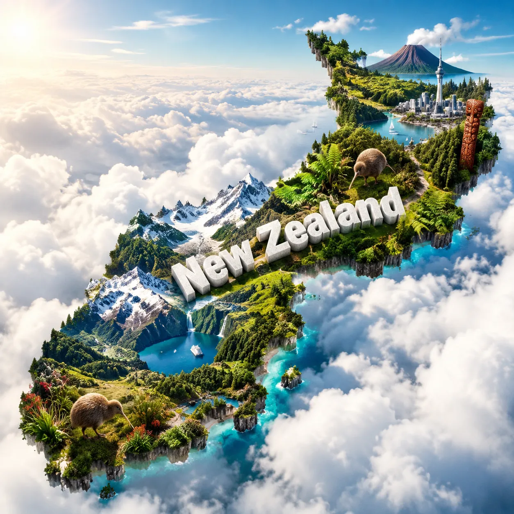</a>

> 地图变成了一个世界：国家的轮廓变成漂浮在云海上的岛屿，上面布满它的标志性风光和地标，国名用巨大的白色 3D 字母刻进地形里。五个空（国家、一个地标、两种地貌、野生动物）就足以引导画面。我们填的是新西兰：雪山、绿色丘陵、碧蓝峡湾和几维鸟，模型还自己加了一座火山锥和一座城市高塔。轮廓可以认出来，但南北两岛被合并简化了，所以请把它当作艺术海报而不是地图。适合旅行社、文旅局或国家主题系列内容。

```text
Create an ultra-HD, hyper-realistic digital poster of a floating miniature island shaped like New Zealand, resting on white clouds in the sky. Blend iconic landmarks, natural landscapes (like snowy alpine peaks, green rolling hills, or turquoise fjords), and cultural elements unique to New Zealand. Carve "New Zealand" into the terrain using large white 3D letters. Add artistic details like kiwi birds, cinematic lighting, vivid colors, aerial perspective, and sun reflections to enhance realism
```

- 原作者: [@Naiknelofar788](https://x.com/Naiknelofar788)
- 原帖: https://x.com/Naiknelofar788/status/2024277162652815403
- [在 cinel 上查看详情并一键生成](https://cinel.ai/zh/prompts/p/floating-country-island-miniature-poster?utm_source=github&utm_medium=awesome&utm_campaign=awesome-gpt-image-2.5-prompts)

### 玻璃骷髅伏案学习 3D 场景提示词

<a href="https://cinel.ai/zh/prompts/p/glass-skeleton-3d-desk-scene?utm_source=github&utm_medium=awesome&utm_campaign=awesome-gpt-image-2.5-prompts">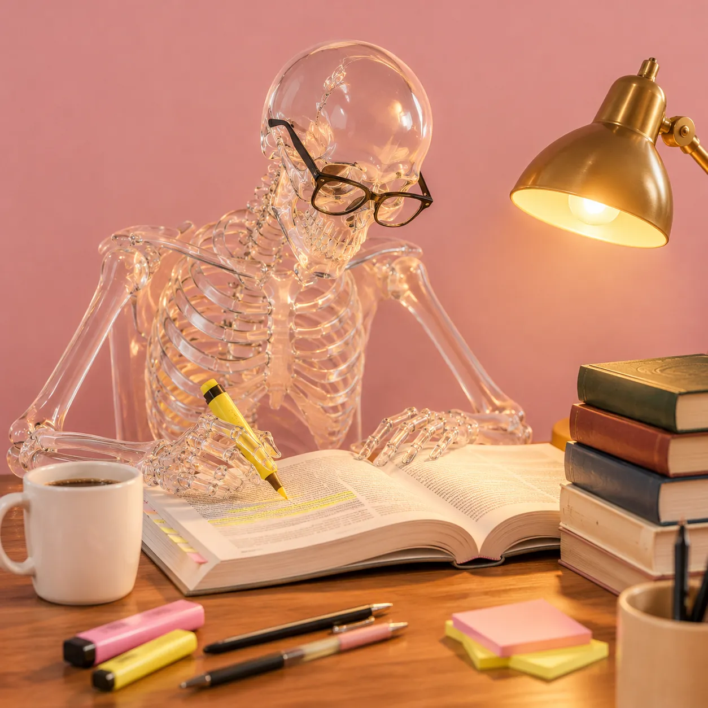</a>

> 一个可爱又有点荒诞的学习场景，网上有很多变体：一具戴黑框眼镜的透明玻璃骷髅，俯身看课本、手拿黄色荧光笔，被暖金色台灯照亮，背景是柔和的粉色墙面。提示词对让笑点成立的细节用了大写的 MUST（低头、正在划线、台灯在右侧），这种坚决很有效。我们的成品里，光亮的反光沿着玻璃骨骼流动，桌上有咖啡杯、一摞精装书、便利贴和粉彩荧光笔。适合学习激励帖、考试季活动、文具店或“期末周的我”表情包。换掉动作（打字、画画）就能做成系列。

```text
Create a high-quality stylized 3D render of a clear, translucent glass skeleton wearing black-rimmed glasses sitting at a wooden desk. The skeleton MUST be looking down at an open textbook and holding a yellow highlighter, actively highlighting a line of text. The scene MUST feature a warm gold desk lamp on the right side casting a cozy, yellow light that creates glossy reflections on the skeleton's surface. The desk is cluttered with a white coffee mug, a stack of hardcover books on the right, and scattered pens and pastel pink and yellow highlighters. The background MUST be a solid, soft pink wall. The overall aesthetic should be warm, studious, and visually soft. Do not include any text overlays or watermarks.
```

- 原作者: [@0xROAS](https://x.com/0xROAS)
- 原帖: https://x.com/0xROAS/status/2011453125685608456
- [在 cinel 上查看详情并一键生成](https://cinel.ai/zh/prompts/p/glass-skeleton-3d-desk-scene?utm_source=github&utm_medium=awesome&utm_campaign=awesome-gpt-image-2.5-prompts)

### 小人修复古董怀表微缩场景提示词

<a href="https://cinel.ai/zh/prompts/p/tiny-workers-restoring-antique-pocket-watch?utm_source=github&utm_medium=awesome&utm_campaign=awesome-gpt-image-2.5-prompts">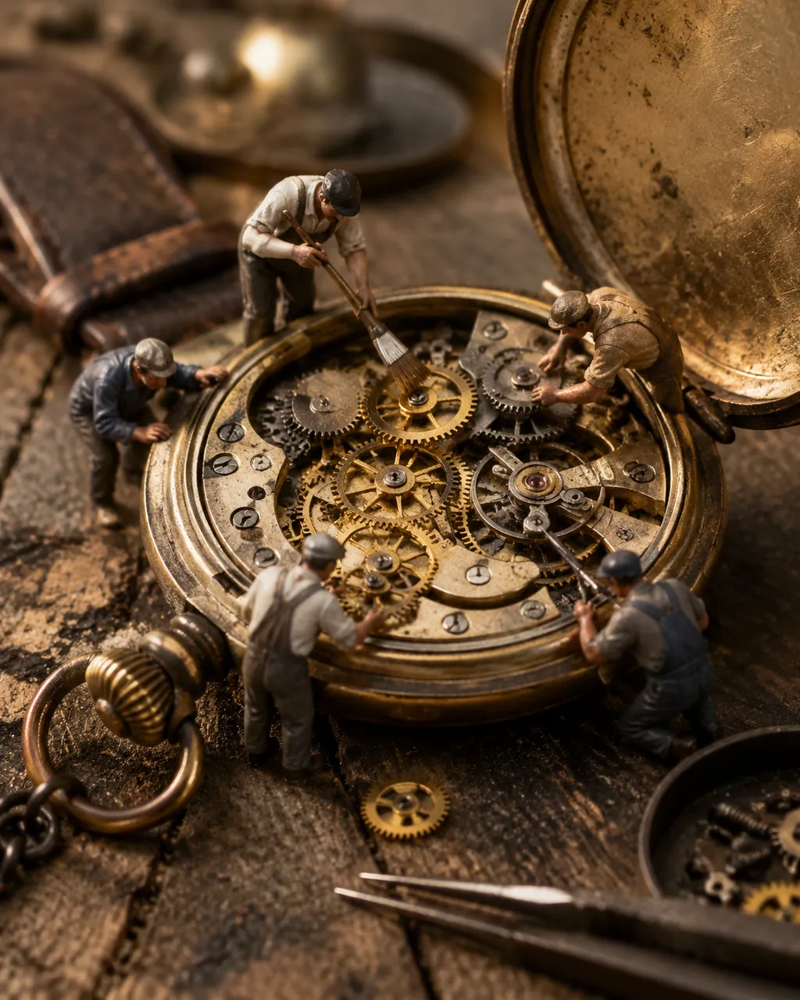</a>

> 带着温柔故事的“小人国”题材：一群微缩修复工人在打开的古董怀表里协作，刷洗黄铜齿轮、扶稳表壳、搬运零件，象征耐心、匠心和“修复时间”。JSON 用微距镜头语言、浅景深、温暖的定向光和灰尘、划痕、指纹等磨损细节，让画面保持摄影质感。我们的成品里，五六个穿工装、戴帽子的小人分布在深色风化木板上金色的机芯各处，其中一个站在梯子上，旁边放着镊子和一个备用齿轮。很适合钟表维修店、老字号品牌或周年纪念内容。

```text
{
  "prompt": "Ultra-realistic macro scene depicting tiny restoration workers collaboratively repairing an antique pocket watch. Several figures delicately clean intricate brass gears using fine brushes, while others stabilize the open watch casing and hold miniature components in place. The pocket watch lies on a textured natural surface, such as weathered wood or stone, emphasizing age and history. The scene symbolizes time, patience, craftsmanship, and teamwork.",
  "style": {
    "photography_type": "Macro photography",
    "realism": "Ultra-realistic",
    "mood": "Emotional and cinematic",
    "lighting": "Soft, warm, directional lighting with gentle highlights and natural shadows",
    "depth_of_field": "Shallow depth of field with sharp focus on foreground details and smooth background bokeh"
  },
  "composition": {
    "shot_type": "Close-up macro",
    "angle": "Slightly elevated perspective",
    "focus": "Extreme detail on gears, tools, and figurines’ interactions",
    "framing": "Pocket watch centered with workers distributed naturally across the mechanism"
  },
  "textures_and_details": {
    "materials": "Aged metal, polished brass gears, worn leather strap, natural surface grain",
    "details": "Visible dust particles, subtle scratches, fingerprints, and mechanical wear"
  },
  "atmosphere": {
    "tone": "Warm, nostalgic, hopeful",
    "symbolism": "Restoration of time through collective effort and care"
  },
  "render_settings": {
    "aspect_ratio": "4:5",
    "quality": 2,
    "resolution": "High-resolution",
    "style_precision": "Professional studio-level composition"
  }
}
```

- 原作者: [@Just_sharon7](https://x.com/Just_sharon7)
- 原帖: https://x.com/Just_sharon7/status/2011621455558221930
- [在 cinel 上查看详情并一键生成](https://cinel.ai/zh/prompts/p/tiny-workers-restoring-antique-pocket-watch?utm_source=github&utm_medium=awesome&utm_campaign=awesome-gpt-image-2.5-prompts)

### 充气亮面搪胶 3D 物件渲染提示词

<a href="https://cinel.ai/zh/prompts/p/inflated-vinyl-3d-object?utm_source=github&utm_medium=awesome&utm_campaign=awesome-gpt-image-2.5-prompts">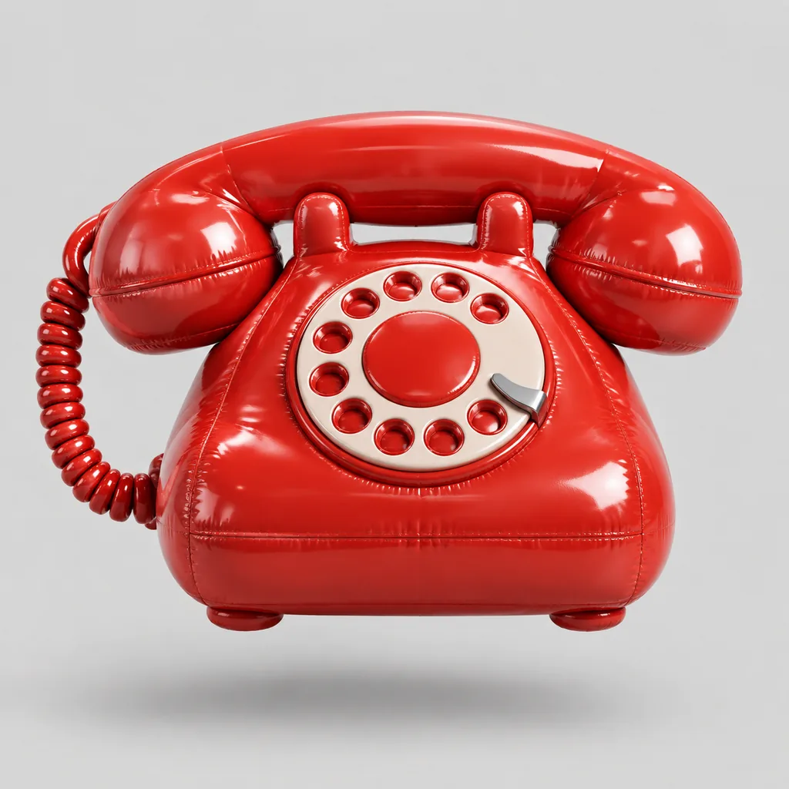</a>

> 来自 @azed_ai 的单变量 3D 模板，能把任何主体变成设计师收藏级潮玩。物件被重塑为光滑、充气、亮面的搪胶材质，轮廓蓬松如枕头，带细微的缝线拼接，比例圆润似玩具，高光强烈，在柔和影棚光下悬浮于浅灰纯色背景之上。我们选了一部复古转盘电话，GPT Image 2.5 让它看起来柔软可捏，同时保留了转盘和听筒的辨识度。适合产品预告、应用图标、周边概念、收藏品设计或俏皮的社媒帖子。

```text
A vintage rotary telephone, made of smooth inflated glossy vinyl plastic, ultra-realistic 3D render, soft pillowy contours with subtle stitched panel seams, slightly rounded toy-like proportions, highly polished surface with strong specular highlights, realistic material depth, soft studio lighting creating gentle shadows and clean reflections, floating slightly above a plain light gray background, minimal composition, designer collectible aesthetic, premium art toy finish, high detail, centered composition, 1:1 aspect ratio.
```

- 原作者: [@azed_ai](https://x.com/azed_ai)
- 原帖: https://x.com/azed_ai/status/2037922744856412584
- [在 cinel 上查看详情并一键生成](https://cinel.ai/zh/prompts/p/inflated-vinyl-3d-object?utm_source=github&utm_medium=awesome&utm_campaign=awesome-gpt-image-2.5-prompts)

### 手绘风格化 3D 游戏资产渲染提示词

<a href="https://cinel.ai/zh/prompts/p/hand-painted-3d-game-asset?utm_source=github&utm_medium=awesome&utm_campaign=awesome-gpt-image-2.5-prompts">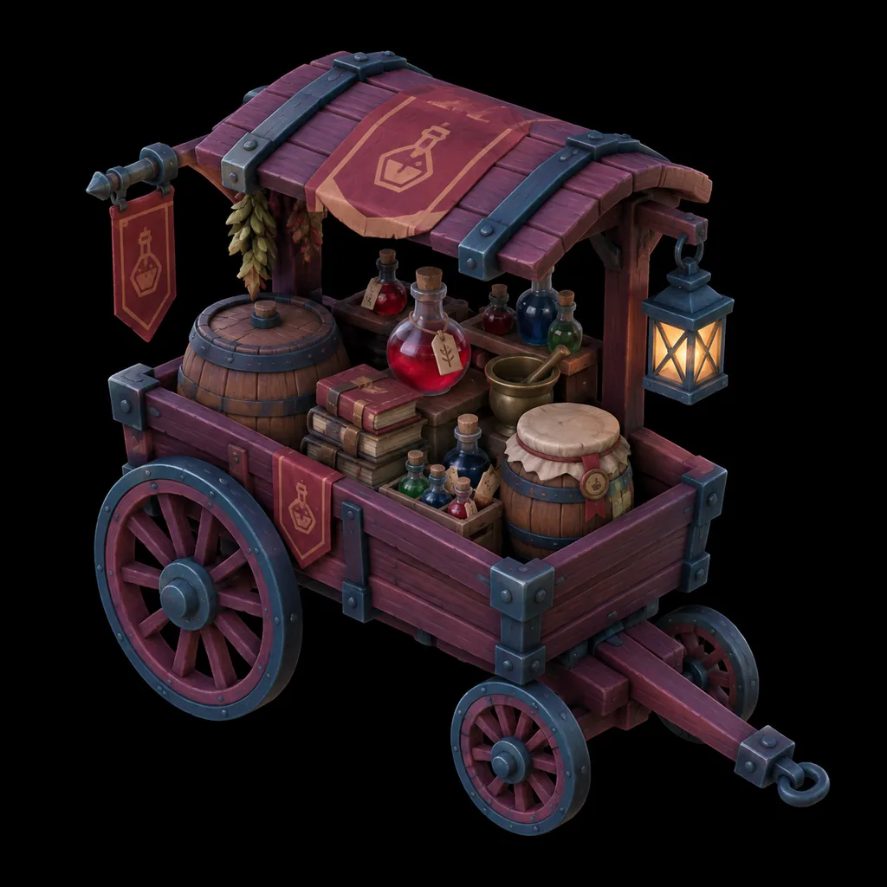</a>

> 来自 @doganuraldesign 的单变量模板，还原独立游戏和手游里常见的手绘风格。主体被简化成厚实的几何体，大块形状清晰易读，边缘柔和倒角，木头和金属是哑光手绘质感，以干净的资产展示构图呈现，轮廓紧凑。我们填入了炼金术士的药水推车，GPT Image 2.5 生成的瓶子、木桶和提灯在缩略图尺寸下依然清楚。适合道具概念、商店图标、提案或资产包预览。

```text
3D render of a cozy alchemist's potion cart with barrels, bottles and a small lantern, stylized hand-painted 3D game asset, chunky simplified geometry, broad readable shapes, softly beveled edges, matte painted wood and metal, subtle hand-painted surface variation, restrained material detail, deep plum and burgundy wood, dark teal and navy hardware, selective crimson and muted warm accents, soft diffuse lighting, gentle ambient occlusion, simple soft directional shadow, flat solid black background, no vignette, no dramatic lighting, no volumetric effects, elevated isometric three-quarter view, clean centered composition, compact game-ready silhouette, understated handcrafted atmosphere.
```

- 原作者: [@doganuraldesign](https://x.com/doganuraldesign)
- 原帖: https://x.com/doganuraldesign/status/2087216179723043107
- [在 cinel 上查看详情并一键生成](https://cinel.ai/zh/prompts/p/hand-painted-3d-game-asset?utm_source=github&utm_medium=awesome&utm_campaign=awesome-gpt-image-2.5-prompts)

### 等距微缩主题世界提示词

<a href="https://cinel.ai/zh/prompts/p/isometric-miniature-themed-world?utm_source=github&utm_medium=awesome&utm_campaign=awesome-gpt-image-2.5-prompts">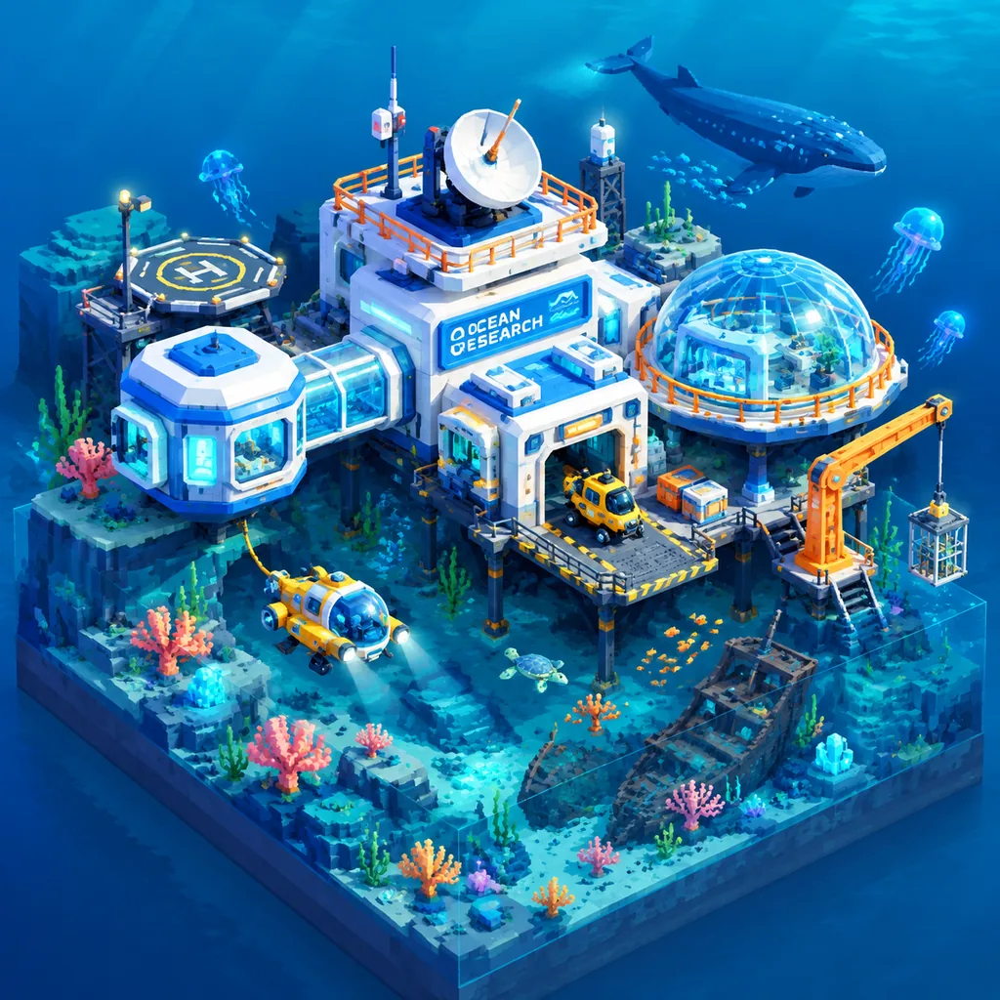</a>

> 来自 @azed_ai 的单变量等距模板。只要给出主题，它就会围绕主题搭出一整个微缩世界：风格化地形、标志性道具、细小的环境细节和角色，全部放在一块紧凑的立体模型底座上，带有玩具般的趣味质感。我们用了深海科考站，结果把穹顶、潜艇、珊瑚和潜水员都装进了一块悬浮的方块里。适合游戏提案、科普图解、活动主视觉和儿童绘本构思。

```text
An isometric 3D miniature world themed around a deep-sea research station, featuring stylized terrain, iconic props, tiny environmental details, and glowing accents in cyan and coral. Clean geometry, crisp edges, flat shadows, vibrant colors, highly detailed micro-world design, pixel-diorama aesthetic, playful and immersive composition.
```

- 原作者: [@azed_ai](https://x.com/azed_ai)
- 原帖: https://x.com/azed_ai/status/2067563761431613534
- [在 cinel 上查看详情并一键生成](https://cinel.ai/zh/prompts/p/isometric-miniature-themed-world?utm_source=github&utm_medium=awesome&utm_campaign=awesome-gpt-image-2.5-prompts)

### 旅行 App 弹出式等距立体模型

<a href="https://cinel.ai/zh/prompts/p/travel-app-pop-out-diorama?utm_source=github&utm_medium=awesome&utm_campaign=awesome-gpt-image-2.5-prompts">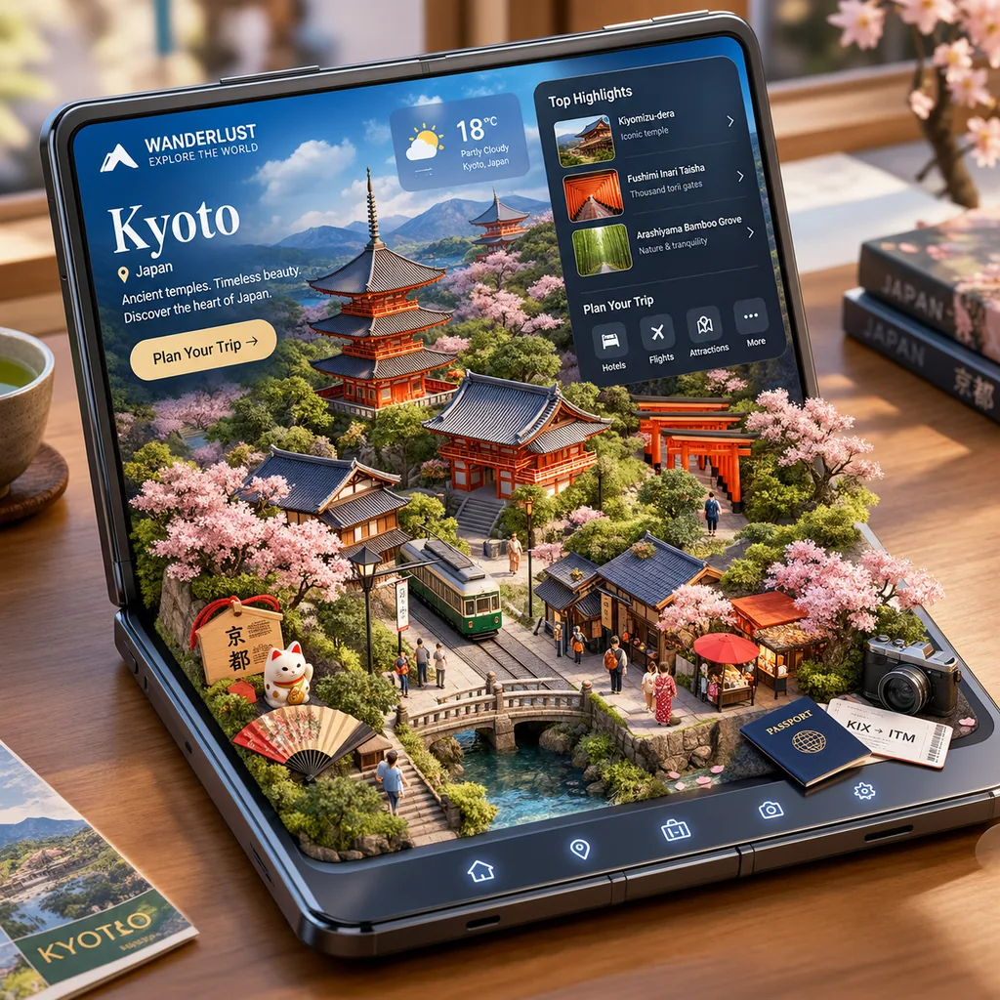</a>

> 来自 @aiwithlumi 的目的地模板。现代旅行 App 界面变成真实的微缩世界：地标、街道、天气、道具和当地文化以等距 3D 的形式从屏幕里升起，界面卡片仍框住整个场景。我们设定为京都，GPT Image 2.5 让宝塔、寺庙和樱花从手机里长了出来。适合旅游宣传、旅行 App 营销、目的地指南和社交轮播图。

```text
Create a highly detailed isometric 3D pop-out travel app diorama for Kyoto, Japan, where a modern travel interface seamlessly transforms into a miniature real-world landscape emerging from the screen. Include iconic temples and pagodas, a tiny tram, culturally authentic miniature characters in everyday clothes, regional souvenirs, and travel accessories integrated into the scene. The screen should display a premium travel UI with the title “WANDERLUST: EXPLORE THE WORLD”, the destination name, a short tagline, a call-to-action button, a weather widget, a highlights panel and trip-planning options. Place everything inside a sleek dark-gray metallic folding device with illuminated touch icons. Polished isometric pop-out style, ultra-realistic textures, cinematic lighting, soft shadows, depth of field, premium 3D render quality, square 1:1 composition.
```

- 原作者: [@aiwithlumi](https://x.com/aiwithlumi)
- 原帖: https://x.com/aiwithlumi/status/2076931957544689825
- [在 cinel 上查看详情并一键生成](https://cinel.ai/zh/prompts/p/travel-app-pop-out-diorama?utm_source=github&utm_medium=awesome&utm_campaign=awesome-gpt-image-2.5-prompts)

### 地标等距悬浮立体模型提示词

<a href="https://cinel.ai/zh/prompts/p/landmark-isometric-floating-diorama?utm_source=github&utm_medium=awesome&utm_campaign=awesome-gpt-image-2.5-prompts">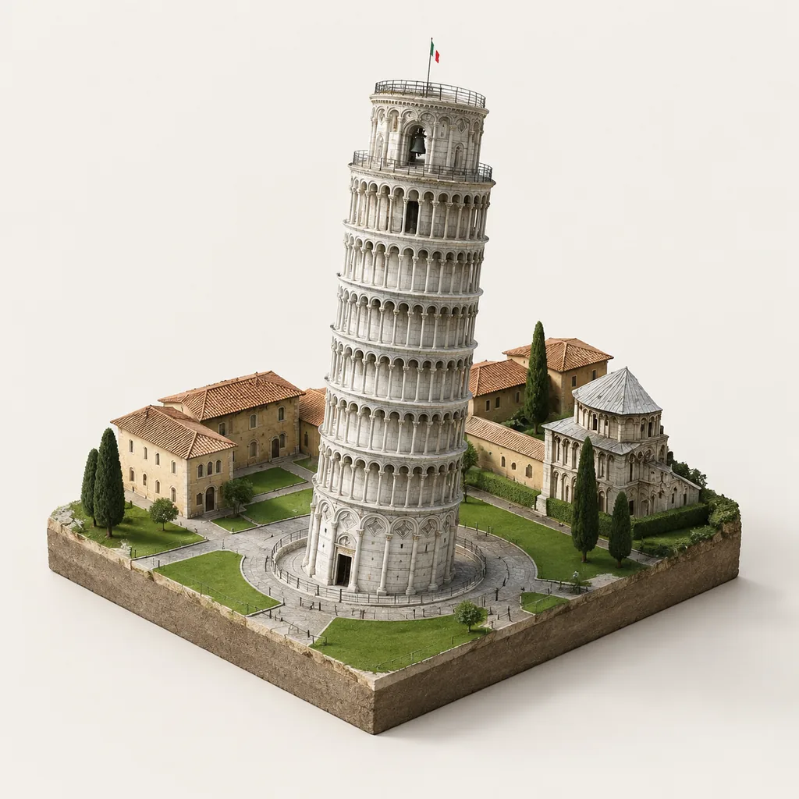</a>

> 来自 @egeberkina 的单变量建筑模板。要求准确还原地标的真实结构和比例，做成微缩模型，放在带一小块地面的悬浮底座上，柔和棚拍光，不出现人物和文字，呈现高级建筑模型的质感。我们选了比萨斜塔，倾斜角度和拱廊层都表现得很清楚。适合旅行内容、教育、收藏风海报和图标组。

```text
A miniature isometric architectural diorama of the Leaning Tower of Pisa, accurately reflecting its real-world structure and proportions, placed on a small floating base with subtle surrounding buildings and landscape elements inspired by Pisa, Italy. Realistic materials and natural textures, physically accurate stone, concrete, metal, and glass surfaces. True-to-life color palette based on the actual landmark, muted and realistic tones. Off-white studio background with soft, natural lighting, gentle shadows, and clean composition. High-detail, realistic yet refined 3D render, premium architectural model aesthetic, no people, no text.
```

- 原作者: [@egeberkina](https://x.com/egeberkina)
- 原帖: https://x.com/egeberkina/status/2011378770494566596
- [在 cinel 上查看详情并一键生成](https://cinel.ai/zh/prompts/p/landmark-isometric-floating-diorama?utm_source=github&utm_medium=awesome&utm_campaign=awesome-gpt-image-2.5-prompts)

### 极简等距交通站台立体模型

<a href="https://cinel.ai/zh/prompts/p/transit-stop-isometric-diorama?utm_source=github&utm_medium=awesome&utm_campaign=awesome-gpt-image-2.5-prompts">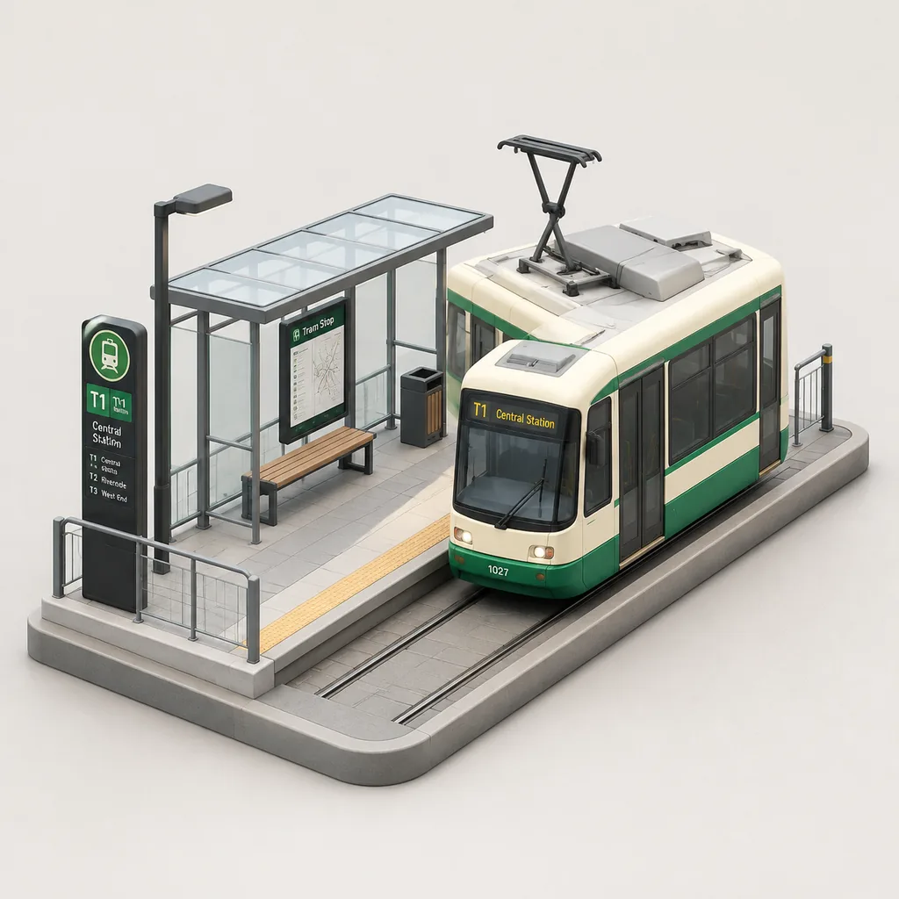</a>

> 来自 @aleenaamiir 的四变量模板，用来做安静、极简的交通场景。你选定交通方式、车辆、站台和雨棚，它会生成一个干净的等距立体模型：停靠的车辆、低调的导视、圆润边角，以及中性背景上的建筑微缩模型质感。我们填入了奶油绿配色的有轨电车和玻璃雨棚。适合城市规划演示、交通 App 插图、图标组和简洁信息图。

```text
A clean, minimal 3D isometric diorama of a city tram stop, featuring a cream-and-green tram paused at a raised platform, simple glass canopy shelter, subtle wayfinding signs, smooth concrete surfaces, soft studio lighting, realistic materials, rounded edges, miniature architectural model style, high detail, neutral background.
```

- 原作者: [@aleenaamiir](https://x.com/aleenaamiir)
- 原帖: https://x.com/aleenaamiir/status/2011662366141006262
- [在 cinel 上查看详情并一键生成](https://cinel.ai/zh/prompts/p/transit-stop-isometric-diorama?utm_source=github&utm_medium=awesome&utm_campaign=awesome-gpt-image-2.5-prompts)

### 数据立方体等距 3D 渲染提示词

<a href="https://cinel.ai/zh/prompts/p/data-cube-isometric-render?utm_source=github&utm_medium=awesome&utm_campaign=awesome-gpt-image-2.5-prompts">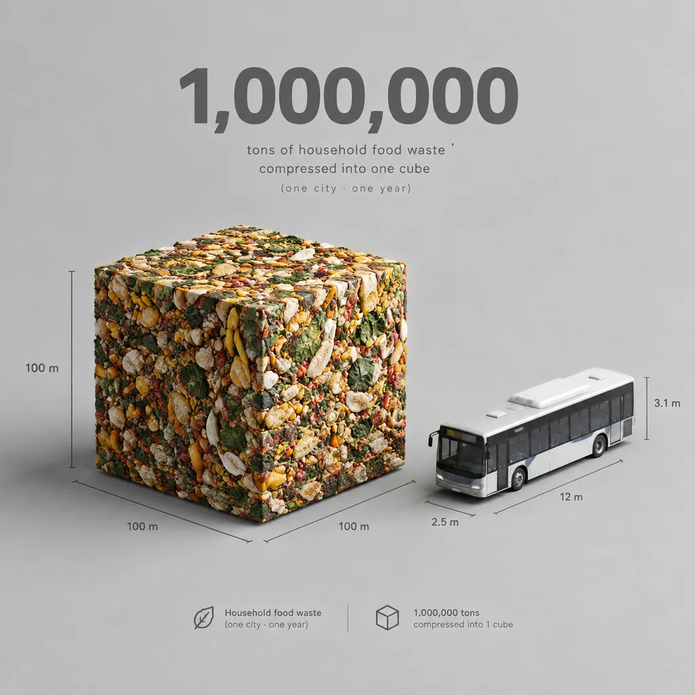</a>

> 由 @Gdgtify 分享的数据实体化模板。给出一个主题，它会挑一个能用体积、质量、金钱、数据或垃圾量表示的统计数据，再用对应的材料搭出一个完美立方体，配极简说明文字和人体比例参照，让难以想象的数量变得可以感知。我们用了一个家庭一年的食物浪费。适合科普图文、报告、可持续议题宣传和编辑类信息图。

```text
Create a minimalist isometric 3D render that compresses one year of household food waste in a single mid-sized city into one perfect cube made of mixed food scraps. It sits beside one familiar comparison object: a city bus. Style: ultra-clean studio render, matte clay and physically accurate material, neutral concrete-grey background, soft ambient occlusion, sharp edges, generous negative space. Add subtle dimension lines showing height, width, and depth. Include one huge numeral floating above the cube. A small caption states what was compressed, the metric and the timeframe. The spirit: make an impossible quantity feel measurable by turning it into one silent block.
```

- 原作者: [@Gdgtify](https://x.com/Gdgtify)
- 原帖: https://x.com/Gdgtify/status/2074079912592593115
- [在 cinel 上查看详情并一键生成](https://cinel.ai/zh/prompts/p/data-cube-isometric-render?utm_source=github&utm_medium=awesome&utm_campaign=awesome-gpt-image-2.5-prompts)

### 以物件为底座的 45° 微缩立体模型

<a href="https://cinel.ai/zh/prompts/p/object-base-45-degree-diorama?utm_source=github&utm_medium=awesome&utm_campaign=awesome-gpt-image-2.5-prompts">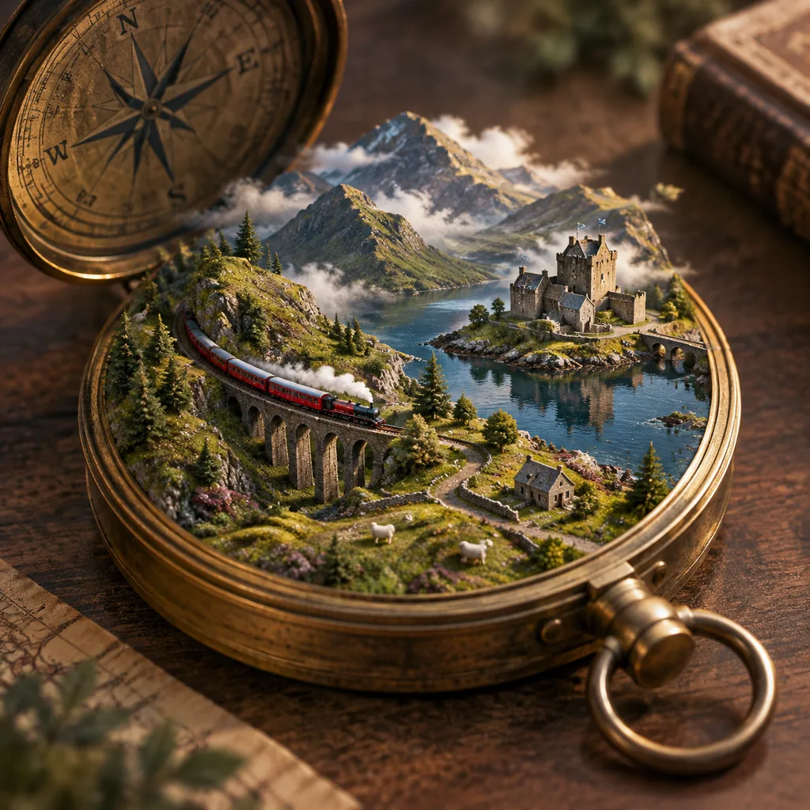</a>

> 来自 @aleenaamiir 的模板，把一个物件变成小世界的地面。以 45 度视角呈现，物件上承载着风格化的微缩景观，比例严谨，几何干净，做工精细，带 8K 电影感质感。我们用了一只复古袖珍指南针，苏格兰高地从中升起：薄雾山丘、湖畔城堡、羊群和驶过高架桥的红色小火车。适合产品故事、超现实海报、壁纸和创意广告。

```text
Create a stylized miniature 3D diorama viewed from a 45-degree angled perspective, emphasizing careful scale, clean geometry, and fine craftsmanship. A vintage pocket compass serves as the central base of the composition. From within this object, a miniature interpretation of the Scottish Highlands emerges naturally, forming a compact, self-contained world: misty hills, a stone castle by a loch, winding paths, tiny sheep and a small red train crossing a viaduct. Use cinematic lighting, soft highlights, and selective depth-of-field blur to create a magical, dreamlike atmosphere. Balance playful isometric styling with realistic materials and lighting, achieving a polished, premium diorama look. Highly detailed, cohesive composition, refined miniature-world aesthetic.
```

- 原作者: [@aleenaamiir](https://x.com/aleenaamiir)
- 原帖: https://x.com/aleenaamiir/status/2011798504482738365
- [在 cinel 上查看详情并一键生成](https://cinel.ai/zh/prompts/p/object-base-45-degree-diorama?utm_source=github&utm_medium=awesome&utm_campaign=awesome-gpt-image-2.5-prompts)

### 指尖捏着的微缩城市立体模型

<a href="https://cinel.ai/zh/prompts/p/city-diorama-between-fingers?utm_source=github&utm_medium=awesome&utm_campaign=awesome-gpt-image-2.5-prompts">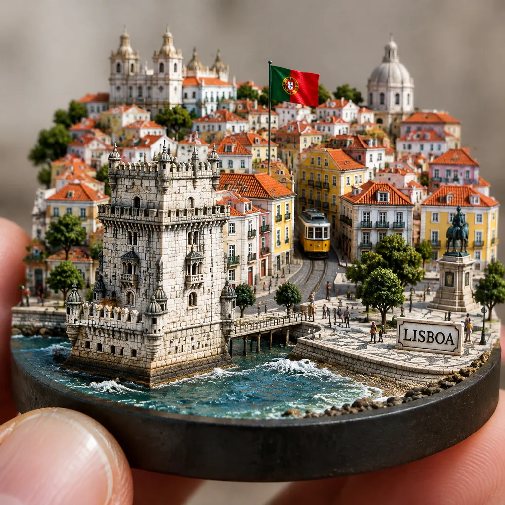</a>

> 来自 @TechieBySA 的城市模板。要求极近距离微距拍摄一座放在实心底座上的城市微缩模型，被两根手指捏着。城市占满大部分画面，地标和街道细节丰富，国家配色若隐若现，背景柔和虚化。我们用了里斯本，红屋顶、黄色电车和山坡街道都呈现出移轴般的细节。适合旅行内容、城市宣传和吸睛的社交图片。

```text
Extreme close-up macro of a miniature city diorama of Lisbon, Portugal on a solid base, held between two human fingers. The city fills 85–95% of the frame. The Portuguese national flag stands on a flagpole in the mid-ground, gently waving. Belém Tower is positioned in the clear foreground, unobstructed and naturally integrated, with a yellow tram on a steep street behind it. A small street sign reads “LISBOA” at a plaza edge. Surrounding terracotta-roofed architecture reflects the city's character. Ultra-realistic handcrafted miniature, detailed architecture, realistic materials, accurate proportions. Macro lens, deep depth of field, soft studio lighting, subtle shadows, tilt-shift realism. Neutral softly blurred background. Photorealistic, cinematic, premium quality.
```

- 原作者: [@TechieBySA](https://x.com/TechieBySA)
- 原帖: https://x.com/TechieBySA/status/2007777809712976297
- [在 cinel 上查看详情并一键生成](https://cinel.ai/zh/prompts/p/city-diorama-between-fingers?utm_source=github&utm_medium=awesome&utm_campaign=awesome-gpt-image-2.5-prompts)

### 国家招牌菜等距 3D 场景提示词

<a href="https://cinel.ai/zh/prompts/p/country-dish-isometric-3d-scene?utm_source=github&utm_medium=awesome&utm_campaign=awesome-gpt-image-2.5-prompts">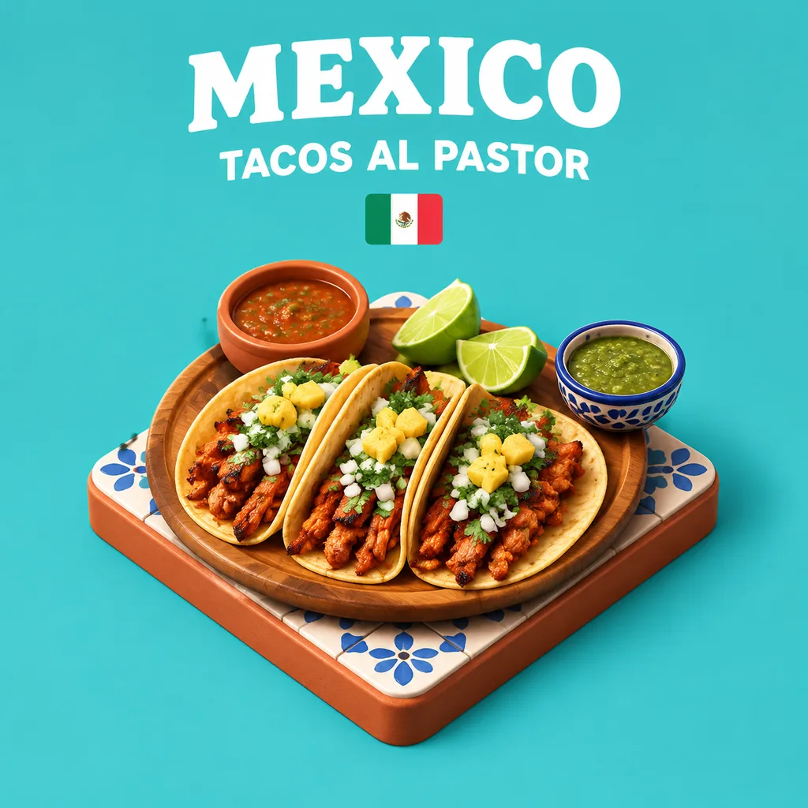</a>

> 来自 @Strength04_X 的美食模板。给出国家和招牌菜，它会生成 45° 俯视等距微缩卡通场景：质感细腻柔和，PBR 材质写实，菜肴周围有小厨师和文化道具，排版干净，配一个简短标题。我们选了墨西哥的 tacos al pastor，GPT Image 2.5 把它们放在花纹瓷砖上，配莎莎酱、青柠和醒目标题。适合美食博客、菜单、文化内容和食谱轮播图。

```text
Present a clear, 45° top-down isometric miniature 3D cartoon scene of Mexico's signature dish: tacos al pastor, with soft refined textures, realistic PBR materials, and gentle lifelike lighting. Create a small raised diorama-style base showcasing the dish in a highly recognizable presentation, with simple complementary elements (plate, lime wedges, small salsa bowls). Use a clean solid turquoise background. At the top-center, display MEXICO in large bold white text, directly beneath it show TACOS AL PASTOR in medium text, and place a small simplified Mexican flag icon below the subtext. Composition: perfectly centered layout, square 1:1, ultra-clean, high-clarity miniature diorama aesthetic.
```

- 原作者: [@Strength04_X](https://x.com/Strength04_X)
- 原帖: https://x.com/Strength04_X/status/2015771756812963853
- [在 cinel 上查看详情并一键生成](https://cinel.ai/zh/prompts/p/country-dish-isometric-3d-scene?utm_source=github&utm_medium=awesome&utm_campaign=awesome-gpt-image-2.5-prompts)

### Q 版盲盒滑板男孩 3D 渲染

<a href="https://cinel.ai/zh/prompts/p/chibi-blind-box-skater-boy?utm_source=github&utm_medium=awesome&utm_campaign=awesome-gpt-image-2.5-prompts">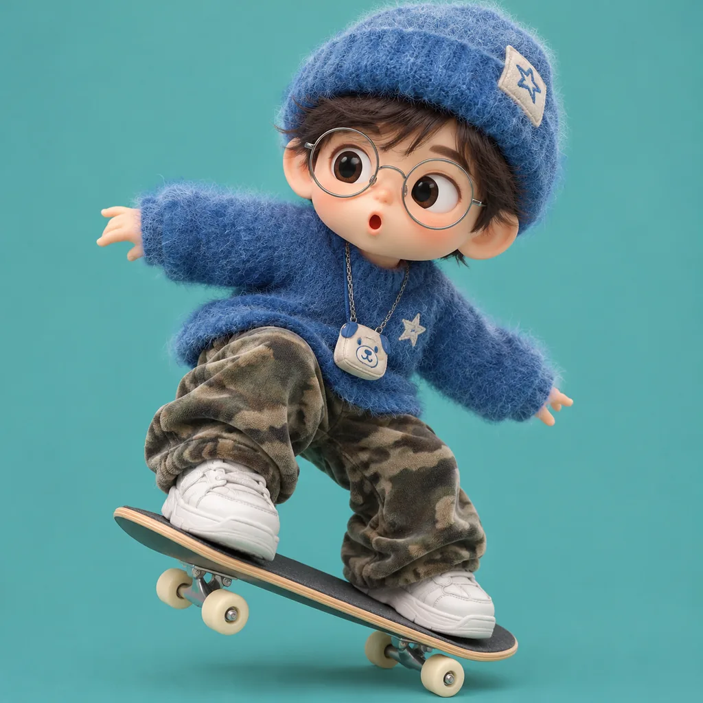</a>

> 来自 @rovvmut_ 的角色提示词，走高端盲盒潮玩路线。一个可爱的风格化男孩，Q 版比例（大头小身），以动感姿势滑板，穿着宽松街头服饰，面料质感非常写实，背景是干净的棚拍。这条提示词没有变量，我们按原文使用，GPT Image 2.5 还原了毛绒针织质感和搪胶公仔般的脸。适合玩具概念、吉祥物、周边样机和头像。

```text
A high-fidelity 3D character render of a cute, stylized boy skateboarding in a dynamic pose. The boy has 'chibi' proportions with a large head, wearing oversized round wire-frame glasses and making a surprised 'O' mouth expression. He is dressed in an extremely fuzzy, textured blue mohair sweater with a small embroidered star on the chest, a matching fuzzy blue beanie with a cream patch, and baggy camouflage-patterned pants made of a soft, velvet-like fabric. He wears chunky white sneakers and a small necklace pouch with a cartoon face. The background is a solid, seamless teal color. Soft diffuse studio lighting, clean high-end blind-box art toy aesthetic with hyper-realistic fabric textures.
```

- 原作者: [@rovvmut_](https://x.com/rovvmut_)
- 原帖: https://x.com/rovvmut_/status/2015648059771044000
- [在 cinel 上查看详情并一键生成](https://cinel.ai/zh/prompts/p/chibi-blind-box-skater-boy?utm_source=github&utm_medium=awesome&utm_campaign=awesome-gpt-image-2.5-prompts)

### Q 版男孩骑滑板车与毛绒蓝色小怪兽

<a href="https://cinel.ai/zh/prompts/p/chibi-boy-scooter-blue-monster?utm_source=github&utm_medium=awesome&utm_campaign=awesome-gpt-image-2.5-prompts">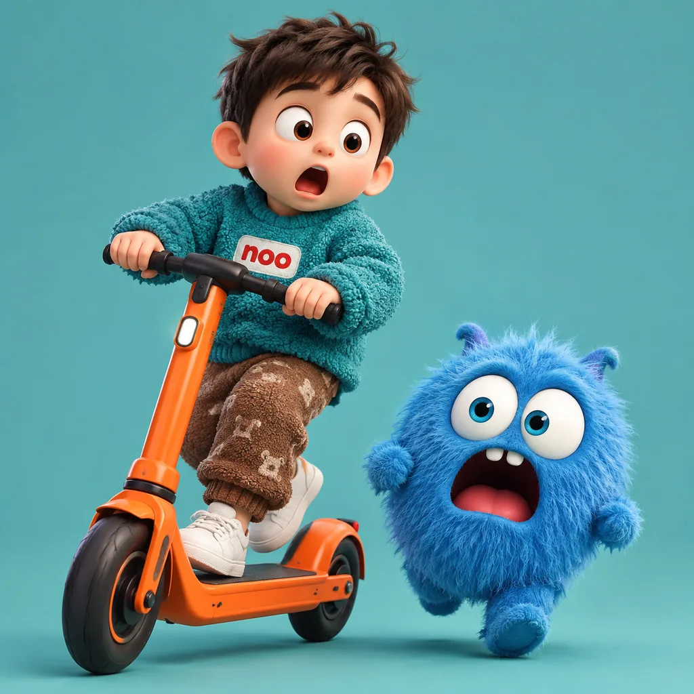</a>

> 来自 @rovvmut_ 的趣味角色提示词。一个可爱的小男孩骑着橙色电动滑板车，旁边是一只圆滚滚的毛绒蓝色小怪兽，两个都瞪大眼睛、张着嘴，一脸震惊。男孩穿着毛茸茸的青色毛衣，胸前白色布贴上有一个红色短词，搭配棕色花纹裤和白色运动鞋，背景是干净的青色棚拍。我们按原文使用。适合吉祥物、贴纸、童装品牌和动画短片概念。

```text
A high-quality 3D render of a cute young boy riding an orange electric scooter next to a small, round, furry blue monster. Both characters have shocked expressions with wide eyes and open mouths. The boy is wearing a highly textured, fuzzy teal sweater with a white patch that reads "noo" in red text, along with brown patterned pants and white sneakers. Clean teal studio background, soft lighting.
```

- 原作者: [@rovvmut_](https://x.com/rovvmut_)
- 原帖: https://x.com/rovvmut_/status/2014987855517614460
- [在 cinel 上查看详情并一键生成](https://cinel.ai/zh/prompts/p/chibi-boy-scooter-blue-monster?utm_source=github&utm_medium=awesome&utm_campaign=awesome-gpt-image-2.5-prompts)

### 橡皮泥地标微缩世界

<a href="https://cinel.ai/zh/prompts/p/modeling-clay-landmark-world?utm_source=github&utm_medium=awesome&utm_campaign=awesome-gpt-image-2.5-prompts"></a>

> 来自 @Milo_Bahi_02 的地标模板。它会围绕一个地方搭出奇趣的微缩世界，全部由彩色橡皮泥制成，带可见的指纹和自然的黏土纹理，风格俏皮童趣，天空湛蓝，云朵蓬松。我们沿用了作者的克什米尔构想，设定为雪中的达尔湖，有黏土船屋、小木船和悬铃木。适合旅行内容、儿童内容、海报和贺卡。

```text
Generate a whimsical miniature world featuring Dal Lake in Kashmir during snowfall, with wooden houseboats and shikara boats, crafted entirely from colorful modeling clay. Every element (houseboats, chinar trees, snowy mountains, waterways and lakeside houses) should appear hand sculpted with visible fingerprints and organic clay textures. Use a playful, childlike style with vibrant colors: bright azure sky, puffy cream clouds, emerald trees, and buildings in warm yellows, oranges, reds, and blues, dusted with clay snow. The handmade quality should be evident in every surface and gentle curve. Capture from a wide perspective showcasing the entire miniature landscape in a harmonious, joyful composition. Include no text, words, or signage. Square 1:1.
```

- 原作者: [@Milo_Bahi_02](https://x.com/Milo_Bahi_02)
- 原帖: https://x.com/Milo_Bahi_02/status/2008765662488059907
- [在 cinel 上查看详情并一键生成](https://cinel.ai/zh/prompts/p/modeling-clay-landmark-world?utm_source=github&utm_medium=awesome&utm_campaign=awesome-gpt-image-2.5-prompts)

### 定格动画微缩场景关键帧

<a href="https://cinel.ai/zh/prompts/p/stop-motion-miniature-set-still?utm_source=github&utm_medium=awesome&utm_campaign=awesome-gpt-image-2.5-prompts">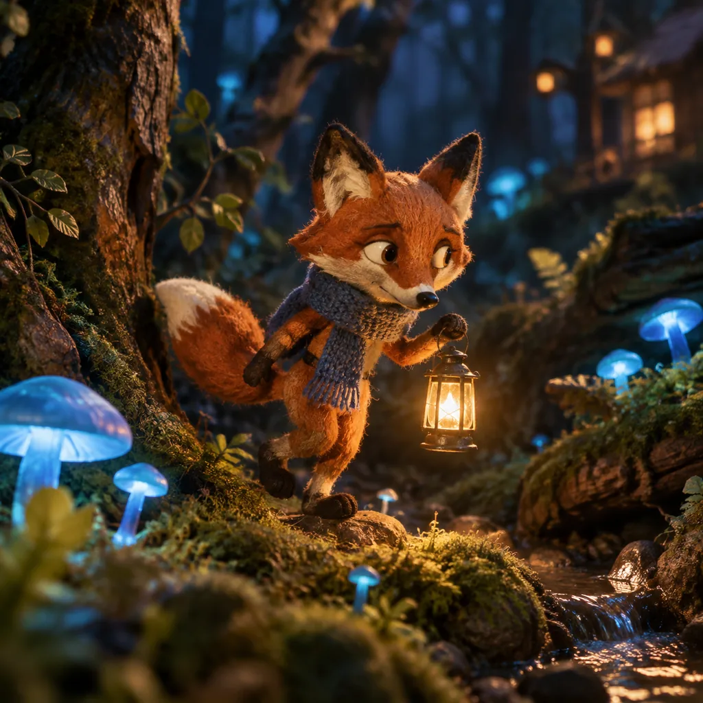</a>

> 改编自 @Soulmotionlabs 的 Seedance 定格动画视频提示词。原文描述的是一整段手工风格化定格短片：微缩实景、可触摸的材质、雕刻纹理、指纹、布料瑕疵和利落夸张的姿态。我们把它改成一张关键帧：一只围着针织围巾的小狐狸偶人提着发光灯笼，踮脚穿过夜晚的森林场景，周围有发光蘑菇。适合动画提案、分镜画面和海报。

```text
A single key frame from a handcrafted stylized stop-motion film: a small fox puppet in a knitted scarf tiptoes through a miniature practical forest set at night, holding a tiny glowing lantern. Tactile materials, carved wood textures, subtle fingerprints and fabric imperfections, snappy expressive pose with strong silhouette readability, stylized facial expression. Cinematic shallow depth of field, warm magical lantern light mixed with cool bioluminescent mushrooms and moss. No motion blur. Emotional, whimsical, cautious tone. Square 1:1 frame.
```

- 原作者: [@Soulmotionlabs](https://x.com/Soulmotionlabs)
- 原帖: https://x.com/Soulmotionlabs/status/2052847150925516830
- [在 cinel 上查看详情并一键生成](https://cinel.ai/zh/prompts/p/stop-motion-miniature-set-still?utm_source=github&utm_medium=awesome&utm_campaign=awesome-gpt-image-2.5-prompts)

### 钩针玩偶厨房定格动画静帧

<a href="https://cinel.ai/zh/prompts/p/crochet-doll-kitchen-still?utm_source=github&utm_medium=awesome&utm_campaign=awesome-gpt-image-2.5-prompts">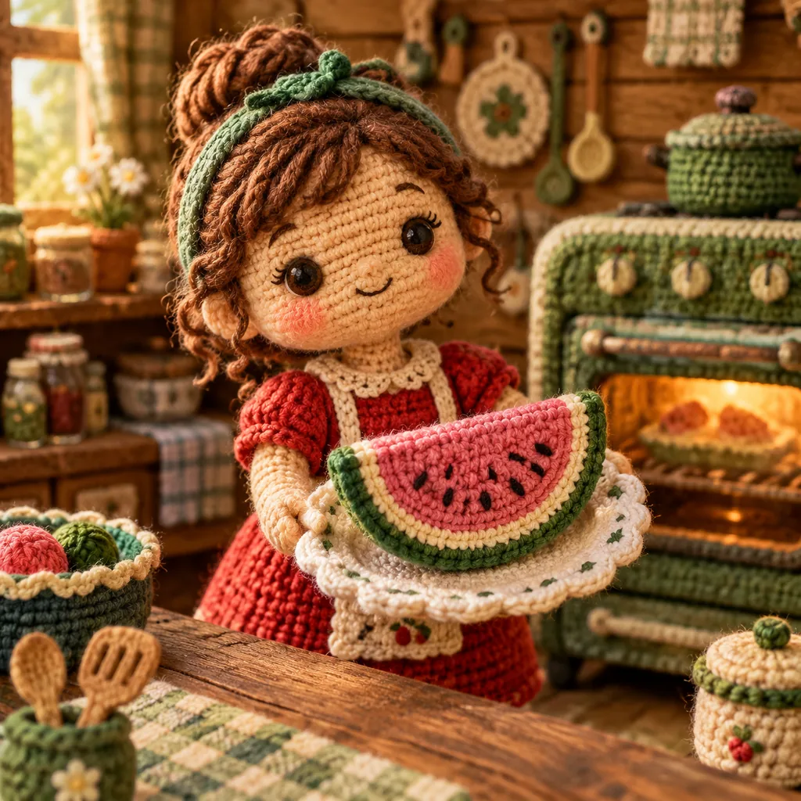</a>

> 改编自 @aiwithlumi 的钩针定格动画烹饪视频提示词。原文讲述了在温暖复古的乡村厨房里完整的烹饪过程，主角是穿红裙、戴绿色发箍的棕发玩偶。我们挑了结尾的一刻做成关键帧：她骄傲地端出一片放在花边毛线盘上的钩针西瓜，身后是发光的复古绿色烤箱。适合温馨品牌视觉、手工频道和动画分镜。

```text
A single key frame from a 3D stop-motion crochet film in a warm rustic vintage kitchen: a cute brown-haired crochet doll in a red dress and green headband proudly serves a freshly baked crochet watermelon slice on a white scalloped yarn plate, the slice showing a pink center, green crust and black stitched seeds; a glowing retro green crochet oven, a green yarn bowl and tiny yarn utensils behind her. Handcrafted wool textures, cozy cinematic lighting, tactile details, tilt-shift depth of field. Square 1:1.
```

- 原作者: [@aiwithlumi](https://x.com/aiwithlumi)
- 原帖: https://x.com/aiwithlumi/status/2097973211593920671
- [在 cinel 上查看详情并一键生成](https://cinel.ai/zh/prompts/p/crochet-doll-kitchen-still?utm_source=github&utm_medium=awesome&utm_campaign=awesome-gpt-image-2.5-prompts)

### 巨手拯救黏土小村庄

<a href="https://cinel.ai/zh/prompts/p/giant-hand-helps-clay-village?utm_source=github&utm_medium=awesome&utm_campaign=awesome-gpt-image-2.5-prompts">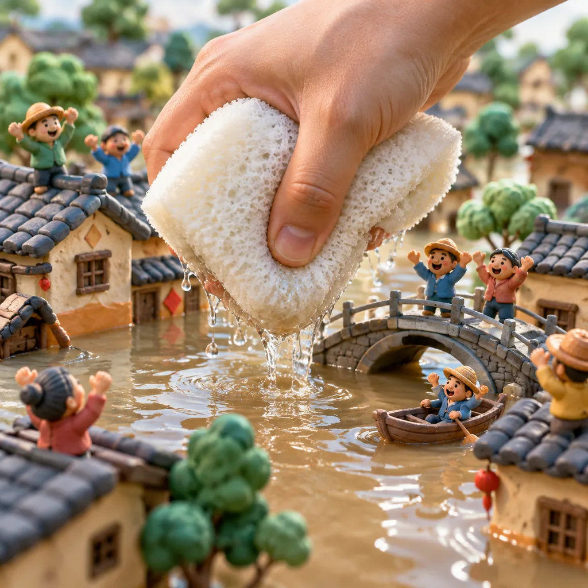</a>

> 改编自 @SRather25825 的黏土移轴视频提示词，原片里一只巨大的人手进入微缩小镇，解决各种小灾难。我们把其中一个场景做成关键帧：巨手把大海绵挤在被淹的黏土村庄上方，小村民们在屋顶和小桥上欢呼。写实的手和橡皮泥世界的反差，让尺度感非常强。适合温情广告、科普封面和动画提案。

```text
A single key frame in 3D claymation style with tilt-shift macro: a realistic giant human hand squeezes a big white sponge over a flooded miniature clay village, soaking up the floodwater while tiny clay villagers on rooftops and a little bridge cheer with raised arms. Rounded clay houses, a tiny clay boat, puddles reflecting soft daylight, handcrafted plasticine textures with fingerprints, shallow depth of field, warm wholesome mood. Square 1:1.
```

- 原作者: [@SRather25825](https://x.com/SRather25825)
- 原帖: https://x.com/SRather25825/status/2093791309790384228
- [在 cinel 上查看详情并一键生成](https://cinel.ai/zh/prompts/p/giant-hand-helps-clay-village?utm_source=github&utm_medium=awesome&utm_campaign=awesome-gpt-image-2.5-prompts)

### 黏土定格风格皮尼西帆船静帧

<a href="https://cinel.ai/zh/prompts/p/clay-sailing-ship-build-still?utm_source=github&utm_medium=awesome&utm_campaign=awesome-gpt-image-2.5-prompts">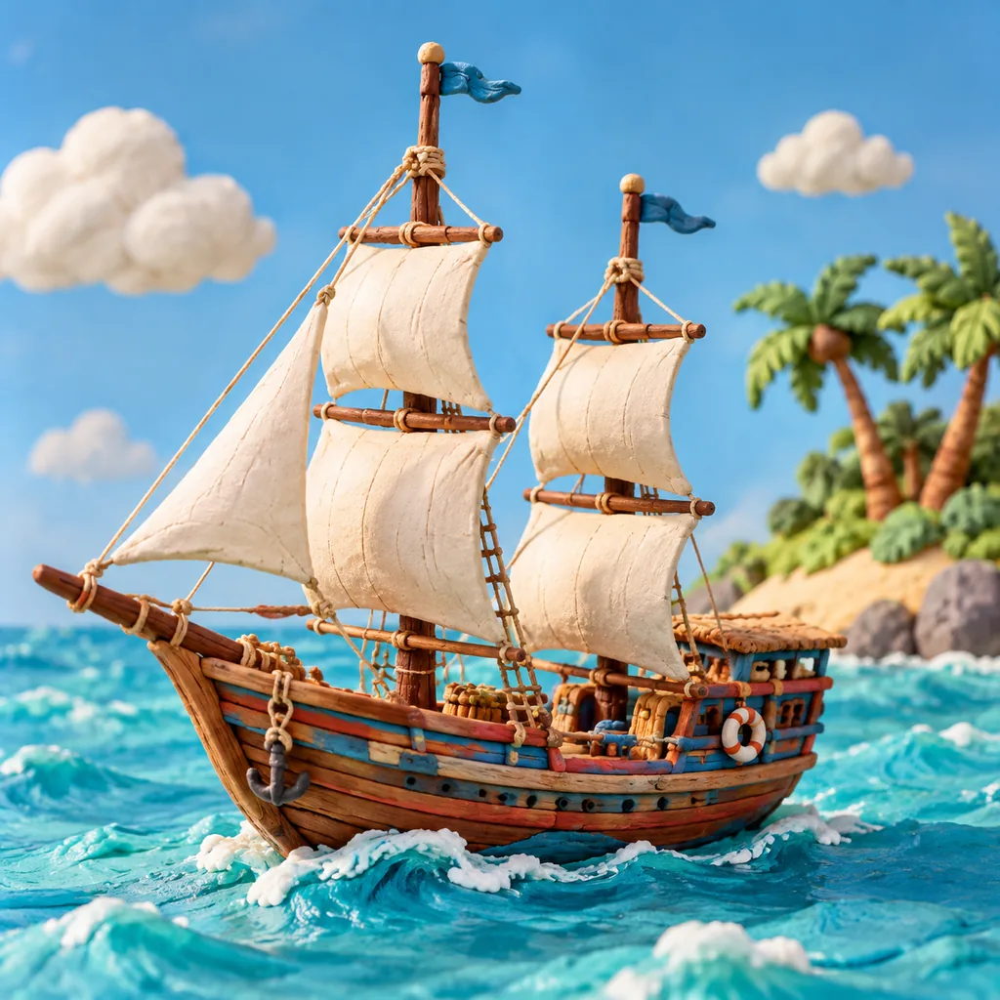</a>

> 改编自 @Soaima_Ai 的 8 镜头 Seedance 黏土视频提示词，原片一步步展示传统皮尼西帆船的制作过程。我们保留最后的成品展示作为关键帧：高桅杆、奶油色船帆的黏土帆船，停在有纹理的青绿色黏土海面上，身后是黏土云朵和棕榈小岛。适合文化内容、手工频道、儿童内容和航海插画。

```text
A single key frame of a cute hyper-detailed claymation scene: a finished miniature traditional Phinisi wooden sailing ship made of colorful modeling clay, with two tall masts, cream clay sails and tiny ropes, gently rocking on a textured turquoise clay ocean, small clay clouds and palm trees on a tiny island behind it. Handcrafted clay texture with fingerprints, miniature diorama, bright tropical light, soft cinematic lighting, macro photography, shallow depth of field. Square 1:1.
```

- 原作者: [@Soaima_Ai](https://x.com/Soaima_Ai)
- 原帖: https://x.com/Soaima_Ai/status/2089014071182151972
- [在 cinel 上查看详情并一键生成](https://cinel.ai/zh/prompts/p/clay-sailing-ship-build-still?utm_source=github&utm_medium=awesome&utm_campaign=awesome-gpt-image-2.5-prompts)

### 微型工匠制作巨型木瓜冰沙

<a href="https://cinel.ai/zh/prompts/p/tiny-artisans-giant-dessert?utm_source=github&utm_medium=awesome&utm_campaign=awesome-gpt-image-2.5-prompts">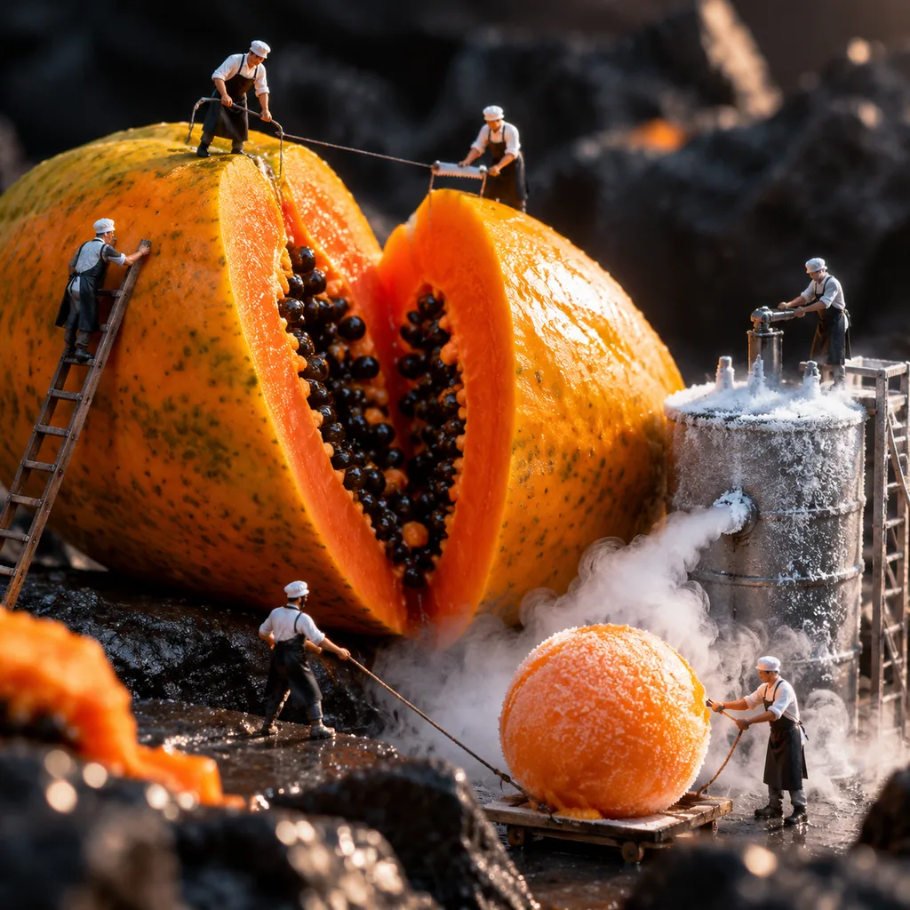</a>

> 改编自 @Fujimoto_hina 的 10 秒微距广告视频提示词，标题为“霓虹与黑曜石：微缩木瓜冰沙”。我们把时间线改成一张主视觉：一厘米高的工匠们用梯子、绳索和线锯，在火山石板上切开了一个巨大的落日橙木瓜，旁边结霜的钢桶喷出冷气，一颗冰沙球正被拉到位。适合食品广告、菜单主图和社交预告。

```text
Ultra-realistic macro diorama photograph: tiny centimeter-tall culinary artisans in dark aprons work on an enormous ripe sunset-orange papaya resting on matte black volcanic slate. Using ladders, ropes and a wire saw, the miniature chefs have just sliced the giant fruit open, revealing glossy black seeds and micro-dew; beside it a frost-covered steel barrel releases cryogenic vapor and a single frost-dusted sorbet sphere is guided by workers with ropes. Tilt-shift macro depth of field, dramatic volumetric rim lighting, vibrant electric orange set against deep charcoal obsidian. No text, no logos. Square 1:1.
```

- 原作者: [@Fujimoto_hina](https://x.com/Fujimoto_hina)
- 原帖: https://x.com/Fujimoto_hina/status/2106298018513490298
- [在 cinel 上查看详情并一键生成](https://cinel.ai/zh/prompts/p/tiny-artisans-giant-dessert?utm_source=github&utm_medium=awesome&utm_campaign=awesome-gpt-image-2.5-prompts)

### 羊毛毡小兔下午茶静帧

<a href="https://cinel.ai/zh/prompts/p/woolen-world-bunny-tea?utm_source=github&utm_medium=awesome&utm_campaign=awesome-gpt-image-2.5-prompts">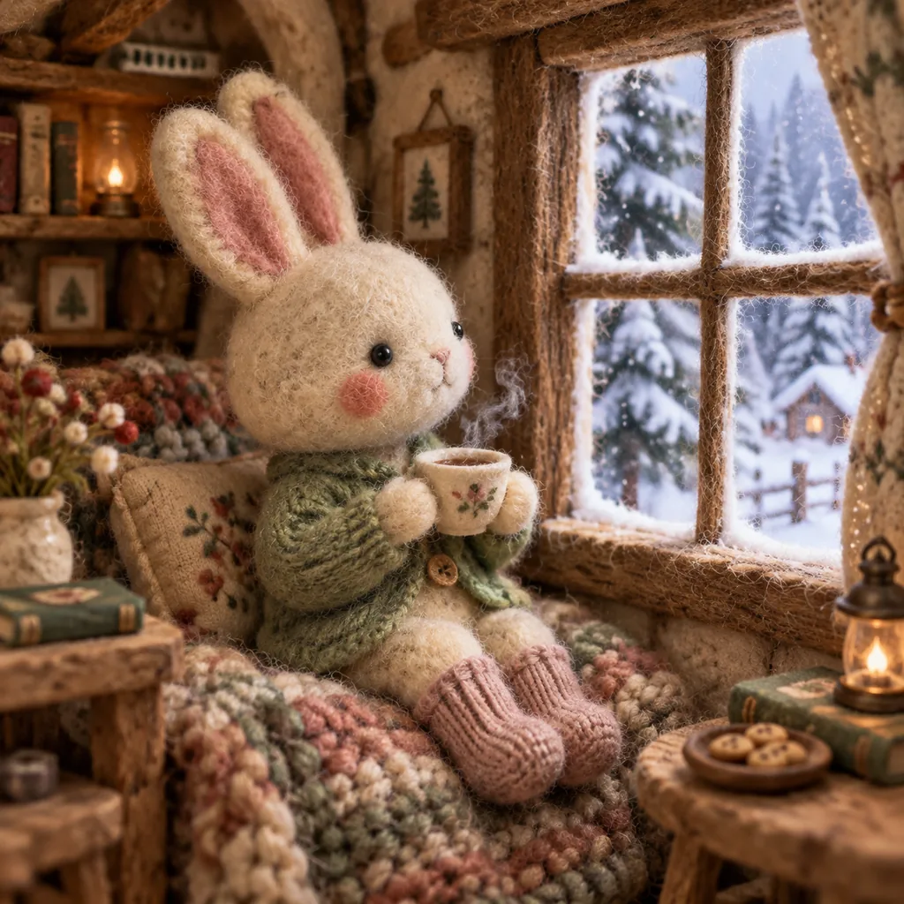</a>

> 改编自 @Caden_Flux 的 30 秒 Seedance 羊毛定格动画视频提示词，原文长达 5,950 个字符，描绘了整个小小的羊毛世界，并严格要求角色一致。我们提炼出核心风格和主角，做成一张关键帧：脸颊红润的奶油色羊毛兔，穿鼠尾草绿开衫和粉色袜子，在小窗边捧着冒热气的茶杯，窗外是毛毡雪林。适合温馨品牌插画、贺卡和频道缩略图。

```text
A single key frame from a cozy needle-felted wool stop-motion film: a cream wool bunny with pink inner ears, rosy cheeks, a sage-green knitted cardigan and dusty-pink knitted socks sits by a tiny window holding a steaming miniature teacup, inside a handcrafted cottage with a chunky knitted blanket, miniature wooden furniture and a snowy felted pine forest visible outside. Visible fuzzy wool fibers, slight handmade imperfections, macro cinematography, shallow depth of field, soft bokeh, warm practical lighting. Must look physically handmade, not smooth CGI. Square 1:1.
```

- 原作者: [@Caden_Flux](https://x.com/Caden_Flux)
- 原帖: https://x.com/Caden_Flux/status/2092234516660432989
- [在 cinel 上查看详情并一键生成](https://cinel.ai/zh/prompts/p/woolen-world-bunny-tea?utm_source=github&utm_medium=awesome&utm_campaign=awesome-gpt-image-2.5-prompts)

### 键帽座舱里的隐藏微型工作站

<a href="https://cinel.ai/zh/prompts/p/keycap-cockpit-miniature-terminal?utm_source=github&utm_medium=awesome&utm_campaign=awesome-gpt-image-2.5-prompts">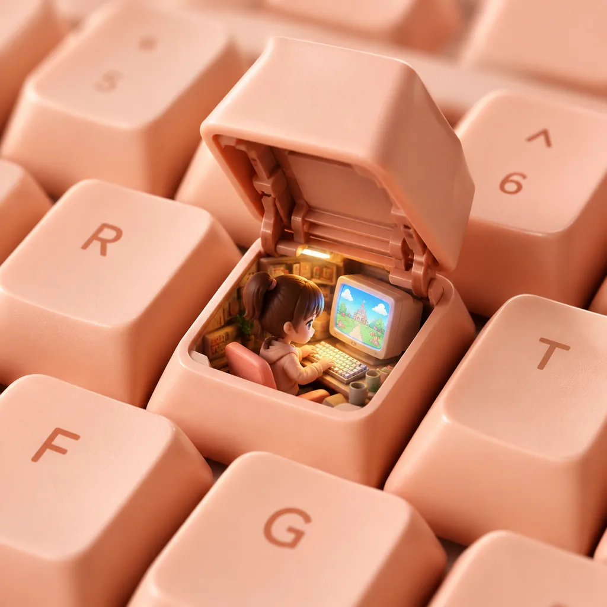</a>

> 改编自 @Zyrellix 的 15 秒连续微距视频提示词，原片中哑光粉彩键盘上的一颗键帽像微型座舱门一样翻开。我们把揭开的瞬间做成一帧：一个 Q 版小人偶在微型键盘上打字，上方发光的 CRT 屏幕显示卡通游戏世界，塑料材质带 PBR 纹理和次表面散射。适合外设广告、游戏内容、桌面布置内容和科技预告。

```text
A macro, shallow depth of field 3D render of a sleek matte pastel-peach mechanical keyboard. One central keycap hinges open upward like a miniature cockpit door, revealing a hidden retro-futuristic workstation underneath, where a tiny stylized chibi figurine of a girl with a ponytail sits typing on a microscopic keyboard; a tiny glowing CRT monitor shows a colorful cartoon game landscape and casts light on her face. Excellent PBR textures, subtle subsurface scattering on the plastic, clean commercial product lighting. No logos. Square 1:1.
```

- 原作者: [@Zyrellix](https://x.com/Zyrellix)
- 原帖: https://x.com/Zyrellix/status/2062098605977313521
- [在 cinel 上查看详情并一键生成](https://cinel.ai/zh/prompts/p/keycap-cockpit-miniature-terminal?utm_source=github&utm_medium=awesome&utm_campaign=awesome-gpt-image-2.5-prompts)

### 眼镜镜片里的微缩世界

<a href="https://cinel.ai/zh/prompts/p/tiny-worlds-in-eyeglass-lenses?utm_source=github&utm_medium=awesome&utm_campaign=awesome-gpt-image-2.5-prompts">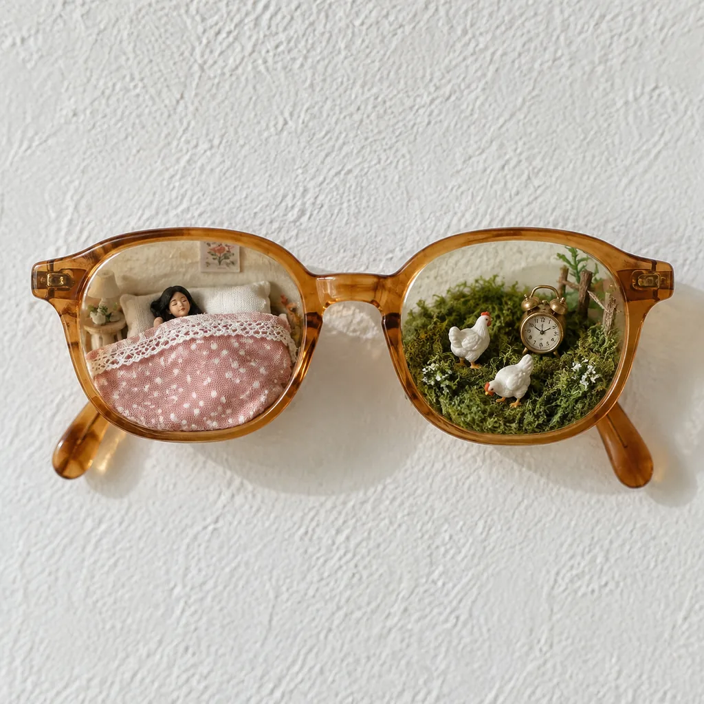</a>

> 根据 @HerodotusWave 分享的一张手工微缩艺术作品图片反向撰写的提示词（原帖没有提供提示词，原作是实体手工作品，不是 AI 图）。我们用自己的话描述了这个创意：一副复古琥珀色眼镜挂在有纹理的白墙上，一片镜片里有人睡在波点小床上，另一片里是青苔、两只母鸡和一个黄铜闹钟。我们的配图完全由 AI 生成。适合诗意海报、眼镜店橱窗创意和艺术提示词。

```text
Handmade miniature art photograph: a pair of vintage translucent amber plastic eyeglasses hung on a white textured wall, each lens turned into a tiny diorama. In the left lens a miniature woman with black hair is tucked into a tiny bed with a lace-trimmed pink polka-dot blanket and a white pillow; in the right lens a patch of green moss grass with two tiny white hens and a miniature brass alarm clock. Sculpted miniature figures, real textures, soft natural daylight, gentle shadows, centered composition, whimsical and poetic.
```

- 原作者: [@HerodotusWave](https://x.com/HerodotusWave)
- 原帖: https://x.com/HerodotusWave/status/2088453126420308071
- [在 cinel 上查看详情并一键生成](https://cinel.ai/zh/prompts/p/tiny-worlds-in-eyeglass-lenses?utm_source=github&utm_medium=awesome&utm_campaign=awesome-gpt-image-2.5-prompts)

### 定格偶人实验室与渡渡鸟

<a href="https://cinel.ai/zh/prompts/p/stop-motion-bird-office-still?utm_source=github&utm_medium=awesome&utm_campaign=awesome-gpt-image-2.5-prompts">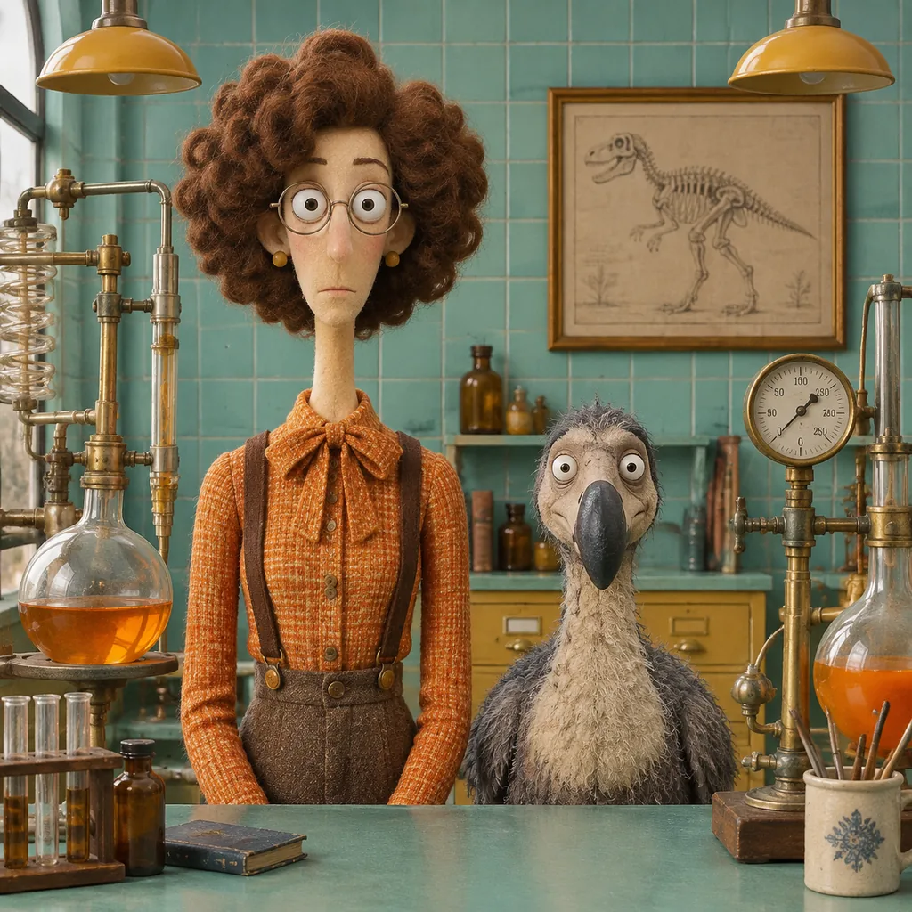</a>

> 根据 @aibabbler 分享的 Veo 视频缩略图反向撰写的提示词（原帖没有提示词）。我们用自己的话描述了这帧画面：一个卷发、戴圆眼镜的高个毛毡科学家偶人，面无表情地站在青色瓷砖的复古实验室里，旁边一只乱糟糟的渡渡鸟偶人盯着镜头，四周是黄铜和玻璃仪器。风格是对称构图、青色与芥末黄的粉彩配色、均匀柔光和冷幽默。适合短片提案、海报和古怪风格的品牌插画。

```text
A still from a stop-motion puppet film: a tall, thin felt-and-fabric woman puppet with voluminous brown curly hair, round glasses, an orange tweed blouse with a bow and suspenders stands deadpan in a teal-tiled vintage laboratory; beside her on the counter a scruffy dodo-like bird puppet stares at the camera, surrounded by brass and glass distillation apparatus, a pressure gauge, an orange liquid flask and a framed dinosaur sketch. Symmetrical framing, pastel teal and mustard palette, soft even light, handcrafted textures, dry comedic tone. Square 1:1.
```

- 原作者: [@aibabbler](https://x.com/aibabbler)
- 原帖: https://x.com/aibabbler/status/2097322517077577916
- [在 cinel 上查看详情并一键生成](https://cinel.ai/zh/prompts/p/stop-motion-bird-office-still?utm_source=github&utm_medium=awesome&utm_campaign=awesome-gpt-image-2.5-prompts)

### 巨型日常物件微距微缩场景

<a href="https://cinel.ai/zh/prompts/p/giant-object-macro-miniature-scene?utm_source=github&utm_medium=awesome&utm_campaign=awesome-gpt-image-2.5-prompts">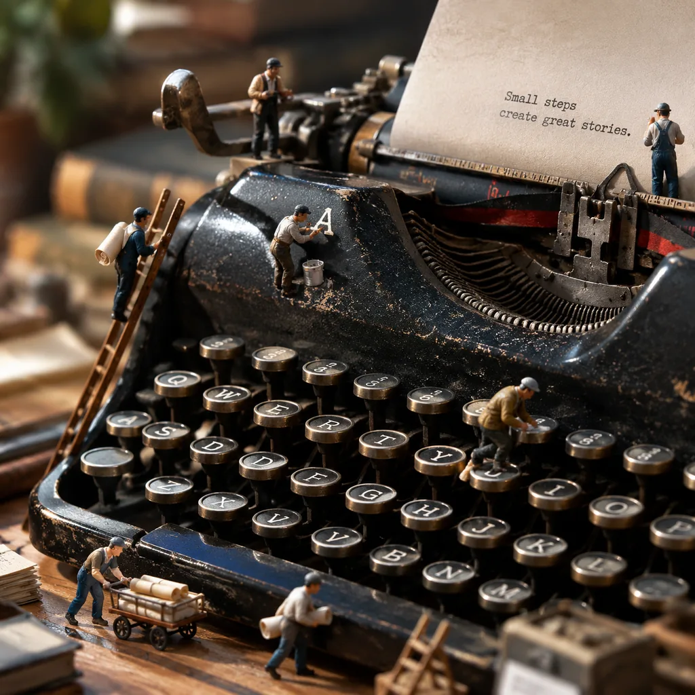</a>

> 来自 @DrSadek_ 的纯提示词模板（原帖没有配图）。一件超大的日常物件变成一整片地形，许多精细的小人在上面攀爬、劳作，用 85mm 微距镜头 f/1.8 拍摄，柔和方向光，微小阴影，灰尘和划痕清晰可见。我们填入了一台复古打字机，小人们在按键上攀爬、搬运纸卷。适合超现实广告、杂志封面和吸睛的社交内容。

```text
Create a hyper-realistic macro photograph of a miniature surreal scene. The environment is dominated by a giant, oversized vintage typewriter, which has been repurposed as a bustling landscape. Tiny, highly detailed miniature human figures are interacting around and on the object: climbing the keys, painting letters, carrying paper scrolls. Shot on an 85mm macro lens with a shallow depth of field (f/1.8) to heavily blur the distant background. Lighting is soft, directional, and casts appropriate micro-shadows to emphasize the massive scale of the object relative to the figures. Intricate environmental details like dust particles and surface scratches are visible on the object. Cinematic, photorealistic.
```

- 原作者: [@DrSadek_](https://x.com/DrSadek_)
- 原帖: https://x.com/DrSadek_/status/2033136123342401904
- [在 cinel 上查看详情并一键生成](https://cinel.ai/zh/prompts/p/giant-object-macro-miniature-scene?utm_source=github&utm_medium=awesome&utm_campaign=awesome-gpt-image-2.5-prompts)

### 打开的书中升起的电影感立体模型

<a href="https://cinel.ai/zh/prompts/p/open-book-cinematic-diorama?utm_source=github&utm_medium=awesome&utm_campaign=awesome-gpt-image-2.5-prompts">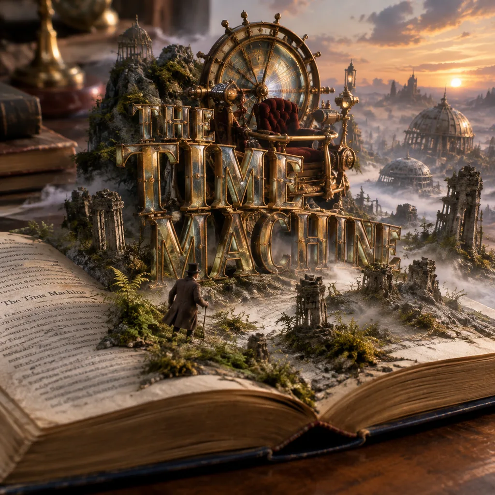</a>

> 由 @Gdgtify 分享的纯提示词模板，专为非版权书籍编写。给出书名，它会推断主角、世界观、书名材质、前景事件和光线，然后生成一个从打开的书中升起的写实实拍特效立体模型，配巨大的 3D 书名字母。我们用了 H. G. 威尔斯的《时间机器》（公版）：黄铜玻璃字母、维多利亚时代的时间机器，还有一个从书页上走出来的小旅人。适合书籍封面、阅读推广和图书馆海报。

```text
Create a photorealistic cinematic diorama emerging physically from an open book for H. G. Wells' The Time Machine (public domain). The open hardcover book occupies the lower majority of the frame; its pages physically transform into a misty far-future valley with ruined domes. The words THE TIME MACHINE become massive freestanding brass-and-glass 3D typography embedded in the terrain. A monumental Victorian time machine of brass rails, a velvet seat and a spinning dial rises behind the typography. On the front page a miniature traveler in a Victorian coat steps out among tiny ferns and broken columns. Page edges remain visible. Cinematic practical lighting at dusk, macro practical-effects photography, real book fibers, physical miniature materials, contact shadows, dust, atmospheric depth, handcrafted diorama realism. Square 1:1.
```

- 原作者: [@Gdgtify](https://x.com/Gdgtify)
- 原帖: https://x.com/Gdgtify/status/2093007884854378782
- [在 cinel 上查看详情并一键生成](https://cinel.ai/zh/prompts/p/open-book-cinematic-diorama?utm_source=github&utm_medium=awesome&utm_campaign=awesome-gpt-image-2.5-prompts)

### 手工木雕微缩小人

<a href="https://cinel.ai/zh/prompts/p/hand-carved-wooden-miniature-figure?utm_source=github&utm_medium=awesome&utm_campaign=awesome-gpt-image-2.5-prompts">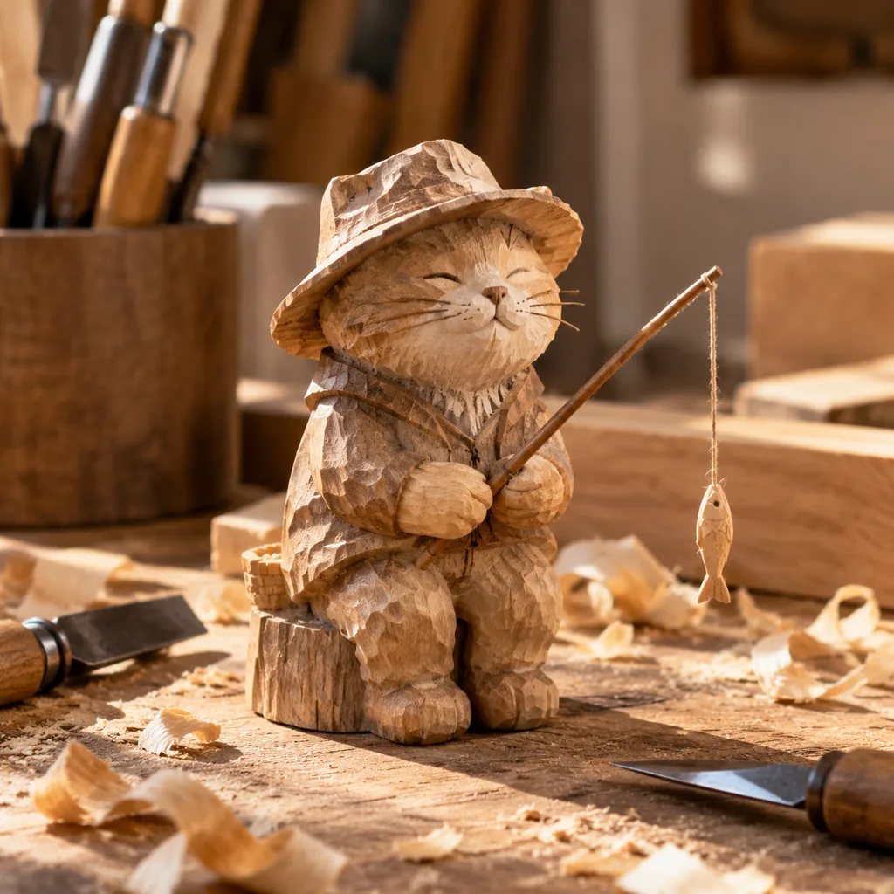</a>

> 来自 @Sheldon056 的单变量手工模板。给出一个角色，它就会变成手工木雕微缩像：刀痕清晰，天然木纹，边缘光滑但未上漆，放在摆着雕刻工具和木屑的工作台上，暖色方向光。我们填入了一只拿着小鱼竿的老渔夫猫。适合手工店视觉、礼物创意、角色概念和温馨的社交内容。

```text
A hand-carved wooden miniature figure of an old fisherman cat holding a tiny fishing rod, shaped with visible knife marks, natural grain texture, and smooth unfinished edges. Placed on a workshop table with carving tools, wood shavings, and soft warm directional lighting. Square 1:1.
```

- 原作者: [@Sheldon056](https://x.com/Sheldon056)
- 原帖: https://x.com/Sheldon056/status/2006921734092632261
- [在 cinel 上查看详情并一键生成](https://cinel.ai/zh/prompts/p/hand-carved-wooden-miniature-figure?utm_source=github&utm_medium=awesome&utm_campaign=awesome-gpt-image-2.5-prompts)

### 软雕塑玩具角色 3D 插画

<a href="https://cinel.ai/zh/prompts/p/soft-sculpture-toy-character-illustration?utm_source=github&utm_medium=awesome&utm_campaign=awesome-gpt-image-2.5-prompts">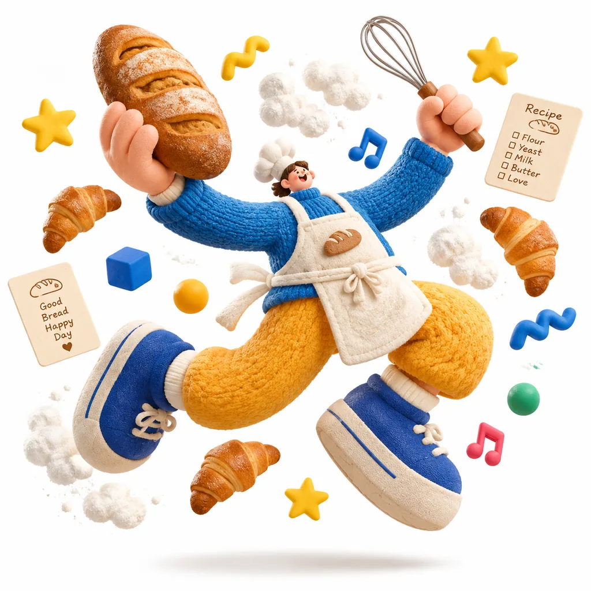</a>

> 来自 @MissDelulu9 的编辑风 3D 模板。它会生成一个夸张的卡通角色：小脑袋、圆胖身体、超长四肢和大鞋子，定格在跳跃的半空中，材质是哑光软橡胶、毛绒布料和针织纹理，多巴胺配色，干净的白色背景，周围漂浮着柔软的小道具。原文结尾是 SaaS 仪表盘主题，我们换成通用主题：一个抱着巨型面包、四周飘着可颂的快乐面包师。适合主视觉插画、宣传图和贴纸。

```text
A complete single 3D illustration, exaggerated artistic editorial illustration style, not storyboard, not a collage layout. The subject is an exaggerated cartoon character with a tiny head, round chubby body, extremely elongated limbs, oversized hands and oversized shoes, off-balance center of gravity, frozen mid-air in a dramatic jumping pose, with strong tension and comedic energy. Overall form looks like a soft sculpture toy: round, chunky, bouncy, exaggerated, not anatomically correct. Materials are matte soft rubber, fuzzy fabric, knitted texture, plasticine feel, with fine fiber details, slight grain, hand-sculpted touch; avoid glossy plastic toy look, avoid translucent glass look, avoid high reflections. High-saturation dopamine color palette, bold color clashes, large flat color blocks, bright but not over-glowing. Clean white background, minimal space, only a soft oval shadow on the ground. Floating abstract graphic elements around the character: stars, squiggle lines, balls, cubes, music notes, all rendered as soft rubber or paper props. Soft studio lighting, global illumination, soft shadows, low contrast, clean commercial render. Stylized soft sculpture, matte clay material, fuzzy fabric texture, knitted surface detail, playful editorial 3D illustration. Theme: a joyful baker leaping with a giant loaf of bread and a whisk, surrounded by floating croissants, flour clouds and recipe cards.
```

- 原作者: [@MissDelulu9](https://x.com/MissDelulu9)
- 原帖: https://x.com/MissDelulu9/status/2056323209323319324
- [在 cinel 上查看详情并一键生成](https://cinel.ai/zh/prompts/p/soft-sculpture-toy-character-illustration?utm_source=github&utm_medium=awesome&utm_campaign=awesome-gpt-image-2.5-prompts)

### 3D Q 版搪胶公仔贴纸表

<a href="https://cinel.ai/zh/prompts/p/chibi-vinyl-figurine-sticker-sheet?utm_source=github&utm_medium=awesome&utm_campaign=awesome-gpt-image-2.5-prompts">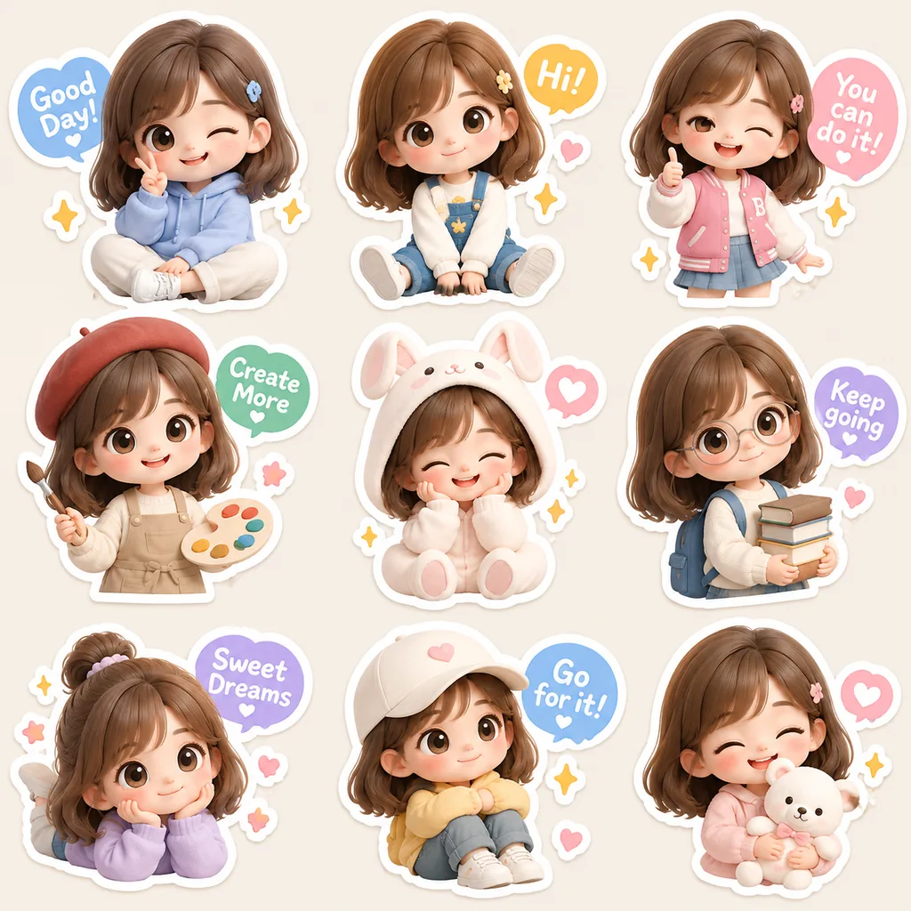</a>

> 来自 @aiwithlumi 的贴纸表模板。它会设计一个前后一致的 Q 版角色（棕发、大而亮的眼睛、大头），呈现哑光搪胶和黏土般的质感，再按 3x3 网格排出九张贴纸，每张都有不同的姿势、服装和表情，配粗白描边、对话气泡、闪光和爱心。我们几乎按原文使用，只列出了五套服装。适合贴纸包、聊天表情、周边和角色设定表。

```text
3D chibi character sticker sheet, stylized feminine figurine, consistent character design, brown medium-length hair, large glossy expressive eyes, soft rounded facial features, cute chibi proportions (oversized head, small body), soft clay-like texture, matte vinyl finish, high-end animation style, bright soft studio lighting, pastel color palette, subtle 3D relief sculpture effect, 9-sticker 3x3 grid layout, evenly spaced, each sticker with unique pose and outfit (hoodie, denim overalls, pink varsity jacket, artist beret and apron, bunny onesie), expressive emotions, colorful speech bubbles, kawaii style, clean thick white sticker outlines, sparkles and heart accents, no photorealism, no harsh shadows, no noise, no realistic proportions.
```

- 原作者: [@aiwithlumi](https://x.com/aiwithlumi)
- 原帖: https://x.com/aiwithlumi/status/2051701782129352839
- [在 cinel 上查看详情并一键生成](https://cinel.ai/zh/prompts/p/chibi-vinyl-figurine-sticker-sheet?utm_source=github&utm_medium=awesome&utm_campaign=awesome-gpt-image-2.5-prompts)

### 黏土微缩温泉村立体模型

<a href="https://cinel.ai/zh/prompts/p/clay-miniature-onsen-village-diorama?utm_source=github&utm_medium=awesome&utm_campaign=awesome-gpt-image-2.5-prompts">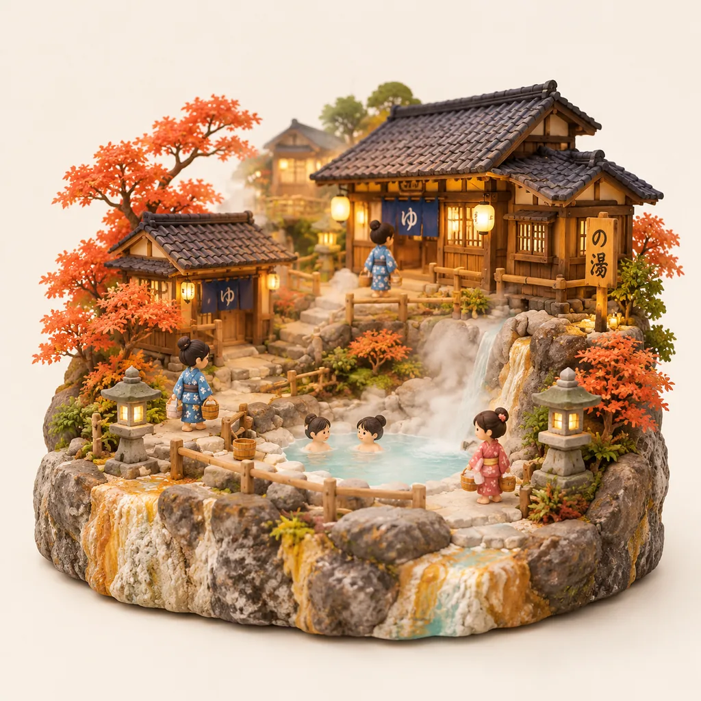</a>

> 来自 @AllaAisling 的地点模板。它会用侧视角做一个黏土微缩场景，底座由与地点相配的天然材料雕成，这里是带矿物沉积的温泉岩上的日本温泉村。木造浴屋、升腾的热气、石灯笼、秋日枫树，还有穿浴衣的小客人，热气把光线变得柔和。适合旅行内容、季节内容、游戏关卡概念和温馨壁纸。

```text
3D miniature scene, a Japanese onsen village with wooden bathhouses, steam rising from natural hot springs, stone lanterns, maple trees in autumn color, guests in tiny yukata robes carrying wooden buckets, presented as a small platform diorama. The platform is carved from natural hot spring rock with mineral deposits. Side view, cute clay style, miniature diorama, soft rendered lighting effects, warm steam diffusing the light, light background.
```

- 原作者: [@AllaAisling](https://x.com/AllaAisling)
- 原帖: https://x.com/AllaAisling/status/2028672209544175970
- [在 cinel 上查看详情并一键生成](https://cinel.ai/zh/prompts/p/clay-miniature-onsen-village-diorama?utm_source=github&utm_medium=awesome&utm_campaign=awesome-gpt-image-2.5-prompts)

### Q 版小人与巨型美食广告海报

<a href="https://cinel.ai/zh/prompts/p/chibi-figures-giant-food-poster?utm_source=github&utm_medium=awesome&utm_campaign=awesome-gpt-image-2.5-prompts"></a>

> 来自 @Taaruk_ 的美食海报模板。Q 版微缩小人和巨大、亮晶晶的菜肴互动，可爱的 3D 黏土风格，有芝士拉丝、小梯子、对话气泡、厚实的 3D 泡泡字和梦幻粉彩配色。我们围绕辣炒年糕和芝士热狗来做，顶部写着韩文 떡볶이。适合菜单海报、外卖 App 横幅、美食节和社交广告。

```text
Ultra-cute Korean food advertisement poster, miniature chibi characters interacting with a giant bowl of tteokbokki and a giant cheese-stuffed corn dog, soft pastel background, adorable 3D clay-style illustration, kawaii diorama aesthetic, highly detailed food textures, melted cheese stretch, glossy toppings, tiny ladders and playful poses, cozy studio lighting, smooth rounded props, whimsical composition, clean commercial poster design, the Korean word 떡볶이 at the top in big chunky 3D bubble letters, tiny speech bubbles with short Korean text, dreamy pastel color palette, toy-like characters with blushy faces, wholesome happy mood, ultra polished CGI render, depth of field, soft shadows, minimal background, premium food campaign aesthetic.
```

- 原作者: [@Taaruk_](https://x.com/Taaruk_)
- 原帖: https://x.com/Taaruk_/status/2052211493295546701
- [在 cinel 上查看详情并一键生成](https://cinel.ai/zh/prompts/p/chibi-figures-giant-food-poster?utm_source=github&utm_medium=awesome&utm_campaign=awesome-gpt-image-2.5-prompts)

### 手作地标微缩旅行卡

<a href="https://cinel.ai/zh/prompts/p/handcrafted-landmark-miniature-travel-card?utm_source=github&utm_medium=awesome&utm_campaign=awesome-gpt-image-2.5-prompts">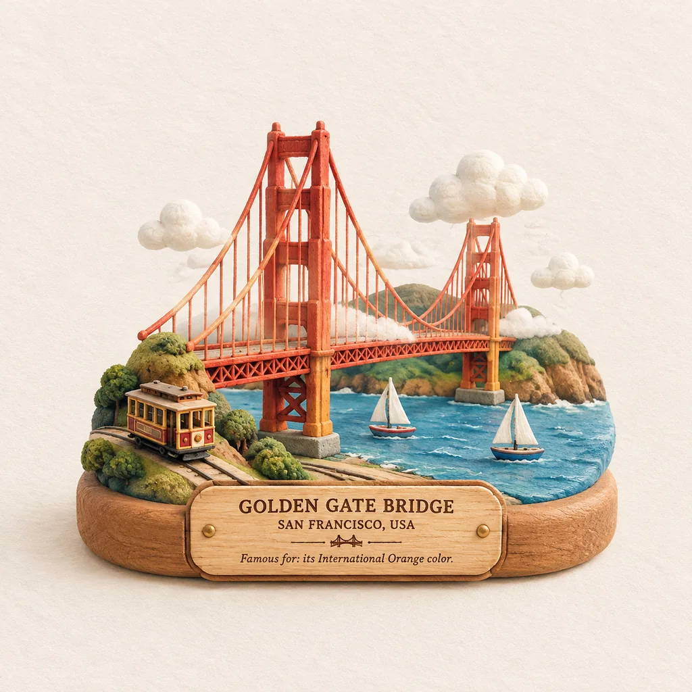</a>

> 来自 @Naiknelofar788 的地标模板。它把著名建筑做成精雕细琢的小 3D 模型，细节圆润柔和，带手工质感，加入几处代表所在地的小元素，在暖白色纹理纸上留出大量留白。一块小木牌写着建筑名称、城市和一条简短趣闻。我们用了金门大桥，配雾云、帆船和缆车。适合旅行手账、明信片、旅游内容和收藏系列。

```text
Create a charming handcrafted miniature travel scene featuring the Golden Gate Bridge as the main focal point. Show the landmark as a beautifully sculpted tiny 3D model, with soft rounded details, handmade textures, delicate imperfections, and a whimsical storybook feeling. Surround it with a few subtle elements that represent its location, such as tiny fog clouds, sailboats, hills and a cable car, without making the scene crowded. Place everything on a clean warm-white textured paper background, with plenty of elegant negative space. Add a small tasteful wooden travel plaque containing: GOLDEN GATE BRIDGE / SAN FRANCISCO, USA / Famous for: its International Orange color. Use soft natural lighting, gentle shadows, pastel yet realistic colors, miniature diorama depth, handcrafted clay/paper textures, and a premium cute travel-journal aesthetic. Centered composition, highly detailed landmark, adorable but sophisticated, clean and collectible travel-card design, no photorealistic people, no clutter.
```

- 原作者: [@Naiknelofar788](https://x.com/Naiknelofar788)
- 原帖: https://x.com/Naiknelofar788/status/2097646788258021837
- [在 cinel 上查看详情并一键生成](https://cinel.ai/zh/prompts/p/handcrafted-landmark-miniature-travel-card?utm_source=github&utm_medium=awesome&utm_campaign=awesome-gpt-image-2.5-prompts)

### 立体书旅行场景

<a href="https://cinel.ai/zh/prompts/p/pop-up-storybook-travel-diorama?utm_source=github&utm_medium=awesome&utm_campaign=awesome-gpt-image-2.5-prompts">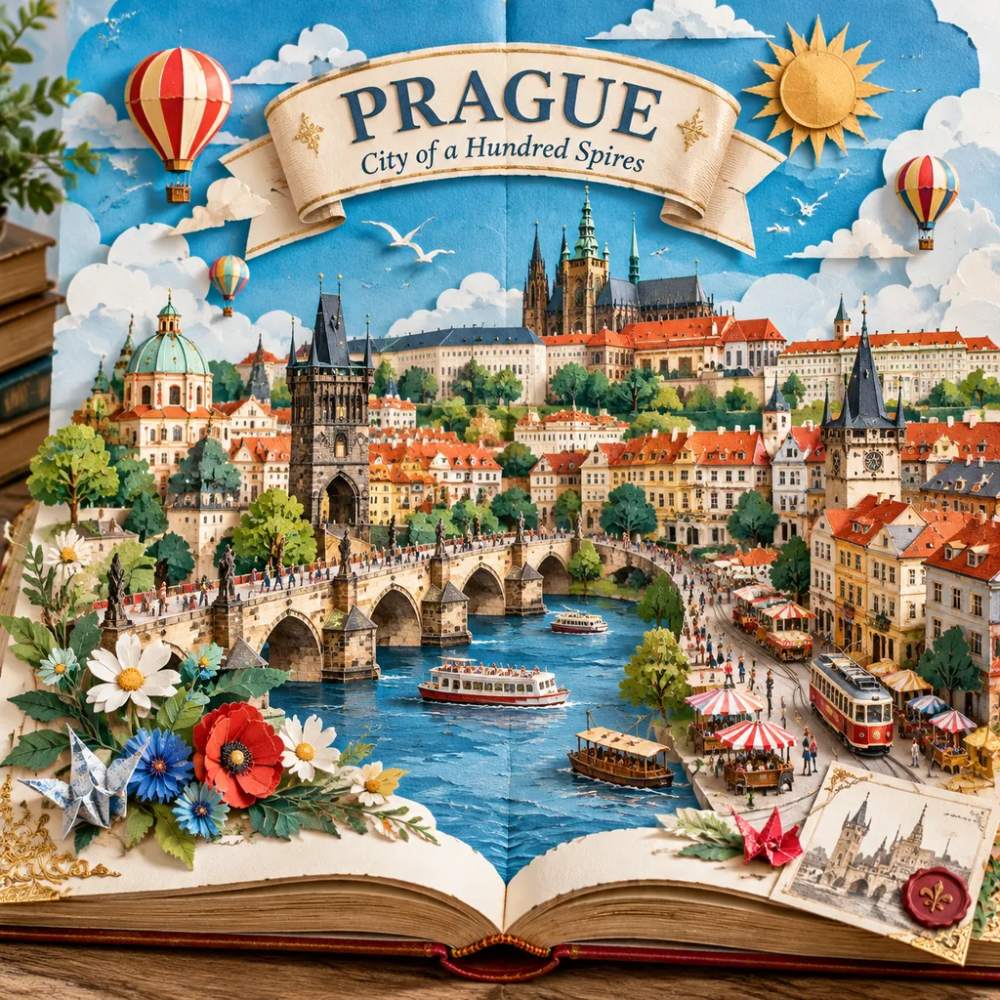</a>

> 来自 @Naiknelofar788 的目的地模板。一座城市从打开的复古书中升起，呈现高级纸艺工程立体书效果：层叠的地标、街道、河流、小电车和小船，带标语的纸质标题横幅，挂着热气球的层叠纸天空，还有镶金边的书角。我们用了布拉格，标语是“City of a Hundred Spires”（百塔之城）。适合旅游海报、旅行指南封面、贺卡和儿童绘本。

```text
Create an ultra-detailed handcrafted 3D pop-up storybook travel illustration of Prague, presented inside a beautifully opened vintage book. The scene looks like a premium collectible paper-engineered pop-up book where the whole city rises from the pages in layered miniature diorama form: Prague Castle, the Charles Bridge over the Vltava river, red-roofed old town streets, a tiny tram, market stalls, trees, tiny tourists and boats. A large decorative paper title banner emerges from the pages reading "PRAGUE" with the tagline "City of a Hundred Spires". Background: bright blue layered-paper sky, puffy paper clouds, hot-air balloons, birds and a decorative paper sun. Foreground: decorative flowers spilling onto the pages, elegant page corners with gold embellishments, origami decorations. Hyper-detailed papercut construction, storybook fantasy aesthetic, vibrant travel-poster colors, soft daylight, subtle depth shadows between paper layers, highly dimensional, museum-quality craftsmanship. Square 1:1.
```

- 原作者: [@Naiknelofar788](https://x.com/Naiknelofar788)
- 原帖: https://x.com/Naiknelofar788/status/2064166761583550562
- [在 cinel 上查看详情并一键生成](https://cinel.ai/zh/prompts/p/pop-up-storybook-travel-diorama?utm_source=github&utm_medium=awesome&utm_campaign=awesome-gpt-image-2.5-prompts)

### 回收战械装甲冒险者3D渲染

<a href="https://cinel.ai/zh/prompts/p/recycled-warforged-adventurer-render?utm_source=github&utm_medium=awesome&utm_campaign=awesome-gpt-image-2.5-prompts">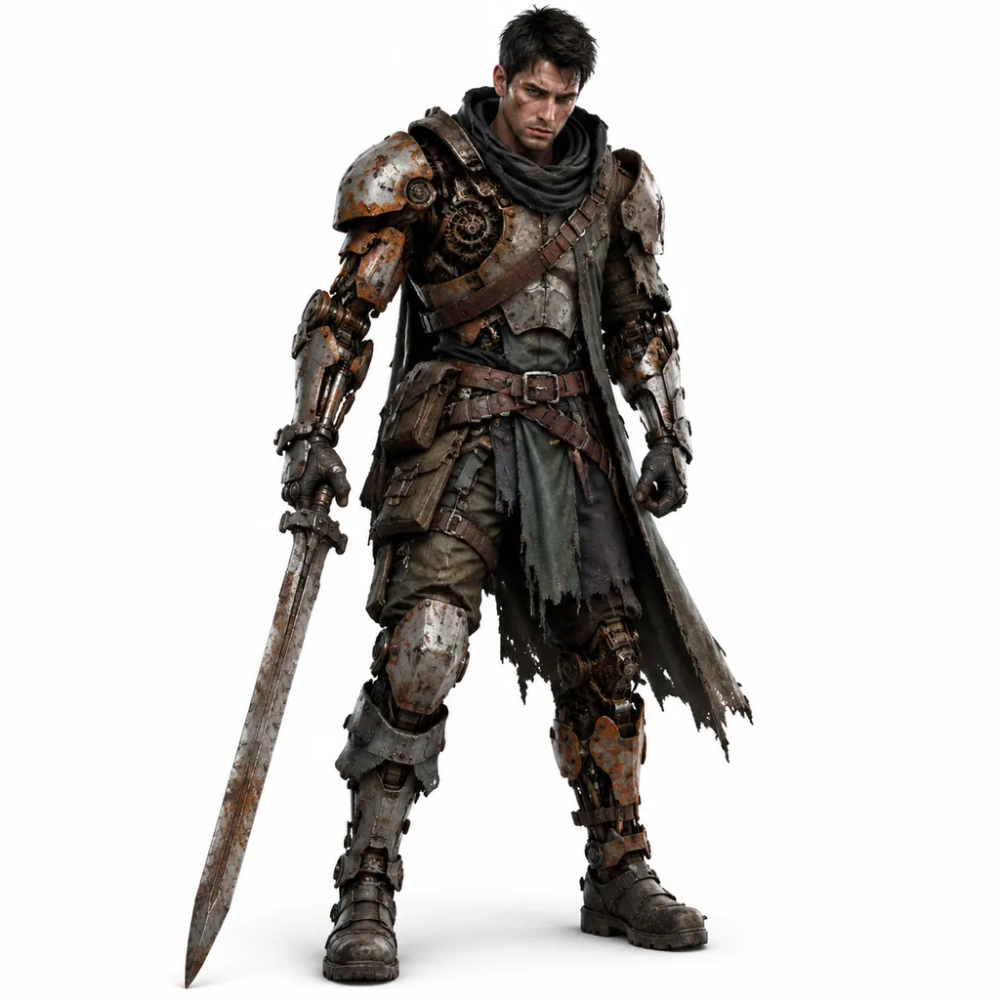</a>

> 这是根据 @azed_ai 分享的电影感3D奇幻模板填好的示例。我们选择了一位疲惫的冒险者，装甲由战械机器人零件回收拼成，锈蚀甲片、外露齿轮，配一把残旧长剑，纯白背景。适合游戏角色概念、RPG头像和3D打印参考。

```text
A highly detailed cinematic 3D character render of a weary fantasy adventurer, wearing weathered armor crafted from recycled warforged robot parts, featuring a scarred determined face, cropped dark hair, a battered longsword, weathered clothing, rusted mechanical plates, exposed gears, damaged robotic components, intricate armor construction, exhausted expression, guarded posture, realistic PBR materials, detailed skin textures, metallic surface imperfections, stylized realistic proportions, dramatic studio lighting, full-body character design, clean white background, no text. Square 1:1 composition.
```

- 原作者: [@azed_ai](https://x.com/azed_ai)
- 原帖: https://x.com/azed_ai/status/2111050036905939238
- [在 cinel 上查看详情并一键生成](https://cinel.ai/zh/prompts/p/recycled-warforged-adventurer-render?utm_source=github&utm_medium=awesome&utm_campaign=awesome-gpt-image-2.5-prompts)

### 黏土浮雕兔子风景板

<a href="https://cinel.ai/zh/prompts/p/clay-relief-rabbit-landscape-panel?utm_source=github&utm_medium=awesome&utm_campaign=awesome-gpt-image-2.5-prompts">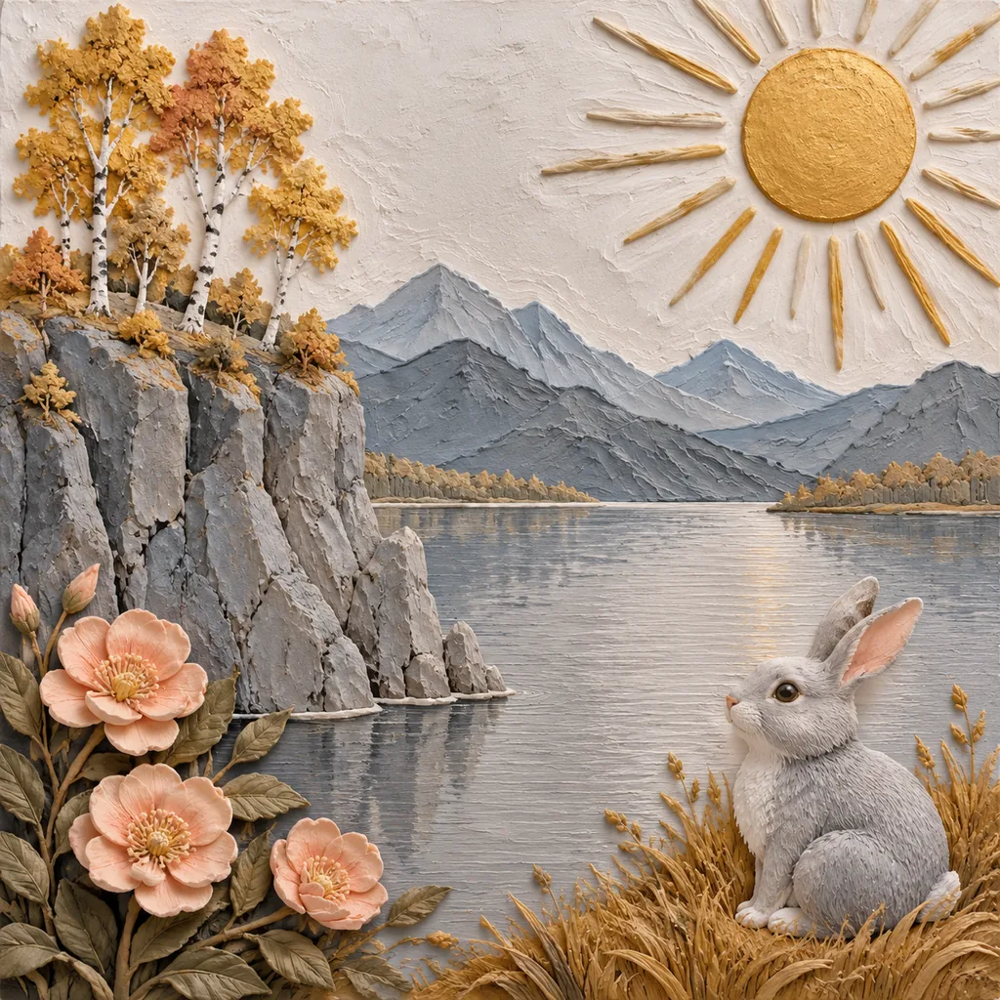</a>

> 摘自 @churvikv 分享的完整黏土浮雕提示词，由宽幅全景改为方形。米白石膏上的瓷与软陶：金日、银湖、秋崖与灰白兔。适合儿童房装饰、手作海报和手工产品封面。

```text
Hand-sculpted 3D clay relief wall-art panel photographed flat, square 1:1, cold porcelain and polymer clay bas-relief, matte finish, soft studio light revealing real physical depth, edge to edge with no frame. An off-white plaster background, a large golden sun disc with raised rays in the upper right, layered grey-blue clay mountains, a calm mirrored lake of brushed silver clay, a tall sculpted grey cliff with autumn birches on top, three peach-pink blossoms in the lower left, and a plump grey-white clay rabbit with pink inner ears sitting in golden dry grass in the lower right. Bas-relief depth, matte clay, no text. Square 1:1 composition.
```

- 原作者: [@churvikv](https://x.com/churvikv)
- 原帖: https://x.com/churvikv/status/2108861102008193470
- [在 cinel 上查看详情并一键生成](https://cinel.ai/zh/prompts/p/clay-relief-rabbit-landscape-panel?utm_source=github&utm_medium=awesome&utm_campaign=awesome-gpt-image-2.5-prompts)

### 微观模型：掌心里的京都

<a href="https://cinel.ai/zh/prompts/p/macro-diorama-kyoto-in-open-palm?utm_source=github&utm_medium=awesome&utm_campaign=awesome-gpt-image-2.5-prompts">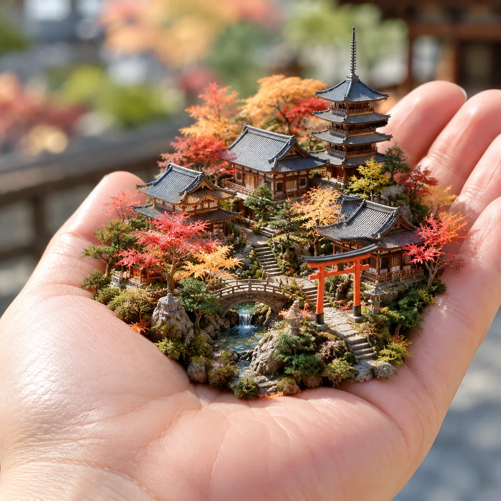</a>

> 根据 @Gdgtify 用 Nano Banana 2.1 测试的代码风 Surreal_Macro_Dioramas 模板扩写。我们把多城市网格改为单掌心里的京都。适合旅行艺术、微缩世界和海报概念。

```text
A surreal macro diorama, square 1:1: a miniature Kyoto temple district resting in a single open human palm, tiny pagoda roofs, maple trees and a small torii gate growing from the skin like a living model, soft daylight, shallow depth of field, photorealistic macro photography, intricate miniature detail, no text. Square 1:1 composition.
```

- 原作者: [@Gdgtify](https://x.com/Gdgtify)
- 原帖: https://x.com/Gdgtify/status/2111355279698805167
- [在 cinel 上查看详情并一键生成](https://cinel.ai/zh/prompts/p/macro-diorama-kyoto-in-open-palm?utm_source=github&utm_medium=awesome&utm_campaign=awesome-gpt-image-2.5-prompts)

### Y2K 盲盒风设计师玩具

<a href="https://cinel.ai/zh/prompts/p/y2k-chibi-designer-toy-figurine?utm_source=github&utm_medium=awesome&utm_campaign=awesome-gpt-image-2.5-prompts">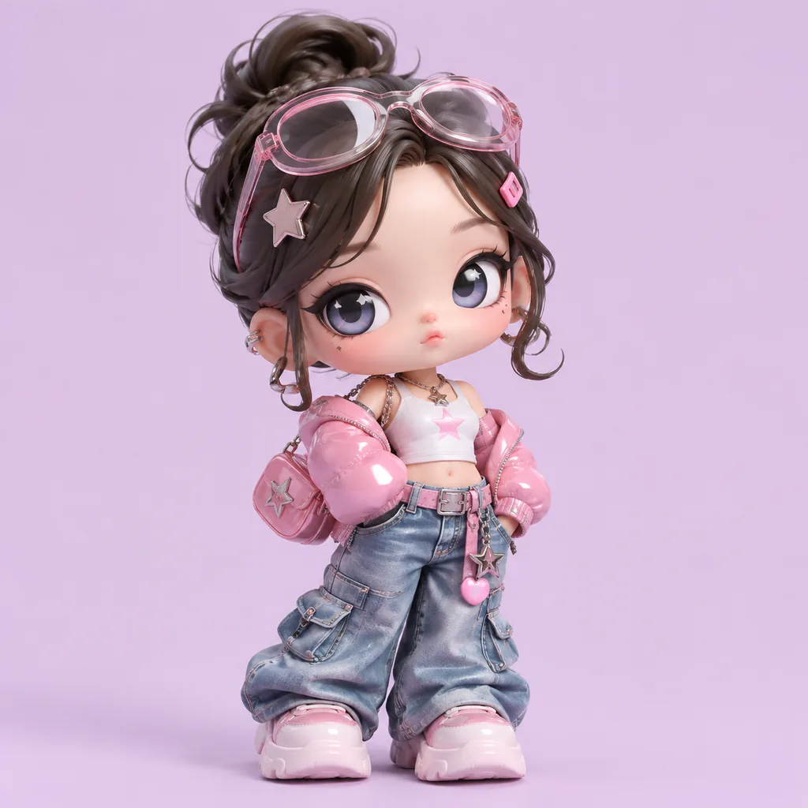</a>

> 根据 @azed_ai 于 2026-10-18 的帖子改写（记录时 186 赞）。我们改成一张干净的1:1图，去掉品牌、Logo、名人/IP元素，也不需要你的照片。一次只改一个变量。

```text
High-detail 3D render, square 1:1: a trendy fictional young woman as a designer-toy blind-box figurine, C4D/Blender aesthetic, exaggerated chibi proportions, oversized head, playful Y2K street fashion, glossy vinyl skin, soft studio light on seamless pastel backdrop, no brand, no text, no logo. Square 1:1 composition.
```

- 原作者: [@azed_ai](https://x.com/azed_ai)
- 原帖: https://x.com/azed_ai/status/2111774317289889900
- [在 cinel 上查看详情并一键生成](https://cinel.ai/zh/prompts/p/y2k-chibi-designer-toy-figurine?utm_source=github&utm_medium=awesome&utm_campaign=awesome-gpt-image-2.5-prompts)

### 彩色盐粒微雕角色

<a href="https://cinel.ai/zh/prompts/p/salt-crystal-micro-sculpture-figure?utm_source=github&utm_medium=awesome&utm_campaign=awesome-gpt-image-2.5-prompts">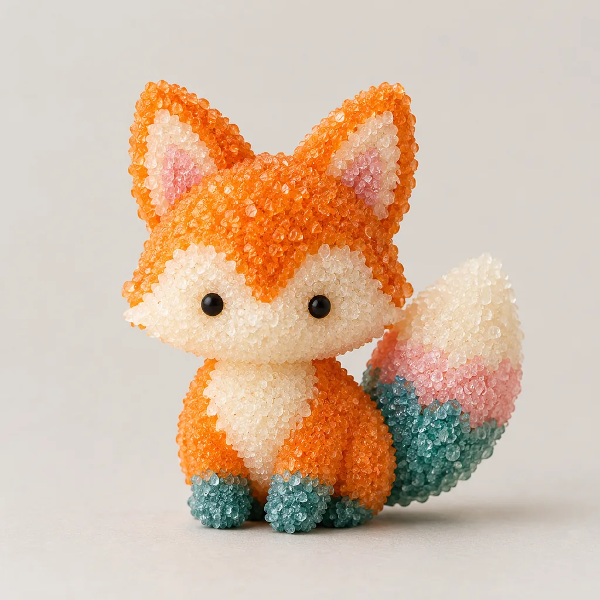</a>

> 根据 @edizkan_ 于 2026-10-18 的提示词+图片帖改写（记录时 32 赞）。我们改成一张干净的1:1方形图，去掉品牌和Logo，也不需要你的照片。一次只改一个变量。

```text
Macro product photograph, square 1:1: a micro sculpture of a cute original cartoon fox character — rounded body, big pointed ears, fluffy tail, simple dot eyes, no mouth — made entirely of tiny coloured salt grains in tangerine orange, cream, soft pink and teal, every grain visible as a sparkling translucent crystal, the colours forming clean graphic zones. The sculpture stands alone, centered on a seamless pale grey-beige background, and is the only element in the picture. Clean product photography lighting, soft diffused key light, crisp crystal highlights, a gentle contact shadow, shallow macro depth of field. No text, no logo. Square 1:1 composition.
```

- 原作者: [@edizkan_](https://x.com/edizkan_)
- 原帖: https://x.com/edizkan_/status/2111928978969657827
- [在 cinel 上查看详情并一键生成](https://cinel.ai/zh/prompts/p/salt-crystal-micro-sculpture-figure?utm_source=github&utm_medium=awesome&utm_campaign=awesome-gpt-image-2.5-prompts)

### 纸艺万圣节女巫小屋立体场景

<a href="https://cinel.ai/zh/prompts/p/papercraft-halloween-witch-cottage-diorama?utm_source=github&utm_medium=awesome&utm_campaign=awesome-gpt-image-2.5-prompts">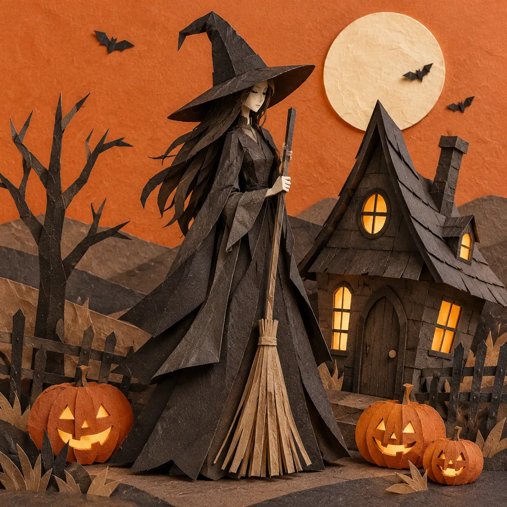</a>

> 根据 @minuitIA 于 2026-10-17 的图片帖改写（记录时 29 赞）。我们改成一张干净的1:1方形图，去掉品牌和Logo，也不需要你的照片。一次只改一个变量。

```text
Handcrafted paper sculpture diorama, square 1:1: a tall witch figure folded and cut from black and charcoal cardstock — pointed hat, flowing layered paper robe, a long broom of cut paper straw strips — stands in front of a crooked little paper cottage with glowing amber windows, carved paper jack-o'-lanterns at her feet, a pale cream paper moon and tiny paper bats in a warm terracotta-orange sky, layered cut-paper hills behind. Visible paper fibres, crisp folds and scored edges, soft shadows between layers, warm studio light, playful-spooky storybook mood. No text, no logo. Square 1:1 composition.
```

- 原作者: [@minuitIA](https://x.com/minuitIA)
- 原帖: https://x.com/minuitIA/status/2111510286805131671
- [在 cinel 上查看详情并一键生成](https://cinel.ai/zh/prompts/p/papercraft-halloween-witch-cottage-diorama?utm_source=github&utm_medium=awesome&utm_campaign=awesome-gpt-image-2.5-prompts)
