# 美食饮品 · GPT Image 2.5

[← README](../../README_zh.md) · 223 · [cinel 分类页](https://cinel.ai/zh/prompts/food-drink?utm_source=github&utm_medium=awesome&utm_campaign=awesome-gpt-image-2.5-prompts)

### 食材悬浮爆炸式美食信息图提示词

<a href="https://cinel.ai/zh/prompts/p/exploded-dish-food-infographic?utm_source=github&utm_medium=awesome&utm_campaign=awesome-gpt-image-2.5-prompts"></a>

> 这条提示词用 JSON 写成，可以逐个字段修改：菜系、悬浮食材清单、标签语言、背景和光线。“碗在底部、食材向上升起”的纵向层级，让任何菜品都有同样清晰的构图；要求用该菜系本地语言做标签，则增加了地道感。我们的印尼菜示例用印尼语正确标注了牛肉、炸豆腐、青柠、大蒜、辣椒和油葱酥，但有一条指引线指错了对象，提醒你要检查指向。复用时，菜系和食材清单要一起改；食材控制在 6–8 种，每个标签才有空间。

```text
{
  "image_prompt": {
    "type": "Hyper-realistic food infographic",
    "subject": {
      "cuisine": "Indonesian",
      "base_element": "Traditional bowl with steaming hot dish at the bottom",
      "levitating_ingredients": [
        "Juicy meat",
        "Crispy tofu",
        "Glossy sauce splashes",
        "Fresh herbs",
        "Chilies",
        "Lime",
        "Garlic",
        "Fried shallots"
      ]
    },
    "composition": {
      "layout": "Clean vertical composition",
      "arrangement": "Realistic gravity-defying/floating elements",
      "background": "Rustic wooden surface",
      "visual_hierarchy": "Bowl anchored at bottom, ingredients rising vertically"
    },
    "graphic_design_elements": {
      "labels": "Clear Indonesian text",
      "lines": "Thin white pointing lines",
      "style": "Editorial infographic layout, professional food magazine style"
    },
    "lighting_and_mood": {
      "lighting": "Cinematic studio lighting",
      "color_palette": "Warm tones",
      "effects": "Dramatic steam, motion-frozen ingredients"
    },
    "technical_specs": {
      "camera_settings": "Shallow depth of field, sharp focus, DSLR look",
      "details": "Ultra-detailed textures",
      "resolution": "8K ultra-realistic"
    }
  }
}
```

- 原作者: [@Taaruk_](https://x.com/Taaruk_)
- 原帖: https://x.com/Taaruk_/status/2017865644365255078
- [在 cinel 上查看详情并一键生成](https://cinel.ai/zh/prompts/p/exploded-dish-food-infographic?utm_source=github&utm_medium=awesome&utm_campaign=awesome-gpt-image-2.5-prompts)

### 悬浮菜品菜谱信息图提示词

<a href="https://cinel.ai/zh/prompts/p/recipe-infographic-floating-dish?utm_source=github&utm_medium=awesome&utm_campaign=awesome-gpt-image-2.5-prompts"></a>

> 大多数菜谱卡提示词出来的都是扁平的俯视版式。这条要求成品菜以倾斜角度、略微悬浮地展示，食材和步骤环绕流动，并设定了清晰的层级（菜品 > 步骤 > 食材 > 数据），让视线知道该往哪里走。毛玻璃步骤卡片和小烹饪图标带来了类似 App 的现代感。我们的印度香饭版本是一张完整可信的菜谱卡：食材用量、六个编号步骤、时间徽章和小贴士一应俱全，唯一的问题是烹饪总时长与各步骤用时对不上。注意：菜名是直接写在提示词里的（原文拼作 briyani），每次复用都要记得替换。

```text
Ultra-clean modern recipe infographic. Showcase briyani in a visually appealing finished form—sliced, plated, or portioned—floating slightly in perspective or angled view. Arrange ingredients, steps, and tips around the dish in a dynamic editorial layout, not restricted to top-down. Ingredients Section: Include icons or mini illustrations for each ingredient with quantities. Arrange them in clusters, lists, or circular flows connected visually to the dish. Steps Section: Show preparation steps with numbered panels, arrows, or lines, forming a logical flow around the main dish. Include small cooking icons (knife, pan, oven, timer) where helpful. Additional Info (optional): Total calories, prep/cook time, servings, spice level—displayed as clean bubbles or badges near the dish. Visual Style: Editorial infographic meets lifestyle food photography. Vibrant, natural food colors, subtle drop shadows, clean vector icons, modern typography, soft gradients or glassmorphism for step panels. Accent colors can highlight key info (calories, prep time). Composition Guidelines: Finished meal as hero visual (perspective or angled) Ingredients and steps flow dynamically around the dish Clear visual hierarchy: dish > steps > ingredients > optional stats Enough negative space to keep design airy and readable Lighting & Background: Soft, natural studio lighting, minimal textured or gradient background for premium editorial feel. Output: 1080×1080, ultra-crisp, social-feed optimized, no watermark.
```

- 原作者: [@Strength04_X](https://x.com/Strength04_X)
- 原帖: https://x.com/Strength04_X/status/2013186574390046844
- [在 cinel 上查看详情并一键生成](https://cinel.ai/zh/prompts/p/recipe-infographic-floating-dish?utm_source=github&utm_medium=awesome&utm_campaign=awesome-gpt-image-2.5-prompts)

### 开心果果仁蜜饼四模块甜品广告提示词

<a href="https://cinel.ai/zh/prompts/p/pistachio-baklava-dessert-commercial-shot?utm_source=github&utm_medium=awesome&utm_campaign=awesome-gpt-image-2.5-prompts"></a>

> 和那条饮品“主提示词”一样，这条也把全局设置和分镜模块分开，这里是四个巴克拉瓦场景，各有自己的背景色。它之所以适合酥皮点心，在于质感词汇：“清晰可见”的超薄酥皮层、菱形切块、夹在层间的鲜绿开心果碎、边缘闪亮的糖浆，以及定格在半空的糖浆滴。我们的四格成品正是如此：深绿底上的悬浮叠塔、奶油底上的整盘、深棕底上的淋糖浆特写、橄榄绿底上飞散的酥皮。“一模块一底色”的规则让整组图非常适合菜单或社交网格。可以把巴克拉瓦换成任何多层甜点，比如拿破仑酥或库纳法，但质感描述要保留。

```text
{
  "resolution": "8K UHD",
  "aspect_ratio": "3:4",
  "image_style": "hyper-realistic commercial dessert photography",
  "global_settings": {
    "quality": "Ultra-high detail, razor-sharp focus, luxury dessert clarity",
    "lighting": "Controlled studio lighting emphasizing texture, layers, and syrup highlights",
    "motion": "Frozen mid-air elements with subtle gravity realism",
    "background_style": "Solid or smooth gradient background, color varies per module",
    "camera": "High-speed photography look, shallow to medium depth of field",
    "post_processing": "Rich contrast, warm tones, natural shine, no artificial glow"
  },
  "modules": { "module_1_classic_baklava_stack_explosion": {
      "scene_description": "A dramatic stack of classic pistachio baklava with flying syrup droplets",
      "baklava": {
        "type": "Traditional pistachio baklava",
        "layers": "Ultra-thin phyllo layers clearly visible",
        "cut": "Diamond-shaped pieces",
        "position": "Stacked and floating mid-air"
      },
      "details": {
        "nuts": "Finely ground bright green pistachios between layers",
        "syrup": "Golden sugar syrup glistening on edges"
      },
      "motion_effects": {
        "syrup": "Small syrup droplets splashing outward",
        "crumbs": "Tiny phyllo flakes suspended in air"
      },
      "background": {
        "color": "Deep emerald green",
        "texture": "Smooth, seamless"
      }
    }, "module_2_minimal_baklava_plate_floating": {
      "scene_description": "Minimalist premium baklava presentation with controlled floating crumbs",
      "baklava": {
        "type": "Single-layer pistachio baklava pieces",
        "arrangement": "Neatly aligned rectangular cuts",
        "surface": "Glossy with light syrup sheen"
      },
      "accent_elements": {
        "nuts": "Crushed pistachio dust lightly floating",
        "syrup": "Thin syrup drizzle frozen mid-air"
      },
      "motion_effects": {
        "particles": "Subtle floating crumbs and nut dust"
      },
      "background": {
        "color": "Warm beige",
        "gradient": "Very soft tonal gradient"
      }
    }, "module_3_baklava_syrup_pour_drama": {
      "scene_description": "Cinematic syrup pour over baklava stack",
      "baklava": {
        "type": "Thick stacked baklava slices",
        "texture": "Highly detailed crispy layers"
      },
      "additional_elements": {
        "syrup": {
          "state": "Thick golden syrup pouring from above",
          "motion": "Frozen in elegant flowing strands"
        },
        "nuts": [
          "Whole pistachio kernels",
          "Crushed pistachio fragments"
        ]
      },
      "motion_effects": {
        "splashes": "Micro syrup splashes on impact points",
        "particles": "Floating nut fragments"
      },
      "background": {
        "color": "Dark chocolate brown",
        "tone": "High contrast, luxury feel"
      }
    }, "module_4_modern_baklava_floating_composition": {
      "scene_description": "Modern deconstructed baklava composition in mid-air",
      "elements": {
        "phyllo": "Crispy golden phyllo sheets floating separately",
        "nuts": "Pistachio layers suspended between sheets",
        "syrup": "Glossy syrup threads connecting elements"
      },
      "motion_effects": {
        "flakes": "Ultra-fine pastry flakes suspended",
        "drops": "Minimal syrup droplets"
      },
      "background": {
        "color": "Muted olive green",
        "texture": "Smooth, seamless"
      }
    }
  },
  "negative_prompt": [
    "text",
    "logos",
    "branding",
    "hands",
    "people",
    "utensils",
    "plates",
    "tables",
    "cartoon style",
    "excessive syrup pooling",
    "burnt pastry",
    "overexposure",
    "artificial glow",
    "low detail textures"
  ]
}
```

- 原作者: [@kaanakz](https://x.com/kaanakz)
- 原帖: https://x.com/kaanakz/status/2009204329236828239
- [在 cinel 上查看详情并一键生成](https://cinel.ai/zh/prompts/p/pistachio-baklava-dessert-commercial-shot?utm_source=github&utm_medium=awesome&utm_campaign=awesome-gpt-image-2.5-prompts)

### 金色标注的悬浮甜点叠塔广告提示词

<a href="https://cinel.ai/zh/prompts/p/cinematic-studio-food-photography?utm_source=github&utm_medium=awesome&utm_campaign=awesome-gpt-image-2.5-prompts"></a>

> 这条模块化提示词的独到之处是文字设计系统，它在全局设置里一次定义好：金属金色的衬线字体食材名、纯白色的无衬线说明文字、细长圆角的金色指示线。每个模块都继承这套系统，所以即使场景差异很大，标注看起来依然统一。“不缩放、不裁切、居中纵向”的规则让悬浮叠塔完整留在画面里。我们的双格成品，一边是粉色渐变底上的蛋糕叠塔，一边是氛围昏暗的酥点场景，两者的金色标注风格完全一致。说明文字是泛泛的营销文案，请替换成你真实的菜单内容；用不到的模块直接删掉。

```text
{
  "global_settings": {
    "resolution": "8K ultra high definition",
    "aspect_ratio": "3:4",
    "camera_style": "studio food photography with cinematic lighting",
    "depth_of_field": "shallow depth of field, sharp subject, soft background",
    "lighting": "soft directional key light, subtle rim light, controlled highlights",
    "style": "hyper-realistic food illustration with editorial infographic overlays",
    "composition_rules": [
      "no zoom",
      "no crop",
      "center-weighted vertical composition",
      "floating elements frozen in motion"
    ],
    "text_design": {
      "ingredient_name_color": "metallic gold",
      "ingredient_description_color": "pure white",
      "font_style": "elegant serif for titles, clean sans-serif for descriptions",
      "indicator_lines": "long, thin, smooth golden lines with rounded corners"
    }
  },

  "module_1_image_1_style": {
    "scene_description": "A vertical stack of assorted cake slices floating above a white ceramic plate against a soft pink gradient background.",
    "background": {
      "color": "soft pastel pink",
      "texture": "smooth gradient",
      "lighting": "even, studio-lit, no harsh shadows"
    },
    "main_subjects": [
      "multiple layered sponge cake slices",
      "white whipped cream layers",
      "raspberry cream layer",
      "chocolate cream topping"
    ],
    "visible_ingredients": [
      "vanilla sponge cake",
      "whipped cream",
      "raspberries",
      "blueberries",
      "strawberries",
      "macarons (vanilla and chocolate)",
      "chocolate bar pieces",
      "mint leaves",
      "small nut fragments"
    ],
    "motion_elements": [
      "floating fruits",
      "floating macarons",
      "crumbs suspended in air"
    ],
    "text_labels": [
      "Vanilla Cake – soft, fluffy sponge cake layered with white cream filling",
      "Macaron – creamy filling between almond meringue shells",
      "Raspberries – juicy, fresh raspberries",
      "Chocolate Bar – chunks of smooth milk chocolate",
      "Raspberry Cream – soft sponge cake layered with creamy, fruity raspberry cream"
    ]
  },

  "module_2_image_2_style": {
    "scene_description": "Rolled Syrian dessert presented vertically with syrup pouring from above, placed in a warm, rustic kitchen environment.",
    "background": {
      "environment": "traditional kitchen",
      "elements": [
        "warm lantern light",
        "wooden surfaces",
        "brass and copper utensils"
      ],
      "lighting": "warm ambient lighting with soft highlights"
    },
    "main_subjects": [
      "rolled white dessert dough",
      "cream filling spilling out",
      "golden syrup stream"
    ],
    "visible_ingredients": [
      "white cheese dough",
      "cream filling",
      "pistachios",
      "sugar syrup"
    ],
    "motion_elements": [
      "syrup dripping vertically",
      "pistachio crumbs falling"
    ],
    "text_labels": [
      "White Cheese Dough – soft outer layer made from cheese and semolina",
      "Cream Filling – creamy filling inside the roll",
      "Pistachios – crushed pistachios sprinkled over and inside the rolls"
    ]
  }
```

- 原作者: [@meng_dagg695](https://x.com/meng_dagg695)
- 原帖: https://x.com/meng_dagg695/status/2011994819124752631
- [在 cinel 上查看详情并一键生成](https://cinel.ai/zh/prompts/p/cinematic-studio-food-photography?utm_source=github&utm_medium=awesome&utm_campaign=awesome-gpt-image-2.5-prompts)

### 白底悬浮分层美食广告提示词

<a href="https://cinel.ai/zh/prompts/p/floating-stacked-food-ad-white-background?utm_source=github&utm_medium=awesome&utm_campaign=awesome-gpt-image-2.5-prompts"></a>

> 快餐广告里的“爆炸汉堡”风格，被简化成了两个空。提示词把菜品纵向拆开（悬浮叠层构图、悬空的部件），在周围撒上小块食材，再用台面上一道清晰柔和的投影把一切落地——正是这个细节让悬浮看起来像拍出来的，而不是抠图。高调光和 100mm 微距质感让纹理保持诱人。我们的双层芝士汉堡被整齐地拆成面包、生菜、番茄、两片带融化芝士的肉饼和酸黄瓜，生菜丝四处飞散。三明治、塔可、千层蛋糕、寿司塔，只要有明显分层就适用。撒的食材要是这道菜里真正有的。

```text
A stacked double cheeseburger, premium food advertising, white seamless background, high key studio lighting, floating stacked composition, levitating pieces, sesame seeds, shredded lettuce and tomato slices scattered, clean minimal layout, crisp soft shadow on surface, ultra realistic, macro product photography, 100mm lens look, f/8 sharp focus, subtle texture detail, editorial commercial, 8k
```

- 原作者: [@azed_ai](https://x.com/azed_ai)
- 原帖: https://x.com/azed_ai/status/2009625733933736157
- [在 cinel 上查看详情并一键生成](https://cinel.ai/zh/prompts/p/floating-stacked-food-ad-white-background?utm_source=github&utm_medium=awesome&utm_campaign=awesome-gpt-image-2.5-prompts)

### 俯拍餐桌变身社交帖子的创意提示词

<a href="https://cinel.ai/zh/prompts/p/top-down-dining-table-group-shot?utm_source=github&utm_medium=awesome&utm_campaign=awesome-gpt-image-2.5-prompts"></a>

> 一个把实体和数字结合起来的巧妙概念：餐桌本身被做成一条巨大的社交帖子——顶部是白色头像条，底部是点赞、分享图标，彩色中心区域就是“照片”。机位拉得很远，留出大片空地，提示词还严格要求所有食物、饮料和手都在彩色中心区域内，错觉才能成立。我们设定了夏日早午餐：柠檬黄桌心、天蓝色地面，四位穿亚麻衣服的朋友倒柠檬水、传递莓果，账号名为虚构的 sunday.table。很适合餐厅开业或品牌周年活动。每个人的动作都要写清楚，笼统的描述会让大家做同一个动作。

```text
Ultra-wide-angle hyper-realistic shooting in top-down mode. A group of 4 real people sitting at a square dining table. The camera is pushed far back, creating a significant negative space (empty floor area) around the people and the table, which provides a clear, minimalistic composition. Scene (relaxed summer brunch, casual linen clothing): Four people are dressed in casual summer linen outfits in cream and soft blue. Their interaction is specific: one pours lemonade, one passes a bowl of berries, one slices a quiche, one raises a glass. The table is a custom-made physical prop, designed as an Instagram post: it has a solid white stripe ONLY along the top and bottom edges (no white frames on the left or right). - The upper white stripe shows a drawn profile photo with a simple lemon-slice icon, the username "sunday.table", followed by a small blue icon with a confirmed check mark, and "..." on the right. - Red hearts, comment and share icons are painted on the bottom white stripe on the left, and a Bookmarks icon on the right. The center of the table is filled in pastel lemon yellow (#FFF4B8). The table shows a quiche, fresh berries, croissants, a jug of lemonade and four glasses. important: ALL food, beverages, objects, and hands that interact with them must be located strictly within this central area, colored in pastel lemon yellow (#FFF4B8). NOTHING should go beyond the white stripes or beyond the table. The background of the floor is made in soft sky blue to create a visual separation. Professional studio lighting with clear shadows. 8k, clear focus.
```

- 原作者: [@Goodmanprotocol](https://x.com/Goodmanprotocol)
- 原帖: https://x.com/Goodmanprotocol/status/2045009725218226475
- [在 cinel 上查看详情并一键生成](https://cinel.ai/zh/prompts/p/top-down-dining-table-group-shot?utm_source=github&utm_medium=awesome&utm_campaign=awesome-gpt-image-2.5-prompts)

### 带标注的美食剖面海报提示词

<a href="https://cinel.ai/zh/prompts/p/food-cross-section-layers-shot?utm_source=github&utm_medium=awesome&utm_campaign=awesome-gpt-image-2.5-prompts"></a>

> 思路是把一道菜当岩石样本来看：干净切开，切面正对镜头，给每一层贴上标签。细细的水平引线连到大写食材名和斜体说明，顶部是大号衬线标题，纯色哑光背景让画面像海报一样干净。左侧的侧光刻出阴影，体现层次深度。我们用了鼠尾草绿背景上的田园蔬菜千层面，模型标注了从里科塔奶酪到马苏里拉的八层，还配上“烟熏、浓郁”这样的短说明。注意核对标签与看到的分层是否一致，模型有时会列出画面里看不到的食材。适合菜单、食谱卡和美食博客。

```text
Perfect cinematic cross-section cut through a garden vegetable lasagna, sliced cleanly down the center revealing every internal layer in full detail. The cut face is facing the camera straight-on, like a geological diagram of flavor. Each visible layer is labeled with a thin horizontal line extending to the right — uppercase sans-serif "RICOTTA" with italic descriptor below. Background: flat matte sage green. Lighting: dramatic side light from left casting long shadows, single warm spotlight on the cut face. Every texture hyperreal — visible moisture, air pockets, char, glaze, and steam. Mood: architectural food photography meets scientific illustration. Dish name "Garden Lasagna" in large elegant type at top. Subtitle: "Layers of Summer". 4K, tack sharp, Style ref: Wes Anderson symmetry meets Michelin-star kitchen.
```

- 原作者: [@AllaAisling](https://x.com/AllaAisling)
- 原帖: https://x.com/AllaAisling/status/2025686032700805436
- [在 cinel 上查看详情并一键生成](https://cinel.ai/zh/prompts/p/food-cross-section-layers-shot?utm_source=github&utm_medium=awesome&utm_campaign=awesome-gpt-image-2.5-prompts)

### 美食撕开动态摄影系列提示词

<a href="https://cinel.ai/zh/prompts/p/pizza-cheese-pull-photo-series?utm_source=github&utm_medium=awesome&utm_campaign=awesome-gpt-image-2.5-prompts"></a>

> 这段 JSON 把五张系列图装进一条提示词：拉出长长马苏里拉的披萨、浸满糖浆的果仁蜜饼、流心熔岩蛋糕、黏糊糊的肉桂卷和绵密的芝士蛋糕，每张都由双手撕开，并各有灯光说明。作为单张图运行时，模型只渲染了第一条——披萨拉丝，而且效果很好：起泡的饼边、罗勒叶、热气和空中的碎屑，饼块与整张披萨之间拉出长长的光亮芝士丝。想要完整一组，就把每个“prompt”值分别运行，比例和渲染模式保持一致。适合需要统一动态系列的烘焙店、披萨店或外卖平台的社交账号。

```text
{
  "aspect_ratio": "3:4",
  "render_mode": "raw",
  "series": [
    {
      "index": "1/5",
      "prompt": "two hands pulling apart a hot freshly baked pizza slice, long elastic mozzarella cheese stretch between the slice and the pie, blistered crust edges, steam rising, crumbs falling mid-air, warm cinematic light, ultra high-detail food action photography",
      "category": "cheese pull",
      "lighting": "warm cinematic oven light",
      "detail_level": "ultra-detailed"
    },
    {
      "index": "2/5",
      "prompt": "two hands pulling apart a syrup-soaked baklava piece, thin crispy phyllo layers cracking, rich pistachio filling visible, thick honey syrup stretching and dripping mid-air, golden warm light, cinematic dessert action photography",
      "category": "syrup & crunch",
      "lighting": "golden warm light",
      "detail_level": "ultra-detailed"
    },
    {
      "index": "3/5",
      "prompt": "two hands breaking a molten chocolate lava cake in half, glossy dark chocolate flowing out from the center, steam rising gently, crumbs suspended mid-air, soft warm spotlight, cinematic dessert action photography",
      "category": "molten chocolate",
      "lighting": "soft warm spotlight",
      "detail_level": "ultra-detailed"
    },
    {
      "index": "4/5",
      "prompt": "two hands tearing a glazed cinnamon roll apart, sticky cinnamon sugar filling stretching in glossy strands, icing dripping slowly, fluffy dough texture visible, cozy warm bakery light, high-detail cinematic food photography",
      "category": "sticky pull",
      "lighting": "warm bakery light",
      "detail_level": "ultra-detailed"
    },
    {
      "index": "5/5",
      "prompt": "two hands splitting a classic New York-style cheesecake slice, ultra-creamy interior slowly separating, crumbly biscuit base breaking apart, subtle cream stretch, soft studio warm light, cinematic high-detail dessert photography",
      "category": "creamy separation",
      "lighting": "soft warm studio light",
      "detail_level": "ultra-detailed"
    }
  ]
}
```

- 原作者: [@kaanakz](https://x.com/kaanakz)
- 原帖: https://x.com/kaanakz/status/2011762827866845208
- [在 cinel 上查看详情并一键生成](https://cinel.ai/zh/prompts/p/pizza-cheese-pull-photo-series?utm_source=github&utm_medium=awesome&utm_campaign=awesome-gpt-image-2.5-prompts)

### 悬浮塔可电影感美食动态提示词

<a href="https://cinel.ai/zh/prompts/p/cinematic-hand-held-food-shot?utm_source=github&utm_medium=awesome&utm_campaign=awesome-gpt-image-2.5-prompts"></a>

> 又一条多模块 JSON 提示词，这次做高能量的美食镜头：模块一是硬壳塔可，周围悬浮着食材和橙红色酱汁飞溅；模块二是深红背景上的烤串；模块三是蓝灰背景上悬浮的一簇寿司卷。作为单张图运行时，模型只渲染了第一个模块，效果很生动：金黄的塔可壳里塞满手撕肉、青酱和奶酪，牛油果片、紫洋葱圈和肉块在冷暖霓虹光斑前飞舞。想要完整一组，就把每个模块拆开单独生成。适合餐厅菜单、外卖平台横幅和餐车社交账号。

```text
{
  "global_settings": {
    "resolution": "8K ultra high definition",
    "aspect_ratio": "2:3 vertical",
    "image_type": "AI-edited cinematic food photography",
    "detail_level": "extreme micro-detail, sharp focus, clean edges",
    "style_constraint": "enhanced realism, minimal alteration from original composition"
  },

  "module_1_image_1_style": {
    "subject": "single hard-shell taco",
    "composition": {
      "orientation": "diagonal, floating in mid-air",
      "foreground_focus": "taco shell and filling",
      "motion": "ingredients suspended, sauce splash frozen mid-air"
    },
    "visible_elements": {
      "shell": "golden yellow hard taco shell with crisp texture",
      "filling": [
        "shredded cooked meat with visible fibers",
        "green sauce layered on top",
        "small red diced pieces",
        "white crumbled cheese"
      ],
      "floating_garnish": [
        "avocado slices",
        "purple onion rings",
        "green herb leaves",
        "small reddish-brown meat cubes",
        "tiny white crumbs"
      ],
      "liquid": "orange-red sauce splash erupting upward behind taco"
    },
    "lighting": {
      "type": "high-contrast studio lighting",
      "highlights": "glossy reflections on sauce and meat",
      "background_lights": "soft circular bokeh in warm and cool tones"
    },
    "background": {
      "color": "dark with neon-like blurred lights",
      "depth": "strong depth of field, background fully defocused"
    }
  },

  "module_2_image_2_style": {
    "subject": "three grilled meat skewers",
    "composition": {
      "orientation": "vertical skewers, slightly angled",
      "foreground_focus": "center skewer",
      "motion": "ingredients and sauce suspended"
    },
    "visible_elements": {
      "skewers": "wooden sticks with pointed ends",
      "meat": "chunked grilled meat with char marks and uneven texture",
      "garnish": "small green herb leaves attached to meat",
      "floating_items": [
        "round cucumber slices",
        "thin onion rings"
      ],
      "sauce": {
        "container": "small white ramekin",
        "action": "thick orange sauce splashing upward from bowl"
      },
      "particles": "tiny spice or crumb particles scattered in air"
    },
    "lighting": {
      "type": "dramatic directional lighting",
      "highlights": "strong sheen on meat surface",
      "contrast": "deep shadows"
    },
    "background": {
      "color": "solid deep red",
      "texture": "soft grain with floating particles"
    }
  },

  "module_3_image_3_style": {
    "subject": "four sushi rolls",
    "composition": {
      "orientation": "floating cluster",
      "spacing": "uneven depth, some closer, some blurred behind",
      "motion": "sesame seeds and herbs suspended"
    },
    "visible_elements": {
      "sushi_structure": {
        "outer_layer": "white rice",
        "inner_layer": "dark seaweed",
        "fillings": [
          "orange fish slice",
          "green avocado"
        ]
      },
      "toppings": [
        "toasted sesame seeds",
        "brown crunchy coating",
        "finely chopped green herbs"
      ],
      "particles": [
        "sesame seeds",
        "small green herb pieces"
      ]
    },
    "lighting": {
      "type": "soft but crisp studio lighting",
      "focus": "front sushi pieces sharp, rear slightly blurred"
    },
    "background": {
      "color": "dark blue-grey",
      "depth": "clean bokeh-free backdrop with floating particles"
    }
  },
  "post_processing": {
    "clarity": "ultra-sharp",
    "noise": "minimal",
    "color_balance": "rich but natural",
    "ai_signature": "clean AI-edited look without exaggeration"
  }
}
```

- 原作者: [@meng_dagg695](https://x.com/meng_dagg695)
- 原帖: https://x.com/meng_dagg695/status/2009887009591226787
- [在 cinel 上查看详情并一键生成](https://cinel.ai/zh/prompts/p/cinematic-hand-held-food-shot?utm_source=github&utm_medium=awesome&utm_campaign=awesome-gpt-image-2.5-prompts)

### 奶油笔管面白底美食照提示词

<a href="https://cinel.ai/zh/prompts/p/creamy-penne-pasta-food-photo?utm_source=github&utm_medium=awesome&utm_campaign=awesome-gpt-image-2.5-prompts"></a>

> 不是每条美食提示词都需要戏剧感。这一条追求的是外卖平台或菜单上那种干净、统一的图：一道菜、一只极简陶瓷碗、白色背景、柔和漫射光和一道淡淡的阴影，再加一份明确的排除清单（无文字、标签、手、道具、水印）。真正有用的细节在食物描述里：笔管面“均匀裹满”“有光泽”的酱汁，“质感和稠度真实”，这样能避免塑料感。我们的成品是一碗明亮的奶油笔管面，撒着帕玛森芝士和欧芹碎，酱汁挂在面的纹路上。替换菜名和配料，就能用同一风格拍完整份菜单。

```text
Ultra-realistic food photography of a prepared creamy white sauce penne pasta served in a minimal ceramic bowl. Perfectly cooked penne coated evenly in rich, glossy cream sauce, topped with freshly grated parmesan cheese and finely chopped green herbs. Clean white studio background, soft diffused lighting, gentle shadows under the bowl, natural highlights on the sauce, realistic texture and thickness. Centered composition, shallow depth of field, premium restaurant-style presentation, high-detail food styling, 8K quality, sharp focus, no text, no labels, no hands, no props, no watermark.
```

- 原作者: [@Strength04_X](https://x.com/Strength04_X)
- 原帖: https://x.com/Strength04_X/status/2016073152820846633
- [在 cinel 上查看详情并一键生成](https://cinel.ai/zh/prompts/p/creamy-penne-pasta-food-photo?utm_source=github&utm_medium=awesome&utm_campaign=awesome-gpt-image-2.5-prompts)

### 冰焦糖咖啡爆炸感饮品广告提示词

<a href="https://cinel.ai/zh/prompts/p/iced-caramel-coffee-explosion-shot?utm_source=github&utm_medium=awesome&utm_campaign=awesome-gpt-image-2.5-prompts"></a>

> 一张高能量的咖啡店广告：饮品悬浮在黑暗中，咖啡豆向外迸发，细腻的咖啡粉悬在空中，焦糖丝带绕杯飞舞，由硬朗的顶部聚光和温暖的金色轮廓光照亮。“烟雾感深色背景”让奶油饮品成为画面中最亮的部分。我们第一次出图时，杯子上出现了某知名连锁咖啡品牌的 Logo，因为原文使用了一个注册商标饮品名；于是改写成无印刷的素杯和“冰焦糖咖啡冰沙”。最终画面是一只带拱形盖、顶着奶油和焦糖淋酱的杯子，周围咖啡豆飞舞。请保留“素杯、无 Logo”的写法，之后再加上你自己的品牌。

```text
Ultra-realistic commercial product photography of an iced caramel blended coffee in a clear plastic cup with dome lid and green straw, the cup plain and unprinted with no logo, topped with whipped cream and caramel drizzle, floating mid-air. Coffee beans exploding around the cup with fine coffee powder dust particles suspended in the air, dynamic caramel splash trails swirling around the drink. Dark smoky background with dramatic spotlight from above, warm golden rim lighting, high contrast, sharp focus, macro details, cinematic depth of field, hyper-detailed texture, premium beverage advertisement, 8K resolution.
```

- 原作者: [@Kashberg_0](https://x.com/Kashberg_0)
- 原帖: https://x.com/Kashberg_0/status/2024707382727889320
- [在 cinel 上查看详情并一键生成](https://cinel.ai/zh/prompts/p/iced-caramel-coffee-explosion-shot?utm_source=github&utm_medium=awesome&utm_campaign=awesome-gpt-image-2.5-prompts)

### 手机照变专业塔可广告+配料爆炸图提示词

<a href="https://cinel.ai/zh/prompts/p/tacos-reference-commercial-food-shot?utm_source=github&utm_medium=awesome&utm_campaign=awesome-gpt-image-2.5-prompts"></a>

> 一个给小餐馆的两步流程：从一张随手拍的手机照开始，先要求生成同一份塔可的精致四分之三角度商业图，再生成第二张爆炸图，把配料垂直堆叠并配上醒目的色块标签。我们的参考图是两个牛肉街头塔可的俯拍，配洋葱、香菜和青柠。第一张图升级得很好：暖光、干净的盘子和青柠角。但第二张图遵循的是提示词里写死的配料清单（小麦饼皮、紫甘蓝、烤鸡肉、酱汁），而不是我们的塔可——这是个有用的提醒：请把配料清单改成你真实菜品的配料，否则爆炸图会变成另一道菜。

```text
A high-end commercial food photograph of the same two tacos from the reference image, preserving their exact structure, fillings, proportions, and arrangement. The camera angle is slightly adjusted to a more flattering three-quarter close-up, enhancing depth and appetite appeal without altering the tacos themselves. Soft cinematic lighting highlights the textures of the tortillas and fillings, with subtle steam and natural sheen to emphasize freshness. The background is replaced with a clean, modern, out-of-focus setting in warm complementary tones that enhance the food without distracting from it. Shallow depth of field, crisp focus on the tacos, rich contrast, natural colors, and premium restaurant advertising quality. No added or removed ingredients, refined composition, lighting, and environment.

Image 2: Exploded-view commercial visualization of the taco from the image, presented as premium recipe-style breakdown.

The taco is deconstructed into four visible ingredients, matching the original taco precisely in composition, color, and texture. No additional ingredients.

The ingredients are separated and arranged in a clean vertical stack, evenly spaced from bottom to top, floating in place with precise alignment and symmetry.

Ingredient order (bottom → top):

Soft wheat taco tortilla

Shredded red cabbage

Grilled chicken pieces

Sauce with garnish (topped with a small mixed garnish of diced onion, tomato, and parsley, approximately 5–6 small cubes total, lightly mixed, placed naturally on top)

Each ingredient is visually distinct and clearly readable in shape and texture.

Annotation design requirements:

– Large, bold sans-serif font, high legibility at feed scale

– Each annotation placed inside a solid or softly rounded rectangular color block

– Background color of each block corresponds subtly to the ingredient color (tomato red, lettuce green, meat warm brown, sauce white/cream, pita beige)

– High contrast text (dark on light, light on dark)

– Thick, clean connector lines pointing clearly to each ingredient

– No transparency that reduces readability

– Annotations must visually dominate over background without covering ingredients

Background is soft, neutral, and atmospheric, with subtle depth and gentle gradients, inspired by premium food advertising.

Overall style is clean, modern, and appetizing, commercial-ready without technical or schematic feel.

No extra elements, no substitutions, no reinterpretation of ingredients.
```

- 原作者: [@Strength04_X](https://x.com/Strength04_X)
- 原帖: https://x.com/Strength04_X/status/2011770206839062641
- [在 cinel 上查看详情并一键生成](https://cinel.ai/zh/prompts/p/tacos-reference-commercial-food-shot?utm_source=github&utm_medium=awesome&utm_campaign=awesome-gpt-image-2.5-prompts)

### 酥脆印尼煎饼撕开微距美食提示词

<a href="https://cinel.ai/zh/prompts/p/crispy-martabak-macro-food-shot?utm_source=github&utm_medium=awesome&utm_campaign=awesome-gpt-image-2.5-prompts"></a>

> 像奢侈品广告一样拍街头小吃。提示词定格了印尼蛋煎饼被撕开的瞬间：薄而金黄的饼皮裂开，牛肉末、葱花和蛋馅向外迸出，炸洋葱碎悬在空中，热气升腾，一切笼罩在温暖的钨丝灯和炭火光中，夜市招牌融化成光斑。具体的质感词（起泡的饼皮、层叠的内馅、油光）让它令人垂涎。我们的成品里，两只手把酥脆的饼撕开，内馅油亮，碎屑在摊位暖光中飞舞。提示词点名了一款具体的相机机身；其实写“105mm 微距、高速快门”就够了。适合小吃摊、外卖平台和旅行内容。

```text
"Macro food photography of a crispy martabak telur tearing open mid-air, thin golden wrapper shattering with a crack, hot filling of minced beef, scallions, and egg bursting outward. Flecks of fried onion and pepper suspended in motion, steam visible, glossy oil sheen catching the light. Warm Indonesian street-stall lighting, tungsten + charcoal warmth, dramatic rim light, ultra high texture detail (bubbled wrapper, layered interior).Editorial food shot, shallow depth of field, bokeh of night market signage, Nikon Z9 look, 105mm macro, fast shutter freeze, hyper-real crumbs. --ar 3:4"
```

- 原作者: [@Just_sharon7](https://x.com/Just_sharon7)
- 原帖: https://x.com/Just_sharon7/status/2009937038670540843
- [在 cinel 上查看详情并一键生成](https://cinel.ai/zh/prompts/p/crispy-martabak-macro-food-shot?utm_source=github&utm_medium=awesome&utm_campaign=awesome-gpt-image-2.5-prompts)

### 咬一口的汉堡馋人美食提示词（JSON）

<a href="https://cinel.ai/zh/prompts/p/craving-food-action-photography?utm_source=github&utm_medium=awesome&utm_campaign=awesome-gpt-image-2.5-prompts"></a>

> 这条提示词把汉堡当作主角产品来拍。它把每一个让人嘴馋的元素都锁进了 JSON：可见的咬痕和被压紧的层次、拉丝的芝士、油亮滴落的酱汁、热气、芝麻、清晰的肉纤维、指甲干净的真实双手、温暖的高对比侧光和深色虚化背景。我们的成品是一张近景：两只手捧着顶部撒满芝麻的厚汉堡，刚被咬了一口，融化的芝士在肉饼上拉成丝，番茄和生菜露出边缘。其中的质量控制段落（“配料自然压缩，不要塑料感”）很聪明，拍任何食物都值得保留。可以把主角换成披萨、三明治或包子。

```text
{
  "content_goal": "viral food visual with extreme craving appeal",
  "image_type": "ultra-photorealistic food action photography",
  "visual_style": {
    "aesthetic": "cinematic food editorial, hyper-real",
    "vibe": "juicy, indulgent, irresistible",
    "realism": "high-end commercial food realism"
  },
  "composition": {
    "framing": "tight close-up or medium close-up",
    "camera_angle": "slightly low or front-facing",
    "subject_position": "centered hero bite moment",
    "perspective": "depth-rich with strong foreground focus"
  },
  "subject": {
    "description": "large gourmet burger captured mid-bite",
    "bite_action": "visible bite mark with compressed layers",
    "ingredients": "juicy beef patty, melted cheese, fresh lettuce, tomato, sauce drip",
    "details": "cheese stretch, sauce gloss, steam rising"
  },
  "texture_details": {
    "bun": "soft toasted bun with sesame seeds",
    "patty": "juicy with visible meat fibers",
    "cheese": "melted, glossy, stretching",
    "sauce": "thick, dripping naturally"
  },
  "human_element": {
    "hands": "realistic hands holding burger",
    "bite_mark": "natural teeth impression",
    "skin_detail": "natural skin texture, clean nails"
  },
  "lighting": {
    "type": "dramatic food lighting",
    "quality": "warm, directional, high-contrast",
    "direction": "side or top-side light emphasizing gloss",
    "highlight_focus": "cheese melt and sauce texture",
    "shadow_style": "deep but controlled shadows"
  },
  "color_palette": {
    "primary": ["golden brown", "cheese yellow", "deep red"],
    "accent": ["lettuce green"],
    "mood": "rich, bold, indulgent"
  },
  "environment": {
    "location": "burger joint, café, or studio food setup",
    "background": "dark, blurred background to isolate burger",
    "atmosphere": "warm, indulgent, street-food luxury"
  },
  "camera_details": {
    "camera_type": "professional DSLR / mirrorless simulation",
    "lens": "85mm or macro food lens",
    "focus": "tack-sharp on bite area",
    "depth_of_field": "shallow for dramatic bokeh",
    "resolution": "advertising-grade clarity"
  },
  "quality_control": {
    "food_realism": "hyper-real textures, no plastic look",
    "bite_accuracy": "natural compression of ingredients",
    "ai_artifacts": "none",
    "professional_finish": "commercial food photography quality"
  },
  "overall_mood": "mouth-watering, bold, indulgent",
  "intended_use": {
    "primary": "viral food post on X",
    "secondary": "restaurant branding, food editorial, ads"
  }
}
```

- 原作者: [@cuties7377](https://x.com/cuties7377)
- 原帖: https://x.com/cuties7377/status/2011374713780457546
- [在 cinel 上查看详情并一键生成](https://cinel.ai/zh/prompts/p/craving-food-action-photography?utm_source=github&utm_medium=awesome&utm_campaign=awesome-gpt-image-2.5-prompts)

### 悬浮饮料罐液体文字飞溅广告提示词

<a href="https://cinel.ai/zh/prompts/p/floating-drink-can-gradient-ad?utm_source=github&utm_medium=awesome&utm_campaign=awesome-gpt-image-2.5-prompts"></a>

> 一个饮料广告填空模板：填入饮料名、液体、水果和一个单词，提示词就会生成悬浮的罐子、夏日渐变背景、冰块和水果的爆炸飞溅，以及由液体塑造成的字母。示例中我们填的是气泡青柠苏打、青柠和薄荷，以及单词 FRESH。成品明亮有冲击力：一罐绿色饮料悬在空中，背后由半透明青柠绿液体组成 FRESH 字样，青柠片、薄荷叶和冰块在晴朗蓝天中飞舞。液体字适合 4–6 个字母的短词，太长会看不清。请使用你自己虚构的产品名。

```text
A vibrant, high-end advertising visual of a sparkling lime soda can/bottle floating dynamically in the center. The background is a soft gradient inspired by the drink’s color, blending into fresh sky-blue tones for a refreshing summer feel.  A powerful splash of sparkling lime soda explodes around the product, forming the word ”FRESH” in smooth, fluid, organic liquid typography.  Crystal-clear ice cubes burst around the composition, with fresh limes and mint (whole and sliced) flying in the air. Juicy splashes, droplets, light mist, and condensation create an intense refreshing atmosphere.  Bright sunlight, glossy highlights, commercial lighting, premium brand look, dynamic motion, hyper-detailed, semi-realistic illustration style, ultra-clean, 4k, sharp focus.
```

- 原作者: [@Kerroudjm](https://x.com/Kerroudjm)
- 原帖: https://x.com/Kerroudjm/status/2011108316882014431
- [在 cinel 上查看详情并一键生成](https://cinel.ai/zh/prompts/p/floating-drink-can-gradient-ad?utm_source=github&utm_medium=awesome&utm_campaign=awesome-gpt-image-2.5-prompts)

### 带手绘涂鸦标注的温馨平铺图提示词

<a href="https://cinel.ai/zh/prompts/p/rustic-table-cozy-flat-lay?utm_source=github&utm_medium=awesome&utm_campaign=awesome-gpt-image-2.5-prompts"></a>

> 一半是照片，一半是手账：质朴木桌上一个下午的俯拍平铺，柠檬冰茶、糖霜甜甜圈、白盆里的多肉、压着眼镜的复古书，还有一只在毯子上熟睡的虎斑猫，每样物品都被白色手绘描边、箭头和可爱的手写说明圈出来。涂鸦把一张漂亮照片变成了一个小故事，这正是这种风格在生活方式类内容里表现很好的原因。我们的成品把温馨氛围拿捏得很准：深色木纹上的暖光、角落里蜷着的猫，五条标注全部清晰可读，从“refreshing iced tea”到“cutest thing in the world – cat”。换掉物品和标注，就能讲你自己的时刻。

```text
Top-down flat lay on a rustic wooden table, cozy aesthetic, soft natural light. A glass of iced tea with lemon slices and ice cubes, a glazed donut, a small succulent plant in a white pot, a vintage book, and eyeglasses. A sleeping tabby cat curled on a blanket at the edge. White hand-drawn doodle outlines and arrows around each object with playful handwritten labels like “refreshing iced tea,” “sweet treat,” “little green friend,” “afternoon read,” and “cutest thing in the world – cat.” Warm tones, minimal shadows, lifestyle photography, high detail, Instagram aesthetic.
```

- 原作者: [@Sairah_0](https://x.com/Sairah_0)
- 原帖: https://x.com/Sairah_0/status/2048725842096976020
- [在 cinel 上查看详情并一键生成](https://cinel.ai/zh/prompts/p/rustic-table-cozy-flat-lay?utm_source=github&utm_medium=awesome&utm_campaign=awesome-gpt-image-2.5-prompts)

### 爆炸分层美食信息图提示词

<a href="https://cinel.ai/zh/prompts/p/exploded-food-layer-infographic?utm_source=github&utm_medium=awesome&utm_campaign=awesome-gpt-image-2.5-prompts"></a>

> 这个模板把任何食物变成纵向爆炸分解图。顶部是悬浮的装饰和液滴，往下依次是表层、主体层、底层，最后是一个简洁的餐盘，各层略微分开，在纯白背景上投下柔和阴影。细细的指引线和干净的文字标签说明每一层，带出高级的社论感。我们填入了一块草莓芝士蛋糕，GPT Image 2.5 呈现了光亮的草莓淋面、绵密的芝士层和酥碎的消化饼底，标注清晰可读。适合菜单、食谱博客、烘焙店社媒帖子和食品品牌讲解图。

```text
Create a hyper-realistic exploded vertical infographic composition of a slice of strawberry cheesecake.
At the top, characteristic particles, droplets, or garnishes associated with the food, frozen mid-air.
Below it, the primary surface or topping layer with rich texture and realistic material detail.
Underneath, the core ingredient layer showing structure, depth, and natural variation.
Below that, the supporting base or interior layer, slightly separated to reveal construction.
At the bottom, a minimal plate, bowl, cup, or base appropriate to the food’s presentation.
Pure white background, soft studio lighting, subtle shadows beneath each floating element, ultra-sharp focus, DSLR macro photography, clean infographic text labels with thin pointer lines, premium editorial food photography aesthetic, 8K quality.
```

- 原作者: [@TechieBySA](https://x.com/TechieBySA)
- 原帖: https://x.com/TechieBySA/status/2010305720764551520
- [在 cinel 上查看详情并一键生成](https://cinel.ai/zh/prompts/p/exploded-food-layer-infographic?utm_source=github&utm_medium=awesome&utm_campaign=awesome-gpt-image-2.5-prompts)

### 悬浮早餐碗飞溅高速摄影提示词

<a href="https://cinel.ai/zh/prompts/p/floating-breakfast-bowl-splash?utm_source=github&utm_medium=awesome&utm_campaign=awesome-gpt-image-2.5-prompts"></a>

> 一条结构化的 JSON 提示词，把一组早餐场景定义成独立模块，每个模块都有自己的碗、食材、动态效果和背景色。浆果思慕雪碗在亮粉背景上迸出香蕉、蓝莓和薄荷；带斑点的粉色碗在薰衣草紫背景上悬浮着燕麦脆和浆果；蓝色麦片碗在深蓝背景上接住飞溅的牛奶和滴落的蜂蜜。全局设置锁定了高速摄影的影棚光和自然饱和度。GPT Image 2.5 把三个模块合成为一组协调的画面。适合咖啡馆菜单、谷物与思慕雪广告或社媒轮播图；增删模块即可调整组合。

```text
{
  "resolution": "8K UHD",
  "aspect_ratio": "1:1",
  "image_style": "hyper-realistic commercial food photography",
  "global_settings": {
    "quality": "Ultra-high detail, sharp focus, studio-grade clarity",
    "lighting": "Soft but controlled studio lighting with visible highlights and splash definition",
    "motion": "Frozen mid-air action, ingredients suspended",
    "background_style": "Solid or smooth gradient background, color varies per module",
    "camera": "High-speed photography look, shallow to medium depth of field",
    "post_processing": "Balanced contrast, natural saturation, no artificial glow"
  },

  "modules": {

    "module_1_berry_smoothie_explosion": {
      "scene_description": "A vibrant smoothie bowl exploding with fruit and liquid splashes",
      "bowl": {
        "color": "Deep blue ceramic bowl",
        "finish": "Glossy",
        "position": "Centered, floating mid-air"
      },
      "base_contents": {
        "type": "Thick berry smoothie",
        "color": "Deep purple-magenta",
        "texture": "Creamy with visible swirl marks"
      },
      "ingredients": {
        "fruits": [
          "Banana slices (round, pale yellow)",
          "Blueberries (whole, dark blue)",
          "Raspberries (whole, red)"
        ],
        "herbs": [
          "Fresh mint leaves (bright green)"
        ]
      },
      "motion_effects": {
        "liquid": "Berry smoothie splashing upward and outward",
        "particles": "Small droplets suspended in air"
      },
      "background": {
        "color": "Bright pink",
        "texture": "Smooth, seamless"
      }
    },

    "module_2_minimal_pink_smoothie_bowl": {
      "scene_description": "Minimalist floating smoothie bowl with granola and berries",
      "bowl": {
        "color": "Light pink ceramic bowl with dark speckles",
        "finish": "Matte",
        "position": "Floating centrally"
      },
      "base_contents": {
        "type": "Smoothie",
        "color": "Soft pink with purple undertones",
        "texture": "Thick and smooth"
      },
      "toppings": {
        "granola": "Golden-brown oat clusters",
        "seeds": "Small black seeds scattered",
        "fruits": [
          "Strawberries (halved)",
          "Raspberries (whole)",
          "Blackberries (whole)"
        ]
      },
      "motion_effects": {
        "ingredients": "Granola flakes, seeds, and berries floating gently"
      },
      "background": {
        "color": "Pastel lavender",
        "gradient": "Subtle, soft gradient"
      }
    },

    "module_3_cereal_milk_honey_splash": {
      "scene_description": "Dynamic cereal stack with milk splash and honey drizzle",
      "bowl": {
        "color": "Blue ceramic bowl",
        "finish": "Glossy",
        "position": "Centered, resting visually but surrounded by motion"
      },
      "contents": {
        "cereal": "Golden cornflakes stacked vertically",
        "milk": "White milk splashing and dripping over flakes",
        "fruits": [
          "Raspberries",
          "Blueberries"
        ]
      },
      "additional_elements": {
        "honey": {
          "source": "Wooden honey dipper",
          "state": "Honey dripping mid-air"
        }
      },
      "motion_effects": {
        "splashes": "Milk splashes frozen in dramatic arcs",
        "particles": "Floating flakes and droplets"
      },
      "background": {
        "color": "Deep blue",
        "tone": "High contrast"
      }
    },
}
```

- 原作者: [@meng_dagg695](https://x.com/meng_dagg695)
- 原帖: https://x.com/meng_dagg695/status/2009157208240755151
- [在 cinel 上查看详情并一键生成](https://cinel.ai/zh/prompts/p/floating-breakfast-bowl-splash?utm_source=github&utm_medium=awesome&utm_campaign=awesome-gpt-image-2.5-prompts)

### 悬浮美食主视觉提示词

<a href="https://cinel.ai/zh/prompts/p/floating-gourmet-hero-food?utm_source=github&utm_medium=awesome&utm_campaign=awesome-gpt-image-2.5-prompts"></a>

> 来自 @azed_ai 的一个双变量美食主图模板。填入菜品和配料，提示词就会让它们悬浮在纯白隔离背景上，呈现诱人的表面质感、可见的湿润感、少许调味、柔和影棚光，以及下方利落的投影，带出商业广告质感。我们试了一叠配蓝莓、黄油和枫糖浆的酪乳松饼，GPT Image 2.5 捕捉到了飘逸的糖浆和悬浮的浆果，构图干净有动感。适合菜单、外卖应用配图、包装样机和社媒广告，按产品替换菜品和配料即可。

```text
A stack of three fluffy buttermilk pancakes topped with fresh blueberries, a pat of butter and a ribbon of maple syrup, suspended in midair against a clean white isolated background, premium food photography, rich natural surface texture, appetizing detail, realistic fibers and moisture, subtle seasoning, soft studio lighting, crisp natural shadow, dynamic floating composition, commercial advertising aesthetic, sharp focus, high detail
```

- 原作者: [@azed_ai](https://x.com/azed_ai)
- 原帖: https://x.com/azed_ai/status/2101627451063546110
- [在 cinel 上查看详情并一键生成](https://cinel.ai/zh/prompts/p/floating-gourmet-hero-food?utm_source=github&utm_medium=awesome&utm_campaign=awesome-gpt-image-2.5-prompts)

### 荷塘泛舟采莲关键帧

<a href="https://cinel.ai/zh/prompts/p/lotus-pond-boat-harvest-keyframe?utm_source=github&utm_medium=awesome&utm_campaign=awesome-gpt-image-2.5-prompts"></a>

> 灵感来自 @PixelAigc 分享的一段在豆包中制作的视频：有人采莲蓬、做莲子羹。提示词放在回复链接里，因此这一帧由我们自己撰写：雾中荷塘、小木船、竹编篮子和一只提起莲蓬的手。适合美食视频开场、茶饮甜品品牌和慢生活内容。

```text
A single cinematic key frame, close-up from the side: a person in loose cream linen clothes sits at the edge of a small wooden boat on a misty lotus pond, one hand lifting a fresh green lotus seed pod from the water, a woven bamboo basket with more pods beside them, giant lotus leaves fading into soft fog behind, calm dark water reflections, muted green and grey palette, quiet natural light, documentary realism, no text. Square 1:1 composition.
```

- 原作者: [@PixelAigc](https://x.com/PixelAigc)
- 原帖: https://x.com/PixelAigc/status/2108831585995010139
- [在 cinel 上查看详情并一键生成](https://cinel.ai/zh/prompts/p/lotus-pond-boat-harvest-keyframe?utm_source=github&utm_medium=awesome&utm_campaign=awesome-gpt-image-2.5-prompts)

### 龙把肉烤糊了摊位关键帧

<a href="https://cinel.ai/zh/prompts/p/dragon-burnt-the-meat-stall-keyframe?utm_source=github&utm_medium=awesome&utm_campaign=awesome-gpt-image-2.5-prompts"></a>

> 根据 @saniaspeaks_ 的 Seedance 视频帖（小龙烧糊了肉）改写成一张1:1关键帧。我们定格喷火、火花和摊主后仰的瞬间。适合美食摊海报、奇幻喜剧封面和夜市场景。

```text
Cinematic video keyframe, square 1:1: a small friendly green dragon at a night-market food stall frozen mid-breath as a tiny flame accidentally scorches a skewer of grilled meat, the cook ducking back laughing, sparks and smoke curling up, warm lantern light and teal night shadows, playful photorealistic film still, the most eye-catching frame of the clip, no text, no logo. Square 1:1 composition.
```

- 原作者: [@saniaspeaks_](https://x.com/saniaspeaks_)
- 原帖: https://x.com/saniaspeaks_/status/2109613917622198384
- [在 cinel 上查看详情并一键生成](https://cinel.ai/zh/prompts/p/dragon-burnt-the-meat-stall-keyframe?utm_source=github&utm_medium=awesome&utm_campaign=awesome-gpt-image-2.5-prompts)

### 无品牌面条广告大片

<a href="https://cinel.ai/zh/prompts/p/unbranded-noodles-billboard-campaign?utm_source=github&utm_medium=awesome&utm_campaign=awesome-gpt-image-2.5-prompts"></a>

> 根据 @Diplomeme 于 2026-10-12 的帖子改写（记录时 60 赞）。我们改成一张干净的1:1图，去掉品牌、Logo、名人/IP元素，也不需要你的照片。一次只改一个变量。

```text
Agency-grade cinematic food billboard visual, square 1:1: an unbranded bowl of steaming noodles lifted by chopsticks with a dramatic cheese-like noodle pull, splashing broth droplets, bold studio lighting, appetising premium FMCG key visual, no brand, no text, no logo. Square 1:1 composition.
```

- 原作者: [@Diplomeme](https://x.com/Diplomeme)
- 原帖: https://x.com/Diplomeme/status/2109694043559223444
- [在 cinel 上查看详情并一键生成](https://cinel.ai/zh/prompts/p/unbranded-noodles-billboard-campaign?utm_source=github&utm_medium=awesome&utm_campaign=awesome-gpt-image-2.5-prompts)

### 阳光咖啡馆双人美食桌

<a href="https://cinel.ai/zh/prompts/p/sunny-cafe-couple-food-table?utm_source=github&utm_medium=awesome&utm_campaign=awesome-gpt-image-2.5-prompts"></a>

> 根据 @rubialixr 于 2026-10-14 的帖子改写（记录时 2 赞）。我们改成一张干净的1:1图，去掉品牌、Logo、名人/IP元素，也不需要你的照片。一次只改一个变量。

```text
Ultra-realistic premium lifestyle food photography, square 1:1: a happy fictional young couple in modest clothes enjoying delicious food together at a sunny cafe table, colourful plates and coffee, warm daylight, no brand, no readable text, no logo. Square 1:1 composition.
```

- 原作者: [@rubialixr](https://x.com/rubialixr)
- 原帖: https://x.com/rubialixr/status/2110468930624274916
- [在 cinel 上查看详情并一键生成](https://cinel.ai/zh/prompts/p/sunny-cafe-couple-food-table?utm_source=github&utm_medium=awesome&utm_campaign=awesome-gpt-image-2.5-prompts)

### 印尼砸炸鸡爆炸信息图

<a href="https://cinel.ai/zh/prompts/p/ayam-geprek-fried-chicken-exploded?utm_source=github&utm_medium=awesome&utm_campaign=awesome-gpt-image-2.5-prompts"></a>

> 根据 @woleswoosh 于 2025-11-29 的帖子改写（记录时 926 赞）。我们改成一张干净的1:1超写实垂直/浮空爆炸拆解美食信息图，去掉品牌、Logo、名人/IP元素，也不需要你的照片。一次只改一个变量。

```text
Hyper-realistic food anatomy exploded-view infographic, square 1:1: authentic Ayam Geprek crushed fried chicken: banana leaf or white plate at the bottom with warm steamed rice, whole crispy golden fried chicken leg smashed to show batter texture and tender meat, glistening red chili sambal, fried shallots, cucumber slices and lime floating above. Clean vertical composition, gravity-defying floating ingredients evenly spaced above a base at the bottom, rustic or studio surface, thin white pointer lines with clear English labels, cinematic studio lighting, warm editorial tones, dramatic steam or gloss where natural, ultra-detailed textures, 8K photoreal, no brand logos, no chain names, no celebrity. Square 1:1 composition.
```

- 原作者: [@woleswoosh](https://x.com/woleswoosh)
- 原帖: https://x.com/woleswoosh/status/1994773362875535462
- [在 cinel 上查看详情并一键生成](https://cinel.ai/zh/prompts/p/ayam-geprek-fried-chicken-exploded?utm_source=github&utm_medium=awesome&utm_campaign=awesome-gpt-image-2.5-prompts)

### 蒸饺爆炸拆解信息图

<a href="https://cinel.ai/zh/prompts/p/steamed-dumpling-exploded-view?utm_source=github&utm_medium=awesome&utm_campaign=awesome-gpt-image-2.5-prompts"></a>

> 根据 @Taaruk_ 于 2026-01-31 的帖子改写（记录时 144 赞）。我们改成一张干净的1:1超写实垂直/浮空爆炸拆解美食信息图，去掉品牌、Logo、名人/IP元素，也不需要你的照片。一次只改一个变量。

```text
Hyper-realistic food anatomy exploded-view infographic, square 1:1: freshly steamed dumplings (momos): rustic wooden board with one intact pleated dumpling at the bottom, thin dumpling wrappers unfurled, juicy minced pork and cabbage filling, ginger garlic flecks, chili oil droplets and rising steam frozen mid-air. Clean vertical composition, gravity-defying floating ingredients evenly spaced above a base at the bottom, rustic or studio surface, thin white pointer lines with clear English labels, cinematic studio lighting, warm editorial tones, dramatic steam or gloss where natural, ultra-detailed textures, 8K photoreal, no brand logos, no chain names, no celebrity. Square 1:1 composition.
```

- 原作者: [@Taaruk_](https://x.com/Taaruk_)
- 原帖: https://x.com/Taaruk_/status/2017438502632493084
- [在 cinel 上查看详情并一键生成](https://cinel.ai/zh/prompts/p/steamed-dumpling-exploded-view?utm_source=github&utm_medium=awesome&utm_campaign=awesome-gpt-image-2.5-prompts)

### 千层面解剖爆炸信息图

<a href="https://cinel.ai/zh/prompts/p/lasagna-dish-anatomy-exploded?utm_source=github&utm_medium=awesome&utm_campaign=awesome-gpt-image-2.5-prompts"></a>

> 根据 @Gdgtify 于 2026-04-29 的帖子改写（记录时 46 赞）。我们改成一张干净的1:1超写实垂直/浮空爆炸拆解美食信息图，去掉品牌、Logo、名人/IP元素，也不需要你的照片。一次只改一个变量。

```text
Create a hyper-realistic exploded vertical food infographic, square 1:1, of a square slice of classic beef lasagna: grated parmesan dust and basil flecks at the top, bubbling mozzarella cheese layer, rich meat ragu, pasta sheet layers, creamy bechamel, golden-edged pasta base, white plate at the bottom. At the top, signature particles, droplets or garnishes frozen mid-air. Below, the primary topping layer with rich texture. Underneath, the core ingredient layer. Below that, the supporting base or interior, slightly separated. At the bottom, a minimal plate, bowl or board. Pure white background, soft studio lighting, subtle shadows under each floating piece, ultra-sharp DSLR macro look, thin pointer lines with clean English ingredient labels, premium editorial food photography, 8K, no brand logos, no celebrity, no modern IP. Square 1:1 composition.
```

- 原作者: [@Gdgtify](https://x.com/Gdgtify)
- 原帖: https://x.com/Gdgtify/status/2049515048372945169
- [在 cinel 上查看详情并一键生成](https://cinel.ai/zh/prompts/p/lasagna-dish-anatomy-exploded?utm_source=github&utm_medium=awesome&utm_campaign=awesome-gpt-image-2.5-prompts)

### 握寿司解剖爆炸信息图

<a href="https://cinel.ai/zh/prompts/p/sushi-nigiri-anatomy-exploded?utm_source=github&utm_medium=awesome&utm_campaign=awesome-gpt-image-2.5-prompts"></a>

> 根据 @aiwithlumi 于 2026-06-10 的帖子改写（记录时 12 赞）。我们改成一张干净的1:1超写实垂直/浮空爆炸拆解美食信息图，去掉品牌、Logo、名人/IP元素，也不需要你的照片。一次只改一个变量。

```text
Create a hyper-realistic exploded vertical food infographic, square 1:1, of a single piece of salmon nigiri sushi: loose sesame and wasabi flecks at the top, glossy salmon slice, thin wasabi smear, hand-pressed sushi rice oval, small ceramic plate at the bottom. At the top, signature particles, droplets or garnishes frozen mid-air. Below, the primary topping layer with rich texture. Underneath, the core ingredient layer. Below that, the supporting base or interior, slightly separated. At the bottom, a minimal plate, bowl or board. Pure white background, soft studio lighting, subtle shadows under each floating piece, ultra-sharp DSLR macro look, thin pointer lines with clean English ingredient labels, premium editorial food photography, 8K, no brand logos, no celebrity, no modern IP. Square 1:1 composition.
```

- 原作者: [@aiwithlumi](https://x.com/aiwithlumi)
- 原帖: https://x.com/aiwithlumi/status/2064859064891543784
- [在 cinel 上查看详情并一键生成](https://cinel.ai/zh/prompts/p/sushi-nigiri-anatomy-exploded?utm_source=github&utm_medium=awesome&utm_campaign=awesome-gpt-image-2.5-prompts)

### 美食砸汉堡爆炸拆解信息图

<a href="https://cinel.ai/zh/prompts/p/gourmet-smash-burger-exploded-infographic?utm_source=github&utm_medium=awesome&utm_campaign=awesome-gpt-image-2.5-prompts"></a>

> 根据 @Ravelberger 于 2026-02-02 的帖子改写（记录时 3 赞）。我们改成一张干净的1:1超写实垂直/浮空爆炸拆解美食信息图，去掉品牌、Logo、名人/IP元素，也不需要你的照片。一次只改一个变量。

```text
Hyper-realistic food anatomy exploded-view infographic, square 1:1: a gourmet smash burger: bottom sesame bun on rustic wood, juicy grilled beef smash patty, melted cheddar, caramelized onions, crispy bacon strips, fresh lettuce, ripe tomato slice, pickles, glossy sauce splash, top bun floating highest. Clean vertical composition, gravity-defying floating ingredients evenly spaced above a base at the bottom, rustic or studio surface, thin white pointer lines with clear English labels, cinematic studio lighting, warm editorial tones, dramatic steam or gloss where natural, ultra-detailed textures, 8K photoreal, no brand logos, no chain names, no celebrity. Square 1:1 composition.
```

- 原作者: [@Ravelberger](https://x.com/Ravelberger)
- 原帖: https://x.com/Ravelberger/status/2018324778021736656
- [在 cinel 上查看详情并一键生成](https://cinel.ai/zh/prompts/p/gourmet-smash-burger-exploded-infographic?utm_source=github&utm_medium=awesome&utm_campaign=awesome-gpt-image-2.5-prompts)

### 玛格丽特披萨爆炸拆解信息图

<a href="https://cinel.ai/zh/prompts/p/pizza-margherita-exploded-infographic?utm_source=github&utm_medium=awesome&utm_campaign=awesome-gpt-image-2.5-prompts"></a>

> 根据 @Ravelberger 于 2026-02-04 的帖子改写（记录时 5 赞）。我们改成一张干净的1:1超写实垂直/浮空爆炸拆解美食信息图，去掉品牌、Logo、名人/IP元素，也不需要你的照片。一次只改一个变量。

```text
Hyper-realistic food anatomy exploded-view infographic, square 1:1: a classic Pizza Margherita: hand-stretched dough base at the bottom, San Marzano tomato sauce swirl, fresh mozzarella melting patches, basil leaves floating, olive oil drizzle droplets at the top. Clean vertical composition, gravity-defying floating ingredients evenly spaced above a base at the bottom, rustic or studio surface, thin white pointer lines with clear English labels, cinematic studio lighting, warm editorial tones, dramatic steam or gloss where natural, ultra-detailed textures, 8K photoreal, no brand logos, no chain names, no celebrity. Square 1:1 composition.
```

- 原作者: [@Ravelberger](https://x.com/Ravelberger)
- 原帖: https://x.com/Ravelberger/status/2019049554071429349
- [在 cinel 上查看详情并一键生成](https://cinel.ai/zh/prompts/p/pizza-margherita-exploded-infographic?utm_source=github&utm_medium=awesome&utm_campaign=awesome-gpt-image-2.5-prompts)

### 街头玉米饼塔可爆炸信息图

<a href="https://cinel.ai/zh/prompts/p/street-taco-exploded-infographic?utm_source=github&utm_medium=awesome&utm_campaign=awesome-gpt-image-2.5-prompts"></a>

> 根据 @Ravelberger 于 2026-02-06 的帖子改写（记录时 2 赞）。我们改成一张干净的1:1超写实垂直/浮空爆炸拆解美食信息图，去掉品牌、Logo、名人/IP元素，也不需要你的照片。一次只改一个变量。

```text
Hyper-realistic food anatomy exploded-view infographic, square 1:1: a soft street taco: soft corn tortilla curved at the bottom, seasoned ground beef, pico de gallo, avocado slices, cilantro sprigs, lime squeeze droplets, cotija cheese crumble floating above. Clean vertical composition, gravity-defying floating ingredients evenly spaced above a base at the bottom, rustic or studio surface, thin white pointer lines with clear English labels, cinematic studio lighting, warm editorial tones, dramatic steam or gloss where natural, ultra-detailed textures, 8K photoreal, no brand logos, no chain names, no celebrity. Square 1:1 composition.
```

- 原作者: [@Ravelberger](https://x.com/Ravelberger)
- 原帖: https://x.com/Ravelberger/status/2019774329894928775
- [在 cinel 上查看详情并一键生成](https://cinel.ai/zh/prompts/p/street-taco-exploded-infographic?utm_source=github&utm_medium=awesome&utm_campaign=awesome-gpt-image-2.5-prompts)

### 法拉费皮塔三明治爆炸信息图

<a href="https://cinel.ai/zh/prompts/p/falafel-pita-exploded-infographic?utm_source=github&utm_medium=awesome&utm_campaign=awesome-gpt-image-2.5-prompts"></a>

> 根据 @aldakhee1 于 2026-01-11 的帖子改写（记录时 0 赞）。我们改成一张干净的1:1超写实垂直/浮空爆炸拆解美食信息图，去掉品牌、Logo、名人/IP元素，也不需要你的照片。一次只改一个变量。

```text
Hyper-realistic food anatomy exploded-view infographic, square 1:1: a falafel pita sandwich in anatomical exploded style: open pita pocket at the bottom, crispy golden falafel balls, tahini drizzle, diced cucumber and tomato, pickled turnip, fresh parsley and mint floating above. Clean vertical composition, gravity-defying floating ingredients evenly spaced above a base at the bottom, rustic or studio surface, thin white pointer lines with clear English labels, cinematic studio lighting, warm editorial tones, dramatic steam or gloss where natural, ultra-detailed textures, 8K photoreal, no brand logos, no chain names, no celebrity. Square 1:1 composition.
```

- 原作者: [@aldakhee1](https://x.com/aldakhee1)
- 原帖: https://x.com/aldakhee1/status/2010378703851626638
- [在 cinel 上查看详情并一键生成](https://cinel.ai/zh/prompts/p/falafel-pita-exploded-infographic?utm_source=github&utm_medium=awesome&utm_campaign=awesome-gpt-image-2.5-prompts)

### 商业塔可爆炸视频关键帧

<a href="https://cinel.ai/zh/prompts/p/commercial-taco-exploded-video-keyframe?utm_source=github&utm_medium=awesome&utm_campaign=awesome-gpt-image-2.5-prompts"></a>

> 根据 @Strength04_X 于 2025-12-30 的帖子改写（记录时 2389 赞）。我们改成一张干净的1:1超写实垂直/浮空爆炸拆解美食信息图，去掉品牌、Logo、名人/IP元素，也不需要你的照片。一次只改一个变量。

```text
Clean commercial recipe-style exploded still, square 1:1: the same soft taco broken into exactly five floating layers stacked vertically and perfectly aligned — lime cilantro garnish on top, seasoned beef, shredded lettuce, pico de gallo, soft corn tortilla at the bottom — pure white background, soft studio light, subtle shadows, frozen from an AI image-to-video spin, no brand logos, no text logos. Square 1:1 composition.
```

- 原作者: [@Strength04_X](https://x.com/Strength04_X)
- 原帖: https://x.com/Strength04_X/status/2006031630268522943
- [在 cinel 上查看详情并一键生成](https://cinel.ai/zh/prompts/p/commercial-taco-exploded-video-keyframe?utm_source=github&utm_medium=awesome&utm_campaign=awesome-gpt-image-2.5-prompts)

### 旋转汉堡分层视频关键帧

<a href="https://cinel.ai/zh/prompts/p/spinning-burger-layers-keyframe?utm_source=github&utm_medium=awesome&utm_campaign=awesome-gpt-image-2.5-prompts"></a>

> 根据 @ZaraIrahh 于 2026-01-07 的帖子改写（记录时 563 赞）。我们改成一张干净的1:1超写实垂直/浮空爆炸拆解美食信息图，去掉品牌、Logo、名人/IP元素，也不需要你的照片。一次只改一个变量。

```text
Hyper-realistic commercial burger exploded still, square 1:1: glossy brioche top bun, juicy beef patty, melted cheese, crisp lettuce, tomato, bottom bun — layers gently separated with perfect alignment and even spacing as if mid slow rotation, soft studio light, clean backdrop, no chain brand marks, no text logos. Square 1:1 composition.
```

- 原作者: [@ZaraIrahh](https://x.com/ZaraIrahh)
- 原帖: https://x.com/ZaraIrahh/status/2008910386008125614
- [在 cinel 上查看详情并一键生成](https://cinel.ai/zh/prompts/p/spinning-burger-layers-keyframe?utm_source=github&utm_medium=awesome&utm_campaign=awesome-gpt-image-2.5-prompts)

### 早餐三明治爆炸视频关键帧

<a href="https://cinel.ai/zh/prompts/p/breakfast-sandwich-exploded-keyframe?utm_source=github&utm_medium=awesome&utm_campaign=awesome-gpt-image-2.5-prompts"></a>

> 根据 @Strength04_X 于 2026-02-22 的帖子改写（记录时 152 赞）。我们改成一张干净的1:1超写实垂直/浮空爆炸拆解美食信息图，去掉品牌、Logo、名人/IP元素，也不需要你的照片。一次只改一个变量。

```text
Clean commercial exploded still, square 1:1: a breakfast sandwich with layers gently separated and perfectly aligned — toasted English muffin top, melted American-style cheese, folded egg, crispy bacon or sausage patty, muffin bottom — pure white studio background, soft shadows, frozen mid-spin from an AI food video, no brand logos. Square 1:1 composition.
```

- 原作者: [@Strength04_X](https://x.com/Strength04_X)
- 原帖: https://x.com/Strength04_X/status/2025444001848197575
- [在 cinel 上查看详情并一键生成](https://cinel.ai/zh/prompts/p/breakfast-sandwich-exploded-keyframe?utm_source=github&utm_medium=awesome&utm_campaign=awesome-gpt-image-2.5-prompts)

### 炸鸡汉堡半空爆炸拆解

<a href="https://cinel.ai/zh/prompts/p/fried-chicken-burger-midair-exploded?utm_source=github&utm_medium=awesome&utm_campaign=awesome-gpt-image-2.5-prompts"></a>

> 根据 @Minahil42298354 于 2026-03-04 的帖子改写（记录时 56 赞）。我们改成一张干净的1:1超写实垂直/浮空爆炸拆解美食信息图，去掉品牌、Logo、名人/IP元素，也不需要你的照片。一次只改一个变量。

```text
Hyper-realistic mid-air exploded gourmet fried chicken burger, square 1:1: toasted sesame brioche at the bottom, crispy breaded chicken fillet, shredded cabbage slaw, pickles, spicy mayo drizzle, top bun highest — ingredients flying upward in a controlled gravity-defying stack, studio backdrop, reverse-written from image, no brand name like Royal Crisp, no logos. Square 1:1 composition.
```

- 原作者: [@Minahil42298354](https://x.com/Minahil42298354)
- 原帖: https://x.com/Minahil42298354/status/2029157743748170190
- [在 cinel 上查看详情并一键生成](https://cinel.ai/zh/prompts/p/fried-chicken-burger-midair-exploded?utm_source=github&utm_medium=awesome&utm_campaign=awesome-gpt-image-2.5-prompts)

### 拉面炸鸡悬浮爆炸镜头

<a href="https://cinel.ai/zh/prompts/p/ramen-fried-chicken-levitation-shot?utm_source=github&utm_medium=awesome&utm_campaign=awesome-gpt-image-2.5-prompts"></a>

> 根据 @pauu_pk 于 2026-01-21 的帖子改写（记录时 0 赞）。我们改成一张干净的1:1超写实垂直/浮空爆炸拆解美食信息图，去掉品牌、Logo、名人/IP元素，也不需要你的照片。一次只改一个变量。

```text
Professional studio food photography, square 1:1: deconstructed ramen with breaded fried chicken in high-speed levitation — noodles uncoiling, broth splash droplets, soft-boiled egg halves, nori, scallions, crispy fried chicken pieces above a simple ramen bowl on a seamless pastel green studio sweep, soft diffused light, reverse-written from image, no brand logos. Square 1:1 composition.
```

- 原作者: [@pauu_pk](https://x.com/pauu_pk)
- 原帖: https://x.com/pauu_pk/status/2013993462077460635
- [在 cinel 上查看详情并一键生成](https://cinel.ai/zh/prompts/p/ramen-fried-chicken-levitation-shot?utm_source=github&utm_medium=awesome&utm_campaign=awesome-gpt-image-2.5-prompts)

### 牛排沙拉爆炸信息图

<a href="https://cinel.ai/zh/prompts/p/steak-salad-exploded-infographic?utm_source=github&utm_medium=awesome&utm_campaign=awesome-gpt-image-2.5-prompts"></a>

> 根据 @meAsifAi 于 2026-02-19 的帖子改写（记录时 0 赞）。我们改成一张干净的1:1超写实垂直/浮空爆炸拆解美食信息图，去掉品牌、Logo、名人/IP元素，也不需要你的照片。一次只改一个变量。

```text
Clean vertically stacked exploded-view salad, square 1:1: steak salad ingredients evenly spaced on a center axis from bottom to top — white ceramic bowl, leafy greens and curly kale, cherry tomatoes, sliced grilled steak strips, crumbled cheese, vinaigrette droplets at the top — pure white background, soft studio light, subtle shadows, reverse-written from image, thin optional pointer lines, no brand logos. Square 1:1 composition.
```

- 原作者: [@meAsifAi](https://x.com/meAsifAi)
- 原帖: https://x.com/meAsifAi/status/2024390571872194725
- [在 cinel 上查看详情并一键生成](https://cinel.ai/zh/prompts/p/steak-salad-exploded-infographic?utm_source=github&utm_medium=awesome&utm_campaign=awesome-gpt-image-2.5-prompts)

### 经典芝士汉堡无文字爆炸图

<a href="https://cinel.ai/zh/prompts/p/classic-cheeseburger-no-text-exploded?utm_source=github&utm_medium=awesome&utm_campaign=awesome-gpt-image-2.5-prompts"></a>

> 根据 @underwoodxie96 于 2025-12-30 的帖子改写（记录时 658 赞）。我们改成一张干净的1:1超写实垂直/浮空爆炸拆解美食信息图，去掉品牌、Logo、名人/IP元素，也不需要你的照片。一次只改一个变量。

```text
Create a hyper-realistic exploded vertical food infographic, square 1:1, of a classic cheeseburger: sesame top bun crumbs at the very top, melted cheese stretch, juicy beef patty, fresh lettuce and tomato, bottom bun on a small wooden board. At the top, signature particles, droplets or garnishes frozen mid-air. Below, the primary topping layer with rich texture. Underneath, the core ingredient layer. Below that, the supporting base or interior, slightly separated. At the bottom, a minimal plate, bowl or board. Pure white background, soft studio lighting, subtle shadows under each floating piece, ultra-sharp DSLR macro look, ensure no text titles or text labels of any kind, no pointer lines with words, premium editorial food photography, 8K, no brand logos, no celebrity, no modern IP. Square 1:1 composition.
```

- 原作者: [@underwoodxie96](https://x.com/underwoodxie96)
- 原帖: https://x.com/underwoodxie96/status/2006055122837856381
- [在 cinel 上查看详情并一键生成](https://cinel.ai/zh/prompts/p/classic-cheeseburger-no-text-exploded?utm_source=github&utm_medium=awesome&utm_campaign=awesome-gpt-image-2.5-prompts)

### 中东拼盘爆炸信息图

<a href="https://cinel.ai/zh/prompts/p/middle-eastern-mezze-exploded?utm_source=github&utm_medium=awesome&utm_campaign=awesome-gpt-image-2.5-prompts"></a>

> 根据 @Taaruk_ 于 2026-01-29 的帖子改写（记录时 166 赞）。我们改成一张干净的1:1超写实垂直/浮空爆炸拆解美食信息图，去掉品牌、Logo、名人/IP元素，也不需要你的照片。一次只改一个变量。

```text
Hyper-realistic food anatomy exploded-view infographic, square 1:1: a deconstructed Middle Eastern mezze plate: flatbread at the bottom on a ceramic platter, hummus swirl, falafel pieces, tabbouleh, olives, pomegranate seeds, tahini drizzle and fresh mint floating above. Clean vertical composition, gravity-defying floating ingredients evenly spaced above a base at the bottom, rustic or studio surface, thin white pointer lines with clear English labels, cinematic studio lighting, warm editorial tones, dramatic steam or gloss where natural, ultra-detailed textures, 8K photoreal, no brand logos, no chain names, no celebrity. Square 1:1 composition.
```

- 原作者: [@Taaruk_](https://x.com/Taaruk_)
- 原帖: https://x.com/Taaruk_/status/2016781186543317340
- [在 cinel 上查看详情并一键生成](https://cinel.ai/zh/prompts/p/middle-eastern-mezze-exploded?utm_source=github&utm_medium=awesome&utm_campaign=awesome-gpt-image-2.5-prompts)

### 松露蘑菇披萨爆炸拆解

<a href="https://cinel.ai/zh/prompts/p/truffle-mushroom-pizza-exploded?utm_source=github&utm_medium=awesome&utm_campaign=awesome-gpt-image-2.5-prompts"></a>

> 根据 @aiwithlumi 于 2026-06-06 的帖子改写（记录时 72 赞）。我们改成一张干净的1:1超写实垂直/浮空爆炸拆解美食信息图，去掉品牌、Logo、名人/IP元素，也不需要你的照片。一次只改一个变量。

```text
High-end food photography, square 1:1: a deconstructed truffle and mushroom pizza in exploded view, floating layers of ingredients suspended vertically — black truffle shavings exploding at the top, sauteed wild mushrooms, melted cheese, olive oil droplets, sourdough crust at the bottom — dark black studio backdrop, dramatic side light, thin pointer labels, no brand logos. Square 1:1 composition.
```

- 原作者: [@aiwithlumi](https://x.com/aiwithlumi)
- 原帖: https://x.com/aiwithlumi/status/2063294103673270685
- [在 cinel 上查看详情并一键生成](https://cinel.ai/zh/prompts/p/truffle-mushroom-pizza-exploded?utm_source=github&utm_medium=awesome&utm_campaign=awesome-gpt-image-2.5-prompts)

### 泰式炒河粉爆炸分层信息图

<a href="https://cinel.ai/zh/prompts/p/pad-thai-exploded-layers?utm_source=github&utm_medium=awesome&utm_campaign=awesome-gpt-image-2.5-prompts"></a>

> 根据 @SaasJunctionHQ 于 2025-11-16 的帖子改写（记录时 0 赞）。我们改成一张干净的1:1超写实垂直/浮空爆炸拆解美食信息图，去掉品牌、Logo、名人/IP元素，也不需要你的照片。一次只改一个变量。

```text
Deconstructed layers of pad thai suspended in space, square 1:1: rice noodles, scrambled egg pieces, shrimp, bean sprouts, crushed peanuts, lime wedge, tamarind sauce droplets, scallions dispersed vertically in an energetic but clean stack, white ceramic plate at the bottom, clean white studio backdrop, high-key lighting, commercial food photography, thin pointer labels, no brand logos. Square 1:1 composition.
```

- 原作者: [@SaasJunctionHQ](https://x.com/SaasJunctionHQ)
- 原帖: https://x.com/SaasJunctionHQ/status/1990074814657409404
- [在 cinel 上查看详情并一键生成](https://cinel.ai/zh/prompts/p/pad-thai-exploded-layers?utm_source=github&utm_medium=awesome&utm_campaign=awesome-gpt-image-2.5-prompts)

### 田园沙拉爆炸视频关键帧

<a href="https://cinel.ai/zh/prompts/p/garden-salad-exploded-keyframe?utm_source=github&utm_medium=awesome&utm_campaign=awesome-gpt-image-2.5-prompts"></a>

> 根据 @Strength04_X 于 2026-01-04 的帖子改写（记录时 1277 赞）。我们改成一张干净的1:1超写实垂直/浮空爆炸拆解美食信息图，去掉品牌、Logo、名人/IP元素，也不需要你的照片。一次只改一个变量。

```text
Clean commercial salad exploded still, square 1:1: a fresh garden salad with ingredients separated and aligned — mixed greens, cucumber ribbons, cherry tomatoes, shredded carrot, seeds, vinaigrette droplets above a white plate — pure studio white, soft shadows, frozen from a plate-spin AI video, no brand logos. Square 1:1 composition.
```

- 原作者: [@Strength04_X](https://x.com/Strength04_X)
- 原帖: https://x.com/Strength04_X/status/2007848790175453305
- [在 cinel 上查看详情并一键生成](https://cinel.ai/zh/prompts/p/garden-salad-exploded-keyframe?utm_source=github&utm_medium=awesome&utm_campaign=awesome-gpt-image-2.5-prompts)

### 松饼塔爆炸视频关键帧

<a href="https://cinel.ai/zh/prompts/p/pancake-stack-exploded-keyframe?utm_source=github&utm_medium=awesome&utm_campaign=awesome-gpt-image-2.5-prompts"></a>

> 根据 @Strength04_X 于 2026-01-20 的帖子改写（记录时 335 赞）。我们改成一张干净的1:1超写实垂直/浮空爆炸拆解美食信息图，去掉品牌、Logo、名人/IP元素，也不需要你的照片。一次只改一个变量。

```text
Ultra-realistic pancake stack exploded still, square 1:1: three fluffy golden pancakes separated vertically with even gaps, melted butter cube, glossy maple syrup strands and chocolate sauce droplets frozen mid-air, berries at the top, minimal white ceramic plate at the bottom, soft studio light, frozen from an AI spin video, no brand syrup logos. Square 1:1 composition.
```

- 原作者: [@Strength04_X](https://x.com/Strength04_X)
- 原帖: https://x.com/Strength04_X/status/2013456246091981078
- [在 cinel 上查看详情并一键生成](https://cinel.ai/zh/prompts/p/pancake-stack-exploded-keyframe?utm_source=github&utm_medium=awesome&utm_campaign=awesome-gpt-image-2.5-prompts)

### 草莓抹茶拿铁爆炸关键帧

<a href="https://cinel.ai/zh/prompts/p/strawberry-matcha-latte-exploded-keyframe?utm_source=github&utm_medium=awesome&utm_campaign=awesome-gpt-image-2.5-prompts"></a>

> 根据 @manibuildsAI 于 2026-06-01 的帖子改写（记录时 0 赞）。我们改成一张干净的1:1超写实垂直/浮空爆炸拆解美食信息图，去掉品牌、Logo、名人/IP元素，也不需要你的照片。一次只改一个变量。

```text
Premium cafe beverage exploded still, square 1:1: iced strawberry matcha latte layers gently separated — matcha foam dusting at the top, vibrant green matcha, milk layer, ice cubes, strawberry puree at the bottom of a clear glass — soft pastel backdrop, elegant vertical stack frozen mid slow rotation, no brand cup logos. Square 1:1 composition.
```

- 原作者: [@manibuildsAI](https://x.com/manibuildsAI)
- 原帖: https://x.com/manibuildsAI/status/2061487714965553489
- [在 cinel 上查看详情并一键生成](https://cinel.ai/zh/prompts/p/strawberry-matcha-latte-exploded-keyframe?utm_source=github&utm_medium=awesome&utm_campaign=awesome-gpt-image-2.5-prompts)

### 水果沙拉爆炸信息图

<a href="https://cinel.ai/zh/prompts/p/fruit-salad-exploded-infographic?utm_source=github&utm_medium=awesome&utm_campaign=awesome-gpt-image-2.5-prompts"></a>

> 根据 @Ankit_patel211 于 2026-01-07 的帖子改写（记录时 26 赞）。我们改成一张干净的1:1超写实垂直/浮空爆炸拆解美食信息图，去掉品牌、Logo、名人/IP元素，也不需要你的照片。一次只改一个变量。

```text
Clean exploded-view fruit salad, square 1:1: colorful fruit pieces floating in a vertical stack — strawberry slices, kiwi, mango cubes, blueberry, mint leaves, citrus zest mist at the top, glass bowl at the bottom — bright high-key studio, reverse-written from image, no brand logos. Square 1:1 composition.
```

- 原作者: [@Ankit_patel211](https://x.com/Ankit_patel211)
- 原帖: https://x.com/Ankit_patel211/status/2008766506528858471
- [在 cinel 上查看详情并一键生成](https://cinel.ai/zh/prompts/p/fruit-salad-exploded-infographic?utm_source=github&utm_medium=awesome&utm_campaign=awesome-gpt-image-2.5-prompts)

### 鲜虾春卷爆炸信息图

<a href="https://cinel.ai/zh/prompts/p/fresh-spring-rolls-exploded-infographic?utm_source=github&utm_medium=awesome&utm_campaign=awesome-gpt-image-2.5-prompts"></a>

> 根据 @recap_david 于 2026-01-05 的帖子改写（记录时 1059 赞）。我们改成一张干净的1:1超写实垂直/浮空爆炸拆解美食信息图，去掉品牌、Logo、名人/IP元素，也不需要你的照片。一次只改一个变量。

```text
Create a hyper-realistic exploded vertical food infographic, square 1:1, of fresh Vietnamese summer rolls: rice paper sheet unfurled at the mid layers, shrimp halves, vermicelli noodles, lettuce, mint and cilantro, peanut dipping sauce droplets, ceramic plate at the bottom. At the top, signature particles, droplets or garnishes frozen mid-air. Below, the primary topping layer with rich texture. Underneath, the core ingredient layer. Below that, the supporting base or interior, slightly separated. At the bottom, a minimal plate, bowl or board. Pure white background, soft studio lighting, subtle shadows under each floating piece, ultra-sharp DSLR macro look, thin pointer lines with clean English ingredient labels, premium editorial food photography, 8K, no brand logos, no celebrity, no modern IP. Square 1:1 composition.
```

- 原作者: [@recap_david](https://x.com/recap_david)
- 原帖: https://x.com/recap_david/status/2007987682681782457
- [在 cinel 上查看详情并一键生成](https://cinel.ai/zh/prompts/p/fresh-spring-rolls-exploded-infographic?utm_source=github&utm_medium=awesome&utm_campaign=awesome-gpt-image-2.5-prompts)

### 黑糖珍珠奶茶爆炸信息图

<a href="https://cinel.ai/zh/prompts/p/brown-sugar-boba-tea-exploded?utm_source=github&utm_medium=awesome&utm_campaign=awesome-gpt-image-2.5-prompts"></a>

> 根据 @Strength04_X 于 2026-05-29 的帖子改写（记录时 157 赞）。我们改成一张干净的1:1超写实垂直/浮空爆炸拆解美食信息图，去掉品牌、Logo、名人/IP元素，也不需要你的照片。一次只改一个变量。

```text
Create a hyper-realistic exploded vertical food infographic, square 1:1, of a brown sugar bubble tea: tapioca pearls cascading at the top, creamy milk tea layer, dark brown sugar syrup streaks on the cup wall, ice cubes, clear cup and wide straw at the bottom. At the top, signature particles, droplets or garnishes frozen mid-air. Below, the primary topping layer with rich texture. Underneath, the core ingredient layer. Below that, the supporting base or interior, slightly separated. At the bottom, a minimal plate, bowl or board. Pure white background, soft studio lighting, subtle shadows under each floating piece, ultra-sharp DSLR macro look, thin pointer lines with clean English ingredient labels, premium editorial food photography, 8K, no brand logos, no celebrity, no modern IP. Square 1:1 composition.
```

- 原作者: [@Strength04_X](https://x.com/Strength04_X)
- 原帖: https://x.com/Strength04_X/status/2060392975570702433
- [在 cinel 上查看详情并一键生成](https://cinel.ai/zh/prompts/p/brown-sugar-boba-tea-exploded?utm_source=github&utm_medium=awesome&utm_campaign=awesome-gpt-image-2.5-prompts)

### 熔岩蛋糕无文字爆炸图

<a href="https://cinel.ai/zh/prompts/p/molten-lava-cake-no-text-exploded?utm_source=github&utm_medium=awesome&utm_campaign=awesome-gpt-image-2.5-prompts"></a>

> 根据 @mehvishs25 于 2026-03-04 的帖子改写（记录时 88 赞）。我们改成一张干净的1:1超写实垂直/浮空爆炸拆解美食信息图，去掉品牌、Logo、名人/IP元素，也不需要你的照片。一次只改一个变量。

```text
Create a hyper-realistic exploded vertical food infographic, square 1:1, of a molten chocolate lava cake: cocoa dust and chocolate shards at the top, cracked cake dome, flowing molten chocolate core mid-pour, cake crumb walls, small dessert plate at the bottom. At the top, signature particles, droplets or garnishes frozen mid-air. Below, the primary topping layer with rich texture. Underneath, the core ingredient layer. Below that, the supporting base or interior, slightly separated. At the bottom, a minimal plate, bowl or board. Pure white background, soft studio lighting, subtle shadows under each floating piece, ultra-sharp DSLR macro look, ensure no text titles or text labels of any kind, no pointer lines with words, premium editorial food photography, 8K, no brand logos, no celebrity, no modern IP. Square 1:1 composition.
```

- 原作者: [@mehvishs25](https://x.com/mehvishs25)
- 原帖: https://x.com/mehvishs25/status/2029021169727488047
- [在 cinel 上查看详情并一键生成](https://cinel.ai/zh/prompts/p/molten-lava-cake-no-text-exploded?utm_source=github&utm_medium=awesome&utm_campaign=awesome-gpt-image-2.5-prompts)

### 冰淇淋圣代爆炸信息图

<a href="https://cinel.ai/zh/prompts/p/ice-cream-sundae-exploded-infographic?utm_source=github&utm_medium=awesome&utm_campaign=awesome-gpt-image-2.5-prompts"></a>

> 根据 @oggii_0 于 2026-01-11 的帖子改写（记录时 89 赞）。我们改成一张干净的1:1超写实垂直/浮空爆炸拆解美食信息图，去掉品牌、Logo、名人/IP元素，也不需要你的照片。一次只改一个变量。

```text
Create a hyper-realistic exploded vertical food infographic, square 1:1, of a classic ice cream sundae: rainbow sprinkles and cherry at the top, whipped cream, chocolate and strawberry sauce ribbons, vanilla and chocolate scoops, wafer stick, tall sundae glass at the bottom. At the top, signature particles, droplets or garnishes frozen mid-air. Below, the primary topping layer with rich texture. Underneath, the core ingredient layer. Below that, the supporting base or interior, slightly separated. At the bottom, a minimal plate, bowl or board. Pure white background, soft studio lighting, subtle shadows under each floating piece, ultra-sharp DSLR macro look, thin pointer lines with clean English ingredient labels, premium editorial food photography, 8K, no brand logos, no celebrity, no modern IP. Square 1:1 composition.
```

- 原作者: [@oggii_0](https://x.com/oggii_0)
- 原帖: https://x.com/oggii_0/status/2010294844116369609
- [在 cinel 上查看详情并一键生成](https://cinel.ai/zh/prompts/p/ice-cream-sundae-exploded-infographic?utm_source=github&utm_medium=awesome&utm_campaign=awesome-gpt-image-2.5-prompts)

### 拉面碗爆炸分层信息图

<a href="https://cinel.ai/zh/prompts/p/ramen-bowl-exploded-layer-infographic?utm_source=github&utm_medium=awesome&utm_campaign=awesome-gpt-image-2.5-prompts"></a>

> 根据 @iamaiistudio 于 2026-07-01 的帖子改写（记录时 25 赞）。我们改成一张干净的1:1超写实垂直/浮空爆炸拆解美食信息图，去掉品牌、Logo、名人/IP元素，也不需要你的照片。一次只改一个变量。

```text
Create a hyper-realistic exploded vertical food infographic, square 1:1, of a rich tonkotsu ramen bowl: chili oil droplets and scallion rings at the top, soft-boiled ajitsuke egg, chashu pork slices, nori sheet, bamboo shoots, springy noodles, steaming creamy broth, deep ceramic bowl at the bottom. At the top, signature particles, droplets or garnishes frozen mid-air. Below, the primary topping layer with rich texture. Underneath, the core ingredient layer. Below that, the supporting base or interior, slightly separated. At the bottom, a minimal plate, bowl or board. Pure white background, soft studio lighting, subtle shadows under each floating piece, ultra-sharp DSLR macro look, thin pointer lines with clean English ingredient labels, premium editorial food photography, 8K, no brand logos, no celebrity, no modern IP. Square 1:1 composition.
```

- 原作者: [@iamaiistudio](https://x.com/iamaiistudio)
- 原帖: https://x.com/iamaiistudio/status/2072208469437112566
- [在 cinel 上查看详情并一键生成](https://cinel.ai/zh/prompts/p/ramen-bowl-exploded-layer-infographic?utm_source=github&utm_medium=awesome&utm_campaign=awesome-gpt-image-2.5-prompts)

### 四川火锅爆炸拆解信息图

<a href="https://cinel.ai/zh/prompts/p/sichuan-hotpot-exploded-infographic?utm_source=github&utm_medium=awesome&utm_campaign=awesome-gpt-image-2.5-prompts"></a>

> 根据 @iamaiistudio 于 2026-05-29 的帖子改写（记录时 4 赞）。我们改成一张干净的1:1超写实垂直/浮空爆炸拆解美食信息图，去掉品牌、Logo、名人/IP元素，也不需要你的照片。一次只改一个变量。

```text
Create a hyper-realistic exploded vertical food infographic, square 1:1, of a Sichuan dual-broth hotpot: chili flakes and Sichuan peppercorns exploding at the top, thinly sliced beef rolls, frozen meatballs, tofu skin, cabbage leaves, lotus root slices, spicy red broth and mild white broth divided, wide hotpot vessel at the bottom. At the top, signature particles, droplets or garnishes frozen mid-air. Below, the primary topping layer with rich texture. Underneath, the core ingredient layer. Below that, the supporting base or interior, slightly separated. At the bottom, a minimal plate, bowl or board. Pure white background, soft studio lighting, subtle shadows under each floating piece, ultra-sharp DSLR macro look, thin pointer lines with clean English ingredient labels, premium editorial food photography, 8K, no brand logos, no celebrity, no modern IP. Square 1:1 composition.
```

- 原作者: [@iamaiistudio](https://x.com/iamaiistudio)
- 原帖: https://x.com/iamaiistudio/status/2060453015585534115
- [在 cinel 上查看详情并一键生成](https://cinel.ai/zh/prompts/p/sichuan-hotpot-exploded-infographic?utm_source=github&utm_medium=awesome&utm_campaign=awesome-gpt-image-2.5-prompts)

### 夏威夷盖饭爆炸信息图

<a href="https://cinel.ai/zh/prompts/p/poke-bowl-exploded-infographic?utm_source=github&utm_medium=awesome&utm_campaign=awesome-gpt-image-2.5-prompts"></a>

> 根据 @tutorgpt_io 于 2026-08-17 的帖子改写（记录时 4 赞）。我们改成一张干净的1:1超写实垂直/浮空爆炸拆解美食信息图，去掉品牌、Logo、名人/IP元素，也不需要你的照片。一次只改一个变量。

```text
Create a hyper-realistic exploded vertical food infographic, square 1:1, of a Hawaiian poke bowl: sesame seeds and nori strips at the top, cubed raw tuna, avocado, edamame, pickled ginger, cucumber, sushi rice, shallow ceramic bowl at the bottom. At the top, signature particles, droplets or garnishes frozen mid-air. Below, the primary topping layer with rich texture. Underneath, the core ingredient layer. Below that, the supporting base or interior, slightly separated. At the bottom, a minimal plate, bowl or board. Pure white background, soft studio lighting, subtle shadows under each floating piece, ultra-sharp DSLR macro look, thin pointer lines with clean English ingredient labels, premium editorial food photography, 8K, no brand logos, no celebrity, no modern IP. Square 1:1 composition.
```

- 原作者: [@tutorgpt_io](https://x.com/tutorgpt_io)
- 原帖: https://x.com/tutorgpt_io/status/2089298352718639558
- [在 cinel 上查看详情并一键生成](https://cinel.ai/zh/prompts/p/poke-bowl-exploded-infographic?utm_source=github&utm_medium=awesome&utm_campaign=awesome-gpt-image-2.5-prompts)

### 越南粉爆炸拆解信息图

<a href="https://cinel.ai/zh/prompts/p/vietnamese-pho-exploded-infographic?utm_source=github&utm_medium=awesome&utm_campaign=awesome-gpt-image-2.5-prompts"></a>

> 根据 @TLightFactory 于 2026-02-02 的帖子改写（记录时 3 赞）。我们改成一张干净的1:1超写实垂直/浮空爆炸拆解美食信息图，去掉品牌、Logo、名人/IP元素，也不需要你的照片。一次只改一个变量。

```text
Hyper-realistic food anatomy exploded-view infographic, square 1:1: a bowl of Vietnamese pho: deep pho bowl with clear aromatic broth at the bottom, flat rice noodles rising, rare beef slices, Thai basil, bean sprouts, lime wedges, sliced chili, fried shallots floating above. Clean vertical composition, gravity-defying floating ingredients evenly spaced above a base at the bottom, rustic or studio surface, thin white pointer lines with clear English labels, cinematic studio lighting, warm editorial tones, dramatic steam or gloss where natural, ultra-detailed textures, 8K photoreal, no brand logos, no chain names, no celebrity. Square 1:1 composition.
```

- 原作者: [@TLightFactory](https://x.com/TLightFactory)
- 原帖: https://x.com/TLightFactory/status/2018251711043744010
- [在 cinel 上查看详情并一键生成](https://cinel.ai/zh/prompts/p/vietnamese-pho-exploded-infographic?utm_source=github&utm_medium=awesome&utm_campaign=awesome-gpt-image-2.5-prompts)

### 偷走派的浣熊感恩节场面

<a href="https://cinel.ai/zh/prompts/p/raccoon-thanksgiving-pie-escape?utm_source=github&utm_medium=awesome&utm_campaign=awesome-gpt-image-2.5-prompts"></a>

> 根据 @heathergreen 于 2026-10-19 的帖子改写（记录时 0 赞）。我们改成一张干净的1:1图，去掉品牌、Logo、名人/IP元素，也不需要你的照片。一次只改一个变量。

```text
Hilarious storybook illustration, square 1:1: a mischievous raccoon fleeing with a whole Thanksgiving pie, crumbs flying, autumn porch and fallen leaves, comic energy and warm fall colours, no brand, no readable text, no logo. Square 1:1 composition.
```

- 原作者: [@heathergreen](https://x.com/heathergreen)
- 原帖: https://x.com/heathergreen/status/2111985689269244155
- [在 cinel 上查看详情并一键生成](https://cinel.ai/zh/prompts/p/raccoon-thanksgiving-pie-escape?utm_source=github&utm_medium=awesome&utm_campaign=awesome-gpt-image-2.5-prompts)

### 夜间饺子厨房关键帧

<a href="https://cinel.ai/zh/prompts/p/dumpling-night-kitchen-keyframe?utm_source=github&utm_medium=awesome&utm_campaign=awesome-gpt-image-2.5-prompts"></a>

> 根据 @Mayz1169 于 2026-10-13 的视频帖改写（记录时 28 赞）。我们改成一张干净的1:1图，去掉品牌、Logo、名人/IP元素，也不需要你的照片。一次只改一个变量。

```text
Cinematic food video keyframe, square 1:1: steaming handmade dumplings being plated in a cozy nighttime apartment kitchen, warm practical light against cool window blue, flour dust and rising steam, Japanese anime-inspired food cinematography frozen at the hero plating beat, no text, no logo. Square 1:1 composition.
```

- 原作者: [@Mayz1169](https://x.com/Mayz1169)
- 原帖: https://x.com/Mayz1169/status/2110010358350176442
- [在 cinel 上查看详情并一键生成](https://cinel.ai/zh/prompts/p/dumpling-night-kitchen-keyframe?utm_source=github&utm_medium=awesome&utm_campaign=awesome-gpt-image-2.5-prompts)

### 印尼炒饭悬浮食材海报

<a href="https://cinel.ai/zh/prompts/p/nasi-goreng-floating-ingredients-poster?utm_source=github&utm_medium=awesome&utm_campaign=awesome-gpt-image-2.5-prompts"></a>

> 根据 @Taaruk_ 于 2026-02-02 的帖子改写（记录时 248 赞）。我们改成一张干净的1:1超写实垂直/浮空爆炸拆解美食信息图，去掉品牌、Logo、名人/IP元素，也不需要你的照片。一次只改一个变量。

```text
Hyper-realistic Indonesian food infographic poster of nasi goreng, square 1:1. A plate of smoky fried rice topped with a crispy fried egg sits at the bottom on dark wood; above it sweet soy sauce ribbons, shrimp, chicken pieces, shallots, garlic, red chilies, cucumber slices and prawn crackers levitate in mid-air, each with a clean white label line and a short English name. Bold title text at the top reading "NASI GORENG" with a small subtitle "INDONESIA". Glossy sauces, steam and wok smoke, motion-frozen rice grains, strong contrast cinematic lighting, editorial food magazine layout, 8K DSLR quality, no brand logos. Square 1:1 composition.
```

- 原作者: [@Taaruk_](https://x.com/Taaruk_)
- 原帖: https://x.com/Taaruk_/status/2018167340417130614
- [在 cinel 上查看详情并一键生成](https://cinel.ai/zh/prompts/p/nasi-goreng-floating-ingredients-poster?utm_source=github&utm_medium=awesome&utm_campaign=awesome-gpt-image-2.5-prompts)

### 巴东牛肉蕉叶悬浮信息图

<a href="https://cinel.ai/zh/prompts/p/beef-rendang-banana-leaf-floating?utm_source=github&utm_medium=awesome&utm_campaign=awesome-gpt-image-2.5-prompts"></a>

> 根据 @Taaruk_ 于 2026-02-05 的帖子改写（记录时 227 赞）。我们改成一张干净的1:1超写实垂直/浮空爆炸拆解美食信息图，去掉品牌、Logo、名人/IP元素，也不需要你的照片。一次只改一个变量。

```text
Ultra-realistic cinematic food photography of Indonesian beef rendang presented as a floating ingredients composition, square 1:1. Dark caramelized rendang beef chunks sit at the bottom in a rustic ceramic bowl on a banana leaf with steamed rice. Key ingredients suspended above: lemongrass stalks, galangal slices, kaffir lime leaves, red chilies, toasted coconut, shallots and a splash of thick spiced coconut gravy frozen in motion, each labeled with clean minimalist English typography and thin pointer lines. Natural tropical setting with soft banana leaves and warm sunlight, shallow depth of field, glossy sauce, gentle steam, editorial food poster style, 8K, no brand logos. Square 1:1 composition.
```

- 原作者: [@Taaruk_](https://x.com/Taaruk_)
- 原帖: https://x.com/Taaruk_/status/2019254034654195755
- [在 cinel 上查看详情并一键生成](https://cinel.ai/zh/prompts/p/beef-rendang-banana-leaf-floating?utm_source=github&utm_medium=awesome&utm_campaign=awesome-gpt-image-2.5-prompts)

### 煎蕊椰奶飞溅悬浮甜品

<a href="https://cinel.ai/zh/prompts/p/cendol-dessert-coconut-splash-floating?utm_source=github&utm_medium=awesome&utm_campaign=awesome-gpt-image-2.5-prompts"></a>

> 根据 @Taaruk_ 于 2026-03-03 的帖子改写（记录时 155 赞）。我们改成一张干净的1:1超写实垂直/浮空爆炸拆解美食信息图，去掉品牌、Logo、名人/IP元素，也不需要你的照片。一次只改一个变量。

```text
Ultra-realistic food photography of a traditional cendol dessert bowl with a dynamic splash, square 1:1. Creamy coconut milk and dark palm sugar syrup exploding upward from a rustic ceramic bowl of shaved ice, with floating ingredients frozen mid-air: green pandan jelly noodles, red beans, sweet corn kernels, jackfruit pieces, ice shards and pandan leaves. Dramatic motion freeze, cold mist rising, rustic wooden background, cinematic lighting, high-speed photography, shallow depth of field, glossy liquid details, warm tones, professional food styling, no text, no brand logos. Square 1:1 composition.
```

- 原作者: [@Taaruk_](https://x.com/Taaruk_)
- 原帖: https://x.com/Taaruk_/status/2028758281079152659
- [在 cinel 上查看详情并一键生成](https://cinel.ai/zh/prompts/p/cendol-dessert-coconut-splash-floating?utm_source=github&utm_medium=awesome&utm_campaign=awesome-gpt-image-2.5-prompts)

### 印尼鸡汤粉丝竖向悬浮信息图

<a href="https://cinel.ai/zh/prompts/p/soto-ayam-vertical-floating-infographic?utm_source=github&utm_medium=awesome&utm_campaign=awesome-gpt-image-2.5-prompts"></a>

> 根据 @Taaruk_ 于 2026-02-06 的帖子改写（记录时 136 赞）。我们改成一张干净的1:1超写实垂直/浮空爆炸拆解美食信息图，去掉品牌、Logo、名人/IP元素，也不需要你的照片。一次只改一个变量。

```text
Ultra-realistic cinematic food photography of Indonesian soto ayam presented as a floating ingredients infographic, square 1:1. The finished turmeric chicken soup sits at the bottom in a ceramic bowl on a wooden surface. Above it, key ingredients float in a clean vertical layout: shredded chicken, glass noodles, half a boiled egg, bean sprouts, celery leaves, fried shallots, lime wedge, sambal and a ribbon of golden broth, each separated and balanced. Thin minimalist pointer lines connect to elegant readable English labels. Glossy broth, gentle steam, soft studio lighting mixed with daylight, shallow depth of field, premium editorial food poster style, clean background, no brand logos. Square 1:1 composition.
```

- 原作者: [@Taaruk_](https://x.com/Taaruk_)
- 原帖: https://x.com/Taaruk_/status/2019806212599284155
- [在 cinel 上查看详情并一键生成](https://cinel.ai/zh/prompts/p/soto-ayam-vertical-floating-infographic?utm_source=github&utm_medium=awesome&utm_campaign=awesome-gpt-image-2.5-prompts)

### 印尼黑汤牛肉悬浮信息图

<a href="https://cinel.ai/zh/prompts/p/rawon-black-beef-soup-infographic?utm_source=github&utm_medium=awesome&utm_campaign=awesome-gpt-image-2.5-prompts"></a>

> 根据 @john_my07 于 2026-02-03 的帖子改写（记录时 192 赞）。我们改成一张干净的1:1超写实垂直/浮空爆炸拆解美食信息图，去掉品牌、Logo、名人/IP元素，也不需要你的照片。一次只改一个变量。

```text
Ultra-realistic culinary infographic of Indonesian rawon black beef soup, square 1:1. A traditional serving bowl of dark keluak beef soup steams at the base on a textured rustic wooden tabletop. Levitating above in a minimal vertically stacked layout: tender beef cubes, keluak nuts, bean sprouts, salted egg half, red chilies, sliced lime, crushed garlic, crispy fried shallots and dark broth droplets in mid-air. Fine white connector lines and clean English annotations, high-end editorial magazine design, controlled cinematic studio lighting, warm appetizing tones, visible steam, shallow depth of field, 8K photorealistic, no brand logos. Square 1:1 composition.
```

- 原作者: [@john_my07](https://x.com/john_my07)
- 原帖: https://x.com/john_my07/status/2018524475306938771
- [在 cinel 上查看详情并一键生成](https://cinel.ai/zh/prompts/p/rawon-black-beef-soup-infographic?utm_source=github&utm_medium=awesome&utm_campaign=awesome-gpt-image-2.5-prompts)

### 黄油鸡悬浮香料海报

<a href="https://cinel.ai/zh/prompts/p/butter-chicken-floating-spice-poster?utm_source=github&utm_medium=awesome&utm_campaign=awesome-gpt-image-2.5-prompts"></a>

> 根据 @Taaruk_ 于 2026-05-09 的帖子改写（记录时 190 赞）。我们改成一张干净的1:1超写实垂直/浮空爆炸拆解美食信息图，去掉品牌、Logo、名人/IP元素，也不需要你的照片。一次只改一个变量。

```text
Ultra cinematic food advertisement poster of butter chicken in a copper karahi bowl, square 1:1, dramatic floating ingredients composition: tandoori grilled chicken pieces levitating above rich makhani curry, garlic naan, a butter cube, cilantro leaves, red chilies, cardamom pods and aromatic spices suspended mid-air, creamy sauce splashes and steam swirls, warm orange-brown background, cinematic studio lighting, ultra realistic textures, infographic-style ingredient labels in English, floating spice particles, rich glossy curry, premium restaurant poster design, 8K, no brand logos. Square 1:1 composition.
```

- 原作者: [@Taaruk_](https://x.com/Taaruk_)
- 原帖: https://x.com/Taaruk_/status/2052944455939031041
- [在 cinel 上查看详情并一键生成](https://cinel.ai/zh/prompts/p/butter-chicken-floating-spice-poster?utm_source=github&utm_medium=awesome&utm_campaign=awesome-gpt-image-2.5-prompts)

### 怪兽脸总汇三明治爆炸图

<a href="https://cinel.ai/zh/prompts/p/monster-face-club-sandwich-exploded?utm_source=github&utm_medium=awesome&utm_campaign=awesome-gpt-image-2.5-prompts"></a>

> 根据 @azed_ai 于 2026-08-24 的帖子改写（记录时 149 赞）。我们改成一张干净的1:1超写实垂直/浮空爆炸拆解美食信息图，去掉品牌、Logo、名人/IP元素，也不需要你的照片。一次只改一个变量。

```text
Ultra-realistic exploded view of a monster-shaped club sandwich, square 1:1, individual ingredients floating separately in their natural assembly order: toasted bread slices, turkey, crispy bacon, cheddar, lettuce, tomato and a fried egg, with a funny monster face constructed entirely from edible ingredients — olive and egg eyes, cheese-cut teeth, a ham tongue, playful expression. Realistic food textures, dynamic suspended composition, clean white background, soft studio lighting, sharp focus, premium commercial food photography, no text, no brand logos. Square 1:1 composition.
```

- 原作者: [@azed_ai](https://x.com/azed_ai)
- 原帖: https://x.com/azed_ai/status/2091842989043953992
- [在 cinel 上查看详情并一键生成](https://cinel.ai/zh/prompts/p/monster-face-club-sandwich-exploded?utm_source=github&utm_medium=awesome&utm_campaign=awesome-gpt-image-2.5-prompts)

### 香煎三文鱼悬浮食材广告

<a href="https://cinel.ai/zh/prompts/p/grilled-salmon-suspended-ingredient-ad?utm_source=github&utm_medium=awesome&utm_campaign=awesome-gpt-image-2.5-prompts"></a>

> 根据 @azed_ai 于 2026-09-30 的帖子改写（记录时 97 赞）。我们改成一张干净的1:1超写实垂直/浮空爆炸拆解美食信息图，去掉品牌、Logo、名人/IP元素，也不需要你的照片。一次只改一个变量。

```text
Premium commercial food advertising photograph of a grilled salmon fillet with herb potatoes resting naturally on a rustic wooden table, square 1:1, hero dish fully visible and sharply focused, lemon slices, dill sprigs, cherry tomatoes, capers, peppercorns and asparagus tips suspended above and around the dish, individual pieces clearly separated, a controlled arc of lemon butter sauce splashing through the air behind the food, droplets frozen in motion, realistic appetizing textures, directional studio lighting, shallow depth of field, uncluttered composition, generous empty space for advertising copy, high-speed food photography, photorealistic, no text, no brand logos. Square 1:1 composition.
```

- 原作者: [@azed_ai](https://x.com/azed_ai)
- 原帖: https://x.com/azed_ai/status/2105251333037342846
- [在 cinel 上查看详情并一键生成](https://cinel.ai/zh/prompts/p/grilled-salmon-suspended-ingredient-ad?utm_source=github&utm_medium=awesome&utm_campaign=awesome-gpt-image-2.5-prompts)

### 辣火鸡面筷子提拉解构图

<a href="https://cinel.ai/zh/prompts/p/fire-noodles-chopstick-lift-deconstructed?utm_source=github&utm_medium=awesome&utm_campaign=awesome-gpt-image-2.5-prompts"></a>

> 根据 @mehvishs25 于 2026-02-27 的帖子改写（记录时 138 赞）。我们改成一张干净的1:1超写实垂直/浮空爆炸拆解美食信息图，去掉品牌、Logo、名人/IP元素，也不需要你的照片。一次只改一个变量。

```text
High-angle cinematic food commercial shot of deconstructed spicy Korean fire noodles, square 1:1, mid-air suspension and slow-motion fall: vibrant orange-red sauced noodles, grilled chicken slices with charred edges, soft-boiled egg halves with jammy yolks, scallions and red chili flakes, all falling toward a steaming ceramic bowl of dark spicy broth, wooden chopsticks lifting a bundle of noodles at peak height. Softly blurred warm noodle-shop background, dramatic directional lighting highlighting steam and texture, hyper-realistic, professional food photography, no text, no brand names or packaging. Square 1:1 composition.
```

- 原作者: [@mehvishs25](https://x.com/mehvishs25)
- 原帖: https://x.com/mehvishs25/status/2027202898002956554
- [在 cinel 上查看详情并一键生成](https://cinel.ai/zh/prompts/p/fire-noodles-chopstick-lift-deconstructed?utm_source=github&utm_medium=awesome&utm_campaign=awesome-gpt-image-2.5-prompts)

### 牛肋排汤飞溅悬浮图

<a href="https://cinel.ai/zh/prompts/p/beef-rib-soup-splash-floating?utm_source=github&utm_medium=awesome&utm_campaign=awesome-gpt-image-2.5-prompts"></a>

> 根据 @Taaruk_ 于 2026-03-05 的帖子改写（记录时 103 赞）。我们改成一张干净的1:1超写实垂直/浮空爆炸拆解美食信息图，去掉品牌、Logo、名人/IP元素，也不需要你的照片。一次只改一个变量。

```text
Ultra-realistic cinematic food photography of a bowl of rich beef rib soup, square 1:1, large bone-in ribs rising dramatically from the broth, a swirling splash of dark savory soup forming dynamic liquid ribbons around the meat, green onions, crispy fried shallots, star anise and spices floating mid-air, steam rising, dramatic dark studio background, high-speed splash capture, macro texture detail on tender meat and glossy broth, gourmet food advertising style, hyper-detailed liquid physics, no text, no brand logos. Square 1:1 composition.
```

- 原作者: [@Taaruk_](https://x.com/Taaruk_)
- 原帖: https://x.com/Taaruk_/status/2029485155442892960
- [在 cinel 上查看详情并一键生成](https://cinel.ai/zh/prompts/p/beef-rib-soup-splash-floating?utm_source=github&utm_medium=awesome&utm_campaign=awesome-gpt-image-2.5-prompts)

### 萨莫萨三角酥空中切开信息图

<a href="https://cinel.ai/zh/prompts/p/samosa-cut-open-midair-infographic?utm_source=github&utm_medium=awesome&utm_campaign=awesome-gpt-image-2.5-prompts"></a>

> 根据 @Taaruk_ 于 2026-03-08 的帖子改写（记录时 67 赞）。我们改成一张干净的1:1超写实垂直/浮空爆炸拆解美食信息图，去掉品牌、Logo、名人/IP元素，也不需要你的照片。一次只改一个变量。

```text
Ultra-realistic food advertising shot of a crispy Indian samosa cut open in mid-air, square 1:1, revealing spiced potato masala filling, surrounded by floating green peas, chopped onions, fresh coriander leaves, sliced green chilies, cumin seeds and a small bowl of mint chutney, flaky golden pastry shell breaking apart with crumbs suspended in motion, black background for dramatic contrast, high-speed food photography, sharp lighting highlighting texture and crunch, modern infographic style with thin lines and clean English ingredient labels, commercial food advertisement, 8K, no brand logos. Square 1:1 composition.
```

- 原作者: [@Taaruk_](https://x.com/Taaruk_)
- 原帖: https://x.com/Taaruk_/status/2030543984100335694
- [在 cinel 上查看详情并一键生成](https://cinel.ai/zh/prompts/p/samosa-cut-open-midair-infographic?utm_source=github&utm_medium=awesome&utm_campaign=awesome-gpt-image-2.5-prompts)

### 华夫碗焦糖冰淇淋悬浮图

<a href="https://cinel.ai/zh/prompts/p/waffle-bowl-caramel-ice-cream-floating?utm_source=github&utm_medium=awesome&utm_campaign=awesome-gpt-image-2.5-prompts"></a>

> 根据 @john_my07 于 2026-02-08 的帖子改写（记录时 143 赞）。我们改成一张干净的1:1超写实垂直/浮空爆炸拆解美食信息图，去掉品牌、Logo、名人/IP元素，也不需要你的照片。一次只改一个变量。

```text
Hyper-realistic commercial dessert photography, square 1:1: a golden waffle bowl filled with vanilla-caramel ice cream floating diagonally, deep honeycomb texture with toasted edges, creamy swirls with soft melting edges, thick caramel ribbons wrapping around the bowl, suspended glossy caramel droplets, floating waffle shards, toasted hazelnuts, chocolate curls and a mint leaf frozen mid-splash. Radiant amber gradient backdrop with floating particles, high-contrast studio lighting with soft glow and rim highlights, honey gold, cocoa brown and vanilla cream palette, razor-sharp focus, no text, no brand logos. Square 1:1 composition.
```

- 原作者: [@john_my07](https://x.com/john_my07)
- 原帖: https://x.com/john_my07/status/2020506802937634983
- [在 cinel 上查看详情并一键生成](https://cinel.ai/zh/prompts/p/waffle-bowl-caramel-ice-cream-floating?utm_source=github&utm_medium=awesome&utm_campaign=awesome-gpt-image-2.5-prompts)

### 素食汉堡空中组装关键帧

<a href="https://cinel.ai/zh/prompts/p/veggie-burger-midair-assembly-keyframe?utm_source=github&utm_medium=awesome&utm_campaign=awesome-gpt-image-2.5-prompts"></a>

> 根据 @ZaraIrahh 于 2026-02-02 的帖子改写（记录时 467 赞）。我们改成一张干净的1:1超写实垂直/浮空爆炸拆解美食信息图，去掉品牌、Logo、名人/IP元素，也不需要你的照片。一次只改一个变量。

```text
Cinematic food fantasy still adapted from a stacking video, square 1:1: in a bold stylized kitchen studio, a grilled portobello mushroom patty rotates mid-air with fresh grill marks and sparkling juices while a slice of creamy cheddar melts over its edges in glossy ribbons. A toasted sesame bun halves itself above, interior glowing golden as butter melts into the crumb; crisp lettuce leaves flutter like thin sails, ripe tomato slices spin, red onion rings hover and a swirl of herb aioli spirals through the air, all aligned to stack onto a clean white ceramic plate below. Warm golden firelight on the patty, soft studio fill, light steam, extreme texture detail, frozen-motion keyframe, no text, no brand logos. Square 1:1 composition.
```

- 原作者: [@ZaraIrahh](https://x.com/ZaraIrahh)
- 原帖: https://x.com/ZaraIrahh/status/2018189159283011846
- [在 cinel 上查看详情并一键生成](https://cinel.ai/zh/prompts/p/veggie-burger-midair-assembly-keyframe?utm_source=github&utm_medium=awesome&utm_campaign=awesome-gpt-image-2.5-prompts)

### 法式咸派切片爆炸分层关键帧

<a href="https://cinel.ai/zh/prompts/p/quiche-slice-exploded-layer-keyframe?utm_source=github&utm_medium=awesome&utm_campaign=awesome-gpt-image-2.5-prompts"></a>

> 根据 @Strength04_X 于 2026-01-18 的帖子改写（记录时 401 赞）。我们改成一张干净的1:1超写实垂直/浮空爆炸拆解美食信息图，去掉品牌、Logo、名人/IP元素，也不需要你的照片。一次只改一个变量。

```text
Produce an ultra-realistic exploded quiche lorraine slice infographic as a single video keyframe, square 1:1. Top layer: chive pieces and cracked pepper floating. Below: golden custard top with browned spots, diced smoked bacon, caramelized onions, grated gruyère, silky egg custard filling, and the buttery flaky shortcrust pastry base at the bottom on a small white plate. Clean white background, professional food photography lighting, realistic textures, gentle shadows, floating layers evenly spaced and perfectly aligned as if separating during a slow turntable spin, thin labeled infographic lines in English, 8K, no brand logos. Square 1:1 composition.
```

- 原作者: [@Strength04_X](https://x.com/Strength04_X)
- 原帖: https://x.com/Strength04_X/status/2012909080785072329
- [在 cinel 上查看详情并一键生成](https://cinel.ai/zh/prompts/p/quiche-slice-exploded-layer-keyframe?utm_source=github&utm_medium=awesome&utm_campaign=awesome-gpt-image-2.5-prompts)

### 巧克力层蛋糕爆炸分层关键帧

<a href="https://cinel.ai/zh/prompts/p/chocolate-layer-cake-exploded-keyframe?utm_source=github&utm_medium=awesome&utm_campaign=awesome-gpt-image-2.5-prompts"></a>

> 根据 @Strength04_X 于 2026-02-17 的帖子改写（记录时 173 赞）。我们改成一张干净的1:1超写实垂直/浮空爆炸拆解美食信息图，去掉品牌、Logo、名人/IP元素，也不需要你的照片。一次只改一个变量。

```text
Design an ultra-realistic exploded chocolate layer cake infographic as a single keyframe from a turntable video, square 1:1. Top layer: cocoa powder dust, fresh raspberries, dark chocolate curls and gold sugar pearls floating. Below: glossy chocolate ganache frosting swirl, three moist chocolate sponge layers with porous crumb, smooth white cream filling between them, and the white cake plate base at the bottom. White background, professional dessert photography lighting, rich textures, floating symmetry with even spacing, labeled infographic style with thin English labels, 8K, no brand logos. Square 1:1 composition.
```

- 原作者: [@Strength04_X](https://x.com/Strength04_X)
- 原帖: https://x.com/Strength04_X/status/2023741334335713360
- [在 cinel 上查看详情并一键生成](https://cinel.ai/zh/prompts/p/chocolate-layer-cake-exploded-keyframe?utm_source=github&utm_medium=awesome&utm_campaign=awesome-gpt-image-2.5-prompts)

### 蔬菜欧姆蛋爆炸信息图关键帧

<a href="https://cinel.ai/zh/prompts/p/veggie-omelette-exploded-infographic-keyframe?utm_source=github&utm_medium=awesome&utm_campaign=awesome-gpt-image-2.5-prompts"></a>

> 根据 @Strength04_X 于 2026-03-07 的帖子改写（记录时 119 赞）。我们改成一张干净的1:1超写实垂直/浮空爆炸拆解美食信息图，去掉品牌、Logo、名人/IP元素，也不需要你的照片。一次只改一个变量。

```text
Exploded vertical food infographic of a fluffy omelette on a clean white studio background, square 1:1, as a keyframe from a slow spin. The omelette separated into floating layers: top golden egg layer, melted cheese layer stretching, sautéed vegetable filling of spinach, mushrooms and diced tomatoes, chive garnish, and bottom egg layer resting on a white plate. Each component labeled with bold annotation blocks and clean connector lines: Egg Layer, Cheese Melt, Spinach, Mushrooms, Tomatoes, Vegetable Filling. Minimal modern infographic design, bright commercial food photography, crisp textures, soft studio lighting, premium recipe visualization aesthetic, no brand logos. Square 1:1 composition.
```

- 原作者: [@Strength04_X](https://x.com/Strength04_X)
- 原帖: https://x.com/Strength04_X/status/2030138248530645250
- [在 cinel 上查看详情并一键生成](https://cinel.ai/zh/prompts/p/veggie-omelette-exploded-infographic-keyframe?utm_source=github&utm_medium=awesome&utm_campaign=awesome-gpt-image-2.5-prompts)

### 韩式炒年糕解构下落关键帧

<a href="https://cinel.ai/zh/prompts/p/tteokbokki-deconstructed-falling-keyframe?utm_source=github&utm_medium=awesome&utm_campaign=awesome-gpt-image-2.5-prompts"></a>

> 根据 @Taaruk_ 于 2026-01-31 的帖子改写（记录时 195 赞）。我们改成一张干净的1:1超写实垂直/浮空爆炸拆解美食信息图，去掉品牌、Logo、名人/IP元素，也不需要你的照片。一次只改一个变量。

```text
Cinematic food commercial keyframe, high-angle deconstructed tteokbokki, square 1:1. In the center, glossy chewy rice cakes coated in red gochujang sauce, fish cake slices, a halved boiled egg, cabbage, scallions and sesame seeds are suspended in mid-air, slowly falling into a shallow steaming pan of bubbling red sauce below. Wooden chopsticks hold one rice cake at the top dripping sauce. Warm softly blurred Korean street-food stall background, dramatic lighting with visible steam rising from the pan, hyper-realistic textures, slow-motion feel, professional food photography, no text, no brand logos. Square 1:1 composition.
```

- 原作者: [@Taaruk_](https://x.com/Taaruk_)
- 原帖: https://x.com/Taaruk_/status/2017600665519009949
- [在 cinel 上查看详情并一键生成](https://cinel.ai/zh/prompts/p/tteokbokki-deconstructed-falling-keyframe?utm_source=github&utm_medium=awesome&utm_campaign=awesome-gpt-image-2.5-prompts)

### 方便面饼悬浮蔬菜关键帧

<a href="https://cinel.ai/zh/prompts/p/instant-noodle-block-floating-veggies-keyframe?utm_source=github&utm_medium=awesome&utm_campaign=awesome-gpt-image-2.5-prompts"></a>

> 根据 @1H77k 于 2026-09-07 的帖子改写（记录时 246 赞）。我们改成一张干净的1:1超写实垂直/浮空爆炸拆解美食信息图，去掉品牌、Logo、名人/IP元素，也不需要你的照片。一次只改一个变量。

```text
Cinematic food photography keyframe, square 1:1: extreme slow-motion macro shot of a raw curly instant noodle block floating in mid-air surrounded by fresh flying ingredients — sliced cherry tomatoes, sweet corn kernels, basil leaves, black olives, chili flakes and a soft-boiled egg half — above a steel pot of boiling water with rising steam. Bright natural volumetric sunlight streaming through a rustic kitchen background, depth of field, ultra-realistic textures, appetizing colors, no packaging, no brand names or logos, no text. Square 1:1 composition.
```

- 原作者: [@1H77k](https://x.com/1H77k)
- 原帖: https://x.com/1H77k/status/2096829877987291200
- [在 cinel 上查看详情并一键生成](https://cinel.ai/zh/prompts/p/instant-noodle-block-floating-veggies-keyframe?utm_source=github&utm_medium=awesome&utm_campaign=awesome-gpt-image-2.5-prompts)

### 日式咖喱饭爆炸分层关键帧

<a href="https://cinel.ai/zh/prompts/p/japanese-curry-rice-exploded-keyframe?utm_source=github&utm_medium=awesome&utm_campaign=awesome-gpt-image-2.5-prompts"></a>

> 根据 @namakemonoAI39 于 2026-01-12 的帖子改写（记录时 10 赞）。我们改成一张干净的1:1超写实垂直/浮空爆炸拆解美食信息图，去掉品牌、Logo、名人/IP元素，也不需要你的照片。一次只改一个变量。

```text
Create a hyper-realistic exploded vertical infographic composition of Japanese katsu curry rice as a slow-rotation video keyframe, square 1:1. At the top, chopped parsley and red pickled fukujinzuke floating with tiny droplets. Below, sliced golden panko pork cutlet with crisp crumb. Next, chunks of carrot, potato and onion. Underneath, a glossy ribbon of thick brown Japanese curry sauce suspended in mid-air with steam wisps. Below that, a dome of fluffy white rice, and at the bottom a wide white plate. Each element floats independently in perfect alignment and scale, dark wooden background with dramatic side lighting, thin pointer lines with clean English labels, 8K, no brand logos. Square 1:1 composition.
```

- 原作者: [@namakemonoAI39](https://x.com/namakemonoAI39)
- 原帖: https://x.com/namakemonoAI39/status/2010617492767469847
- [在 cinel 上查看详情并一键生成](https://cinel.ai/zh/prompts/p/japanese-curry-rice-exploded-keyframe?utm_source=github&utm_medium=awesome&utm_campaign=awesome-gpt-image-2.5-prompts)

### 巧克力圆顶拉糖悬浮甜品

<a href="https://cinel.ai/zh/prompts/p/chocolate-dome-spun-sugar-dessert?utm_source=github&utm_medium=awesome&utm_campaign=awesome-gpt-image-2.5-prompts"></a>

> 根据 @Kisalay_ 于 2026-06-16 的帖子改写（记录时 8 赞）。我们改成一张干净的1:1超写实垂直/浮空爆炸拆解美食信息图，去掉品牌、Logo、名人/IP元素，也不需要你的照片。一次只改一个变量。

```text
A hyper-detailed, mouth-watering macro food photograph of an avant-garde dark chocolate dome dessert resting on rough textured black slate, square 1:1. The glossy tempered chocolate shell melts open under a drizzle of steaming liquid-gold caramel, revealing a vibrant crimson berry core topped with delicate edible gold leaf. White liquid nitrogen mist rolls over the slate. Suspended around the dessert are gravity-defying shards of crystalline spun sugar, freeze-dried raspberries and cocoa nibs catching the warm spotlight. 100mm macro lens at f/2.8, soft buttery bokeh, dark moody background, dramatic chiaroscuro lighting, Michelin-style presentation, no text, no brand logos. Square 1:1 composition.
```

- 原作者: [@Kisalay_](https://x.com/Kisalay_)
- 原帖: https://x.com/Kisalay_/status/2066776707345142067
- [在 cinel 上查看详情并一键生成](https://cinel.ai/zh/prompts/p/chocolate-dome-spun-sugar-dessert?utm_source=github&utm_medium=awesome&utm_campaign=awesome-gpt-image-2.5-prompts)

### 过桥米线悬浮拆解海报

<a href="https://cinel.ai/zh/prompts/p/crossing-bridge-rice-noodles-exploded-poster?utm_source=github&utm_medium=awesome&utm_campaign=awesome-gpt-image-2.5-prompts"></a>

> 根据 @Soranlan 于 2025-11-25 的帖子改写（记录时 155 赞）。我们改成一张干净的1:1超写实垂直/浮空爆炸拆解美食信息图，去掉品牌、Logo、名人/IP元素，也不需要你的照片。一次只改一个变量。

```text
Hyper-realistic vertical exploded food poster of Yunnan crossing-the-bridge rice noodles, square 1:1. At the bottom, a celadon ru-ware porcelain bowl with fine gold kintsugi repair lines holds clear golden chicken broth with steam and heat haze rising. Above it, ingredients float in neat layers as if about to be blanched in the hot broth: thin raw pork and fish slices, quail egg, ham strips, chives and scallions, bean sprouts and goji berries, and a cloud of white rice noodles lifted by chopsticks at the top. Black background, warm cinematic rim light, thin pointer lines with small elegant labels in Chinese and English, bold calligraphy title "过桥米线" in the top-left corner, premium editorial food poster, no brand logos. Square 1:1 composition.
```

- 原作者: [@Soranlan](https://x.com/Soranlan)
- 原帖: https://x.com/Soranlan/status/1993145792123879519
- [在 cinel 上查看详情并一键生成](https://cinel.ai/zh/prompts/p/crossing-bridge-rice-noodles-exploded-poster?utm_source=github&utm_medium=awesome&utm_campaign=awesome-gpt-image-2.5-prompts)

### 冬阴功砂锅悬浮信息图

<a href="https://cinel.ai/zh/prompts/p/tom-yum-clay-pot-floating-infographic?utm_source=github&utm_medium=awesome&utm_campaign=awesome-gpt-image-2.5-prompts"></a>

> 根据 @GenboAI 于 2026-02-05 的帖子改写（记录时 3 赞）。我们改成一张干净的1:1超写实垂直/浮空爆炸拆解美食信息图，去掉品牌、Logo、名人/IP元素，也不需要你的照片。一次只改一个变量。

```text
Ultra-realistic exploded food infographic of Thai tom yum goong, square 1:1. A rustic clay pot of spicy orange-red tom yum broth sits at the bottom on a dark wooden table, steam rising. Above it, the ingredients float in a loose vertical column frozen in motion: whole prawns, straw mushrooms, lemongrass stalks, galangal slices, kaffir lime leaves, bird's-eye chilies, cherry tomatoes, lime halves and cilantro, with broth droplets suspended mid-air. Thin white pointer lines connect to clean English labels on both sides. Warm rustic kitchen bokeh background, cinematic lighting, hyper-detailed textures, no brand logos. Square 1:1 composition.
```

- 原作者: [@GenboAI](https://x.com/GenboAI)
- 原帖: https://x.com/GenboAI/status/2019394850043388224
- [在 cinel 上查看详情并一键生成](https://cinel.ai/zh/prompts/p/tom-yum-clay-pot-floating-infographic?utm_source=github&utm_medium=awesome&utm_campaign=awesome-gpt-image-2.5-prompts)

### 提拉米苏杯白底爆炸信息图

<a href="https://cinel.ai/zh/prompts/p/tiramisu-cup-exploded-white-infographic?utm_source=github&utm_medium=awesome&utm_campaign=awesome-gpt-image-2.5-prompts"></a>

> 根据 @TechieBySA 于 2026-03-02 的帖子改写（记录时 218 赞）。我们改成一张干净的1:1超写实垂直/浮空爆炸拆解美食信息图，去掉品牌、Logo、名人/IP元素，也不需要你的照片。一次只改一个变量。

```text
Hyper-realistic exploded vertical food infographic of a tiramisu dessert cup on pure white, square 1:1. From top to bottom, evenly spaced floating layers: cocoa powder dust cloud and a coffee bean garnish, smooth mascarpone cream layer, espresso-soaked ladyfinger biscuits with coffee droplets, a second mascarpone layer, another ladyfinger layer, and the clear glass cup at the bottom. Soft studio lighting, subtle shadows under each floating piece, ultra-sharp macro detail, thin gray pointer lines with clean English labels on the right side, minimal editorial layout, no brand logos. Square 1:1 composition.
```

- 原作者: [@TechieBySA](https://x.com/TechieBySA)
- 原帖: https://x.com/TechieBySA/status/2028451530198642753
- [在 cinel 上查看详情并一键生成](https://cinel.ai/zh/prompts/p/tiramisu-cup-exploded-white-infographic?utm_source=github&utm_medium=awesome&utm_campaign=awesome-gpt-image-2.5-prompts)

### 蜂蜜蒜香炸鸡爆炸主视觉海报

<a href="https://cinel.ai/zh/prompts/p/honey-garlic-fried-chicken-explosion-poster?utm_source=github&utm_medium=awesome&utm_campaign=awesome-gpt-image-2.5-prompts"></a>

> 根据 @MrLarus 于 2026-06-11 的帖子改写（记录时 340 赞）。我们改成一张干净的1:1超写实垂直/浮空爆炸拆解美食信息图，去掉品牌、Logo、名人/IP元素，也不需要你的照片。一次只改一个变量。

```text
High-end commercial restaurant key-visual poster of honey garlic fried chicken, square 1:1. A pile of crunchy glazed fried chicken pieces sits at the center, exploding outward in a natural layered burst: crispy chicken wings and drumsticks, glossy honey glaze ribbons, garlic cloves and minced garlic, toasted sesame seeds, chili flakes and scallion rings suspended with depth and slight perspective, honey droplets frozen mid-air, steam rising. Warm caramel-amber background with soft bokeh, cinematic food lighting, bold designed headline "蜂蜜蒜香炸鸡" and a short tagline "外酥里嫩 · 蒜香浓郁" in poster typography, real-photo texture, no brand logos. Square 1:1 composition.
```

- 原作者: [@MrLarus](https://x.com/MrLarus)
- 原帖: https://x.com/MrLarus/status/2065096379824005129
- [在 cinel 上查看详情并一键生成](https://cinel.ai/zh/prompts/p/honey-garlic-fried-chicken-explosion-poster?utm_source=github&utm_medium=awesome&utm_campaign=awesome-gpt-image-2.5-prompts)

### 波斯烤肉饭等距爆炸微缩场景

<a href="https://cinel.ai/zh/prompts/p/chelo-kebab-isometric-exploded-diorama?utm_source=github&utm_medium=awesome&utm_campaign=awesome-gpt-image-2.5-prompts"></a>

> 根据 @Gdgtify 于 2026-02-06 的帖子改写（记录时 39 赞）。我们改成一张干净的1:1超写实垂直/浮空爆炸拆解美食信息图，去掉品牌、Logo、名人/IP元素，也不需要你的照片。一次只改一个变量。

```text
Generate a hyper-realistic isometric 3D exploded-view diorama of Persian chelo kebab, square 1:1. The dish is separated into floating layers above a round ceramic platter base: saffron-tinted fluffy basmati rice dome with a golden tahdig crisp, two long grilled koobideh minced kebab skewers, a charred tomato, grilled green chili, a pat of butter, sumac powder cloud and raw onion slices, each layer hovering at an even isometric offset with soft shadows. Thin technical callout lines with clean English labels like a product teardown diagram, light warm gray studio background, crisp miniature-diorama lighting, ultra detailed textures, no brand logos. Square 1:1 composition.
```

- 原作者: [@Gdgtify](https://x.com/Gdgtify)
- 原帖: https://x.com/Gdgtify/status/2019841271418736702
- [在 cinel 上查看详情并一键生成](https://cinel.ai/zh/prompts/p/chelo-kebab-isometric-exploded-diorama?utm_source=github&utm_medium=awesome&utm_campaign=awesome-gpt-image-2.5-prompts)

### 水煮鱼爆炸悬浮主视觉海报

<a href="https://cinel.ai/zh/prompts/p/boiled-fish-chili-oil-explosion-poster?utm_source=github&utm_medium=awesome&utm_campaign=awesome-gpt-image-2.5-prompts"></a>

> 根据 @MrLarus 于 2026-06-11 的帖子改写（记录时 34 赞）。我们改成一张干净的1:1超写实垂直/浮空爆炸拆解美食信息图，去掉品牌、Logo、名人/IP元素，也不需要你的照片。一次只改一个变量。

```text
High-end commercial restaurant key-visual poster for Sichuan boiled fish in chili oil (水煮鱼), square 1:1. The dish is centered and enlarged: a deep bowl of tender white fish slices in sizzling red chili oil, with ingredients bursting outward in an explosive floating arrangement that follows the dish's own layers — silky fish slices, dried red chilies, Sichuan peppercorns, bean sprouts, garlic slices, scallions and cilantro — with natural height offsets, foreground and background depth, splashes of red oil frozen mid-air and hot steam rising. Warm dark wood table, shallow depth of field, cinematic light. Bold Chinese calligraphy headline "水煮鱼" with a short tagline "麻辣鲜嫩 · 热油飘香" in elegant restaurant-poster typography, real food photography texture, no brand logos. Square 1:1 composition.
```

- 原作者: [@MrLarus](https://x.com/MrLarus)
- 原帖: https://x.com/MrLarus/status/2065097083707896104
- [在 cinel 上查看详情并一键生成](https://cinel.ai/zh/prompts/p/boiled-fish-chili-oil-explosion-poster?utm_source=github&utm_medium=awesome&utm_campaign=awesome-gpt-image-2.5-prompts)

### 西班牙海鲜饭爆炸烹饪信息图

<a href="https://cinel.ai/zh/prompts/p/paella-exploded-culinary-infographic?utm_source=github&utm_medium=awesome&utm_campaign=awesome-gpt-image-2.5-prompts"></a>

> 根据 @AngelNwoha 于 2026-06-03 的帖子改写（记录时 0 赞）。我们改成一张干净的1:1超写实垂直/浮空爆炸拆解美食信息图，去掉品牌、Logo、名人/IP元素，也不需要你的照片。一次只改一个变量。

```text
A hyper-realistic 3D exploded-view culinary infographic poster for Spanish seafood paella, square 1:1. Every individual ingredient is separated and floating in a vertical stack against a clean pure white studio background, hovering at different heights with soft realistic shadows, as if frozen in zero gravity: saffron bomba rice grains, king prawns, mussels, clams, squid rings, chicken pieces, red bell pepper strips, green peas, lemon wedges, parsley and saffron threads. Thin elegant leader lines connect each ingredient to a clean black sans-serif label along the left side. No assembled dish anywhere, no title text. To the right, a slim editorial sidebar with a small flavor profile bar chart and a short list of key spices. Soft diffused lighting, crisp focus, generous negative space, no brand logos. Square 1:1 composition.
```

- 原作者: [@AngelNwoha](https://x.com/AngelNwoha)
- 原帖: https://x.com/AngelNwoha/status/2062217972005888041
- [在 cinel 上查看详情并一键生成](https://cinel.ai/zh/prompts/p/paella-exploded-culinary-infographic?utm_source=github&utm_medium=awesome&utm_campaign=awesome-gpt-image-2.5-prompts)

### 越南法棍三明治纵向解构爆炸

<a href="https://cinel.ai/zh/prompts/p/banh-mi-deconstructed-vertical-exploded?utm_source=github&utm_medium=awesome&utm_campaign=awesome-gpt-image-2.5-prompts"></a>

> 根据 @nthfuture_x 于 2026-08-25 的帖子改写（记录时 2 赞）。我们改成一张干净的1:1超写实垂直/浮空爆炸拆解美食信息图，去掉品牌、Logo、名人/IP元素，也不需要你的照片。一次只改一个变量。

```text
Ultra-realistic premium studio food photography of an authentic Vietnamese bánh mì in a dramatic deconstructed exploded composition, square 1:1. The fully assembled bánh mì rests on a dark rustic wooden cutting board in the lower part of the frame, while every ingredient is precisely suspended above it in a perfectly aligned vertical column: glossy pork meatballs in savory sauce, a slice of Vietnamese pork sausage, a layer of creamy pâté, julienned pickled carrot and daikon, crisp cucumber slices, fresh cilantro sprigs and thin red chili slices at the top. Tiny sauce droplets fall between the floating pieces, frozen mid-air. Folded linen cloth and small ceramic spice bowls in the foreground, dark moody studio, strong directional key light, realistic moisture and crumbs, no text, no brand logos. Square 1:1 composition.
```

- 原作者: [@nthfuture_x](https://x.com/nthfuture_x)
- 原帖: https://x.com/nthfuture_x/status/2092235557170737421
- [在 cinel 上查看详情并一键生成](https://cinel.ai/zh/prompts/p/banh-mi-deconstructed-vertical-exploded?utm_source=github&utm_medium=awesome&utm_campaign=awesome-gpt-image-2.5-prompts)

### 石锅拌饭螺旋悬浮食材

<a href="https://cinel.ai/zh/prompts/p/bibimbap-spiral-floating-ingredients?utm_source=github&utm_medium=awesome&utm_campaign=awesome-gpt-image-2.5-prompts"></a>

> 根据 @nthfuture_x 于 2026-08-23 的帖子改写（记录时 2 赞）。我们改成一张干净的1:1超写实垂直/浮空爆炸拆解美食信息图，去掉品牌、Logo、名人/IP元素，也不需要你的照片。一次只改一个变量。

```text
Ultra-realistic high-end commercial food photography of Korean bibimbap, square 1:1. A rustic black stone bowl of steaming fluffy white rice sits centered at the bottom on a dark wooden tabletop. Above the bowl, the ingredients are dramatically suspended mid-air as if being tossed into the dish in a dynamic circular spiral: a large sunny-side-up egg with glossy golden yolk at the center, julienned carrots, bean sprouts, sautéed spinach with sesame seeds, shiitake slices, tender grilled beef strips, a ribbon of red gochujang sauce and crispy golden rice grains. Tiny sesame seeds, sauce droplets and rice grains fly through the air, wisps of steam weave between them, premium Korean food advertising light, no text, no brand logos. Square 1:1 composition.
```

- 原作者: [@nthfuture_x](https://x.com/nthfuture_x)
- 原帖: https://x.com/nthfuture_x/status/2091383682267480116
- [在 cinel 上查看详情并一键生成](https://cinel.ai/zh/prompts/p/bibimbap-spiral-floating-ingredients?utm_source=github&utm_medium=awesome&utm_campaign=awesome-gpt-image-2.5-prompts)

### 意式培根蛋酱面悬浮食材信息图

<a href="https://cinel.ai/zh/prompts/p/carbonara-floating-ingredients-infographic?utm_source=github&utm_medium=awesome&utm_campaign=awesome-gpt-image-2.5-prompts"></a>

> 根据 @Preda2005 于 2026-04-30 的帖子改写（记录时 17 赞）。我们改成一张干净的1:1超写实垂直/浮空爆炸拆解美食信息图，去掉品牌、Logo、名人/IP元素，也不需要你的照片。一次只改一个变量。

```text
Hyper-realistic cinematic food infographic of Italian pasta carbonara, square 1:1. A deep ceramic bowl of glossy spaghetti carbonara sits anchored at the bottom on dark marble, emitting gentle steam. Gravity-defying floating ingredients rise upward in layered depth: a raw egg yolk dripping, a twirl of spaghetti lifted on a fork, crispy guanciale pieces, a wedge of pecorino with grated shavings, cracked black pepper, a few droplets of rendered fat and creamy sauce splashing in motion, with fine steam particles. Thin white guide lines connect each element to minimal clean English labels. Cinematic studio lighting, warm rich tones, shallow depth of field, 8K photoreal, no brand logos. Square 1:1 composition.
```

- 原作者: [@Preda2005](https://x.com/Preda2005)
- 原帖: https://x.com/Preda2005/status/2049960503880118525
- [在 cinel 上查看详情并一键生成](https://cinel.ai/zh/prompts/p/carbonara-floating-ingredients-infographic?utm_source=github&utm_medium=awesome&utm_campaign=awesome-gpt-image-2.5-prompts)

### 印尼咖喱羊肉悬浮信息海报

<a href="https://cinel.ai/zh/prompts/p/gulai-goat-curry-floating-infographic-poster?utm_source=github&utm_medium=awesome&utm_campaign=awesome-gpt-image-2.5-prompts"></a>

> 根据 @Taaruk_ 于 2026-02-02 的帖子改写（记录时 272 赞）。我们改成一张干净的1:1超写实垂直/浮空爆炸拆解美食信息图，去掉品牌、Logo、名人/IP元素，也不需要你的照片。一次只改一个变量。

```text
Ultra-realistic Indonesian traditional food infographic poster of gulai kambing goat curry, square 1:1. A clay bowl of rich yellow coconut curry with tender goat pieces sits at the bottom, steam rising. Cinematic floating ingredients suspended in mid-air above it: a glossy curry splash, goat chunks, turmeric root, galangal, lemongrass, candlenuts, star anise, cinnamon, red chilies and fresh basil. Bold headline at the top reading "GULAI KAMBING" with a small subtitle "ASAL: SUMATERA", clean typography with curved label arrows pointing to each ingredient in English. Dramatic but clean dark background, rich golden studio lighting, hyper-detailed glossy textures, shallow depth of field, editorial layout, no brand logos. Square 1:1 composition.
```

- 原作者: [@Taaruk_](https://x.com/Taaruk_)
- 原帖: https://x.com/Taaruk_/status/2018252656574185981
- [在 cinel 上查看详情并一键生成](https://cinel.ai/zh/prompts/p/gulai-goat-curry-floating-infographic-poster?utm_source=github&utm_medium=awesome&utm_campaign=awesome-gpt-image-2.5-prompts)

### 土锅椒香鸡揭盖爆发海报

<a href="https://cinel.ai/zh/prompts/p/clay-pot-pepper-chicken-lid-eruption-poster?utm_source=github&utm_medium=awesome&utm_campaign=awesome-gpt-image-2.5-prompts"></a>

> 根据 @ou_zhen599 于 2026-10-19 的帖子改写（记录时 4 赞）。我们改成一张干净的1:1超写实垂直/浮空爆炸拆解美食信息图，去掉品牌、Logo、名人/IP元素，也不需要你的照片。一次只改一个变量。

```text
Full-bleed dark fiery Japanese restaurant food poster for a signature pepper chicken clay pot, square 1:1. A dramatic mid-frame product eruption: the clay lid lifted on a diagonal, a central steam column rising, a restrained burst of ingredients flying up — glossy sauce-coated chicken pieces, potato chunks, green and red peppers, sansho peppercorns, garlic and scallions — flames wrapping behind the heat-worn matte ceramic pot, ember underglow, deep roasted background. Large brush-calligraphy headline "土鍋椒香鶏" at the top with a small vertical tagline "炊きたての香り", glossy sauce cling, juicy hot food, cinematic contrast. No brand name, no price badge, no logos. Square 1:1 composition.
```

- 原作者: [@ou_zhen599](https://x.com/ou_zhen599)
- 原帖: https://x.com/ou_zhen599/status/2112200465832395025
- [在 cinel 上查看详情并一键生成](https://cinel.ai/zh/prompts/p/clay-pot-pepper-chicken-lid-eruption-poster?utm_source=github&utm_medium=awesome&utm_campaign=awesome-gpt-image-2.5-prompts)

### 罗宋汤粉调悬浮食材棚拍

<a href="https://cinel.ai/zh/prompts/p/borscht-dusty-pink-levitation-shot?utm_source=github&utm_medium=awesome&utm_campaign=awesome-gpt-image-2.5-prompts"></a>

> 根据 @oggii_0 于 2026-01-20 的帖子改写（记录时 239 赞）。我们改成一张干净的1:1超写实垂直/浮空爆炸拆解美食信息图，去掉品牌、Logo、名人/IP元素，也不需要你的照片。一次只改一个变量。

```text
Professional studio food photography of a deconstructed borscht in high-speed levitation, square 1:1. Against a seamless dusty pink background with soft diffused studio lighting, ingredients float and explode dynamically above a ceramic bowl of deep ruby beet soup on a wooden board: sliced beets, shredded cabbage, carrot ribbons, potato cubes, a dollop of sour cream mid-air, fresh dill sprigs, garlic cloves and a slice of dark rye bread. Fine details like flying crumbs, spice particles, herbs and red soup droplets in sharp focus with shallow depth of field, a soft shadow cast beneath the floating elements, no text, no brand logos. Square 1:1 composition.
```

- 原作者: [@oggii_0](https://x.com/oggii_0)
- 原帖: https://x.com/oggii_0/status/2013488775356391702
- [在 cinel 上查看详情并一键生成](https://cinel.ai/zh/prompts/p/borscht-dusty-pink-levitation-shot?utm_source=github&utm_medium=awesome&utm_campaign=awesome-gpt-image-2.5-prompts)

### 牛油果吐司水波蛋悬浮分离

<a href="https://cinel.ai/zh/prompts/p/avocado-toast-poached-egg-levitation?utm_source=github&utm_medium=awesome&utm_campaign=awesome-gpt-image-2.5-prompts"></a>

> 根据 @oggii_0 于 2026-01-17 的帖子改写（记录时 195 赞）。我们改成一张干净的1:1超写实垂直/浮空爆炸拆解美食信息图，去掉品牌、Logo、名人/IP元素，也不需要你的照片。一次只改一个变量。

```text
Hyper-realistic commercial food photography, square 1:1, frozen mid-air action with ingredients suspended: a thick slice of toasted sourdough at the bottom, a layer of smashed avocado lifting off it, a runny poached egg separating in mid-air with a golden yolk drip, cherry tomato halves, radish slices, microgreens, chili flakes, flaky sea salt and a drizzle of olive oil droplets. Smooth sage-green gradient background, soft but controlled studio lighting with visible highlights and splash definition, high-speed photography look, shallow to medium depth of field, balanced contrast, natural saturation, no text, no brand logos. Square 1:1 composition.
```

- 原作者: [@oggii_0](https://x.com/oggii_0)
- 原帖: https://x.com/oggii_0/status/2012557350591434765
- [在 cinel 上查看详情并一键生成](https://cinel.ai/zh/prompts/p/avocado-toast-poached-egg-levitation?utm_source=github&utm_medium=awesome&utm_campaign=awesome-gpt-image-2.5-prompts)

### 也门羊肉焖饭爆炸商业图

<a href="https://cinel.ai/zh/prompts/p/lamb-mandi-rice-exploded-commercial?utm_source=github&utm_medium=awesome&utm_campaign=awesome-gpt-image-2.5-prompts"></a>

> 根据 @ksa8Turky 于 2026-01-30 的帖子改写（记录时 124 赞）。我们改成一张干净的1:1超写实垂直/浮空爆炸拆解美食信息图，去掉品牌、Logo、名人/IP元素，也不需要你的照片。一次只改一个变量。

```text
Hyper-realistic cinematic Middle Eastern food commercial of lamb mandi, square 1:1, with a controlled exploded-view composition: a large round platter of fragrant saffron and white basmati rice topped with a slow-cooked bone-in lamb shoulder sits at the bottom, while individual rice grains, shredded lamb, toasted almonds and pine nuts, fried onions, raisins, cardamom pods, cloves, cinnamon sticks and parsley are frozen mid-air above the plated dish. Warm smoky atmosphere, dark rustic table, golden rim light, steam and smoke wisps, glossy textures, high-speed photography, no text, no brand logos. Square 1:1 composition.
```

- 原作者: [@ksa8Turky](https://x.com/ksa8Turky)
- 原帖: https://x.com/ksa8Turky/status/2017309337186640249
- [在 cinel 上查看详情并一键生成](https://cinel.ai/zh/prompts/p/lamb-mandi-rice-exploded-commercial?utm_source=github&utm_medium=awesome&utm_campaign=awesome-gpt-image-2.5-prompts)

### 芒果奇亚籽碗失重主视觉

<a href="https://cinel.ai/zh/prompts/p/mango-chia-bowl-weightless-hero?utm_source=github&utm_medium=awesome&utm_campaign=awesome-gpt-image-2.5-prompts"></a>

> 根据 @mehvishs25 于 2026-01-22 的帖子改写（记录时 113 赞）。我们改成一张干净的1:1超写实垂直/浮空爆炸拆解美食信息图，去掉品牌、Logo、名人/IP元素，也不需要你的照片。一次只改一个变量。

```text
Ultra-premium cinematic food photography, square 1:1. A high-end studio composition featuring a single floating coconut-shell bowl of mango chia pudding as the weightless hero, captured in a high-speed moment with ingredients suspended mid-air: mango cubes, passion fruit pulp, toasted coconut flakes, chia seeds, granola clusters, mint leaves and an elegant arc of coconut milk with droplets. Soft directional studio lighting sculpting textures, shallow-to-medium depth of field, rich yet natural colors, creamy organic swirls, crisp granola, believable physics, seamless warm apricot gradient background, no artificial glow, no text, no brand logos. Square 1:1 composition.
```

- 原作者: [@mehvishs25](https://x.com/mehvishs25)
- 原帖: https://x.com/mehvishs25/status/2014162814739611701
- [在 cinel 上查看详情并一键生成](https://cinel.ai/zh/prompts/p/mango-chia-bowl-weightless-hero?utm_source=github&utm_medium=awesome&utm_campaign=awesome-gpt-image-2.5-prompts)

### 天妇罗零重力悬浮大片

<a href="https://cinel.ai/zh/prompts/p/tempura-zero-gravity-editorial?utm_source=github&utm_medium=awesome&utm_campaign=awesome-gpt-image-2.5-prompts"></a>

> 根据 @Ozayrr_irl 于 2026-05-12 的帖子改写（记录时 80 赞）。我们改成一张干净的1:1超写实垂直/浮空爆炸拆解美食信息图，去掉品牌、Logo、名人/IP元素，也不需要你的照片。一次只改一个变量。

```text
A hyper-realistic ultra cinematic floating tempura photography editorial, square 1:1: premium tempura pieces suspended at different heights in zero gravity — a golden shrimp tempura with lacy crisp batter in extreme macro, a slice of kabocha squash, shiso leaf tempura, lotus root slice showing its holes, maitake mushroom — tiny batter flakes bursting outward, a small bowl of tentsuyu dipping sauce with grated daikon below, droplets of sauce frozen mid-fall as glossy spheres, steam wisps. Deep midnight black background with a single razor-sharp overhead light and soft rim light, luxurious Japanese editorial mood, no text, no brand logos. Square 1:1 composition.
```

- 原作者: [@Ozayrr_irl](https://x.com/Ozayrr_irl)
- 原帖: https://x.com/Ozayrr_irl/status/2054043869512184255
- [在 cinel 上查看详情并一键生成](https://cinel.ai/zh/prompts/p/tempura-zero-gravity-editorial?utm_source=github&utm_medium=awesome&utm_campaign=awesome-gpt-image-2.5-prompts)

### 什锦饭手写菜谱墨字爆炸

<a href="https://cinel.ai/zh/prompts/p/jambalaya-recipe-card-ink-explosion?utm_source=github&utm_medium=awesome&utm_campaign=awesome-gpt-image-2.5-prompts"></a>

> 根据 @Gdgtify 于 2026-03-22 的帖子改写（记录时 37 赞）。我们改成一张干净的1:1超写实垂直/浮空爆炸拆解美食信息图，去掉品牌、Logo、名人/IP元素，也不需要你的照片。一次只改一个变量。

```text
The Recipe Explosion for Cajun jambalaya, square 1:1. Base: an old, stained handwritten recipe card on a wooden counter. The ink words are exploding upward, transmuting into the actual fresh ingredients suspended in mid-air: the word "Shrimp" turns into plump shrimp splashing in tomato broth droplets, "Andouille" into smoky sausage slices, "Rice" into a cascade of grains, "Holy Trinity" into diced onion, celery and bell pepper, "Cayenne" into a puff of red spice and a small flame. Tiny chef figurines with nets try to catch the floating ingredients. High-speed food photography, zero gravity, high saturation, delicious detail, no brand logos. Square 1:1 composition.
```

- 原作者: [@Gdgtify](https://x.com/Gdgtify)
- 原帖: https://x.com/Gdgtify/status/2035767965887410385
- [在 cinel 上查看详情并一键生成](https://cinel.ai/zh/prompts/p/jambalaya-recipe-card-ink-explosion?utm_source=github&utm_medium=awesome&utm_campaign=awesome-gpt-image-2.5-prompts)

### 墨西哥魔力酱卷饼菜谱爆炸

<a href="https://cinel.ai/zh/prompts/p/mole-enchiladas-recipe-card-explosion?utm_source=github&utm_medium=awesome&utm_campaign=awesome-gpt-image-2.5-prompts"></a>

> 根据 @Gdgtify 于 2026-03-18 的帖子改写（记录时 25 赞）。我们改成一张干净的1:1超写实垂直/浮空爆炸拆解美食信息图，去掉品牌、Logo、名人/IP元素，也不需要你的照片。一次只改一个变量。

```text
The Recipe Explosion for Mexican enchiladas with mole poblano, square 1:1. Base: an old, stained handwritten recipe card. The ink words explode upward and transmute into real ingredients suspended mid-air: "Mole" becomes a glossy dark chocolate-chili sauce ribbon, "Chiles" becomes dried ancho and pasilla peppers, "Tortillas" becomes rolled corn tortillas, "Pollo" becomes shredded chicken, with sesame seeds, cinnamon, chocolate shards, crumbled queso fresco and onion rings flying. Tiny chef figurines with nets try to catch the floating ingredients. High-speed food photography, zero gravity, vertical energy, high saturation, delicious detail, no brand logos. Square 1:1 composition.
```

- 原作者: [@Gdgtify](https://x.com/Gdgtify)
- 原帖: https://x.com/Gdgtify/status/2034303566479806507
- [在 cinel 上查看详情并一键生成](https://cinel.ai/zh/prompts/p/mole-enchiladas-recipe-card-explosion?utm_source=github&utm_medium=awesome&utm_campaign=awesome-gpt-image-2.5-prompts)

### 莓果奶昔碗风味爆炸

<a href="https://cinel.ai/zh/prompts/p/berry-smoothie-bowl-flavor-explosion?utm_source=github&utm_medium=awesome&utm_campaign=awesome-gpt-image-2.5-prompts"></a>

> 根据 @iamrealsnow 于 2026-01-30 的帖子改写（记录时 24 赞）。我们改成一张干净的1:1超写实垂直/浮空爆炸拆解美食信息图，去掉品牌、Logo、名人/IP元素，也不需要你的照片。一次只改一个变量。

```text
Hyper-realistic commercial food photography, square 1:1: a vibrant thick berry smoothie bowl in a glossy deep blue ceramic bowl, centered and floating mid-air, exploding with fruit and liquid splashes — blueberries, raspberries, strawberry halves, blackberries, banana coins, granola clusters, coconut flakes and chia seeds suspended, a purple smoothie wave arcing over the rim with droplets. Ultra-high detail, sharp focus, studio-grade clarity, soft but controlled studio lighting with visible highlights and splash definition, smooth lavender gradient background, high-speed photography look, balanced contrast, natural saturation, no artificial glow, no text, no brand logos. Square 1:1 composition.
```

- 原作者: [@iamrealsnow](https://x.com/iamrealsnow)
- 原帖: https://x.com/iamrealsnow/status/2017240107749961883
- [在 cinel 上查看详情并一键生成](https://cinel.ai/zh/prompts/p/berry-smoothie-bowl-flavor-explosion?utm_source=github&utm_medium=awesome&utm_campaign=awesome-gpt-image-2.5-prompts)

### 印尼沙爹鸡肉串反重力信息图

<a href="https://cinel.ai/zh/prompts/p/chicken-satay-gravity-defying-infographic?utm_source=github&utm_medium=awesome&utm_campaign=awesome-gpt-image-2.5-prompts"></a>

> 根据 @iamaiistudio 于 2026-05-20 的帖子改写（记录时 2 赞）。我们改成一张干净的1:1超写实垂直/浮空爆炸拆解美食信息图，去掉品牌、Logo、名人/IP元素，也不需要你的照片。一次只改一个变量。

```text
Hyper-realistic food infographic of Indonesian sate ayam, square 1:1. At the bottom sits a traditional plate with grilled chicken satay skewers, rice cakes and a bowl of peanut sauce, anchoring the frame. Rising vertically above it, levitating ingredients caught mid-air: charred chicken pieces, a ribbon of glossy peanut sauce, sweet soy drizzle, crushed peanuts, shallots, bird's-eye chilies, lime wedge, cucumber slices and fried shallots. Clean vertical layout on a rustic wooden surface, clear English text labels with thin white pointing lines, editorial infographic layout, professional food magazine style, cinematic studio lighting, warm palette, dramatic grill smoke, motion-frozen ingredients, shallow depth of field, 8K, no brand logos. Square 1:1 composition.
```

- 原作者: [@iamaiistudio](https://x.com/iamaiistudio)
- 原帖: https://x.com/iamaiistudio/status/2057091631627829538
- [在 cinel 上查看详情并一键生成](https://cinel.ai/zh/prompts/p/chicken-satay-gravity-defying-infographic?utm_source=github&utm_medium=awesome&utm_campaign=awesome-gpt-image-2.5-prompts)

### 炸鱼薯条黑镜面拆解信息图

<a href="https://cinel.ai/zh/prompts/p/fish-and-chips-black-reflective-infographic?utm_source=github&utm_medium=awesome&utm_campaign=awesome-gpt-image-2.5-prompts"></a>

> 根据 @Maercihh 于 2026-04-24 的帖子改写（记录时 129 赞）。我们改成一张干净的1:1超写实垂直/浮空爆炸拆解美食信息图，去掉品牌、Logo、名人/IP元素，也不需要你的照片。一次只改一个变量。

```text
An infographic-style food photography shot of British fish and chips on a black reflective background, square 1:1. In the center is a high-resolution, delicious beer-battered cod fillet with golden crunchy coating on a pile of thick-cut chips. Surrounding the dish are its deconstructed ingredients floating and in small piles: raw cod fillet, batter with flour and sparkling bubbles, potato wedges, mushy peas, tartar sauce, lemon wedge, malt vinegar droplets and sea salt flakes, with thin elegant lines pointing from text descriptions to each part. Each ingredient has a bold English header in orange with short white sub-text, minimalist sans-serif typography, professional studio lighting, cinematic composition, flat design elements mixed with realistic 3D food textures, no brand logos. Square 1:1 composition.
```

- 原作者: [@Maercihh](https://x.com/Maercihh)
- 原帖: https://x.com/Maercihh/status/2047643979110601154
- [在 cinel 上查看详情并一键生成](https://cinel.ai/zh/prompts/p/fish-and-chips-black-reflective-infographic?utm_source=github&utm_medium=awesome&utm_campaign=awesome-gpt-image-2.5-prompts)

### 干炒牛河颠锅关键帧

<a href="https://cinel.ai/zh/prompts/p/beef-chow-fun-wok-toss-keyframe?utm_source=github&utm_medium=awesome&utm_campaign=awesome-gpt-image-2.5-prompts"></a>

> 根据 @Just_sharon7 于 2026-01-17 的帖子改写（记录时 112 赞）。我们改成一张干净的1:1超写实垂直/浮空爆炸拆解美食信息图，去掉品牌、Logo、名人/IP元素，也不需要你的照片。一次只改一个变量。

```text
Cinematic slow-motion food video keyframe, square 1:1: sizzling beef chow fun being tossed high above a black carbon-steel wok — wide flat rice noodles, seared beef slices, bean sprouts, scallion segments and onion strips flying mid-air in an arc, rich dark soy sauce glistening, dramatic wok-hei smoke and steam spiraling upward, flames licking the wok edge below, warm golden highlights on noodles, moody restaurant kitchen background, ultra-realistic texture, appetizing motion, shallow depth of field, subtle bokeh, no people, no text, no logos. Square 1:1 composition.
```

- 原作者: [@Just_sharon7](https://x.com/Just_sharon7)
- 原帖: https://x.com/Just_sharon7/status/2012499864882729296
- [在 cinel 上查看详情并一键生成](https://cinel.ai/zh/prompts/p/beef-chow-fun-wok-toss-keyframe?utm_source=github&utm_medium=awesome&utm_campaign=awesome-gpt-image-2.5-prompts)

### 草莓云朵蛋糕全息显现

<a href="https://cinel.ai/zh/prompts/p/strawberry-cloud-cake-hologram-reveal?utm_source=github&utm_medium=awesome&utm_campaign=awesome-gpt-image-2.5-prompts"></a>

> 根据 @Just_sharon7 于 2026-03-31 的帖子改写（记录时 98 赞）。我们改成一张干净的1:1超写实垂直/浮空爆炸拆解美食信息图，去掉品牌、Logo、名人/IP元素，也不需要你的照片。一次只改一个变量。

```text
Keyframe from a futuristic food transformation video, square 1:1: in a clean white studio, a glowing blue holographic recipe interface floats in mid-air, its digital ingredient icons materializing into real floating ingredients — strawberries, cream swirls, eggs, flour particles, sugar crystals — with magical light particles flowing down into a hyper-realistic strawberry cloud cake below: ultra-fluffy ethereal white sponge, glossy fresh red strawberries, delicate cream swirls and a subtle pink glaze. Vibrant juicy reds and soft pastel whites, dreamy lighting with glowing cyan accents, appetizing food photography mixed with hologram effects, no readable text, no brand logos. Square 1:1 composition.
```

- 原作者: [@Just_sharon7](https://x.com/Just_sharon7)
- 原帖: https://x.com/Just_sharon7/status/2038881078103212219
- [在 cinel 上查看详情并一键生成](https://cinel.ai/zh/prompts/p/strawberry-cloud-cake-hologram-reveal?utm_source=github&utm_medium=awesome&utm_campaign=awesome-gpt-image-2.5-prompts)

### 担担面空中爆发关键帧

<a href="https://cinel.ai/zh/prompts/p/dan-dan-noodles-midair-explosion-keyframe?utm_source=github&utm_medium=awesome&utm_campaign=awesome-gpt-image-2.5-prompts"></a>

> 根据 @SyntheSarah 于 2026-04-06 的帖子改写（记录时 59 赞）。我们改成一张干净的1:1超写实垂直/浮空爆炸拆解美食信息图，去掉品牌、Logo、名人/IP元素，也不需要你的照片。一次只改一个变量。

```text
Ultra-realistic cinematic slow-motion food keyframe, square 1:1: full food explosion in mid-air above a ceramic bowl of Sichuan dan dan noodles on a dark teal blurred background — glossy chili-oil coated noodles twisting upward lifted by black chopsticks, spiced minced pork crumbles, bok choy leaves, crushed peanuts, scallions, Sichuan peppercorns and drops of red chili oil floating and rotating, seasoning particles and sesame seeds suspended, thick steam swirls. Dramatic high-contrast studio lighting, soft rim light, warm highlights on noodles, 85mm lens look, creamy bokeh, no people, no text, no brand logos. Square 1:1 composition.
```

- 原作者: [@SyntheSarah](https://x.com/SyntheSarah)
- 原帖: https://x.com/SyntheSarah/status/2041064143407460697
- [在 cinel 上查看详情并一键生成](https://cinel.ai/zh/prompts/p/dan-dan-noodles-midair-explosion-keyframe?utm_source=github&utm_medium=awesome&utm_campaign=awesome-gpt-image-2.5-prompts)

### 意式包馅披萨出炉悬浮香草关键帧

<a href="https://cinel.ai/zh/prompts/p/calzone-oven-pull-floating-herbs-keyframe?utm_source=github&utm_medium=awesome&utm_campaign=awesome-gpt-image-2.5-prompts"></a>

> 根据 @SyntheSarah 于 2026-03-24 的帖子改写（记录时 135 赞）。我们改成一张干净的1:1超写实垂直/浮空爆炸拆解美食信息图，去掉品牌、Logo、名人/IP元素，也不需要你的照片。一次只改一个变量。

```text
Hero keyframe from a cinematic food commercial, square 1:1: a freshly baked golden calzone on a wooden peel just pulled from a glowing wood-fired oven, cut open with melted mozzarella and ricotta stretching dramatically, steam rising, while its fillings float above in a gentle burst — roasted vegetables, spinach leaves, mushrooms, cherry tomatoes, basil leaves, oregano flakes and parmesan shavings. Rich golden tones, dramatic shadows, dark blurred kitchen background, macro lens detail, subtle particles of flour and steam, premium food commercial, hyper-realistic, no people, no text, no brand logos. Square 1:1 composition.
```

- 原作者: [@SyntheSarah](https://x.com/SyntheSarah)
- 原帖: https://x.com/SyntheSarah/status/2036377944621478185
- [在 cinel 上查看详情并一键生成](https://cinel.ai/zh/prompts/p/calzone-oven-pull-floating-herbs-keyframe?utm_source=github&utm_medium=awesome&utm_campaign=awesome-gpt-image-2.5-prompts)

### 龙虾卷爆炸分层技术标注

<a href="https://cinel.ai/zh/prompts/p/lobster-roll-exploded-technical-labels?utm_source=github&utm_medium=awesome&utm_campaign=awesome-gpt-image-2.5-prompts"></a>

> 根据 @alien_insurance 于 2026-01-08 的帖子改写（记录时 1 赞）。我们改成一张干净的1:1超写实垂直/浮空爆炸拆解美食信息图，去掉品牌、Logo、名人/IP元素，也不需要你的照片。一次只改一个变量。

```text
Cinematic studio keyframe of a New England lobster roll centered on a dark background, square 1:1, captured at the end of a smooth controlled vertical expansion: the split-top brioche bun lifts up, followed by lemon-butter drizzle, chunks of sweet lobster meat, a crisp butter lettuce leaf, celery dice and chive pieces, separating into distinct floating layers hovering in a perfect exploded-view stack. Thin white technical lines and clean text labels point to each layer (Bun, Lobster, Butter, Lettuce, Chives). High contrast warm lighting, ultra-realistic textures, slight push-in framing, no chaotic spinning, no brand logos. Square 1:1 composition.
```

- 原作者: [@alien_insurance](https://x.com/alien_insurance)
- 原帖: https://x.com/alien_insurance/status/2009333658814173416
- [在 cinel 上查看详情并一键生成](https://cinel.ai/zh/prompts/p/lobster-roll-exploded-technical-labels?utm_source=github&utm_medium=awesome&utm_campaign=awesome-gpt-image-2.5-prompts)

### 手撕猪肉三明治白底爆炸图

<a href="https://cinel.ai/zh/prompts/p/pulled-pork-sandwich-white-exploded-view?utm_source=github&utm_medium=awesome&utm_campaign=awesome-gpt-image-2.5-prompts"></a>

> 根据 @Lc_9998 于 2026-03-19 的帖子改写（记录时 5 赞）。我们改成一张干净的1:1超写实垂直/浮空爆炸拆解美食信息图，去掉品牌、Logo、名人/IP元素，也不需要你的照片。一次只改一个变量。

```text
Exploded view of a premium pulled pork sandwich, square 1:1, as a clean keyframe from a reveal video: toasted brioche bun top floating highest, then a tangle of smoky glossy BBQ pulled pork, creamy coleslaw, pickled red onions, dill pickle chips and the bottom bun, with sauce droplets suspended between layers. Floating ingredients evenly spaced and aligned, cinematic lighting, hyper-realistic textures, white minimalist background with soft shadows under each layer, 8K, no text, no brand logos. Square 1:1 composition.
```

- 原作者: [@Lc_9998](https://x.com/Lc_9998)
- 原帖: https://x.com/Lc_9998/status/2034522230332563485
- [在 cinel 上查看详情并一键生成](https://cinel.ai/zh/prompts/p/pulled-pork-sandwich-white-exploded-view?utm_source=github&utm_medium=awesome&utm_campaign=awesome-gpt-image-2.5-prompts)

### 波斯香草炖肉放射爆发定格

<a href="https://cinel.ai/zh/prompts/p/ghormeh-sabzi-radial-burst-freeze-frame?utm_source=github&utm_medium=awesome&utm_campaign=awesome-gpt-image-2.5-prompts"></a>

> 根据 @Gdgtify 于 2026-03-16 的帖子改写（记录时 15 赞）。我们改成一张干净的1:1超写实垂直/浮空爆炸拆解美食信息图，去掉品牌、Logo、名人/IP元素，也不需要你的照片。一次只改一个变量。

```text
Exploding burst of Persian ghormeh sabzi as a high-speed freeze frame, square 1:1, the first frame of a start/end video pair: ingredients suspended in mid-air in a radial explosion pattern from the center, captured at the peak of separation — tender lamb cubes, red kidney beans, dark sautéed herb mixture of parsley, cilantro and fenugreek, dried black limes split open, turmeric dust, onion slices and a few grains of saffron rice — with fresh moisture droplets, steam rising, distinct separation between pieces. Rim lighting from behind, high-speed flash freezing the motion, vibrant appetizing colors, macro 100mm lens, 1/8000 shutter, commercial food photography, no plated food, no text, no brand logos. Square 1:1 composition.
```

- 原作者: [@Gdgtify](https://x.com/Gdgtify)
- 原帖: https://x.com/Gdgtify/status/2033576021828706439
- [在 cinel 上查看详情并一键生成](https://cinel.ai/zh/prompts/p/ghormeh-sabzi-radial-burst-freeze-frame?utm_source=github&utm_medium=awesome&utm_campaign=awesome-gpt-image-2.5-prompts)

### 巧克力曲奇食材悬浮关键帧

<a href="https://cinel.ai/zh/prompts/p/chocolate-chip-cookie-ingredients-float-keyframe?utm_source=github&utm_medium=awesome&utm_campaign=awesome-gpt-image-2.5-prompts"></a>

> 根据 @Urwa_345 于 2026-09-02 的帖子改写（记录时 164 赞）。我们改成一张干净的1:1超写实垂直/浮空爆炸拆解美食信息图，去掉品牌、Logo、名人/IP元素，也不需要你的照片。一次只改一个变量。

```text
Ultra-realistic macro keyframe from a baking ASMR video, square 1:1: a warm golden-baked chocolate chip cookie broken in half at the bottom on a small plate beside a mini glass of milk, while its raw ingredients float above in a gentle vertical cascade — cookie dough balls, glossy chocolate chips, a cracked egg with yolk, a cube of butter, brown sugar crystals, a puff of flour and a vanilla pod — tiny crumbs and flour particles suspended. Warm orange oven glow from the background, realistic metal and glass reflections, soft steam, shallow depth of field, no hands, no people, no text, no brand logos. Square 1:1 composition.
```

- 原作者: [@Urwa_345](https://x.com/Urwa_345)
- 原帖: https://x.com/Urwa_345/status/2095009773121053155
- [在 cinel 上查看详情并一键生成](https://cinel.ai/zh/prompts/p/chocolate-chip-cookie-ingredients-float-keyframe?utm_source=github&utm_medium=awesome&utm_campaign=awesome-gpt-image-2.5-prompts)

### 班尼迪克蛋爆炸图手写体标注

<a href="https://cinel.ai/zh/prompts/p/eggs-benedict-exploded-script-labels?utm_source=github&utm_medium=awesome&utm_campaign=awesome-gpt-image-2.5-prompts"></a>

> 根据 @furoku 于 2025-12-02 的帖子改写（记录时 3 赞）。我们改成一张干净的1:1超写实垂直/浮空爆炸拆解美食信息图，去掉品牌、Logo、名人/IP元素，也不需要你的照片。一次只改一个变量。

```text
Hyper-realistic vertical exploded food diagram of eggs Benedict, square 1:1, layers floating in neat vertical order with even gaps: shaved black truffle slices at the top, a glossy cascade of rich hollandaise sauce, a perfect poached egg with a soft runny yolk, a nest of sautéed spinach, and a toasted English muffin half at the bottom. Elegant white script handwriting labels with thin curved pointer lines (Truffle Slices, Rich Hollandaise Sauce, Perfect Poached Egg, Sautéed Spinach, Toasted English Muffin). Softly blurred warm candlelit restaurant background, shallow depth of field, gentle rim light, appetizing textures, no brand logos. Square 1:1 composition.
```

- 原作者: [@furoku](https://x.com/furoku)
- 原帖: https://x.com/furoku/status/1995858644043530731
- [在 cinel 上查看详情并一键生成](https://cinel.ai/zh/prompts/p/eggs-benedict-exploded-script-labels?utm_source=github&utm_medium=awesome&utm_campaign=awesome-gpt-image-2.5-prompts)

### 炸鱼汉堡日文卡路里分解图

<a href="https://cinel.ai/zh/prompts/p/fish-burger-japanese-calorie-exploded?utm_source=github&utm_medium=awesome&utm_campaign=awesome-gpt-image-2.5-prompts"></a>

> 根据 @mountainjump 于 2026-01-18 的帖子改写（记录时 11 赞）。我们改成一张干净的1:1超写实垂直/浮空爆炸拆解美食信息图，去掉品牌、Logo、名人/IP元素，也不需要你的照片。一次只改一个变量。

```text
Exploded diagram of a crispy fish fillet burger in high-end Japanese food magazine style, square 1:1. Each component floats separately in a vertical stack on a dark slate background: top bun, creamy tartar sauce, broccoli florets, golden panko-fried white fish fillet, finely shredded cabbage, and bottom bun. Each ingredient is labeled in Japanese with its name and approximate calories using thin white leader lines, e.g. 上バンズ（約75kcal）, タルタルソース（約50kcal）, ブロッコリー（約20kcal）, フライドフィッシュ（約180kcal）, 千切りキャベツ（約5kcal）, 下バンズ（約75kcal). Soft studio lighting, crisp textures, elegant editorial typography, no brand logos. Square 1:1 composition.
```

- 原作者: [@mountainjump](https://x.com/mountainjump)
- 原帖: https://x.com/mountainjump/status/2012775275214622990
- [在 cinel 上查看详情并一键生成](https://cinel.ai/zh/prompts/p/fish-burger-japanese-calorie-exploded?utm_source=github&utm_medium=awesome&utm_campaign=awesome-gpt-image-2.5-prompts)

### 石榴核桃炖鸡便当剖面微缩场景

<a href="https://cinel.ai/zh/prompts/p/fesenjan-bento-cross-section-diorama?utm_source=github&utm_medium=awesome&utm_campaign=awesome-gpt-image-2.5-prompts"></a>

> 根据 @Gdgtify 于 2026-01-31 的帖子改写（记录时 84 赞）。我们改成一张干净的1:1超写实垂直/浮空爆炸拆解美食信息图，去掉品牌、Logo、名人/IP元素，也不需要你的照片。一次只改一个变量。

```text
A hyper-realistic product photo of a "Bento Cross-Section Diorama" miniature food exhibit for Persian fesenjan, square 1:1. A U-shaped glossy black lacquer bento display box (two walls and a floor) holds a full-color dish of chicken in dark glossy pomegranate-walnut sauce with saffron rice. The back walls are covered in black-and-white recipe-card typography, ingredient diagrams and plating sketches; the floor has pop-up paper steam ribbons, walnut and pomegranate-seed confetti rising. A cute matte-PVC chibi chef mascot in a white toque pulls a 2D sauce swirl from the wall that becomes a 3D glossy pomegranate ribbon over the dish. Label "Fesenjan — Iran" on the wall. Soft food-photography lighting, appetizing miniature realism, no brand logos. Square 1:1 composition.
```

- 原作者: [@Gdgtify](https://x.com/Gdgtify)
- 原帖: https://x.com/Gdgtify/status/2017660652219686942
- [在 cinel 上查看详情并一键生成](https://cinel.ai/zh/prompts/p/fesenjan-bento-cross-section-diorama?utm_source=github&utm_medium=awesome&utm_campaign=awesome-gpt-image-2.5-prompts)

### 埃及库莎丽药柜微缩场景

<a href="https://cinel.ai/zh/prompts/p/koshari-apothecary-diorama?utm_source=github&utm_medium=awesome&utm_campaign=awesome-gpt-image-2.5-prompts"></a>

> 根据 @Gdgtify 于 2026-02-13 的帖子改写（记录时 21 赞）。我们改成一张干净的1:1超写实垂直/浮空爆炸拆解美食信息图，去掉品牌、Logo、名人/IP元素，也不需要你的照片。一次只改一个变量。

```text
A hyper-realistic 1:1 product photo of an "Apothecary Diorama" for Egyptian koshari, square 1:1. A U-shaped apothecary shelf box with a tiny glass-jar illusion holds a full-color bowl of koshari: rice, brown lentils, macaroni, chickpeas, crispy fried onions and spicy tomato sauce. Walls show black-and-white recipe-card typography and ingredient diagrams; the floor has pop-up paper cut-out spice dust, herb confetti and steam ribbons. A matte-PVC chibi chef figure in a white toque pours a 2D tomato sauce spiral that becomes a 3D glossy ribbon over the bowl, food elements glossy-real. Label "Koshari — Egypt". Soft food-photography highlights, no harsh shadows, appetizing miniature realism, no brand logos. Square 1:1 composition.
```

- 原作者: [@Gdgtify](https://x.com/Gdgtify)
- 原帖: https://x.com/Gdgtify/status/2022369932575674732
- [在 cinel 上查看详情并一键生成](https://cinel.ai/zh/prompts/p/koshari-apothecary-diorama?utm_source=github&utm_medium=awesome&utm_campaign=awesome-gpt-image-2.5-prompts)

### 烤肋排等距悬浮备料砧板

<a href="https://cinel.ai/zh/prompts/p/bbq-ribs-isometric-floating-prep-board?utm_source=github&utm_medium=awesome&utm_campaign=awesome-gpt-image-2.5-prompts"></a>

> 根据 @GFXAiPrompt 于 2026-10-15 的帖子改写（记录时 0 赞）。我们改成一张干净的1:1超写实垂直/浮空爆炸拆解美食信息图，去掉品牌、Logo、名人/IP元素，也不需要你的照片。一次只改一个变量。

```text
Appetizing 3D isometric food diorama, square 1:1: a floating thick wooden prep board viewed from a 45-degree isometric angle on a clean white background, holding a glazed rack of smoky BBQ pork ribs as the hero, surrounded by neatly arranged prep details — a small cast-iron grill pan, a bowl of BBQ sauce with a basting brush, corn on the cob with butter, coleslaw, pickles, sliced onions, a checkered napkin and unbranded plain red and yellow squeeze bottles — with a few herbs and spice flecks floating just above the board. Warm appetite-inducing studio lighting, soft drop shadow under the board, studio-grade 3D culinary asset look, no text, no brand logos. Square 1:1 composition.
```

- 原作者: [@GFXAiPrompt](https://x.com/GFXAiPrompt)
- 原帖: https://x.com/GFXAiPrompt/status/2110823102657839605
- [在 cinel 上查看详情并一键生成](https://cinel.ai/zh/prompts/p/bbq-ribs-isometric-floating-prep-board?utm_source=github&utm_medium=awesome&utm_campaign=awesome-gpt-image-2.5-prompts)

### 希腊慕萨卡3D爆炸烹饪海报

<a href="https://cinel.ai/zh/prompts/p/moussaka-3d-exploded-culinary-poster?utm_source=github&utm_medium=awesome&utm_campaign=awesome-gpt-image-2.5-prompts"></a>

> 根据 @TechieBySA 于 2026-06-01 的帖子改写（记录时 15 赞）。我们改成一张干净的1:1超写实垂直/浮空爆炸拆解美食信息图，去掉品牌、Logo、名人/IP元素，也不需要你的照片。一次只改一个变量。

```text
A hyper-realistic 3D exploded-view culinary infographic poster for Greek moussaka, square 1:1. The complete dish is deconstructed in mid-air against a clean pure white studio background — every component separated and floating in a vertical stack at different heights with soft realistic shadows, as if frozen in zero gravity: golden béchamel top layer, grated kefalotyri cheese, spiced lamb ragù, sliced roasted eggplant, sliced potatoes, tomato, cinnamon stick, nutmeg and oregano. Thin elegant leader lines connect each floating ingredient to a clean black sans-serif label along the left side. No assembled version of the dish and no title text. To the right, a slim editorial sidebar shows a flavor profile with small bars for sweet, salty, sour, umami and spicy, the origin "Greece" with a tiny flag icon, and a short list of key spices. Premium food-magazine aesthetic, soft diffused lighting, generous negative space, no brand logos. Square 1:1 composition.
```

- 原作者: [@TechieBySA](https://x.com/TechieBySA)
- 原帖: https://x.com/TechieBySA/status/2061448697997566371
- [在 cinel 上查看详情并一键生成](https://cinel.ai/zh/prompts/p/moussaka-3d-exploded-culinary-poster?utm_source=github&utm_medium=awesome&utm_campaign=awesome-gpt-image-2.5-prompts)

### 叙利亚沙威玛爆炸街头信息图

<a href="https://cinel.ai/zh/prompts/p/syrian-shawarma-exploded-street-infographic?utm_source=github&utm_medium=awesome&utm_campaign=awesome-gpt-image-2.5-prompts"></a>

> 根据 @syp_now 于 2026-01-14 的帖子改写（记录时 0 赞）。我们改成一张干净的1:1超写实垂直/浮空爆炸拆解美食信息图，去掉品牌、Logo、名人/IP元素，也不需要你的照片。一次只改一个变量。

```text
Commercial gourmet exploded-view infographic of a Syrian chicken shawarma wrap, square 1:1, blending realism with authentic Syrian street-food aesthetics. A high-angle cinematic exploded view where thin white Syrian flatbread, grilled marinated chicken slices with charred edges, whipped garlic cream (toum), pickled cucumbers, french fry strips and sumac float above the rolled wrap as if frozen in time, with garlic sauce droplets suspended. Warm beige, bread white, garlic cream, grilled-brown and pickle-green palette, rustic street-stall background softly blurred, thin pointer lines with clean English and Arabic labels, title "Syrian Shawarma" at the top, editorial infographic layout, no brand logos. Square 1:1 composition.
```

- 原作者: [@syp_now](https://x.com/syp_now)
- 原帖: https://x.com/syp_now/status/2011506445221503039
- [在 cinel 上查看详情并一键生成](https://cinel.ai/zh/prompts/p/syrian-shawarma-exploded-street-infographic?utm_source=github&utm_medium=awesome&utm_campaign=awesome-gpt-image-2.5-prompts)

### 宫保鸡丁七层悬浮黑底海报

<a href="https://cinel.ai/zh/prompts/p/kung-pao-chicken-seven-layer-black-poster?utm_source=github&utm_medium=awesome&utm_campaign=awesome-gpt-image-2.5-prompts"></a>

> 根据 @wuzhutisushuo 于 2025-12-08 的帖子改写（记录时 37 赞）。我们改成一张干净的1:1超写实垂直/浮空爆炸拆解美食信息图，去掉品牌、Logo、名人/IP元素，也不需要你的照片。一次只改一个变量。

```text
High-end Chinese restaurant food poster presenting kung pao chicken in deconstructed form, square 1:1: all ingredients and the finished dish float in seven stacked layers on a pure black (#000000) background with natural gaps. Layer 1 at top: dried red chilies and Sichuan peppercorns. Layer 2: crushed roasted peanuts and scallion rings. Layer 3: diced chicken cubes. Layer 4: diced cucumber, leek and garlic. Layer 5: glossy kung pao sauce in a clear glass dish with floating particles. Layer 6: an extra-wide breathing gap with only faint steam, oil droplets and spice flecks drifting down. Layer 7 at the bottom: the finished kung pao chicken in a traditional porcelain plate at a 45-degree angle, steaming and glossy. Unified dramatic 45-degree studio lighting with rim light, elegant small Chinese labels with ultra-thin white lines and arrows, subtle sparkle near the finished dish, luxurious commercial food photography, no platform, no brand logos. Square 1:1 composition.
```

- 原作者: [@wuzhutisushuo](https://x.com/wuzhutisushuo)
- 原帖: https://x.com/wuzhutisushuo/status/1998108674682990944
- [在 cinel 上查看详情并一键生成](https://cinel.ai/zh/prompts/p/kung-pao-chicken-seven-layer-black-poster?utm_source=github&utm_medium=awesome&utm_campaign=awesome-gpt-image-2.5-prompts)

### 法式火腿芝士三明治白底解构标注

<a href="https://cinel.ai/zh/prompts/p/croque-monsieur-deconstructed-white-labels?utm_source=github&utm_medium=awesome&utm_campaign=awesome-gpt-image-2.5-prompts"></a>

> 根据 @icreatelife 于 2026-01-13 的帖子改写（记录时 4 赞）。我们改成一张干净的1:1超写实垂直/浮空爆炸拆解美食信息图，去掉品牌、Logo、名人/IP元素，也不需要你的照片。一次只改一个变量。

```text
Croque monsieur, high-end food advertising, white seamless background, deconstructed view with layers separated, square 1:1: golden broiled gruyère crust on top, creamy béchamel layer, toasted brioche slice, thin-sliced ham, melted emmental, a smear of dijon mustard and the bottom toasted slice, ingredients floating in perfect arrangement, individual components suspended mid-air, natural layering implied, crisp soft shadow, ultra realistic, macro food photography, 100mm lens look, the name of each ingredient added beside it in an elegant thin serif font, no brand logos. Square 1:1 composition.
```

- 原作者: [@icreatelife](https://x.com/icreatelife)
- 原帖: https://x.com/icreatelife/status/2011072501602726144
- [在 cinel 上查看详情并一键生成](https://cinel.ai/zh/prompts/p/croque-monsieur-deconstructed-white-labels?utm_source=github&utm_medium=awesome&utm_campaign=awesome-gpt-image-2.5-prompts)

### 番茄土豆炒牛腩撕纸手账菜谱海报

<a href="https://cinel.ai/zh/prompts/p/tomato-beef-brisket-collage-recipe-poster?utm_source=github&utm_medium=awesome&utm_campaign=awesome-gpt-image-2.5-prompts"></a>

> 根据 @sereinworld 于 2026-05-07 的帖子改写（记录时 14 赞）。我们改成一张干净的1:1超写实垂直/浮空爆炸拆解美食信息图，去掉品牌、Logo、名人/IP元素，也不需要你的照片。一次只改一个变量。

```text
Ultra minimalist modern food recipe infographic poster for Tomato Potato Stir-Fried Beef Brisket (番茄土豆炒牛腩), square 1:1, combining modern editorial infographic, luxury food magazine layout, Chinese guochao journal style, torn-paper food magazine and Japanese street-poster aesthetics. Central focus: a highly realistic plated beef brisket with glossy rich sauce, vibrant red tomatoes, golden potatoes, visible steam and oil sheen, slightly angled with a subtle floating composition and soft shadow, while a few ingredients — tomato wedges, potato cubes, brisket chunks, star anise, scallion — float lightly around it. Left: an ingredients section with realistic mini cut-out photos; right: numbered cooking steps; top: a clean information bar; bottom: calories, tips and spice-level module. Torn paper textures, masking tape, handwritten annotations, subtle stamp graphics, generous breathing space, photorealistic food not illustration, no brand logos. Square 1:1 composition.
```

- 原作者: [@sereinworld](https://x.com/sereinworld)
- 原帖: https://x.com/sereinworld/status/2052387250806390976
- [在 cinel 上查看详情并一键生成](https://cinel.ai/zh/prompts/p/tomato-beef-brisket-collage-recipe-poster?utm_source=github&utm_medium=awesome&utm_campaign=awesome-gpt-image-2.5-prompts)

### 巴黎黄金时刻开心果甜筒人像

<a href="https://cinel.ai/zh/prompts/p/pistachio-cone-paris-golden-hour-portrait?utm_source=github&utm_medium=awesome&utm_campaign=awesome-gpt-image-2.5-prompts"></a>

> 根据 @afrinxai 于 2026-10-16 的提示词+图片帖改写（记录时 51 赞）。我们改成一张干净的1:1方形图，去掉品牌和Logo，也不需要你的照片。一次只改一个变量。

```text
Vibrant golden-hour street fashion portrait, square 1:1: a fictional young woman in a ruby-red outfit peeks over gold-rimmed heart-shaped sunglasses with deep red lenses, holding a crisp waffle cone with two scoops of pale green pistachio ice cream, drizzled with white cream and sprinkled with chopped pistachios, out toward the camera as a bold foreground hero. Long wavy honey-brown hair with a few thin braids, a red bandana with a small white floral print tied in a bow, light freckles, glossy cherry-red lips, small hoop earrings. Fitted ruby-red knit top under an open red leather jacket, an oval ruby pendant on a black cord, red jeweled bracelets, glossy cherry-red nails. Behind her, a lively Parisian boulevard at golden hour — cream stone buildings, wrought-iron balconies, a vintage street lamp, red awnings and a café with a warm pink neon glow — melts into creamy amber bokeh. Warm backlight rims her hair; crisp highlights sparkle on the lenses and the glossy ice cream. Polished lifestyle editorial finish, 50mm f/1.8 look. No text, no readable signs, no logos, no watermark. Square 1:1 composition.
```

- 原作者: [@afrinxai](https://x.com/afrinxai)
- 原帖: https://x.com/afrinxai/status/2111095820724375803
- [在 cinel 上查看详情并一键生成](https://cinel.ai/zh/prompts/p/pistachio-cone-paris-golden-hour-portrait?utm_source=github&utm_medium=awesome&utm_campaign=awesome-gpt-image-2.5-prompts)

### 雨夜咖啡馆熔岩巧克力蛋糕

<a href="https://cinel.ai/zh/prompts/p/rainy-cafe-chocolate-lava-cake-dessert?utm_source=github&utm_medium=awesome&utm_campaign=awesome-gpt-image-2.5-prompts"></a>

> 根据 @Nokiardnv 于 2026-10-14 的提示词+图片帖改写（记录时 25 赞）。我们改成一张干净的1:1方形图，去掉品牌和Logo，也不需要你的照片。一次只改一个变量。

```text
Ultra-realistic luxury dessert photography, square 1:1: a premium café interior during heavy rain, rain streaming down the window glass with blurred warm city lights beyond. On a dark luxurious table, an elegant black plate holds a molten chocolate lava cake, split open with glossy chocolate flowing out, a scoop of vanilla ice cream and fresh mint leaves, beside a premium espresso shot and golden cutlery. Warm candle glow, rich textures, soft reflections on the table, high-end pastry advertising look, photorealistic, no people, no text, no logo. Square 1:1 composition.
```

- 原作者: [@Nokiardnv](https://x.com/Nokiardnv)
- 原帖: https://x.com/Nokiardnv/status/2110446334918758652
- [在 cinel 上查看详情并一键生成](https://cinel.ai/zh/prompts/p/rainy-cafe-chocolate-lava-cake-dessert?utm_source=github&utm_medium=awesome&utm_campaign=awesome-gpt-image-2.5-prompts)

### 超大字体快餐托盘海报

<a href="https://cinel.ai/zh/prompts/p/oversized-type-fast-food-tray-poster?utm_source=github&utm_medium=awesome&utm_campaign=awesome-gpt-image-2.5-prompts"></a>

> 根据 @oggii_0 于 2026-05-22 的提示词+图片帖改写（记录时 316 赞）。我们改成一张干净的1:1方形设计，品牌名均为虚构，不含真实Logo，也不需要上传你的照片或Logo。一次只改一个变量。

```text
Premium fast-food advertising poster for crispy chicken tenders from a fictional brand "CRUNCHLAB". Two paper trays of golden crispy tenders placed diagonally: one in the upper left, one in the lower right, with dynamic zig-zag eye movement. Oversized extra-bold geometric sans-serif letters "CRUNCH" run behind and between the trays, mixing solid fill and outline type, cropped by the frame edges. Small simple wordmark CRUNCHLAB centered at the top. Clean light-grey studio background, strong negative space, soft realistic shadows, high-detail crispy texture, warm food tones with one bold tomato-red brand color. Minimal wording, high-end FMCG campaign look, crisp readable text, no real brands. Square 1:1 composition.
```

- 原作者: [@oggii_0](https://x.com/oggii_0)
- 原帖: https://x.com/oggii_0/status/2057758702812500383
- [在 cinel 上查看详情并一键生成](https://cinel.ai/zh/prompts/p/oversized-type-fast-food-tray-poster?utm_source=github&utm_medium=awesome&utm_campaign=awesome-gpt-image-2.5-prompts)

### 可爱风咖啡馆小食菜单海报

<a href="https://cinel.ai/zh/prompts/p/kawaii-cafe-snack-menu-poster?utm_source=github&utm_medium=awesome&utm_campaign=awesome-gpt-image-2.5-prompts"></a>

> 根据 @Taaruk_ 于 2026-05-18 的提示词+图片帖改写（记录时 166 赞）。我们改成一张干净的1:1方形设计，品牌名均为虚构，不含真实Logo，也不需要上传你的照片或Logo。一次只改一个变量。

```text
Cute kawaii-style food menu advertisement poster for a fictional Korean café "BUNBUN CAFÉ". Vibrant overhead food photography of crispy fried chicken bites, a cheese toast, and two pastel iced drinks on a cream table, mixed with playful doodle graphics: pastel cartoon stickers, hand-drawn sparkles, hearts, arrows and stars, an adorable original bear mascot and bunny mascot. Bold rounded headline "SNACK TIME!" with white outlines, cute handwritten captions "crispy!", "so cheesy", "new". Vibrant orange, pink, green and cream palette, glossy textures, warm lighting, dreamy soft glow, kawaii scrapbook layout, cheerful social media design, crisp readable text, no real brands. Square 1:1 composition.
```

- 原作者: [@Taaruk_](https://x.com/Taaruk_)
- 原帖: https://x.com/Taaruk_/status/2056324712435986847
- [在 cinel 上查看详情并一键生成](https://cinel.ai/zh/prompts/p/kawaii-cafe-snack-menu-poster?utm_source=github&utm_medium=awesome&utm_campaign=awesome-gpt-image-2.5-prompts)

### 街头小吃涂鸦快拍帖

<a href="https://cinel.ai/zh/prompts/p/street-food-doodle-story-post?utm_source=github&utm_medium=awesome&utm_campaign=awesome-gpt-image-2.5-prompts"></a>

> 根据 @Sairah_0 于 2026-05-07 的提示词+图片帖改写（记录时 184 赞）。我们改成一张干净的1:1方形设计，品牌名均为虚构，不含真实Logo，也不需要上传你的照片或Logo。一次只改一个变量。

```text
Aesthetic close-up food photography of a crispy Korean-style corn dog on a wooden stick, heavily drizzled with creamy white and yellow sauces and sprinkled with red chili seasoning, served on a plain paper tray over a dark wooden table. Warm cozy café lighting, shallow depth of field, soft shadows, golden-brown crunchy texture, comfort-food vibe. Cute handwritten doodles and pastel annotations around the food: "good morning", "comfort food", "little bites, big happiness", with hearts, arrows, stars and dashed lines. Social story style layout with a few sticker accents, cozy warm tones, realistic texture, trendy food-blogger look, no app interface, no logos. Square 1:1 composition.
```

- 原作者: [@Sairah_0](https://x.com/Sairah_0)
- 原帖: https://x.com/Sairah_0/status/2052361133617823865
- [在 cinel 上查看详情并一键生成](https://cinel.ai/zh/prompts/p/street-food-doodle-story-post?utm_source=github&utm_medium=awesome&utm_campaign=awesome-gpt-image-2.5-prompts)

### 超大字体烘焙早午餐海报

<a href="https://cinel.ai/zh/prompts/p/oversized-type-bakery-brunch-poster?utm_source=github&utm_medium=awesome&utm_campaign=awesome-gpt-image-2.5-prompts"></a>

> 根据 @MrLarus 于 2026-08-30 的提示词+图片帖改写（记录时 137 赞）。我们改成一张干净的1:1方形设计，品牌名均为虚构，不含真实Logo，也不需要上传你的照片或Logo。一次只改一个变量。

```text
Editorial food poster for a fictional bakery "BUTTER & BLOOM". Product: a caramel waffle stacked with banana slices and a glossy caramel drizzle. Poster theme: weekend brunch launch. Headline "Sunday tastes golden", supporting text "Caramel Waffle · $9 · Sat–Sun 9–14". Butter-yellow background, one dominant caramel-brown accent. Layout direction: oversized vertical side type — the word "WAFFLE" runs huge and vertical along the left edge, cropped by the canvas, with the waffle overlapping and breaking through the letters. Realistic appetizing textures, crumbs and glaze highlights, a few thin lines and small circles, lively asymmetric hierarchy, playful but professional, crisp readable text, no real brands. Square 1:1 composition.
```

- 原作者: [@MrLarus](https://x.com/MrLarus)
- 原帖: https://x.com/MrLarus/status/2094071843850223978
- [在 cinel 上查看详情并一键生成](https://cinel.ai/zh/prompts/p/oversized-type-bakery-brunch-poster?utm_source=github&utm_medium=awesome&utm_campaign=awesome-gpt-image-2.5-prompts)

### 暗黑霓虹汉堡促销帖

<a href="https://cinel.ai/zh/prompts/p/dark-neon-burger-promo-post?utm_source=github&utm_medium=awesome&utm_campaign=awesome-gpt-image-2.5-prompts"></a>

> 根据 @RizwanAly07 于 2026-05-09 的提示词+图片帖改写（记录时 112 赞）。我们改成一张干净的1:1方形设计，品牌名均为虚构，不含真实Logo，也不需要上传你的照片或Logo。一次只改一个变量。

```text
Bold modern fast-food advertising post for "Double Smash Burger" from a fictional brand "GRILLHOUND". Large hero burger composition with aggressive modern marketing energy: two smashed beef patties, melted cheese, pickles, glossy brioche bun. Dark luxury charcoal background with neon green and orange accents, smooth abstract shapes, glowing overlays, dynamic curves, subtle floating sesame seeds and lettuce, premium shadows. Dramatic cinematic commercial lighting, glossy highlights, crispy texture. Oversized distressed headline "SMASH IT" mixed with an elegant handwritten subtitle "premium taste", small badges "Limited Time Offer", "Up To 50% OFF", "Order Now". Product large and dominant, strong hierarchy, uncluttered, crisp readable text, no real brands. Square 1:1 composition.
```

- 原作者: [@RizwanAly07](https://x.com/RizwanAly07)
- 原帖: https://x.com/RizwanAly07/status/2053158966625259554
- [在 cinel 上查看详情并一键生成](https://cinel.ai/zh/prompts/p/dark-neon-burger-promo-post?utm_source=github&utm_medium=awesome&utm_campaign=awesome-gpt-image-2.5-prompts)

### 蓝莓薰衣草苏打手账拼贴海报

<a href="https://cinel.ai/zh/prompts/p/blueberry-lavender-soda-scrapbook-poster?utm_source=github&utm_medium=awesome&utm_campaign=awesome-gpt-image-2.5-prompts"></a>

> 根据 @john_my07 于 2026-05-21 的提示词+图片帖改写（记录时 98 赞）。我们改成一张干净的1:1方形设计，品牌名均为虚构，不含真实Logo，也不需要上传你的照片或Logo。一次只改一个变量。

```text
Vintage-inspired blueberry lavender soda scrapbook poster for a fictional café "MOONJAR", dreamy artisanal café ad aesthetic. A tall glass of sparkling layered blueberry soda with lavender cream foam and translucent ice cubes, fizzy bubbles visible, glossy condensation, purple-to-blue gradient drink tones. Ultra-realistic beverage photography blended with playful hand-drawn doodles and pastel marker sketches: lavender sprigs, bows, stars, tiny moons, blueberries, sparkles and little ingredient arrows. Sticker-book collage layout with torn notebook paper, washi tape, a polaroid snapshot and a small recipe card; handwritten notes "fizzy!", "new flavor", "MOONJAR soda bar". Warm window light, soft lavender, dusty blue, cream and silver palette, nostalgic Gen Z café mood, crisp readable text, no real brands. Square 1:1 composition.
```

- 原作者: [@john_my07](https://x.com/john_my07)
- 原帖: https://x.com/john_my07/status/2057417084259487783
- [在 cinel 上查看详情并一键生成](https://cinel.ai/zh/prompts/p/blueberry-lavender-soda-scrapbook-poster?utm_source=github&utm_medium=awesome&utm_campaign=awesome-gpt-image-2.5-prompts)

### 辣味套餐分割背景海报

<a href="https://cinel.ai/zh/prompts/p/spicy-combo-split-background-poster?utm_source=github&utm_medium=awesome&utm_campaign=awesome-gpt-image-2.5-prompts"></a>

> 根据 @Ziha_ai 于 2026-05-24 的提示词+图片帖改写（记录时 76 赞）。我们改成一张干净的1:1方形设计，品牌名均为虚构，不含真实Logo，也不需要上传你的照片或Logo。一次只改一个变量。

```text
Bold modern fast-food advertising poster for a spicy Korean crispy chicken burger paired with a sparkling lemon soda combo. Background split: left side warm cream white, right side vibrant spicy red blending into lemon yellow. Burger slightly left of center, plain metallic lemon soda can slightly right of center, both overlapping the split. Burger: golden crispy fried chicken, dripping spicy sauce, lettuce, cheese, glossy brioche bun. Can: condensation droplets, cold reflections, fizz. Giant lemon slices and chili textures behind, floating chips, soda splashes, spice powder and crumbs, dynamic wave shapes. Large vertical white typography "SPICY COMBO" cropped by the edges, top-left placeholder wordmark "ZESTA × CRUNCHA" (fictional), headline "Crunch Meets Refreshment". Cinematic food lighting, energetic youthful design, crisp readable text, no real brands. Square 1:1 composition.
```

- 原作者: [@Ziha_ai](https://x.com/Ziha_ai)
- 原帖: https://x.com/Ziha_ai/status/2058382524997681287
- [在 cinel 上查看详情并一键生成](https://cinel.ai/zh/prompts/p/spicy-combo-split-background-poster?utm_source=github&utm_medium=awesome&utm_campaign=awesome-gpt-image-2.5-prompts)

### 流沙包爆浆切面悬浮

<a href="https://cinel.ai/zh/prompts/p/salted-egg-custard-bun-exploding-core?utm_source=github&utm_medium=awesome&utm_campaign=awesome-gpt-image-2.5-prompts"></a>

> 本批最新、互动最高的模板之一：@azed_ai 的六变量「爆浆内馅」提示词。它把一份有馅的食物定格在裂开的瞬间，馅料、面芯和外皮一张图看清。我们填入了库里还没有的广式流沙包，保留原有变量顺序，换成任何带馅食物都能用。

```text
Exploding steamed salted-egg custard bun (liu sha bao) filled with molten salted-egg yolk custard, split into two pieces as the golden custard bursts and stretches between the halves, soft, matte, pillowy steamed-dough exterior, exposed fluffy white bun crumb and a glossy custard core, crumbs and particles frozen mid-air, clean warm beige studio background, professional studio lighting, realistic food textures, sharp focus, high-end commercial food photography, premium advertising aesthetic. No text, no logos. Square 1:1 composition.
```

- 原作者: [@azed_ai](https://x.com/azed_ai)
- 原帖: https://x.com/azed_ai/status/2107788046167105839
- [在 cinel 上查看详情并一键生成](https://cinel.ai/zh/prompts/p/salted-egg-custard-bun-exploding-core?utm_source=github&utm_medium=awesome&utm_campaign=awesome-gpt-image-2.5-prompts)

### 重庆小面食材飞舞定格

<a href="https://cinel.ai/zh/prompts/p/chongqing-spicy-noodles-flying-veg-keyframe?utm_source=github&utm_medium=awesome&utm_campaign=awesome-gpt-image-2.5-prompts"></a>

> @aynellex 发布了一条 13 秒的 Seedance 2.5 广告：泡面下锅、翻锅时蔬菜飞舞、最后煎蛋流黄。库里已经有泡面关键帧，所以我们只保留最有冲击力的一拍（第 3 幕翻锅），改写成一张重庆小面静帧，并把第 6 幕的煎蛋放在画面底部压住构图。

```text
Ultra-realistic cinematic food-commercial keyframe, square 1:1: a single frozen moment above a black wok — a tangle of glossy chili-oil coated Chongqing wheat noodles tossed high in mid-air, with bok choy leaves, sliced scallions, crushed roasted peanuts, Sichuan peppercorns, dried red chilies, minced pickled mustard greens and a few drops of red chili oil flying around the noodles in slow motion, thick steam backlit in warm amber, a dark bowl below topped with a fried egg whose golden yolk is just breaking. Dark dramatic kitchen background, strong backlight through the steam, warm golden highlights, macro detail on the noodle strands, shallow depth of field, premium food-advertising cinematography. No people, no hands, no text, no logos. Square 1:1 composition.
```

- 原作者: [@aynellex](https://x.com/aynellex)
- 原帖: https://x.com/aynellex/status/2108792014695535051
- [在 cinel 上查看详情并一键生成](https://cinel.ai/zh/prompts/p/chongqing-spicy-noodles-flying-veg-keyframe?utm_source=github&utm_medium=awesome&utm_campaign=awesome-gpt-image-2.5-prompts)

### 古巴三明治悬浮旋转广告照

<a href="https://cinel.ai/zh/prompts/p/cuban-sandwich-floating-spin-commercial?utm_source=github&utm_medium=awesome&utm_campaign=awesome-gpt-image-2.5-prompts"></a>

> @1H77k 这条“悬浮缓慢旋转的芝士汉堡”提示词（同时配了图和视频）拿到 110 赞。库里汉堡已经很多，所以我们逐句保留结构（主体、环绕的单件食材、蒸汽、金色轮廓光、长负面词），把主体换成切面有五层的压制古巴三明治。

```text
A whole, mouthwatering pressed Cuban sandwich floating and slowly spinning in mid-air, featuring a crisp golden flattened loaf with a glossy pressed crust, thick layers of slow-roasted mojo pork, thin-sliced ham, melted Swiss cheese, crunchy dill pickle slices and a bright stripe of yellow mustard visible at the cut edge. Surrounding the sandwich, individual pickle slices, folds of ham, curls of roast pork, a cheese slice and tiny mustard droplets gracefully float and rotate, creating a dynamic suspended-motion food commercial scene. Subtle steam rises from the warm pork. Ultra-realistic food photography, premium deli commercial aesthetic, cinematic golden lighting, warm highlights, dramatic rim lighting, glistening melted cheese, juicy meat fibers, shallow depth of field, soft creamy bokeh background, high-speed commercial photography, photorealistic, crisp focus on the sandwich, frozen flying ingredients with subtle motion trails. No text, no logo, no watermark, no hands, no people. Square 1:1 composition.
```

- 原作者: [@1H77k](https://x.com/1H77k)
- 原帖: https://x.com/1H77k/status/2091732378355962144
- [在 cinel 上查看详情并一键生成](https://cinel.ai/zh/prompts/p/cuban-sandwich-floating-spin-commercial?utm_source=github&utm_medium=awesome&utm_campaign=awesome-gpt-image-2.5-prompts)

### 椰子冰咖啡悬浮食材定格

<a href="https://cinel.ai/zh/prompts/p/iced-coconut-coffee-floating-crystal-tumbler-keyframe?utm_source=github&utm_medium=awesome&utm_campaign=awesome-gpt-image-2.5-prompts"></a>

> @DuaFatimaAi 10 月 1 日的 Seedance 2.5 咖啡广告，开场就是水晶杯上方悬浮冰块、咖啡豆和奶油，然后才倒咖啡。我们定格这个开场画面，去掉片尾戴手套的手，并改成椰子冰咖啡，避免和库里的焦糖冰咖啡重复。任何分层饮品都能套用。

```text
Ultra-realistic luxury beverage keyframe on a pure black studio background, square 1:1: a premium crystal tumbler with intricate faceted glass texture sits centered, filled with layered iced coffee — dark espresso swirling into creamy coconut milk, crystal-clear ice cubes and fresh condensation on the glass. Above the glass, floating ingredients are frozen in mid-air: a transparent ice cube, roasted coffee beans, a curl of toasted coconut flakes, a half coconut shell with white flesh, a soft cloud of coconut cream foam and one glossy falling drop of cream about to touch the surface. Dramatic high-contrast studio lighting, strong rim light on the crystal edges, realistic reflections and refractions, cinematic macro product photography, centered composition, shallow depth of field. No hands, no text, no logos, no extra objects. Square 1:1 composition.
```

- 原作者: [@DuaFatimaAi](https://x.com/DuaFatimaAi)
- 原帖: https://x.com/DuaFatimaAi/status/2105612605046034677
- [在 cinel 上查看详情并一键生成](https://cinel.ai/zh/prompts/p/iced-coconut-coffee-floating-crystal-tumbler-keyframe?utm_source=github&utm_medium=awesome&utm_campaign=awesome-gpt-image-2.5-prompts)

### 草莓巧克力挞半空漩涡定格

<a href="https://cinel.ai/zh/prompts/p/strawberry-chocolate-tart-midair-vortex-keyframe?utm_source=github&utm_medium=awesome&utm_campaign=awesome-gpt-image-2.5-prompts"></a>

> @yourPlugAI 用 GPT Image 2.5 Flare + Seedance 2.0 Mini 做的：一颗草莓旋转、炸成水果、巧克力和糖粉的漩涡，再瞬间合成一个精致的挞。我们把第 3–6 秒的“变身”一拍做成静帧，去掉了甜点师和片尾品牌图形，现在一条提示词就出一张干净主图。

```text
Ultra-realistic macro food keyframe, square 1:1: the transformation moment in mid-air above a white marble slab — a swirling vortex of vibrant red strawberry pieces, liquid chocolate ribbons and fine powdered-sugar clouds spirals inward and condenses into a multi-layered glossy strawberry chocolate tart hovering at the center, its dark chocolate shell half-formed, strawberry halves settling on top, golden spun-sugar threads spiraling around it, droplets of chocolate and fruit particles frozen in motion. Bright clean studio lighting, glossy glaze highlights, crisp detail, shallow depth of field, premium dessert commercial aesthetic. No people, no hands, no text, no logos. Square 1:1 composition.
```

- 原作者: [@yourPlugAI](https://x.com/yourPlugAI)
- 原帖: https://x.com/yourPlugAI/status/2098049745885225020
- [在 cinel 上查看详情并一键生成](https://cinel.ai/zh/prompts/p/strawberry-chocolate-tart-midair-vortex-keyframe?utm_source=github&utm_medium=awesome&utm_campaign=awesome-gpt-image-2.5-prompts)

### 烟熏三文鱼贝果白底悬浮

<a href="https://cinel.ai/zh/prompts/p/smoked-salmon-bagel-suspended-white-studio?utm_source=github&utm_medium=awesome&utm_campaign=awesome-gpt-image-2.5-prompts"></a>

> @meAsifAi 让 Grok 总结出“一条通用提示词”来批量生成白底悬浮美食，得到这个两变量模板。这是本批最简单的模板。我们填入烟熏三文鱼贝果，只加了一句“上半个贝果抬起”，让层次一眼可见。

```text
A halved everything bagel layered with silky smoked salmon and whipped cream cheese, topped with capers, thin red onion rings, dill sprigs and cracked black pepper, suspended in midair against a clean white isolated background, the top half of the bagel and a few capers and onion rings floating just above, premium food photography, rich natural surface texture, appetizing detail, realistic fibers and moisture, subtle seasoning, soft studio lighting, crisp natural shadow, dynamic floating composition, commercial advertising aesthetic, sharp focus, high detail. No text, no logos, no hands. Square 1:1 composition.
```

- 原作者: [@meAsifAi](https://x.com/meAsifAi)
- 原帖: https://x.com/meAsifAi/status/2101967169286197750
- [在 cinel 上查看详情并一键生成](https://cinel.ai/zh/prompts/p/smoked-salmon-bagel-suspended-white-studio?utm_source=github&utm_medium=awesome&utm_campaign=awesome-gpt-image-2.5-prompts)

### 鹰嘴豆咖喱香料漩涡定格

<a href="https://cinel.ai/zh/prompts/p/chana-masala-spice-vortex-keyframe?utm_source=github&utm_medium=awesome&utm_campaign=awesome-gpt-image-2.5-prompts"></a>

> @JuliaClarky 这条 8 秒 Seedance 2.0 Fast 广告（157 赞）按镜头精确分秒：豆蔻落下、八种香料旋转、全部炸开成漩涡，最后停在虚构的“SpiceMix”包装盒上。我们保留第 1.6–4.2 秒“爆发→漩涡”这一拍，把包装换成一碗鹰嘴豆咖喱，让香料落到菜上，并去掉所有文字。

```text
Ultra-realistic luxury food-commercial keyframe, square 1:1: the "ingredients explosion" moment frozen in mid-air above a matte black ceramic bowl of glossy chana masala on a dark reflective surface — green cardamom pods, cinnamon sticks, cloves, black peppercorns, cumin seeds, coriander seeds, star anise, dried red chilies and bay leaves burst upward and spiral into an elegant vortex, the outer ring dissolving into shimmering clouds of turmeric-gold and chili-red spice powder, fresh cilantro leaves and a few chickpeas suspended among them, warm golden backlight catching fine spice dust. Macro cinematography, shallow depth of field, rich warm color grading, premium CGI-level detail with photorealistic textures. No people, no hands, no utensils, no packaging, no text, no logos. Square 1:1 composition.
```

- 原作者: [@JuliaClarky](https://x.com/JuliaClarky)
- 原帖: https://x.com/JuliaClarky/status/2072868373382550000
- [在 cinel 上查看详情并一键生成](https://cinel.ai/zh/prompts/p/chana-masala-spice-vortex-keyframe?utm_source=github&utm_medium=awesome&utm_campaign=awesome-gpt-image-2.5-prompts)

### 早餐卷饼美食蓝图剖面图

<a href="https://cinel.ai/zh/prompts/p/breakfast-burrito-culinary-blueprint-cutaway?utm_source=github&utm_medium=awesome&utm_campaign=awesome-gpt-image-2.5-prompts"></a>

> @Gdgtify 把一条原本给包装食品用的“美食蓝图”提示词拿来做德州四款午餐，用 GPT Image 2.5 生成。它用类 XML 的分段（透明层、剖切逻辑、渲染）让模型把食物当机械装配件处理。我们改成单个早餐卷饼、1:1，并把标注固定为七个确切单词，保证文字干净。

```text
Culinary Blueprint engineering exploded view of a Texas breakfast burrito. A "Perfect Slice" cross-section cuts the burrito in half; the outer flour tortilla is rendered as a distinct material layer, and the inner components — fluffy scrambled eggs, crispy diced potatoes, crumbled chorizo, melted cheddar, pico de gallo and a red salsa layer — separate outward from the cut face as distinct floating components with clear even spacing, mimicking a mechanical exploded view. Neutral white background, high-key lighting that emphasizes texture and moisture, thin dark-gray leader lines with small clean sans-serif labels reading exactly: TORTILLA, EGGS, POTATO, CHORIZO, CHEDDAR, PICO, SALSA. Photorealistic food textures, crisp technical composition, generous white space. No other text, no logos. Square 1:1 composition.
```

- 原作者: [@Gdgtify](https://x.com/Gdgtify)
- 原帖: https://x.com/Gdgtify/status/2102330563600244770
- [在 cinel 上查看详情并一键生成](https://cinel.ai/zh/prompts/p/breakfast-burrito-culinary-blueprint-cutaway?utm_source=github&utm_medium=awesome&utm_campaign=awesome-gpt-image-2.5-prompts)

### 炸猪排三明治解剖展台信息图

<a href="https://cinel.ai/zh/prompts/p/katsu-sando-anatomy-pedestal-infographic?utm_source=github&utm_medium=awesome&utm_campaign=awesome-gpt-image-2.5-prompts"></a>

> @Gdgtify 把这条写成了一个 Python 类（Premium_Anatomy_Infographic）：左侧是带金色引线的爆炸分层，右侧是放在大理石展台上的成品。GPT Image 2.5 能很好地执行这种左右双栏结构。我们把它展开成直白英文，主体换成炸猪排三明治，并固定标签文字，保证金色字体清晰。

```text
Premium anatomy infographic of a Japanese katsu sando. High-end commercial photography, dark cinematic background, warm spotlighting, elegant gold and white typography. Left side: a levitating exploded view of its core layers stacked vertically with perfect spacing — crustless white milk bread top, tonkatsu sauce layer, golden panko-crusted pork cutlet, finely shredded cabbage, a thin swipe of Japanese mustard mayo and the bottom milk bread — with thin gold lines pointing from small gold labels to each floating component. Right side: the fully assembled photorealistic katsu sando cut in half to show the thick cross-section, resting on a sleek minimalist black marble display pedestal. A small elegant gold title at the top reads exactly "KATSU SANDO". Labels read exactly: Milk Bread, Tonkatsu Sauce, Pork Cutlet, Cabbage, Mustard Mayo. No other text, no logos. Square 1:1 composition.
```

- 原作者: [@Gdgtify](https://x.com/Gdgtify)
- 原帖: https://x.com/Gdgtify/status/2106039251561267367
- [在 cinel 上查看详情并一键生成](https://cinel.ai/zh/prompts/p/katsu-sando-anatomy-pedestal-infographic?utm_source=github&utm_medium=awesome&utm_campaign=awesome-gpt-image-2.5-prompts)

### 夏威夷米饭汉堡爆炸标注图

<a href="https://cinel.ai/zh/prompts/p/loco-moco-exploded-labeled-infographic?utm_source=github&utm_medium=awesome&utm_campaign=awesome-gpt-image-2.5-prompts"></a>

> @Strength04_X（M-studioAi）发了一组给 Kling 3.0 + GPT Image 2 用的芝士汉堡双图提示词，第二条（“IMAGE 2”）是带确切指引标签的垂直爆炸信息图。我们逐句保留第二条，把汉堡换成夏威夷米饭汉堡，它同样能整齐叠成：煎蛋、肉汁、蘑菇、肉饼、米饭、碗。

```text
Create a hyper-realistic exploded vertical infographic composition of a Hawaiian loco moco. At the top, a sunny-side-up fried egg with a glossy golden yolk. Below it, a ribbon of rich brown gravy, sautéed sliced mushrooms, a juicy seared beef patty, sliced green onion, a scoop of steamed white rice, and a shallow white bowl at the base. All ingredients are evenly spaced and perfectly aligned vertically. Warm yellow seamless studio background, soft commercial food lighting, subtle realistic shadows under each floating element, ultra-sharp focus, DSLR macro food photography, premium diner ad aesthetic. Add clean infographic text labels with thin pointer lines pointing to each element using these exact labels: "Fried Egg" "Gravy" "Mushrooms" "Beef Patty" "Green Onion" "Rice" "Bowl". No other text, no logos. Square 1:1 composition.
```

- 原作者: [@Strength04_X](https://x.com/Strength04_X)
- 原帖: https://x.com/Strength04_X/status/2046851786297037305
- [在 cinel 上查看详情并一键生成](https://cinel.ai/zh/prompts/p/loco-moco-exploded-labeled-infographic?utm_source=github&utm_medium=awesome&utm_campaign=awesome-gpt-image-2.5-prompts)

### 北京烤鸭爆炸拆解海报

<a href="https://cinel.ai/zh/prompts/p/peking-duck-exploded-disassembly-poster?utm_source=github&utm_medium=awesome&utm_campaign=awesome-gpt-image-2.5-prompts"></a>

> @LucyChenSpeaker 分享了一条给 ChatGPT 用的中文“爆炸拆解图”提示词，会根据主体自动匹配风格：机械类用工业海报光，古建器物用古风图鉴，菜品用暖金色美食广告光。她的示例是火锅，我们用美食分支做了部件清晰可分的北京烤鸭，并固定了六个中文标签。

```text
An ultra-detailed exploded-view disassembly diagram of Peking duck, composed like a high-end poster fused with a structural breakdown infographic. Break the dish into its real components and layers so the frame is "full of parts yet still orderly": a whole glossy mahogany roast duck at the center, with thin slices of crisp lacquered skin, sliced duck meat, a stack of thin steamed pancakes, a small dish of sweet bean sauce, cucumber batons and fine scallion threads floating outward in clean radial order. Food styling: high-end food-advertising look with warm golden light on a dark background. Thin white leader lines with small clear Chinese labels reading exactly: 鸭皮, 鸭肉, 荷叶饼, 甜面酱, 黄瓜条, 葱丝. No other text, no logos, no wrong structures, no disorder. Square 1:1 composition.
```

- 原作者: [@LucyChenSpeaker](https://x.com/LucyChenSpeaker)
- 原帖: https://x.com/LucyChenSpeaker/status/2105834981931266263
- [在 cinel 上查看详情并一键生成](https://cinel.ai/zh/prompts/p/peking-duck-exploded-disassembly-poster?utm_source=github&utm_medium=awesome&utm_campaign=awesome-gpt-image-2.5-prompts)

### 海鲜丼冷雾升腾海报

<a href="https://cinel.ai/zh/prompts/p/kaisendon-cold-mist-rising-seafood-poster?utm_source=github&utm_medium=awesome&utm_campaign=awesome-gpt-image-2.5-prompts"></a>

> 出自 @ou_zhen599 的“日料进化”系列（GPT Image 2）。它不用热气，而是用冷雾和逆光构建画面，让生鲜看起来是冰镇的而不是熟的。原帖是为一家虚构餐厅（“Oulaolao”）做海报，我们去掉所有品牌和文字，把升腾的主体落在库里还没有的海鲜丼上。

```text
Create an ultra-premium cinematic food advertising poster for a Japanese kaisendon seafood rice bowl with a cold blue-black luxury atmosphere, extreme ingredient realism and master-level backlit mist. In the lower center, one elegant matte charcoal Japanese bowl of vinegared rice is the visual anchor; from it, thick-cut salmon sashimi, tuna slices, delicate white fish, sweet shrimp, glistening ikura, shiso leaves, daikon threads, a nori strip, microgreens and a small yuzu wedge rise upward in a controlled, graceful cold burst, surrounded by translucent cold vapor, condensation haze and suspended micro particles. Strong cinematic backlight through the mist gives a luminous halo around floating ingredients and translucent edges on the sashimi. Clear spatial layering: softly blurred foreground edge, sharp midground hero bowl, luminous misty background receding into deep navy darkness. Palette: blue-black, deep navy, cool silver highlights, mist white, salmon orange, tuna crimson, emerald microgreens. Hyper-realistic commercial food photography, 8k. No text, no logos, no brand names. Square 1:1 composition.
```

- 原作者: [@ou_zhen599](https://x.com/ou_zhen599)
- 原帖: https://x.com/ou_zhen599/status/2074912308313325819
- [在 cinel 上查看详情并一键生成](https://cinel.ai/zh/prompts/p/kaisendon-cold-mist-rising-seafood-poster?utm_source=github&utm_medium=awesome&utm_campaign=awesome-gpt-image-2.5-prompts)

### 咖喱叻沙香料漩涡手写标注

<a href="https://cinel.ai/zh/prompts/p/curry-laksa-spice-vortex-handwritten-callouts?utm_source=github&utm_medium=awesome&utm_campaign=awesome-gpt-image-2.5-prompts"></a>

> @ou_zhen599 这条的观点是：想让复杂菜品显得“真材实料”，别把原料平铺在碗边，要让它们顺着汤汁和热气从成品里升起，再逐一标注。帖子的要点里写的就是虾、香茅、南姜、柠檬叶、豆腐泡的咖喱，而完整提示词是过桥米线。我们按要点做了咖喱叻沙版本。

```text
Create an ultra-premium commercial food poster for Malaysian curry laksa. One real hero bowl of curry laksa sits in the lower center, photographed from a slightly elevated front angle: rich orange coconut-curry broth with a red chili-oil sheen, rice vermicelli and yellow noodles, prawns, tofu puffs, fish cake slices, bean sprouts, half a boiled egg and fresh mint. Above the bowl, key ingredients rise upward in a controlled aromatic spice vortex carried by broth and steam — prawns, tofu puffs, lemongrass stalks, galangal slices, kaffir lime leaves and a spoonful of sambal — with thick curry droplets, glossy suspended arcs and spice-infused mist. Elegant handwritten English callouts in warm ivory, connected to each hero ingredient with delicate thin lines, reading exactly: Prawns, Tofu Puffs, Lemongrass, Galangal, Lime Leaf, Sambal. Rich dark restaurant background with warm shadow depth and subtle amber bokeh, soft high-end cinematic food lighting, steam catching the light. Ultra-premium photorealistic food advertising, 8k. No other text, no logos. Square 1:1 composition.
```

- 原作者: [@ou_zhen599](https://x.com/ou_zhen599)
- 原帖: https://x.com/ou_zhen599/status/2081782016224465182
- [在 cinel 上查看详情并一键生成](https://cinel.ai/zh/prompts/p/curry-laksa-spice-vortex-handwritten-callouts?utm_source=github&utm_medium=awesome&utm_campaign=awesome-gpt-image-2.5-prompts)

### 肉丸意面螺旋悬浮定格

<a href="https://cinel.ai/zh/prompts/p/spaghetti-meatball-spiral-levitation-keyframe?utm_source=github&utm_medium=awesome&utm_campaign=awesome-gpt-image-2.5-prompts"></a>

> @MayaAiCreator 发了完整的“图+视频”工作流：一条动态提示词、两条关键帧提示词和一句给视频工具的运动描述。意面在半空旋成螺旋，下落时自己缠上肉丸，最后落到盘里。我们把关键帧 1 和 2 合并成一张 1:1 静帧，定格螺旋刚落盘的瞬间。

```text
Commercial food photography keyframe, dark studio background, high-speed macro action shot, square 1:1: a dynamic swirling vertical spiral of cooked spaghetti levitating in mid-air, with juicy browned meatballs each partly wrapped in a nest of spaghetti strands, vibrant red tomato sauce droplets and splashes, fresh basil leaves, red chili slices, garlic cloves, oregano flakes and salt crystals floating and swirling together; the bottom of the spiral is just settling onto a clean white plate with rising steam and a basil garnish. Dramatic rim lighting, cinematic contrast, ultra-realistic food commercial quality, highly detailed textures. No people, no hands, no text, no logos. Square 1:1 composition.
```

- 原作者: [@MayaAiCreator](https://x.com/MayaAiCreator)
- 原帖: https://x.com/MayaAiCreator/status/2105219279951897079
- [在 cinel 上查看详情并一键生成](https://cinel.ai/zh/prompts/p/spaghetti-meatball-spiral-levitation-keyframe?utm_source=github&utm_medium=awesome&utm_campaign=awesome-gpt-image-2.5-prompts)

### 泰式船面汤螺旋爆发

<a href="https://cinel.ai/zh/prompts/p/thai-boat-noodle-soup-spiral-explosion?utm_source=github&utm_medium=awesome&utm_campaign=awesome-gpt-image-2.5-prompts"></a>

> @Web3_Deey 深夜发的 JSON 提示词，主体是“浓郁的亚洲汤”：汤汁卷成螺旋丝带和液体皇冠，八种食材向上爆发。它的字段结构（主体、动作、食材、光线、相机）很好改。我们保留 JSON 格式，把主体定为泰式船面并换上对应食材，补上方形构图和无文字限制。

```text
{"image_prompt": {"subject": "Thai boat noodle soup in a small dark ceramic bowl", "action": "Ingredients exploding upward in mid-air, swirling spiral splash of dark rich broth forming a dynamic ribbon shape, liquid splash crown", "ingredients": ["Floating thin beef slices", "Beef meatballs", "Thin rice noodles", "Morning glory greens", "Bean sprouts", "Fried pork crackling", "Thai basil", "Bird's eye chili"], "environment": "Dramatic dark textured background", "lighting": "Studio lighting, strong rim light, glossy broth reflections, cinematic contrast", "photography_style": "Ultra-realistic food photography, high-speed photography, frozen motion, hyper realistic", "camera_settings": {"lens": "85mm", "aperture": "f/4", "focus": "Sharp focus, macro clarity"}, "constraints": "No text, no logos, no people", "aspect_ratio": "1:1 square composition"}}
```

- 原作者: [@Web3_Deey](https://x.com/Web3_Deey)
- 原帖: https://x.com/Web3_Deey/status/2079301739048792540
- [在 cinel 上查看详情并一键生成](https://cinel.ai/zh/prompts/p/thai-boat-noodle-soup-spiral-explosion?utm_source=github&utm_medium=awesome&utm_campaign=awesome-gpt-image-2.5-prompts)

### 草莓爆浆麻薯撕裂瞬间

<a href="https://cinel.ai/zh/prompts/p/strawberry-lava-mochi-torn-explosion?utm_source=github&utm_medium=awesome&utm_campaign=awesome-gpt-image-2.5-prompts"></a>

> @iamrealsnow 的“草莓爆浆麻薯”（ChatGPT 里的 GPT Image 2）好用在于写的是“撕开”而不是“切开”：弹性奶油丝带、半透明麻薯皮、莓果与米粉组成的碎屑场。几乎原样可用，我们只去掉了“16K”分辨率词，补上方形和无文字两句。

```text
An ultra premium Japanese strawberry mochi suspended in mid air, violently torn into two halves at the exact moment of impact, molten strawberry cream stretching between both pieces in long elastic ribbons, fresh strawberry chunks bursting outward, delicate rice flour particles floating through the air, microscopic sugar crystals sparkling under cinematic studio lights, ultra soft mochi skin revealing translucent texture, hyper realistic filling layers exposed, dynamic debris field of berry fragments and powdered sugar, frozen motion photography, luxury dessert advertising campaign, pure white seamless background, dramatic rim lighting, macro food photography, ultra sharp focus, photorealistic textures, award winning commercial food photography. No text, no logos. Square 1:1 composition.
```

- 原作者: [@iamrealsnow](https://x.com/iamrealsnow)
- 原帖: https://x.com/iamrealsnow/status/2065796399695069424
- [在 cinel 上查看详情并一键生成](https://cinel.ai/zh/prompts/p/strawberry-lava-mochi-torn-explosion?utm_source=github&utm_medium=awesome&utm_campaign=awesome-gpt-image-2.5-prompts)

### 北非蛋从铸铁锅中腾空

<a href="https://cinel.ai/zh/prompts/p/shakshuka-levitating-cast-iron-skillet?utm_source=github&utm_medium=awesome&utm_campaign=awesome-gpt-image-2.5-prompts"></a>

> @aiwithlumi 的披萨提示词（Gemini Flash）场景很有辨识度：火焰上的铸铁锅、深色砖墙框着的明亮白色灯板、一块被拉起并连着长丝。我们把这个场景换成北非蛋；被拉起的披萨变成一勺酱汁托着的水波蛋，“拉起”的动作依然有一缕酱汁连回锅里。

```text
Dynamic commercial food advertisement of hot shakshuka levitating out of a black cast iron skillet on a rustic wooden table. Dramatic flames glow along the bottom edge. One soft-poached egg is lifted upward on a spoonful of spiced tomato-pepper sauce, its runny yolk just breaking, with a strand of sauce connecting it to the skillet. Crumbled feta, fresh parsley and cilantro leaves, sliced red peppers, onion slivers and cumin seeds float in mid-air against a bright glowing white rectangular backdrop framed by dark brick walls. Steam rising. Cinematic lighting, intense warmth, action shot, ultra-realistic food styling, high detail. No people, no hands, no text, no logos. Square 1:1 composition.
```

- 原作者: [@aiwithlumi](https://x.com/aiwithlumi)
- 原帖: https://x.com/aiwithlumi/status/2063235297148891527
- [在 cinel 上查看详情并一键生成](https://cinel.ai/zh/prompts/p/shakshuka-levitating-cast-iron-skillet?utm_source=github&utm_medium=awesome&utm_campaign=awesome-gpt-image-2.5-prompts)

### 墨西哥玉米片莎莎爱心环绕

<a href="https://cinel.ai/zh/prompts/p/chilaquiles-salsa-heart-ingredient-orbit?utm_source=github&utm_medium=awesome&utm_campaign=awesome-gpt-image-2.5-prompts"></a>

> @ou_zhen599 的思路是：爱心之所以成立，是因为它来自菜本身（酱汁从碗里升起变成符号），再用一圈克制的食材环绕，飞溅就不会乱。原帖是为虚构品牌做埃及 koshari。我们换成红酱墨西哥玉米片，莎莎酱自然就能凝成爱心，并去掉了品牌、Logo 和标题文案。

```text
Create a Cannes-level flagship food advertising poster featuring a signature bowl of red chilaquiles. Use a fully saturated premium crimson-red seamless background with soft tonal gradients. In the lower center, one large ultra-realistic white ceramic bowl floats slightly above a warm wooden tabletop, with a neatly arranged yellow-and-white gingham cloth corner beneath it. Fill the bowl generously with crisp tortilla chips simmered in glossy red salsa, a sunny-side-up egg, crumbled queso fresco, Mexican crema drizzle, sliced avocado, pickled red onion and cilantro. From the bowl, a bold rising splash of thick glossy red salsa arcs upward and resolves into a suspended heart shape. Around the heart, a controlled circular orbit of tortilla chip shards, cilantro leaves, crumbled cheese, avocado slices, red onion rings and tiny chili slices. Warm premium studio lighting, gentle shadows beneath the floating bowl, ultra-realistic commercial food photography, strong negative space, no clutter. No text, no logos, no brand names. Square 1:1 composition.
```

- 原作者: [@ou_zhen599](https://x.com/ou_zhen599)
- 原帖: https://x.com/ou_zhen599/status/2096532359680299351
- [在 cinel 上查看详情并一键生成](https://cinel.ai/zh/prompts/p/chilaquiles-salsa-heart-ingredient-orbit?utm_source=github&utm_medium=awesome&utm_campaign=awesome-gpt-image-2.5-prompts)

### 匈牙利炖牛肉包豪斯食谱爆炸海报

<a href="https://cinel.ai/zh/prompts/p/hungarian-goulash-bauhaus-recipe-exploded-poster?utm_source=github&utm_medium=awesome&utm_campaign=awesome-gpt-image-2.5-prompts"></a>

> @Gdgtify 把这条写成“海报风格 DNA”：两种父风格（爆炸视图产品广告 + 复古食谱卡）加一个包豪斯网格“突变”，按 40/35/25 混合，效果介于广告和菜谱页之间。我们把它展开成直白英文，主体是一份匈牙利炖牛肉，三个文字位都用了短词。

```text
Vertical-feel culinary poster in a square 1:1 frame, mixing 40% ultra-premium exploded-view product advertisement (floating layers, studio lighting, precise material separation), 35% vintage recipe-card illustration and European café menu design (warm paper, culinary nostalgia, elegant food diagrams) and 25% Bauhaus culinary grid system (geometric plates, measurement marks, flavor icons, modular typography). Hungarian goulash is presented as a floating luxury object, partially assembled from its ingredients: beef chuck cubes, potato chunks, a scoop of sweet paprika powder, caraway seeds, sliced onions and carrot, a sprig of parsley, and a matte red enamel pot, all suspended in precise alignment around a steaming bowl of deep red stew. Small recipe annotations and ingredient swatches on warm archival paper texture, restrained steam, premium shadows, matte ceramics. Typography reads exactly: "GOULASH" large at the top, "HUNGARY" small beneath it, and "slow paprika comfort" as a short tagline. No other text, no watermark, no messy table scene. Square 1:1 composition.
```

- 原作者: [@Gdgtify](https://x.com/Gdgtify)
- 原帖: https://x.com/Gdgtify/status/2076704959903470016
- [在 cinel 上查看详情并一键生成](https://cinel.ai/zh/prompts/p/hungarian-goulash-bauhaus-recipe-exploded-poster?utm_source=github&utm_medium=awesome&utm_campaign=awesome-gpt-image-2.5-prompts)

### 吉事果焦糖甜点大爆发

<a href="https://cinel.ai/zh/prompts/p/churro-caramel-dessert-explosion?utm_source=github&utm_medium=awesome&utm_campaign=awesome-gpt-image-2.5-prompts"></a>

> @nxnusratul 这条“甜点超载”JSON 按区域分配画面（中心、上部、左下、右下、中景、流体），所以再满的爆发也有条理。原帖中心是巧克力曲奇球，我们换成一束吉事果配两杯蘸酱，并精简了几个区域，让主体在 1:1 画面里依然清楚。

```text
{"scene_description": "A dynamic, high-velocity explosion of churros, chocolate and caramel elements captured in an ultra-detailed studio shot against a warm, swirling caramel and cream background.", "composition": {"style": "Dynamic action splash, hyper-realistic macro photography", "lighting": "Volumetric cinematic lighting, warm golden hour glow, glossy reflections on liquid surfaces", "framing": "Centric, multi-layered explosion with a sense of floating and zero-gravity motion, square 1:1", "color_palette": ["Rich chocolate brown", "Golden amber caramel", "Creamy off-white", "Vibrant raspberry pink"]}, "visual_elements": {"centerpiece": {"item": "A crossed bundle of three ridged, cinnamon-sugar-dusted golden churros", "topping": "Glossy dulce de leche ribbon wrapping around them", "texture": "Crisp fried ridges with sparkling sugar crystals"}, "upper_section": {"waffle_cones": "Two crispy golden waffle cones pointing downwards, bursting with liquid caramel splashes"}, "lower_left_section": {"chocolate": "A swirling vortex of dark melted chocolate with solid chocolate squares and whole hazelnuts flying"}, "lower_right_section": {"dip_cups": "One small cup of thick hot chocolate and one small cup of golden sea-salt caramel"}, "mid_ground_floating_elements": {"fruit": ["Fresh red raspberries"], "accent_details": "Delicate flakes of edible gold leaf and cinnamon sugar crumbs"}, "fluid_dynamics": {"caramel_splashes": "High-speed crown splashes and fluid ribbons wrapping around the churros", "cream_swirls": "Smooth satin cream streams snaking through the center"}}, "technical_specifications": {"camera_settings": "1/8000s shutter to freeze motion, sharp focus on the central churros, soft bokeh on outer debris", "rendering_hints": "photorealistic textures, subsurface scattering on cream and caramel"}, "constraints": "No text, no logos, no people"}
```

- 原作者: [@nxnusratul](https://x.com/nxnusratul)
- 原帖: https://x.com/nxnusratul/status/2060546986299007016
- [在 cinel 上查看详情并一键生成](https://cinel.ai/zh/prompts/p/churro-caramel-dessert-explosion?utm_source=github&utm_medium=awesome&utm_campaign=awesome-gpt-image-2.5-prompts)

### 韩式嫩豆腐汤砂锅提勺海报

<a href="https://cinel.ai/zh/prompts/p/sundubu-jjigae-claypot-spoon-lift-poster?utm_source=github&utm_medium=awesome&utm_campaign=awesome-gpt-image-2.5-prompts"></a>

> 本批最新的一条（10 月 20 日，Nano Banana 2.1）。@ou_zhen599 的原则是：蒸汽和那一勺不是装饰砂锅，而是把它的热度向上延伸，让人一眼从锅读到勺。原帖是为虚构韩国品牌做的金色豆腐砂锅，有韩文标题和握勺的手。我们保留垂直的“热气路径”，改成红色嫩豆腐汤，并去掉手、品牌和所有文字。

```text
Create a premium commercial food poster centered on a hyper-real hero: a steaming black earthen claypot (ttukbaegi) of bubbling red sundubu jjigae — soft silken tofu, a cracked egg, clams, scallions and a glossy chili-oil broth — sitting frontally in the lower half on a clean wooden stand over a warm wood tabletop. A long pale wooden ladle enters from the upper right with no hand visible, angled diagonally toward center, lifting one spoonful of large tender tofu pieces in glossy red broth above the pot, one small drip falling back. The spoonful is suspended in the upper-middle zone, aligned with layered rising steam that forms a visual bridge. The pot feels authentic, weighty, kiln-fired, with matte charcoal glaze and rim wear. Background: deep near-black brown negative space, no kitchen, no extra props. Dramatic chiaroscuro: glowing warm highlights on the broth, bright tofu planes, soft amber specular accents, controlled side light on the pot texture. Palette: roasted brown, charcoal black, chili red, tofu cream, warm wood. Ultra-real premium food photography. No people, no hands, no text, no logos. Square 1:1 composition.
```

- 原作者: [@ou_zhen599](https://x.com/ou_zhen599)
- 原帖: https://x.com/ou_zhen599/status/2112582876068028750
- [在 cinel 上查看详情并一键生成](https://cinel.ai/zh/prompts/p/sundubu-jjigae-claypot-spoon-lift-poster?utm_source=github&utm_medium=awesome&utm_campaign=awesome-gpt-image-2.5-prompts)

### 螺蛳粉45度悬空分层标注图

<a href="https://cinel.ai/zh/prompts/p/luosifen-45-degree-exploded-labels?utm_source=github&utm_medium=awesome&utm_campaign=awesome-gpt-image-2.5-prompts"></a>

> @xiaojianjian567（Polo）发了这条简短中文模板，建议直接发给 AI 存成“skill”：碗倾斜 45 度、所有食材沿中心轴悬空、红汤飞溅串联各层、每样食材旁一条白色细线加中文标注。我们补全了螺蛳粉的食材清单，并固定了标注文字。

```text
Ultra-realistic exploded view of a bowl of Liuzhou luosifen (river snail rice noodle soup), tilted 45 degrees and suspended in mid-air, with all ingredients separated into floating layers along the bowl's vertical center axis, from top to bottom: pickled bamboo shoots and sour long beans, fried peanuts, wood ear fungus strips, leafy greens, chopped scallions, river snails, thick rice noodles, red chili-oil broth, and a white porcelain bowl at the base. The glossy red broth splashes upward and connects each layer. Pure black background, professional studio side-backlight with softbox fill emphasizing the broth's sheen and layered texture, natural refined colors, not oversaturated. Beside each ingredient a thin white line with a clean, neat Chinese label reading exactly: 酸笋, 酸豆角, 炸花生, 木耳丝, 青菜, 葱花, 螺蛳, 米粉, 红汤 — labels clear and not covering the food. Ultra-realistic 8K food photography, maximum detail, a futuristic-tech floating-disassembly feel. No other text, no logos. Square 1:1 composition.
```

- 原作者: [@xiaojianjian567](https://x.com/xiaojianjian567)
- 原帖: https://x.com/xiaojianjian567/status/2073317121015365782
- [在 cinel 上查看详情并一键生成](https://cinel.ai/zh/prompts/p/luosifen-45-degree-exploded-labels?utm_source=github&utm_medium=awesome&utm_campaign=awesome-gpt-image-2.5-prompts)

### 开心果库纳法杯悬浮广告

<a href="https://cinel.ai/zh/prompts/p/pistachio-kunafa-cup-floating-ad?utm_source=github&utm_medium=awesome&utm_campaign=awesome-gpt-image-2.5-prompts"></a>

> @SPEEDAI07 发了一条完整的方括号甜品广告模板（GPT Image 2），并附上每个变量的候选值速查表（产品类型、质感、悬浮食材、动态效果、配色、文字）。我们为开心果库纳法杯填满了所有变量，文字设为不加，杯装、雪糕、甜筒类甜品都能以它为起点。

```text
Create a hyper-realistic commercial food photography poster for a premium pistachio kunafa dessert, designed in a refined luxury advertisement style, square 1:1 composition. Place a clear dessert cup of pistachio kunafa as the central hero subject, positioned centered vertical at a slightly low angle, with premium realistic details such as crisp golden shredded kataifi pastry and chopped pistachios, a creamy pistachio swirl, and layers of kataifi, pistachio cream and white cream visible through the cup. Surround the product with whole pistachios, shards of kataifi, rose petals and a piece of pistachio chocolate, arranged dynamically but cleanly to create movement, depth and visual balance. Add a slow drip of pistachio cream and a fine burst of pistachio powder interacting with the product in a natural high-speed freeze-frame style, showing realistic viscosity, droplets, suspended particles, soft shadows and crisp highlights. Use a soft gradient studio backdrop with a cohesive palette of pistachio sage, golden kataifi, cream white and blush pink, keeping the composition clean, appetizing and premium. Lighting is soft high-key studio light with gentle rim light, emphasizing gloss, creaminess, texture and material contrast. Ultra-detailed textures, photorealistic rendering, high-end dessert advertisement aesthetic, sharp focus on the hero product, slight depth falloff on outer elements. No text, no logos, no packaging labels. Square 1:1 composition.
```

- 原作者: [@SPEEDAI07](https://x.com/SPEEDAI07)
- 原帖: https://x.com/SPEEDAI07/status/2050470348454551902
- [在 cinel 上查看详情并一键生成](https://cinel.ai/zh/prompts/p/pistachio-kunafa-cup-floating-ad?utm_source=github&utm_medium=awesome&utm_campaign=awesome-gpt-image-2.5-prompts)

### 奶油芝士丝带托起卷饼海报

<a href="https://cinel.ai/zh/prompts/p/labneh-ribbon-flatbread-lift-poster?utm_source=github&utm_medium=awesome&utm_campaign=awesome-gpt-image-2.5-prompts"></a>

> 10 月 13 日发布，GPT Image 2.5 提示词。@ou_zhen599 的关键一句：“奶油不是飞溅，而是托起那一口的手。”丝带在罐口收紧、转弯处放松、顶端保持柔软尖峰，看起来是“被托起”而不是“炸开”。原帖是为虚构乳品品牌做的产品广告，带印刷标签和标题。我们把罐子改成无标签，并去掉所有文字。

```text
Create a premium food poster ad, square 1:1. The hero is a plain, unlabeled glass jar of whipped labneh, centered in the lower third on a sunlit carved limestone pedestal. A dense ribbon of whipped labneh rises directly from the open jar, twists upward in a refined continuous S-curve with soft peaks and tensile flow, and lifts a freshly folded flatbread wrap at the crest as if the cream itself carries the bite into the air. The folded bread shows one clean bite revealing whipped labneh, tomato slices and green herbs inside; warm-toned, lightly blistered, believable crumb. Around the cream ribbon, a restrained orbit of small basil leaves, cherry tomato halves and a few suspended olive-oil droplets, precisely spaced. Background: a sun-drenched Mediterranean hillside with olive trees, terraced stone walls, distant sea glow and a soft late-afternoon sky, softened for product clarity. Warm directional sunlight from the upper left, elegant reflected fill on the glass and cream. Palette: warm dairy white, beige stone, toasted flatbread, sky blue, olive green, tomato red and olive-oil gold. No text, no labels, no logos, no brand names. Square 1:1 composition.
```

- 原作者: [@ou_zhen599](https://x.com/ou_zhen599)
- 原帖: https://x.com/ou_zhen599/status/2110063975635583190
- [在 cinel 上查看详情并一键生成](https://cinel.ai/zh/prompts/p/labneh-ribbon-flatbread-lift-poster?utm_source=github&utm_medium=awesome&utm_campaign=awesome-gpt-image-2.5-prompts)

### 红烧牛肉面科技感悬空分解

<a href="https://cinel.ai/zh/prompts/p/taiwanese-braised-beef-noodle-exploded-axis?utm_source=github&utm_medium=awesome&utm_campaign=awesome-gpt-image-2.5-prompts"></a>

> 纯文字提示词：@Sukiea1008 分享了原文，并推测原图出自 Seedance 2.0。它和螺蛳粉那条是同一套 45 度中心轴拆解，但写的是红烧牛肉面，从上到下的食材顺序很精确。我们做了无标注版本，和带标注的螺蛳粉成对使用，并把酸豆角换成牛肉面经典配料酸菜。

```text
Tech-visualization exploded diagram of a bowl of Taiwanese braised beef noodle soup, tilted 45 degrees and suspended in mid-air, ingredients separated into floating layers along the bowl's vertical center axis and precisely aligned with their positions in the bowl. From top to bottom: pickled mustard greens, fried soybeans, bird's eye chili rings, kelp knots, cilantro, chopped scallions, chunks of braised beef shank, thin wheat noodles, glossy red braised broth, and a white porcelain bowl. The red broth splashes glossily and connects each layer. Pure black background, professional studio side-backlight with softbox fill, emphasizing the broth's rich sheen and the real texture of each ingredient; natural refined colors, not oversaturated. Ultra-realistic 8K food photography, maximum detail, a futuristic floating-disassembly effect. No text, no labels, no logos. Square 1:1 composition.
```

- 原作者: [@Sukiea1008](https://x.com/Sukiea1008)
- 原帖: https://x.com/Sukiea1008/status/2072818133040349304
- [在 cinel 上查看详情并一键生成](https://cinel.ai/zh/prompts/p/taiwanese-braised-beef-noodle-exploded-axis?utm_source=github&utm_medium=awesome&utm_campaign=awesome-gpt-image-2.5-prompts)

### 冬日水果茶香气曲线海报

<a href="https://cinel.ai/zh/prompts/p/winter-fruit-tea-aromatic-curve-poster?utm_source=github&utm_medium=awesome&utm_campaign=awesome-gpt-image-2.5-prompts"></a>

> @ou_zhen599 这条的观点是：悬浮食材不是越多越香，真正有广告感的，是让它们像一笔气味轨迹，最后落回杯子：少量食材、充分留白、只从杯口冒出的一个紧凑水花。它正好平衡本组里那些更热闹的爆发类提示词，也无需换菜。

```text
Create an ultra-premium dark beverage poster: one transparent glass mug with a clear handle and thick premium glass walls, filled with glowing ruby-amber winter fruit infusion, sits at the lower-middle center of a dark tabletop on a small dark serving slab, while a refined, highly controlled aromatic curve of floating ingredients rises above it: 2 small mandarin-like citrus fruits, 1 to 2 citrus wedges, a few red berries, 1 cinnamon stick, 2 dried leaves and a very restrained number of glowing droplets, rising in a single fragrant gesture like a line of fragrance drawn in light. One compact sculptural splash crown emerges from the mug, with a few connected droplets rising into the curve. On the lower right of the table, a small organized flavor-release display: a small glass spice jar, two cinnamon sticks, a few berries, one citrus fragment and one star anise. Warm main light from the upper front-left, a cooler atmospheric side light from a soft vertical window-like panel on the right, a subtle hint of warm vapor near the mug opening. Exquisite material realism. Palette: black, deep charcoal blue, ruby amber, blood orange, citrus gold, cinnamon brown. No title, no logo, no watermark, no text. Square 1:1 composition.
```

- 原作者: [@ou_zhen599](https://x.com/ou_zhen599)
- 原帖: https://x.com/ou_zhen599/status/2087830451893477453
- [在 cinel 上查看详情并一键生成](https://cinel.ai/zh/prompts/p/winter-fruit-tea-aromatic-curve-poster?utm_source=github&utm_medium=awesome&utm_campaign=awesome-gpt-image-2.5-prompts)

### 泰式青木瓜沙拉半空翻拌

<a href="https://cinel.ai/zh/prompts/p/som-tam-papaya-salad-midair-toss?utm_source=github&utm_medium=awesome&utm_campaign=awesome-gpt-image-2.5-prompts"></a>

> @ZephyraLeigh 的一句话纯文字模板，只有两个变量：沙拉和配料。虽然短，但“被抛起翻拌”加“酱汁液滴悬停”已经足够做出腾空翻拌。我们填入泰式青木瓜沙拉，并加上捣它用的陶臼作为画面锚点。

```text
A Thai green papaya salad (som tam) being tossed in mid-air above a clay mortar, ingredients like shredded green papaya, cherry tomato halves, cut long beans, roasted peanuts, dried shrimp, bird's eye chilies and lime wedges floating dynamically, tamarind-lime dressing droplets suspended, vibrant colors, clean light background, crisp lighting, high-end commercial food photography. No people, no hands, no text, no logos. Square 1:1 composition.
```

- 原作者: [@ZephyraLeigh](https://x.com/ZephyraLeigh)
- 原帖: https://x.com/ZephyraLeigh/status/2065715250146787470
- [在 cinel 上查看详情并一键生成](https://cinel.ai/zh/prompts/p/som-tam-papaya-salad-midair-toss?utm_source=github&utm_medium=awesome&utm_campaign=awesome-gpt-image-2.5-prompts)

### 满料热狗黑底悬浮

<a href="https://cinel.ai/zh/prompts/p/loaded-hot-dog-floating-black-studio?utm_source=github&utm_medium=awesome&utm_campaign=awesome-gpt-image-2.5-prompts"></a>

> @iamrealsnow 的一条精简纯文字提示词：一句话列出配料、写上“悬浮食材”、黑色背景。原文要求“高级快餐品牌感”，容易生成虚构 Logo，所以我们改成“高级街头美食造型”，写明悬浮的具体部件，并加上无 Logo。

```text
Gourmet loaded hot dog with a snappy grilled sausage in a toasted split-top bun, a zigzag mustard drizzle, a ketchup splash, crispy fried onions, diced pickles and sliced jalapeños, with floating ingredients — a few crispy onion strands, pickle cubes, jalapeño rings and droplets of mustard and ketchup — suspended around it, dramatic black background, commercial food photography, ultra-realistic textures, premium street-food styling, cinematic lighting with a warm rim light. No text, no logos, no packaging, no hands. Square 1:1 composition.
```

- 原作者: [@iamrealsnow](https://x.com/iamrealsnow)
- 原帖: https://x.com/iamrealsnow/status/2068901441297858693
- [在 cinel 上查看详情并一键生成](https://cinel.ai/zh/prompts/p/loaded-hot-dog-floating-black-studio?utm_source=github&utm_medium=awesome&utm_campaign=awesome-gpt-image-2.5-prompts)

### 法式洋葱汤脏粉色悬浮

<a href="https://cinel.ai/zh/prompts/p/french-onion-soup-dusty-pink-levitation?utm_source=github&utm_medium=awesome&utm_campaign=awesome-gpt-image-2.5-prompts"></a>

> @iamaiistudio（PromptLab）分享了一条 GPT Image 2 系列提示词：在无缝脏粉色背景上高速悬浮的解构菜品，原文一次列了三道（提拉米苏、罗宋汤、牛油果吐司）。柔和的粉色布景是它的辨识点。我们收窄成库里还没有的一道菜——法式洋葱汤，一条提示词出一张干净的图。

```text
A professional studio food photograph of a deconstructed French onion soup captured mid-air in dramatic high-speed levitation. Set against a seamless dusty pink backdrop with soft, even studio lighting, the components burst and float in a dynamic formation above a white ceramic crock resting on a wooden board: ribbons of deeply caramelized onions, a toasted baguette slice, a slab of melted gruyère with long cheese strands, a sprig of thyme, a bay leaf and droplets of rich brown broth hovering in the air. Fine details like flying crumbs, thyme leaves and broth droplets are razor-sharp with a shallow depth of field. Soft shadows fall beneath the main suspended elements. No text, no logos, no people. Square 1:1 composition.
```

- 原作者: [@iamaiistudio](https://x.com/iamaiistudio)
- 原帖: https://x.com/iamaiistudio/status/2067851560168931394
- [在 cinel 上查看详情并一键生成](https://cinel.ai/zh/prompts/p/french-onion-soup-dusty-pink-levitation?utm_source=github&utm_medium=awesome&utm_campaign=awesome-gpt-image-2.5-prompts)

### 草莓奶油酥饼粉底爆炸分层

<a href="https://cinel.ai/zh/prompts/p/strawberry-shortcake-exploded-pink-studio?utm_source=github&utm_medium=awesome&utm_campaign=awesome-gpt-image-2.5-prompts"></a>

> @fabiyamada_art 展示了 Nano Banana 2 生成的四张爆炸视图（汉堡、总汇三明治、草莓奶昔、草莓奶油酥饼），说只需替换两个词，但提示词本身放在链接里，帖子没有给出。所以本条属于“仅有图片”：我们根据草莓酥饼那张图反写了提示词（垂直叠层、等距、粉彩无缝背景、碎屑定格）。原始提示词未提供。

```text
Luxury campaign exploded-view photo of a classic strawberry shortcake: the layers separated vertically and floating in mid-air with even spacing — fresh whole and halved strawberries with a dusting of powdered sugar at the top, a cloud of whipped cream, a golden flaky buttermilk biscuit top, glossy macerated strawberry slices dripping red syrup, a second layer of whipped cream, and the biscuit base at the bottom. Biscuit crumbs, strawberry pieces, syrup droplets and a few mint leaves are frozen mid-air around the stack. Seamless soft pastel pink background, soft diffused studio light with gentle shadows, crisp focus, photorealistic textures, high-end food advertising. No text, no logos, no hands. Square 1:1 composition.
```

- 原作者: [@fabiyamada_art](https://x.com/fabiyamada_art)
- 原帖: https://x.com/fabiyamada_art/status/2079255543496183899
- [在 cinel 上查看详情并一键生成](https://cinel.ai/zh/prompts/p/strawberry-shortcake-exploded-pink-studio?utm_source=github&utm_medium=awesome&utm_campaign=awesome-gpt-image-2.5-prompts)

### 巴西牛臀盖三明治爆炸分层广告定格

<a href="https://cinel.ai/zh/prompts/p/picanha-sandwich-exploded-layers-ad-keyframe?utm_source=github&utm_medium=awesome&utm_campaign=awesome-gpt-image-2.5-prompts"></a>

> 本批最热的新帖：@condzxyz 为一家虚构炭火餐厅写的 25 秒、60 帧动效广告完整脚本（两周内 256 收藏）。核心第 4 幕让一份爆炸拆开的汉堡按节拍逐层落下。我们把这一拍定格成一张静帧，沿用脚本里的炭黑+炭火配色，并把主体从库里已有的厚压汉堡换成巴西牛臀盖三明治。

```text
Ultra-realistic fire-kitchen advertising keyframe, square 1:1: a Brazilian picanha steak sandwich exploded vertically into six separate floating layers, one stacked above the other with even gaps, frozen at the moment of impact — from bottom to top: a toasted bottom bun, crisp pickle slices, charred red onion rings, a thick slab of sliced medium-rare picanha with a glistening fat cap, a melting slice of provolone draping over a second layer of picanha, and a glossy toasted top bun. Below, a bed of glowing charcoal embers; above and around the stack, ballistic sparks and rising embers, tiny droplets of meat juice and crumbs suspended in the air. Deep charcoal background (#120D0A, never pure black) with a warm radial glow, ember-orange and gold highlights on the meat and bread, subtle film grain and vignette. Dramatic rim light, macro food detail, shallow depth of field, premium restaurant commercial look. No people, no hands, no text, no logos. Square 1:1 composition.
```

- 原作者: [@condzxyz](https://x.com/condzxyz)
- 原帖: https://x.com/condzxyz/status/2107661805447184673
- [在 cinel 上查看详情并一键生成](https://cinel.ai/zh/prompts/p/picanha-sandwich-exploded-layers-ad-keyframe?utm_source=github&utm_medium=awesome&utm_campaign=awesome-gpt-image-2.5-prompts)

### 火龙果雪葩零重力漩涡定格

<a href="https://cinel.ai/zh/prompts/p/dragon-fruit-sorbet-zero-gravity-vortex-keyframe?utm_source=github&utm_medium=awesome&utm_campaign=awesome-gpt-image-2.5-prompts"></a>

> @Fujimoto_hina 的 Veo 3.1 JSON 提示词（1.66 万浏览）：火龙果被劈开、果汁与罗勒和手指柠檬在零重力中旋转、最后挖出带霜的雪葩球。我们把“劈开”和“漩涡”两拍合进一张静帧，并把成品雪葩球放在漩涡中心，一张图讲完“从水果到雪葩”。

```text
Ultra-realistic cinematic food-commercial keyframe, square 1:1: a dew-beaded deep magenta red dragon fruit cleaved cleanly in half, the two halves floating apart above a matte black slate and revealing glistening magenta flesh studded with glossy black micro-seeds; between them a zero-gravity vortex of cold-pressed fuchsia pitaya nectar, translucent agave ribbons, tiny Thai basil micro-leaves and pearls of finger lime caviar swirls in mid-air, and at the center of the vortex a perfect ridged sphere of velvety magenta sorbet sparkling with microscopic frost crystals, a thin drizzle of hibiscus reduction arcing around it. Cool cryogenic vapor curls at the edges. Crisp backlit rim light catching every airborne droplet, electric magenta and jade green accents against charcoal slate, extreme macro, ultra-shallow depth of field. No text, no logos, no people, no hands. Square 1:1 composition.
```

- 原作者: [@Fujimoto_hina](https://x.com/Fujimoto_hina)
- 原帖: https://x.com/Fujimoto_hina/status/2104102096882802907
- [在 cinel 上查看详情并一键生成](https://cinel.ai/zh/prompts/p/dragon-fruit-sorbet-zero-gravity-vortex-keyframe?utm_source=github&utm_medium=awesome&utm_campaign=awesome-gpt-image-2.5-prompts)

### 阿方索芒果藏红花冰淇淋零重力定格

<a href="https://cinel.ai/zh/prompts/p/alphonso-mango-saffron-gelato-zero-gravity-keyframe?utm_source=github&utm_medium=awesome&utm_campaign=awesome-gpt-image-2.5-prompts"></a>

> @Fujimoto_hina 的 Veo 3.1「Golden Churn」提示词（129 赞、76 收藏）走的是“水果到冰淇淋”的完整弧线：芒果切开、奶油与豆蔻和藏红花在零重力中旋转、搅拌成型、挖出一球。我们把悬浮的水果、漩涡和成品冰淇淋放进同一张静帧，做成一款印度风味的芒果冰淇淋，与同一作者的火龙果雪葩相互呼应。

```text
Ultra-realistic cinematic food-commercial keyframe, square 1:1: a sun-ripened Alphonso mango sliced into a hedgehog-cut cheek and thick golden slices floating above a chilled dark slate, releasing golden nectar droplets and a fine fibrous fruit mist; around them a zero-gravity vortex of velvety sweet cream, crushed green cardamom pods, saffron threads and rich saffron-gold mango pulp collides and swirls in mid-air ribbons; below, resting in a frosted brass coupe on the slate, a perfect textured scoop of dense, glossy mango gelato with visible ripe mango chunks, delicate frost crystals and glistening condensation, a single thread of thick mango reduction cascading onto it, faint frost vapor curling around the coupe. Extreme macro, ultra-shallow depth of field, deep saffron-gold and rich ivory palette against dark slate, warm golden-hour rim light balanced by cool frosty blue fill. No text, no logos, no people, no hands. Square 1:1 composition.
```

- 原作者: [@Fujimoto_hina](https://x.com/Fujimoto_hina)
- 原帖: https://x.com/Fujimoto_hina/status/2102063087251853337
- [在 cinel 上查看详情并一键生成](https://cinel.ai/zh/prompts/p/alphonso-mango-saffron-gelato-zero-gravity-keyframe?utm_source=github&utm_medium=awesome&utm_campaign=awesome-gpt-image-2.5-prompts)

### 奶油夹心可颂爆浆裂开

<a href="https://cinel.ai/zh/prompts/p/cream-filled-croissant-exploding-split?utm_source=github&utm_medium=awesome&utm_campaign=awesome-gpt-image-2.5-prompts"></a>

> 整个候选池里互动最高的一条：@azed_ai 最初的「爆浆美食」模板（846 赞、697 收藏），掰开美食这股风潮就是从它开始的。六个变量（食物、馅料、动作、外皮、内部、背景）适用于任何带馅食物。我们填入了库里还没有的奶油夹心可颂。

```text
Exploding croissant with vanilla bean pastry cream, broken into two pieces with cream bursting and stretching outward between the halves. Flaky, shattering golden-brown laminated crust, airy honeycomb layers and buttery crumb visible, crumbs and pastry flakes suspended mid-air. Clean pastel beige studio background, studio lighting, high-end commercial food photography, ultra-detailed, sharp focus. No text, no logos. Square 1:1 composition.
```

- 原作者: [@azed_ai](https://x.com/azed_ai)
- 原帖: https://x.com/azed_ai/status/2049806236556964092
- [在 cinel 上查看详情并一键生成](https://cinel.ai/zh/prompts/p/cream-filled-croissant-exploding-split?utm_source=github&utm_medium=awesome&utm_campaign=awesome-gpt-image-2.5-prompts)

### 西西里炸饭团拉丝爆裂广告

<a href="https://cinel.ai/zh/prompts/p/arancini-cheese-pull-explosion-ad?utm_source=github&utm_medium=awesome&utm_campaign=awesome-gpt-image-2.5-prompts"></a>

> @azed_ai 6 月的进阶版「美食爆裂广告」（325 赞、251 收藏），在原模板上强调“露出内部”和高级广告质感。我们用它做了西西里炸饭团：藏红花米饭、肉酱和芝士拉丝，一掰就有三种质感。

```text
Exploding Sicilian arancino rice ball with molten mozzarella and ragù, broken into two pieces with mozzarella stretching in long strands while ragù spills out. Crunchy golden breadcrumb shell, saffron risotto and slow-cooked meat ragù exposed, crumbs, rice grains and particles suspended mid-air. Clean dark slate-grey background, professional studio lighting, high-end commercial food photography, ultra-detailed textures, sharp focus, premium advertising aesthetic. No text, no logos. Square 1:1 composition.
```

- 原作者: [@azed_ai](https://x.com/azed_ai)
- 原帖: https://x.com/azed_ai/status/2065752075682844685
- [在 cinel 上查看详情并一键生成](https://cinel.ai/zh/prompts/p/arancini-cheese-pull-explosion-ad?utm_source=github&utm_medium=awesome&utm_campaign=awesome-gpt-image-2.5-prompts)

### 马卡龙从甜点盒中爆开飞出

<a href="https://cinel.ai/zh/prompts/p/macarons-bursting-from-pastry-box?utm_source=github&utm_medium=awesome&utm_campaign=awesome-gpt-image-2.5-prompts"></a>

> @AiwithLariab 的 Nano Banana 提示词（120 赞、53 收藏）有三个双语变量（爆出来的东西、它从哪个容器里爆出来、飞散的碎屑），任何产品都能用。库里已有汉堡和水果，所以我们填成从甜点盒里爆出来的马卡龙，变量名保留原帖的印尼语。

```text
A high-speed commercial photograph capturing a dynamic explosion of about twelve assorted French macarons in pistachio, raspberry, lemon, lavender and chocolate bursting upwards out of an open pale-pink pastry box. Freeze motion effect shows cookie shell crumbs, ganache flecks, freeze-dried raspberry pieces and powdered sugar suspended in mid-air surrounding the main subjects. Some macarons are breaking apart or deconstructing, revealing ganache fillings. Hyper-realistic textures, dramatic studio lighting highlighting details against a dark, moody textured background, vibrant colors, energetic atmosphere. Plain box with no printing. No text, no logos. Square 1:1 composition.
```

- 原作者: [@AiwithLariab](https://x.com/AiwithLariab)
- 原帖: https://x.com/AiwithLariab/status/2080633180277879240
- [在 cinel 上查看详情并一键生成](https://cinel.ai/zh/prompts/p/macarons-bursting-from-pastry-box?utm_source=github&utm_medium=awesome&utm_campaign=awesome-gpt-image-2.5-prompts)

### 三奶蛋糕爆炸拆解风味图鉴

<a href="https://cinel.ai/zh/prompts/p/tres-leches-cake-exploded-flavor-profile-infographic?utm_source=github&utm_medium=awesome&utm_campaign=awesome-gpt-image-2.5-prompts"></a>

> @TechieBySA 的「爆炸拆解美食图」帖（157 赞、104 收藏）是四张爆炸拆解图（汉堡、卡布奇诺、拉面、草莓蛋糕），每张都有带标注的悬浮分层，以及风味、产地和关键香料侧栏。提示词只放在外链里，我们根据图片自己写了一版，用在库里还没有的三奶蛋糕上。

```text
Hyper-realistic exploded food view infographic on a pure white background, square 1:1. On the left two-thirds, a Mexican tres leches cake is separated into floating horizontal layers stacked vertically with even gaps and soft shadows beneath each one, from top to bottom: a dusting of ground cinnamon, a pillowy layer of whipped cream, fresh strawberry slices, a milk-soaked vanilla sponge glistening with the three-milk mixture, a pool of sweetened condensed and evaporated milk, a second soaked sponge layer, and a white ceramic cake plate at the bottom. Thin grey leader lines connect each layer to a clean black label on the left: "Cinnamon", "Whipped Cream", "Strawberries", "Soaked Sponge", "Three Milks", "Sponge Base", "Cake Plate". On the right, a slim sidebar with the heading "FLAVOR PROFILE" and five small bar meters labeled SWEET, CREAMY, SOUR, RICH, SPICE; below it "ORIGIN: Mexico" and a "KEY INGREDIENTS" list with tiny realistic icons of vanilla pod, cinnamon stick, evaporated milk and strawberries. Bottom left, three small minimalist line badges. Premium food-magazine infographic layout, soft studio light, ultra-sharp macro detail, correctly spelled English text. No logos, no flags, no people. Square 1:1 composition.
```

- 原作者: [@TechieBySA](https://x.com/TechieBySA)
- 原帖: https://x.com/TechieBySA/status/2061448694034018637
- [在 cinel 上查看详情并一键生成](https://cinel.ai/zh/prompts/p/tres-leches-cake-exploded-flavor-profile-infographic?utm_source=github&utm_medium=awesome&utm_campaign=awesome-gpt-image-2.5-prompts)

### 越南鸡蛋咖啡分层爆炸图

<a href="https://cinel.ai/zh/prompts/p/vietnamese-egg-coffee-exploded-layers-infographic?utm_source=github&utm_medium=awesome&utm_campaign=awesome-gpt-image-2.5-prompts"></a>

> @iamaiistudio 发布的 JSON 提示词，把一杯巧克力咖啡拆成七层悬浮（从可可粉到空玻璃杯），背景是石墨渐变。库里已有分层巧克力饮品，所以我们保留 JSON 结构（层列表、背景、灯光、右侧标签），改成越南鸡蛋咖啡，并加上它传统的热水浴杯。

```text
A hyper-realistic vertical exploded-view breakdown of a Vietnamese egg coffee (cà phê trứng), square 1:1. Centered vertical alignment, with every ingredient floating as its own separate layer and clearly spaced apart, from top to bottom: a fine dusting of cocoa powder particles; a thick, glossy cloud of whipped egg-yolk and condensed-milk custard foam with soft peaks; a thin ribbon of sweetened condensed milk with dripping edges; a dark, silky layer of strong Robusta phin-filter coffee; a handful of roasted coffee beans; and at the bottom an empty small transparent textured glass cup with a weighted base, standing in a shallow bowl of hot water. Premium dark background: a clean studio backdrop with a smooth near-black graphite-to-charcoal gradient. Soft, controlled studio lighting with distinct layered shadows beneath each floating ingredient. Ultra-sharp macro realism, minimal thin guide lines and English labels on the right side reading "Cocoa", "Egg Cream", "Condensed Milk", "Phin Coffee", "Coffee Beans", "Glass & Water Bath". High-end product infographic. No logos, no people. Square 1:1 composition.
```

- 原作者: [@iamaiistudio](https://x.com/iamaiistudio)
- 原帖: https://x.com/iamaiistudio/status/2072148184932192581
- [在 cinel 上查看详情并一键生成](https://cinel.ai/zh/prompts/p/vietnamese-egg-coffee-exploded-layers-infographic?utm_source=github&utm_medium=awesome&utm_campaign=awesome-gpt-image-2.5-prompts)

### 海盐焦糖椒盐卷饼奶昔食材爆炸海报

<a href="https://cinel.ai/zh/prompts/p/salted-caramel-pretzel-milkshake-ingredient-explosion-poster?utm_source=github&utm_medium=awesome&utm_campaign=awesome-gpt-image-2.5-prompts"></a>

> @ou_zhen599（Loriel.AI）解释了这个构图为什么成立：左边的杯子把广告“钉”住，右边的食材爆炸就成了口味证明，而不是一堆漂浮的甜品拼贴。原帖是虚构品牌“Mocha Cloud Shake”加夹心饼干的广告。我们去掉品牌和标题，保留左右两区的“环绕”构图，改成没有商标外观的海盐焦糖椒盐卷饼奶昔。

```text
Ultra-real premium dessert-beverage advertising poster, square 1:1. On the left, a clean unbranded clear takeaway cup of salted caramel milkshake with caramel streaks down the inside wall and a tall whipped cream swirl rising from the domed lid, topped with a mini pretzel twist; on the right, a surreal enlarged ingredient spectacle where vanilla milkshake, whipped cream, golden-brown pretzel twists and broken pretzel pieces, flakes of sea salt and glossy amber caramel sauce explode and swirl together in midair around a central whipped cream spiral. Glossy caramel splash arcs wrap around the spiral and loop back toward the cup. Clean cool mint background with a subtle tabletop plane along the bottom, generous negative space, sculptural and reduced, high-key studio light with crisp highlights on cream and caramel. No brand names, no logo on the cup, no text, no people, no hands. Square 1:1 composition.
```

- 原作者: [@ou_zhen599](https://x.com/ou_zhen599)
- 原帖: https://x.com/ou_zhen599/status/2095457767058505935
- [在 cinel 上查看详情并一键生成](https://cinel.ai/zh/prompts/p/salted-caramel-pretzel-milkshake-ingredient-explosion-poster?utm_source=github&utm_medium=awesome&utm_campaign=awesome-gpt-image-2.5-prompts)

### 日式水果三明治爆炸标注图

<a href="https://cinel.ai/zh/prompts/p/japanese-fruit-sando-exploded-labeled-infographic?utm_source=github&utm_medium=awesome&utm_campaign=awesome-gpt-image-2.5-prompts"></a>

> @Strength04_X 的咖啡馆广告组合（95 赞）：先用 Nano Banana Pro 出一张总汇三明治静物照，再用“竖向爆炸信息图”提示词写死从上到下的层次和标签原文，最后用 Kling 3.0 做成动画。库里已有总汇三明治，所以我们保留层列表和标签写法，改成日式水果三明治。

```text
Create a hyper-realistic exploded vertical infographic composition of a Japanese fruit sando, square 1:1. Top to bottom structure: Milk Bread Layer (crustless fluffy white shokupan slice) → Whipped Cream Layer (smooth thick Chantilly cream) → Strawberry Layer (whole halved strawberries, glossy red) → Kiwi Layer (bright green kiwi slices with black seeds) → Mango Layer (juicy golden mango cubes) → Cream Base (second smooth cream layer) → Bread Base (soft milk bread slice). Everything centered with even spacing, warm café lighting on a soft warm wood-toned seamless studio background, subtle shadows beneath every layer, premium commercial infographic design. Add clean infographic text labels with thin pointer lines using these exact labels: "Milk Bread", "Whipped Cream", "Strawberry", "Kiwi", "Mango", "Cream", "Bread Base". Hyper-realistic café food photography, premium commercial quality. No logos, no people. Square 1:1 composition.
```

- 原作者: [@Strength04_X](https://x.com/Strength04_X)
- 原帖: https://x.com/Strength04_X/status/2071072079412392337
- [在 cinel 上查看详情并一键生成](https://cinel.ai/zh/prompts/p/japanese-fruit-sando-exploded-labeled-infographic?utm_source=github&utm_medium=awesome&utm_campaign=awesome-gpt-image-2.5-prompts)

### 韩式冷面爆炸拆解信息图

<a href="https://cinel.ai/zh/prompts/p/korean-naengmyeon-exploded-infographic?utm_source=github&utm_medium=awesome&utm_campaign=awesome-gpt-image-2.5-prompts"></a>

> @Strength04_X 的拉面版爆炸信息图（93 赞、49 收藏）：蒸汽、香草、蛋和肉、面、汤、碗六层叠放，再用 Kling 3.0 转起来。库里拉面已经很多，所以我们保留六层结构和标签列表，改成冰爽的韩式冷面，把蒸汽换成冰。

```text
Create a hyper-realistic exploded vertical infographic composition of Korean mul-naengmyeon cold noodles, square 1:1. Top to bottom structure: Ice Layer (crystal clear ice shards and frost) → Garnish Layer (julienned cucumber, Korean pear slices and toasted sesame) → Egg & Beef Layer (half a boiled egg and thin slices of cold brisket) → Noodles (chewy thin buckwheat noodles twisted into a neat nest) → Broth Layer (icy clear beef-and-dongchimi broth with a few slushy crystals) → Bowl Base (minimal brass bowl). All elements aligned vertically with clean spacing. Cool dark slate background, crisp cinematic lighting, realistic shadows, a faint cold mist. Add clean infographic labels with thin pointer lines using these exact labels: "Ice", "Garnish", "Egg & Beef", "Noodles", "Broth", "Bowl". Ultra-realistic liquid and ice detail, premium food photography. No logos, no people. Square 1:1 composition.
```

- 原作者: [@Strength04_X](https://x.com/Strength04_X)
- 原帖: https://x.com/Strength04_X/status/2057050369247875459
- [在 cinel 上查看详情并一键生成](https://cinel.ai/zh/prompts/p/korean-naengmyeon-exploded-infographic?utm_source=github&utm_medium=awesome&utm_campaign=awesome-gpt-image-2.5-prompts)

### 委内瑞拉玉米饼 Arepa 爆炸标注图

<a href="https://cinel.ai/zh/prompts/p/venezuelan-arepa-exploded-labeled-infographic?utm_source=github&utm_medium=awesome&utm_campaign=awesome-gpt-image-2.5-prompts"></a>

> @Strength04_X 的塔可版（92 赞、51 收藏）：生菜、莎莎酱、奶酪、肉、饼壳五层加五个引线标签，再用 Kling 3.0 做成动画。库里塔可已经有三条，所以我们保留五到六层的列表，改成天然能分成上下两半的委内瑞拉鸡肉牛油果 arepa。

```text
Create a hyper-realistic exploded vertical infographic composition of a Venezuelan arepa reina pepiada, square 1:1. Top to bottom structure: Top Arepa Half (golden griddled corn cake with charred spots) → Cilantro (fresh green leaves) → Avocado Chicken Salad (creamy shredded chicken mixed with mashed avocado and lime) → Avocado Slices (glossy green fans) → Shredded Cheese (white queso blanco shreds) → Bottom Arepa Half (soft steaming corn interior facing up). Perfect vertical alignment, warm rustic terracotta background, soft studio lighting, realistic shadows beneath each floating element. Add clean infographic text labels with thin pointer lines using these exact labels: "Arepa", "Cilantro", "Chicken Salad", "Avocado", "Queso", "Arepa Base". Ultra-detailed food textures, premium commercial aesthetic. No logos, no people. Square 1:1 composition.
```

- 原作者: [@Strength04_X](https://x.com/Strength04_X)
- 原帖: https://x.com/Strength04_X/status/2056018963084226866
- [在 cinel 上查看详情并一键生成](https://cinel.ai/zh/prompts/p/venezuelan-arepa-exploded-labeled-infographic?utm_source=github&utm_medium=awesome&utm_campaign=awesome-gpt-image-2.5-prompts)

### 柠檬水五层爆炸结构海报

<a href="https://cinel.ai/zh/prompts/p/lemonade-five-layer-exploded-structure-poster-zh?utm_source=github&utm_medium=awesome&utm_campaign=awesome-gpt-image-2.5-prompts"></a>

> 本批最新的一条（10 月 15 日）。@superfang119 用同一条中文提示词跑了四个模型，对比冰块数量和标签拼写。这条提示词本身就是“精确控制”的范本：写死数量、单一轴线、六组固定文字，再加一张“不要加”的清单。我们逐字保留，只把 3:4 改成方形。

```text
A square 1:1 photorealistic lemonade exploded-structure concept poster on a pure white background, macro commercial photography, transparent materials, frozen water droplets, soft studio light. Five elements float strictly along one vertical center axis, separated and not overlapping, from top to bottom: a clear splash of lemonade, three transparent ice cubes, one round lemon slice, three green mint leaves, and one empty clear cylindrical glass. The glass is complete, with its rim, base and wall thickness clearly visible; no horizon line in the background. On the right, five thin leader lines point precisely to the five layers, with English labels from top to bottom reading only "LEMON WATER", "ICE", "LEMON", "MINT", "GLASS". At the top, the exact title "INSIDE LEMONADE". Use only these six pieces of text; do not add sugar, a straw, a second glass or any other ingredient. It should feel like a creative deconstruction ad for a drinks brand; the floating is a visual concept, not a mechanical assembly. Keep the vertical layering, moderate negative space, clear glass and sharp fruit-flesh detail. No logos. Square 1:1 composition.
```

- 原作者: [@superfang119](https://x.com/superfang119)
- 原帖: https://x.com/superfang119/status/2110611628958114239
- [在 cinel 上查看详情并一键生成](https://cinel.ai/zh/prompts/p/lemonade-five-layer-exploded-structure-poster-zh?utm_source=github&utm_medium=awesome&utm_campaign=awesome-gpt-image-2.5-prompts)

### 蛤蜊扁面叉起瞬间悬浮爆发

<a href="https://cinel.ai/zh/prompts/p/linguine-vongole-fork-lift-floating-burst?utm_source=github&utm_medium=awesome&utm_campaign=awesome-gpt-image-2.5-prompts"></a>

> @ou_zhen599 的「我爱吃」海报提示词（41 赞）整张图只围绕一个想法：叉子是结构轴，每根飘起的面条都是“挑起”动作的延续，所以爆发显得有雕塑感而不凌乱。原帖是番茄意面，和库里已有的意面重复，所以我们换成蛤蜊扁面。

```text
Create an ultra-premium gourmet poster, square 1:1, focused on the microsecond when a fork lifts linguine alle vongole upward and the ingredients burst into a suspended floating composition. One refined vintage silver fork stands vertically at the center, twirling a glossy nest of linguine slick with white wine, garlic and olive oil; around the forked pasta core, long strands stretch upward and arc downward in elegant curves, while open littleneck clams in their shells, flecks of chopped parsley, thin garlic slices, red chili flakes, a curl of lemon zest and tiny droplets of buttery sauce hover in a controlled, weightless floating burst. A shallow white bowl sits below, slightly out of focus. Minimalist warm off-white background with strong negative space, elegant directional light, glossy sauce highlights, physically believable pasta tension, luxury editorial food-explosion aesthetic. No text, no logos, no hands, no people. Square 1:1 composition.
```

- 原作者: [@ou_zhen599](https://x.com/ou_zhen599)
- 原帖: https://x.com/ou_zhen599/status/2075266659422715961
- [在 cinel 上查看详情并一键生成](https://cinel.ai/zh/prompts/p/linguine-vongole-fork-lift-floating-burst?utm_source=github&utm_medium=awesome&utm_campaign=awesome-gpt-image-2.5-prompts)

### 加拿大肉汁奶酪薯条爆炸标注图

<a href="https://cinel.ai/zh/prompts/p/poutine-exploded-labeled-infographic?utm_source=github&utm_medium=awesome&utm_campaign=awesome-gpt-image-2.5-prompts"></a>

> @Strength04_X 的薯条提示词（71 赞）说明了这个格式的上限：就算是单一食材，也能把薯条、盐、油、生土豆和盒子各拆一层、各配一个标签。我们沿用这种把“简单”食物拆成工序层的思路，用在加拿大 poutine 上，并把品牌红盒换成素白纸船。

```text
Create a hyper-realistic exploded vertical infographic composition of Canadian poutine, square 1:1. Top to bottom structure: Gravy Layer (glossy rich brown gravy pouring in a thick ribbon) → Cheese Curds (squeaky white cheese curds, slightly melting) → Fries Layer (thick-cut golden fries with crisp edges) → Salt Crystals (fine flaky salt particles floating lightly) → Potato Core (raw russet potato slices showing inner texture) → Paper Boat Base (plain white cardboard serving boat). Perfect vertical alignment, even spacing, bold warm mustard-yellow seamless background, soft shadows, premium diner ad aesthetic. Add labels with thin pointer lines: "Gravy", "Cheese Curds", "Fries", "Salt", "Potato", "Paper Boat". Ultra-sharp detail, realistic textures. No logos, no brand packaging, no people. Square 1:1 composition.
```

- 原作者: [@Strength04_X](https://x.com/Strength04_X)
- 原帖: https://x.com/Strength04_X/status/2055121275979509899
- [在 cinel 上查看详情并一键生成](https://cinel.ai/zh/prompts/p/poutine-exploded-labeled-infographic?utm_source=github&utm_medium=awesome&utm_campaign=awesome-gpt-image-2.5-prompts)

### 黄油爆米花爆炸标注图

<a href="https://cinel.ai/zh/prompts/p/butter-popcorn-exploded-labeled-infographic?utm_source=github&utm_medium=awesome&utm_campaign=awesome-gpt-image-2.5-prompts"></a>

> @Strength04_X 7 月的影院零食组合：先出一张条纹爆米花桶产品照，再出五层爆炸信息图，最后用 Kling 3.0 做成动画。库里还没有爆米花，所以我们保留菜品和标签原文，只改成方形并去掉 Logo。

```text
Create a hyper-realistic exploded vertical infographic composition of butter popcorn, square 1:1. Top to bottom structure: Melted Butter Layer (golden glossy butter droplets and a thin pour) → Fresh Popcorn Layer (crispy fluffy popcorn pieces) → Salt Crystal Layer (fine floating sea salt crystals) → Corn Kernel Layer (golden unpopped kernels) → Popcorn Bucket Base (plain red-and-white striped paper bucket). Everything perfectly centered with equal spacing and realistic shadows beneath every floating layer. Rich red seamless studio background, warm cinema lighting, clean commercial composition, premium snack advertisement style. Add clean infographic text labels with thin pointer lines using these exact labels: "Butter", "Popcorn", "Salt", "Kernels", "Bucket". Hyper-realistic commercial snack photography, premium infographic layout. No logos, no people. Square 1:1 composition.
```

- 原作者: [@Strength04_X](https://x.com/Strength04_X)
- 原帖: https://x.com/Strength04_X/status/2072317174551806235
- [在 cinel 上查看详情并一键生成](https://cinel.ai/zh/prompts/p/butter-popcorn-exploded-labeled-infographic?utm_source=github&utm_medium=awesome&utm_campaign=awesome-gpt-image-2.5-prompts)

### 鲁本三明治逐层悬浮定格

<a href="https://cinel.ai/zh/prompts/p/reuben-sandwich-levitating-layers-keyframe?utm_source=github&utm_medium=awesome&utm_campaign=awesome-gpt-image-2.5-prompts"></a>

> @Rosey_watson 的 20 镜变速视频提示词（1.5 万浏览）：把和牛汉堡一层层分开、环绕拍摄、再拼回去。库里汉堡已经很多，所以我们定格第 3 镜“全部食材爆开”，改成熟食店鲁本三明治，保留木板、暖色小酒馆灯光和悬停的肉汁滴。

```text
Ultra-realistic cinematic food keyframe, square 1:1: a colossal Reuben sandwich on a rustic wooden serving board in a dimly lit, high-end delicatessen with warm ambient lighting, frozen at the "full ingredient explosion" moment — every layer smoothly separated vertically and perfectly aligned in mid-air: the top slice of toasted marble rye rises highest, then a slice of melting Swiss cheese with glossy edges, a tangle of sauerkraut, a thick stack of pink corned beef with visible grain, a ribbon of Russian dressing, and the bottom slice of rye just above the board. Tiny droplets of meat juice and rye crumbs hang motionless between the layers. Low hero angle looking slightly up through the gaps, warm amber bokeh behind, shallow depth of field, luxury food-advertising look. No people, no hands, no text, no logos. Square 1:1 composition.
```

- 原作者: [@Rosey_watson](https://x.com/Rosey_watson)
- 原帖: https://x.com/Rosey_watson/status/2073782092790706220
- [在 cinel 上查看详情并一键生成](https://cinel.ai/zh/prompts/p/reuben-sandwich-levitating-layers-keyframe?utm_source=github&utm_medium=awesome&utm_campaign=awesome-gpt-image-2.5-prompts)

### 布里欧修法式吐司“反重力”海报

<a href="https://cinel.ai/zh/prompts/p/brioche-french-toast-defy-gravity-poster?utm_source=github&utm_medium=awesome&utm_campaign=awesome-gpt-image-2.5-prompts"></a>

> @ShamsAmin56 的快餐海报提示词（117 赞、52 收藏）用了一套清晰的 WHAT / FEEL / SHOW / TYPOGRAPHY / TECHNICAL 五段式写法。其中 SHOW 一段的“解构重力”（顶层面包微微悬浮）是最克制的爆炸拆解。原帖是汉堡，我们保留五段式和“DEFY GRAVITY”字样，改成布里欧修法式吐司。

```text
A cinematic square 1:1 composition featuring a gourmet "Golden Hour" brioche French toast stack. WHAT: three thick slices of custard-soaked brioche French toast with caramelized crackling edges, a slab of melting salted butter, warm maple syrup, fresh blueberries and raspberries, and a dusting of powdered sugar. FEEL: an atmosphere of "Sunday Indulgence" — dark, moody lighting with a single warm amber spotlight; wisps of steam curl around the stack; hyper-real texture, you can see sugar crystals on the crust and syrup beading on the berries. SHOW: the stack is captured in a "deconstructed gravity" moment — the top slice and the butter pat hover slightly above the stack, a ribbon of maple syrup hangs frozen in mid-air between them, and a few berries float beside it, revealing the soft custardy interior layers. TYPOGRAPHY: ultra-bold, distressed sans-serif type overlapping the bottom third of the frame, reading exactly "DEFY GRAVITY" in a raw concrete-texture finish. TECHNICAL: macro photography style, shallow depth of field, neon-noir color grading (deep blacks, warm ambers, subtle teal highlights). No other text, no logos, no people. Square 1:1 composition.
```

- 原作者: [@ShamsAmin56](https://x.com/ShamsAmin56)
- 原帖: https://x.com/ShamsAmin56/status/2054238324198625780
- [在 cinel 上查看详情并一键生成](https://cinel.ai/zh/prompts/p/brioche-french-toast-defy-gravity-poster?utm_source=github&utm_medium=awesome&utm_campaign=awesome-gpt-image-2.5-prompts)

### 金色太妃糖熔岩焦糖爆炸

<a href="https://cinel.ai/zh/prompts/p/golden-toffee-molten-caramel-explosion?utm_source=github&utm_medium=awesome&utm_campaign=awesome-gpt-image-2.5-prompts"></a>

> @iamrealsnow 的 Nano Banana Pro 提示词（71 赞）就是一段紧凑的话：一颗糖、一个撞击瞬间、液态黄金和“像钻石一样”的糖晶、黑色镜面。库里还没有太妃糖，所以我们几乎逐字保留，只加了太妃糖碎片和海盐，让爆炸也能看出糖的成分。

```text
A premium square golden butter toffee suspended in mid-air above a mirror-polished black surface, the moment of impact creating an enormous explosion of molten caramel, liquid gold splashing outward in slow motion, broken toffee shards with glassy amber edges flying outward, thousands of sparkling sugar crystals and a few flakes of sea salt floating through the air like diamonds, dramatic studio lighting, ultra-realistic textures, luxury confectionery advertisement, cinematic depth of field, macro photography, hyper-detailed reflections in the black surface. No text, no logos, no wrapper. Square 1:1 composition.
```

- 原作者: [@iamrealsnow](https://x.com/iamrealsnow)
- 原帖: https://x.com/iamrealsnow/status/2066462510103056548
- [在 cinel 上查看详情并一键生成](https://cinel.ai/zh/prompts/p/golden-toffee-molten-caramel-explosion?utm_source=github&utm_medium=awesome&utm_campaign=awesome-gpt-image-2.5-prompts)

### 黑巧克力排块半空碎裂可可景观

<a href="https://cinel.ai/zh/prompts/p/dark-chocolate-bar-shattering-midair-cocoa-landscape?utm_source=github&utm_medium=awesome&utm_campaign=awesome-gpt-image-2.5-prompts"></a>

> @iamrealsnow 的姊妹篇 GPT Image 2 提示词（65 赞），把巧克力推到史诗尺度：大理石山景、焦糖河、聚光灯下爆开的排块。我们去掉了原文里的奢侈品牌和包装描述，避免品牌元素，并加入整颗可可豆和可可碎，让爆炸也能看出巧克力的来源。

```text
Luxury chocolate advertising masterpiece, square 1:1: an enormous unbranded artisan dark chocolate bar with a satin snap surface suspended in mid-air above a black marble landscape, a dramatic slow-motion explosion of chocolate fragments breaking off its edges, molten liquid chocolate flowing like a waterfall through the scene, rich caramel rivers weaving between giant chocolate mountains, whole cocoa beans and cracked cocoa nibs floating alongside, thousands of cocoa particles illuminated by cinematic spotlight beams, golden cocoa dust sparkling throughout the air, hyper-realistic textures revealing every microscopic detail of the chocolate surface, dark elegant environment with deep contrast, dramatic reflections on polished marble, macro photography merged with epic cinematic scale. No packaging, no brand names, no text, no logos. Square 1:1 composition.
```

- 原作者: [@iamrealsnow](https://x.com/iamrealsnow)
- 原帖: https://x.com/iamrealsnow/status/2065359538744922187
- [在 cinel 上查看详情并一键生成](https://cinel.ai/zh/prompts/p/dark-chocolate-bar-shattering-midair-cocoa-landscape?utm_source=github&utm_medium=awesome&utm_campaign=awesome-gpt-image-2.5-prompts)

### 果酱甜甜圈爆浆裂开

<a href="https://cinel.ai/zh/prompts/p/jam-doughnut-exploding-split?utm_source=github&utm_medium=awesome&utm_campaign=awesome-gpt-image-2.5-prompts"></a>

> @SPEEDAI07 在 @azed_ai 爆浆结构爆红当天，就发布了八个现成的填法（27 收藏）：芝士汉堡、熔岩蛋糕、可颂、甜甜圈、披萨、饺子、曲奇和蛋糕。其中好几道库里已经有了，所以我们逐字采用甜甜圈这一条，只改成方形。

```text
Exploding glazed doughnut with strawberry jam filling, broken into two pieces with jam splashing outward. Glossy sugar glaze texture, fluffy golden dough layers visible, sugar crystals and jam droplets suspended mid-air. Clean pink background, bright studio lighting, high-end commercial food photography, ultra-detailed, sharp focus. No text, no logos. Square 1:1 composition.
```

- 原作者: [@SPEEDAI07](https://x.com/SPEEDAI07)
- 原帖: https://x.com/SPEEDAI07/status/2049809743431229465
- [在 cinel 上查看详情并一键生成](https://cinel.ai/zh/prompts/p/jam-doughnut-exploding-split?utm_source=github&utm_medium=awesome&utm_campaign=awesome-gpt-image-2.5-prompts)

### 至尊玉米片爆炸标注图

<a href="https://cinel.ai/zh/prompts/p/nachos-supreme-exploded-labeled-infographic?utm_source=github&utm_medium=awesome&utm_campaign=awesome-gpt-image-2.5-prompts"></a>

> @Strength04_X 5 月的玉米片广告，用同样的五层爆炸格式，再配一条在 Hailuo 里让整列旋转的运动提示词。库里还没有玉米片，所以我们保留菜品和标签写法，加了一层牛油果酱和酸奶油，更接近真正的至尊玉米片，并换成青绿色背景衬出芝士。

```text
Create a hyper-realistic exploded vertical infographic composition of nachos supreme, square 1:1. Top to bottom structure: Cheese Sauce Layer (smooth melted cheddar sauce in a glossy ribbon) → Jalapeño & Tomato Layer (fresh sliced jalapeños, diced tomato and scallions) → Sour Cream & Guacamole Layer (dollops of sour cream and chunky guacamole) → Salsa Layer (rich chunky red salsa) → Tortilla Chips Layer (crispy golden triangular chips) → Serving Tray Base (minimal black enamel tray). Perfect vertical alignment, bold teal seamless background, realistic shadows beneath each layer. Add clean infographic text labels with thin pointer lines using these exact labels: "Cheese", "Toppings", "Guac & Cream", "Salsa", "Chips", "Tray". Ultra-realistic food detail, premium commercial aesthetic. No logos, no people. Square 1:1 composition.
```

- 原作者: [@Strength04_X](https://x.com/Strength04_X)
- 原帖: https://x.com/Strength04_X/status/2060807489822876133
- [在 cinel 上查看详情并一键生成](https://cinel.ai/zh/prompts/p/nachos-supreme-exploded-labeled-infographic?utm_source=github&utm_medium=awesome&utm_campaign=awesome-gpt-image-2.5-prompts)

### 烤芝士三明治悬浮拉丝

<a href="https://cinel.ai/zh/prompts/p/grilled-cheese-floating-halves-cheese-pull?utm_source=github&utm_medium=awesome&utm_campaign=awesome-gpt-image-2.5-prompts"></a>

> @iamaiistudio 的烤芝士“美食大片”提示词（12 赞、10 收藏），原本靠一双手把三明治拉开。我们的规则不放手部，所以改成两半自己在空中分开：拉丝变成了悬浮镜头，并保留原帖的飘落面包屑和温暖光线。

```text
A cinematic food action photograph, square 1:1: the two halves of a grilled cheese sandwich floating apart in mid-air on their own, with no hands, long melted cheddar and mozzarella strands stretching dramatically between them. The toasted sourdough has crisp golden buttery edges, crumbs and tiny flakes of crust are falling and suspended in mid-air, a faint wisp of steam rises from the melted center, and a small bowl of tomato soup sits softly out of focus below. Warm cozy light from the side, dark warm-brown background, appetizing close-up, high-detail food photography, shallow depth of field. No hands, no people, no text, no logos. Square 1:1 composition.
```

- 原作者: [@iamaiistudio](https://x.com/iamaiistudio)
- 原帖: https://x.com/iamaiistudio/status/2072781965108064381
- [在 cinel 上查看详情并一键生成](https://cinel.ai/zh/prompts/p/grilled-cheese-floating-halves-cheese-pull?utm_source=github&utm_medium=awesome&utm_campaign=awesome-gpt-image-2.5-prompts)

### 印度卡蒂卷解构悬浮

<a href="https://cinel.ai/zh/prompts/p/kathi-roll-deconstructed-floating-ingredients?utm_source=github&utm_medium=awesome&utm_campaign=awesome-gpt-image-2.5-prompts"></a>

> @iamaiistudio 的土耳其旋转烤肉提示词是一套六幕（肉片爆开、卷饼悬浮、淋酱、解构构图、烤肉柱特写、俯拍爆开），每幕有自己的纯色背景。库里已有沙威玛，所以我们取第 4 幕“解构构图”（灰绿背景），加上第 2 幕卷饼悬浮的思路，用在加尔各答卡蒂卷上。

```text
Hyper-realistic commercial food photography, square 1:1, deconstructed composition: a Kolkata chicken kathi roll cut in half and floating vertically, its cross-section revealing an egg-coated flaky paratha wrapped around charred chicken tikka, sliced red onion, green chili and coriander; around it, toasted paratha pieces, chicken tikka chunks, onion rings, lime wedges and coriander leaves are all suspended separately at varying heights, glossy ribbons of green mint chutney and creamy yogurt sauce connecting the elements artistically, ultra-fine chaat masala and chili powder dust in the air. Muted sage green background with soft tonal gradient, controlled studio lighting emphasizing char marks and flaky layers, warm savory tones, natural shine, appetizing color grading. No text, no logos, no people, no hands. Square 1:1 composition.
```

- 原作者: [@iamaiistudio](https://x.com/iamaiistudio)
- 原帖: https://x.com/iamaiistudio/status/2063094917774086510
- [在 cinel 上查看详情并一键生成](https://cinel.ai/zh/prompts/p/kathi-roll-deconstructed-floating-ingredients?utm_source=github&utm_medium=awesome&utm_campaign=awesome-gpt-image-2.5-prompts)

### 抹茶千层蛋糕“地质岩层”海报

<a href="https://cinel.ai/zh/prompts/p/matcha-mille-crepe-geological-layers-poster?utm_source=github&utm_medium=awesome&utm_campaign=awesome-gpt-image-2.5-prompts"></a>

> @hellsing00fl 的「地质岩层」海报脚本，把汉堡的层次变成沉积岩层——“风味的层＝大地的层”。这个比喻用在千层蛋糕上比汉堡更贴切：二十层薄层，一层层数得清。我们保留概念、风格段和标题，把主体换成库里还没有的抹茶千层。

```text
Create one complete high-end advertising poster for a matcha mille crêpe cake, square 1:1. SELECTED STYLE: Geological Layers — stratified composition inspired by geological cross-sections, sedimentary rock formations, topographic diagrams and contemporary editorial graphic design; this is NOT a conventional dessert advertisement. CORE CREATIVE CONCEPT: "LAYERS OF FLAVOR." A tall wedge of matcha mille crêpe cake is presented like a geological formation that has been cut open to reveal millions of years of flavor: twenty paper-thin pale-green crêpes alternating with fine white cream strata, a dusting of matcha powder on top like topsoil, and the slice lifted slightly away from the whole cake so its layered face is fully exposed, a few crêpe flakes and matcha particles drifting in the gap. Thin contour lines and small stratigraphy tick marks run beside the slice like a survey diagram. Every layer must remain physically believable and genuinely edible, not plastic CGI. Dark warm stone-grey background, soft directional light, premium typography: a large serif headline reading exactly "LAYERS OF FLAVOR" at the top. No other text, no logos, no people. Square 1:1 composition.
```

- 原作者: [@hellsing00fl](https://x.com/hellsing00fl)
- 原帖: https://x.com/hellsing00fl/status/2096545758610858101
- [在 cinel 上查看详情并一键生成](https://cinel.ai/zh/prompts/p/matcha-mille-crepe-geological-layers-poster?utm_source=github&utm_medium=awesome&utm_campaign=awesome-gpt-image-2.5-prompts)

### 佛跳墙解构悬浮高端海报

<a href="https://cinel.ai/zh/prompts/p/buddha-jumps-over-the-wall-deconstructed-luxury-poster?utm_source=github&utm_medium=awesome&utm_campaign=awesome-gpt-image-2.5-prompts"></a>

> @ou_zhen599 的佛跳墙海报提示词给了三种食材排法（“竖直上升”“正面悬浮”“环绕炖盅分段”）。我们选了竖直上升，让这道福建名菜变成一张安静的博物馆式爆炸拆解图。这是库里第一条佛跳墙。

```text
Create a premium luxury food advertising poster for Buddha Jumps Over the Wall (佛跳墙), square 1:1, ultra-realistic commercial food photography fused with refined Oriental editorial design, elegant, restrained and culturally rich like a museum-grade gourmet campaign. Calm centered composition with generous negative space on a warm ivory rice-paper background. At the bottom center, an exquisite lidded celadon clay tureen holds the rich golden-amber soup, lightly steaming; its lid floats just above. Above the vessel, the premium ingredients rise in a carefully spaced vertical ascending arrangement, as if the dish has been poetically unfolded for appreciation: a whole glossy abalone, a sea cucumber, a piece of fish maw, dried scallops, a shiitake mushroom, a quail egg, a slice of ham, bamboo shoot and a few goji berries, each distinct, silky, gelatinous and mouthwatering, with fine droplets of broth suspended between them. Soft warm side light, delicate reflections on the glaze, subtle shadows. No text, no logos, no people, no hands. Square 1:1 composition.
```

- 原作者: [@ou_zhen599](https://x.com/ou_zhen599)
- 原帖: https://x.com/ou_zhen599/status/2073121129603146033
- [在 cinel 上查看详情并一键生成](https://cinel.ai/zh/prompts/p/buddha-jumps-over-the-wall-deconstructed-luxury-poster?utm_source=github&utm_medium=awesome&utm_campaign=awesome-gpt-image-2.5-prompts)

### 鸡肉印度香饭放射状爆炸图

<a href="https://cinel.ai/zh/prompts/p/chicken-biryani-radial-exploded-view?utm_source=github&utm_medium=awesome&utm_campaign=awesome-gpt-image-2.5-prompts"></a>

> @SPEEDAI07 的精简双变量模板“[菜名] 的爆炸视图，[食材列表] 以可控的放射状向外飞散”，是竖直堆叠之外的放射式版本。一锅出的米饭类菜最合适，锅本身就是天然的中心。我们填入了海得拉巴鸡肉香饭和它的整粒香料。

```text
An exploded view of Hyderabadi chicken biryani in a copper handi, ingredients like saffron-tinted basmati grains, spiced chicken pieces, crispy fried onions, mint and coriander leaves, green cardamom, star anise, cinnamon sticks, cloves, a boiled egg half and a drizzle of ghee flying outward in a controlled radial composition from the open pot at the center, vibrant colors, suspended motion, clean pale saffron-cream background, ultra-sharp macro detail, premium commercial food styling, balanced composition. No text, no logos, no people. Square 1:1 composition.
```

- 原作者: [@SPEEDAI07](https://x.com/SPEEDAI07)
- 原帖: https://x.com/SPEEDAI07/status/2053085398356914561
- [在 cinel 上查看详情并一键生成](https://cinel.ai/zh/prompts/p/chicken-biryani-radial-exploded-view?utm_source=github&utm_medium=awesome&utm_campaign=awesome-gpt-image-2.5-prompts)

### 波兰饺子 Pierogi 解构面粉飞扬

<a href="https://cinel.ai/zh/prompts/p/polish-pierogi-deconstructed-flour-burst?utm_source=github&utm_medium=awesome&utm_campaign=awesome-gpt-image-2.5-prompts"></a>

> @iamaiistudio 的 momo 提示词，把画面分成木板上的成品饺子，以及面皮、馅料和香草连同面粉一起漂浮的“解构视图”。库里已有中式和喜马拉雅饺子，所以我们用同样的结构做了波兰土豆奶酪饺子，加入焦糖洋葱、酸奶油和莳萝。

```text
Cinematic food photography, square 1:1, of freshly pan-fried Polish pierogi ruskie piled on a rustic weathered wooden board, golden crisp edges with crimped half-moon pleats, topped with caramelized onions and a dollop of sour cream. Split scene showing a deconstructed view: floating round dough wrappers, balls of potato-and-farmer's-cheese filling, crispy onion pieces, chopped dill and chives suspended in the air above the board. Frozen-in-time effect with flour particles mid-air, motion-frozen cracked black pepper, wisps of swirling steam and falling dill sprigs. Dark moody rustic kitchen setting, weathered wooden board with visible grain and cracks, cinematic warm studio lighting, high contrast and deep shadows, macro detail, shallow depth of field with crisp focus on the ingredients. No text, no logos, no people, no hands. Square 1:1 composition.
```

- 原作者: [@iamaiistudio](https://x.com/iamaiistudio)
- 原帖: https://x.com/iamaiistudio/status/2068984482603147590
- [在 cinel 上查看详情并一键生成](https://cinel.ai/zh/prompts/p/polish-pierogi-deconstructed-flour-burst?utm_source=github&utm_medium=awesome&utm_campaign=awesome-gpt-image-2.5-prompts)

### 印尼牛肉丸汤食材悬浮信息图

<a href="https://cinel.ai/zh/prompts/p/indonesian-bakso-floating-ingredient-stack-infographic?utm_source=github&utm_medium=awesome&utm_campaign=awesome-gpt-image-2.5-prompts"></a>

> @iamaiistudio 的印尼美食信息图提示词，没有指定菜（只写“一道印尼菜”），但格式写死：碗在底部、食材向上叠起、印尼语标签加细白引线。库里已有好几道印尼菜，所以我们用它做了印尼最受欢迎的牛肉丸汤 bakso，并写出原生标签。

```text
Square 1:1 hyper-realistic editorial food infographic of Indonesian bakso. A traditional bowl of steaming hot bakso meatball soup sits at the bottom of the frame on a rustic wooden surface. Above it, the ingredients rise upward in a realistic gravity-defying stack: bouncy beef meatballs, yellow egg noodles, clear rice vermicelli, fried tofu, bok choy, a ladle-splash of clear beef broth, fried shallots, celery leaves, red chilies and a lime wedge. Keep a clean vertical composition with a strong visual hierarchy, bowl at the base and floating ingredients ascending. Add tasteful infographic overlays with clear Indonesian text labels and thin white pointing lines: "Bakso Sapi", "Mie Kuning", "Bihun", "Tahu Goreng", "Sawi", "Kuah Kaldu", "Bawang Goreng", "Seledri", "Cabai", "Jeruk Nipis". Professional food-magazine layout, warm cinematic studio lighting, dramatic steam, motion-frozen ingredients, shallow depth of field, sharp focus, ultra-detailed textures, premium editorial realism. No watermark, no logo, no people. Square 1:1 composition.
```

- 原作者: [@iamaiistudio](https://x.com/iamaiistudio)
- 原帖: https://x.com/iamaiistudio/status/2053819797214019996
- [在 cinel 上查看详情并一键生成](https://cinel.ai/zh/prompts/p/indonesian-bakso-floating-ingredient-stack-infographic?utm_source=github&utm_medium=awesome&utm_campaign=awesome-gpt-image-2.5-prompts)

### 肉夹馍食材爆炸解构图鉴

<a href="https://cinel.ai/zh/prompts/p/roujiamo-ingredient-exploded-menu-infographic-zh?utm_source=github&utm_medium=awesome&utm_campaign=awesome-gpt-image-2.5-prompts"></a>

> @HioPepper 的中文模板，是本批唯一的纯提示词帖，相当于一份完整的“餐品解构图鉴”设计规范：五个填空字段、浅色背景、3/4 透视且层间错位的爆炸结构、蓝色引线标签、底部四格卖点栏。我们填入了常被称为“中国汉堡”的西安腊汁肉夹馍。

```text
Generate a square 1:1 "restaurant dish deconstruction guide / ingredient explosion information board" image for roujiamo (腊汁肉夹馍), the Shaanxi street-food classic. Premium restaurant brand visual, Michelin-menu design style, Apple-style infographic layout, modern food advertising photography. Background in light warm grey-white and cream white, clean, generous negative space, no dark background, no restaurant scene, no people. The dish sits in the center in 3/4 perspective as a realistic 3D ingredient explosion, all ingredients floating apart in true serving logic with clear gaps, each layer slightly offset for natural dynamism, from top to bottom: cilantro leaves → chopped green pepper → the top half of a golden baiji flatbread with its iron-ring pattern → a mound of finely chopped braised pork belly glistening with juice → a few drops of rich braising gravy → star anise, cinnamon bark and black cardamom → the bottom half of the flatbread → a plain white plate → soft shadow. No machine parts, screws or industrial structures; every layer is real food. Ultra-realistic textures: crisp-outside soft-inside flatbread, tender fatty pork, glossy gravy. Top-left small title "餐品解构图鉴", large title "肉夹馍", subtitle "陕西小吃 · 风味解析". Around the dish, 6 Chinese labels joined by thin blue leader lines: "① 白吉馍 外酥里软", "② 腊汁肉 肥而不腻", "③ 老汤肉汁 百年传承", "④ 青椒 清爽解腻", "⑤ 香菜 点睛提香", "⑥ 八角桂皮 卤香浓郁". At the bottom, a rounded white info bar with 4 selling-point modules (minimal line icon + title + one short line): "外酥里软", "肥而不腻", "肉汁饱满", "百年老汤". Soft shadows, real spatial relationships, blue detail annotations, high-end menu design. No logos. Square 1:1 composition.
```

- 原作者: [@HioPepper](https://x.com/HioPepper)
- 原帖: https://x.com/HioPepper/status/2061678578346184976
- [在 cinel 上查看详情并一键生成](https://cinel.ai/zh/prompts/p/roujiamo-ingredient-exploded-menu-infographic-zh?utm_source=github&utm_medium=awesome&utm_campaign=awesome-gpt-image-2.5-prompts)

### 草莓奶昔爆炸分层标注信息图

<a href="https://cinel.ai/zh/prompts/p/strawberry-milkshake-exploded-labeled?utm_source=github&utm_medium=awesome&utm_campaign=awesome-gpt-image-2.5-prompts">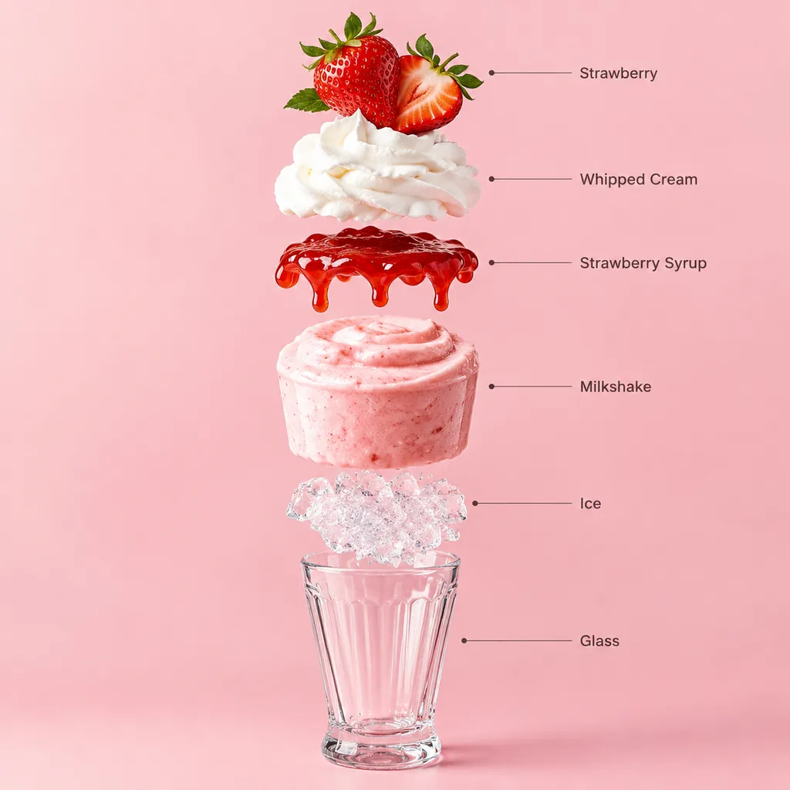</a>

> @Strength04_X 发了 Nano Banana 2 × Kling 工作流，其中 Image 2 是草莓奶昔垂直爆炸分层信息图（140 赞）。我们保留 Image 2 作为可运行静帧，并固定 1:1。

```text
Create a hyper-realistic exploded vertical infographic composition of a premium strawberry milkshake.
Top → Bottom structure:
Fresh Strawberry Garnish
→ Whipped Cream
→ Strawberry Syrup
→ Creamy Strawberry Shake
→ Crushed Ice
→ Transparent Glass Base
All elements must be perfectly centered, evenly spaced, and vertically aligned. Show realistic strawberry texture, fluffy whipped cream, glossy syrup, thick creamy milkshake consistency, translucent ice, and realistic glass reflections. Use a soft pastel pink seamless studio background with elegant café lighting and subtle realistic shadows beneath each floating element. Ultra-sharp DSLR macro beverage photography, premium dessert drink infographic aesthetic, clean professional composition, hyper realistic, 8K.
Add clean minimalist infographic text labels with thin pointer lines using these exact labels:
"Strawberry"
"Whipped Cream"
"Strawberry Syrup"
"Milkshake"
"Ice"
"Glass"
Square aspect ratio 1:1. No logos, no brands, no people, no hands.
```

- 原作者: [@Strength04_X](https://x.com/Strength04_X)
- 原帖: https://x.com/Strength04_X/status/2090665058980462697
- [在 cinel 上查看详情并一键生成](https://cinel.ai/zh/prompts/p/strawberry-milkshake-exploded-labeled?utm_source=github&utm_medium=awesome&utm_campaign=awesome-gpt-image-2.5-prompts)

### 满料牛肉玉米卷爆炸分层标注信息图

<a href="https://cinel.ai/zh/prompts/p/loaded-beef-taco-exploded-labeled?utm_source=github&utm_medium=awesome&utm_campaign=awesome-gpt-image-2.5-prompts">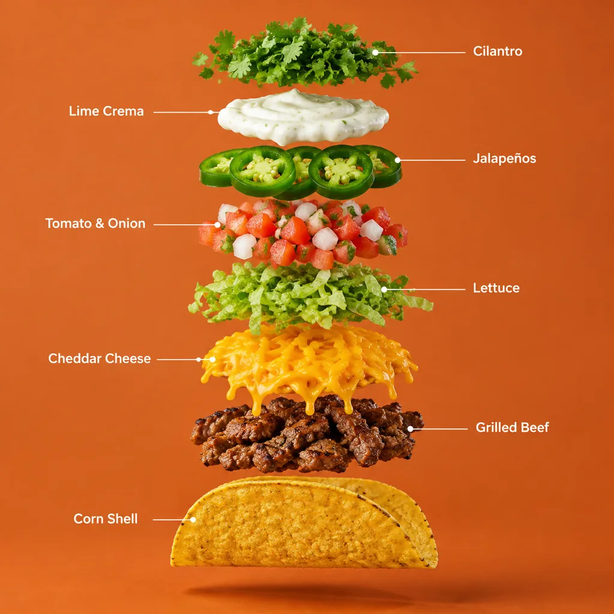</a>

> @Strength04_X 的 Image 2 牛肉玉米卷爆炸信息图（40 赞）。保留垂直标注分层，1:1。

```text
Create a hyper-realistic exploded vertical infographic composition of a premium loaded beef taco.
Top → Bottom structure:
Fresh Cilantro Garnish
→ Lime Crema
→ Jalapeño Slices
→ Diced Tomato & Onion
→ Shredded Lettuce
→ Melted Cheddar Cheese
→ Seasoned Grilled Beef
→ Crispy Corn Shell
Every element must be perfectly centered, evenly spaced, and aligned vertically. Show realistic grilled beef texture, melted cheese, crisp vegetables, fresh herbs, creamy sauce, and a detailed crunchy corn shell. Use a warm terracotta-orange seamless studio background, soft commercial lighting, subtle realistic shadows beneath every floating element, ultra-sharp DSLR macro food photography, premium fast-food infographic aesthetic, clean professional composition, hyper realistic, 8K.
Add clean minimalist infographic text labels with thin pointer lines using these exact labels:
"Cilantro"
"Lime Crema"
"Jalapeños"
"Tomato & Onion"
"Lettuce"
"Cheddar Cheese"
"Grilled Beef"
"Corn Shell"
Square aspect ratio 1:1. No logos, no brands, no people, no hands.
```

- 原作者: [@Strength04_X](https://x.com/Strength04_X)
- 原帖: https://x.com/Strength04_X/status/2091192289385451787
- [在 cinel 上查看详情并一键生成](https://cinel.ai/zh/prompts/p/loaded-beef-taco-exploded-labeled?utm_source=github&utm_medium=awesome&utm_campaign=awesome-gpt-image-2.5-prompts)

### 炸鸡块爆炸分层标注信息图

<a href="https://cinel.ai/zh/prompts/p/chicken-nuggets-exploded-labeled?utm_source=github&utm_medium=awesome&utm_campaign=awesome-gpt-image-2.5-prompts">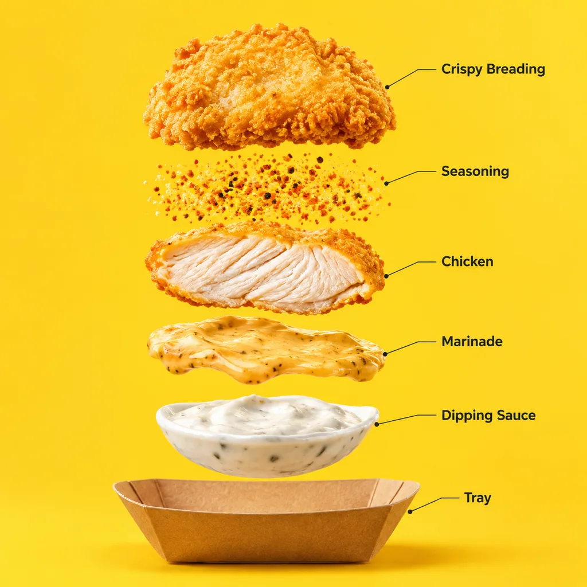</a>

> @Strength04_X 主帖（107 赞）的回复 Image 2 给出炸鸡块爆炸分层。filled 用 Image 2；点赞记主帖。

```text
Create a hyper-realistic exploded vertical infographic composition of premium crispy chicken nuggets.
Top → Bottom structure:
Crispy Breading
→ Seasoning
→ Chicken Fillet
→ Marinade Layer
→ Dipping Sauce
→ Serving Tray
Each layer must remain perfectly centered, evenly spaced, and visually clean. Show realistic golden breading texture, juicy chicken fibers, fine seasoning particles, creamy sauce texture, and a minimal serving tray. Use a bright yellow seamless studio background with soft commercial lighting and subtle realistic shadows beneath each floating element. Ultra-sharp DSLR macro food photography, premium fast-food infographic aesthetic, clean professional composition, 8K.
Add clean infographic text labels with thin pointer lines using these exact labels:
"Crispy Breading"
"Seasoning"
"Chicken"
"Marinade"
"Dipping Sauce"
"Tray"
Square aspect ratio 1:1. No logos, no brands, no people, no hands.
```

- 原作者: [@Strength04_X](https://x.com/Strength04_X)
- 原帖: https://x.com/Strength04_X/status/2089531966156857533
- [在 cinel 上查看详情并一键生成](https://cinel.ai/zh/prompts/p/chicken-nuggets-exploded-labeled?utm_source=github&utm_medium=awesome&utm_campaign=awesome-gpt-image-2.5-prompts)

### 土豆变金脆薯片英雄静帧

<a href="https://cinel.ai/zh/prompts/p/potato-golden-crunch-chips-hero?utm_source=github&utm_medium=awesome&utm_campaign=awesome-gpt-image-2.5-prompts">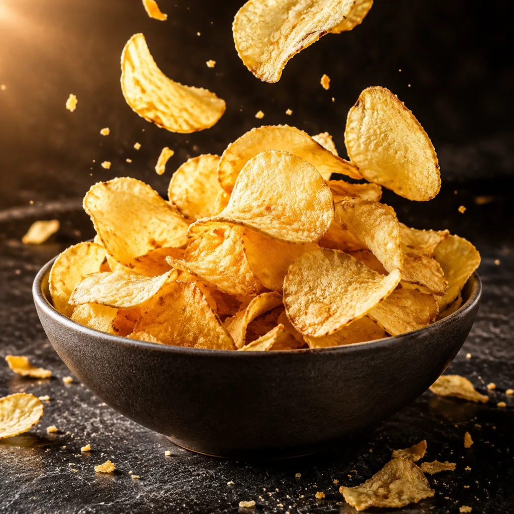</a>

> @Strength04_X 的视频分镜（144 赞）。把第 07 英雄镜头改写成静帧；去掉品牌包装文案。

```text
Ultra-realistic premium snack-food commercial still, square 1:1. Hero keyframe from a potato-to-chips transformation: a generous pile of golden crispy thin potato chips landing into a premium matte ceramic bowl on a dark cinematic stone surface, warm golden rim light, crumbs falling naturally around the bowl, shallow depth of field, ultra-crispy blistered chip texture, rich shadows, no packaging branding, no logos, no text, no people, no hands. DSLR macro food photography, 8K.
```

- 原作者: [@Strength04_X](https://x.com/Strength04_X)
- 原帖: https://x.com/Strength04_X/status/2091472894727712866
- [在 cinel 上查看详情并一键生成](https://cinel.ai/zh/prompts/p/potato-golden-crunch-chips-hero?utm_source=github&utm_medium=awesome&utm_campaign=awesome-gpt-image-2.5-prompts)

### 土豆条掰碎碎屑静帧

<a href="https://cinel.ai/zh/prompts/p/potato-sticks-crumb-break?utm_source=github&utm_medium=awesome&utm_campaign=awesome-gpt-image-2.5-prompts">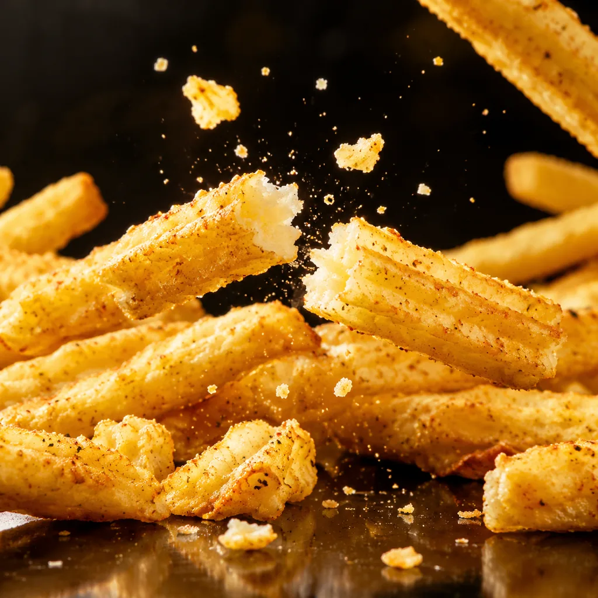</a>

> @Strength04_X 分镜（143 赞）。取掰断碎屑瞬间作静帧；去掉品牌筒包装。

```text
Ultra-realistic premium snack commercial still, square 1:1. Extreme macro of crunchy seasoned potato sticks snapping mid-air with tiny crumbs and seasoning particles suspended around them, glossy dark studio surface below, dramatic controlled lighting, golden yellow and cream palette, sharp crispy ridge texture, no branded packaging logos, no text overlays, no people, no hands. High-speed food photography, 8K.
```

- 原作者: [@Strength04_X](https://x.com/Strength04_X)
- 原帖: https://x.com/Strength04_X/status/2095782580071411770
- [在 cinel 上查看详情并一键生成](https://cinel.ai/zh/prompts/p/potato-sticks-crumb-break?utm_source=github&utm_medium=awesome&utm_campaign=awesome-gpt-image-2.5-prompts)

### 牛油果吐司配抹茶拿铁咖啡馆俯拍

<a href="https://cinel.ai/zh/prompts/p/avocado-toast-matcha-cafe-flatlay?utm_source=github&utm_medium=awesome&utm_campaign=awesome-gpt-image-2.5-prompts">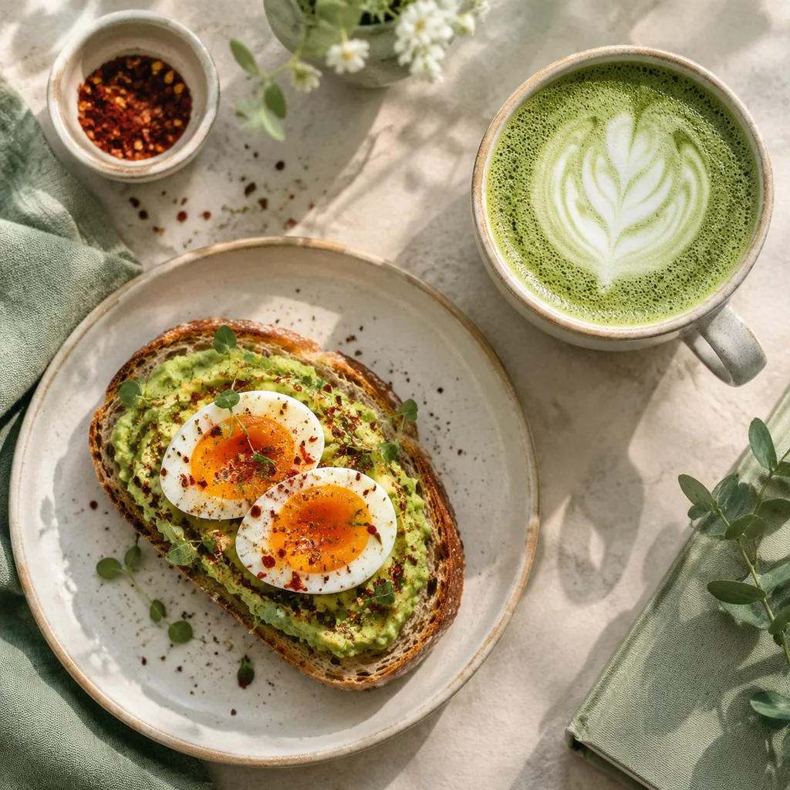</a>

> @azed_ai Fresh Café Flatlay 模板（119 赞）。填入牛油果吐司+抹茶拿铁，鼠尾草绿/奶油色。

```text
Photorealistic top-down shot of avocado toast with soft-boiled egg and chili flakes with a frothy matcha latte in a ceramic cup in a stylish café setting, cheerful fresh atmosphere, sage green and warm cream palette, elegant food styling, natural textures, soft daylight, subtle shadows, premium editorial food photography, ARRI Alexa look, crisp details, 8K realism. Square 1:1. No logos, no brand marks, no people, no hands.
```

- 原作者: [@azed_ai](https://x.com/azed_ai)
- 原帖: https://x.com/azed_ai/status/2107063271648100604
- [在 cinel 上查看详情并一键生成](https://cinel.ai/zh/prompts/p/avocado-toast-matcha-cafe-flatlay?utm_source=github&utm_medium=awesome&utm_campaign=awesome-gpt-image-2.5-prompts)

### 意面叉子蒸汽英雄静帧

<a href="https://cinel.ai/zh/prompts/p/spaghetti-fork-steam-hero?utm_source=github&utm_medium=awesome&utm_campaign=awesome-gpt-image-2.5-prompts">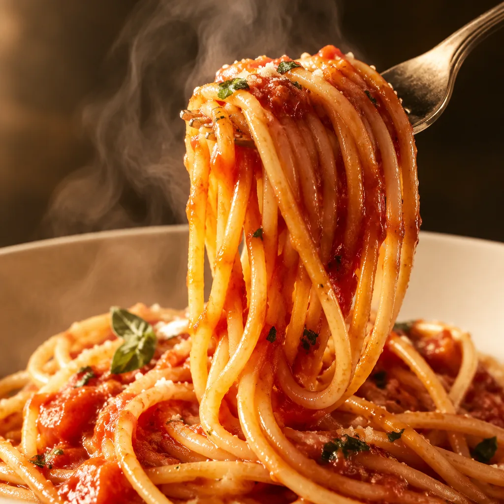</a>

> @Strength04_X 意面分镜（296 赞）。取叉子卷面蒸汽作静帧；去掉品牌包装盒。

```text
Ultra-realistic Italian food advertising still, square 1:1. Long cooked spaghetti strands coated in glossy tomato sauce being twirled elegantly around a fork, steam rising softly, extreme macro silky pasta texture, warm cinematic cream and wheat-gold lighting, dark neutral background, no branded packaging, no logos, no text, no people, no hands. Premium gourmet presentation, 8K.
```

- 原作者: [@Strength04_X](https://x.com/Strength04_X)
- 原帖: https://x.com/Strength04_X/status/2095411329461100949
- [在 cinel 上查看详情并一键生成](https://cinel.ai/zh/prompts/p/spaghetti-fork-steam-hero?utm_source=github&utm_medium=awesome&utm_campaign=awesome-gpt-image-2.5-prompts)

### 气泡柑橘饮料飞溅静帧

<a href="https://cinel.ai/zh/prompts/p/sparkling-citrus-drink-splash?utm_source=github&utm_medium=awesome&utm_campaign=awesome-gpt-image-2.5-prompts">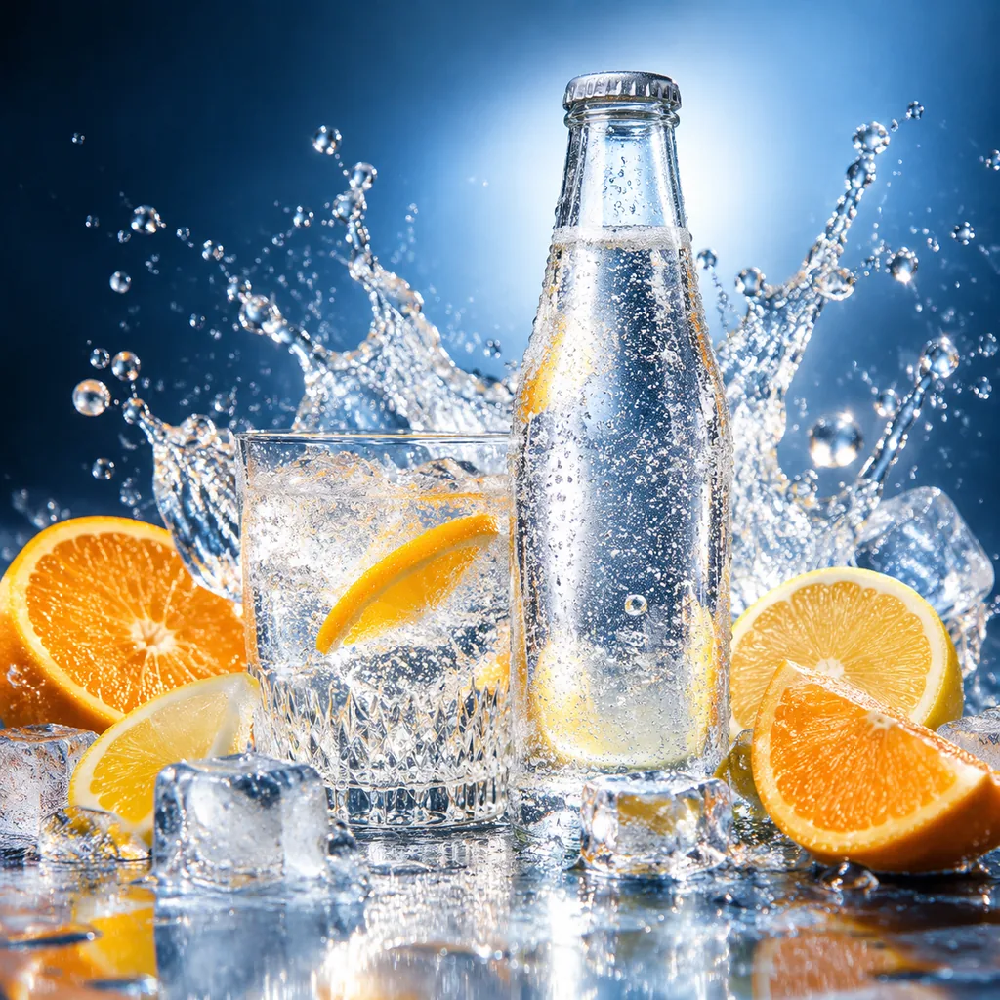</a>

> @Strength04_X 饮料分镜（242 赞）。英雄飞溅静帧；瓶子无品牌。

```text
Ultra-realistic luxury beverage advertising still, square 1:1. Final hero of a chilled unbranded clear sparkling fruit drink bottle and crystal glass surrounded by a frozen citrus splash, fresh orange and lemon slices, ice cubes, condensation droplets, silver-citrus-orange and deep blue studio palette, dramatic backlighting, no logos, no brand labels, no text, no people, no hands. High-speed liquid photography, 8K.
```

- 原作者: [@Strength04_X](https://x.com/Strength04_X)
- 原帖: https://x.com/Strength04_X/status/2091388744599486491
- [在 cinel 上查看详情并一键生成](https://cinel.ai/zh/prompts/p/sparkling-citrus-drink-splash?utm_source=github&utm_medium=awesome&utm_campaign=awesome-gpt-image-2.5-prompts)

### 花生酱丝带吐司静帧

<a href="https://cinel.ai/zh/prompts/p/peanut-butter-ribbon-toast?utm_source=github&utm_medium=awesome&utm_campaign=awesome-gpt-image-2.5-prompts">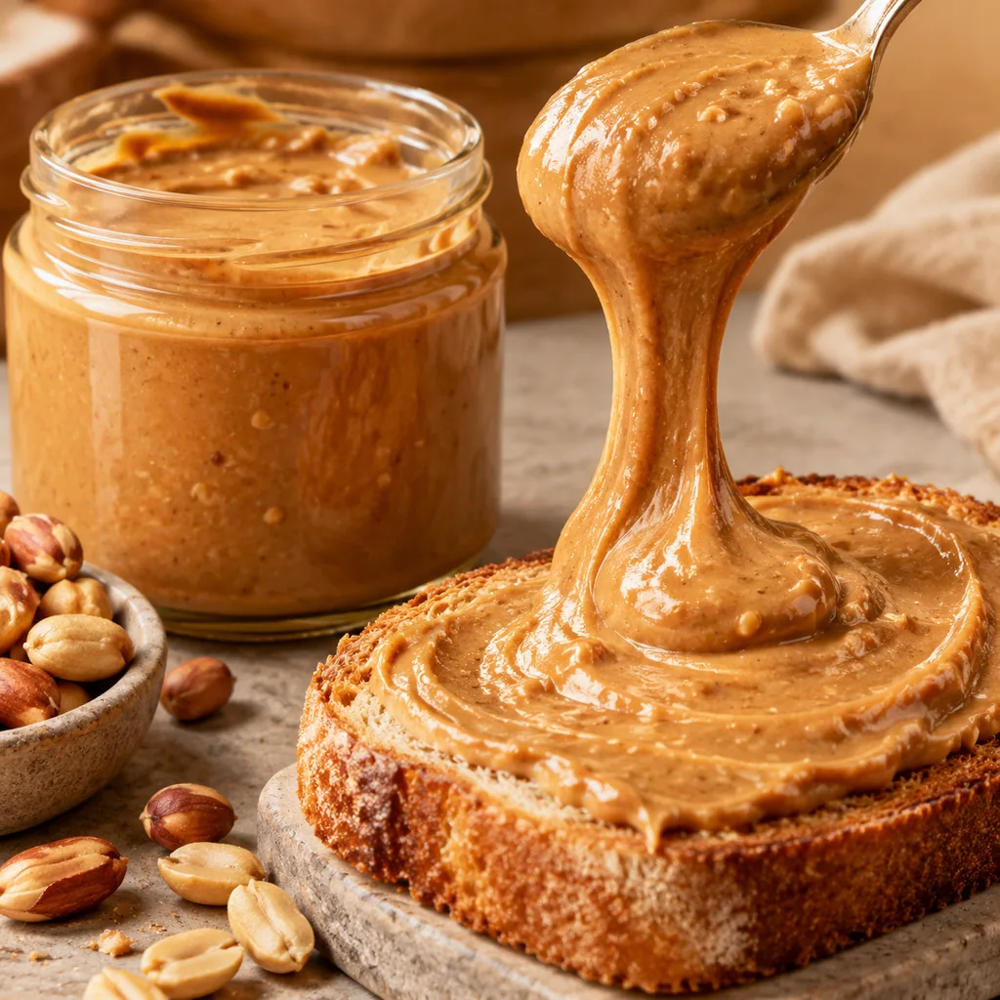</a>

> @Strength04_X 花生酱分镜（314 赞）。丝带拉起静帧；罐子无品牌。

```text
Ultra-realistic gourmet breakfast advertising still, square 1:1. Thick creamy peanut butter lifting from a spoon in a long glossy ribbon above warm toasted bread, with an unbranded glass jar and roasted peanuts nearby on a premium stone surface, warm beige caramel brown palette, natural soft lighting, rich creamy texture with tiny peanut particles, no logos, no brand labels, no text, no people, no hands. Extreme macro food photography, 8K.
```

- 原作者: [@Strength04_X](https://x.com/Strength04_X)
- 原帖: https://x.com/Strength04_X/status/2095104027667177825
- [在 cinel 上查看详情并一键生成](https://cinel.ai/zh/prompts/p/peanut-butter-ribbon-toast?utm_source=github&utm_medium=awesome&utm_campaign=awesome-gpt-image-2.5-prompts)

### 薯角掰开松软内心静帧

<a href="https://cinel.ai/zh/prompts/p/potato-wedges-fluffy-break?utm_source=github&utm_medium=awesome&utm_campaign=awesome-gpt-image-2.5-prompts">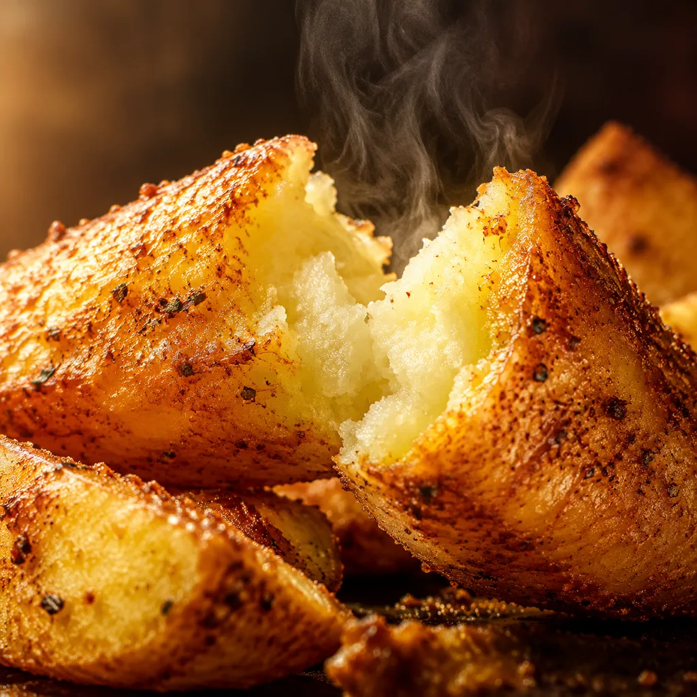</a>

> @Strength04_X 薯角分镜（249 赞）。掰开微距静帧；去掉冷冻包装品牌。

```text
Ultra-realistic gourmet food commercial still, square 1:1. One golden crispy potato wedge breaking open to reveal a soft fluffy potato center, steam rising, crispy seasoned coating with bubbling texture detail, warm cream golden yellow and dark brown studio background, dramatic side light, no packaging brands, no logos, no text, no people, no hands. Extreme macro food photography, 8K.
```

- 原作者: [@Strength04_X](https://x.com/Strength04_X)
- 原帖: https://x.com/Strength04_X/status/2091043191755878628
- [在 cinel 上查看详情并一键生成](https://cinel.ai/zh/prompts/p/potato-wedges-fluffy-break?utm_source=github&utm_medium=awesome&utm_campaign=awesome-gpt-image-2.5-prompts)

### 椰子水英雄飞溅静帧

<a href="https://cinel.ai/zh/prompts/p/coconut-water-hero-splash?utm_source=github&utm_medium=awesome&utm_campaign=awesome-gpt-image-2.5-prompts">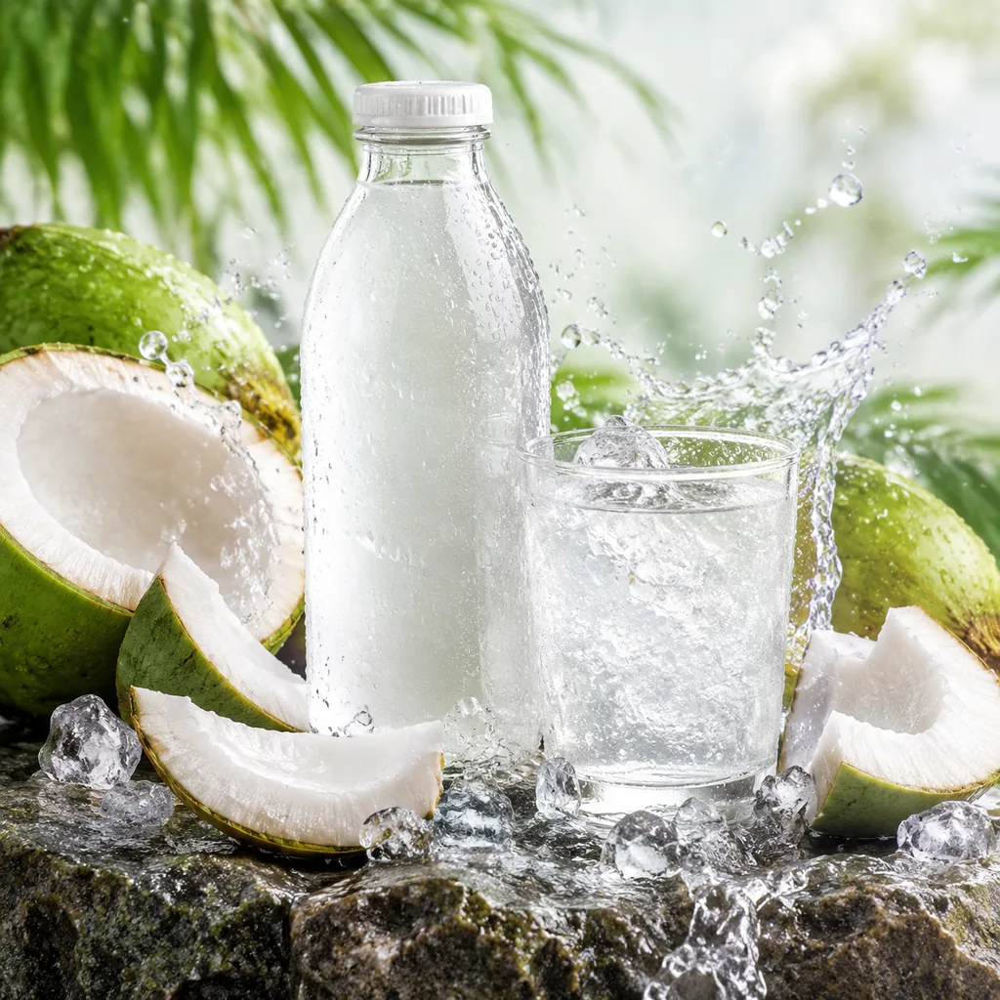</a>

> 本批最高热度美食源：@Strength04_X 椰子水分镜（663 赞）。英雄飞溅静帧；瓶子无品牌。

```text
Ultra-realistic premium natural beverage advertising still, square 1:1. Final hero of an unbranded chilled coconut water bottle and a clear glass surrounded by fresh coconut pieces and a frozen water splash on wet natural stone, heavy condensation, crystal-clear liquid, white coconut-green beige palette, natural premium lighting, no logos, no brand labels, no text, no people, no hands. High-speed liquid photography, 8K.
```

- 原作者: [@Strength04_X](https://x.com/Strength04_X)
- 原帖: https://x.com/Strength04_X/status/2094760813794111843
- [在 cinel 上查看详情并一键生成](https://cinel.ai/zh/prompts/p/coconut-water-hero-splash?utm_source=github&utm_medium=awesome&utm_campaign=awesome-gpt-image-2.5-prompts)

### 焦耳夫饭烹饪解剖信息板

<a href="https://cinel.ai/zh/prompts/p/jollof-rice-culinary-anatomy?utm_source=github&utm_medium=awesome&utm_campaign=awesome-gpt-image-2.5-prompts">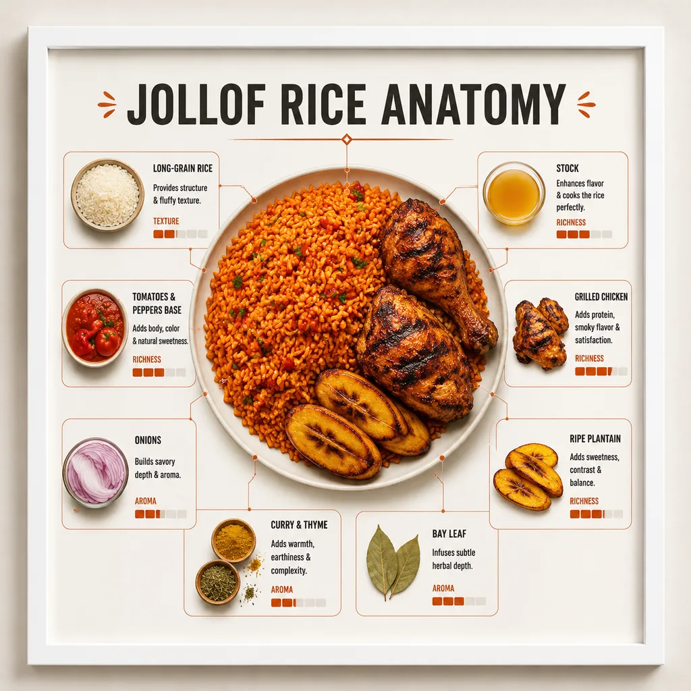</a>

> @Gdgtify 烹饪解剖板元提示词（11 赞）。填入尼日利亚焦耳夫饭；方形海报。

```text
Square 1:1 clean framed educational food anatomy poster for Nigerian jollof rice. Central high-quality rendered plate of fragrant red jollof rice with grilled plantain and chicken. Surrounding ingredient callout boxes with thin connectors: long-grain rice, tomatoes and peppers stew base, onions, curry and thyme spices, bay leaf, stock, grilled chicken, ripe plantain. Each box has component name, one short culinary-property notation, and a tiny simple chart (heat, aroma, or richness). Bold sans-serif title at top: "JOLLOF RICE ANATOMY". Bright soft studio lighting, white framed poster on clean wall, educational modern menu-lab aesthetic, appetizing food realism, no logos, no brands, no people, no hands.
```

- 原作者: [@Gdgtify](https://x.com/Gdgtify)
- 原帖: https://x.com/Gdgtify/status/2097241279071727902
- [在 cinel 上查看详情并一键生成](https://cinel.ai/zh/prompts/p/jollof-rice-culinary-anatomy?utm_source=github&utm_medium=awesome&utm_campaign=awesome-gpt-image-2.5-prompts)

### 冷压橙汁飞溅静帧

<a href="https://cinel.ai/zh/prompts/p/cold-pressed-orange-juice-splash?utm_source=github&utm_medium=awesome&utm_campaign=awesome-gpt-image-2.5-prompts">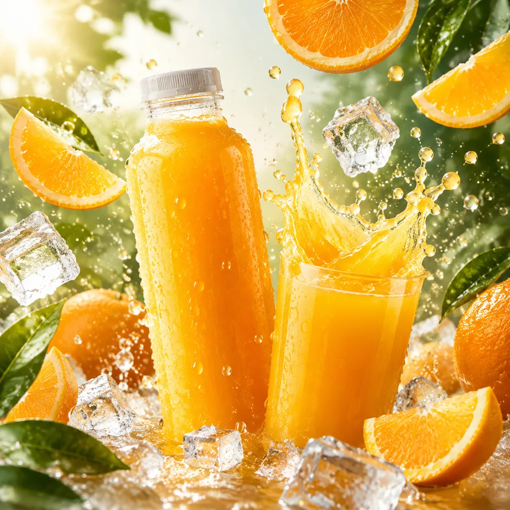</a>

> @Strength04_X 冷压果汁分镜（143 赞）。飞溅英雄静帧；瓶子无品牌。

```text
Ultra-realistic fresh beverage commercial still, square 1:1. Unbranded cold-pressed orange juice bottle with condensation beside a glass, frozen mid-air juice splash and fresh orange pieces falling around, ice cubes, vibrant orange green cream palette, dramatic backlight, no logos, no brand labels, no text, no people, no hands. High-speed liquid photography, 8K.
```

- 原作者: [@Strength04_X](https://x.com/Strength04_X)
- 原帖: https://x.com/Strength04_X/status/2090774232213131401
- [在 cinel 上查看详情并一键生成](https://cinel.ai/zh/prompts/p/cold-pressed-orange-juice-splash?utm_source=github&utm_medium=awesome&utm_campaign=awesome-gpt-image-2.5-prompts)

### 意式辣香肠披萨爆炸分层标注信息图

<a href="https://cinel.ai/zh/prompts/p/pepperoni-pizza-exploded-labeled?utm_source=github&utm_medium=awesome&utm_campaign=awesome-gpt-image-2.5-prompts">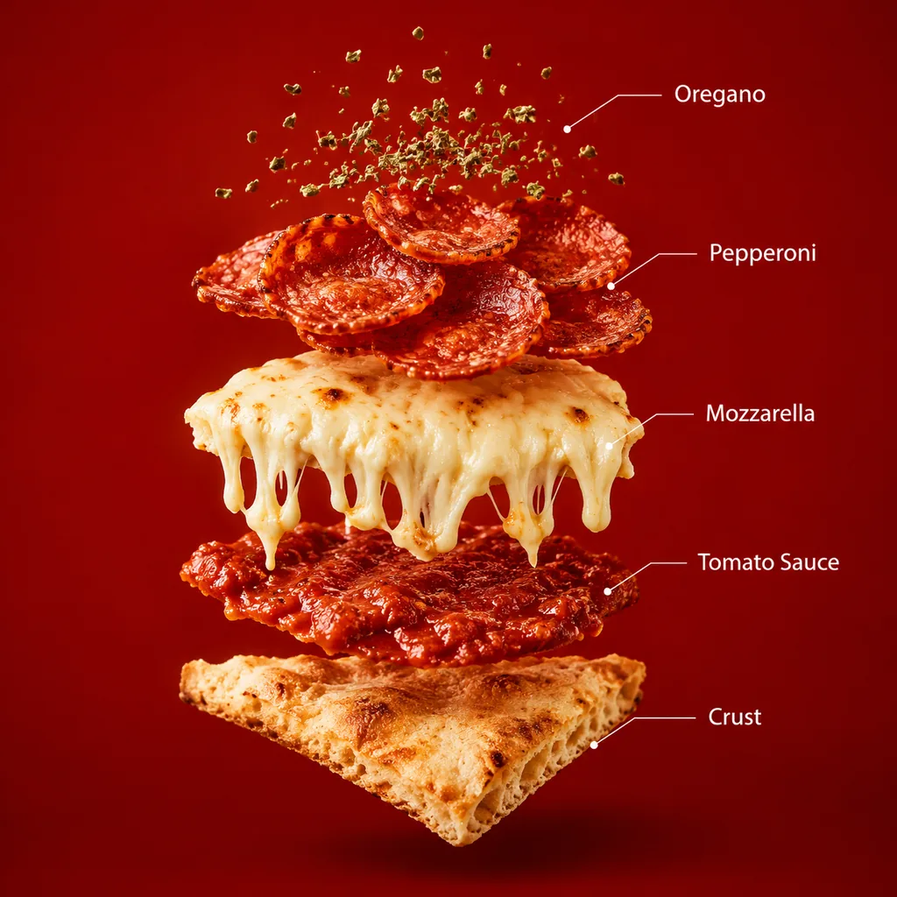</a>

> @Strength04_X 意式辣香肠披萨主帖（64 赞）公开了 Image 1；同串 Image 2 爆炸提示词未完整抓取。我们按 Strength04 固定垂直信息图模板 + Image 1 菜品反写爆炸分层。

```text
Create a hyper-realistic exploded vertical infographic composition of a premium pepperoni pizza slice stack.
Top → Bottom structure:
Oregano Sprinkle
→ Pepperoni Slices
→ Melted Mozzarella
→ Tomato Sauce
→ Golden Thin Crust
Each layer perfectly centered, evenly spaced, vertically aligned. Show stretchy melted cheese, crispy-edged pepperoni, rich sauce gloss, and detailed baked crust bubbles. Deep warm red seamless studio background, soft cinematic lighting, subtle shadows under each floating element. Ultra-sharp DSLR macro food photography, premium pizzeria infographic aesthetic, hyper realistic, 8K.
Add clean minimalist labels with thin pointer lines:
"Oregano"
"Pepperoni"
"Mozzarella"
"Tomato Sauce"
"Crust"
Square 1:1. No logos, no brands, no people, no hands.
```

- 原作者: [@Strength04_X](https://x.com/Strength04_X)
- 原帖: https://x.com/Strength04_X/status/2088559566418227273
- [在 cinel 上查看详情并一键生成](https://cinel.ai/zh/prompts/p/pepperoni-pizza-exploded-labeled?utm_source=github&utm_medium=awesome&utm_campaign=awesome-gpt-image-2.5-prompts)

### 静奢牛肉汉堡画廊海报

<a href="https://cinel.ai/zh/prompts/p/quiet-luxury-beef-burger-gallery?utm_source=github&utm_medium=awesome&utm_campaign=awesome-gpt-image-2.5-prompts">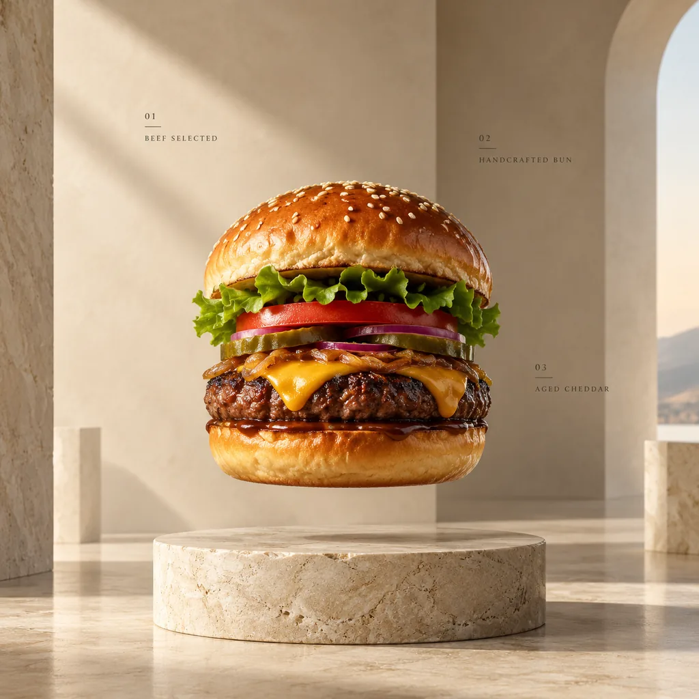</a>

> @hellsing00fl 静奢超现实汉堡海报（提示词分享；抓取时 0 赞，但风格可复用）。填成 1:1；可运行提示词去掉杂志品牌点名；原文原样保留。

```text
Create one complete high-end advertising still of a premium beef burger, square 1:1 aspect ratio. Surrealism × quiet luxury — minimalist luxury still life, soft cinematic lighting, premium editorial advertising aesthetic. One complete handcrafted burger floating slightly above a warm travertine stone pedestal inside a minimalist surreal gallery room of soft beige marble and limestone planes. Brioche bun with subtle sesame, crisp lettuce, ripe tomato, pickles, thin red onion, melted aged cheddar, thick flame-grilled beef patty with natural char, caramelized onion, dark sauce. Soft morning side light, gentle shadows, large empty architectural negative space. Tiny thin editorial marks only: "01 BEEF SELECTED" "02 HANDCRAFTED BUN" "03 AGED CHEDDAR". No fast-food red/yellow, no people, no hands, no logos, no brand names, no flames, no flying ingredients. Museum-quality quiet luxury food advertising, 8K.
```

- 原作者: [@hellsing00fl](https://x.com/hellsing00fl)
- 原帖: https://x.com/hellsing00fl/status/2096552686678417851
- [在 cinel 上查看详情并一键生成](https://cinel.ai/zh/prompts/p/quiet-luxury-beef-burger-gallery?utm_source=github&utm_medium=awesome&utm_campaign=awesome-gpt-image-2.5-prompts)

### 印尼加多加多无字悬浮碗

<a href="https://cinel.ai/zh/prompts/p/floating-gado-gado-no-text?utm_source=github&utm_medium=awesome&utm_campaign=awesome-gpt-image-2.5-prompts">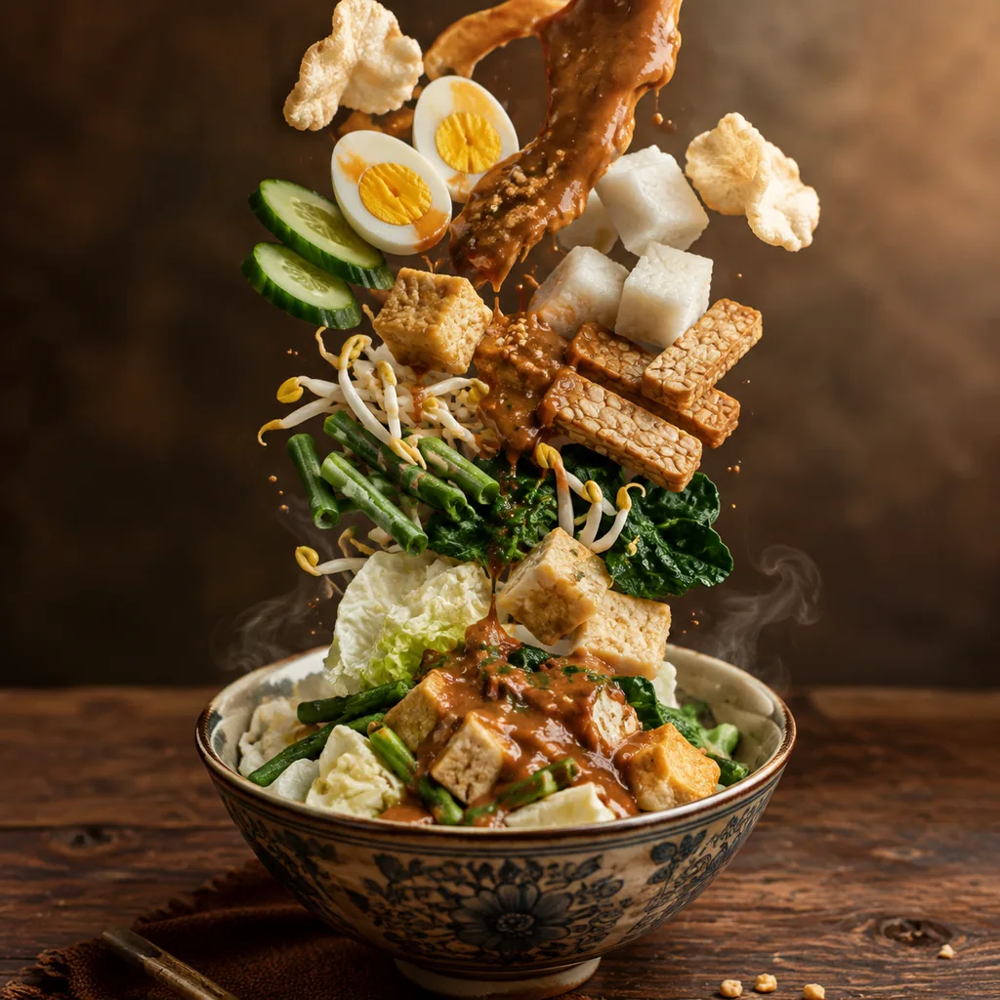</a>

> @AIMevzulari 悬浮碗美食风格（记录时 1297 赞）。同源无字填空：印尼加多加多无字悬浮碗；质朴木纹背景；按热门查询去掉全部标题/标签/水印；1:1。 使用原始帖 id。

```text
Square 1:1 hyper-realistic editorial food visual of Indonesian gado-gado. A traditional ceramic bowl of peanut-sauce salad with blanched vegetables and compressed rice cake sits at the bottom of the frame on a rustic wooden surface. Above it, the ingredients rise upward in a realistic gravity-defying stack: blanched cabbage wedges, long beans, spinach, bean sprouts, fried tofu cubes, tempeh slices, boiled egg halves, lontong rice cake, cucumber slices, emping crackers, and a glossy ribbon of peanut sauce. Keep a clean vertical composition with a strong visual hierarchy, bowl at the base and floating ingredients ascending. Absolutely no text titles, no ingredient labels, no watermarks, no logos, and no typography anywhere in the image. Professional food-magazine layout, warm cinematic studio lighting, dramatic steam where natural, motion-frozen ingredients, shallow depth of field, sharp DSLR-style focus, ultra-detailed textures, premium editorial photorealism. Square 1:1 composition.
```

- 原作者: [@AIMevzulari](https://x.com/AIMevzulari)
- 原帖: https://x.com/AIMevzulari/status/2018256452930912676
- [在 cinel 上查看详情并一键生成](https://cinel.ai/zh/prompts/p/floating-gado-gado-no-text?utm_source=github&utm_medium=awesome&utm_campaign=awesome-gpt-image-2.5-prompts)

### 印尼炒面无字悬浮碗

<a href="https://cinel.ai/zh/prompts/p/floating-mie-goreng-no-text?utm_source=github&utm_medium=awesome&utm_campaign=awesome-gpt-image-2.5-prompts">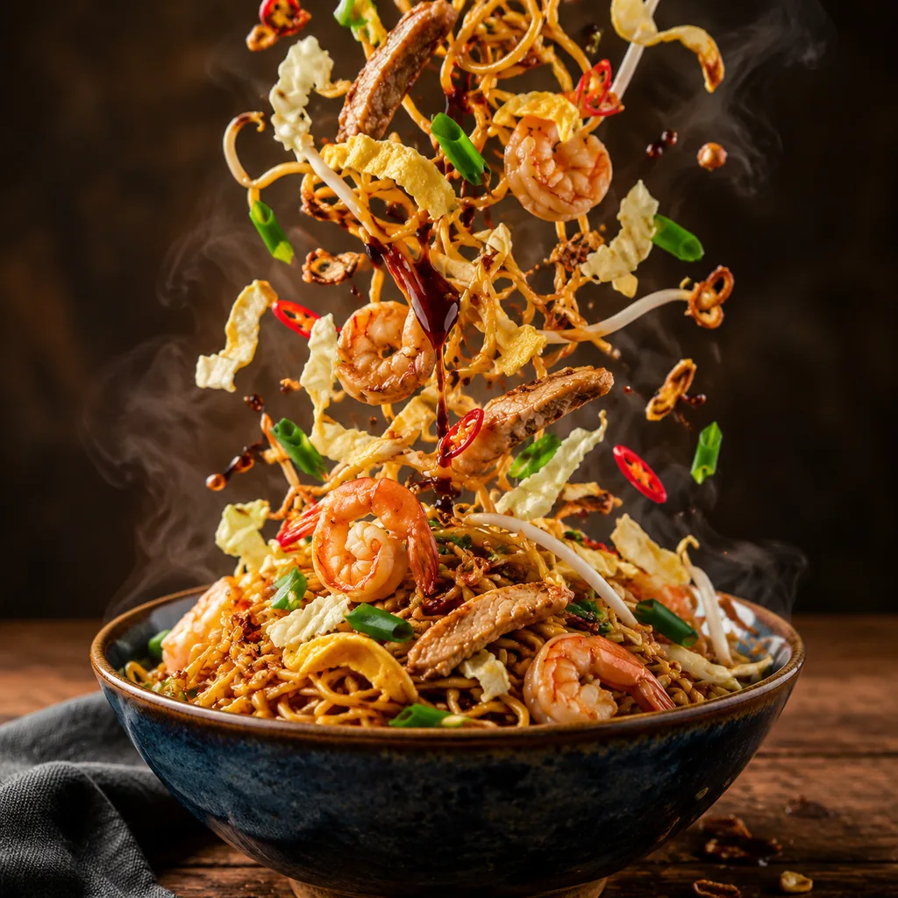</a>

> @AIMevzulari 悬浮碗美食风格（记录时 1297 赞）。同源无字填空：印尼炒面无字悬浮碗；质朴木纹背景；按热门查询去掉全部标题/标签/水印；1:1。 合成唯一 id。

```text
Square 1:1 hyper-realistic editorial food visual of Indonesian mie goreng. A traditional deep ceramic bowl of smoky stir-fried yellow noodles with sweet soy gloss sits at the bottom of the frame on a rustic wooden surface. Above it, the ingredients rise upward in a realistic gravity-defying stack: tangled yellow noodle strands, shrimp, chicken strips, cabbage shreds, bean sprouts, fried egg ribbons, green onions, fried shallots, red chili slices, and a splash of kecap manis. Keep a clean vertical composition with a strong visual hierarchy, bowl at the base and floating ingredients ascending. Absolutely no text titles, no ingredient labels, no watermarks, no logos, and no typography anywhere in the image. Professional food-magazine layout, warm cinematic studio lighting, dramatic steam where natural, motion-frozen ingredients, shallow depth of field, sharp DSLR-style focus, ultra-detailed textures, premium editorial photorealism. Square 1:1 composition.
```

- 原作者: [@AIMevzulari](https://x.com/AIMevzulari)
- 原帖: https://x.com/AIMevzulari/status/2018256452930912676
- [在 cinel 上查看详情并一键生成](https://cinel.ai/zh/prompts/p/floating-mie-goreng-no-text?utm_source=github&utm_medium=awesome&utm_campaign=awesome-gpt-image-2.5-prompts)

### 印尼克托普拉克无字悬浮碗

<a href="https://cinel.ai/zh/prompts/p/floating-ketoprak-no-text?utm_source=github&utm_medium=awesome&utm_campaign=awesome-gpt-image-2.5-prompts">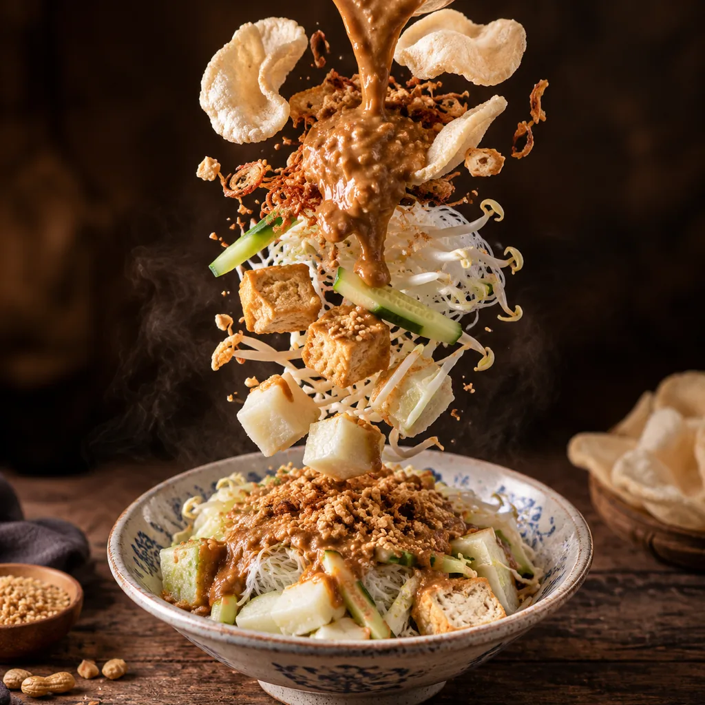</a>

> @AIMevzulari 悬浮碗美食风格（记录时 1297 赞）。同源无字填空：印尼克托普拉克无字悬浮碗；质朴木纹背景；按热门查询去掉全部标题/标签/水印；1:1。 合成唯一 id。

```text
Square 1:1 hyper-realistic editorial food visual of Indonesian ketoprak. A traditional wide ceramic bowl of ketoprak rice-cake salad with peanut sauce and vermicelli sits at the bottom of the frame on a rustic wooden surface. Above it, the ingredients rise upward in a realistic gravity-defying stack: lontong cubes, thin rice vermicelli, fried tofu, bean sprouts, cucumber sticks, crushed peanuts, fried shallots, krupuk crackers, and a thick peanut-sauce pour. Keep a clean vertical composition with a strong visual hierarchy, bowl at the base and floating ingredients ascending. Absolutely no text titles, no ingredient labels, no watermarks, no logos, and no typography anywhere in the image. Professional food-magazine layout, warm cinematic studio lighting, dramatic steam where natural, motion-frozen ingredients, shallow depth of field, sharp DSLR-style focus, ultra-detailed textures, premium editorial photorealism. Square 1:1 composition.
```

- 原作者: [@AIMevzulari](https://x.com/AIMevzulari)
- 原帖: https://x.com/AIMevzulari/status/2018256452930912676
- [在 cinel 上查看详情并一键生成](https://cinel.ai/zh/prompts/p/floating-ketoprak-no-text?utm_source=github&utm_medium=awesome&utm_campaign=awesome-gpt-image-2.5-prompts)

### 印尼炸鲶鱼无字悬浮

<a href="https://cinel.ai/zh/prompts/p/floating-pecel-lele-no-text?utm_source=github&utm_medium=awesome&utm_campaign=awesome-gpt-image-2.5-prompts">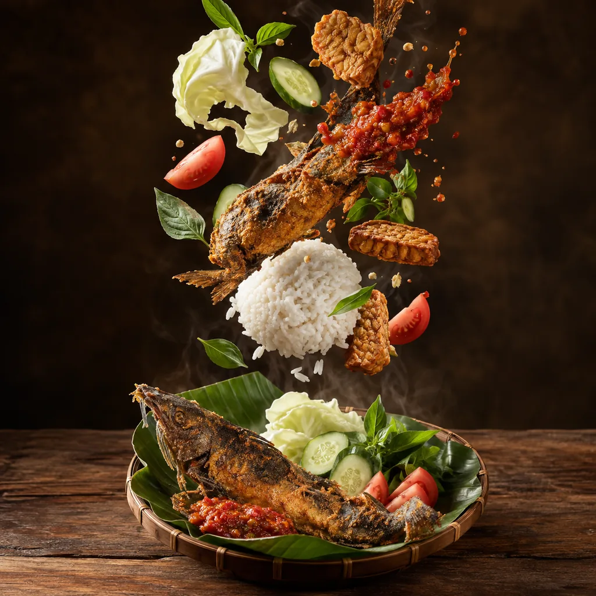</a>

> @AIMevzulari 悬浮碗美食风格（记录时 1297 赞）。同源无字填空：印尼炸鲶鱼无字悬浮；质朴木纹背景；按热门查询去掉全部标题/标签/水印；1:1。 合成唯一 id。

```text
Square 1:1 hyper-realistic editorial food visual of Indonesian pecel lele. A traditional banana-leaf plate of crispy fried catfish with fresh sambal and lalapan vegetables sits at the bottom of the frame on a rustic wooden surface. Above it, the ingredients rise upward in a realistic gravity-defying stack: whole golden fried catfish pieces, steaming white rice mound, raw cabbage, cucumber, basil leaves, tomato wedges, fried tempeh, and a fiery sambal splash. Keep a clean vertical composition with a strong visual hierarchy, bowl at the base and floating ingredients ascending. Absolutely no text titles, no ingredient labels, no watermarks, no logos, and no typography anywhere in the image. Professional food-magazine layout, warm cinematic studio lighting, dramatic steam where natural, motion-frozen ingredients, shallow depth of field, sharp DSLR-style focus, ultra-detailed textures, premium editorial photorealism. Square 1:1 composition.
```

- 原作者: [@AIMevzulari](https://x.com/AIMevzulari)
- 原帖: https://x.com/AIMevzulari/status/2018256452930912676
- [在 cinel 上查看详情并一键生成](https://cinel.ai/zh/prompts/p/floating-pecel-lele-no-text?utm_source=github&utm_medium=awesome&utm_campaign=awesome-gpt-image-2.5-prompts)

### 印尼椰浆饭无字悬浮碗

<a href="https://cinel.ai/zh/prompts/p/floating-nasi-uduk-no-text?utm_source=github&utm_medium=awesome&utm_campaign=awesome-gpt-image-2.5-prompts">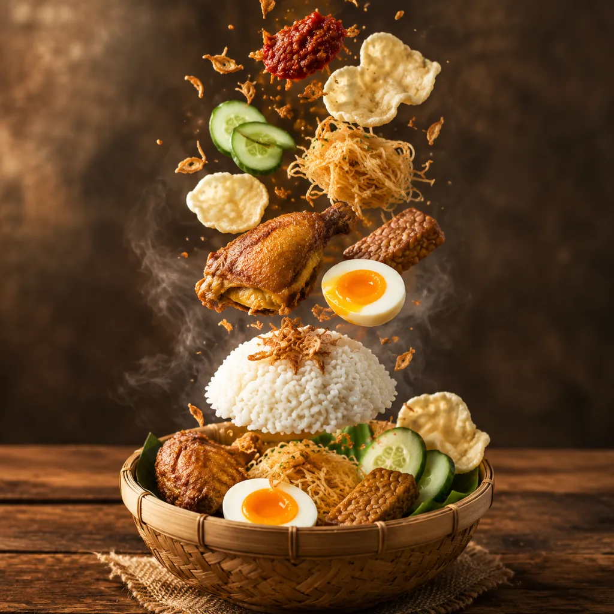</a>

> @AIMevzulari 悬浮碗美食风格（记录时 1297 赞）。同源无字填空：印尼椰浆饭无字悬浮碗；质朴木纹背景；按热门查询去掉全部标题/标签/水印；1:1。 合成唯一 id。

```text
Square 1:1 hyper-realistic editorial food visual of Indonesian nasi uduk. A traditional woven bamboo bowl of coconut milk rice with savory side dishes sits at the bottom of the frame on a rustic wooden surface. Above it, the ingredients rise upward in a realistic gravity-defying stack: fluffy coconut rice mound, fried chicken piece, soft-boiled egg, fried tempeh, bihun noodles, cucumber slices, emping, sambal, and fried shallot shower. Keep a clean vertical composition with a strong visual hierarchy, bowl at the base and floating ingredients ascending. Absolutely no text titles, no ingredient labels, no watermarks, no logos, and no typography anywhere in the image. Professional food-magazine layout, warm cinematic studio lighting, dramatic steam where natural, motion-frozen ingredients, shallow depth of field, sharp DSLR-style focus, ultra-detailed textures, premium editorial photorealism. Square 1:1 composition.
```

- 原作者: [@AIMevzulari](https://x.com/AIMevzulari)
- 原帖: https://x.com/AIMevzulari/status/2018256452930912676
- [在 cinel 上查看详情并一键生成](https://cinel.ai/zh/prompts/p/floating-nasi-uduk-no-text?utm_source=github&utm_medium=awesome&utm_campaign=awesome-gpt-image-2.5-prompts)

### 印尼隆通蔬菜咖喱无字悬浮碗

<a href="https://cinel.ai/zh/prompts/p/floating-lontong-sayur-no-text?utm_source=github&utm_medium=awesome&utm_campaign=awesome-gpt-image-2.5-prompts">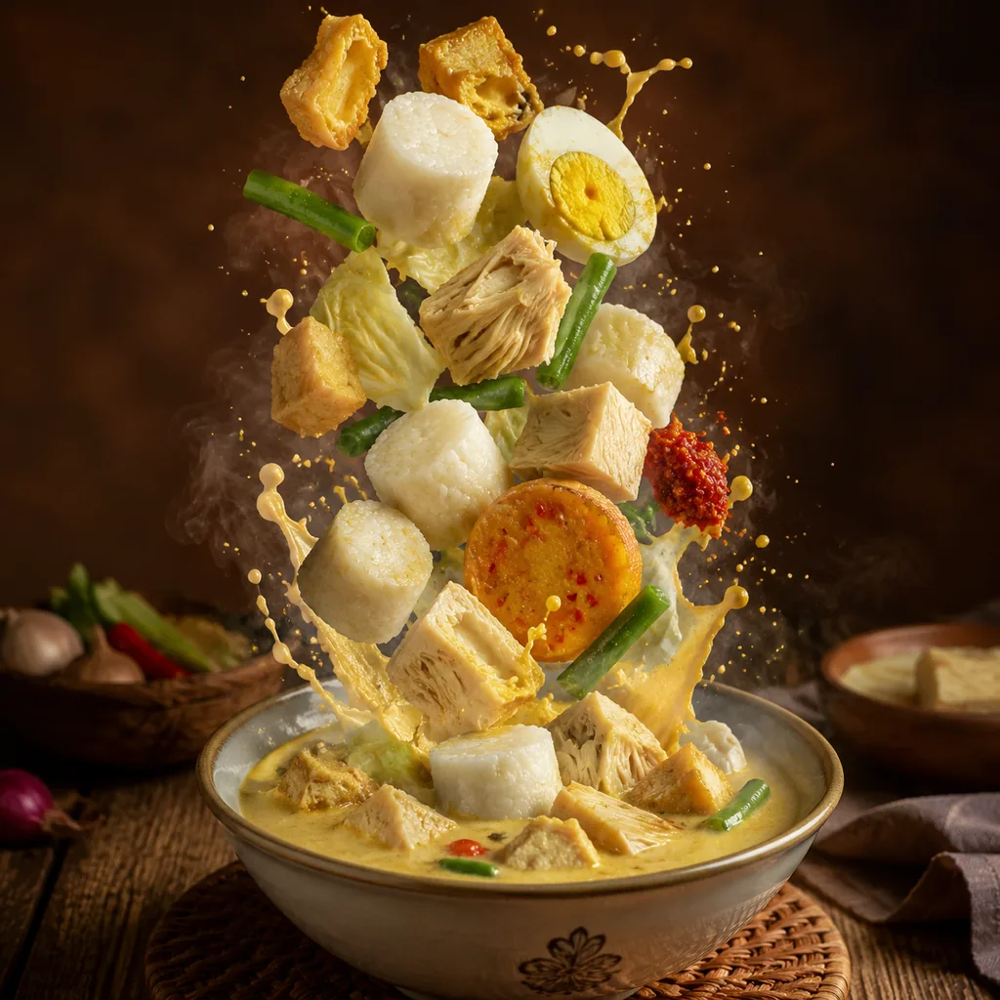</a>

> @AIMevzulari 悬浮碗美食风格（记录时 1297 赞）。同源无字填空：印尼隆通蔬菜咖喱无字悬浮碗；质朴木纹背景；按热门查询去掉全部标题/标签/水印；1:1。 合成唯一 id。

```text
Square 1:1 hyper-realistic editorial food visual of Indonesian lontong sayur. A traditional ceramic soup bowl of compressed rice cakes in rich coconut vegetable curry sits at the bottom of the frame on a rustic wooden surface. Above it, the ingredients rise upward in a realistic gravity-defying stack: lontong cylinders, jackfruit chunks, cabbage, long beans, tofu puffs, hard-boiled egg, spicy potato cake, sambal, and a creamy coconut-curry splash. Keep a clean vertical composition with a strong visual hierarchy, bowl at the base and floating ingredients ascending. Absolutely no text titles, no ingredient labels, no watermarks, no logos, and no typography anywhere in the image. Professional food-magazine layout, warm cinematic studio lighting, dramatic steam where natural, motion-frozen ingredients, shallow depth of field, sharp DSLR-style focus, ultra-detailed textures, premium editorial photorealism. Square 1:1 composition.
```

- 原作者: [@AIMevzulari](https://x.com/AIMevzulari)
- 原帖: https://x.com/AIMevzulari/status/2018256452930912676
- [在 cinel 上查看详情并一键生成](https://cinel.ai/zh/prompts/p/floating-lontong-sayur-no-text?utm_source=github&utm_medium=awesome&utm_campaign=awesome-gpt-image-2.5-prompts)

### 印尼恩帕尔根东牛肉汤无字悬浮碗

<a href="https://cinel.ai/zh/prompts/p/floating-empal-gentong-no-text?utm_source=github&utm_medium=awesome&utm_campaign=awesome-gpt-image-2.5-prompts">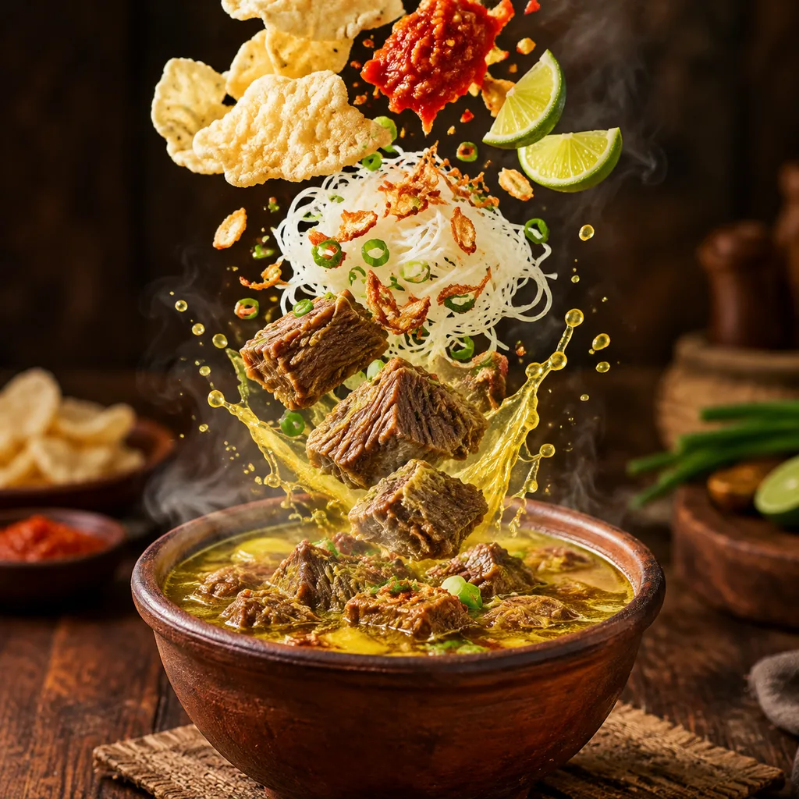</a>

> @AIMevzulari 悬浮碗美食风格（记录时 1297 赞）。同源无字填空：印尼恩帕尔根东牛肉汤无字悬浮碗；质朴木纹背景；按热门查询去掉全部标题/标签/水印；1:1。 合成唯一 id。

```text
Square 1:1 hyper-realistic editorial food visual of Indonesian empal gentong. A traditional clay soup bowl of Cirebon-style beef soup with fragrant yellow spices sits at the bottom of the frame on a rustic wooden surface. Above it, the ingredients rise upward in a realistic gravity-defying stack: tender beef chunks, clear yellow spice broth splash, rice noodles, fried shallots, scallions, lime wedges, emping, and chili sambal. Keep a clean vertical composition with a strong visual hierarchy, bowl at the base and floating ingredients ascending. Absolutely no text titles, no ingredient labels, no watermarks, no logos, and no typography anywhere in the image. Professional food-magazine layout, warm cinematic studio lighting, dramatic steam where natural, motion-frozen ingredients, shallow depth of field, sharp DSLR-style focus, ultra-detailed textures, premium editorial photorealism. Square 1:1 composition.
```

- 原作者: [@AIMevzulari](https://x.com/AIMevzulari)
- 原帖: https://x.com/AIMevzulari/status/2018256452930912676
- [在 cinel 上查看详情并一键生成](https://cinel.ai/zh/prompts/p/floating-empal-gentong-no-text?utm_source=github&utm_medium=awesome&utm_campaign=awesome-gpt-image-2.5-prompts)

### 印尼巴塔戈无字悬浮

<a href="https://cinel.ai/zh/prompts/p/floating-batagor-no-text?utm_source=github&utm_medium=awesome&utm_campaign=awesome-gpt-image-2.5-prompts">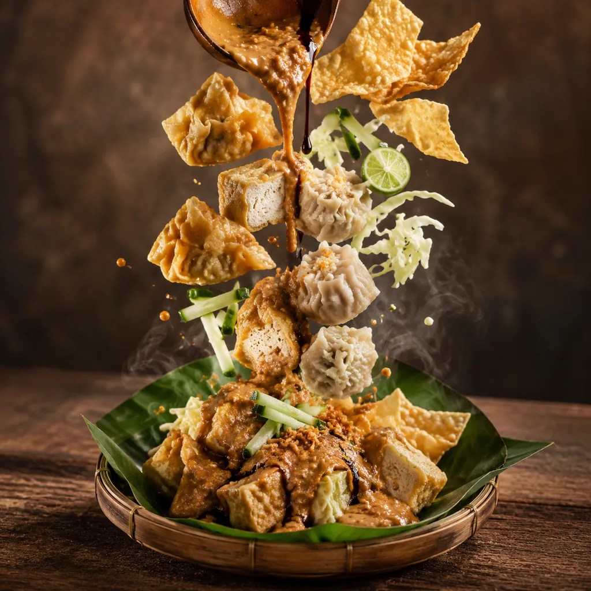</a>

> @AIMevzulari 悬浮碗美食风格（记录时 1297 赞）。同源无字填空：印尼巴塔戈无字悬浮；质朴木纹背景；按热门查询去掉全部标题/标签/水印；1:1。 合成唯一 id。

```text
Square 1:1 hyper-realistic editorial food visual of Indonesian batagor. A traditional banana-leaf plate of fried fish dumplings with peanut sauce sits at the bottom of the frame on a rustic wooden surface. Above it, the ingredients rise upward in a realistic gravity-defying stack: golden fried batagor dumplings, tofu batagor, steamed siomay pieces, shredded cucumber, cabbage, lime, crispy wonton chips, and a thick peanut-sauce pour with sweet soy drizzle. Keep a clean vertical composition with a strong visual hierarchy, bowl at the base and floating ingredients ascending. Absolutely no text titles, no ingredient labels, no watermarks, no logos, and no typography anywhere in the image. Professional food-magazine layout, warm cinematic studio lighting, dramatic steam where natural, motion-frozen ingredients, shallow depth of field, sharp DSLR-style focus, ultra-detailed textures, premium editorial photorealism. Square 1:1 composition.
```

- 原作者: [@AIMevzulari](https://x.com/AIMevzulari)
- 原帖: https://x.com/AIMevzulari/status/2018256452930912676
- [在 cinel 上查看详情并一键生成](https://cinel.ai/zh/prompts/p/floating-batagor-no-text?utm_source=github&utm_medium=awesome&utm_campaign=awesome-gpt-image-2.5-prompts)

### 万隆烧卖无字悬浮

<a href="https://cinel.ai/zh/prompts/p/floating-siomay-bandung-no-text?utm_source=github&utm_medium=awesome&utm_campaign=awesome-gpt-image-2.5-prompts">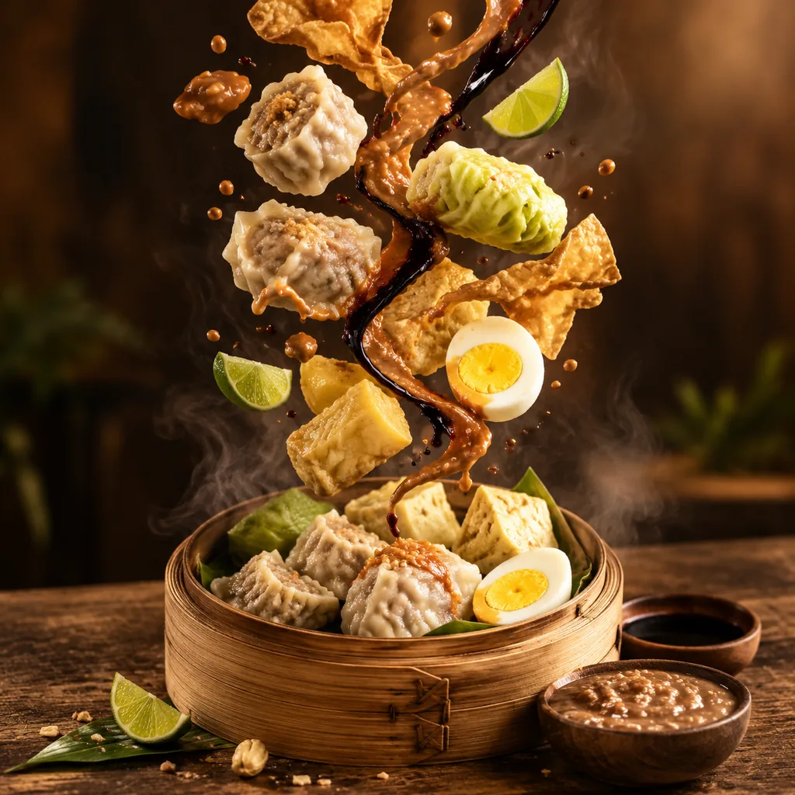</a>

> @Taaruk_ 悬浮碗美食风格（记录时 227 赞）。同源无字填空：万隆烧卖无字悬浮；质朴木纹背景；按热门查询去掉全部标题/标签/水印；1:1。 合成唯一 id。

```text
Square 1:1 hyper-realistic editorial food visual of Bandung siomay. A traditional bamboo steamer basket plate of steamed fish dumplings with peanut sauce and sweet soy sits at the bottom of the frame on a rustic wooden surface. Above it, the ingredients rise upward in a realistic gravity-defying stack: steamed fish siomay, tofu siomay, cabbage roll, hard-boiled egg, potato siomay, fried wonton skin, lime wedges, and a glossy peanut-sauce ribbon with kecap manis. Keep a clean vertical composition with a strong visual hierarchy, bowl at the base and floating ingredients ascending. Absolutely no text titles, no ingredient labels, no watermarks, no logos, and no typography anywhere in the image. Professional food-magazine layout, warm cinematic studio lighting, dramatic steam where natural, motion-frozen ingredients, shallow depth of field, sharp DSLR-style focus, ultra-detailed textures, premium editorial photorealism. Square 1:1 composition.
```

- 原作者: [@Taaruk_](https://x.com/Taaruk_)
- 原帖: https://x.com/Taaruk_/status/2019254034654195755
- [在 cinel 上查看详情并一键生成](https://cinel.ai/zh/prompts/p/floating-siomay-bandung-no-text?utm_source=github&utm_medium=awesome&utm_campaign=awesome-gpt-image-2.5-prompts)

### 巨港鱼饼无字悬浮碗

<a href="https://cinel.ai/zh/prompts/p/floating-pempek-palembang-no-text?utm_source=github&utm_medium=awesome&utm_campaign=awesome-gpt-image-2.5-prompts">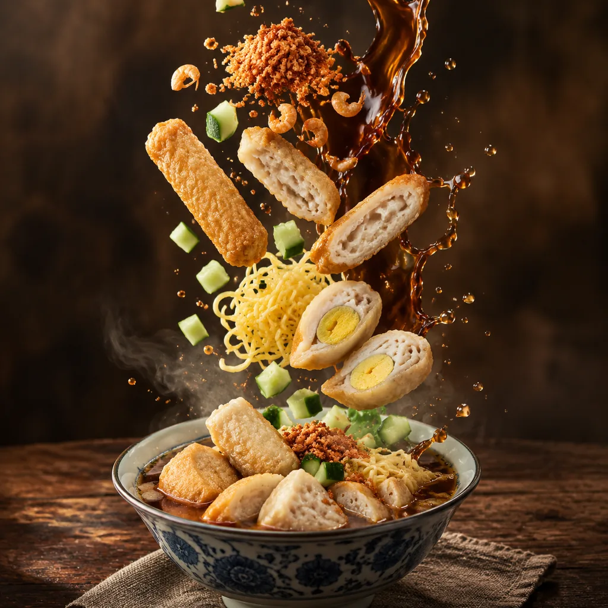</a>

> @Taaruk_ 悬浮碗美食风格（记录时 227 赞）。同源无字填空：巨港鱼饼无字悬浮碗；质朴木纹背景；按热门查询去掉全部标题/标签/水印；1:1。 合成唯一 id。

```text
Square 1:1 hyper-realistic editorial food visual of Palembang pempek. A traditional ceramic bowl of fried fish cakes with vinegar cuko sauce and noodles sits at the bottom of the frame on a rustic wooden surface. Above it, the ingredients rise upward in a realistic gravity-defying stack: fried lenjer pempek sticks, submarine pempek cut open, egg pempek halves, yellow egg noodles, diced cucumber, dried shrimp powder, and a sharp cuko vinegar-sauce splash. Keep a clean vertical composition with a strong visual hierarchy, bowl at the base and floating ingredients ascending. Absolutely no text titles, no ingredient labels, no watermarks, no logos, and no typography anywhere in the image. Professional food-magazine layout, warm cinematic studio lighting, dramatic steam where natural, motion-frozen ingredients, shallow depth of field, sharp DSLR-style focus, ultra-detailed textures, premium editorial photorealism. Square 1:1 composition.
```

- 原作者: [@Taaruk_](https://x.com/Taaruk_)
- 原帖: https://x.com/Taaruk_/status/2019254034654195755
- [在 cinel 上查看详情并一键生成](https://cinel.ai/zh/prompts/p/floating-pempek-palembang-no-text?utm_source=github&utm_medium=awesome&utm_campaign=awesome-gpt-image-2.5-prompts)

### 印尼鸡肉粥无字悬浮碗

<a href="https://cinel.ai/zh/prompts/p/floating-bubur-ayam-no-text?utm_source=github&utm_medium=awesome&utm_campaign=awesome-gpt-image-2.5-prompts">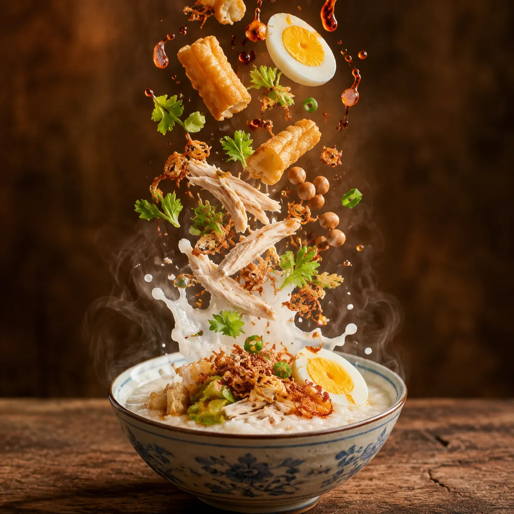</a>

> @Taaruk_ 悬浮碗美食风格（记录时 227 赞）。同源无字填空：印尼鸡肉粥无字悬浮碗；质朴木纹背景；按热门查询去掉全部标题/标签/水印；1:1。 合成唯一 id。

```text
Square 1:1 hyper-realistic editorial food visual of Indonesian bubur ayam. A traditional ceramic porridge bowl of savory chicken rice porridge with crisp toppings sits at the bottom of the frame on a rustic wooden surface. Above it, the ingredients rise upward in a realistic gravity-defying stack: creamy white rice porridge splash, shredded chicken, fried shallots, scallions, celery, cakwe sticks, toasted soybeans, boiled egg slices, and chili oil droplets. Keep a clean vertical composition with a strong visual hierarchy, bowl at the base and floating ingredients ascending. Absolutely no text titles, no ingredient labels, no watermarks, no logos, and no typography anywhere in the image. Professional food-magazine layout, warm cinematic studio lighting, dramatic steam where natural, motion-frozen ingredients, shallow depth of field, sharp DSLR-style focus, ultra-detailed textures, premium editorial photorealism. Square 1:1 composition.
```

- 原作者: [@Taaruk_](https://x.com/Taaruk_)
- 原帖: https://x.com/Taaruk_/status/2019254034654195755
- [在 cinel 上查看详情并一键生成](https://cinel.ai/zh/prompts/p/floating-bubur-ayam-no-text?utm_source=github&utm_medium=awesome&utm_campaign=awesome-gpt-image-2.5-prompts)

### 印尼甜马塔巴克无字悬浮

<a href="https://cinel.ai/zh/prompts/p/floating-martabak-manis-no-text?utm_source=github&utm_medium=awesome&utm_campaign=awesome-gpt-image-2.5-prompts">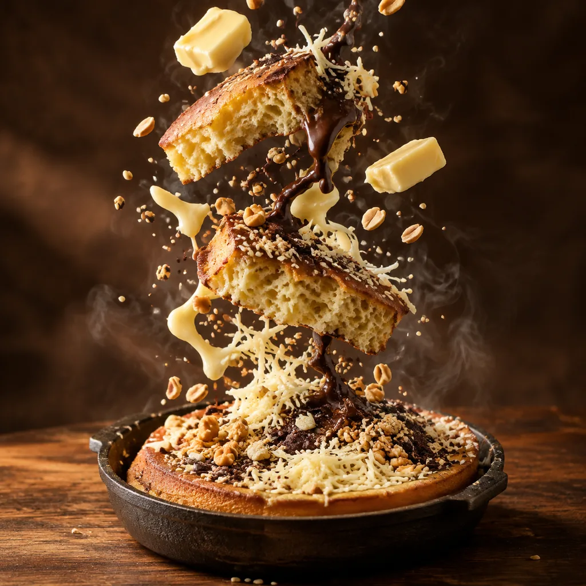</a>

> @Taaruk_ 悬浮碗美食风格（记录时 227 赞）。同源无字填空：印尼甜马塔巴克无字悬浮；质朴木纹背景；按热门查询去掉全部标题/标签/水印；1:1。 合成唯一 id。

```text
Square 1:1 hyper-realistic editorial food visual of Indonesian martabak manis. A traditional cast-iron pan base of thick sweet martabak pancake with melting toppings sits at the bottom of the frame on a rustic wooden surface. Above it, the ingredients rise upward in a realistic gravity-defying stack: torn fluffy pancake halves, melted chocolate, crushed peanuts, sesame seeds, condensed milk ribbons, grated cheese, and butter pats floating above. Keep a clean vertical composition with a strong visual hierarchy, bowl at the base and floating ingredients ascending. Absolutely no text titles, no ingredient labels, no watermarks, no logos, and no typography anywhere in the image. Professional food-magazine layout, warm cinematic studio lighting, dramatic steam where natural, motion-frozen ingredients, shallow depth of field, sharp DSLR-style focus, ultra-detailed textures, premium editorial photorealism. Square 1:1 composition.
```

- 原作者: [@Taaruk_](https://x.com/Taaruk_)
- 原帖: https://x.com/Taaruk_/status/2019254034654195755
- [在 cinel 上查看详情并一键生成](https://cinel.ai/zh/prompts/p/floating-martabak-manis-no-text?utm_source=github&utm_medium=awesome&utm_campaign=awesome-gpt-image-2.5-prompts)

### 印尼克莱朋塔无字悬浮

<a href="https://cinel.ai/zh/prompts/p/floating-klepon-tower-no-text?utm_source=github&utm_medium=awesome&utm_campaign=awesome-gpt-image-2.5-prompts">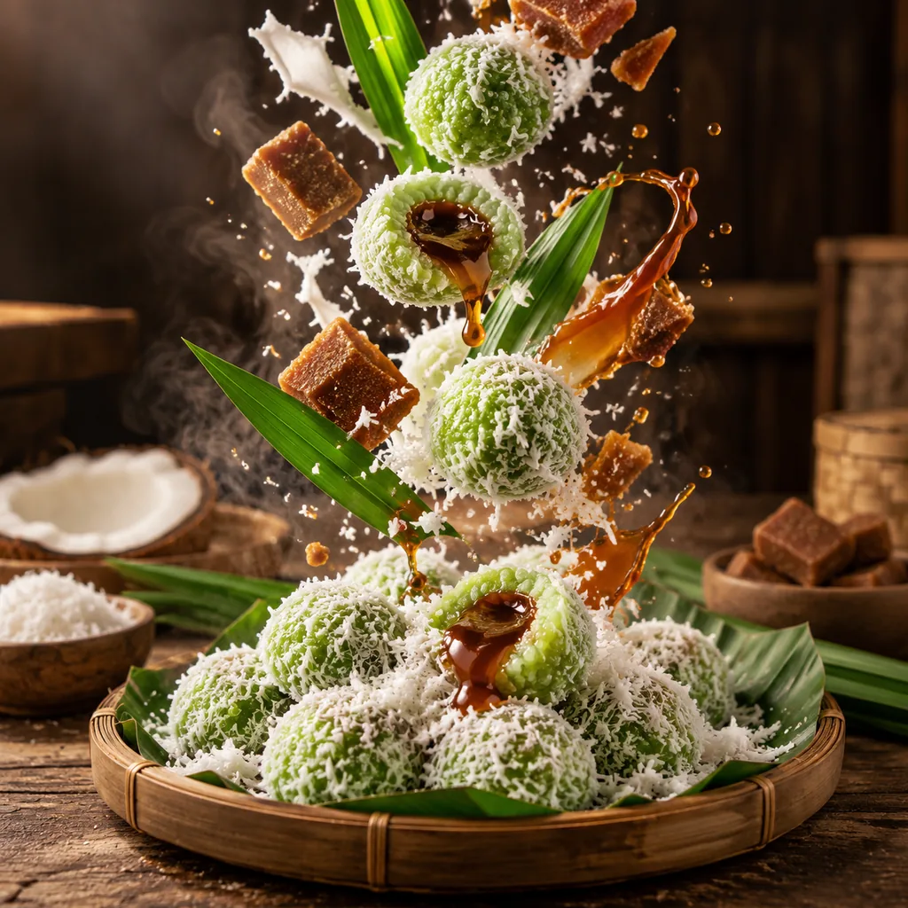</a>

> @Taaruk_ 悬浮碗美食风格（记录时 227 赞）。同源无字填空：印尼克莱朋塔无字悬浮；质朴木纹背景；按热门查询去掉全部标题/标签/水印；1:1。 合成唯一 id。

```text
Square 1:1 hyper-realistic editorial food visual of Indonesian klepon. A traditional banana-leaf platter of pandan sticky-rice balls coated in grated coconut sits at the bottom of the frame on a rustic wooden surface. Above it, the ingredients rise upward in a realistic gravity-defying stack: bright green klepon balls, molten palm-sugar cores oozing, fresh grated coconut flakes, pandan leaves, and a palm-sugar syrup splash rising in a tower. Keep a clean vertical composition with a strong visual hierarchy, bowl at the base and floating ingredients ascending. Absolutely no text titles, no ingredient labels, no watermarks, no logos, and no typography anywhere in the image. Professional food-magazine layout, warm cinematic studio lighting, dramatic steam where natural, motion-frozen ingredients, shallow depth of field, sharp DSLR-style focus, ultra-detailed textures, premium editorial photorealism. Square 1:1 composition.
```

- 原作者: [@Taaruk_](https://x.com/Taaruk_)
- 原帖: https://x.com/Taaruk_/status/2019254034654195755
- [在 cinel 上查看详情并一键生成](https://cinel.ai/zh/prompts/p/floating-klepon-tower-no-text?utm_source=github&utm_medium=awesome&utm_campaign=awesome-gpt-image-2.5-prompts)

### 印尼杂冰无字悬浮碗

<a href="https://cinel.ai/zh/prompts/p/floating-es-campur-no-text?utm_source=github&utm_medium=awesome&utm_campaign=awesome-gpt-image-2.5-prompts">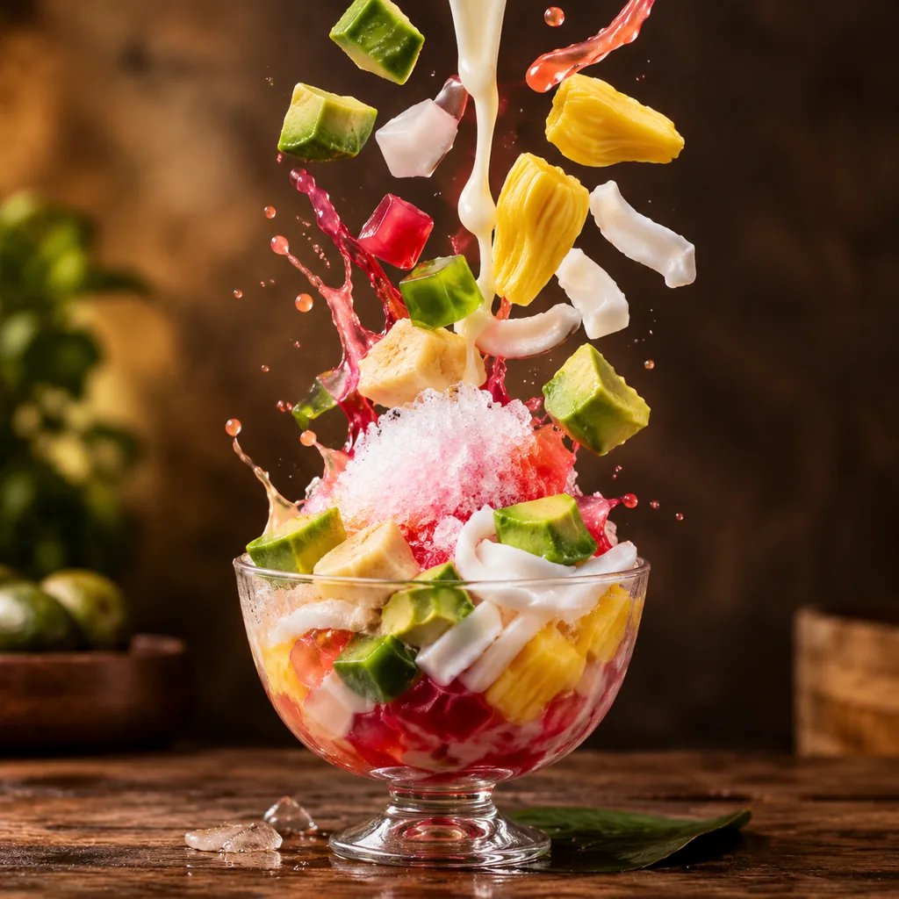</a>

> @Taaruk_ 悬浮碗美食风格（记录时 227 赞）。同源无字填空：印尼杂冰无字悬浮碗；质朴木纹背景；按热门查询去掉全部标题/标签/水印；1:1。 合成唯一 id。

```text
Square 1:1 hyper-realistic editorial food visual of Indonesian es campur. A traditional tall glass bowl of mixed ice dessert with syrup, jelly, and tropical fruit sits at the bottom of the frame on a rustic wooden surface. Above it, the ingredients rise upward in a realistic gravity-defying stack: shaved ice mound, colorful agar jellies, fermented cassava tape, avocado chunks, jackfruit, coconut young meat, condensed milk pour, and rose syrup splash. Keep a clean vertical composition with a strong visual hierarchy, bowl at the base and floating ingredients ascending. Absolutely no text titles, no ingredient labels, no watermarks, no logos, and no typography anywhere in the image. Professional food-magazine layout, warm cinematic studio lighting, dramatic steam where natural, motion-frozen ingredients, shallow depth of field, sharp DSLR-style focus, ultra-detailed textures, premium editorial photorealism. Square 1:1 composition.
```

- 原作者: [@Taaruk_](https://x.com/Taaruk_)
- 原帖: https://x.com/Taaruk_/status/2019254034654195755
- [在 cinel 上查看详情并一键生成](https://cinel.ai/zh/prompts/p/floating-es-campur-no-text?utm_source=github&utm_medium=awesome&utm_campaign=awesome-gpt-image-2.5-prompts)

### 金巴兰烤鱼无字悬浮

<a href="https://cinel.ai/zh/prompts/p/floating-ikan-bakar-jimbaran-no-text?utm_source=github&utm_medium=awesome&utm_campaign=awesome-gpt-image-2.5-prompts">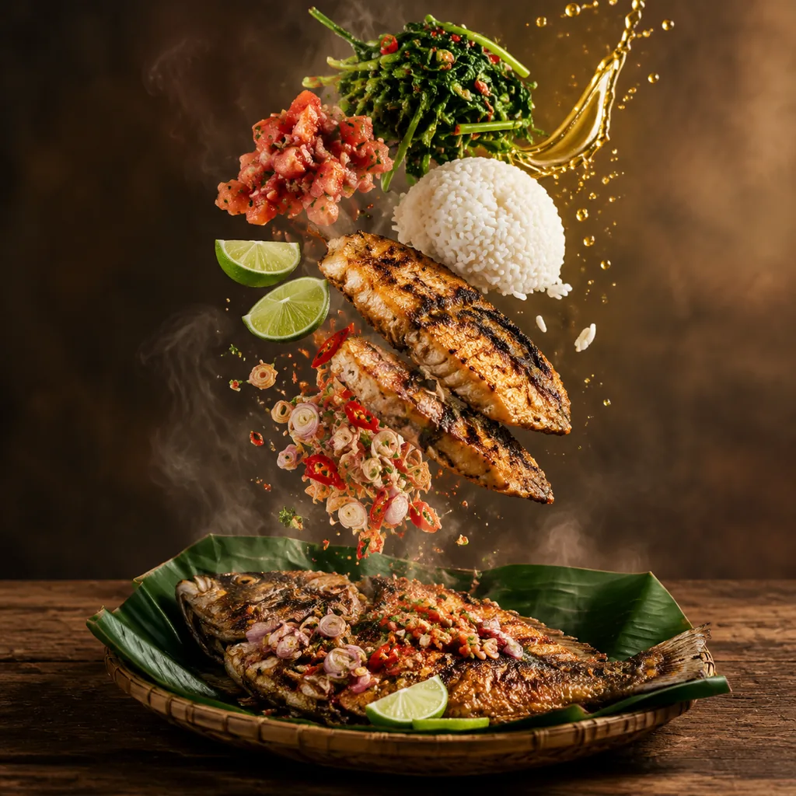</a>

> @Taaruk_ 悬浮碗美食风格（记录时 136 赞）。同源无字填空：金巴兰烤鱼无字悬浮；质朴木纹背景；按热门查询去掉全部标题/标签/水印；1:1。 合成唯一 id。

```text
Square 1:1 hyper-realistic editorial food visual of Jimbaran grilled fish. A traditional banana-leaf platter of charcoal-grilled whole fish with sambal matah sits at the bottom of the frame on a rustic wooden surface. Above it, the ingredients rise upward in a realistic gravity-defying stack: charred grilled fish fillets, sambal matah with lemongrass and shallots, lime wedges, steamed rice, water spinach, tomato salsa, and a smoky oil splash. Keep a clean vertical composition with a strong visual hierarchy, bowl at the base and floating ingredients ascending. Absolutely no text titles, no ingredient labels, no watermarks, no logos, and no typography anywhere in the image. Professional food-magazine layout, warm cinematic studio lighting, dramatic steam where natural, motion-frozen ingredients, shallow depth of field, sharp DSLR-style focus, ultra-detailed textures, premium editorial photorealism. Square 1:1 composition.
```

- 原作者: [@Taaruk_](https://x.com/Taaruk_)
- 原帖: https://x.com/Taaruk_/status/2019806212599284155
- [在 cinel 上查看详情并一键生成](https://cinel.ai/zh/prompts/p/floating-ikan-bakar-jimbaran-no-text?utm_source=github&utm_medium=awesome&utm_campaign=awesome-gpt-image-2.5-prompts)

### 印尼炸鸭无字悬浮

<a href="https://cinel.ai/zh/prompts/p/floating-bebek-goreng-no-text?utm_source=github&utm_medium=awesome&utm_campaign=awesome-gpt-image-2.5-prompts">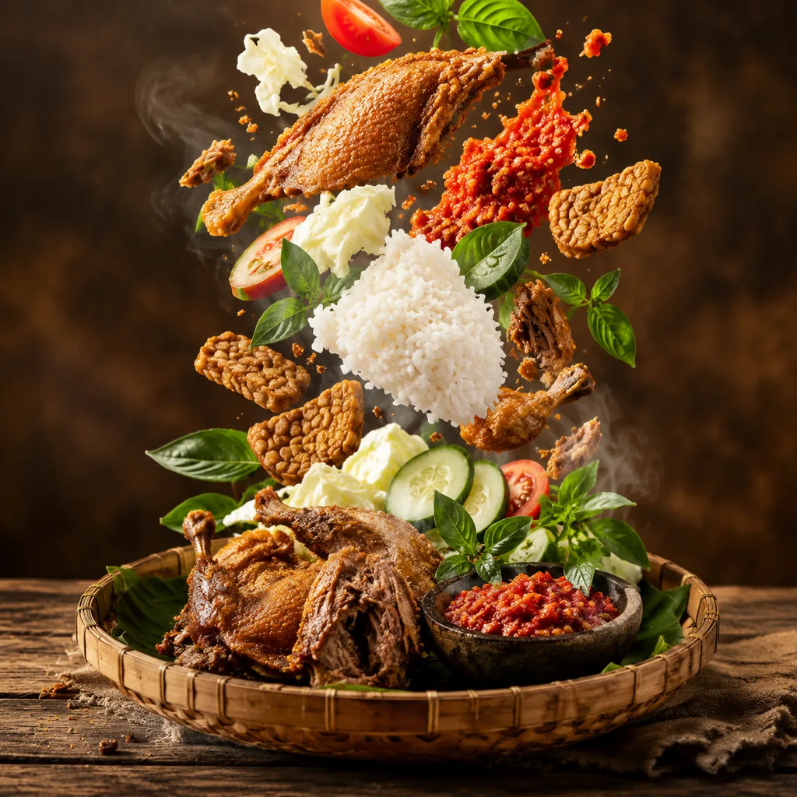</a>

> @Taaruk_ 悬浮碗美食风格（记录时 136 赞）。同源无字填空：印尼炸鸭无字悬浮；质朴木纹背景；按热门查询去掉全部标题/标签/水印；1:1。 合成唯一 id。

```text
Square 1:1 hyper-realistic editorial food visual of Indonesian bebek goreng. A traditional woven plate of crispy fried duck with sambal and fresh vegetables sits at the bottom of the frame on a rustic wooden surface. Above it, the ingredients rise upward in a realistic gravity-defying stack: golden crispy duck pieces, steaming rice, raw cabbage, cucumber, basil, tomato, fried tempeh, and a chunky red sambal splash. Keep a clean vertical composition with a strong visual hierarchy, bowl at the base and floating ingredients ascending. Absolutely no text titles, no ingredient labels, no watermarks, no logos, and no typography anywhere in the image. Professional food-magazine layout, warm cinematic studio lighting, dramatic steam where natural, motion-frozen ingredients, shallow depth of field, sharp DSLR-style focus, ultra-detailed textures, premium editorial photorealism. Square 1:1 composition.
```

- 原作者: [@Taaruk_](https://x.com/Taaruk_)
- 原帖: https://x.com/Taaruk_/status/2019806212599284155
- [在 cinel 上查看详情并一键生成](https://cinel.ai/zh/prompts/p/floating-bebek-goreng-no-text?utm_source=github&utm_medium=awesome&utm_campaign=awesome-gpt-image-2.5-prompts)

### 印尼甜辣炸豆腐无字悬浮碗

<a href="https://cinel.ai/zh/prompts/p/floating-tahu-gejrot-no-text?utm_source=github&utm_medium=awesome&utm_campaign=awesome-gpt-image-2.5-prompts">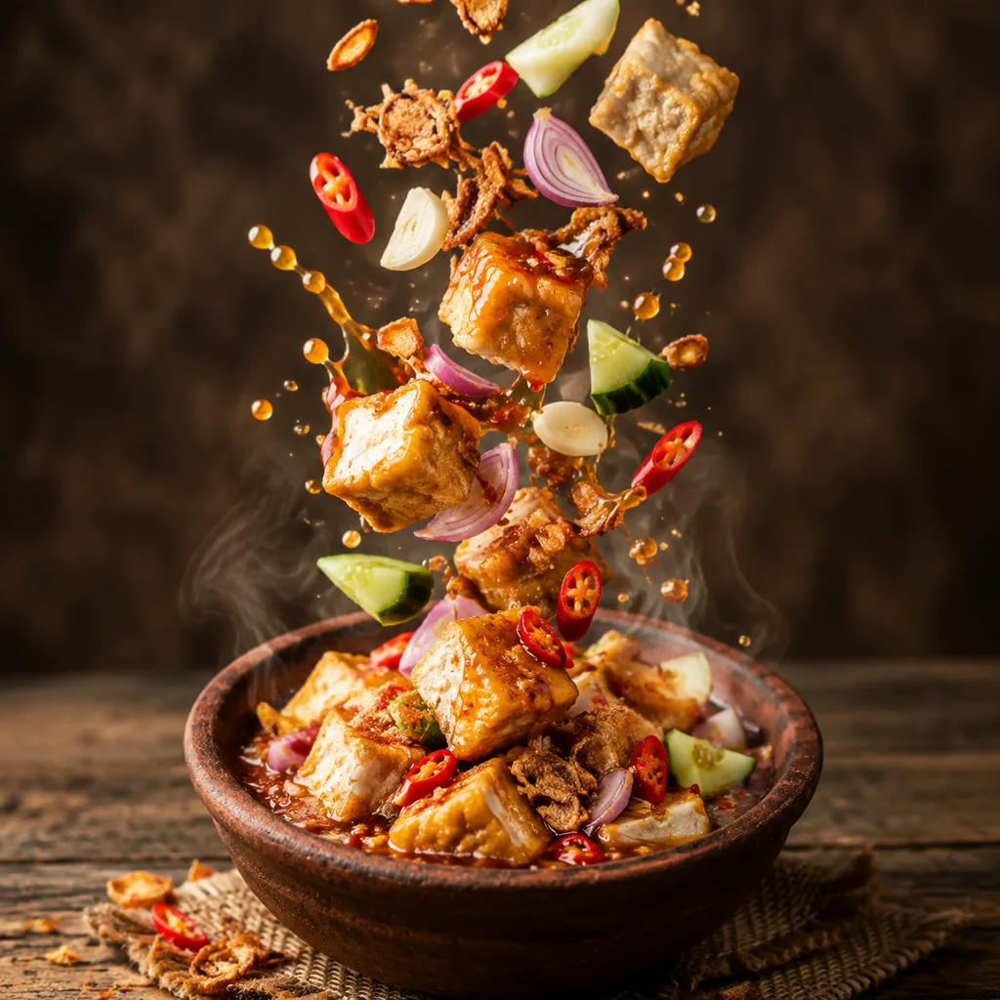</a>

> @Taaruk_ 悬浮碗美食风格（记录时 136 赞）。同源无字填空：印尼甜辣炸豆腐无字悬浮碗；质朴木纹背景；按热门查询去掉全部标题/标签/水印；1:1。 合成唯一 id。

```text
Square 1:1 hyper-realistic editorial food visual of Indonesian tahu gejrot. A traditional clay bowl of fried tofu chunks in sweet-spicy gejrot sauce sits at the bottom of the frame on a rustic wooden surface. Above it, the ingredients rise upward in a realistic gravity-defying stack: crispy fried tofu cubes, sliced shallots, red chilies, garlic, sweet-sour gejrot sauce splash, fried shallots, and fresh cucumber. Keep a clean vertical composition with a strong visual hierarchy, bowl at the base and floating ingredients ascending. Absolutely no text titles, no ingredient labels, no watermarks, no logos, and no typography anywhere in the image. Professional food-magazine layout, warm cinematic studio lighting, dramatic steam where natural, motion-frozen ingredients, shallow depth of field, sharp DSLR-style focus, ultra-detailed textures, premium editorial photorealism. Square 1:1 composition.
```

- 原作者: [@Taaruk_](https://x.com/Taaruk_)
- 原帖: https://x.com/Taaruk_/status/2019806212599284155
- [在 cinel 上查看详情并一键生成](https://cinel.ai/zh/prompts/p/floating-tahu-gejrot-no-text?utm_source=github&utm_medium=awesome&utm_campaign=awesome-gpt-image-2.5-prompts)

### 印尼湿辣脆片无字悬浮碗

<a href="https://cinel.ai/zh/prompts/p/floating-seblak-no-text?utm_source=github&utm_medium=awesome&utm_campaign=awesome-gpt-image-2.5-prompts">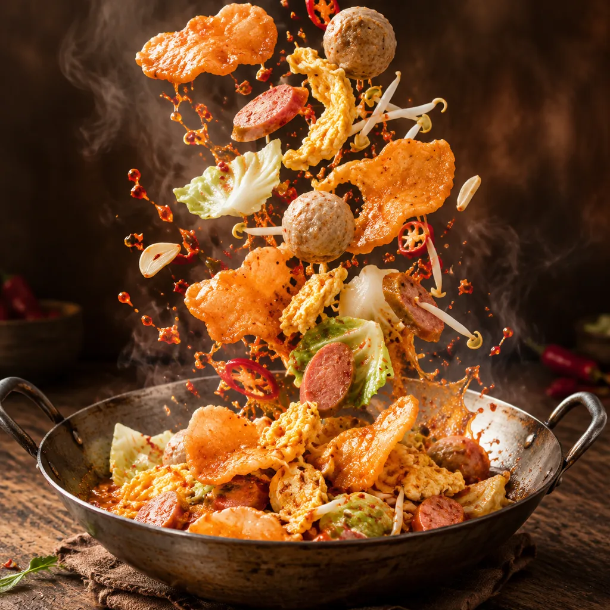</a>

> @Taaruk_ 悬浮碗美食风格（记录时 136 赞）。同源无字填空：印尼湿辣脆片无字悬浮碗；质朴木纹背景；按热门查询去掉全部标题/标签/水印；1:1。 合成唯一 id。

```text
Square 1:1 hyper-realistic editorial food visual of Indonesian seblak. A traditional metal wok bowl of spicy wet crackers stir-fry with egg and proteins sits at the bottom of the frame on a rustic wooden surface. Above it, the ingredients rise upward in a realistic gravity-defying stack: soft kerupuk crackers, scrambled egg ribbons, sausages, meatballs, cabbage, bean sprouts, garlic, kencur aroma steam, and a fiery red chili-oil splash. Keep a clean vertical composition with a strong visual hierarchy, bowl at the base and floating ingredients ascending. Absolutely no text titles, no ingredient labels, no watermarks, no logos, and no typography anywhere in the image. Professional food-magazine layout, warm cinematic studio lighting, dramatic steam where natural, motion-frozen ingredients, shallow depth of field, sharp DSLR-style focus, ultra-detailed textures, premium editorial photorealism. Square 1:1 composition.
```

- 原作者: [@Taaruk_](https://x.com/Taaruk_)
- 原帖: https://x.com/Taaruk_/status/2019806212599284155
- [在 cinel 上查看详情并一键生成](https://cinel.ai/zh/prompts/p/floating-seblak-no-text?utm_source=github&utm_medium=awesome&utm_campaign=awesome-gpt-image-2.5-prompts)

### 印尼黄饭无字悬浮碗

<a href="https://cinel.ai/zh/prompts/p/floating-nasi-kuning-no-text?utm_source=github&utm_medium=awesome&utm_campaign=awesome-gpt-image-2.5-prompts">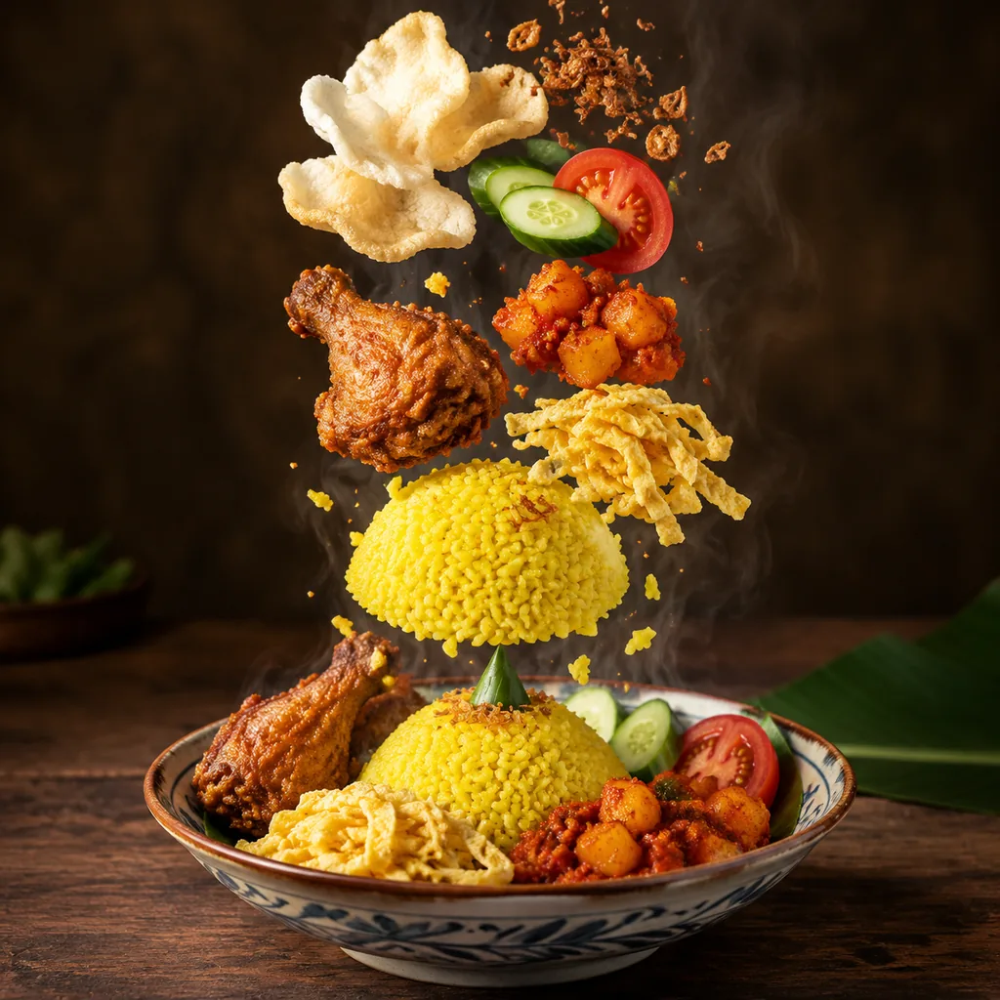</a>

> @iamaiistudio 悬浮碗美食风格（记录时 1 赞）。同源无字填空：印尼黄饭无字悬浮碗；质朴木纹背景；按热门查询去掉全部标题/标签/水印；1:1。 合成唯一 id。

```text
Square 1:1 hyper-realistic editorial food visual of Indonesian nasi kuning. A traditional ceramic plate bowl of festive turmeric yellow rice with savory sides sits at the bottom of the frame on a rustic wooden surface. Above it, the ingredients rise upward in a realistic gravity-defying stack: mounded turmeric rice, fried chicken, shredded omelette, sambal goreng potatoes, cucumber, tomato, kerupuk, and fried shallots. Keep a clean vertical composition with a strong visual hierarchy, bowl at the base and floating ingredients ascending. Absolutely no text titles, no ingredient labels, no watermarks, no logos, and no typography anywhere in the image. Professional food-magazine layout, warm cinematic studio lighting, dramatic steam where natural, motion-frozen ingredients, shallow depth of field, sharp DSLR-style focus, ultra-detailed textures, premium editorial photorealism. Square 1:1 composition.
```

- 原作者: [@iamaiistudio](https://x.com/iamaiistudio)
- 原帖: https://x.com/iamaiistudio/status/2053819797214019996
- [在 cinel 上查看详情并一键生成](https://cinel.ai/zh/prompts/p/floating-nasi-kuning-no-text?utm_source=github&utm_medium=awesome&utm_campaign=awesome-gpt-image-2.5-prompts)

### 印尼白咖喱鸡无字悬浮碗

<a href="https://cinel.ai/zh/prompts/p/floating-opor-ayam-no-text?utm_source=github&utm_medium=awesome&utm_campaign=awesome-gpt-image-2.5-prompts">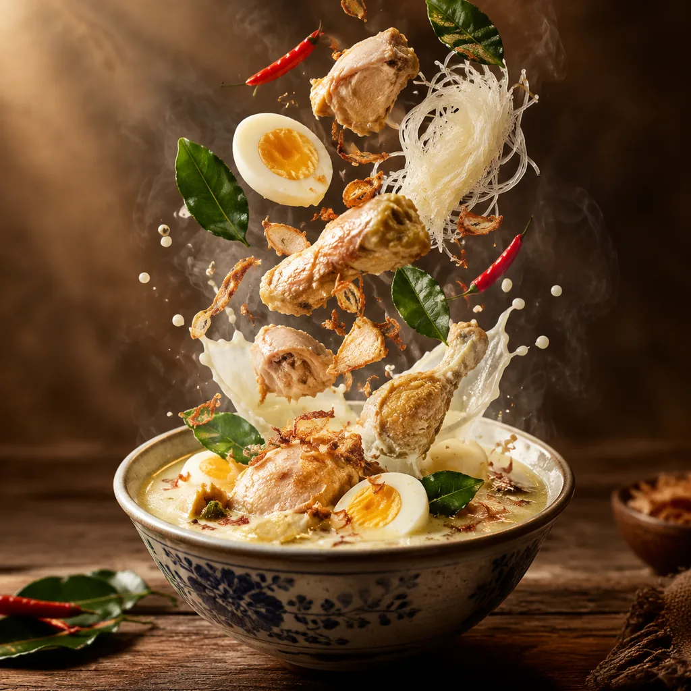</a>

> @iamaiistudio 悬浮碗美食风格（记录时 1 赞）。同源无字填空：印尼白咖喱鸡无字悬浮碗；质朴木纹背景；按热门查询去掉全部标题/标签/水印；1:1。 合成唯一 id。

```text
Square 1:1 hyper-realistic editorial food visual of Indonesian opor ayam. A traditional ceramic soup bowl of chicken in creamy white coconut spice sauce sits at the bottom of the frame on a rustic wooden surface. Above it, the ingredients rise upward in a realistic gravity-defying stack: tender chicken pieces, creamy white coconut gravy splash, boiled egg, glass noodles, fried shallots, lime leaves, and mild chili. Keep a clean vertical composition with a strong visual hierarchy, bowl at the base and floating ingredients ascending. Absolutely no text titles, no ingredient labels, no watermarks, no logos, and no typography anywhere in the image. Professional food-magazine layout, warm cinematic studio lighting, dramatic steam where natural, motion-frozen ingredients, shallow depth of field, sharp DSLR-style focus, ultra-detailed textures, premium editorial photorealism. Square 1:1 composition.
```

- 原作者: [@iamaiistudio](https://x.com/iamaiistudio)
- 原帖: https://x.com/iamaiistudio/status/2053819797214019996
- [在 cinel 上查看详情并一键生成](https://cinel.ai/zh/prompts/p/floating-opor-ayam-no-text?utm_source=github&utm_medium=awesome&utm_campaign=awesome-gpt-image-2.5-prompts)

### 日惹古德格无字悬浮碗

<a href="https://cinel.ai/zh/prompts/p/floating-gudeg-jogja-no-text?utm_source=github&utm_medium=awesome&utm_campaign=awesome-gpt-image-2.5-prompts">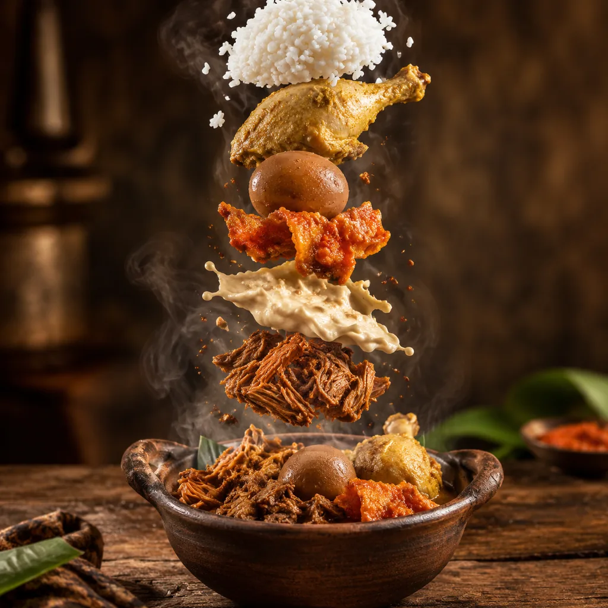</a>

> @iamaiistudio 悬浮碗美食风格（记录时 1 赞）。同源无字填空：日惹古德格无字悬浮碗；质朴木纹背景；按热门查询去掉全部标题/标签/水印；1:1。 合成唯一 id。

```text
Square 1:1 hyper-realistic editorial food visual of Yogyakarta gudeg. A traditional clay bowl of slow-cooked jackfruit stew with savory sides sits at the bottom of the frame on a rustic wooden surface. Above it, the ingredients rise upward in a realistic gravity-defying stack: brown caramelized jackfruit gudeg, creamy areh coconut sauce, krecek spicy cattle skin, boiled egg, chicken opor piece, and steamed rice. Keep a clean vertical composition with a strong visual hierarchy, bowl at the base and floating ingredients ascending. Absolutely no text titles, no ingredient labels, no watermarks, no logos, and no typography anywhere in the image. Professional food-magazine layout, warm cinematic studio lighting, dramatic steam where natural, motion-frozen ingredients, shallow depth of field, sharp DSLR-style focus, ultra-detailed textures, premium editorial photorealism. Square 1:1 composition.
```

- 原作者: [@iamaiistudio](https://x.com/iamaiistudio)
- 原帖: https://x.com/iamaiistudio/status/2053819797214019996
- [在 cinel 上查看详情并一键生成](https://cinel.ai/zh/prompts/p/floating-gudeg-jogja-no-text?utm_source=github&utm_medium=awesome&utm_campaign=awesome-gpt-image-2.5-prompts)

### 巴东沙爹无字悬浮

<a href="https://cinel.ai/zh/prompts/p/floating-sate-padang-no-text?utm_source=github&utm_medium=awesome&utm_campaign=awesome-gpt-image-2.5-prompts">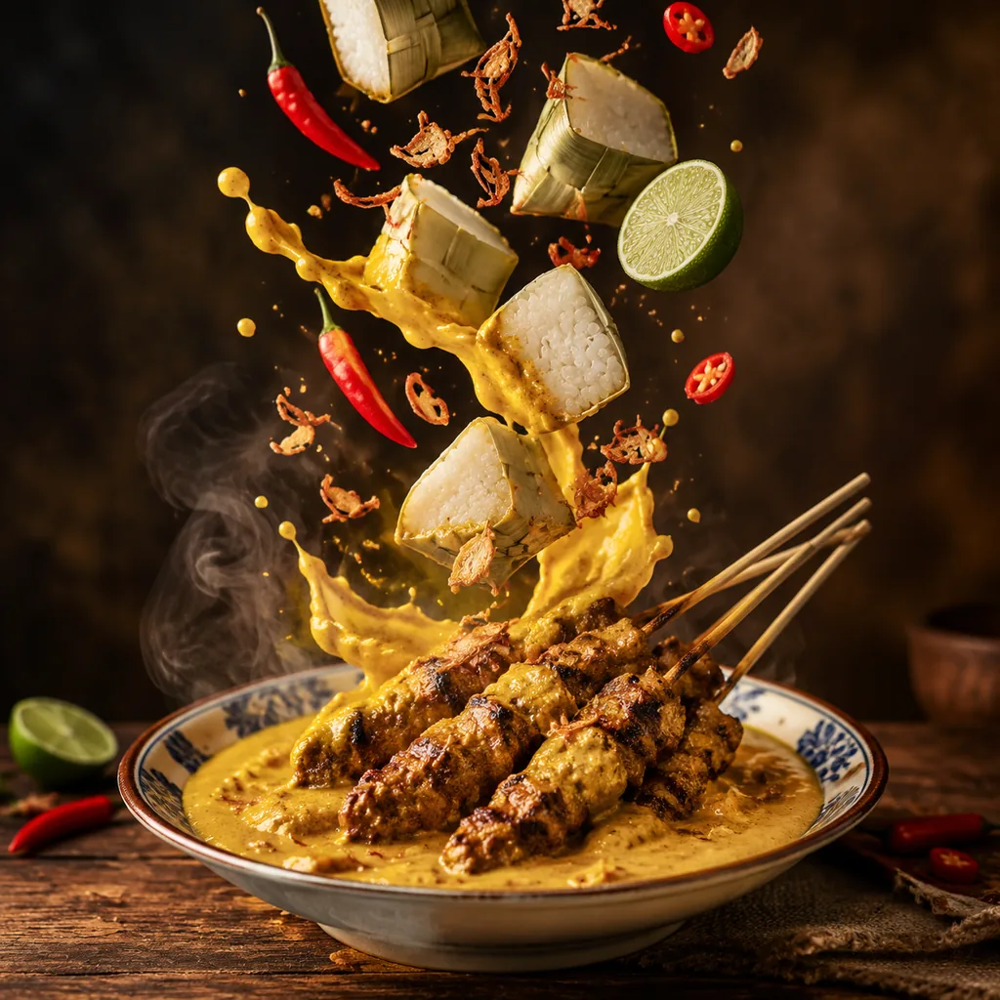</a>

> @iamaiistudio 悬浮碗美食风格（记录时 1 赞）。同源无字填空：巴东沙爹无字悬浮；质朴木纹背景；按热门查询去掉全部标题/标签/水印；1:1。 合成唯一 id。

```text
Square 1:1 hyper-realistic editorial food visual of Padang satay. A traditional ceramic plate with bowl of beef satay with thick yellow Padang sauce sits at the bottom of the frame on a rustic wooden surface. Above it, the ingredients rise upward in a realistic gravity-defying stack: grilled beef satay skewers, thick yellow turmeric sauce splash, ketupat rice cakes, fried shallots, red chilies, and lime. Keep a clean vertical composition with a strong visual hierarchy, bowl at the base and floating ingredients ascending. Absolutely no text titles, no ingredient labels, no watermarks, no logos, and no typography anywhere in the image. Professional food-magazine layout, warm cinematic studio lighting, dramatic steam where natural, motion-frozen ingredients, shallow depth of field, sharp DSLR-style focus, ultra-detailed textures, premium editorial photorealism. Square 1:1 composition.
```

- 原作者: [@iamaiistudio](https://x.com/iamaiistudio)
- 原帖: https://x.com/iamaiistudio/status/2053819797214019996
- [在 cinel 上查看详情并一键生成](https://cinel.ai/zh/prompts/p/floating-sate-padang-no-text?utm_source=github&utm_medium=awesome&utm_campaign=awesome-gpt-image-2.5-prompts)

### 印尼椰浆杂菜汤无字悬浮碗

<a href="https://cinel.ai/zh/prompts/p/floating-sayur-lodeh-no-text?utm_source=github&utm_medium=awesome&utm_campaign=awesome-gpt-image-2.5-prompts">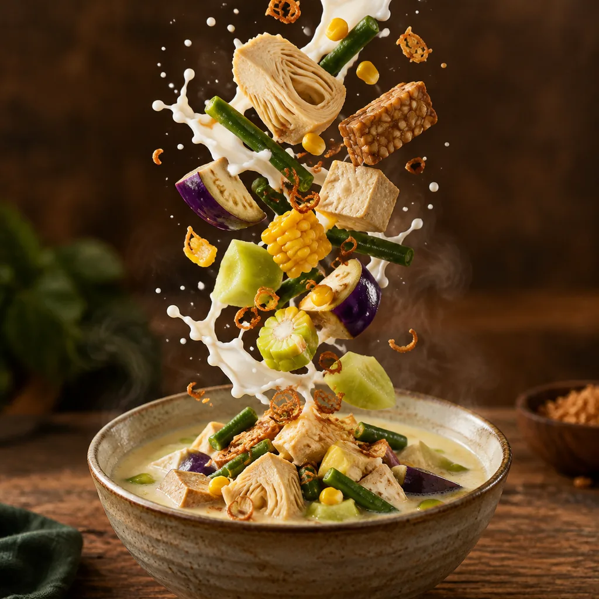</a>

> @woleswoosh 悬浮碗美食风格（记录时 925 赞）。同源无字填空：印尼椰浆杂菜汤无字悬浮碗；质朴木纹背景；按热门查询去掉全部标题/标签/水印；1:1。 合成唯一 id。

```text
Square 1:1 hyper-realistic editorial food visual of Indonesian sayur lodeh. A traditional ceramic soup bowl of vegetable stew in savory coconut milk broth sits at the bottom of the frame on a rustic wooden surface. Above it, the ingredients rise upward in a realistic gravity-defying stack: young jackfruit, long beans, eggplant, tempeh, tofu, corn kernels, chayote, and a creamy coconut-milk splash with fried shallots. Keep a clean vertical composition with a strong visual hierarchy, bowl at the base and floating ingredients ascending. Absolutely no text titles, no ingredient labels, no watermarks, no logos, and no typography anywhere in the image. Professional food-magazine layout, warm cinematic studio lighting, dramatic steam where natural, motion-frozen ingredients, shallow depth of field, sharp DSLR-style focus, ultra-detailed textures, premium editorial photorealism. Square 1:1 composition.
```

- 原作者: [@woleswoosh](https://x.com/woleswoosh)
- 原帖: https://x.com/woleswoosh/status/1994773362875535462
- [在 cinel 上查看详情并一键生成](https://cinel.ai/zh/prompts/p/floating-sayur-lodeh-no-text?utm_source=github&utm_medium=awesome&utm_campaign=awesome-gpt-image-2.5-prompts)

### 印尼埃斯特勒无字悬浮碗

<a href="https://cinel.ai/zh/prompts/p/floating-es-teler-no-text?utm_source=github&utm_medium=awesome&utm_campaign=awesome-gpt-image-2.5-prompts">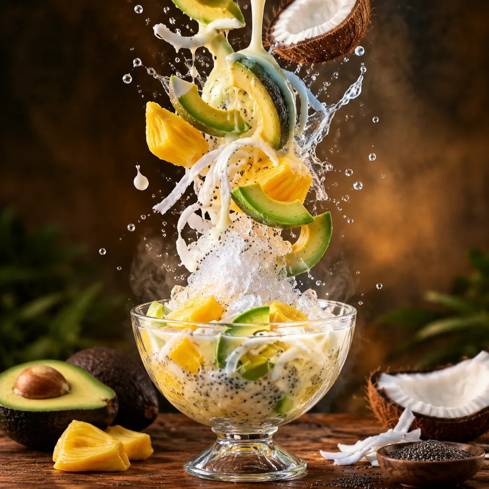</a>

> @woleswoosh 悬浮碗美食风格（记录时 925 赞）。同源无字填空：印尼埃斯特勒无字悬浮碗；质朴木纹背景；按热门查询去掉全部标题/标签/水印；1:1。 合成唯一 id。

```text
Square 1:1 hyper-realistic editorial food visual of Indonesian es teler. A traditional glass dessert bowl of mixed ice with avocado, jackfruit, and coconut sits at the bottom of the frame on a rustic wooden surface. Above it, the ingredients rise upward in a realistic gravity-defying stack: shaved ice, ripe avocado slices, jackfruit segments, young coconut strands, condensed milk pour, coconut water splash, and basil seeds. Keep a clean vertical composition with a strong visual hierarchy, bowl at the base and floating ingredients ascending. Absolutely no text titles, no ingredient labels, no watermarks, no logos, and no typography anywhere in the image. Professional food-magazine layout, warm cinematic studio lighting, dramatic steam where natural, motion-frozen ingredients, shallow depth of field, sharp DSLR-style focus, ultra-detailed textures, premium editorial photorealism. Square 1:1 composition.
```

- 原作者: [@woleswoosh](https://x.com/woleswoosh)
- 原帖: https://x.com/woleswoosh/status/1994773362875535462
- [在 cinel 上查看详情并一键生成](https://cinel.ai/zh/prompts/p/floating-es-teler-no-text?utm_source=github&utm_medium=awesome&utm_campaign=awesome-gpt-image-2.5-prompts)
