# 人像写真 · GPT Image 2.5 提示词

[← 返回首页](../../README_zh.md) · 74 条 · [cinel](https://cinel.ai/zh/prompts/portrait?utm_source=github&utm_medium=awesome&utm_campaign=awesome-gpt-image-2.5-prompts)

### 橄榄绿丝绒纱丽高级时装棚拍人像提示词

<a href="https://cinel.ai/zh/prompts/p/velvet-saree-fashion-studio-portrait?utm_source=github&utm_medium=awesome&utm_campaign=awesome-gpt-image-2.5-prompts"></a>

> 证明人像提示词不必很长。约 90 个英文单词里，它确定了服装（橄榄绿丝绒，搭在一侧肩上）、让画面具体的造型细节（刺绣无袖上衣、深色海娜手绘、金耳饰）、光线（暗调、戏剧化、掠过丝绒表面）以及神态（直视镜头、自信）。选丝绒很聪明：在低调光下，绒面会捕捉高光，示例图正是如此。改写时保留关于光线和质感的那一句，替换服装——丝绸蕾哈迦、织锦外套、缎面礼服都适用。最先改的应该是丝绒的颜色。

```text
A detailed, high-fashion studio photograph of a woman posing gracefully, wearing a luxurious olive green velvet saree draped elegantly over her shoulder, paired with a matching heavily embroidered sleeveless blouse that highlights her midriff. The lighting is moody and dramatic, accentuating the rich texture of the velvet and giving her skin a subtle, dewy sheen. Her hands are adorned with intricate, dark henna (mehndi) designs, and she is wearing traditional gold  earrings, looking directly into the camera with a confident expression.
```

- 原作者: [@Flora_Janer8](https://x.com/Flora_Janer8)
- 原帖: https://x.com/Flora_Janer8/status/2021300975248736723
- [在 cinel 上查看详情并一键生成](https://cinel.ai/zh/prompts/p/velvet-saree-fashion-studio-portrait?utm_source=github&utm_medium=awesome&utm_campaign=awesome-gpt-image-2.5-prompts)

### 高级感健康生活方式四联照提示词

<a href="https://cinel.ai/zh/prompts/p/luxury-wellness-lifestyle-photo-series?utm_source=github&utm_medium=awesome&utm_campaign=awesome-gpt-image-2.5-prompts"></a>

> 这条提示词为需要一整套统一画面、而不是单张主图的博主和健康品牌而写。JSON 把“常量”（同一位人物、发型妆容、奶油色罗纹运动套装、暖调窗光、米色—奶油—大理石配色，点缀绿植和金色）与“变量”（四个场景）分开。正因为常量定义得非常严密，我们的 2×2 成品里，同一位女性在大理石厨房做饭、在梳妆台前护肤、拉伸、吃沙拉，造型毫无突兀变化。可以替换运动服颜色或四个活动以适配其他品牌，但配色区块一定要保留，它让整组照片显得有艺术指导。

```text
{
  "overall_theme": {
    "description": "A curated series of four ultra-photorealistic vignettes showcasing a luxurious, wellness-focused lifestyle.",
    "mood": "Calm, serene, balanced, sophisticated, peaceful, rejuvenating.",
    "style": "Minimalist, high-end, contemporary, clean aesthetic, aspirational."
  },
  "subject": {
    "description": "Young woman.",
    "appearance": {
      "hair": "Long, dark brown, wavy, natural texture.",
      "skin": "Clear, glowing, natural.",
      "makeup": "No-makeup makeup look, dewy finish.",
      "physique": "Fit, toned."
    },
    "expression": "Serene, composed, gently smiling, focused."
  },
  "wardrobe": {
    "outfit_base": "Matching ribbed beige/cream activewear set.",
    "variations": [
      "Sleeveless crop top and high-waisted leggings.",
      "Long-sleeve crop top and high-waisted leggings."
    ],
    "style": "Comfortable, stylish, high-quality fabric."
  },
  "environmental_details": {
    "lighting": {
      "type": "Natural daylight.",
      "quality": "Soft, diffused, warm, bright.",
      "source": "Large windows (implied or visible)."
    },
    "color_palette": {
      "dominant": ["Warm Beige", "Cream", "White", "Marble Grey"],
      "accents": ["Green (plants)", "Gold (fixtures, details)", "Natural Wood", "Soft Purple (smoothie)"]
    },
    "materials": ["White Marble", "Light Wood", "Stone", "Ceramic", "Glass", "Linen"]
  },
  "scenes": [
    {
      "location": "Modern Luxury Kitchen",
      "environment": "White marble island and countertops, white shaker cabinets, gold hardware, integrated wine fridge, large window.",
      "pose": "Standing at the island, body angled slightly, looking down.",
      "action": "Whisking a hot beverage in a small bowl.",
      "props": ["Ceramic bowl", "Wooden whisk", "Steam", "Mug with 'H'", "Wine fridge"]
    },
    {
      "location": "High-End Bathroom",
      "environment": "Large backlit mirror, white marble vanity, white walls, orchid plant.",
      "pose": "Standing facing the mirror, one hand applying product to face.",
      "action": "Applying skincare.",
      "props": ["Cotton pad", "Skincare bottle", "Lit Diptyque candle", "Whole coconut", "Glass jars"]
    },
    {
      "location": "Minimalist Wellness Space",
      "environment": "Textured beige walls with curved arches, stone water fountain, eucalyptus in a vase.",
      "pose": "Full-body stretch, arms extended overhead, head tilted back, eyes closed.",
      "action": "Stretching.",
      "props": ["Stone water feature", "Large perfume bottle", "Eucalyptus vase"]
    },
    {
      "location": "Bright Café Corner",
      "environment": "Round white marble table, cane chair, large window overlooking a street.",
      "pose": "Sitting at the table, smiling while eating, holding a fork.",
      "action": "Eating avocado toast.",
      "props": ["Avocado toast on plate", "Purple smoothie in glass", "Fork", "Assouline book", "Notebooks", "Small flowers"]
    }
  ],
  "camera_and_technical": {
    "type": "DSLR Photography",
    "style": "Editorial lifestyle",
    "lens": "Prime lens (e.g., 50mm or 85mm f/1.4)",
    "focus": "Sharp focus on the subject in each frame.",
    "depth_of_field": "Shallow, creating a soft, creamy bokeh in the background.",
    "resolution": "Ultra-high resolution, photorealistic textures.",
    "composition": "Four-panel grid collage."
  }
}
```

- 原作者: [@xmliisu](https://x.com/xmliisu)
- 原帖: https://x.com/xmliisu/status/2008486850378293427
- [在 cinel 上查看详情并一键生成](https://cinel.ai/zh/prompts/p/luxury-wellness-lifestyle-photo-series?utm_source=github&utm_medium=awesome&utm_campaign=awesome-gpt-image-2.5-prompts)

### 新年祝福九宫格肖像提示词（男生版）

<a href="https://cinel.ai/zh/prompts/p/new-year-greeting-portrait-grid?utm_source=github&utm_medium=awesome&utm_campaign=awesome-gpt-image-2.5-prompts"></a>

> 这是一条“按数字设计”的好例子。九格各有一个手势和一句四字吉祥语，而且吉祥语的首字恰好对应格子序号：一帆风顺、双喜临门、三阳开泰……一直到九。JSON 把人物一致性、手势列表和文字叠加分开写，并且强调克制：纯白墙、自然柔光、“阳光不油腻”、不夸张的微笑。我们的成品里，同一位穿红毛衣的年轻男性贯穿九格，上方是红色书法字、下方是深蓝色年份。可以替换人物、服装颜色或年份，这套吉祥语适用于任何一个春节。

```text
{
  "project_settings": {
    "task_type": "九宫格新年祝福肖像（男生版）",
    "aspect_ratio": "1:1",
    "grid_layout": "3x3",
    "batch_size": 1
  },

  "overall_style": {
    "整体风格": "极简新年祝福风",
    "视觉基调": "干净、温和、克制的节日感",
    "背景": "纯色白墙面，无装饰",
    "光线": "自然柔光，均匀无强阴影",
    "色彩重点": "中国红（服装 + 文字）"
  },

  "subject_base": {
    "人物一致性": "九宫格内为同一位人物",
    "人物类型": "亚洲男性",
    "性别气质": "干净、阳光、自然，不油腻",
    "发型": "黑色短发，自然蓬松，简洁利落",
    "服装": "红色针织毛衣或卫衣，简洁无图案",
    "妆容": "无明显妆感，真实自然肤质",
    "表情气质": "开心，克制的微笑，不夸张"
  },

  "pose_variations": {
    "grid_1": "食指竖于嘴前，轻松安静手势",
    "grid_2": "单手比 V 手势靠近脸部",
    "grid_3": "单手做 OK 或三指手势",
    "grid_4": "双手举起做轻松俏皮手势（不过度卖萌）",
    "grid_5": "单手张开遮住半边脸",
    "grid_6": "单手做电话手势靠近脸侧",
    "grid_7": "单手轻点脸颊或下巴",
    "grid_8": "单手托下巴，轻微思考姿势",
    "grid_9": "双手指向脸部或克制比心变体"
  },

  "text_overlays": {
    "字体风格": "传统中文新年书法字体",
    "文字颜色": "中国红",
    "年份颜色": "深蓝色",
    "文字位置": "每一格顶部居中",
    "文字结构": "四字祝福语 + 年份"
  },

  "text_content": [
    { "position": "grid_1", "text": "一帆风顺", "year": "2026" },
    { "position": "grid_2", "text": "双喜临门", "year": "2026" },
    { "position": "grid_3", "text": "三阳开泰", "year": "2026" },
    { "position": "grid_4", "text": "四季发财", "year": "2026" },
    { "position": "grid_5", "text": "五福临门", "year": "2026" },
    { "position": "grid_6", "text": "六六大顺", "year": "2026" },
    { "position": "grid_7", "text": "七星高照", "year": "2026" },
    { "position": "grid_8", "text": "八方来财", "year": "2026" },
    { "position": "grid_9", "text": "九九同心", "year": "2026" }
  ],

  "constraints": {
    "禁止项": [
      "不改变人物身份",
      "不夸张表情",
      "不女性化姿态",
      "不使用复杂背景",
      "不添加节日道具",
      "不风格化面部"
    ],
    "一致性要求": [
      "人物脸型五官保持完全一致",
      "服装颜色与材质一致",
      "拍摄角度与距离基本一致"
    ]
  },

  "use_cases": [
    "男生新年纪念照",
    "个人春节祝福九宫格",
    "社交平台头像矩阵",
    "品牌新年男生模板"
  ]
}
```

- 原作者: [@wanerfu](https://x.com/wanerfu)
- 原帖: https://x.com/wanerfu/status/2008421241091154115
- [在 cinel 上查看详情并一键生成](https://cinel.ai/zh/prompts/p/new-year-greeting-portrait-grid?utm_source=github&utm_medium=awesome&utm_campaign=awesome-gpt-image-2.5-prompts)

### 长曝光人潮中的街头人像提示词

<a href="https://cinel.ai/zh/prompts/p/long-exposure-crowd-street-portrait?utm_source=github&utm_medium=awesome&utm_campaign=awesome-gpt-image-2.5-prompts"></a>

> 创意来自经典摄影技巧：在模糊、匆忙的人群里，有一个清晰静止的人。提示词把两部分都写得很明确，模型才不会把主角也拍糊。“静止站立”“完全静止”“面部清晰对焦”锚定了人物，“强烈的方向性动态模糊”“人群拖影”则让背景动起来。细微的真实感线索——淡淡的雀斑、自然妆容、深色冬季大衣和围巾——让脸不显得磨皮。我们的成品把这种反差拍得很到位：平静直视的目光，被一道道横向拖影的通勤人群框住。城市、季节、服装都可以随意换，但关于“静止”的描述要保留，效果主要靠它。

```text
Ultra-realistic cinematic street portrait of a young woman standing still in a crowded city street, sharp focus on her face with calm, intense expression. Long-exposure effect with people moving around her creating strong directional motion blur, streaked crowd movement while the subject remains perfectly still. Natural soft daylight, shallow depth of field, creamy bokeh, realistic skin texture, subtle freckles, neutral makeup, dark winter coat and scarf. Emotional, introspective mood, urban storytelling photography, DSLR quality, 85mm lens look, f/1.8, high dynamic range, 8K, professional color grading.
```

- 原作者: [@Taaruk_](https://x.com/Taaruk_)
- 原帖: https://x.com/Taaruk_/status/2018685474131562751
- [在 cinel 上查看详情并一键生成](https://cinel.ai/zh/prompts/p/long-exposure-crowd-street-portrait?utm_source=github&utm_medium=awesome&utm_campaign=awesome-gpt-image-2.5-prompts)

### 夜间手机抓拍：模糊随手照提示词

<a href="https://cinel.ai/zh/prompts/p/candid-smartphone-selfie-photo?utm_source=github&utm_medium=awesome&utm_campaign=awesome-gpt-image-2.5-prompts"></a>

> 这里的一切都是为了看起来“没设计过”，而这比追求完美更难写。作者先列出一组叠加的下意识反应：回头、抬手挡镜头、憋着笑；再刻意降低拍摄质量：失控的抖动、被拖花的五官、重影、人物几乎出画。它还要求模型只把参考图当作宽泛的灵感，确保人脸是原创的。我们用虚构参考图测试，得到了一张非常像意外抓拍的照片：白瓷砖墙前一只模糊的手，和半遮住的笑容。适合需要“真实感”的社交内容；模糊相关的指令一定要保留，否则会变回摆拍照。

```text
Ultra-realistic candid smartphone photograph, 9:16 vertical.
Use the attached image only as a strong visual inspiration for general facial proportions and vibe,
while ensuring the generated subject remains fully original, non-identifiable, and not a face copy.
Scene
Nighttime on a quiet Tokyo city sidewalk beside a building with white ceramic tile walls.
The subject is walking past the camera, partially side-on, captured mid-step in a rushed, accidental moment.
Poses & Gestures (combined naturally)
The subject reacts instinctively to being photographed:
turning her head back mid-walk as if surprised,
raising one hand close to the lens to partially block the camera,
shy, restrained smile forming as she suppresses laughter,
body angled in half-profile while continuing to walk forward,
motion carries her slightly out of frame, imperfect framing.
Expressions are subtle and spontaneous — embarrassed, playful, fleeting — never posed.
Camera & Motion
Shot on a modern smartphone, handheld, rushed capture. Strong uncontrolled camera shake. Heavy directional motion blur across the raised hand, hair, and face. Facial features appear smeared and streaked by movement, faintly recognizable but distorted. Partial ghosting around the body. Imperfect framing, subject nearly leaving the frame.
Lighting
Flash-only lighting fired mid-motion. Harsh flash highlights on skin and hand. Deep surrounding darkness. Uneven exposure, blown highlights, hard shadows typical of hurried night phone photography.
Background
White ceramic tile wall stretches into streaked light bands due to motion blur. Street surroundings fade into darkness with minimal readable detail.
Mood
Candid, shy, slightly playful. Feels intrusive, raw, imperfect, and authentic — like a fleeting memory accidentally captured and never meant to be perfect.
Image Quality
Extremely noisy. Heavily blurred. Raw smartphone look. Not cinematic. Not editorial. Not polished.
Negative Prompt
anime, illustration, painting, stylized,
studio lighting, beauty lighting, soft portrait,
sharp focus, clean face, perfect anatomy, smooth skin,
fashion editorial, posed portrait, cinematic grading, film still,
tripod shot, professional photography,
identity match, face copy, real person replication
```

- 原作者: [@HustleXR](https://x.com/HustleXR)
- 原帖: https://x.com/HustleXR/status/2011675822076411914
- [在 cinel 上查看详情并一键生成](https://cinel.ai/zh/prompts/p/candid-smartphone-selfie-photo?utm_source=github&utm_medium=awesome&utm_campaign=awesome-gpt-image-2.5-prompts)

### 黑白男装时尚大片三联图提示词

<a href="https://cinel.ai/zh/prompts/p/monochrome-fashion-editorial-triptych?utm_source=github&utm_medium=awesome&utm_campaign=awesome-gpt-image-2.5-prompts"></a>

> 三格画面，三种情绪：手放在锁骨附近的内省、清晰向上的侧脸、直视镜头的正面，这正是杂志跨页的结构，提示词还逐格写明了光线和视线。贯穿三格的道具（白 T 恤和金项链）把画面串在一起；第一格的伦勃朗光增加了雕塑感。我们用一张虚构的大胡子男性参考图生成，三格中面部保持一致，毛孔可见，背景柔和过渡。适合演员头像套图、个人品牌或型录封面；贯穿道具可按需替换，比如黑色高领衫配银戒指。

```text
Preserve the face, proportions, and external features of the model as in the reference. A minimalist monochrome fashion editorial triptych featuring three stacked cinematic frames. The subject is a young man with short dark hair and a groomed beard. Frame 1: Emotional and introspective, looking downward with a hand near the collarbone, highlighting bone structure with Rembrandt lighting. Frame 2: A crisp profile shot with a focus on the nose, lips, and masculine jawline, gaze directed slightly upward. Frame 3: A frontal, thoughtful portrait with shoulders relaxed and direct eye contact. The composition is clean and modern, using a white T-shirt and gold necklace for visual continuity. Commercial magazine quality, high-end mirrorless camera, authentic skin pores, soft bokeh, and elegant masculinity.
```

- 原作者: [@harboriis](https://x.com/harboriis)
- 原帖: https://x.com/harboriis/status/2023230471061315992
- [在 cinel 上查看详情并一键生成](https://cinel.ai/zh/prompts/p/monochrome-fashion-editorial-triptych?utm_source=github&utm_medium=awesome&utm_campaign=awesome-gpt-image-2.5-prompts)

### 彩色盒子房间时尚大片（参考图版）提示词

<a href="https://cinel.ai/zh/prompts/p/color-box-room-fashion-editorial?utm_source=github&utm_medium=awesome&utm_campaign=awesome-gpt-image-2.5-prompts">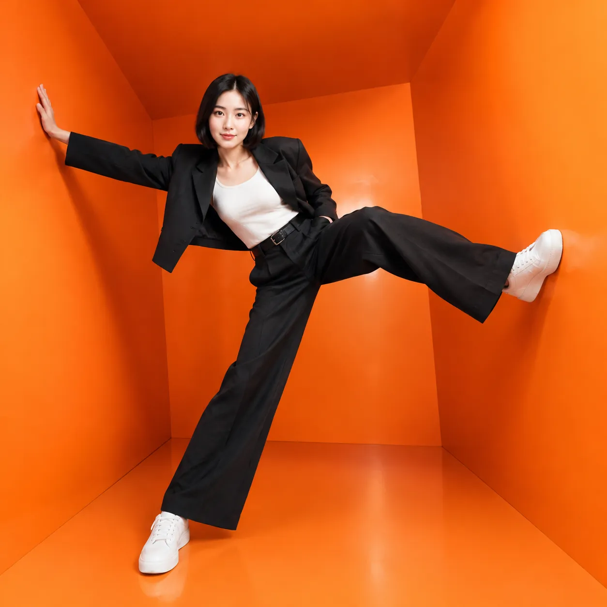</a>

> 布景是一个中空、高饱和的单色立方体，提示词要求模型每次随机决定三件事：颜色、动态姿势和戏剧性的广角机位。这种随机化让它非常适合用一张参考照生成风格多变的系列广告。光线描述也很周到：要求彩色墙面产生反射和反弹光，让人物看起来真的被房间照亮。我们的测试中，一位利落波波头的虚构女性在橙色盒子里撑墙踢腿，穿黑色西装配白色球鞋。想让系列保持品牌一致，就把“随机选择”换成固定的颜色。

```text
INPUT IMAGE: the attached reference photo. Use the person in the input image as the ONLY subject. Preserve their identity and facial features clearly.

Create a hyper-realistic high-fashion editorial photo inside a surreal 3D geometric “color box” room (a hollow cube / tilted cube set). Each render MUST randomly choose:
1) a bold single-color box (monochrome environment, vivid and saturated),
2) a dynamic “cool” fashion pose (gravity-defying or extreme stretch / leap / sideways bracing against the walls),
3) a dramatic camera angle (wide-angle 24–35mm equivalent, tilted horizon, strong perspective).

The subject appears full-body and sharp, wearing an avant-garde fashion styling that feels modern and editorial (clean silhouette, stylish layering, premium fabric texture). Keep clothing tasteful and fashion-forward. The subject’s pose should feel athletic, stylish, and unusual—like a magazine campaign shot.

Lighting: studio quality, crisp and cinematic; strong key light with controlled soft shadows, subtle rim light; realistic reflections and bounce light from the colored walls. Ultra-detailed skin texture, natural pores, realistic fabric weave, clean edges, high dynamic range. 
Composition: subject centered with plenty of negative space and strong geometric lines; the box perspective frames the subject. 
Color: the box color is a SINGLE bold color and MUST be different each run (random vivid hue). The subject’s outfit contrasts well with the box color.

Output: hyper-real, photorealistic, 8k detail, editorial campaign quality, sharp focus on subject, no motion blur, no distortion of face, natural proportions.
```

- 原作者: [@Samann_ai](https://x.com/Samann_ai)
- 原帖: https://x.com/Samann_ai/status/2017598696678895882
- [在 cinel 上查看详情并一键生成](https://cinel.ai/zh/prompts/p/color-box-room-fashion-editorial?utm_source=github&utm_medium=awesome&utm_campaign=awesome-gpt-image-2.5-prompts)

### 锁定身份的英雄式低机位红橙人像提示词

<a href="https://cinel.ai/zh/prompts/p/identity-locked-editorial-portrait?utm_source=github&utm_medium=awesome&utm_campaign=awesome-gpt-image-2.5-prompts">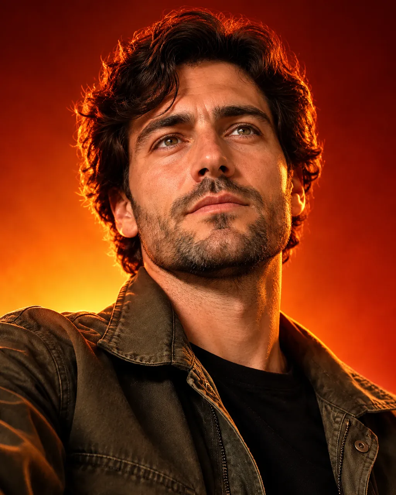</a>

> 两个设计让这条提示词很可靠。第一，明确的“身份锁定”（相貌完全一致、面部几何比例、自然皮肤、“不美颜”），并要求服装与参考图保持一致，防止模型给人物换造型。第二，把光线风格完整写明：英雄式低机位、视线向上越过画外、高饱和橙红明暗对比、把头部从渐变背景中分离出来的轮廓光。以一张穿橄榄色夹克、波浪发的虚构男性参考图生成，成品保留了他的脸和夹克，并把他变成了电影海报男主角。保持结构不变、替换配色（青蓝、绿金），就能适配不同类型片。

```text
Editorial portrait from the attached reference photo, photorealistic. Use uploaded selfie as ONLY face reference. Identity lock: exact likeness, facial geometry/proportions, natural skin texture. No beautification. Keep clothing style, color, material, and fit identical to the reference. Medium close-up (face and shoulders), low angle looking up (heroic/dominant perspective), sharp focus on face/eyes.Serious, intense, focused expression, gaze directed upward and away from camera (beyond the frame). Dramatic saturated studio lighting, high-contrast chiaroscuro with deep shadows, vibrant oranges and deep reds palette, strong rim light creating a halo separation. Solid studio backdrop, rich orange-red smooth gradient, pattern-free, hot radiant atmosphere. High skin texture fidelity (pores visible), 8k, portrait aspect ratio, cinematic lighting, 4:5.
```

- 原作者: [@harboriis](https://x.com/harboriis)
- 原帖: https://x.com/harboriis/status/2017479603921600730
- [在 cinel 上查看详情并一键生成](https://cinel.ai/zh/prompts/p/identity-locked-editorial-portrait?utm_source=github&utm_medium=awesome&utm_campaign=awesome-gpt-image-2.5-prompts)

### 红色霓虹光带横穿双眼的棚拍人像提示词

<a href="https://cinel.ai/zh/prompts/p/red-neon-strip-studio-portrait?utm_source=github&utm_medium=awesome&utm_campaign=awesome-gpt-image-2.5-prompts">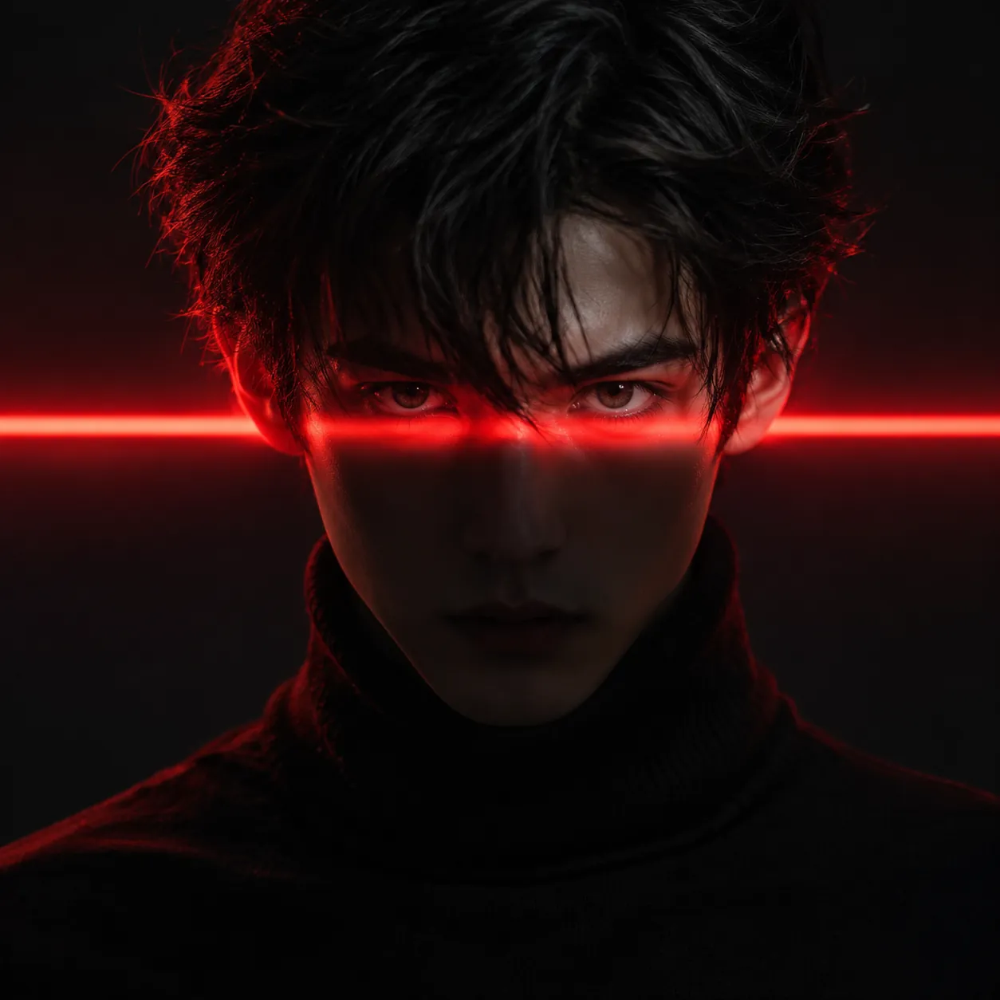</a>

> 一盏灯，一个想法。一条水平红色霓虹光带恰好放在眼睛的高度，其余一切都保持黑暗：低调布光、黑色高领衫、极简背景、下半张脸的阴影。这种克制让眼睛成为画面中唯一的亮点，所以成品显得格外有张力。我们的版本里，一位头发凌乱有层次的年轻男性，红线横切过脸庞，并映在瞳孔里。适合专辑封面、活动海报或很有冲击力的头像。可以换霓虹颜色（青、紫、琥珀）或服装，但请保留“强对比阴影覆盖下半张脸”，没有它，戏剧感会变平。

```text
Cinematic studio portrait of a young man with messy textured hair, wearing a black turtleneck, centered composition, dark minimal background, dramatic low-key lighting, a horizontal red neon light strip cutting across his eyes, strong contrast shadows covering lower face, intense gaze, moody atmosphere, cyberpunk aesthetic, ultra-realistic, sharp focus, 85mm lens, shallow depth of field, high detail, editorial photography style.
```

- 原作者: [@Kashberg_0](https://x.com/Kashberg_0)
- 原帖: https://x.com/Kashberg_0/status/2035918574674665977
- [在 cinel 上查看详情并一键生成](https://cinel.ai/zh/prompts/p/red-neon-strip-studio-portrait?utm_source=github&utm_medium=awesome&utm_campaign=awesome-gpt-image-2.5-prompts)

### 红色动态模糊剪影人像提示词

<a href="https://cinel.ai/zh/prompts/p/red-motion-blur-silhouette-portrait?utm_source=github&utm_medium=awesome&utm_campaign=awesome-gpt-image-2.5-prompts">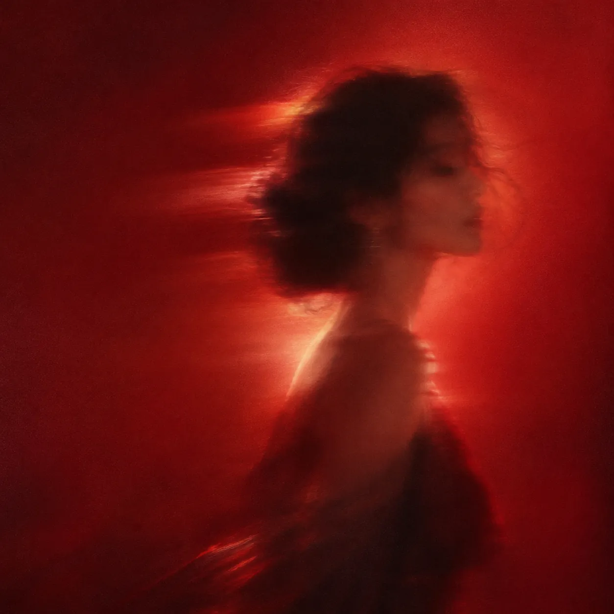</a>

> 这条提示词几乎全是氛围，这正是它的长处。它从不描述脸：只要求模糊的剪影、拖在身后的动态模糊、柔焦的五官、胶片颗粒和深红色薄雾，让这些效果撑起画面。“追焦拍摄”这个词很关键：它告诉模型相机跟着人物移动，所以人物是水平拉丝，而不是直接消失。我们的成品是一个幽灵般的侧影溶解在深红光里，很适合做单曲封面、情绪快拍背景或书封。只改背景色就能切换情绪：深蓝显孤独，琥珀显怀旧，绿色显不安。

```text
panning shot of a blurry female silhouette, soft motion blur trailing behind her, gentle film grain, diffused edge lighting, deep red gradient background with glowing haze, soft-focus facial features, smooth atmospheric glow,

slow-shutter cinematic effect
```

- 原作者: [@nextstepst](https://x.com/nextstepst)
- 原帖: https://x.com/nextstepst/status/2026308234420666586
- [在 cinel 上查看详情并一键生成](https://cinel.ai/zh/prompts/p/red-motion-blur-silhouette-portrait?utm_source=github&utm_medium=awesome&utm_campaign=awesome-gpt-image-2.5-prompts)

### 亮蓝羽绒服女孩伫立人潮中提示词

<a href="https://cinel.ai/zh/prompts/p/blue-puffer-crowd-street-portrait?utm_source=github&utm_medium=awesome&utm_campaign=awesome-gpt-image-2.5-prompts">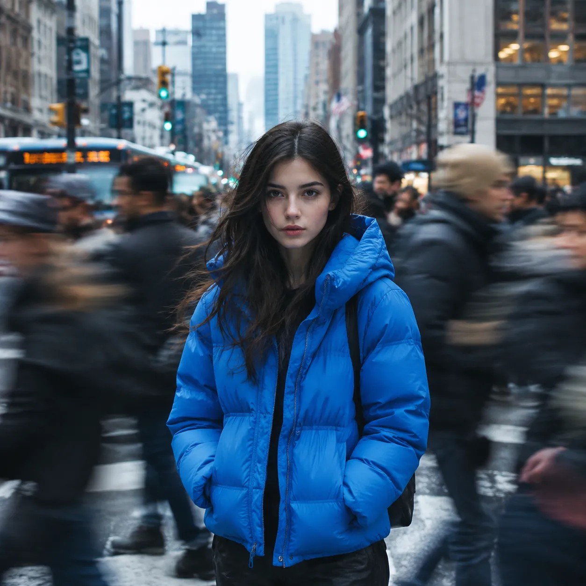</a>

> 它和“长曝光人潮人像”是近亲，但有两处不同改变了整体感受。一件高饱和单品——亮蓝色羽绒服——让人物在冷调阴天的城市里瞬间跳出来；“强烈的眼神接触”则把情绪从内省变成了直面挑战。具体的城市元素（红绿灯、高楼）把场景定在市中心。我们的成品里，钴蓝外套是画面中唯一的浓烈色彩，通勤的人群模糊成灰色拖影。适合服装和外套广告，让产品颜色当主角。把蓝色换成任何品牌色，其余场景保持低饱和即可。

```text
Ultra-realistic cinematic street portrait of a young woman in a bright blue puffer jacket standing still in the middle of a busy city crowd, intense eye contact with camera, shallow depth of field, motion-blurred pedestrians rushing around her, urban background with traffic lights and tall buildings, cool color grading, natural skin tones, soft overcast lighting, 85mm lens, f/1.8, high detail, sharp focus on subject, dynamic motion blur, editorial photography, 8k.
```

- 原作者: [@Kashberg_0](https://x.com/Kashberg_0)
- 原帖: https://x.com/Kashberg_0/status/2026100670500339830
- [在 cinel 上查看详情并一键生成](https://cinel.ai/zh/prompts/p/blue-puffer-crowd-street-portrait?utm_source=github&utm_medium=awesome&utm_campaign=awesome-gpt-image-2.5-prompts)

### 满脸贴纸吹泡泡糖人像提示词

<a href="https://cinel.ai/zh/prompts/p/sticker-covered-face-bubblegum-portrait?utm_source=github&utm_medium=awesome&utm_campaign=awesome-gpt-image-2.5-prompts">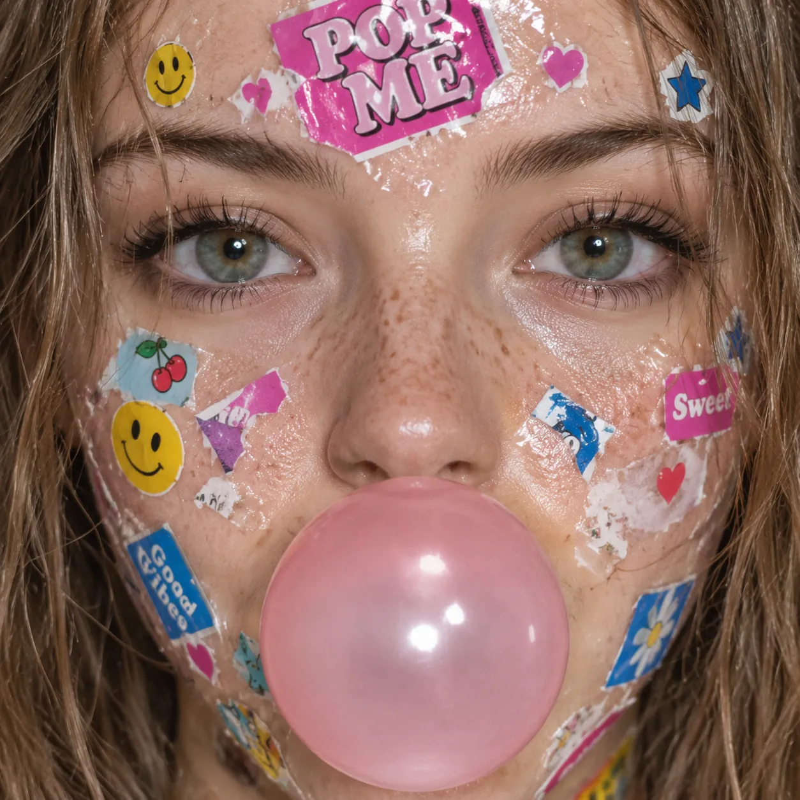</a>

> 这条提示词是一长段结构化 JSON 场景描述，像是从一张参考照片反推出来的：整体语境、光线方向与质感、估算的色值、构图，以及细到每种贴纸类型的物体清单。正是这种程度的描述让成品高度可控。我们的成品是一位长雀斑的年轻女性的极近特写，脸上点缀着笑脸、樱桃、星星和文字贴纸（“POP ME”“Sweet”），嘴前一个光亮的粉色泡泡，毛孔和胶水的光泽清晰可见。适合俏皮美妆、Z 世代潮流或零食广告。改编时修改贴纸文字等取值即可，不要改结构。

```text
{
  "meta": {
    "image_quality": "High",
    "image_type": "Photo"
  },
  "global_context": {
    "scene_description": "Close-up portrait of a young person's face covered with colorful paper stickers and glossy adhesive residue. Central focus on eyes, nose, lips; subject blowing a pink bubblegum bubble. Stickers vary in size, text, icons and layered overlap; hair strands frame face at edges. Skin shows freckles, pores, and sheen from adhesive or moisture.",
    "time_of_day": "Neutral/studio lighting",
    "weather_atmosphere": "Indoors/controlled",
    "lighting": {
      "source": "Artificial",
      "direction": "Frontal with slight top",
      "quality": "Soft",
      "color_temp": "Neutral"
    }
  },
  "color_palette": {
    "dominant_hex_estimates": ["#E7B1B6", "#F6C0D0", "#C9A38C"],
    "accent_colors": ["Pink","Magenta"],
    "contrast_level": "Medium"
  },
  "composition": {
    "camera_angle": "Eye-level",
    "framing": "Extreme close-up (face fills frame)",
    "depth_of_field": "Shallow (background indistinct)",
    "focal_point": "Eyes and central bubble"
  },
  "objects": [
    {
      "id": "obj_001",
      "label": "Face",
      "category": "Person (head)",
      "location": "Center",
      "prominence": "Foreground",
      "visual_attributes": {
        "color": "Light beige skin with pink undertones and freckles",
        "texture": "Smooth with visible pores, glossy adhesive patches",
        "material": "Skin",
        "state": "Sticker-covered, slightly wet/glossy",
        "dimensions_relative": "Large relative to frame"
      },
      "micro_details": [
        "Freckles concentrated on nose and cheeks",
        "Shiny adhesive residue streaks on forehead and cheeks",
        "Fine vellus hairs visible",
        "Pores visible on nose and cheeks"
      ],
      "pose_or_orientation": "Frontal",
      "text_content": null
    },
    {
      "id": "obj_002",
      "label": "Eyes (pair)",
      "category": "Facial feature",
      "location": "Upper-center",
      "prominence": "Foreground",
      "visual_attributes": {
        "color": "Gray-green irises with dark limbal ring",
        "texture": "Wet/glossy cornea, visible eyelashes",
        "material": "Biological",
        "state": "Open, neutral expression",
        "dimensions_relative": "Medium"
      },
      "micro_details": [
        "Tiny specular highlights on each cornea",
        "Sparse lower lashes, fuller upper lashes",
        "Slight shadow under lower lids"
      ],
      "pose_or_orientation": "Facing camera",
      "text_content": null
    },
    {
      "id": "obj_003",
      "label": "Pink bubble",
      "category": "Object (gum)",
      "location": "Lower-center",
      "prominence": "Foreground",
      "visual_attributes": {
        "color": "Pastel pink",
        "texture": "Smooth, slightly translucent",
        "material": "Gum",
        "state": "Inflated/intact",
        "dimensions_relative": "Large relative to mouth"
      },
      "micro_details": [
        "Two bright specular reflections on sphere",
        "Seamless edge against lips"
      ],
      "pose_or_orientation": "Centered over mouth",
      "text_content": null
    },
    {
      "id": "obj_004",
      "label": "Stickers (assorted)",
      "category": "Adhesive stickers",
      "location": "Entire face and neck, concentrated forehead and cheeks",
      "prominence": "Foreground",
      "visual_attributes": {
        "color": "Multicolor: magenta, yellow, blue, white",
        "texture": "Paper/plastic with glossy varnish, torn edges",
        "material": "Paper/plastic adhesive",
        "state": "Layered, partially torn, some wrinkled",
        "dimensions_relative": "Varied small-to-medium"
      },
      "micro_details": [
        "Large 'POP ME' magenta sticker on forehead",
        "Partial torn sticker fragments near nasolabial fold",
        "Small rectangular stickers with tiny printed text",
        "Edges lifting, adhesive shine around perimeters"
      ],
      "pose_or_orientation": "Affixed flat or slightly peeled",
      "text_content": "Multiple small logos and words (e.g., 'POP ME')"
    },
    {
      "id": "obj_005",
      "label": "Hair strands",
      "category": "Hair",
      "location": "Left and right edges framing face",
      "prominence": "Background/foreground overlap",
      "visual_attributes": {
        "color": "Light brown",
        "texture": "Fine, slightly wet",
        "material": "Hair",
        "state": "Loose strands",
        "dimensions_relative": "Thin relative to face"
      },
      "micro_details": [
        "Individual strands crossing forehead edges",
        "Slight adhesive sheen on some strands"
      ],
      "pose_or_orientation": "Hanging down"
    }
  ],
  "text_ocr": {
    "present": true,
    "content": [
      {
        "text": "POP ME",
        "location": "Forehead",
        "font_style": "Bold/Decorative",
        "legibility": "Clear"
      }
    ]
  },
  "semantic_relationships": [
    "Stickers are affixed to Face",
    "Bubble covers mouth, partially obscuring lips",
    "Adhesive residue creates glossy highlights on skin",
    "Hair strands frame and partly overlay stickers"
  ]
}
```

- 原作者: [@Ankit_patel211](https://x.com/Ankit_patel211)
- 原帖: https://x.com/Ankit_patel211/status/2016189962090381695
- [在 cinel 上查看详情并一键生成](https://cinel.ai/zh/prompts/p/sticker-covered-face-bubblegum-portrait?utm_source=github&utm_medium=awesome&utm_campaign=awesome-gpt-image-2.5-prompts)

### 风吹草海中的杂志感人像提示词

<a href="https://cinel.ai/zh/prompts/p/windswept-grass-field-editorial-portrait?utm_source=github&utm_medium=awesome&utm_campaign=awesome-gpt-image-2.5-prompts">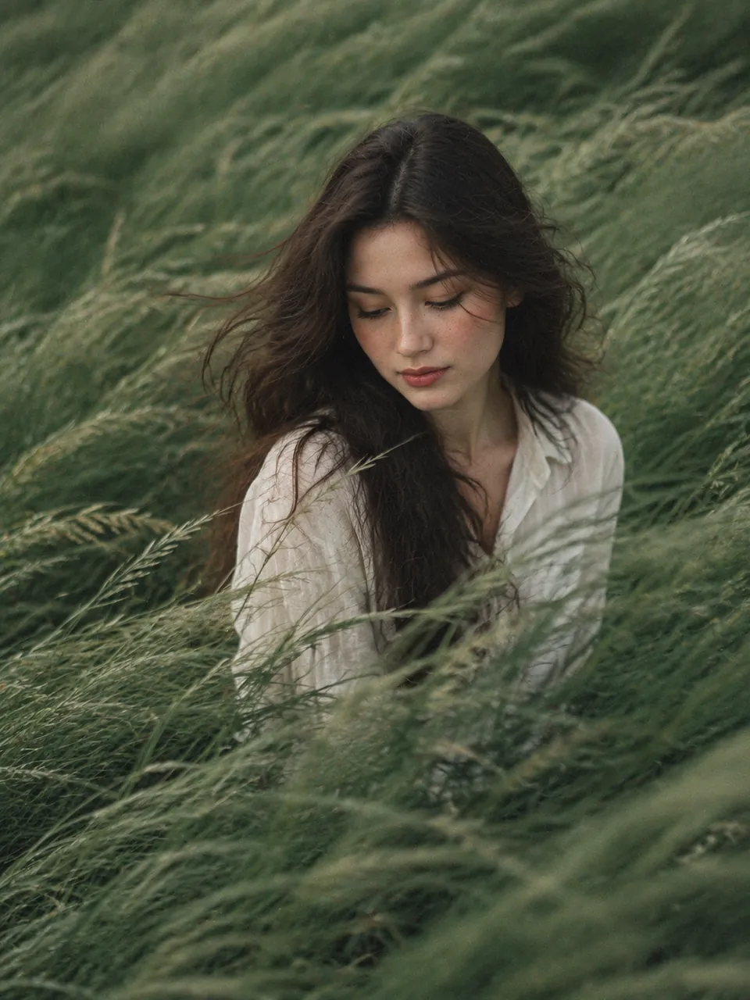</a>

> 一条基于参考图的人像提示词，描述得很有诗意：人物站在像“海浪”一样翻涌的高草中，草遮住了部分身体；画面没有地平线，完全被草的纹理填满。宽松白衬衫、低垂的头和向下的目光营造出安静、忧郁的基调；长焦压缩、胶片颗粒和低饱和的鼠尾草绿与橄榄色，让它像一页杂志大片。我们用了一位长发深色的虚构女性参考图，成品保留了她的样貌和被风吹乱的头发，草丛在她身边斜向流动。很适合音乐人、作者和个人品牌。请保留“看不到地平线”这一句，沉浸感就来自它。

```text
Create a 3:4 cinematic, atmospheric editorial portrait using the attached photo as the exact face and identity reference. A solitary man/woman stands alone in the middle of vast, wind-swept sage green grass fields. Tall grass surrounds the subject completely, flowing in strong currents like ocean waves, partially obscuring the body and creating motion,depth, and solitude. The subject wears a simple, loose white shirt that softly contrasts with the rich green landscape.
Dark hair is slightly messy, with natural strands moving in the wind. The head is gently tilted downward, eyes cast toward the ground, conveying a quiet, introspective, melancholic mood. Expression is calm, distant, and emotionally restrained. Compose the frame slightly off-center, from a subtle elevated angle. No visible horizon, the frame is fully immersed in grass texture. Use a muted natural palette of sage green, deep olive, and soft off-white. Shoot vertical 3:4, telephoto perspective, shallow depth of field, cinematic framing. Film photography aesthetic with visible grain, soft edge falloff, atmospheric light, wind-driven motion blur in the grass. Quiet, poetic storytelling; ultra-detailed yet natural, magazine-cover editorial quality. No text, no watermark.
```

- 原作者: [@Goodmanprotocol](https://x.com/Goodmanprotocol)
- 原帖: https://x.com/Goodmanprotocol/status/2038617381388583283
- [在 cinel 上查看详情并一键生成](https://cinel.ai/zh/prompts/p/windswept-grass-field-editorial-portrait?utm_source=github&utm_medium=awesome&utm_campaign=awesome-gpt-image-2.5-prompts)

### 海边情侣分享芝麻圈的抓拍提示词

<a href="https://cinel.ai/zh/prompts/p/seaside-street-romance-candid-photo?utm_source=github&utm_medium=awesome&utm_campaign=awesome-gpt-image-2.5-prompts">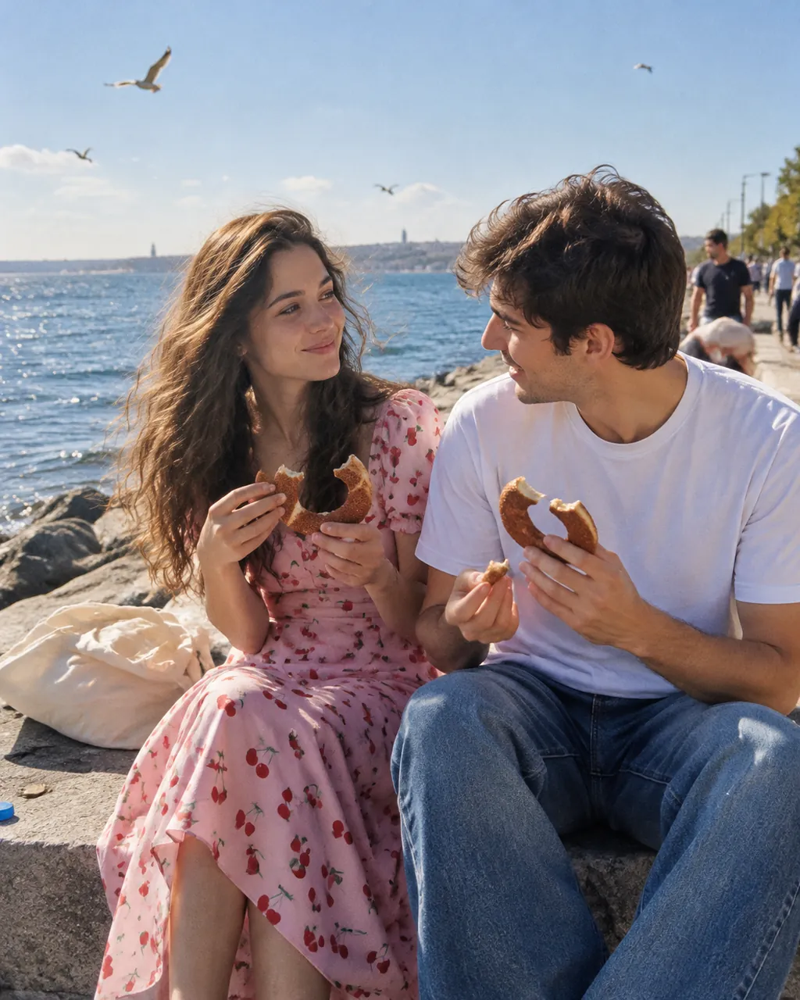</a>

> 大多数“情侣”提示词出来的都是光鲜的婚纱照风格。这一条恰恰是为了避免这种效果而写：要求普通、不像模特的人物，35mm 平视、构图不完美，真实不修饰的皮肤，轻微的高光晕染和片门抖动，再用负面词禁止影棚光、HDR、“AI 光晕”和摆拍海报感。场景非常具体（伊斯坦布尔的莫达海滨、樱桃印花裙、手上的芝麻圈碎屑），正是这种具体让画面可信。我们的成品里，情侣对着面包笑，身后是海鸥和大海。可以替换地点、食物和服装，用于本地文旅、咖啡馆或生活方式品牌。

```text
{
  "generation_request": {
    "meta_data": {
      "tool": "NanoBanana Pro",
      "task_type": "photoreal_candid_street_romance",
      "version": "v1.2_MODA_SEASIDE_SIMIT_SUNNY_CHERRY_DRESS_EN",
      "priority": "highest"
    },

    "output_settings": {
      "aspect_ratio": "4:5",
      "orientation": "portrait",
      "resolution_target": "ultra_high_res",
      "render_style": "ultra_photoreal_candid_street_film_still",
      "sharpness": "crisp_but_natural",
      "film_grain": "subtle_35mm",
      "color_grade": "true_to_life_sunny_natural",
      "dynamic_range": "natural_not_hdr",
      "skin_rendering": "real_texture_no_retouch"
    },

    "global_rules": {
      "camera_language": "35mm lens equivalent, eye-level, imperfect framing, candid documentary feel, focus on eyes when people are present",
      "authenticity_markers": "subtle halation on highlights, tiny film gate weave, real street clutter, slight background motion blur only, no studio look",
      "lighting_language": "motivated natural light only (sunlight + sky fill), deep but detailed shadows"
    },

    "creative_prompt": {
      "scene_summary": "Moda seaside in Istanbul on a sunny day. A young couple in their early 20s sits near the shore eating simit. A candid, unposed film-still moment—quiet love inside everyday life.",

      "subjects": {
        "count": 2,
        "description": "the same young man and woman (early 20s), ordinary and real, not model-like; faces visible and eyes sharp",
        "expression": "small genuine smiles, relaxed presence, natural micro-expressions",
        "skin_and_face": "natural skin texture, no beauty retouch, no plastic skin, slight imperfections preserved"
      },

      "wardrobe_and_props": {
        "female": "pink dress with colorful cherry pattern, simple fit, slightly moving in sea breeze, natural minimal makeup, long wavy hair",
        "male": "blue denim jeans and a plain white t-shirt, slightly wrinkled, no logos",
        "props": "two simits in their hands, a simple tote/backpack nearby, no branding"
      },

      "micro_action": "they break pieces of simit, share a bite, laugh softly; the wind lifts the dress hem slightly; crumbs fall naturally onto their hands",

      "environment_details": {
        "location": "Moda coast, Istanbul",
        "background": "sea horizon, gentle waves, a few distant people walking softly out of focus, seagulls in the sky, sunlit railing and rocks",
        "ground_details": "worn stone or concrete edge, small everyday clutter (a bottle cap or leaf), but clean and believable, no staged props"
      },

      "lighting": "bright sunny daylight with soft sky fill; controlled highlights; subtle halation on sunlit edges; deep but detailed shadows under chins and clothing folds",

      "composition": "eye-level medium shot, slightly off-center, imperfect framing like real street photography; faces sharp; background gently receding; no perfect symmetry",

      "mood": "warm, simple, human—an everyday Istanbul love scene"
    },

    "negative_prompt": [
      "studio lighting",
      "beauty retouch",
      "plastic skin",
      "model faces",
      "posed romance poster look",
      "perfect symmetry",
      "HDR",
      "AI glow",
      "fake bokeh shapes",
      "overly clean staged scene",
      "text",
      "logo",
      "watermark",
      "cartoon",
      "painterly"
    ]
  }
}
```

- 原作者: [@astronomerozge1](https://x.com/astronomerozge1)
- 原帖: https://x.com/astronomerozge1/status/2010681577987055947
- [在 cinel 上查看详情并一键生成](https://cinel.ai/zh/prompts/p/seaside-street-romance-candid-photo?utm_source=github&utm_medium=awesome&utm_campaign=awesome-gpt-image-2.5-prompts)

### 街头人像与卡通分身同框提示词

<a href="https://cinel.ai/zh/prompts/p/street-portrait-with-cartoon-companion?utm_source=github&utm_medium=awesome&utm_campaign=awesome-gpt-image-2.5-prompts">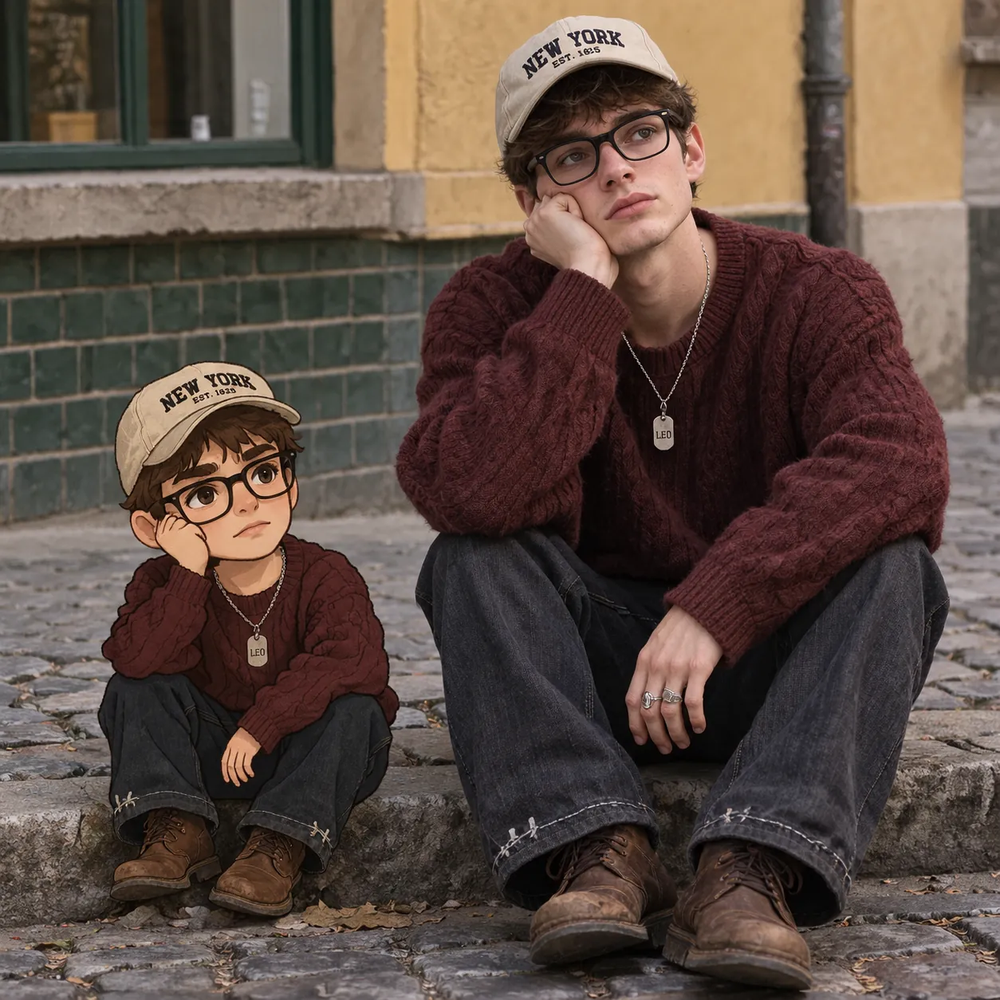</a>

> 真人与插画在同一条人行道上相遇：主角坐在路边、手托下巴，旁边一个更小的卡通版本复刻了他的服装、姿势和表情。提示词把服装写得非常细（酒红色绞花毛衣、深色牛仔裤、棕色靴子、眼镜、棒球帽、刻着名字的狗牌项链），正是这些细节让卡通能对得上。我们用了一位年轻男性的虚构参考图，把狗牌名字设为“LEO”。成品把这对组合做得很到位，手绘小人线条干净，背景是鹅卵石路和黄色墙面；不过人物没有胡子，和原文描述不同。适合创作者头像或“内在自我”主题的宣传。

```text
Transform this image (the attached reference image) into a 64K DSLR shot resolution of A creative urban street portrait featuring a young man (same face as the uploaded image) sitting on a curb in a quiet city street, paired with a stylized cartoon illustration of himself placed beside him. The real-life subject (same face as the uploaded image) is seated casually on a concrete sidewalk edge, resting his head on one hand in a bored, contemplative pose. He looks slightly upward with a neutral, introspective expression, conveying a sense of quiet thoughtfulness and urban solitude. He wears a muted maroon cable-knit sweater with a relaxed fit, dark loose-fitting denim jeans with subtle stitched details near the cuffs, and worn brown leather boots. Accessories include layered silver chain dog tag with the name "LEO" written on it, rings on his fingers, black-framed glasses, and a light-coloured baseball cap with bold embroidered lettering on the front. His hair is short, dark hair, a well-groomed beard texture and character. Next to him on the sidewalk sits a small cartoon version (same face as the uploaded image) of himself, matching his outfit and pose exactly—same sweater, jeans, boots, cap, glasses, and facial expression. The illustrated character has clean outlines, warm muted colors, and a soft shaded, hand-drawn animation style, creating a playful contrast between realism and illustration. The cartoon figure is proportionally smaller, emphasizing a companion-like or inner-self concept. The background features textured cobblestone pavement, a curb edge, and a building facade with muted yellow walls and green-tiled brickwork near a window. The color palette is earthy and subdued, with natural daylight providing soft, even lighting and realistic shadows. The overall composition blends street photography, fashion portraiture, and mixed-media digital art, evoking themes of identity, self-reflection, and creativity.
Style & Mood Keywords: Urban street photography, casual fashion portrait, mixed media art, real and cartoon character duo, introspective mood, muted earthy tones, soft natural light, realistic textures, creative storytelling, high-resolution detail, cinematic realism. Octane render & Unreal Engine
```

- 原作者: [@Sheldon056](https://x.com/Sheldon056)
- 原帖: https://x.com/Sheldon056/status/2009458579305267681
- [在 cinel 上查看详情并一键生成](https://cinel.ai/zh/prompts/p/street-portrait-with-cartoon-companion?utm_source=github&utm_medium=awesome&utm_campaign=awesome-gpt-image-2.5-prompts)

### 3×3 耳机生活方式分镜九宫格提示词

<a href="https://cinel.ai/zh/prompts/p/teal-studio-lifestyle-storyboard-grid?utm_source=github&utm_medium=awesome&utm_campaign=awesome-gpt-image-2.5-prompts">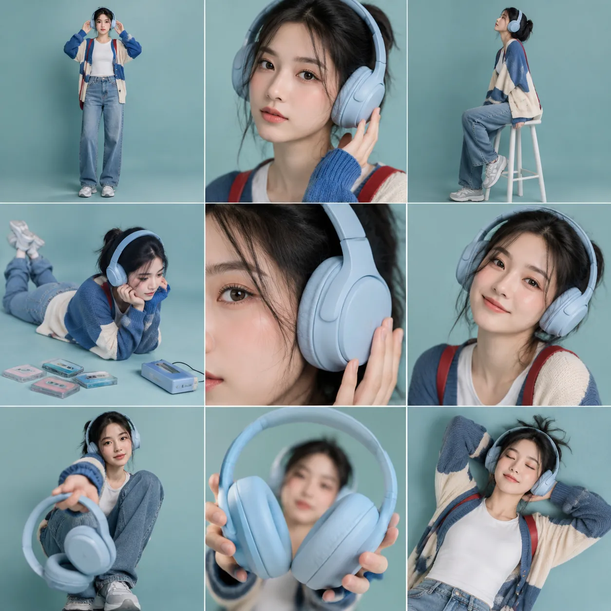</a>

> 一份把拍摄清单直接写成提示词的方案。它先固定所有不变的元素（一位模特、一套服装、粉蓝色耳机、青绿色背景、柔和漫射光），再给九格逐一编号并指定姿势和景别：站立、手扶耳罩的特写、坐在高脚凳上的侧面、趴着摆弄磁带、超近特写、强制透视的产品镜头等。正是这种结构让我们的九宫格保持一致：九格里是同一位女性、同一套衣服，姿势也基本按顺序完成。可以用来提案、给摄影师做简报，或快速做一组社交组图。换掉产品和配色，保留编号顺序即可。

```text
3×3 storyboard grid, nine panels, same subject and outfit, consistent teal studio background, soft diffused lighting, clean editorial lifestyle photography
young East Asian woman, natural makeup, black hair tied back, wearing white fitted top, blue/cream color-block cardigan with red strap, blue jeans, sneakers, pastel blue over-ear wireless headphones
panel sequence (left→right, top→bottom): 1 standing adjusting headphones, front view
2 close-up portrait touching earcup
3 side profile sitting on tall stool
4 lying on stomach with cassette tapes + retro player
5 extreme close-up headphones + face detail
6 tilted head smiling portrait
7 low-angle crouch reaching headphones toward camera
8 forced perspective product shot, headphones close to lens
9 lying on back relaxed pose
style: minimal, pastel tones, soft shadows, sharp focus, commercial product photography, consistent framing, balanced grid layout, mix of wide/medium/close shots
```

- 原作者: [@oggii_0](https://x.com/oggii_0)
- 原帖: https://x.com/oggii_0/status/2042288316868149748
- [在 cinel 上查看详情并一键生成](https://cinel.ai/zh/prompts/p/teal-studio-lifestyle-storyboard-grid?utm_source=github&utm_medium=awesome&utm_campaign=awesome-gpt-image-2.5-prompts)

### 70 年代秋日咖啡馆台阶时尚人像提示词

<a href="https://cinel.ai/zh/prompts/p/1970s-cafe-steps-fashion-portrait?utm_source=github&utm_medium=awesome&utm_campaign=awesome-gpt-image-2.5-prompts">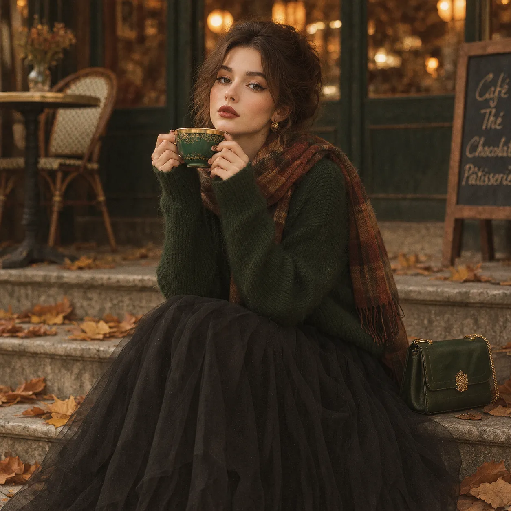</a>

> 一条以穿搭为主导的杂志人像提示词，它之所以好看，是因为每件单品都属于同一组大地色：森林绿针织衫、黑色长纱裙、棕橙红格纹围巾、带金色搭扣的深绿皮革斜挎包，以及金边的华丽绿色咖啡杯。台阶上的落叶和咖啡馆窗内的琥珀色灯光呼应这些颜色，“70 年代胶片色调、温暖颗粒感”再把一切统一起来。我们的成品里，一位微卷长发、哑光红唇的女性坐在石阶上啜饮，身后是虚化的小黑板。适合秋季造型手册、咖啡馆推广或买手店社交内容；可以替换单品，但保持色调不变。

```text
Aesthetic 1970s-inspired fashion portrait of a stylish young woman sitting on outdoor cafe steps, holding a premium ornate green coffee cup with gold rim detailing, gazing softly at the camera. Her hair is styled in soft loose strands framing her face with vintage makeup, matte red lips, and subtle eyeliner. She is wearing a cozy forest green premium knit sweater paired with a long flowing black tutu skirt. A warm vintage plaid scarf in earthy brown, burnt orange, and muted red tones is wrapped loosely around her neck. A premium dark green leather crossbody bag with a gold filigree clasp and chain strap is placed beside her. Autumn street café setting with scattered fallen leaves and warm amber café lights glowing behind glass windows. 1970s film tone, warm grainy texture, muted earthy color palette, cinematic atmosphere, shallow depth of field, soft natural lighting, analog film look, fashion editorial photography, ultra-realistic, high detail, 85mm lens, f/1.8, vintage aesthetic, dreamy mood.
```

- 原作者: [@2abhisheknaks](https://x.com/2abhisheknaks)
- 原帖: https://x.com/2abhisheknaks/status/2008537400083939763
- [在 cinel 上查看详情并一键生成](https://cinel.ai/zh/prompts/p/1970s-cafe-steps-fashion-portrait?utm_source=github&utm_medium=awesome&utm_campaign=awesome-gpt-image-2.5-prompts)

### 明暗对照风吹发丝电影感特写人像提示词

<a href="https://cinel.ai/zh/prompts/p/windswept-hair-cinematic-close-up?utm_source=github&utm_medium=awesome&utm_campaign=awesome-gpt-image-2.5-prompts">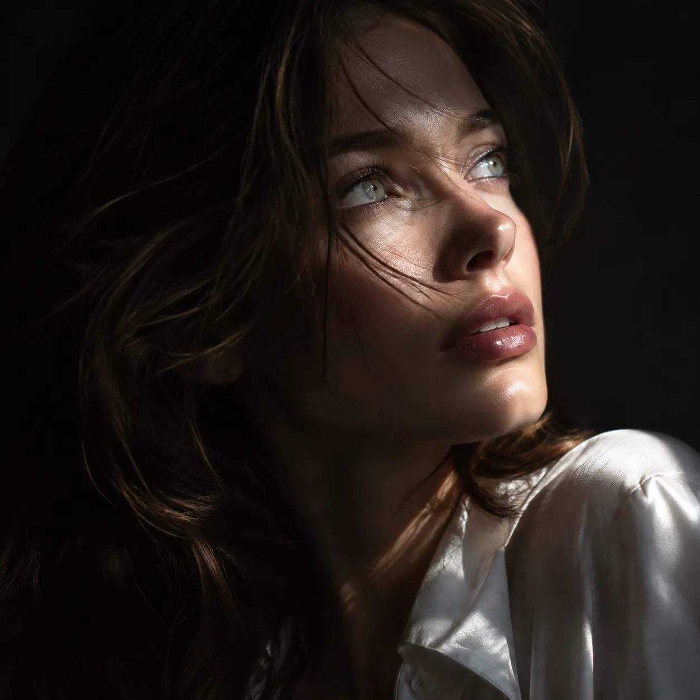</a>

> 明暗对照法意味着让画面大部分沉入黑暗，这条提示词贯彻得很彻底：一束锐利的斜光只照亮颧骨、鼻梁和嘴唇的高点，脸的其余部分和背景都沉入深影。她的目光朝右上方、迎向光源，眼睛因此有明亮的反光。注意提示词前后矛盾：先描述深色衣服，结尾又写“服装应为白色”；模型听从了最后一句，给她穿上了能接住一点光的白色丝质衬衫。我们的成品里，发丝拂过脸庞，浅色眼睛在光束中发亮。使用前请先统一服装描述。

```text
Hyper-realistic cinematic Create an 8k close-up portrait of a beautiful woman with medium, brown, slightly wind-swept hair falling across her face. Her striking, light-colored eyes gaze upwards and to the right, catching a sharp, diagonal beam of natural light that illuminates the high points of her cheekbone, nose, and plump, fair skin, glossy, mauve-toned lips a slightly light weight silk shirt. The rest of her face and the background are cast in deep,dramatic shadow (chiaroscuro) emphasizing the play of light and shadow Subtle textures of her dark clothing are visible on her left shoulder. The image should capture a mysterious and introspective mood, with incredible detail in her skin, hair strands, and the subtle reflections in her eyes and lips.
Outfit should white.
```

- 原作者: [@Naiknelofar788](https://x.com/Naiknelofar788)
- 原帖: https://x.com/Naiknelofar788/status/2028853502358003808
- [在 cinel 上查看详情并一键生成](https://cinel.ai/zh/prompts/p/windswept-hair-cinematic-close-up?utm_source=github&utm_medium=awesome&utm_campaign=awesome-gpt-image-2.5-prompts)

### 多臂职业人像棚拍提示词

<a href="https://cinel.ai/zh/prompts/p/professional-office-chair-studio-portrait?utm_source=github&utm_medium=awesome&utm_campaign=awesome-gpt-image-2.5-prompts"></a>

> 一种一次展示一份工作全部内容的趣味方式：人物跷腿坐在白色人体工学椅上，身后呈扇形伸出六到八只照片级写实的手臂，每只手都拿着一件职业工具。提示词用规则完成了难点：解剖要求（关节正确、五根手指）、与职业匹配的背景色、一块大号银色反光板，以及清晰的布光方案。我们用一位三十八岁左右的虚构女性参考图，职业设为建筑师。她前面的手握着手机，周围是卷起的图纸、圆规、相机、平板、笔记本电脑和材料色卡。适合领英横幅、团队介绍页或招聘海报。

```text
Create a hyper-real, studio portrait using the attached reference image as the exact identity reference (same face, hairstyle, skin texture, and age). Depict the person as a confident architect sitting casually on a modern white ergonomic office chair, legs crossed, centered in frame. Add a stylized “multi-arm” illusion (6–8 arms total) radiating behind the torso like a modern Shiva/Vishnu-inspired silhouette, but photorealistic: each extra arm must have correct anatomy, believable joints, tendons, skin pores, and natural shadowing; no warped fingers.

PROPS (must be profession-relevant): Automatically choose and place different tools that a real architect would use, one per hand/arm, all clearly readable and accurate in design. Examples of categories: primary tool, secondary tool, communication device, measurement/diagnostic tool, accessory, and a “hero” prop. Keep one real smartphone in the main/front hand. Avoid generic random objects—every prop must logically belong to architect. If architect is digital/tech: include items like laptop, tablet, camera/monitor, light meter, stylus, keyboard, mic, etc. If architect is medical: stethoscope, clipboard, otoscope, syringe (safe/clinical), etc. If architect is culinary: chef knife, tongs, plating tweezers, recipe tablet, etc. (Always match architect.)

BACKGROUND COLOR (topic-matched): Use a seamless paper studio backdrop with a single dominant color that matches the profession theme (e.g., warm mustard for creative/media, cool teal for healthcare, graphite/steel for engineering, rich olive for outdoors, deep burgundy for luxury). The color should complement skin tones and wardrobe. Add subtle gradient falloff and soft bounce for depth (no flat background).

LIGHTING & SET: High-end commercial studio look. One large soft key light from camera-left, controlled fill from right, crisp rim light to separate subject, and realistic specular highlights on props. Include a large circular silver reflector disk behind the subject (partially visible) for visual punch. Add a subtle shadow on the floor consistent with light direction.

WARDROBE & STYLING: Outfit must be believable for a top-tier architect (clean, modern, slightly stylized), with texture detail (fabric weave, seams). Add minimal accessories (watch/bracelet) that feel premium. Expression: focused, slightly intense, “in the zone.”

COMPOSITION & CAMERA: Full-body vertical portrait (4:5), 50mm lens look, eye-level camera, sharp focus on face, shallow depth of field but props still readable. Ultra-detailed skin, natural color grading, high dynamic range, crisp micro-contrast.

REALISM RULES: No cartoon, no CGI look. No extra faces, no duplicated heads. Hands must be anatomically correct (5 fingers), no melted objects, no unreadable text logos unless naturally present. Keep the scene clean and premium.

Output: hyper-real editorial photograph, 8K detail, studio-quality retouching, natural skin texture preserved.
```

- 原作者: [@Samann_ai](https://x.com/Samann_ai)
- 原帖: https://x.com/Samann_ai/status/2017190762346078697
- [在 cinel 上查看详情并一键生成](https://cinel.ai/zh/prompts/p/professional-office-chair-studio-portrait?utm_source=github&utm_medium=awesome&utm_campaign=awesome-gpt-image-2.5-prompts)

### 从玻璃下方仰拍行人提示词

<a href="https://cinel.ai/zh/prompts/p/people-walking-on-glass-from-below?utm_source=github&utm_medium=awesome&utm_campaign=awesome-gpt-image-2.5-prompts">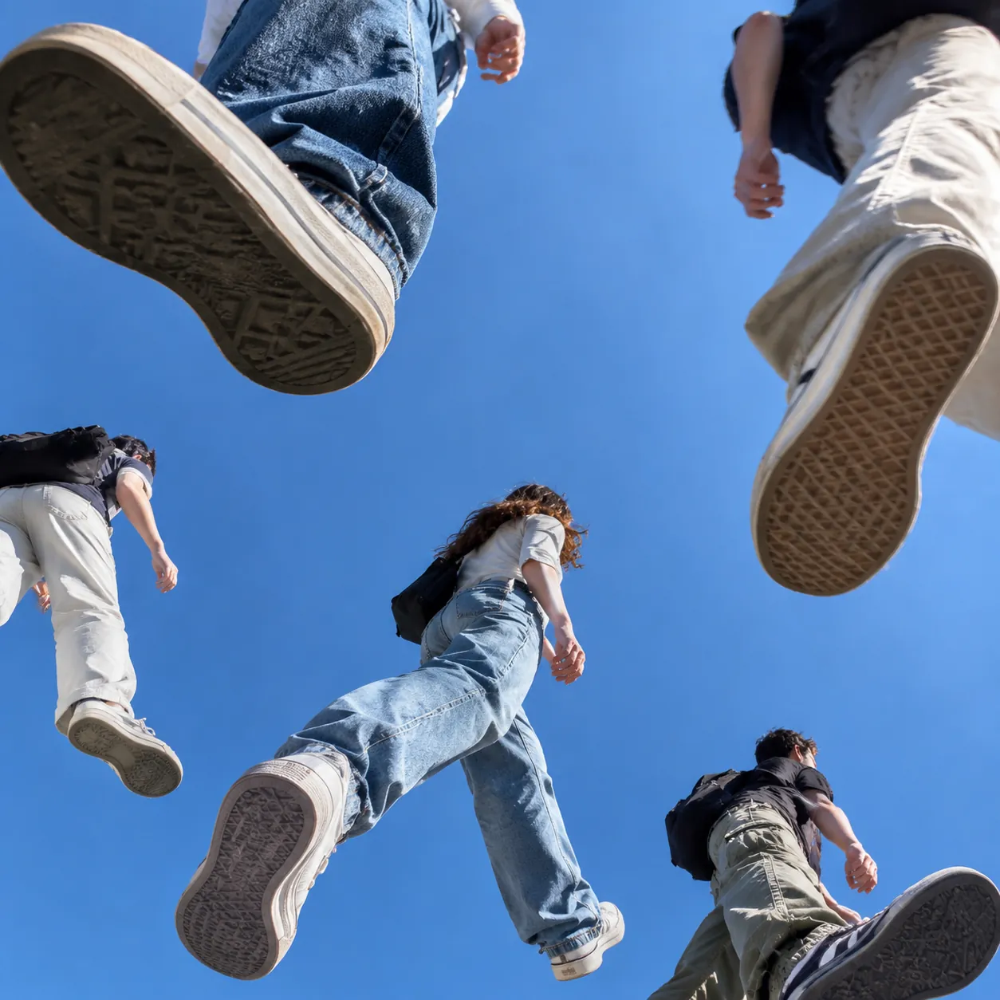</a>

> 这里的诀窍是做减法：提示词不断去掉任何能解释场景的东西——没有建筑、没有边缘、有机玻璃没有接缝，“就像有机玻璃根本不存在”。剩下的就是满天仿佛凌空行走的人，鞋底几乎碰到镜头。指定人们“大致从左往右走”，让人群有了方向，画面像一个瞬间而不是拼贴。我们的成品里，五个穿牛仔裤和运动鞋的人从头顶大步走过，磨旧的橡胶鞋底清晰锐利，背景是干净的蓝天。适合运动鞋品牌、城市节庆或概念封面。试试换成日落天空。

```text
View from under a plane of completely transparent plexiglass. We are looking straight up. Many people are walking on the plexiglass. In the background is a pure blue sky. No buildings visible. No edges or separations in the plexiglass. It’s as if the plexiglass isn’t even there. We are very close to the people. The people are in the process of walking. The people are walking generally from left to right. The soles of their shoes are very close to the foreground.
```

- 原作者: [@cfryant](https://x.com/cfryant)
- 原帖: https://x.com/cfryant/status/2008198858405462492
- [在 cinel 上查看详情并一键生成](https://cinel.ai/zh/prompts/p/people-walking-on-glass-from-below?utm_source=github&utm_medium=awesome&utm_campaign=awesome-gpt-image-2.5-prompts)

### 夜晚站台人像配 Q 版分身涂鸦提示词

<a href="https://cinel.ai/zh/prompts/p/train-platform-mixed-media-portrait?utm_source=github&utm_medium=awesome&utm_campaign=awesome-gpt-image-2.5-prompts">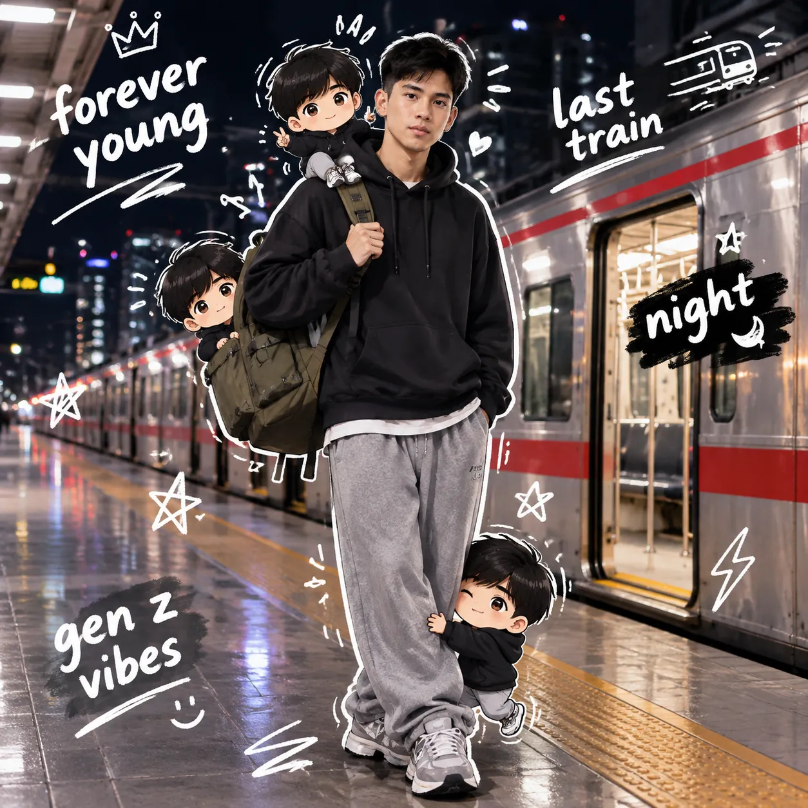</a>

> 一个画面里叠了三种视觉语言：人物站在夜晚灯火通明的站台上的写实照片、在他身边玩耍的可爱 3D Q 版分身，以及一层扁平的白色手绘涂鸦——描边、星星、闪电和手写口号。每个 Q 版都有具体任务（一个坐在肩上、一个爬腿、一个从背包里探头），所以不会挤成一团。原文点名了雅加达的一条具体通勤线路，我们改成了带红色条纹的现代通勤列车，并把其中一句口号换成“last train”。用一位穿黑色卫衣的年轻男性虚构参考图，成品是一张活泼、像手账拼贴的社交帖子。

```text
A high quality mixed media portrait of a trendy young man (using my uploaded person photo) standing on a train station platform at night. The subject is posing coolly, holding the strap of an olive backpack with one hand. He is wearing a stylish streetwear outfit with an oversized layered black hoodie, gray sweatpants, and chunky sneakers.

The background features a realistic modern commuter train side view with red striping and no operator logos, with the train doors wide open, bathed in bright cinematic station lighting and city night ambiance.

Surrounding the realistic main subject are several cute 3D style chibi versions of himself, same outfit and same face. These chibis are interacting playfully, one sitting on his shoulder, one climbing his leg, and another peeking out from the backpack.

Overlay the image with vibrant hand drawn doodle effects, white drawn outlines around the subject, playful scribbles, stars, sparkles, electric sparks, and floating white and black handwritten slogans like “forever young”, “last train”, “night”, and “gen z vibes”. The style should seamlessly blend hyper realistic photography with colorful flat cartoon illustrations while keeping the face and body shape unchanged.
```

- 原作者: [@harboriis](https://x.com/harboriis)
- 原帖: https://x.com/harboriis/status/2021810779348140286
- [在 cinel 上查看详情并一键生成](https://cinel.ai/zh/prompts/p/train-platform-mixed-media-portrait?utm_source=github&utm_medium=awesome&utm_campaign=awesome-gpt-image-2.5-prompts)

### 海崖男装双联人像提示词

<a href="https://cinel.ai/zh/prompts/p/coastal-cliff-side-by-side-portrait?utm_source=github&utm_medium=awesome&utm_campaign=awesome-gpt-image-2.5-prompts">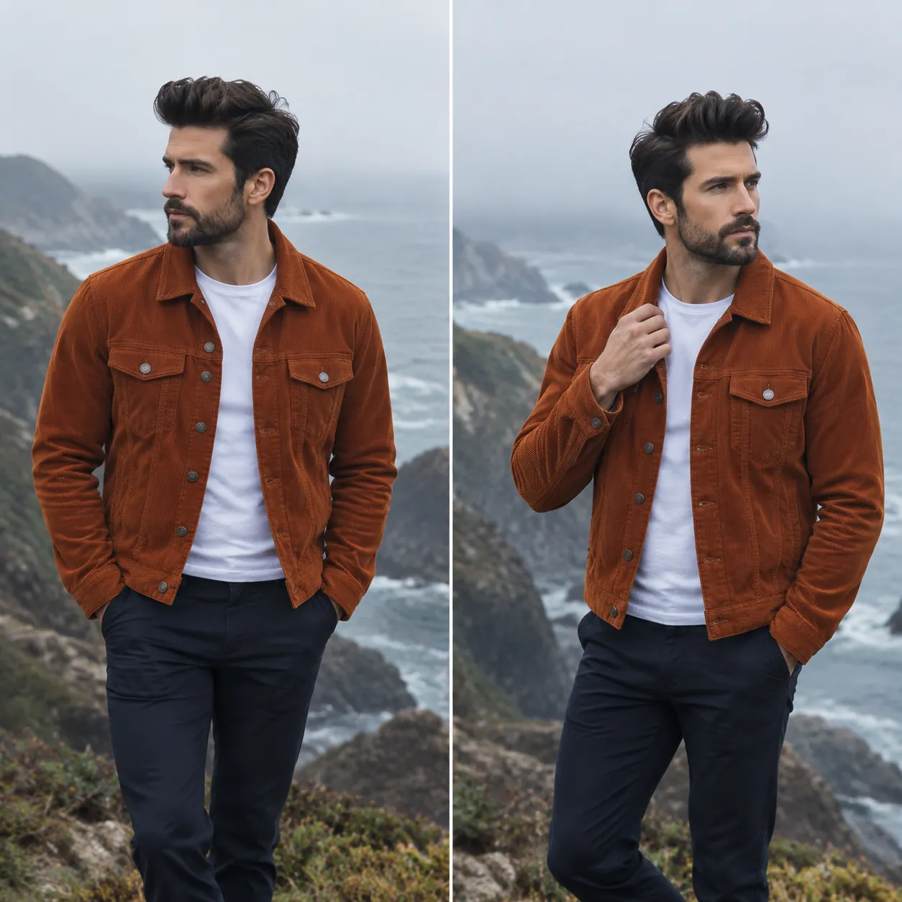</a>

> 一份简短的 JSON 简报，直接产出一张现成的造型手册双联图：一个人、一套衣服、两个姿势并排。结构保证两格里的人物和服装一致（三十五岁左右、修剪整齐的胡子、蓬松的背头、铁锈色灯芯绒夹克、挺括白 T、深色长裤），场景则用崎岖海崖、雾蒙蒙的海平线和柔和的阴天光线营造氛围。我们的成品左边是他双手插兜望向远方，右边是整理衣领，身后是灰色的海和礁石，夹克温暖的铁锈色是画面中唯一浓烈的颜色。适合男装详情页、理发或男士理容品牌和户外服饰。

```text
{
  "image_description": "A high-quality side-by-side comparison of a handsome man posing on a coastal cliffside.",
  "subject": {
    "gender": "male",
    "appearance": "mid-30s, well-groomed beard, thick dark hair styled in a modern voluminous pompadour",
    "poses": [
      "standing with hands in pockets looking away from the camera",
      "standing with one hand adjusting the collar of his jacket"
    ]
  },
  "outfit": {
    "outerwear": "burnt orange or rust-colored corduroy trucker jacket with metal buttons",
    "base_layer": "crisp white crew-neck t-shirt",
    "bottoms": "dark navy blue or black slim-fit trousers"
  },
  "setting": {
    "location": "rugged coastal cliff overlooking the ocean",
    "background": "misty horizon, calm sea, rocky shoreline",
    "lighting": "overcast, soft diffused natural light, moody atmospheric fog"
  },
  "technical_details": {
    "camera_angle": "eye-level medium shot",
    "composition": "diptych (two images side-by-side)",
    "aesthetic": "lifestyle photography, cinematic color grading, shallow depth of field with soft background bokeh"
  }
}
```

- 原作者: [@2abhisheknaks](https://x.com/2abhisheknaks)
- 原帖: https://x.com/2abhisheknaks/status/2008113093117894773
- [在 cinel 上查看详情并一键生成](https://cinel.ai/zh/prompts/p/coastal-cliff-side-by-side-portrait?utm_source=github&utm_medium=awesome&utm_campaign=awesome-gpt-image-2.5-prompts)

### 斑马线上俯拍巨人自拍配产品提示词

<a href="https://cinel.ai/zh/prompts/p/cinematic-selfie-identity-preserved?utm_source=github&utm_medium=awesome&utm_campaign=awesome-gpt-image-2.5-prompts">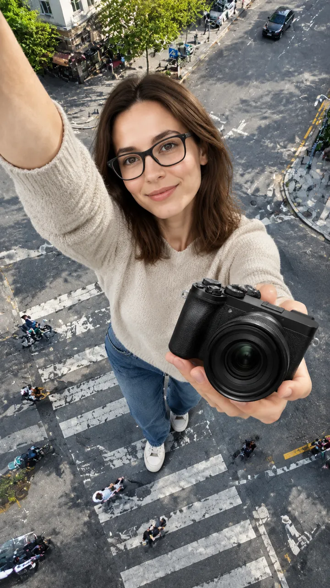</a>

> 一张几何关系很有野心的产品植入自拍：相机从正上方垂直向下，一只手臂向上伸出画面、仿佛握着相机，另一只手把产品推向镜头，让产品成为画面中最大的物体，其次是脸、全身和下方的街道。提示词想要的强制透视非常夸张，楼房只到她的膝盖。我们提供了两张自有参考图：一位戴眼镜的虚构女性和一台无品牌微单相机。成品很好地做出了层次纵深，也保留了她的样貌，不过“巨人”效果比描述的弱：她显得高，但没有高耸入云。适合达人合作和数码新品发布。

```text
{
  "type": "image_generation_prompt",
  "language": "en",
  "style": "hyper-realistic cinematic selfie photography",
  "aspect_ratio": "9:16",
  "identity_preservation": {
    "use_reference_image": true,
    "strict_identity_lock": true,
    "alter_face": false,
    "alter_skin": false,
    "alter_hair": false,
    "alter_gender": false,
    "notes": "Preserve identical facial features, skin texture, hair, glasses, age, and gender from the uploaded reference image. No synthetic skin or sculptural look."
  },
  "subject": {
    "gender": "female",
    "capture_method": "selfie taken by the subject herself",
    "pose": {
      "selfie_arm": {
        "description": "one arm fully straight and completely extended upward holding the camera that takes the selfie",
        "visibility": "arm clearly visible, straight and dominant in frame",
        "camera_visibility": "the selfie camera device itself must NOT be visible in the frame"
      },
      "product_arm": {
        "description": "the other arm fully extended toward the camera holding the attached camera from the second reference image",
        "importance": "product is closest to the camera and visually dominant"
      },
      "head": {
        "tilt": "slightly tilted toward the selfie camera"
      },
      "expression": "natural and relaxed facial expression"
    },
    "body_visibility": "full body visible from head to toe",
    "feet": "feet clearly touching the road surface"
  },
  "composition": {
    "perspective": "natural selfie perspective at chest height",
    "camera_angle": "extreme top-down angle, camera above the subject looking directly downward",
    "layer_depth": [
      "product (closest to camera)",
      "face",
      "full body",
      "city environment (background)"
    ]
  },
  "scale_and_perspective": {
    "effect": "forced perspective",
    "subject_scale": "the woman appears extremely giant",
    "buildings_scale": "buildings appear much smaller, reaching no higher than her knees",
    "dominance": "the subject visually dominates the entire scene",
    "realism": "inspiring scale while remaining physically believable"
  },
  "environment": {
    "location": "real urban intersection",
    "elements": [
      "pedestrian crosswalk",
      "road markings",
      "traffic signs",
      "cars",
      "bicycles",
      "pedestrians at realistic human scale"
    ],
    "setting": "ground-level urban environment"
  },
  "lighting": {
    "type": "natural daylight",
    "conditions": "clear or lightly cloudy sky",
    "shadows": "soft and realistic",
    "restrictions": "no fantasy or dramatic lighting"
  },
  "product_rules": {
    "usage": "use the camera from the second reference image exactly as provided",
    "distortion": "none",
    "logo": "none",
    "appearance": "natural reflections and realistic highlights only"
  },
  "camera_quality": {
    "realism": "maximum photorealism",
    "depth": "clear separation of foreground, subject, and background",
    "artifacts": "none"
  },
  "constraints": [
    "No AI-art look",
    "No plastic or sculpted skin",
    "No distortion of face or body",
    "No extra limbs or incorrect anatomy",
    "No text or watermarks",
    "No visible selfie camera device"
  ],
  "output_goal": "Create a hyper-realistic cinematic selfie image of a woman using her exact reference identity, captured from an extreme top-down perspective in a real urban crosswalk, with forced perspective scale, natural daylight, and the camera prominently held toward the lens."
}
```

- 原作者: [@saniaspeaks_](https://x.com/saniaspeaks_)
- 原帖: https://x.com/saniaspeaks_/status/2009834337043394622
- [在 cinel 上查看详情并一键生成](https://cinel.ai/zh/prompts/p/cinematic-selfie-identity-preserved?utm_source=github&utm_medium=awesome&utm_campaign=awesome-gpt-image-2.5-prompts)

### 黑西装飞行员墨镜情绪棚拍人像提示词

<a href="https://cinel.ai/zh/prompts/p/black-suit-warm-light-cinematic-portrait?utm_source=github&utm_medium=awesome&utm_campaign=awesome-gpt-image-2.5-prompts">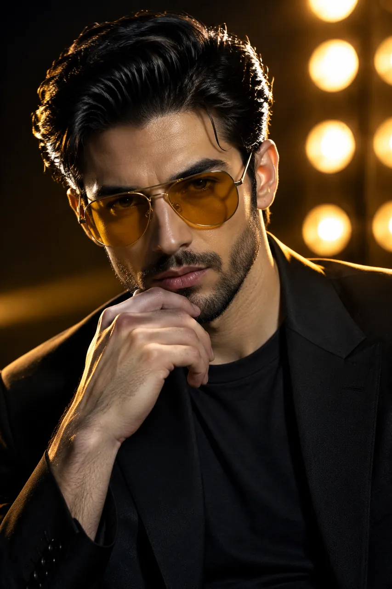</a>

> 一张用 JSON 精确描述的时尚人像：一位二十五到三十岁的男士，油亮的背头和方形短胡，黑色 T 恤外搭哑光黑西装，戴金框琥珀色镜片的飞行员墨镜，手托下巴，略低于平视的机位让他更有气场。配色是关键决定：除了镜片和背后虚化的化妆镜灯泡里暖暖的黄橙色，一切都是黑和炭灰，所以眼镜和背景彼此呼应。我们的成品非常贴合要求，硬朗的侧光和轮廓光刻画出下颌和发丝。适合理发店、眼镜、男装或个人品牌；换镜片颜色就能改变情绪。

```text
{
  "objective": "Create a dramatic, high-contrast cinematic portrait of a stylish young man in a premium black suit with selective warm lighting and intense mood",
  "subject": {
    "type": "Young adult male",
    "age_appearance": "25-30",
    "hair": "Black, voluminous, slicked back pompadour style, perfectly styled with high shine",
    "facial_hair": "Well-groomed short boxed beard and mustache",
    "expression": "Intense, confident, serious, slightly mysterious",
    "pose": "Hand under chin thoughtful/contemplative pose, looking directly at camera",
    "accessories": {
      "sunglasses": "Classic aviator style, gold metal frame, strong yellow/orange tinted lenses",
      "clothing": {
        "outerwear": "Premium matte black tailored blazer/jacket, sharp lapels, high-end luxurious fabric texture",
        "innerwear": "Dark charcoal or black crew-neck t-shirt"
      }
    }
  },
  "lighting": {
    "style": "Cinematic studio lighting",
    "main": "Strong side and rim lighting creating deep shadows and dramatic highlights",
    "background": "Dark gradient with circular warm spotlight array (vanity/makeup studio lights)",
    "contrast": "Very high contrast, deep blacks, bright highlights on face and hair",
    "mood": "Moody, masculine, powerful, film-noir inspired"
  },
  "composition": {
    "framing": "Tight mid-close-up portrait, head and shoulders",
    "angle": "Slightly below eye level for commanding presence",
    "depth_of_field": "Shallow, sharp focus on face and sunglasses, soft background"
  },
  "color_palette": {
    "dominant": "Black & deep charcoal",
    "accents": "Warm yellow-orange from sunglasses lenses and background lights",
    "skin_tone": "Natural with subtle cinematic glow"
  },
  "style_references": [
    "Modern film-noir",
    "High-end fashion editorial",
    "Hollywood dramatic portrait",
    "David LaChapelle meets classic menswear advertising"
  ],
  "image_quality": {
    "resolution": "Ultra-high detail, 8K",
    "sharpness": "Crisp facial features, hair strands visible",
    "texture": "Detailed skin pores, fabric weave, hair shine"
  },
  "negative_prompt": [
    "low quality",
    "blurry",
    "overexposed",
    "underexposed",
    "cartoon",
    "anime",
    "distorted face",
    "extra limbs",
    "bad anatomy",
    "logo",
    "text",
    "watermark",
    "bright colored clothing",
    "casual outfit"
  ],
  "aspect_ratio": "2:3 (portrait orientation)"
}
```

- 原作者: [@2abhisheknaks](https://x.com/2abhisheknaks)
- 原帖: https://x.com/2abhisheknaks/status/2012888202760384949
- [在 cinel 上查看详情并一键生成](https://cinel.ai/zh/prompts/p/black-suit-warm-light-cinematic-portrait?utm_source=github&utm_medium=awesome&utm_campaign=awesome-gpt-image-2.5-prompts)

### 酒吧波点裙人像（参考图）提示词

<a href="https://cinel.ai/zh/prompts/p/wine-bar-polka-dot-dress-portrait?utm_source=github&utm_medium=awesome&utm_campaign=awesome-gpt-image-2.5-prompts">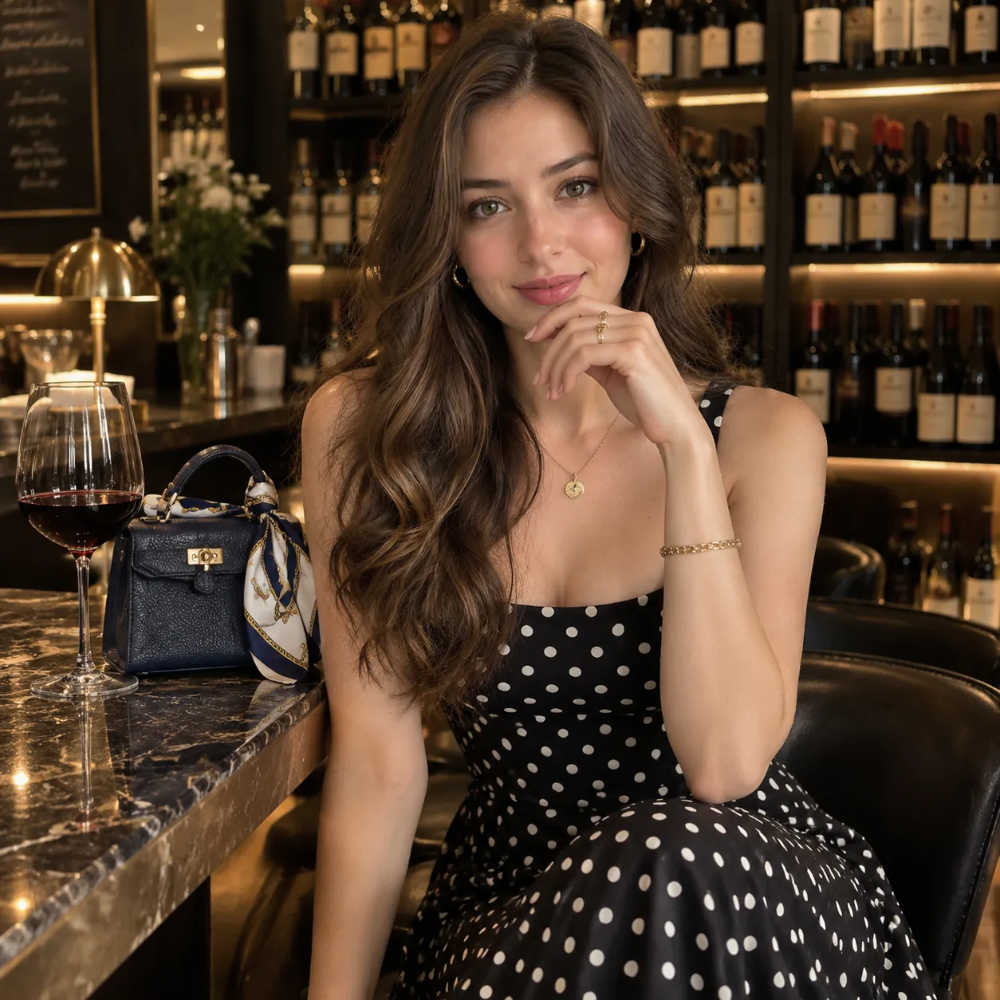</a>

> 一张有明确场景感的生活方式人像：葡萄酒吧台、背光的酒瓶墙、温暖的低光，以及在琥珀色调中格外醒目的黑白波点中长裙。坐姿、手靠近唇边，显得若有所思而不是摆拍。原文点名了某奢侈品牌的包，我们改成了配丝巾的藏青色设计师款迷你包。用一位栗色长卷发虚构女性的参考图，成品保留了她的样貌，大理石吧台上放着一杯红酒和那只藏青色小包。适合餐厅或酒吧营销，也可以做个人“夜晚出行”主题头像。

```text
Young beautiful woman with long wavy hair, elegant sleeveless polka dot midi dress black and white pattern, sitting thoughtfully at stylish wine bar counter, hand near lips, luxury wine bottles wall background, navy blue designer mini bag with silk scarf, gold jewelry, sophisticated chic atmosphere, soft warm lighting, cinematic, highly detailed, realistic

Use my uploaded face image as the ONLY facial and identity reference. No other faces, models, datasets, or references are allowed.
```

- 原作者: [@2abhisheknaks](https://x.com/2abhisheknaks)
- 原帖: https://x.com/2abhisheknaks/status/2011378277001363610
- [在 cinel 上查看详情并一键生成](https://cinel.ai/zh/prompts/p/wine-bar-polka-dot-dress-portrait?utm_source=github&utm_medium=awesome&utm_campaign=awesome-gpt-image-2.5-prompts)

### 低角度橄榄绿西装棚拍人像（参考图）提示词

<a href="https://cinel.ai/zh/prompts/p/low-angle-full-body-studio-portrait?utm_source=github&utm_medium=awesome&utm_campaign=awesome-gpt-image-2.5-prompts">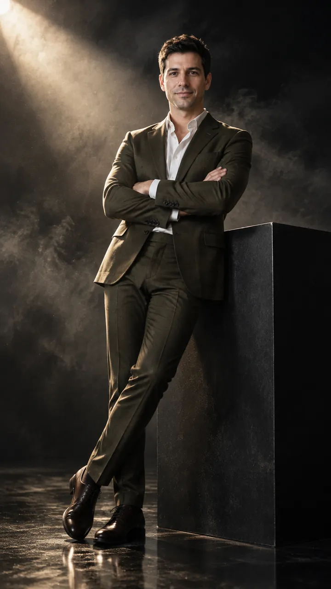</a>

> 一张带舞台布光的自信高管风人像：左上方一束强烈的体积光切开薄雾和微尘，影棚其余部分沉入丝绒般的黑暗，略低的 35mm 机位让人物更显挺拔。人物双臂交叉倚着深色方台，穿修身橄榄绿西装和敞领白衬衫。JSON 中写的分辨率 7680×4320 只是画质提示，不代表画幅，所以我们按原帖的 9:16 竖幅生成。用一位三十五岁左右、没有胡子的虚构男性参考图，成品从头到脚完整入画：他双脚交叉倚着方台，烟雾在光束中翻卷，抛光地面上有倒影。适合创始人简介和演讲嘉宾海报。

```text
{
  "prompt": "Cinematic full-body studio portrait of a subject using the uploaded face as exact reference (preserve identity, facial structure, and proportions). Slightly low-angle perspective with a 35mm lens for a commanding, sophisticated presence. Subject leaning casually against a dark minimalist plinth, arms crossed. Wearing a perfectly tailored slim-fit olive green suit and a crisp white dress shirt, top buttons undone. Intense chiaroscuro lighting with a single powerful volumetric spotlight from the upper-left, cutting through subtle atmospheric haze with swirling smoke and micro-dust particles. Sharp rim highlights along shoulders and silhouette, deep velvety shadows across the body, high-contrast moody aesthetic. Hyper-realistic textures, visible fabric weave, subtle reflections on a polished studio floor, professional cinematic lighting, ultra-detailed, 8K resolution, no text, no watermark.",
  "resolution": "7680x4320",
  "camera": {
    "lens": "35mm",
    "angle": "slightly low-angle",
    "aperture": "f/2.0",
    "iso": "100",
    "shutter_speed": "1/125"
  },
  "quality": "ultra-high",
  "style": "cinematic, hyper-realistic, studio photography",
  "negative_prompt": "blurry, low-resolution, overexposed, underexposed, flat lighting, cartoon, CGI, plastic skin, extra limbs, distorted hands, bad anatomy, asymmetry, watermark, logo, text"
}
```

- 原作者: [@r4jjesh](https://x.com/r4jjesh)
- 原帖: https://x.com/r4jjesh/status/2020480621026705858
- [在 cinel 上查看详情并一键生成](https://cinel.ai/zh/prompts/p/low-angle-full-body-studio-portrait?utm_source=github&utm_medium=awesome&utm_campaign=awesome-gpt-image-2.5-prompts)

### 蓝红分色霓虹棚拍人像提示词

<a href="https://cinel.ai/zh/prompts/p/symmetrical-head-and-shoulders-studio-portrait?utm_source=github&utm_medium=awesome&utm_campaign=awesome-gpt-image-2.5-prompts">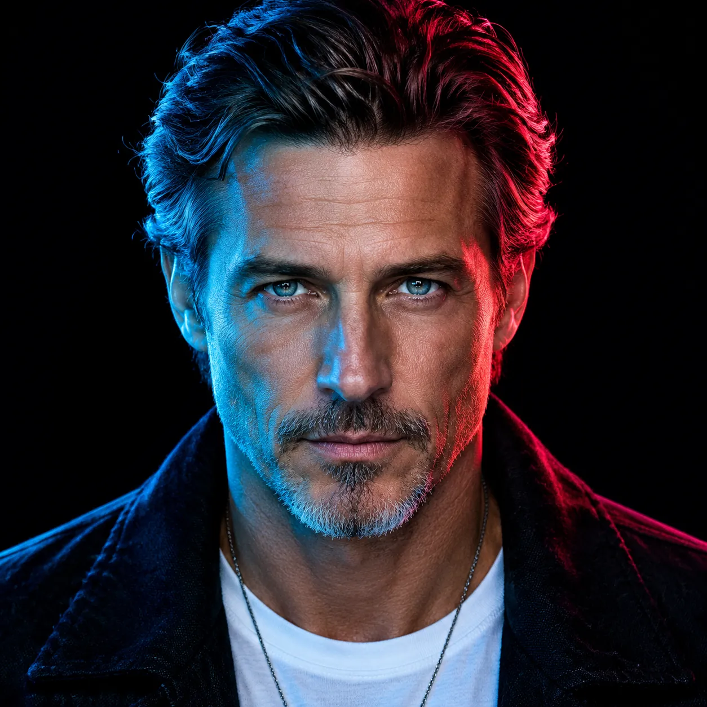</a>

> 这段 JSON 像一份反推出来的风格说明：记录了构图、对称性、左前方的青色主光、右后方的饱和红色轮廓光、几乎没有补光、纯黑背景，最后还列出了“风格复现关键词”。因为灯位写得非常精确，结果很容易在任何一张脸上复现。我们的成品是一位中年男士，向后梳的花白头发、浅色眼睛、椒盐色胡茬，直视镜头，蓝光洒满脸部，红光勾勒出头发和下颌。很适合专辑封面、演讲嘉宾海报或个性头像。把两种颜色换掉（青与琥珀、紫与青柠）就能做出变化。

```text
{
"image_type": "studio portrait",
"composition": {
"framing": "tight head-and-shoulders close-up",
"camera_angle": "eye-level",
"orientation": "vertical",
"symmetry": "near-perfect central symmetry",
"focus": "sharp focus on eyes and facial features",
"depth_of_field": "shallow, background fully blurred to black"
},
"subject": {
"description": "middle-aged male-presenting subject",
"pose": "frontal, facing camera directly",
"expression": "calm, confident, intense gaze",
"eye_direction": "looking straight into lens",
"facial_features": {
"facial_hair": "short salt-and-pepper stubble and trimmed goatee",
"skin_texture": "visible pores and fine lines, realistic skin detail",
"eyes": "light-colored eyes emphasized by catchlights"
},
"hair": {
"style": "medium-length, brushed back",
"texture": "natural, slightly tousled",
"color": "dark brown with subtle gray highlights"
}
},
"wardrobe": {
"top": "white crew-neck t-shirt",
"outerwear": "dark jacket or coat with soft texture",
"accessories": "thin chain necklace partially visible"
},
"lighting": {
"style": "cinematic, high-contrast neon lighting",
"key_light": {
"position": "front-left",
"color": "cool cyan/blue",
"effect": "dominant illumination across face and torso"
},
"rim_light": {
"position": "rear-right",
"color": "saturated red/magenta",
"effect": "strong edge highlight on hair and face contour"
},
"fill_light": "minimal to none",
"contrast_level": "high",
"mood": "dramatic, futuristic, intense"
},
"color_palette": {
"dominant_colors": ["cyan blue", "deep red", "black"],
"color_temperature": "mixed cool and warm neon tones",
"saturation": "high saturation on lighting, neutral clothing tones",
"color_grading": "stylized cyberpunk-inspired grading"
},
"background": {
"environment": "studio",
"details": "pure black background with no visible texture or objects",
"separation": "strong subject-background separation via rim lighting"
},
"technical_details": {
"camera_style": "professional studio photography",
"lens_effect": "slight compression typical of portrait lens",
"estimated_focal_length": "85mm equivalent",
"image_sharpness": "high",
"noise": "minimal",
"dynamic_range": "controlled highlights with deep shadows"
},
"artistic_style": {
"genre": "cinematic portrait",
"influences": ["cyberpunk", "neo-noir", "editorial fashion"],
"visual_aesthetic": "bold, modern, high-impact",
"post_processing": {
"skin_retouching": "subtle, realistic",
"color_enhancement": "strong split-toning blue/red",
"clarity": "enhanced micro-contrast"
}
},
"overall_impression": {
"tone": "powerful and enigmatic",
"intended_use": "editorial, album cover, cinematic poster, AI style reference",
"style_recreation_keywords": [
"cinematic neon portrait",
"blue and red split lighting",
"black background",
"intense direct gaze",
"cyberpunk color grading",
"high-contrast studio lighting"
]
}
}
```

- 原作者: [@Sheldon056](https://x.com/Sheldon056)
- 原帖: https://x.com/Sheldon056/status/2002763964476965234
- [在 cinel 上查看详情并一键生成](https://cinel.ai/zh/prompts/p/symmetrical-head-and-shoulders-studio-portrait?utm_source=github&utm_medium=awesome&utm_campaign=awesome-gpt-image-2.5-prompts)

### 闪光灯居家派对九宫格写真提示词

<a href="https://cinel.ai/zh/prompts/p/home-party-flash-nine-grid-portrait?utm_source=github&utm_medium=awesome&utm_campaign=awesome-gpt-image-2.5-prompts">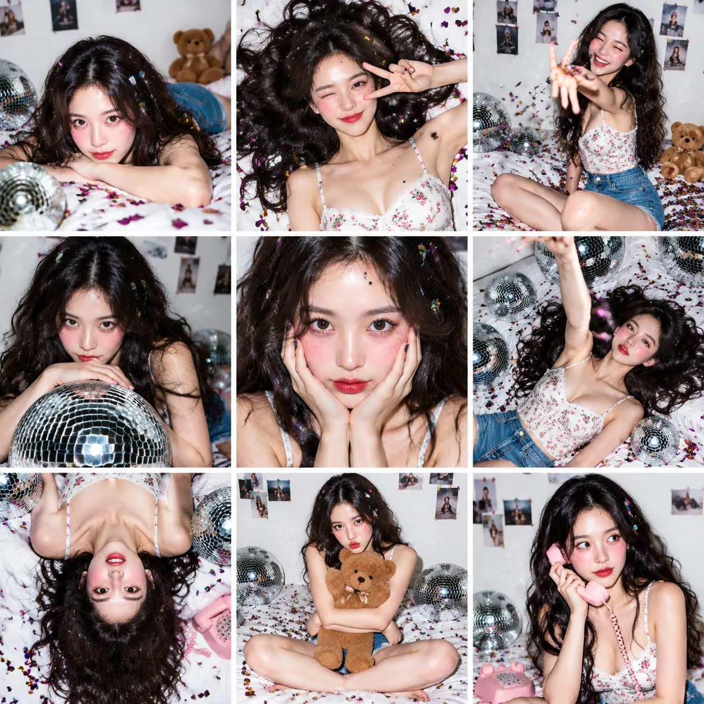</a>

> 这条提示词把一个流行的“居家写真派对”潮流做成了 3×3 拼图：机顶闪光直打出硬阴影，白墙上贴着照片，银色迪斯科球、金属亮片、泰迪熊和粉色复古电话，九个编号姿势从趴在床上到对着电话说悄悄话。它甚至写了相机参数（35mm、f/5.6、1/200 秒闪光同步）来定格亮片。原文对人物年龄的描述比较模糊，我们把主体明确改为二十八九岁的成年女性。我们的九宫格里，九格始终是同一个人、同一套衣服，迪斯科球上有闪光反射。适合派对写真馆或自拍馆的宣传。

```text
3x3 Photo Collage / 9-Panel Grid.",
      "layout": "Nine vertical portrait images arranged in a square grid.",
      "consistency": "Same subject, same outfit, and same lighting across all 9 panels."
    },
    "aesthetic_style": {
      "theme": "Gen Z Home Party / 'Maiden Pavilion' Photoshoot.",
      "lighting_technique": "Direct On-Camera Flash (Hard Light).",
      "visuals": "High contrast, sharp shadows, chaotic fun, vibrant colors against a white background."
    },
    "subject_details": {
      "appearance": "An adult Asian woman in her late 20s, fair skin, long dark wavy hair with volume.",
      "outfit": "White floral camisole top, blue denim shorts.",
      "makeup": "Heavy pink blush (Igari style), red lips, glitter on cheeks."
    },
    "environment_and_props": {
      "background": "White wall with taped photos, white bed sheets.",
      "decor": "Silver disco balls (various sizes), colorful metallic confetti scattered everywhere, brown teddy bear, pink retro corded phone."
    },
    "panel_pose_breakdown": {
      "1_top_left": "Lying on stomach (prone), resting chin on crossed arms, looking at camera. Confetti in hair.",
      "2_top_center": "Top-down view lying on back, winking one eye, making a peace sign near face. Hair fanned out.",
      "3_top_right": "Sitting sideways, knees bent, laughing candidly while throwing a handful of confetti in the air.",
      "4_middle_left": "Leaning upper body over a large silver disco ball, looking intensely at the camera.",
      "5_middle_center": "Close-up portrait. Hands touching cheeks in a 'surprised' or 'shy' gesture. Confetti stuck to cheeks.",
      "6_middle_right": "Lying on back amongst the disco balls, one arm reaching up towards the ceiling/camera.",
      "7_bottom_left": "Upside-down perspective (head at bottom of frame), playful expression, hair cascading down.",
      "8_bottom_center": "Sitting cross-legged (Lotus position), hugging the brown teddy bear tight, pouting slightly.",
      "9_bottom_right": "Sitting up, holding the pink retro telephone receiver to ear, looking sideways as if listening to gossip."
    },
    "camera_technical_values": {
      "focal_length": "35mm (Versatile environmental portrait lens).",
      "aperture": "f/5.6 (Ensures subject and props are in focus).",
      "shutter_speed": "1/200s (Flash sync to freeze confetti motion).",
      "iso": "ISO 200.",
      "lighting": "Hard flash creates a distinct drop shadow behind the subject on the white wall and specular highlights on the disco balls."
    }
  },
  "midjourney_string": "3x3 photo grid collage of a stylish adult Asian woman in her late 20s at a home party, wearing white floral top and
```

- 原作者: [@IqraSaifiii](https://x.com/IqraSaifiii)
- 原帖: https://x.com/IqraSaifiii/status/2010083845761314964
- [在 cinel 上查看详情并一键生成](https://cinel.ai/zh/prompts/p/home-party-flash-nine-grid-portrait?utm_source=github&utm_medium=awesome&utm_campaign=awesome-gpt-image-2.5-prompts)

### 70 年代胶片感秋日咖啡街人像提示词

<a href="https://cinel.ai/zh/prompts/p/1970s-street-cafe-fashion-portrait?utm_source=github&utm_medium=awesome&utm_campaign=awesome-gpt-image-2.5-prompts">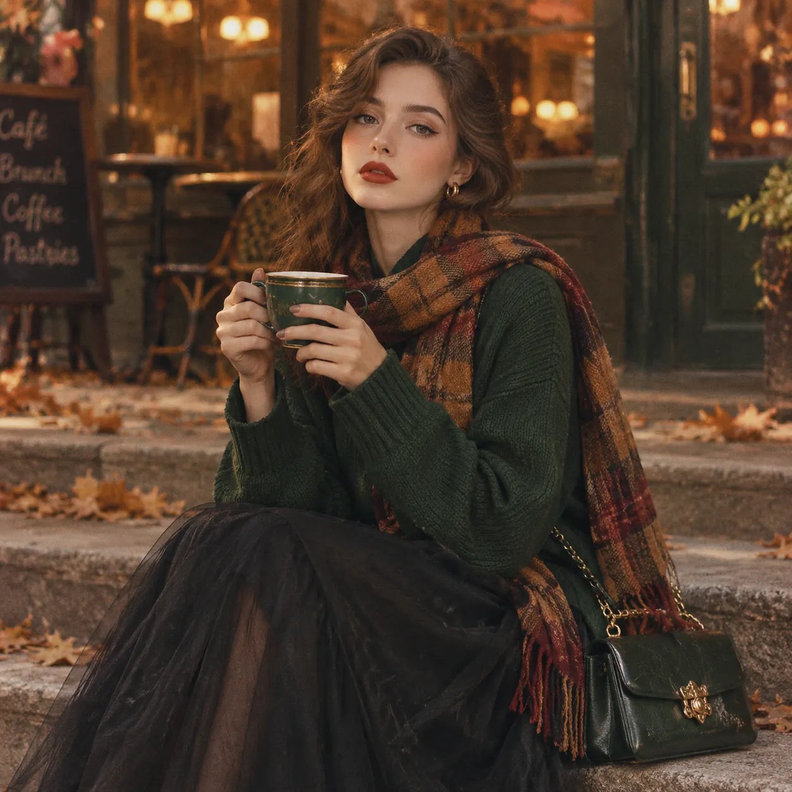</a>

> 这条提示词描述的服装和场景与我们另一条“70 年代咖啡馆台阶人像”几乎相同，但它用流畅的散文写成，更关注妆容和情绪：哑光深红唇、上挑眼线、暖色腮红、“宁静、若有所思、永恒”的表情，以及“柔和的城市静谧”。对比两张成品很有启发：这一版更有情绪、更有绘画感——松散的赤褐色卷发，杯子贴近脸庞，身后是咖啡馆小黑板，胶片颗粒也更重。如果要二选一，重氛围时用这条，重服装细节和干净的造型手册构图时用另一条。

```text
A cinematic 1970s-inspired fashion portrait of a graceful young woman seated on worn stone steps outside a cozy street café. She holds an ornate deep-green ceramic coffee cup with delicate gold rim accents, gently resting it in her hands as she gazes softly toward the camera with calm confidence. Her expression feels serene, thoughtful, and timeless.
Her hair falls in soft, natural waves with loose strands framing her face, styled in a classic vintage manner. Makeup reflects 1970s elegance: matte crimson-red lips, subtle winged eyeliner, warm-toned blush, and softly defined brows. She wears a luxurious forest-green knitted sweater with a relaxed fit, paired with a flowing black tulle skirt that moves lightly with the air.
A warm plaid scarf in earthy browns, burnt orange, and muted reds is draped casually around her neck. Beside her rests a premium dark-green leather crossbody bag with gold filigree hardware and a delicate chain strap.
The background features an autumn café street with scattered fallen leaves, glowing amber lights behind glass windows, and a soft urban stillness. Shot with an 85mm lens at f/1.8, shallow depth of field, warm analog film grain, muted earthy palette, dreamy cinematic mood, ultra-realistic fashion editorial photography inspired by classic 1970s film aesthetics.
```

- 原作者: [@me_Aarvi](https://x.com/me_Aarvi)
- 原帖: https://x.com/me_Aarvi/status/2008687707946709129
- [在 cinel 上查看详情并一键生成](https://cinel.ai/zh/prompts/p/1970s-street-cafe-fashion-portrait?utm_source=github&utm_medium=awesome&utm_campaign=awesome-gpt-image-2.5-prompts)

### 黑白阳光水波纹特写人像提示词

<a href="https://cinel.ai/zh/prompts/p/sunlight-ripple-black-white-close-up?utm_source=github&utm_medium=awesome&utm_campaign=awesome-gpt-image-2.5-prompts">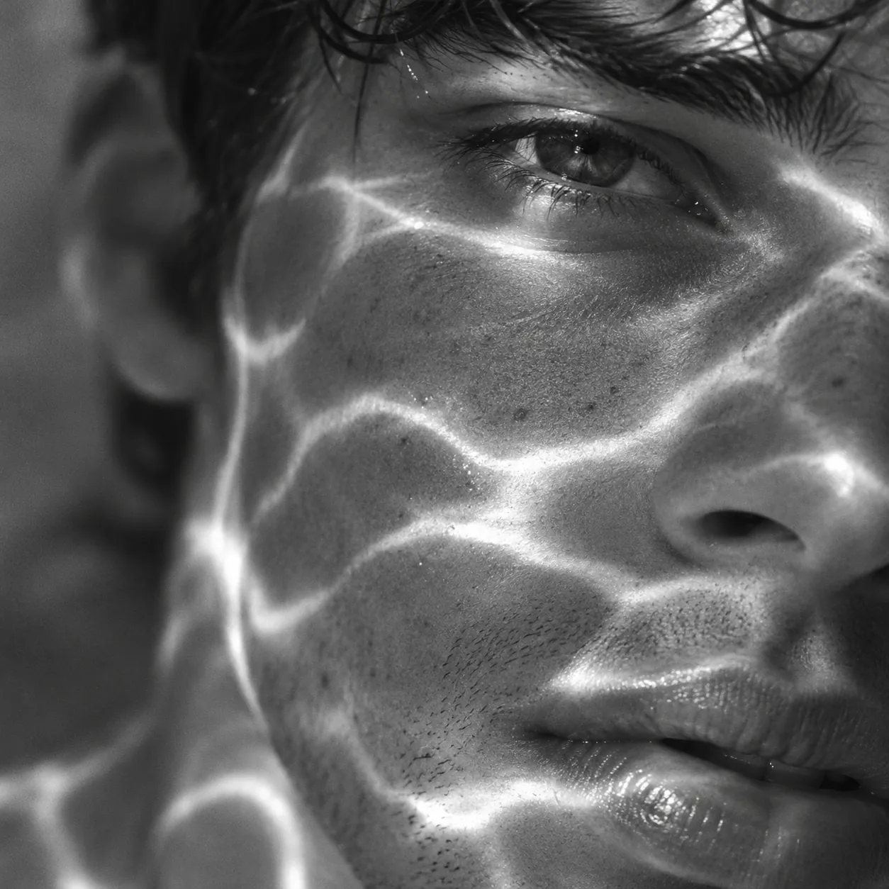</a>

> 与其说是人像，不如说是一次光的研究：阳光碎成柔和的波浪线，像泳池底的反光一样在皮肤上荡漾，斜着绕过颧骨、眼睛和嘴唇。两个选择让它像摄影而不是特效：阴影化为中灰而不是纯黑，极薄的景深只让一道皮肤起伏保持清晰，其余全部融化。提示词还要求真实的质感（毛孔、淡淡的雀斑、胡茬）和细腻颗粒。我们的黑白成品框住了一位浓眉年轻男性的眼睛和鼻梁，明亮的焦散光线纵横交错。适合香水、泳装或诗意的杂志封面。

```text
A hyperrealistic 8K black and white extreme close-up portrait of a young man's face, focusing tightly on his eye, cheekbone, and lips. Bright sunlight breaks into soft, wavy luminous lines that ripple across his skin like underwater reflections. The light flows diagonally, wrapping around the contours of his face in surreal patterns, while the shadows dissolve into smooth mid-gray tones instead of deep black. The skin is rendered in lifelike detail-visible pores, faint freckles, subtle stubble, and natural imperfections catch the glowing light realistically. The lips are softly highlighted, and the eye reflects fragments of the luminous waves, adding depth and emotion without artificial glow. The camera framing feels macro, pressed close to the face, with razor-thin depth of field: one illuminated ridge of skin is perfectly sharp, while the rest melts into velvety blur. The glassy, fluid quality of the light lines gives the portrait a surreal dreamlike aesthetic while remaining grounded in photographic realism. The background disappears into soft gray gradients, leaving only the interplay of skin texture and luminous wave-like rays. Fine cinematic grain overlays the frame, enhancing the tactile analog feel. The overall mood is intimate, surreal, and emotionally evocative - a monochrome portrait.
```

- 原作者: [@harboriis](https://x.com/harboriis)
- 原帖: https://x.com/harboriis/status/2021058505885745401
- [在 cinel 上查看详情并一键生成](https://cinel.ai/zh/prompts/p/sunlight-ripple-black-white-close-up?utm_source=github&utm_medium=awesome&utm_campaign=awesome-gpt-image-2.5-prompts)

### 报刊亭旁的梦幻动态模糊人像提示词

<a href="https://cinel.ai/zh/prompts/p/black-dress-newsstand-flowers-portrait?utm_source=github&utm_medium=awesome&utm_campaign=awesome-gpt-image-2.5-prompts">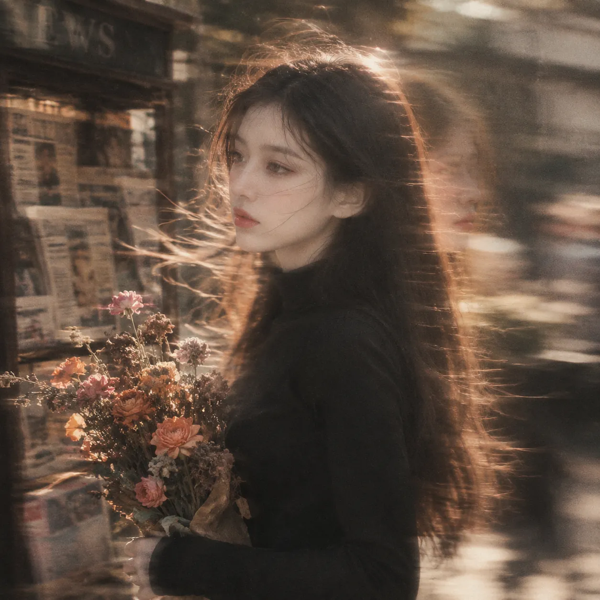</a>

> 这条提示词写得更像诗而不是技术说明，它刻意叠加了几种模拟胶片的“瑕疵”：追焦动态模糊、重影、拖尾阴影、柔焦、复古颗粒，以及暖调低饱和滤镜。场景很具体：高领黑色长裙、一捧枯枝和橙粉色花，还有一座斑驳的报刊亭。我们用一位黑色直长发的虚构女性参考图测试，成品朦胧得很美：她的侧脸在动态中半溶解，逆光的发丝扫过下颌，报刊亭的杂志在身后拉成光带。相似度会因此被刻意柔化。适合时尚大片、花店和音乐封面。

```text
The generated image uses the uploaded image as a reference for the character, wearing a high-necked, tight-fitting black long-sleeved dress. A cluster of withered wood and orange-pink flowers lies beside an old newsstand, the grainy texture of vintage film interwoven, the blurred background with noticeable trailing shadows, and the double-image effect creating a fantastical atmosphere. A bewitchingly beautiful girl, carrying flowers, is shown in profile, her fair skin delicate and translucent. Her exquisite face is blurred with motion, the outline of her figure slightly swaying with the panning camera, the soft focus making the image even more hazy and languid. A warm-toned, low-saturation filter enhances the effect, her long, backlit hair glowing with a soft glow, the messy strands sweeping wildly across her jawline, the details concealing a captivating yet dangerous allure. Cute movements add dynamism, the motion blur blending with the film grain, creating a trendy, Instagram-worthy image while the blurred image outlines a dynamic scene full of story, cleverly balancing bewitching and sweetness.
```

- 原作者: [@HustleXR](https://x.com/HustleXR)
- 原帖: https://x.com/HustleXR/status/2009214441083019511
- [在 cinel 上查看详情并一键生成](https://cinel.ai/zh/prompts/p/black-dress-newsstand-flowers-portrait?utm_source=github&utm_medium=awesome&utm_campaign=awesome-gpt-image-2.5-prompts)

### 直打闪光水泥墙杂志人像提示词

<a href="https://cinel.ai/zh/prompts/p/flash-concrete-wall-editorial-portrait?utm_source=github&utm_medium=awesome&utm_campaign=awesome-gpt-image-2.5-prompts">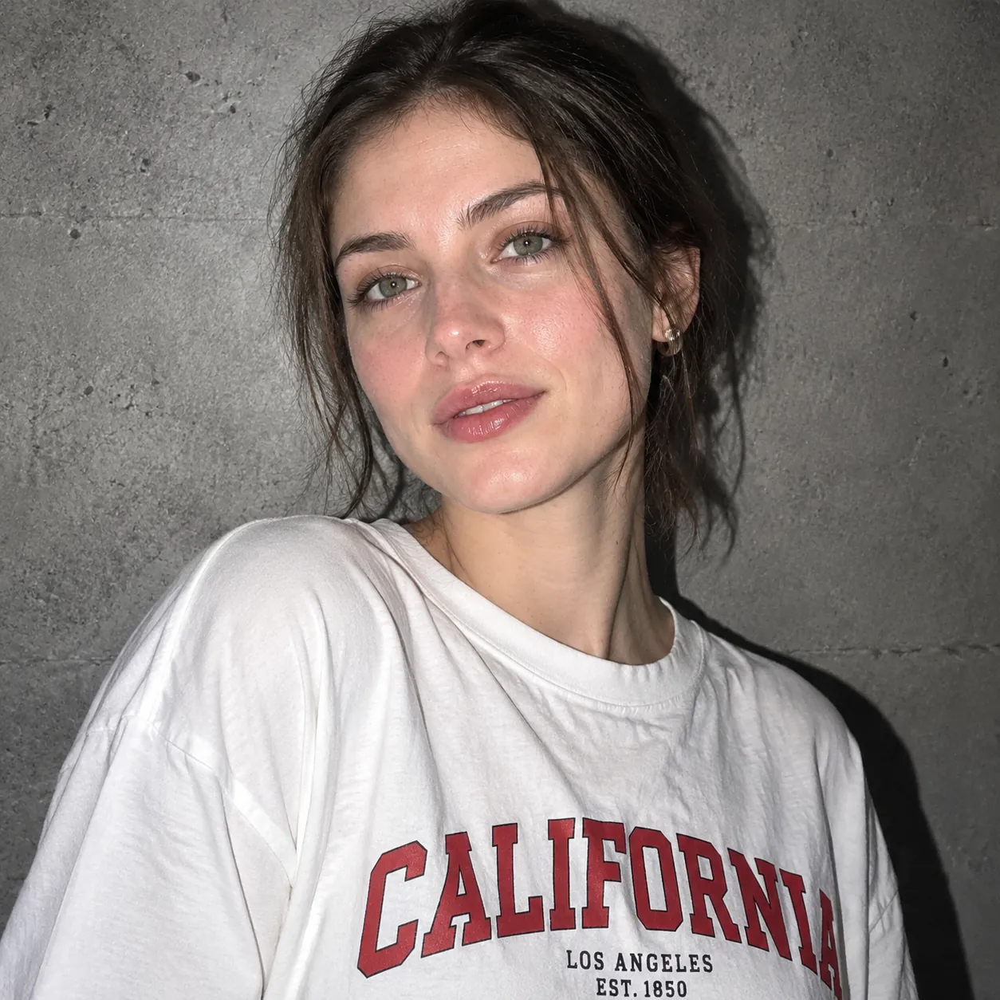</a>

> 人像里通常会避免机顶闪光，这条提示词却主动拥抱它：正面硬光、皮肤上的光泽、粗糙灰色水泥墙上的硬阴影，还有时尚快照那种“夜里被抓拍”的感觉。详细的造型描述完成了其余部分（头后仰、下巴抬起、几缕发丝遮住一只眼、光泽唇、印着醒目红色“CALIFORNIA”的宽松白 T）。配色刻意收窄为灰、白、红三色。用一位深色头发松松扎起的年轻女性虚构参考图，成品保留了她的脸，也拿捏住了酷酷的疏离表情。把 T 恤图案换成你自己的周边，就能变成潮牌产品图。

```text
A high-resolution, close-up editorial-style portrait of a young woman standing against a textured gray concrete wall, captured with direct on-camera flash that creates a raw, moody, high-contrast aesthetic. She is positioned slightly angled to the side with her head tilted back and chin lifted, giving an effortlessly cool, candid expression. Her face has a fair, smooth complexion with a natural sheen from the flash, soft rosy blush across the cheeks, minimal eye makeup, lightly defined brows, and glossy natural pink lips that are slightly parted, conveying a relaxed yet confident mood. Wispy strands of her dark brown hair fall loosely across her face, partially covering one eye, while the rest of her hair is pulled back into a low, casual style, enhancing the spontaneous, fashion-editorial feel. Her eyes look slightly upward and past the camera, adding to the detached, artistic vibe. She is wearing a loose-fitting white oversized T-shirt with bold red typography reading “CALIFORNIA” across the chest, along with smaller black text underneath, giving a casual streetwear aesthetic. Small, subtle stud earrings are visible, adding minimal detail without distracting from the overall look. The lighting is harsh and frontal, producing sharp shadows behind her on the wall and emphasizing skin texture, hair strands, and fabric folds, while the background remains simple and uncluttered. The color palette is muted and neutral—gray wall, white shirt, and red lettering—allowing the subject’s face and expression to remain the focal point. The overall atmosphere feels intimate, modern, slightly gritty, and effortlessly stylish, like a candid fashion snapshot captured at night with flash photography. Use this uploaded photo as the only and exact face reference. The generated image must use this same face exactly as shown, without any changes to identity, facial structure, or expression.
```

- 原作者: [@ZaraIrahh](https://x.com/ZaraIrahh)
- 原帖: https://x.com/ZaraIrahh/status/2010661146349756814
- [在 cinel 上查看详情并一键生成](https://cinel.ai/zh/prompts/p/flash-concrete-wall-editorial-portrait?utm_source=github&utm_medium=awesome&utm_campaign=awesome-gpt-image-2.5-prompts)

### 明亮人潮中的静止：时尚杂志人像提示词

<a href="https://cinel.ai/zh/prompts/p/stillness-in-crowd-magazine-portrait?utm_source=github&utm_medium=awesome&utm_campaign=awesome-gpt-image-2.5-prompts">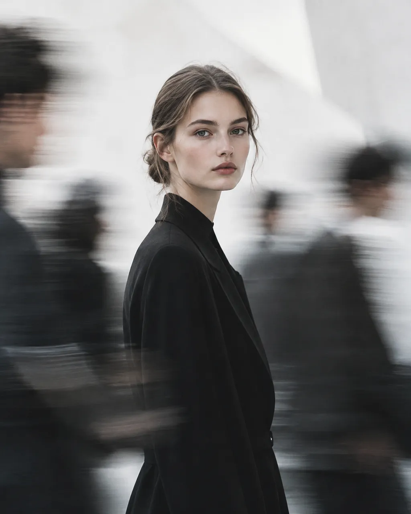</a>

> 这是我们“静止人物、流动人群”系列里的第三条，也是最极简的一条。它没有城市街道或夜晚霓虹，而是要求干净、明亮、略带抽象的背景，所以路人变成柔和的灰色幻影，而不是可辨认的人。黑色极简服装、冷静的表情和转向镜头的头部，让情绪安静而高级。我们的成品里，一位头发向后束起、穿黑色长大衣的女性，在苍白的拖影人群中清晰锐利，4:5 竖幅可以直接放进杂志版面。奢侈品或极简品牌选这一版；想要城市能量和色彩，就选街头版本。

```text
A high fashion magazine pictorial of an Alpine-looking woman in her early 20s who stands still, looking at the camera, turning her head in the center, surrounded by a blurry silhouette of people passing by. She has a calm, stoic look on her face and is wearing a black minimalist outfit. The background is clean, bright and slightly abstract, and emphasizes the contrast between motion blur and static appearance. Editing style, film composition, pure art photography, soft magazine texture, high resolution. --ar 4:5
```

- 原作者: [@ChillaiKalan__](https://x.com/ChillaiKalan__)
- 原帖: https://x.com/ChillaiKalan__/status/2020715808939549011
- [在 cinel 上查看详情并一键生成](https://cinel.ai/zh/prompts/p/stillness-in-crowd-magazine-portrait?utm_source=github&utm_medium=awesome&utm_campaign=awesome-gpt-image-2.5-prompts)

### 鱼眼 2×2 宫格涂鸦搞怪表情提示词

<a href="https://cinel.ai/zh/prompts/p/fisheye-sneaker-angles-2x2-grid?utm_source=github&utm_medium=awesome&utm_campaign=awesome-gpt-image-2.5-prompts">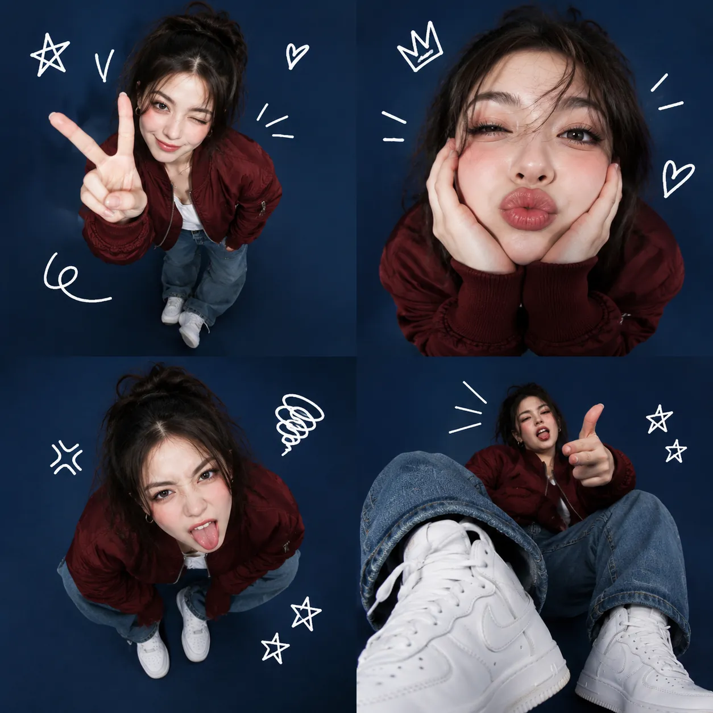</a>

> 四格画面，四个机位：中景、特写、俯视角度，以及从球鞋处向上的极端仰拍，全部用鱼眼镜头和夸张的透视缩短。每格一个新的搞怪表情，加上白色手绘涂鸦，变成一张有趣的 Y2K 风小样张。最后一句“不要圆形取景”防止了鱼眼常见的圆形暗角。原文给鞋子指定了一个运动品牌，我们改成了纯白高帮鞋。成品里，一位穿暗红色飞行员夹克和牛仔裤的年轻女性比耶、嘟嘴、吐舌头，在仰拍那格里球鞋显得巨大。很适合潮牌新品发售。

```text
Create a 2x2 grid image. In each frame include a medium shot, closeup shot, high angle looking down and extreme low angle view looking up from the sneakers. Utilize a fish eye lens perspective in each frame as well as an aesthetic pose with foreshortening. The character is wearing a dark red bomber jacket, blue jeans and white high top sneakers and posing with a different wacky facial expression in each frame. Include white doodle hand drawn elements around them in each frame. Studio photography against a dark blue background. Ensure the background encompasses the entire background, no circular framing.
```

- 原作者: [@MrDavids1](https://x.com/MrDavids1)
- 原帖: https://x.com/MrDavids1/status/2012224276900851827
- [在 cinel 上查看详情并一键生成](https://cinel.ai/zh/prompts/p/fisheye-sneaker-angles-2x2-grid?utm_source=github&utm_medium=awesome&utm_campaign=awesome-gpt-image-2.5-prompts)

### 黑白头像只留琥珀色眼镜的提示词

<a href="https://cinel.ai/zh/prompts/p/minimal-mens-studio-headshot?utm_source=github&utm_medium=awesome&utm_campaign=awesome-gpt-image-2.5-prompts">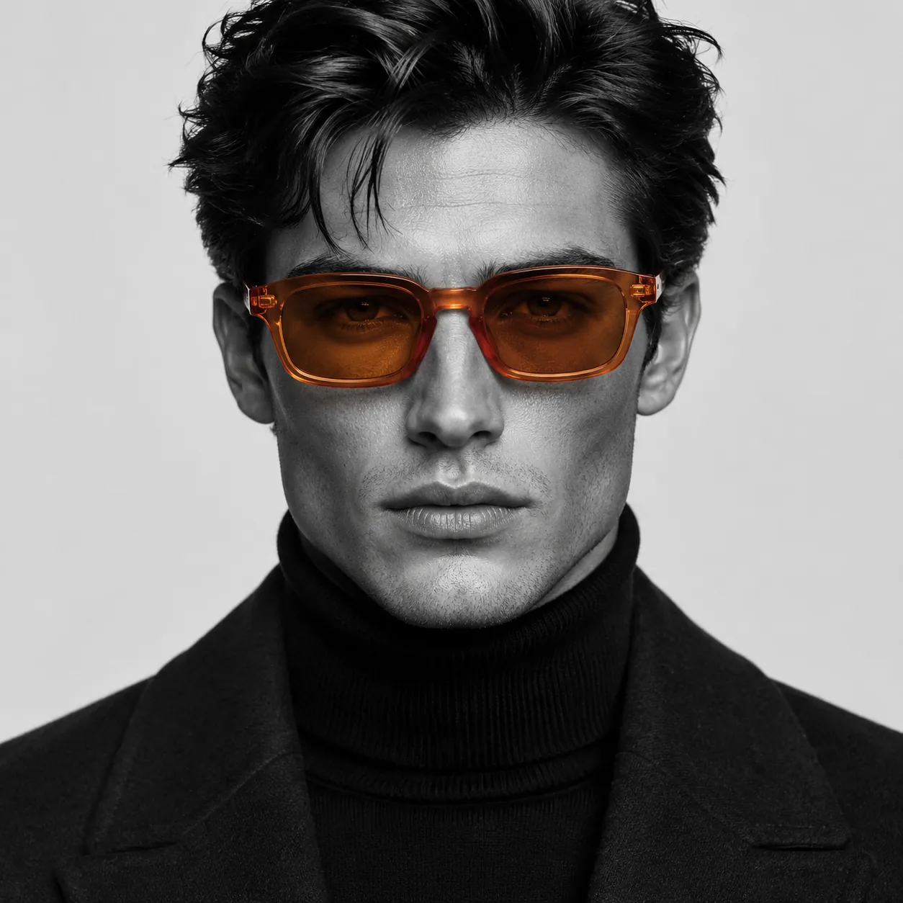</a>

> 有品位的局部留色：画面中除了一件配饰——半透明琥珀橙色眼镜——其余全是黑白。提示词的其他部分是经典的极简男装（黑色高领衫、深色修身大衣、纯浅色背景、中性表情、85mm 镜头、高对比柔光），让这一抹颜色发挥最大冲击力。我们的成品是一张居中对称的头像：深色头发、颧骨分明的男士，橙色镜框在灰色肤色中发光。非常适合眼镜品牌和眼镜店，也适用于任何想单独突出的产品，比如手表、口红或耳环——只要在括号里写上单品和颜色。

```text
Ultra-realistic studio portrait of a man, close-up headshot, centered composition, neutral expression, sharp facial details, textured skin, clean grooming, wearing a black turtleneck and dark tailored coat, modern minimalist fashion, monochrome black and white photography style, only the glasses in color (Translucent amber-orange frame and lenses
), high contrast lighting, soft studio light, cinematic shadows, editorial fashion photography, plain light background, 85mm lens, shallow depth of field, ultra detailed, photorealistic, magazine quality, 8K.
```

- 原作者: [@Sheldon056](https://x.com/Sheldon056)
- 原帖: https://x.com/Sheldon056/status/2026214554083242053
- [在 cinel 上查看详情并一键生成](https://cinel.ai/zh/prompts/p/minimal-mens-studio-headshot?utm_source=github&utm_medium=awesome&utm_campaign=awesome-gpt-image-2.5-prompts)

### 黄金时刻窗光 3×3 人像拼图提示词

<a href="https://cinel.ai/zh/prompts/p/face-preserved-reference-portrait?utm_source=github&utm_medium=awesome&utm_campaign=awesome-gpt-image-2.5-prompts">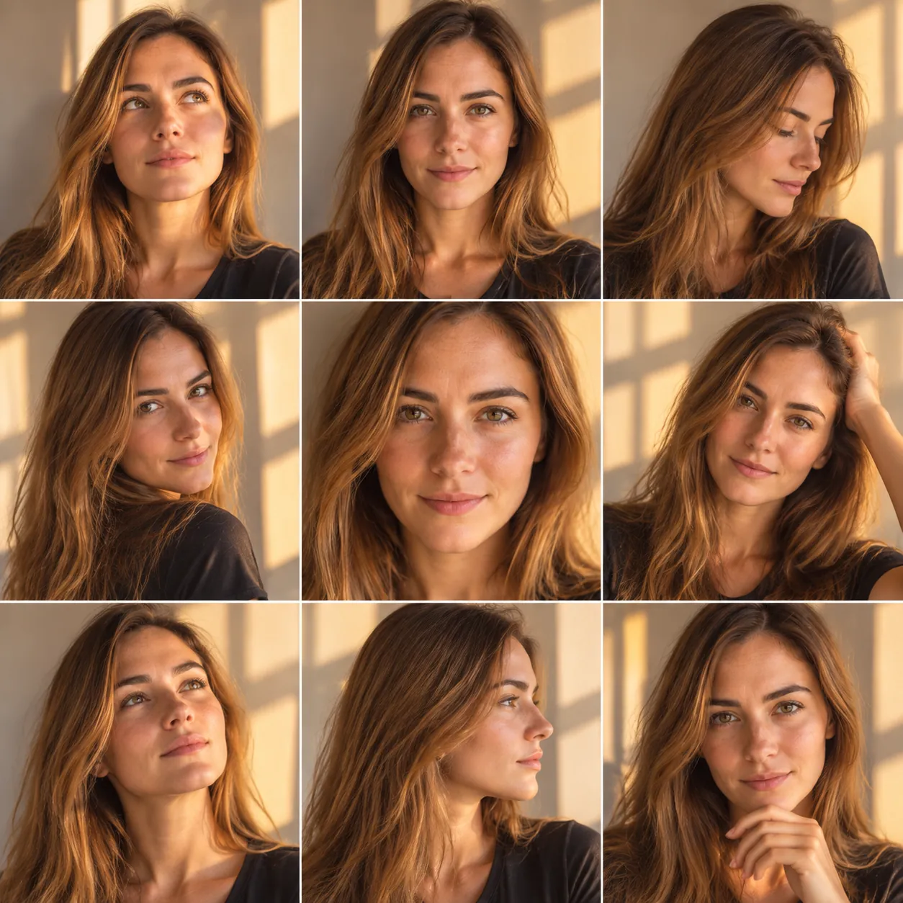</a>

> 一组看起来像跟优秀摄影师度过了一个下午的个人写真：九个姿势（仰望光线、侧脸、回眸、手拨头发、头向后仰），温暖的金色窗光，素墙上柔和的光影图案，一件简单的深色 T 恤。JSON 坚持各格之间身份、光线和背景一致，这让整张九宫格像同一次拍摄。有一个小问题：提示词写的是“男性”，但我们提供的是一位蜂蜜棕长发女性的虚构参考图，模型合理地遵从了参考图。成品是一组温暖统一的九宫格。请把性别描述改成与你的照片一致，用于更新头像或交友软件资料照。

```text
{
  "image_generation": {
    "face": {
      "preserve_original": true,
      "reference_match": true,
      "description": "Maintain the same facial structure, skin tone, eye shape, and natural expressions across all frames, with consistent identity in each pose."
    },
    "photo_style": {
      "type": "golden hour portrait collage",
      "camera_angle": "varied close-up and medium portrait angles",
      "lighting": "warm golden hour sunlight casting soft window shadows",
      "mood": "soft, calm, intimate, aesthetic",
      "texture": "natural skin texture, soft highlights, gentle contrast",
      "focus": "sharp focus on face with smooth background falloff"
    },
    "subject": {
      "gender": "male",
      "age": "young adult",
      "poses": [
        "looking upward toward light",
        "soft smile facing camera",
        "side profile with downward gaze",
        "over-the-shoulder glance",
        "direct close-up with relaxed lips",
        "hand in hair casual pose",
        "head tilted back toward light",
        "clean side profile portrait",
        "thoughtful pose with hand near chin"
      ],
      "expression": "natural, minimal, relaxed, emotionally subtle",
      "hair": {
        "style": "long straight hair worn loose",
        "color": "light to medium brown",
        "details": "natural shine with soft light highlights"
      },
      "clothing": {
        "type": "casual minimalist outfit",
        "details": "simple dark t-shirt with no visible branding"
      }
    },
    "composition": {
      "layout": "3x3 grid collage",
      "consistency": "uniform lighting and background across all frames",
      "framing": "clean portrait framing with slight pose variation"
    },
    "environment": {
      "setting": "indoor space near a window",
      "background": "plain wall with warm sunlight and shadow patterns",
      "atmosphere": "quiet, minimal, artistic indoor ambiance"
    },
    "aesthetic": {
      "style": "Instagram aesthetic portrait set",
      "features": [
        "golden hour light",
        "window shadow patterns",
        "minimal makeup",
        "natural expressions",
        "clean editorial portrait look"
      ]
    }
  }
}
```

- 原作者: [@harboriis](https://x.com/harboriis)
- 原帖: https://x.com/harboriis/status/2008484790287430022
- [在 cinel 上查看详情并一键生成](https://cinel.ai/zh/prompts/p/face-preserved-reference-portrait?utm_source=github&utm_medium=awesome&utm_campaign=awesome-gpt-image-2.5-prompts)

### 同一张脸多种发型拼图提示词

<a href="https://cinel.ai/zh/prompts/p/same-face-hairstyle-collage?utm_source=github&utm_medium=awesome&utm_campaign=awesome-gpt-image-2.5-prompts">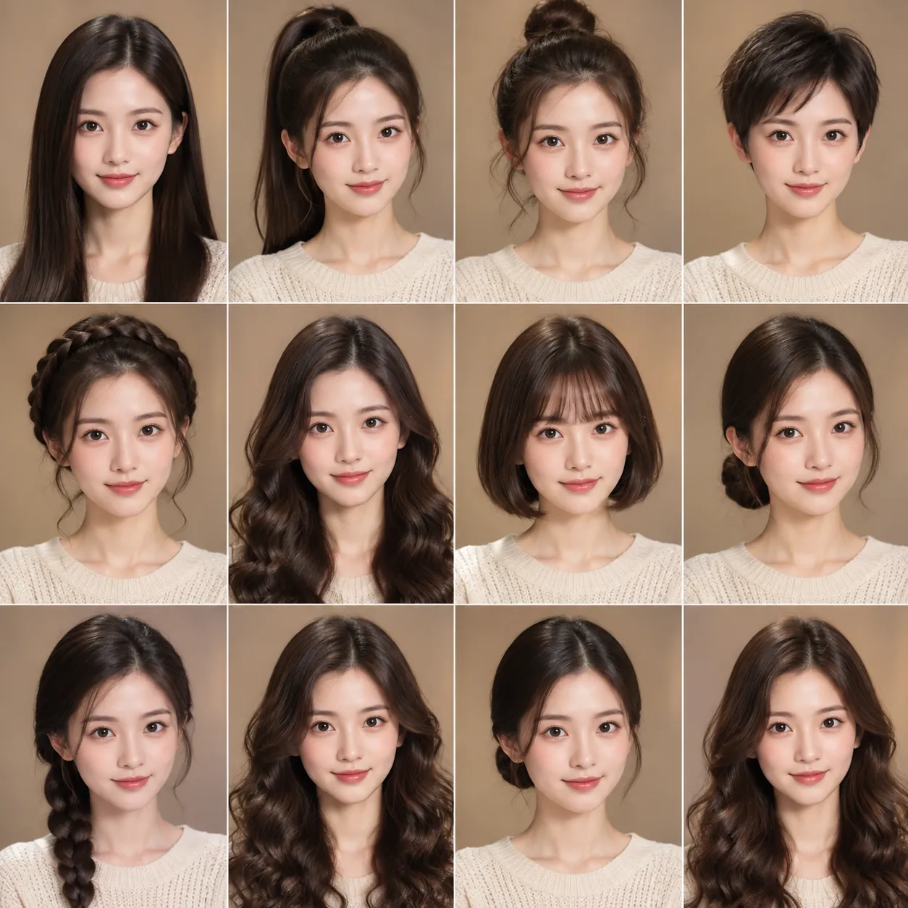</a>

> 一个给美发沙龙和发型师的实用格式：脸、表情、服装、妆容和光线全部保持一致，每格只换发型。提示词列了十种发型（直长发、高马尾、丸子头、精灵短发、编发皇冠、柔软波浪、齐刘海波波头、低发髻、侧编发、松散卷发），却要求 4×3 网格，所以模型用自己的变化补上了多出来的两格。我们的成品里，十二格中的同一位女性一致性非常高，背景是温暖的虚化色调。上传顾客的照片作为参考，就能变成“剪之前先看看”的预览。任何公开发布的版本，都请明确写出人物是成年人。

```text
A high-quality photo collage featuring the same person with identical facial features and expression, shown in multiple frames with different hairstyles. Each panel displays a unique hairstyle such as long straight hair, high ponytail, messy bun, pixie cut, braided crown, soft waves, short bob with bangs, low bun, side braid, and loose curls. Consistent neutral outfit and makeup across all images, soft studio lighting, warm blurred background, realistic skin texture, symmetrical face consistency, ultra-detailed, editorial beauty look, 4x3 grid layout, professional portrait photograph
```

- 原作者: [@AIwithSynthia](https://x.com/AIwithSynthia)
- 原帖: https://x.com/AIwithSynthia/status/2013225585297043665
- [在 cinel 上查看详情并一键生成](https://cinel.ai/zh/prompts/p/same-face-hairstyle-collage?utm_source=github&utm_medium=awesome&utm_campaign=awesome-gpt-image-2.5-prompts)

### 阳光米色墙时尚人像（参考图）提示词

<a href="https://cinel.ai/zh/prompts/p/identity-preserved-woman-portrait?utm_source=github&utm_medium=awesome&utm_campaign=awesome-gpt-image-2.5-prompts">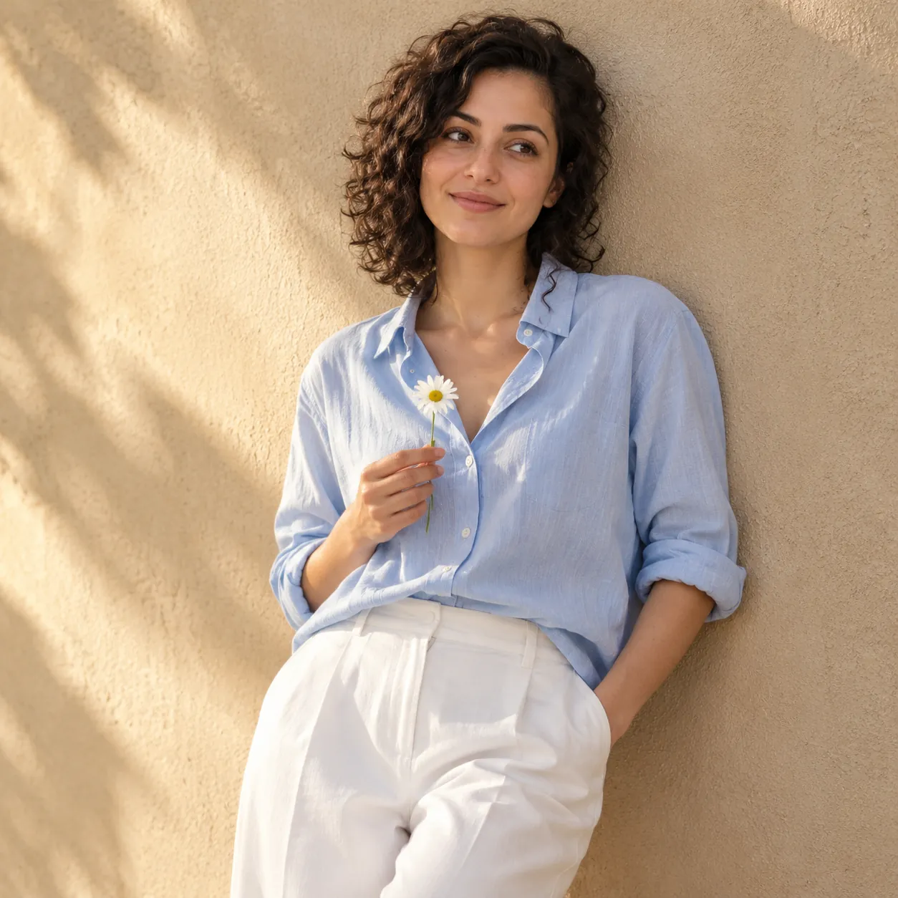</a>

> 一张平静、有夏日感的杂志照，色彩搭配很克制：卷起袖子的粉蓝色衬衫、宽松白色长裤、白色运动鞋和一朵小白雏菊，背景是温暖的米色肌理墙。侧面的阳光在墙面上投下柔和的阴影，带来生活方式广告那种通透明亮的感觉。提示词开头就写了非常严格的身份规则（“100% 准确，不美颜”），所以成品像参考图本人，而不是一个泛泛的模特。我们的虚构参考图是一位三十多岁、深色及肩卷发的女性；她倚着墙，一只手插兜，雏菊放在胸前，目光望向镜头外。适合服装品牌和个人品牌。

```text
Using the uploaded reference image STRICTLY, preserve the same woman’s face, identity, age, facial structure, skin tone, and natural expression with 100% accuracy. No facial alteration, beautification, or identity change.\n\nGenerate a highly realistic cinematic fashion editorial photoshoot featuring a stylish adult woman leaning casually against a warm beige textured wall. Her body is slightly angled, one shoulder gently resting on the wall, conveying relaxed confidence, elegance, and quiet strength.\n\nOutfit:\nShe wears a loose pastel blue button-down shirt with softly rolled-up sleeves, styled effortlessly. Paired with tailored white relaxed-fit trousers that drape naturally. Footwear consists of clean minimalist white or soft blue-white sneakers, maintaining a modern, understated luxury feel.\n\nPose & Expression:\nShe stands with natural posture — one hand casually placed in her trouser pocket, the other delicately holding a small white daisy flower. Her facial expression is calm, self-assured, and serene, with a soft editorial gaze slightly away from the camera. Emotion feels confident yet gentle.\n\nHair & Makeup:\nHair is neatly styled in a natural, modern look (soft waves, low ponytail, or loose bun). Makeup is minimal and refined — clean skin, subtle blush, neutral lips, no heavy contouring or glow.\n\nLighting & Atmosphere:\nWarm natural sunlight streams from the side, creating soft highlights along her face and clothing, with gentle shadows adding depth to the textured wall. The mood is airy, sunlit, and cinematic.\n\nVisual Style:\nHigh-end fashion editorial aesthetic with realistic skin texture, crisp fabric details, refined neutral color palette, and elegant composition.\n\nCamera & Quality:\nProfessional fashion photography style, shallow depth of field, cinematic framing, ultra-realistic 8K quality, sharp focus on subject with smooth background falloff.\n\nOverall Feel:\nModern, minimal, sun-drenched lifestyle fashion campaign — confident, graceful, and timeless.",
  
  "style": "cinematic, high-end female fashion editorial",
  "lighting": "warm natural sunlight with soft shadows",
  "background": "minimal beige textured wall, sunlit",
  "quality": "ultra-realistic, 8K, ultra-sharp",
  "camera": "professional fashion photography, shallow depth of field",
  "mood": "clean, modern, elegant, confident, relaxed"
```

- 原作者: [@me_Aarvi](https://x.com/me_Aarvi)
- 原帖: https://x.com/me_Aarvi/status/2011444759605510287
- [在 cinel 上查看详情并一键生成](https://cinel.ai/zh/prompts/p/identity-preserved-woman-portrait?utm_source=github&utm_medium=awesome&utm_campaign=awesome-gpt-image-2.5-prompts)

### 双人自拍亭 2×2 拼图（参考图）提示词

<a href="https://cinel.ai/zh/prompts/p/photobooth-2x2-collage-from-reference?utm_source=github&utm_medium=awesome&utm_campaign=awesome-gpt-image-2.5-prompts">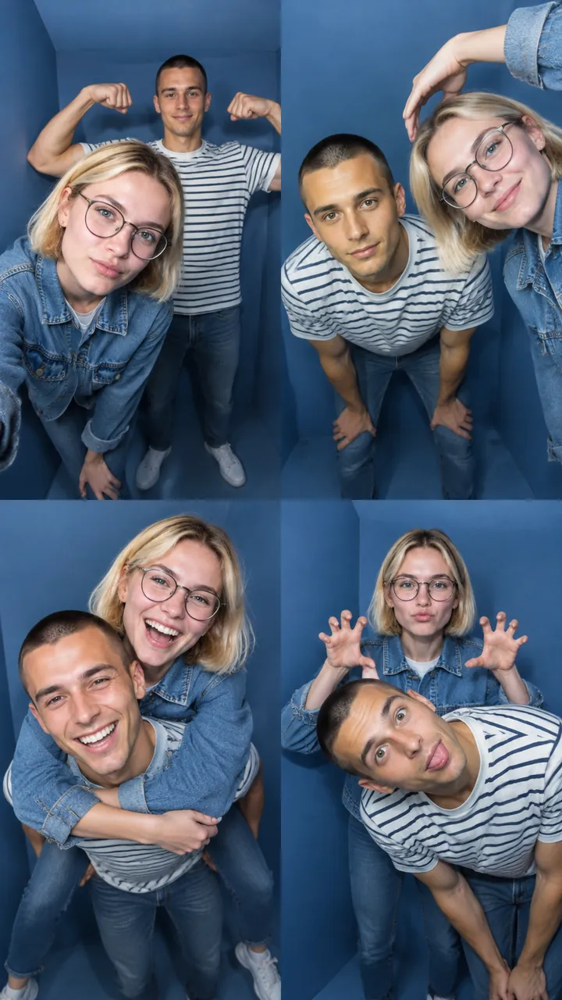</a>

> 重现自助拍照亭的乐趣：狭小的蓝色拍照间、略带鱼眼的广角镜头、明亮的中性闪光，以及四个写好的搞怪姿势（大力士秀肌肉、半个比心、背着跑、在朋友头上比“角”）。它还要求格与格之间没有边框和缝隙，让九比十六的整张图像一张无缝的大头贴。原文为了这种观感指定了某款手机型号，我们改成了旗舰智能手机。用一张两位成年朋友的虚构参考图（戴眼镜的金发女生和穿条纹 T 恤的男生），成品四格中两人的脸和服装都保持一致。适合活动拍照亭、友情节帖子或情侣内容。

```text
{
  "task": "Create an smartphone-realistic photobooth collage (4 photos in a 2x2 grid)",
  "subjects": [
    {
      "id": "Subject 1",
      "description": "EXACTLY from the Reference Image (same face, hairstyle, skin tone, body proportions, overall look).",
      "outfit": "EXACTLY the same as in the Reference Image. Do not change clothing, glasses, or accessories."
    },
    {
      "id": "Subject 2",
      "description": "EXACTLY from the Reference Image (same face, hairstyle, skin tone, body proportions, overall look).",
      "outfit": "EXACTLY the same as in the Reference Image. Do not change clothing, glasses, or accessories."
    }
  ],
  "scene": {
    "location": "Inside a small BOX photo booth",
    "background": "Matte blue walls and blue floor, tight enclosed corner, clean minimal environment",
    "camera_look": "Ultra wide / slight fisheye lens look with subtle perspective distortion typical of photobox cameras. flagship smartphone, photobooth wide-angle.",
    "lighting": "Bright neutral-white flash lighting, evenly illuminating faces, soft shadow falloff on blue walls, crisp detail, realistic skin texture. Direct neutral white flash (no yellow / no warm tone).",
    "aesthetic": "4K, amateur photobooth aesthetic, high contrast but still natural, no cinematic grading, no heavy beauty filter, no blur, no text, no watermark."
  },
  "layout": {
    "type": "2x2 grid collage",
    "aspect_ratio": "9:16 (vertical collage)",
    "style": "Clean, with NO white borders, NO frame lines, NO gaps, and NO outlines between photos (seamless collage). Each frame fills its quadrant edge-to-edge."
  },
  "frames": [
    {
      "position": "top-left",
      "content": "Subject 1 leans diagonally toward the camera from the front-left, one arm stretched down, playful serious face; Subject 2 stands behind in the center, arms raised and flexing like “strongman”, smiling."
    },
    {
      "position": "top-right",
      "content": "Subject 2 leans forward toward the camera, hands on knees, curious expression; Subject 1 enters from the right side very close to camera, tilting her head, one arm arched above her head like a half-heart pose, soft smile."
    },
    {
      "position": "bottom-left",
      "content": "Piggyback pose — Subject 1 on Subject 2’s back, arms wrapped around shoulders; both laughing big, faces close to camera, dynamic motion vibe."
    },
    {
      "position": "bottom-right",
      "content": "Subject 2 bends sideways/leans forward with a goofy face; Subject 1 stands behind making playful “claw/horns” hand gestures above Subject 2’s head, slightly pouting for fun."
    }
  ]
}
```

- 原作者: [@NameIsSudee](https://x.com/NameIsSudee)
- 原帖: https://x.com/NameIsSudee/status/2008809931550716249
- [在 cinel 上查看详情并一键生成](https://cinel.ai/zh/prompts/p/photobooth-2x2-collage-from-reference?utm_source=github&utm_medium=awesome&utm_campaign=awesome-gpt-image-2.5-prompts)

### 3D 社交帖子边框里的健身人像提示词

<a href="https://cinel.ai/zh/prompts/p/ponytail-stool-sneaker-studio-portrait?utm_source=github&utm_medium=awesome&utm_campaign=awesome-gpt-image-2.5-prompts">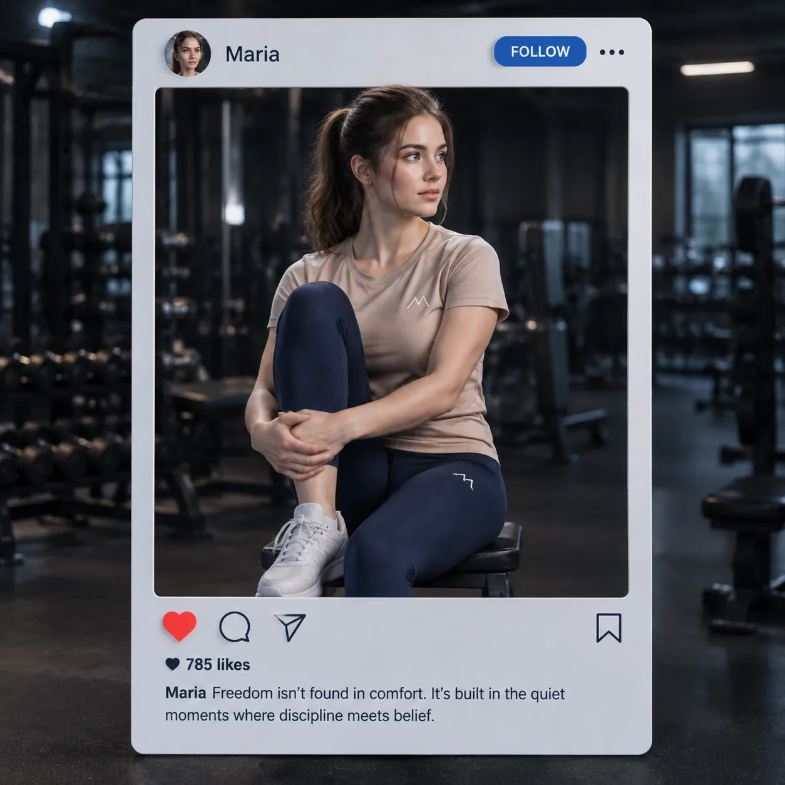</a>

> 一种很受博主欢迎的格式：人物坐在一张实体的 3D 白色帖子卡片里，卡片悬浮在昏暗的健身房前，头像、用户名、蓝色关注按钮、点亮的爱心、785 个赞和一句励志文案一应俱全。JSON 把每个界面元素都写清楚了，所以文字渲染得很干净。我们的成品里，一位棕发女性坐在凳子上抱着一侧膝盖，穿米色 T 恤、藏青紧身裤和白色运动鞋，柔和的聚光灯打在她身上，背后是虚化的器械架。原文点名了某运动品牌的标志，我们改成了一个小的极简标志，模型画出了一个通用的小山峰图案。把文案和用户名换成你自己的频道即可。

```text
{
  "image_generation_prompt": {
    "subject": {
      "description": "A photorealistic young woman with brown hair tied back in a ponytail, sitting on a stool.",
      "pose": "Sitting with one knee raised, hands clasped around her shin, looking slightly to the side with a calm, focused expression.",
      "clothing": {
        "top": "Beige t-shirt with a small white minimalist logo on the chest.",
        "bottoms": "Dark blue leggings with a small white minimalist logo on the thigh.",
        "footwear": "White athletic sneakers."
      }
    },
    "composition": {
      "foreground_element": "A large, 3D-rendered white social media frame resembling an Instagram post, physically framing the subject.",
      "ui_details": {
        "header": {
          "profile_picture": "Profile picture of the woman",
          "username": "Maria",
          "follow_button": {
            "text": "FOLLOW",
            "color": "Blue"
          }
        },
        "footer_icons": [
          {
            "type": "like",
            "icon": "Heart",
            "color": "Red",
            "state": "Liked"
          },
          {
            "type": "comment",
            "icon": "Comment bubble"
          },
          {
            "type": "share",
            "icon": "Paper plane"
          },
          {
            "type": "bookmark",
            "icon": "Bookmark"
          }
        ],
        "likes_count": 785,
        "caption": "Freedom isn’t found in comfort. It’s built in the quiet moments where discipline meets belief."
      }
    },
    "environment": {
      "setting": "A dimly lit, atmospheric gym background.",
      "details": "Blurred gym equipment in the shadows, creating a strong depth of field."
    },
    "style": {
      "visual_style": "3D realistic render using Unreal Engine 5, cinematic and high fidelity.",
      "lighting": {
        "subject": "Soft spotlight focused on the woman",
        "background": "Cool ambient lighting with subtle shadows"
      }
    }
  }
}
```

- 原作者: [@2abhisheknaks](https://x.com/2abhisheknaks)
- 原帖: https://x.com/2abhisheknaks/status/2016154222765527482
- [在 cinel 上查看详情并一键生成](https://cinel.ai/zh/prompts/p/ponytail-stool-sneaker-studio-portrait?utm_source=github&utm_medium=awesome&utm_campaign=awesome-gpt-image-2.5-prompts)

### 深红花海侧脸人像（破框）提示词

<a href="https://cinel.ai/zh/prompts/p/crimson-flower-field-profile-portrait?utm_source=github&utm_medium=awesome&utm_campaign=awesome-gpt-image-2.5-prompts">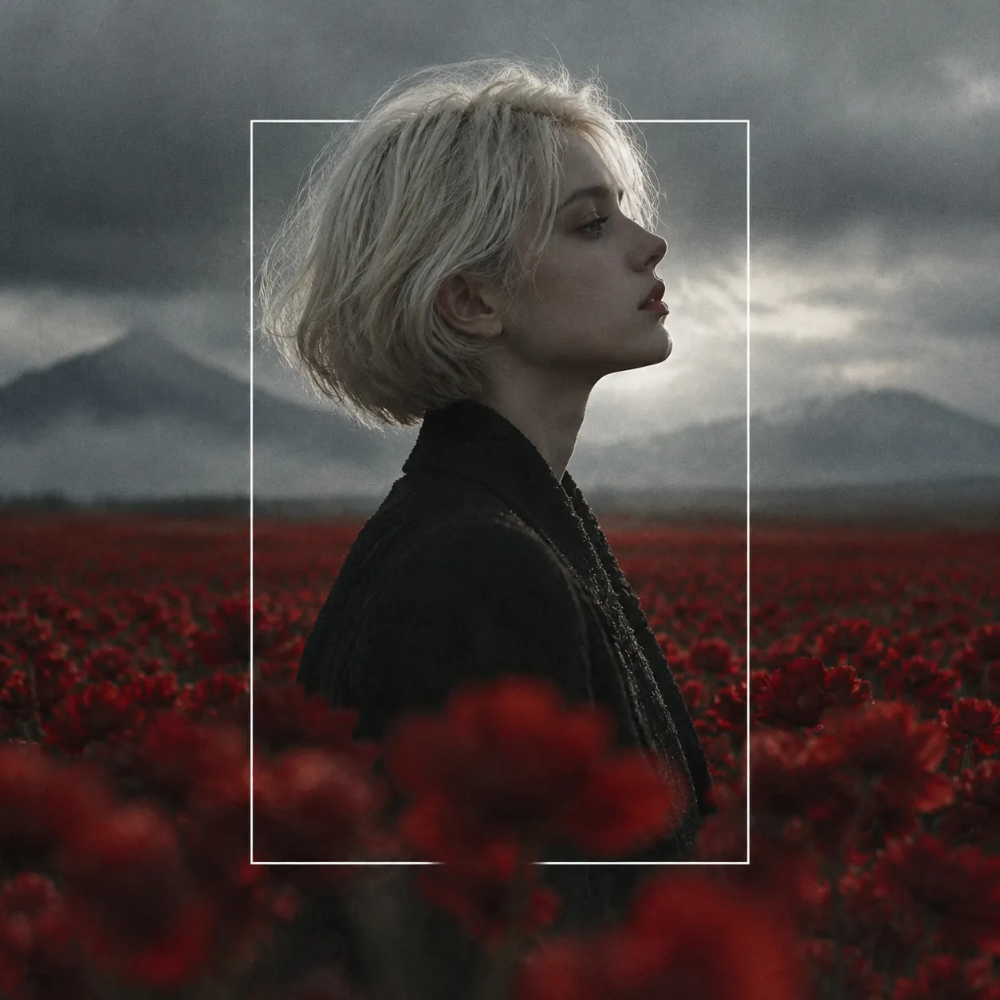</a>

> 这张人像有两个记忆点：阴沉灰色天空下的一片深红花海，以及叠在画面中央、被人物头部穿破的细白色矩形框。这个“破框”手法让一张情绪风景人像看起来像经过设计的作品，像专辑封面或画廊版画。我们的成品里，一位铂金色短波波头的女性侧脸，穿深色外套，柔和的轮廓光勾出发丝，框线从她脑后穿过，红花在前景虚化成一片，地平线上是雾中的山脉。高颗粒的胶片质感增添了忧郁。把花的颜色换成薰衣草紫或芥末黄，情绪会完全不同。

```text
A cinematic, high-contrast profile portrait of a woman with short, platinum-blonde hair, standing in a vast field of deep crimson flowers. The scene is set under a heavy, overcast grey sky with a moody, melancholic atmosphere. A thin, white rectangular frame is superimposed in the center of the composition; the woman's head and shoulders overlap and break the top and bottom edges of the frame for a modern, artistic effect. The lighting is soft and diffused from behind, creating a subtle rim light on her profile and hair. The foreground flowers are softly blurred with a shallow depth of field, and a faint, misty mountain silhouette is visible in the distant background. High-grain, filmic aesthetic.
```

- 原作者: [@rovvmut_](https://x.com/rovvmut_)
- 原帖: https://x.com/rovvmut_/status/2024712387132346673
- [在 cinel 上查看详情并一键生成](https://cinel.ai/zh/prompts/p/crimson-flower-field-profile-portrait?utm_source=github&utm_medium=awesome&utm_campaign=awesome-gpt-image-2.5-prompts)

### 科幻 HUD 背景的大胡子男性侧脸提示词

<a href="https://cinel.ai/zh/prompts/p/sci-fi-hud-bearded-man-side-profile?utm_source=github&utm_medium=awesome&utm_campaign=awesome-gpt-image-2.5-prompts">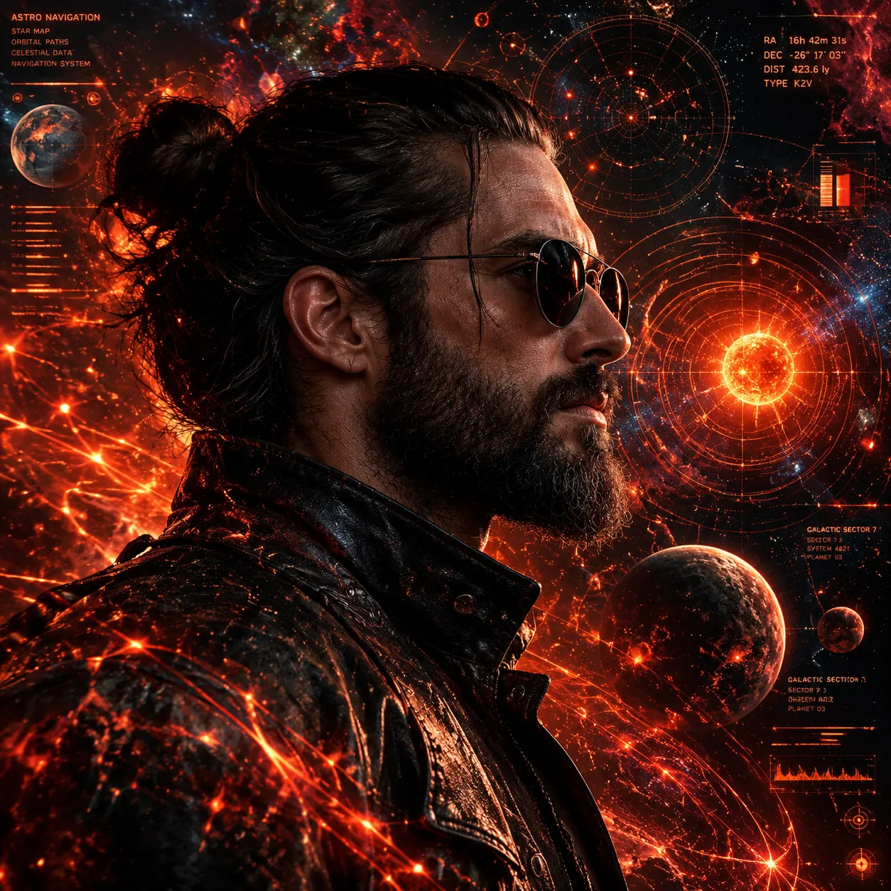</a>

> 一张情绪浓烈的海报风人像，把粗犷的人物和繁忙的全息世界搭配在一起：一位扎着发髻、满脸胡须、戴圆形墨镜、穿质感皮夹克的男性，侧脸面对橙红色的数据流、星图、天体导航图、网格和 HUD 面板，余烬般的粒子在他周围盘旋。色板只用深色加一种火焰色，繁复的背景才不会显得杂乱。我们的成品戏剧感十足又清晰：胡须和夹克上有温暖的轮廓光，身后界面里有一颗发光的红色太阳状星球和几颗行星。适合播客封面、游戏头像、音乐作品或活动主视觉。

```text
A cinematic side-profile portrait of a rugged man with a tied-back bun and full beard, wearing round dark sunglasses and a textured leather jacket. His skin is detailed and slightly weathered. The background is a futuristic sci-fi interface filled with glowing orange and red data streams, star maps, celestial navigation diagrams, grids, and holographic UI elements. Fiery particle effects and ember-like energy swirl around him, creating a cosmic, high-tech atmosphere. Dark color palette with strong contrast, dramatic lighting, ultra-detailed, sharp focus, 8K, cyberpunk aesthetic, cinematic composition, depth of field.
```

- 原作者: [@iamsofiaijaz](https://x.com/iamsofiaijaz)
- 原帖: https://x.com/iamsofiaijaz/status/2047882171336253928
- [在 cinel 上查看详情并一键生成](https://cinel.ai/zh/prompts/p/sci-fi-hud-bearded-man-side-profile?utm_source=github&utm_medium=awesome&utm_campaign=awesome-gpt-image-2.5-prompts)

### 狗仔闪光灯特写时装周人像提示词

<a href="https://cinel.ai/zh/prompts/p/paparazzi-flash-closeup-portrait?utm_source=github&utm_medium=awesome&utm_campaign=awesome-gpt-image-2.5-prompts">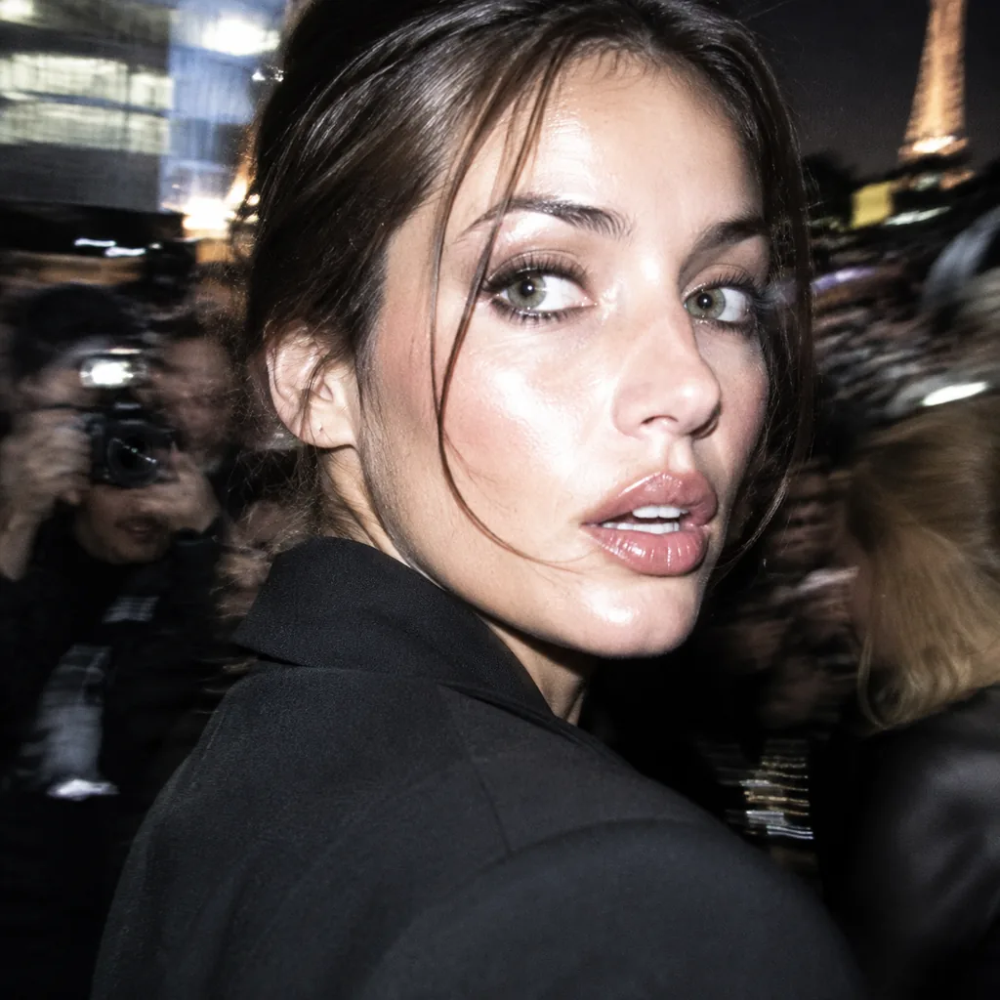</a>

> 这条提示词重现了2000年代小报照片那种生猛的现场感。一位五官鲜明的女性在转身望向镜头时被抓拍，低角度取景只拍到脸和肩膀，机顶闪光灯打得高光过曝，身后的人群拖成动态模糊。颗粒、轻微的镜头畸变和不完美的构图让画面像真实抓拍。我们用 GPT Image 2.5 生成时，把原提示词里的服装换成了黑色西装外套，场景是夜晚巴黎秀场外，模糊背景里还能看到摄影师。适合时尚社论、街拍情绪板，或需要“非摆拍、闪光直打”质感的专辑封面。

```text
Paparazzi-style extreme close-up photo of a woman with striking facial features, caught off-guard while turning toward the camera. Face and shoulders only, shot from a low angle. Strong harsh on-camera flash, grainy high-ISO, raw candid street-photography feel. Background shows a crowded scene with motion blur (Paris Fashion Week atmosphere). Intense, spontaneous energy, imperfect and real. She is an adult woman wearing a tailored black blazer. Ultra-realistic, cinematic realism, high detail skin texture, slight lens distortion.

Camera style: “35mm paparazzi lens, f/2.8, flash blown highlights”
Look: “2000s tabloid photo aesthetic”
Quality: “sharp focus on face, background heavily blurred and streaked”
```

- 原作者: [@oggii_0](https://x.com/oggii_0)
- 原帖: https://x.com/oggii_0/status/2011304086847832089
- [在 cinel 上查看详情并一键生成](https://cinel.ai/zh/prompts/p/paparazzi-flash-closeup-portrait?utm_source=github&utm_medium=awesome&utm_campaign=awesome-gpt-image-2.5-prompts)

### 35°俯拍纯色影棚时尚人像提示词

<a href="https://cinel.ai/zh/prompts/p/overhead-studio-void-fashion?utm_source=github&utm_medium=awesome&utm_campaign=awesome-gpt-image-2.5-prompts">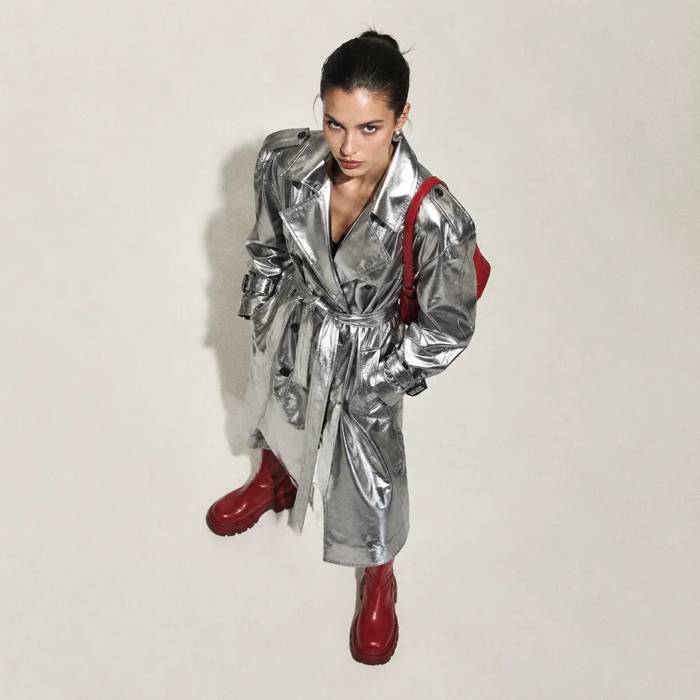</a>

> 来自 @azed_ai 的一个干净、可复用的社论模板。镜头以约35度俯视一个独自站在米白无缝背景里的主体，用一盏美人碟闪光灯打出利落的影子，搭配风格化的比例、反光材质和一点柯达 Portra 式颗粒。主体只是一个占位符，所以人物、角色甚至产品都适用。我们填入了一位穿超大银色金属感风衣和厚底红靴的模特，GPT Image 2.5 准确呈现了略带透视压缩、抬头看镜头的姿态和硬朗影子。适合 lookbook、广告测试和角色概念设计。

```text
A fashion model in an oversized metallic silver trench coat and chunky red boots photographed from a 35-degree overhead angle, standing alone in an off-white studio void, with a confident pose and clean silhouette. Stylised proportions, sleek fashion styling, reflective textures, bold accessories, soft studio light, single beauty-dish flash casting crisp shadows, subtle Kodak Portra-inspired grain, candid editorial energy, minimalist composition, sharp detail, premium studio photography
```

- 原作者: [@azed_ai](https://x.com/azed_ai)
- 原帖: https://x.com/azed_ai/status/2040745533858574471
- [在 cinel 上查看详情并一键生成](https://cinel.ai/zh/prompts/p/overhead-studio-void-fashion?utm_source=github&utm_medium=awesome&utm_campaign=awesome-gpt-image-2.5-prompts)

### 红色圆形相机杂志肖像

<a href="https://cinel.ai/zh/prompts/p/red-circle-camera-editorial-portrait?utm_source=github&utm_medium=awesome&utm_campaign=awesome-gpt-image-2.5-prompts">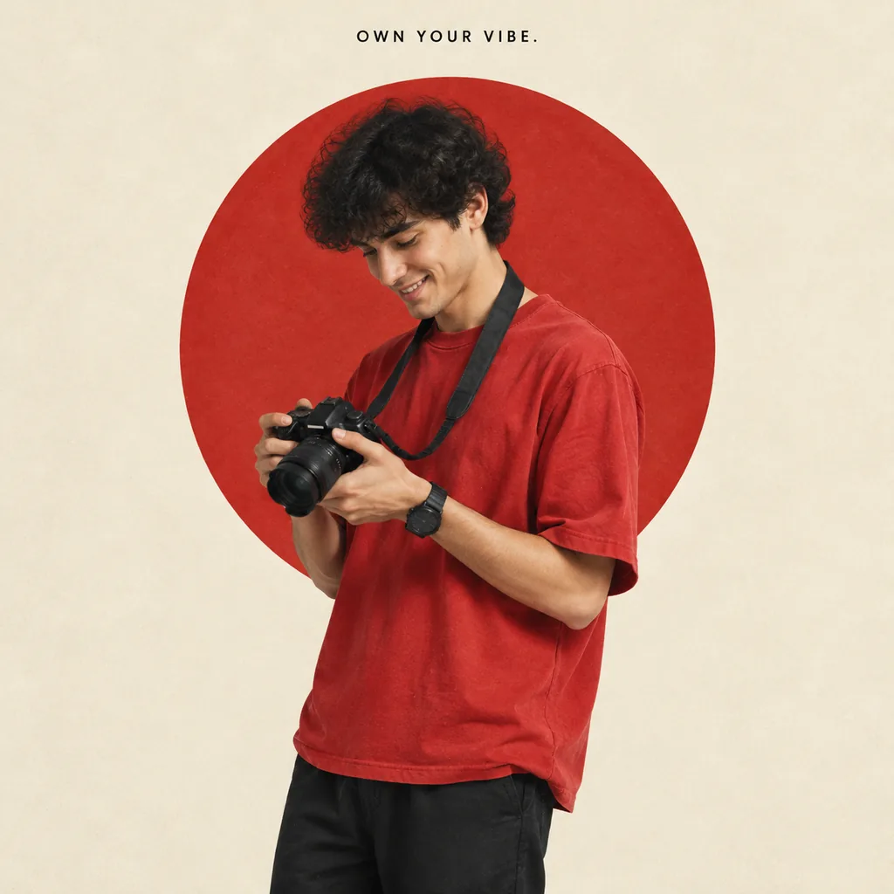</a>

> 来自 @harboriis 的 GPT Image 2.5 提示词。它描述了一张干净的棚拍肖像：卷发年轻男子穿宽松红色 T 恤，手持单反低头微笑，背后是暖奶油色背景上的大红圆形，顶部一行小字“OWN YOUR VIBE.”。我们只把画幅从 4:5 改成方形。适合创作者品牌、摄影课广告和海报风头像。

```text
Create Photorealistic editorial 1:1 square portrait of a young man standing mostly straight in a relaxed, stylish pose, body turned slightly sideways so his chest is not directly facing the camera, with one shoulder subtly angled forward. He is not too thin, with natural, balanced proportions. He wears an oversized red short-sleeve T-shirt, black pants, black wristwatch, and black camera strap, holding an unbranded black DSLR camera (no visible logo or lettering on the camera) naturally with both hands, slightly away from his face. He looks slightly downward at the camera he is holding, not at his eyes, with a soft, happy, confident smile. Thick curly dark hair. Clean warm off-white/cream background with a large red circle positioned directly behind his upper shoulders and head, with his hair and shoulder overlapping into the circle. Soft studio lighting, subtle vintage texture, clean minimal composition, realistic proportions. Small black uppercase text "OWN YOUR VIBE." centered at the very top above the circle.
```

- 原作者: [@harboriis](https://x.com/harboriis)
- 原帖: https://x.com/harboriis/status/2110714603965726893
- [在 cinel 上查看详情并一键生成](https://cinel.ai/zh/prompts/p/red-circle-camera-editorial-portrait?utm_source=github&utm_medium=awesome&utm_campaign=awesome-gpt-image-2.5-prompts)

### 双手系缎带蝴蝶结特写关键帧

<a href="https://cinel.ai/zh/prompts/p/hands-tying-satin-bow-closeup-keyframe?utm_source=github&utm_medium=awesome&utm_campaign=awesome-gpt-image-2.5-prompts">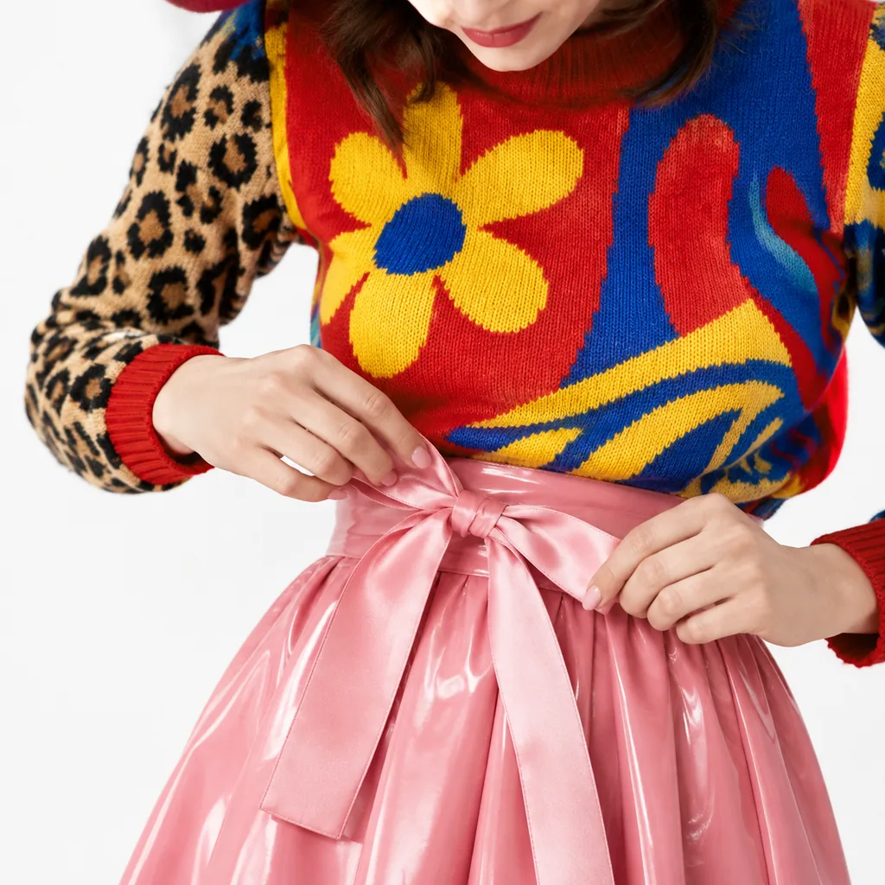</a>

> 灵感来自 @Salmaaboukarr 的 Seedance 2.5 测试，她挑战了 AI 视频最难的任务之一：系结时保持手和绳子的一致。原帖没有分享提示词，因此我们把这一帧写成明亮的极繁主义时尚特写。它很适合测试手部细节。适合时尚画册、配饰广告和模型对比。

```text
A single fashion-film key frame, close-up of an adult woman's hands carefully tying a pink satin ribbon into a bow at the waist of a glossy pink skirt, a colorful knit top with bold red, yellow and blue graphic patterns and a leopard-print sleeve, a red beret just visible at the top edge, crisp white studio background, soft even light, sharp detail on fingers and ribbon, playful maximalist styling, no text. Square 1:1 composition.
```

- 原作者: [@Salmaaboukarr](https://x.com/Salmaaboukarr)
- 原帖: https://x.com/Salmaaboukarr/status/2110101528442732745
- [在 cinel 上查看详情并一键生成](https://cinel.ai/zh/prompts/p/hands-tying-satin-bow-closeup-keyframe?utm_source=github&utm_medium=awesome&utm_campaign=awesome-gpt-image-2.5-prompts)

### 饰金瓷面奇幻肖像

<a href="https://cinel.ai/zh/prompts/p/ornate-porcelain-face-gold-jewelry?utm_source=github&utm_medium=awesome&utm_campaign=awesome-gpt-image-2.5-prompts">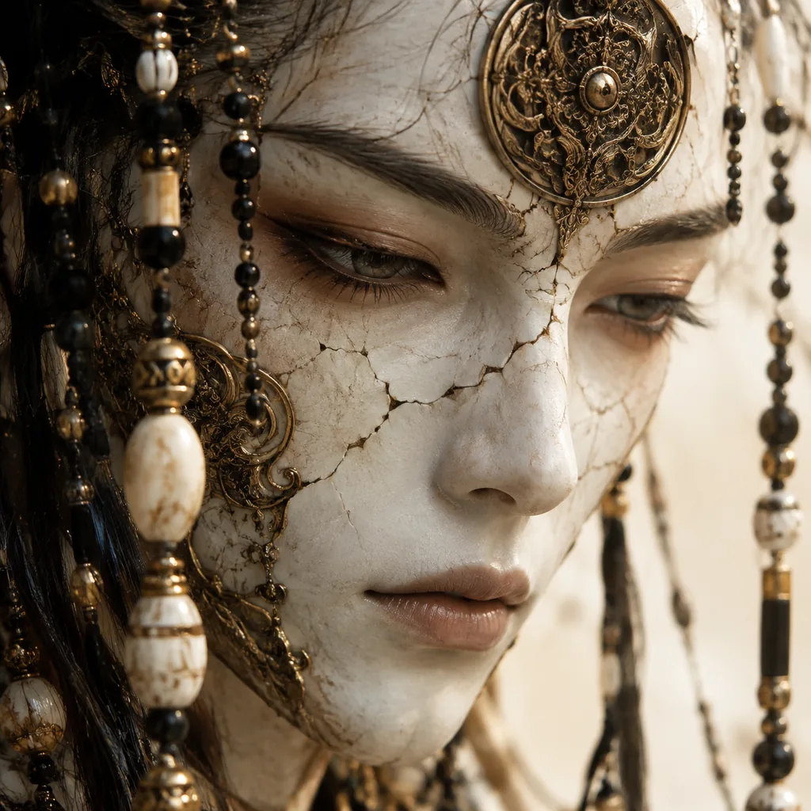</a>

> 根据 @AllaAisling 一张只配文“No words. Just art”的图片反向撰写的提示词（原帖没有分享提示词）。我们自己写出画面：一个异世界生命体的极近特写，裂纹象牙瓷质肌肤，额间嵌着雕花青铜饰章，垂挂黑、金与骨色串珠。适合奇幻角色设定、专辑封面和收藏卡牌设计。

```text
An extreme close-up dark-fantasy portrait of an otherworldly being with cracked ivory porcelain skin, an ornate engraved bronze medallion set in the forehead, strands of black, gold and bone beads hanging around the face, fine filigree metalwork along the cheek, half-closed eyes, warm cream background softly blurred, intricate textures, museum-sculpture realism, no text. Square 1:1 composition.
```

- 原作者: [@AllaAisling](https://x.com/AllaAisling)
- 原帖: https://x.com/AllaAisling/status/2109337734821146942
- [在 cinel 上查看详情并一键生成](https://cinel.ai/zh/prompts/p/ornate-porcelain-face-gold-jewelry?utm_source=github&utm_medium=awesome&utm_campaign=awesome-gpt-image-2.5-prompts)

### 健身Vlog平板支撑关键帧

<a href="https://cinel.ai/zh/prompts/p/gym-vlog-plank-keyframe?utm_source=github&utm_medium=awesome&utm_campaign=awesome-gpt-image-2.5-prompts">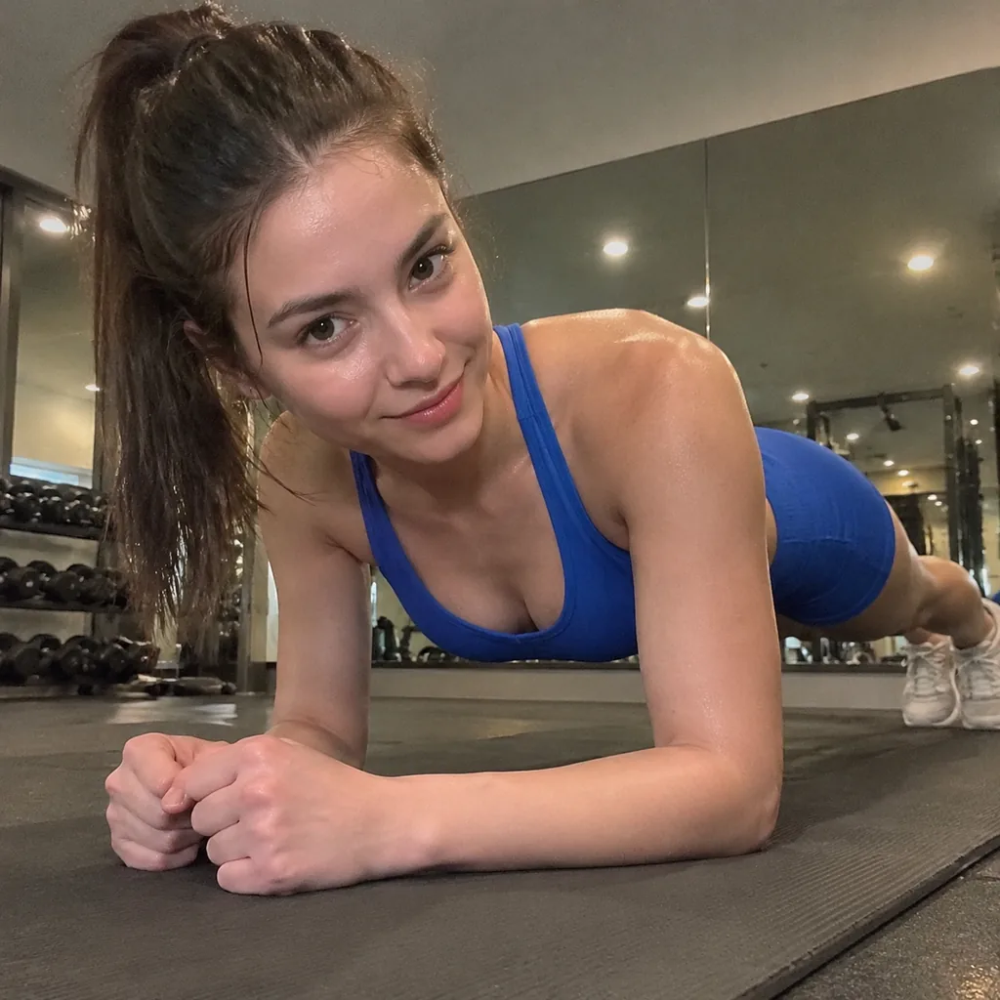</a>

> 根据 @Naiknelofar788 完整的 Seedance 健身Vlog分镜写的关键帧静图。我们定格平板支撑时刻：相机放在垫上、镜墙与晚间健身房灯光，自然抓拍摄像机颗粒感。适合健身封面、运动App和Vlog缩略图。

```text
Photorealistic video keyframe, square 1:1: a young woman with a high brunette ponytail wearing a cobalt-blue athletic top and matching shorts holds a plank on a gym mat in the evening, glancing at a camera resting on the mat, mirror wall and soft overhead gym lights behind her, natural handheld camcorder feel, slight grain, candid and playful mood, no text, no logo. Square 1:1 composition.
```

- 原作者: [@Naiknelofar788](https://x.com/Naiknelofar788)
- 原帖: https://x.com/Naiknelofar788/status/2109295099800907848
- [在 cinel 上查看详情并一键生成](https://cinel.ai/zh/prompts/p/gym-vlog-plank-keyframe?utm_source=github&utm_medium=awesome&utm_campaign=awesome-gpt-image-2.5-prompts)

### 缠绕画侧脸装饰艺术肖像

<a href="https://cinel.ai/zh/prompts/p/zentangle-profile-art-deco-portrait?utm_source=github&utm_medium=awesome&utm_campaign=awesome-gpt-image-2.5-prompts">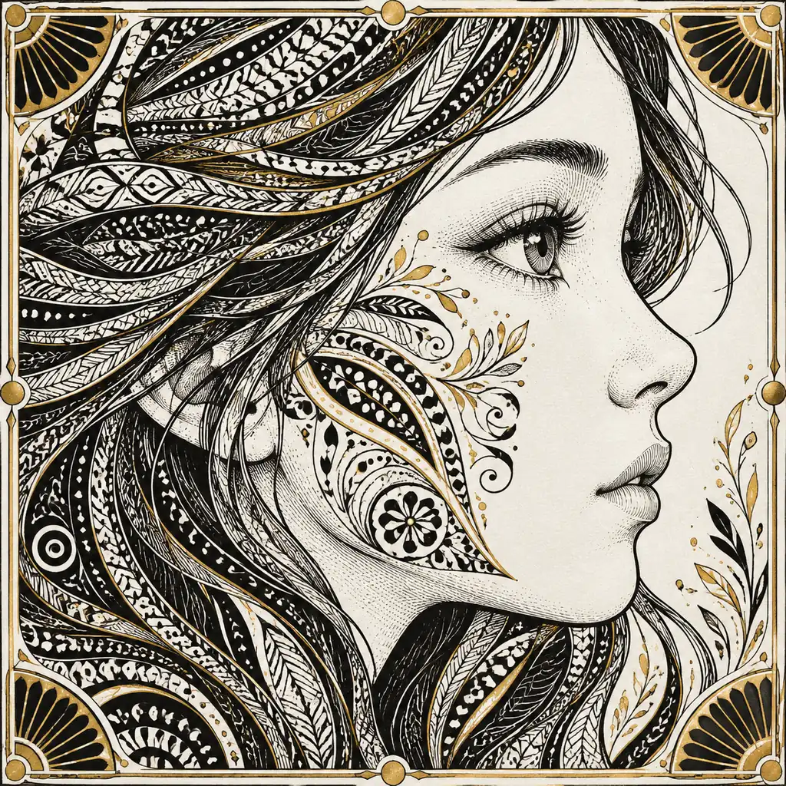</a>

> 摘自 @deebeeeff 为 Midjourney、ChatGPT 与 Gemini 分享的肖像提示词（原帖已标注1:1）。精细墨纹流过发丝与脸颊，装饰艺术边框内。适合涂色书、纹身参考和手账封面。

```text
Extreme close-up profile of a young girl's face in a zentangle illustration style, intricate black ink patterns flowing through her hair and across the cheek, an elegant art-deco border framing the portrait, fine line work, monochrome with delicate gold accents, decorative and calm, no text. Square 1:1 composition.
```

- 原作者: [@deebeeeff](https://x.com/deebeeeff)
- 原帖: https://x.com/deebeeeff/status/2109792114465034477
- [在 cinel 上查看详情并一键生成](https://cinel.ai/zh/prompts/p/zentangle-profile-art-deco-portrait?utm_source=github&utm_medium=awesome&utm_campaign=awesome-gpt-image-2.5-prompts)

### 红裙弗拉门戈舞者

<a href="https://cinel.ai/zh/prompts/p/flamenco-dancer-red-dress?utm_source=github&utm_medium=awesome&utm_campaign=awesome-gpt-image-2.5-prompts">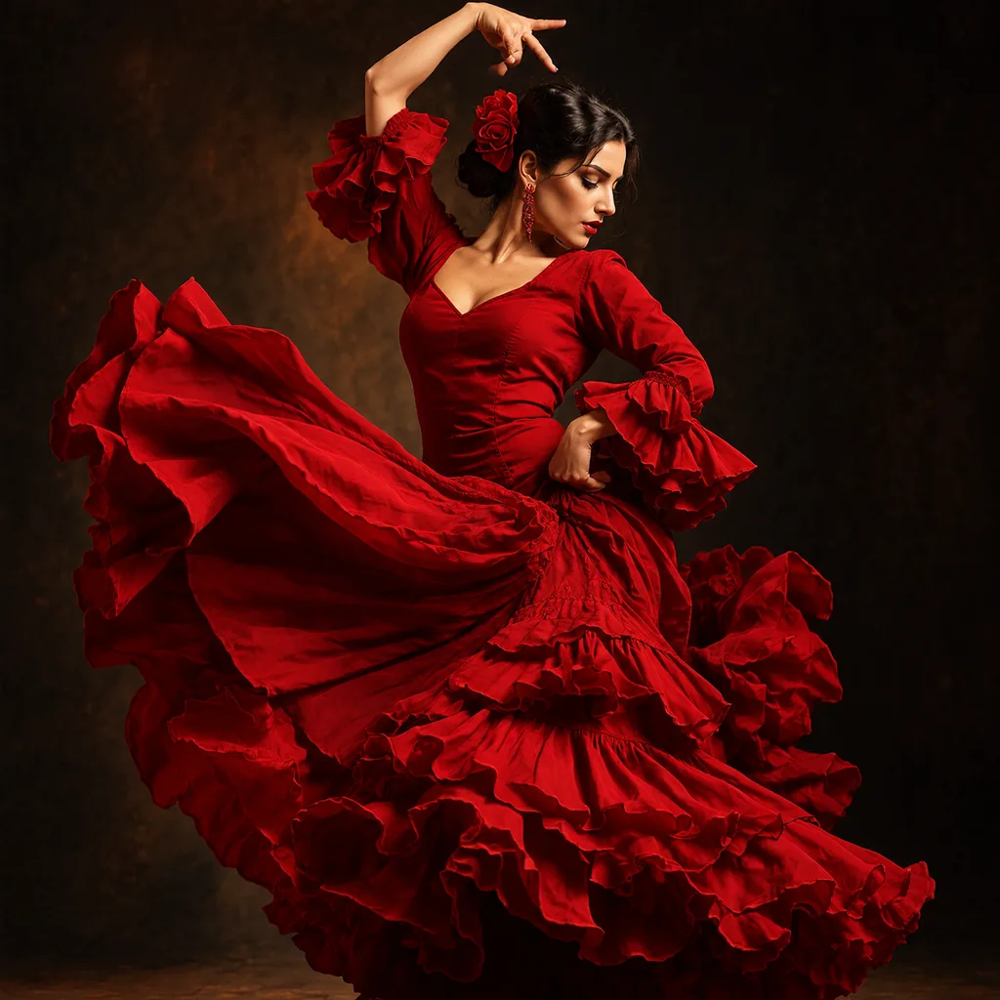</a>

> 根据 @azed_ai 以“Share your flamenco dancer”为题发布的图片反向撰写的提示词（原帖没有分享提示词）。我们自己描述了旋转中的红裙与深色背景。适合舞蹈海报、音乐封面和时尚编辑图。

```text
A dramatic portrait, square 1:1: a flamenco dancer in a flowing deep-red ruffled dress captured mid-twirl, the skirt sweeping into a painterly wave around her, dark simple background, expressive pose and strong warm light, fashion editorial photography, no text. Square 1:1 composition.
```

- 原作者: [@azed_ai](https://x.com/azed_ai)
- 原帖: https://x.com/azed_ai/status/2110279951069151479
- [在 cinel 上查看详情并一键生成](https://cinel.ai/zh/prompts/p/flamenco-dancer-red-dress?utm_source=github&utm_medium=awesome&utm_campaign=awesome-gpt-image-2.5-prompts)

### 雨中动态模糊时尚肖像

<a href="https://cinel.ai/zh/prompts/p/motion-blur-fashion-in-the-rain?utm_source=github&utm_medium=awesome&utm_campaign=awesome-gpt-image-2.5-prompts">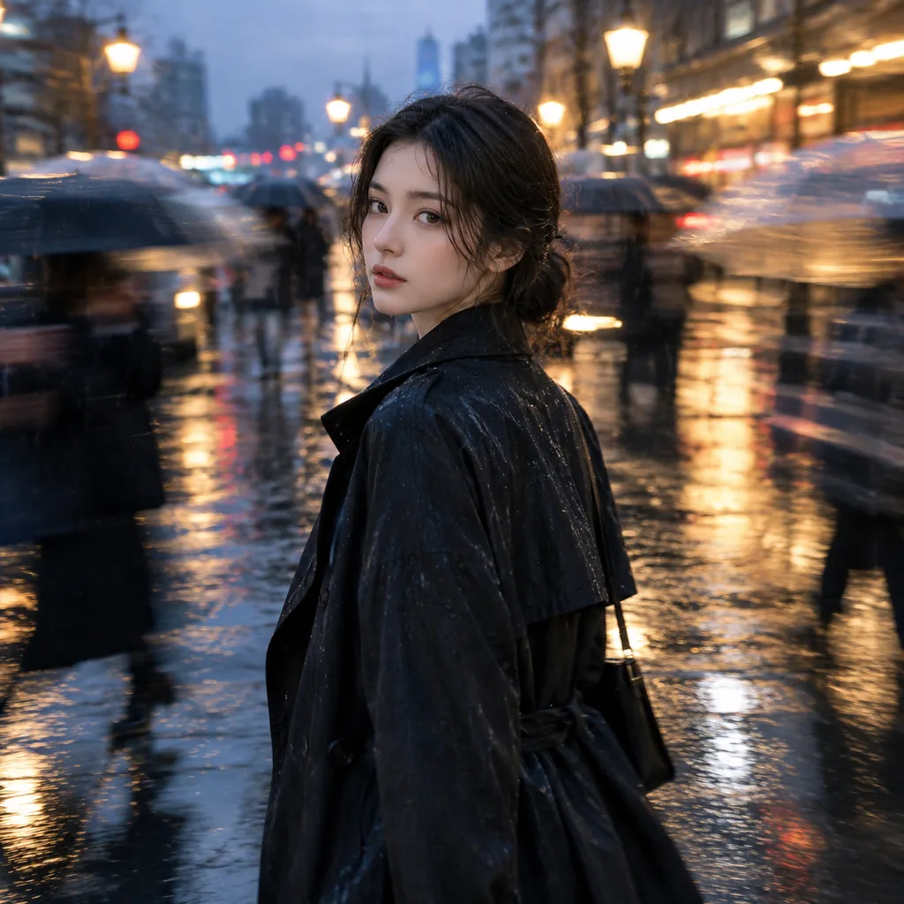</a>

> 根据 @AiwithLariab 的 GPT Image 2.5 帖子标题《Motion Blur Fashion in the Rain》补全（完整提示词在评论区）。我们让她的面部在模糊雨伞中保持清晰。适合时尚大片、雨季 campaign 和城市肖像。

```text
Photorealistic fashion portrait, square 1:1: a young woman in a dark trench coat walking through rainy city streets at dusk, artistic motion blur on passing umbrellas and lights while her face stays sharp, wet reflections, cinematic rain, editorial photography, no text, no logo. Square 1:1 composition.
```

- 原作者: [@AiwithLariab](https://x.com/AiwithLariab)
- 原帖: https://x.com/AiwithLariab/status/2109602481198305536
- [在 cinel 上查看详情并一键生成](https://cinel.ai/zh/prompts/p/motion-blur-fashion-in-the-rain?utm_source=github&utm_medium=awesome&utm_campaign=awesome-gpt-image-2.5-prompts)

### 霓虹街头舞蹈巅峰关键帧

<a href="https://cinel.ai/zh/prompts/p/neon-street-dance-peak-keyframe?utm_source=github&utm_medium=awesome&utm_campaign=awesome-gpt-image-2.5-prompts">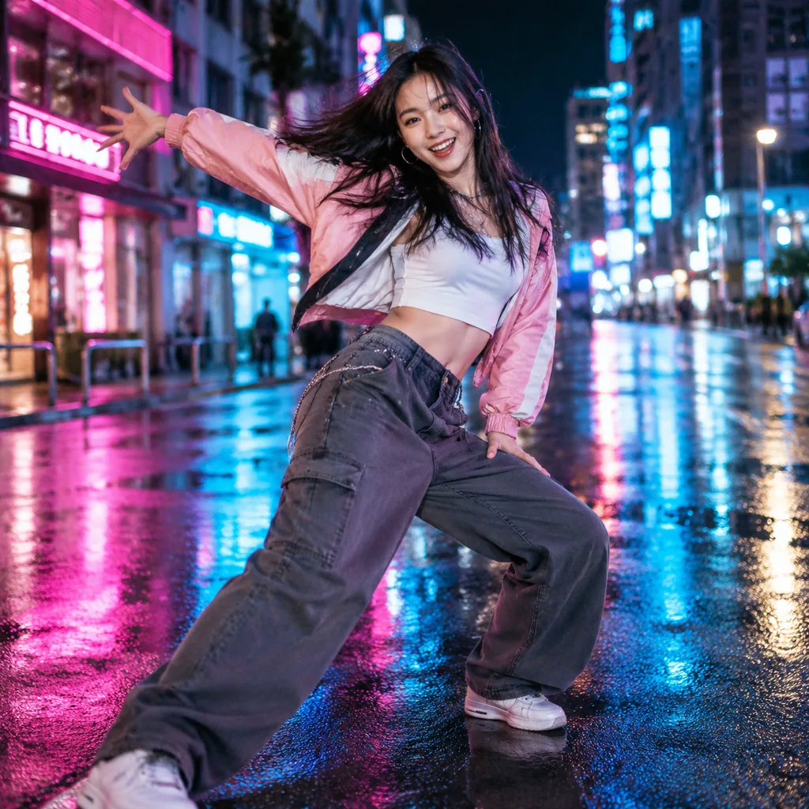</a>

> 根据 @mehvishs25 分享的 Seedance 舞蹈视频改写成1:1关键帧。我们定格张臂、甩发和霓虹倒影。适合音乐封面、舞蹈海报和夜生活肖像。

```text
Photorealistic video keyframe, square 1:1: a young woman dancer frozen at the peak of a stylish street-dance move on a neon-lit city street at night, one arm thrown wide, hair swinging, pink and cyan neon reflecting on wet pavement, cinematic music-video still, dynamic pose and joyful confidence, realistic skin and fabric, no text, no logo. Square 1:1 composition.
```

- 原作者: [@mehvishs25](https://x.com/mehvishs25)
- 原帖: https://x.com/mehvishs25/status/2110939101071593664
- [在 cinel 上查看详情并一键生成](https://cinel.ai/zh/prompts/p/neon-street-dance-peak-keyframe?utm_source=github&utm_medium=awesome&utm_campaign=awesome-gpt-image-2.5-prompts)

### 复古梳妆镜肖像油画

<a href="https://cinel.ai/zh/prompts/p/vintage-vanity-mirror-portrait-painting?utm_source=github&utm_medium=awesome&utm_campaign=awesome-gpt-image-2.5-prompts">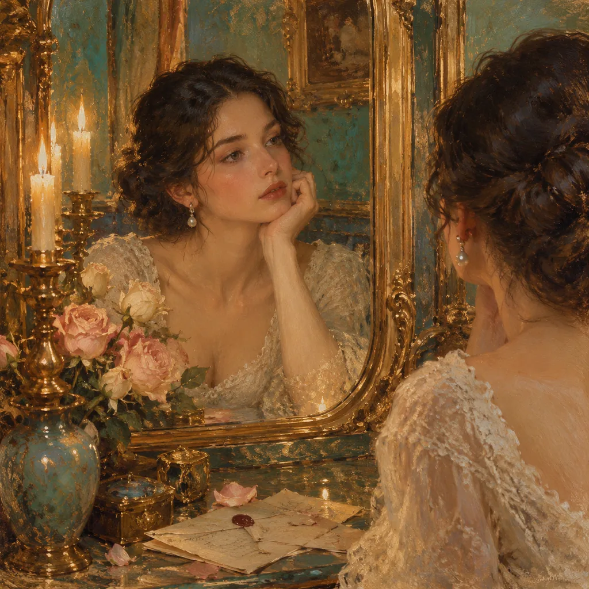</a>

> 根据 @punkhuri1 对比三款图像模型时用的《Vintage Romantic Vanity Portrait》主题扩写。我们保留梳妆台、烛光与褪色调。适合浪漫封面、肖像委托和复古装饰。

```text
A dreamy romantic vintage oil painting, square 1:1: a beautiful adult woman in her mid-twenties with soft dark hair sits at an ornate vanity mirror in warm candlelight, lace dress and pearl earrings, reflected roses and old letters on the table, faded turquoise and antique gold palette, visible brushstrokes, timeless romantic portrait, no text. Square 1:1 composition.
```

- 原作者: [@punkhuri1](https://x.com/punkhuri1)
- 原帖: https://x.com/punkhuri1/status/2111469984350359723
- [在 cinel 上查看详情并一键生成](https://cinel.ai/zh/prompts/p/vintage-vanity-mirror-portrait-painting?utm_source=github&utm_medium=awesome&utm_campaign=awesome-gpt-image-2.5-prompts)

### 微表情第一滴泪关键帧

<a href="https://cinel.ai/zh/prompts/p/micro-expression-first-tear-keyframe?utm_source=github&utm_medium=awesome&utm_campaign=awesome-gpt-image-2.5-prompts">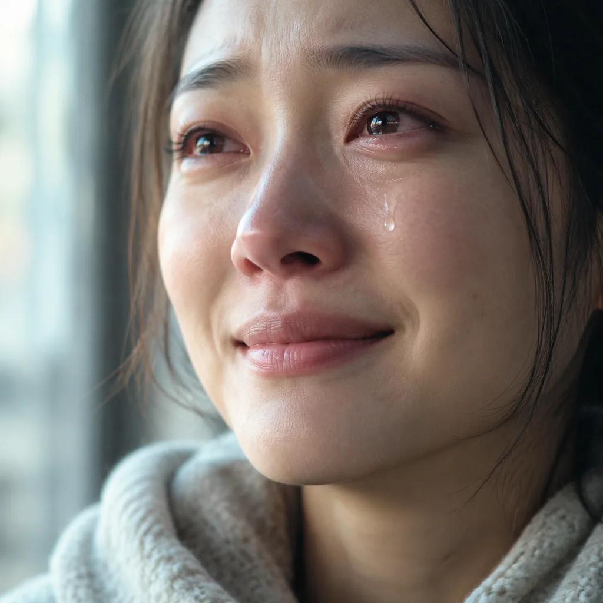</a>

> 根据 @Kiana_Liang0609 从平静到第一滴泪的五帧微表情视频概念改写成1:1关键帧。我们定格落泪帧。适合表演研究、剧情封面和情感肖像。

```text
Photorealistic emotional video keyframe, square 1:1: an adult woman in extreme close-up frozen at the moment a first tear gathers, a shaky almost-smile, soft window light, realistic skin texture and catchlights, quiet performance still, cinematic and tender, no text. Square 1:1 composition.
```

- 原作者: [@Kiana_Liang0609](https://x.com/Kiana_Liang0609)
- 原帖: https://x.com/Kiana_Liang0609/status/2109933762473496774
- [在 cinel 上查看详情并一键生成](https://cinel.ai/zh/prompts/p/micro-expression-first-tear-keyframe?utm_source=github&utm_medium=awesome&utm_campaign=awesome-gpt-image-2.5-prompts)

### 与镜中自己对峙的人像

<a href="https://cinel.ai/zh/prompts/p/mirror-self-confrontation-shadow-portrait?utm_source=github&utm_medium=awesome&utm_campaign=awesome-gpt-image-2.5-prompts">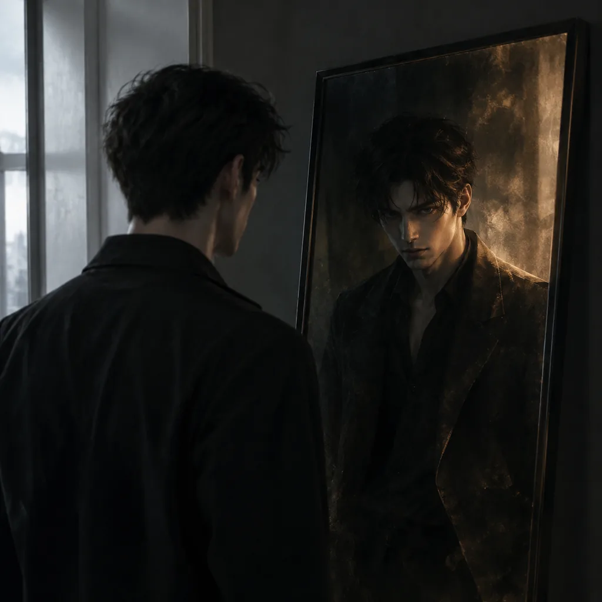</a>

> 根据 @OrhanGhazi65942 于 2026-10-16 的帖子改写（记录时 23 赞）。我们改成一张干净的1:1图，去掉品牌、Logo、名人/IP元素，也不需要你的照片。一次只改一个变量。

```text
Moody cinematic portrait, square 1:1: a fictional adult man in dark clothes facing his own reflection in a tall mirror, the reflection lit differently like an inner battle, dramatic shadow and soft window light, no text, no logo. Square 1:1 composition.
```

- 原作者: [@OrhanGhazi65942](https://x.com/OrhanGhazi65942)
- 原帖: https://x.com/OrhanGhazi65942/status/2111079966133895442
- [在 cinel 上查看详情并一键生成](https://cinel.ai/zh/prompts/p/mirror-self-confrontation-shadow-portrait?utm_source=github&utm_medium=awesome&utm_campaign=awesome-gpt-image-2.5-prompts)

### 霓虹棚拍南瓜头时尚大片

<a href="https://cinel.ai/zh/prompts/p/neon-studio-pumpkin-head-editorial?utm_source=github&utm_medium=awesome&utm_campaign=awesome-gpt-image-2.5-prompts">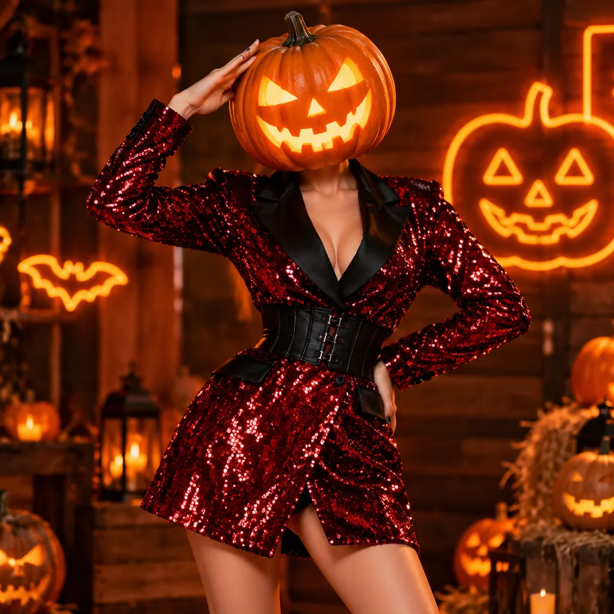</a>

> 根据 @nthfuture_x 于 2026-10-18 的帖子改写（记录时 14 赞）。我们改成一张干净的1:1南瓜头写真，去掉品牌、Logo、名人/IP元素，也不需要你的照片。一次只改一个变量。

```text
Editorial fashion photoshoot, square 1:1: a model whose head is a glowing carved pumpkin standing in a wooden-accent Halloween studio, sequined deep-red blazer dress with black lapels and corset belt, playful salute pose, vibrant orange neon signs and soft-focus pumpkins behind, 85mm shallow depth of field, vivid cinematic contrast, no real-person identity lock, no text, no logo. Square 1:1 composition.
```

- 原作者: [@nthfuture_x](https://x.com/nthfuture_x)
- 原帖: https://x.com/nthfuture_x/status/2111742078199718222
- [在 cinel 上查看详情并一键生成](https://cinel.ai/zh/prompts/p/neon-studio-pumpkin-head-editorial?utm_source=github&utm_medium=awesome&utm_campaign=awesome-gpt-image-2.5-prompts)

### 月下门廊南瓜头情侣

<a href="https://cinel.ai/zh/prompts/p/moonlit-porch-pumpkin-head-couple?utm_source=github&utm_medium=awesome&utm_campaign=awesome-gpt-image-2.5-prompts">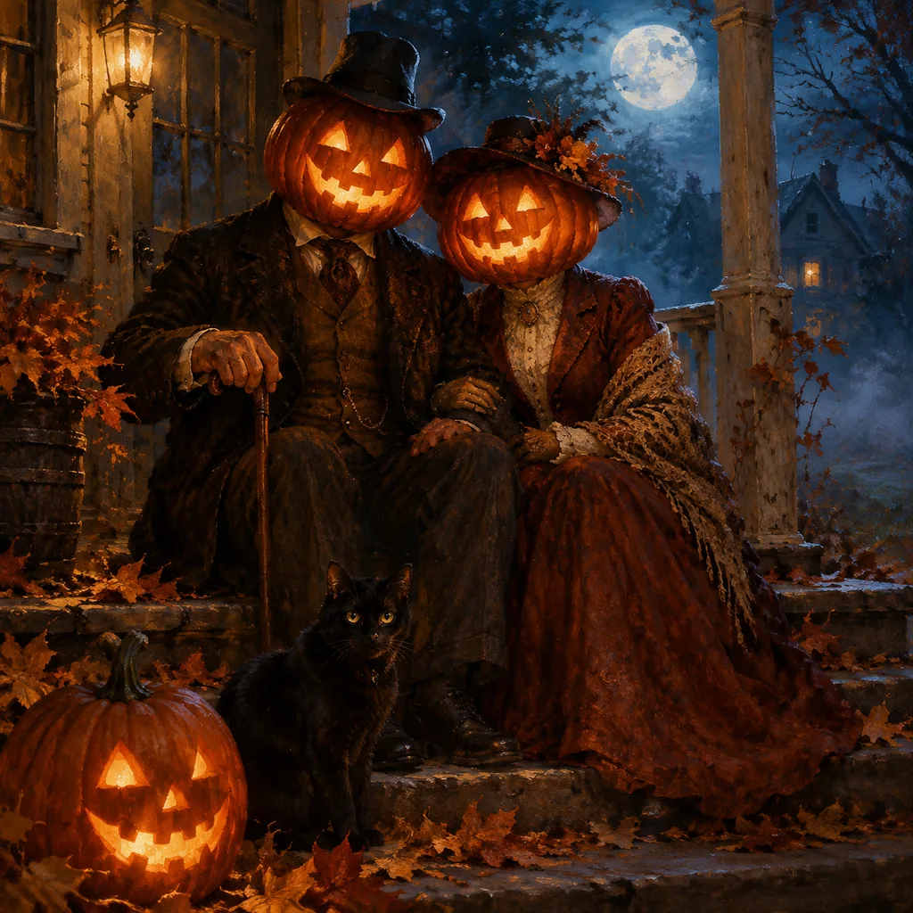</a>

> 根据 @StormriderStory 于 2026-10-07 的帖子改写（记录时 14 赞）。我们改成一张干净的1:1南瓜头写真，去掉品牌、Logo、名人/IP元素，也不需要你的照片。一次只改一个变量。

```text
Painterly Halloween portrait, square 1:1: an older couple with matching carved pumpkin heads on a moonlit porch, vintage formal clothes that are original costumes not famous characters, warm jack-o'-lantern light on the pumpkin faces, cool blue moonlight behind, autumn leaves on the steps, a black cat at their feet, faint fog, one glowing carved pumpkin in the foreground, rich oil-painting texture, kind cinematic mood, no text, no logo. Square 1:1 composition.
```

- 原作者: [@StormriderStory](https://x.com/StormriderStory)
- 原帖: https://x.com/StormriderStory/status/2107902068459790479
- [在 cinel 上查看详情并一键生成](https://cinel.ai/zh/prompts/p/moonlit-porch-pumpkin-head-couple?utm_source=github&utm_medium=awesome&utm_campaign=awesome-gpt-image-2.5-prompts)

### 维多利亚门廊迎宾南瓜头

<a href="https://cinel.ai/zh/prompts/p/victorian-door-greeter-pumpkin-head?utm_source=github&utm_medium=awesome&utm_campaign=awesome-gpt-image-2.5-prompts"></a>

> 根据 @pixexid 于 2025-10-28 的帖子改写（记录时 0 赞）。我们改成一张干净的1:1南瓜头写真，去掉品牌、Logo、名人/IP元素，也不需要你的照片。一次只改一个变量。

```text
Photoreal character portrait, square 1:1: a carved pumpkin head figure standing upright as a door greeter on a Victorian porch, holding an oversized candy bowl, playful eerie welcome lean toward the door, warm porch lantern light, autumn wreath on the door, theatrical costume body, no text, no logo. Square 1:1 composition.
```

- 原作者: [@pixexid](https://x.com/pixexid)
- 原帖: https://x.com/pixexid/status/1983021209328459882
- [在 cinel 上查看详情并一键生成](https://cinel.ai/zh/prompts/p/victorian-door-greeter-pumpkin-head?utm_source=github&utm_medium=awesome&utm_campaign=awesome-gpt-image-2.5-prompts)

### 橙装南瓜头时尚关键帧

<a href="https://cinel.ai/zh/prompts/p/orange-suit-pumpkin-fashion-keyframe?utm_source=github&utm_medium=awesome&utm_campaign=awesome-gpt-image-2.5-prompts"></a>

> 根据 @MindySarver 于 2025-09-29 的视频帖改写（记录时 23 赞）。我们改成一张干净的1:1南瓜头写真，去掉品牌、Logo、名人/IP元素，也不需要你的照片。一次只改一个变量。

```text
Hyperreal fashion editorial still, square 1:1: full-body figure with a smiling carved pumpkin head wearing a vivid orange suit patterned with tiny pumpkins, saturated orange pink lime and gold palette, brilliant luminous highlights, elegant surreal harmony on a clean light backdrop, frozen video keyframe energy, no text, no logo, no celebrity. Square 1:1 composition.
```

- 原作者: [@MindySarver](https://x.com/MindySarver)
- 原帖: https://x.com/MindySarver/status/1972491969579651383
- [在 cinel 上查看详情并一键生成](https://cinel.ai/zh/prompts/p/orange-suit-pumpkin-fashion-keyframe?utm_source=github&utm_medium=awesome&utm_campaign=awesome-gpt-image-2.5-prompts)

### 缝合南瓜头视频关键帧

<a href="https://cinel.ai/zh/prompts/p/stitched-pumpkin-head-video-keyframe?utm_source=github&utm_medium=awesome&utm_campaign=awesome-gpt-image-2.5-prompts"></a>

> 根据 @crafter_mind 于 2025-11-01 的视频帖改写（记录时 0 赞）。我们改成一张干净的1:1南瓜头写真，去掉品牌、Logo、名人/IP元素，也不需要你的照片。一次只改一个变量。

```text
Cinematic video keyframe, square 1:1: mysterious figure with a stitched jack-o'-lantern head turning slightly toward camera, glowing carved eyes, Victorian dark coat, subtle film grain and soft volumetric light, frozen from an AI image-to-video loop, haunting elegance, no text, no logo. Square 1:1 composition.
```

- 原作者: [@crafter_mind](https://x.com/crafter_mind)
- 原帖: https://x.com/crafter_mind/status/1984502220071780692
- [在 cinel 上查看详情并一键生成](https://cinel.ai/zh/prompts/p/stitched-pumpkin-head-video-keyframe?utm_source=github&utm_medium=awesome&utm_campaign=awesome-gpt-image-2.5-prompts)

### 摄影棚微凶南瓜头肖像

<a href="https://cinel.ai/zh/prompts/p/menacing-studio-pumpkin-head-portrait?utm_source=github&utm_medium=awesome&utm_campaign=awesome-gpt-image-2.5-prompts"></a>

> 根据 @Runee96 于 2026-10-04 的帖子改写（记录时 0 赞）。我们改成一张干净的1:1南瓜头写真，去掉品牌、Logo、名人/IP元素，也不需要你的照片。一次只改一个变量。

```text
Studio portrait, square 1:1: a carved jack-o'-lantern head on a human body in a dark turtleneck, slightly menacing with one corner of the mouth carved up, soft Rembrandt key light and deep shadow, clean charcoal seamless backdrop, fashion-photoshoot restraint, no text, no logo. Square 1:1 composition.
```

- 原作者: [@Runee96](https://x.com/Runee96)
- 原帖: https://x.com/Runee96/status/2106735881470067094
- [在 cinel 上查看详情并一键生成](https://cinel.ai/zh/prompts/p/menacing-studio-pumpkin-head-portrait?utm_source=github&utm_medium=awesome&utm_campaign=awesome-gpt-image-2.5-prompts)

### 门廊南瓜头家庭合影

<a href="https://cinel.ai/zh/prompts/p/pumpkin-head-family-porch-portrait?utm_source=github&utm_medium=awesome&utm_campaign=awesome-gpt-image-2.5-prompts"></a>

> 根据 @bewisetojudge_ 于 2025-10-14 的帖子改写（记录时 0 赞）。我们改成一张干净的1:1南瓜头写真，去掉品牌、Logo、名人/IP元素，也不需要你的照片。一次只改一个变量。

```text
Warm family photoshoot, square 1:1: three figures — two adults and one child — each with a cheerfully carved pumpkin head, standing together on a suburban porch with string lights and hay bales, autumn evening glow, cozy holiday card mood, SFW, no text, no logo, no celebrity. Square 1:1 composition.
```

- 原作者: [@bewisetojudge_](https://x.com/bewisetojudge_)
- 原帖: https://x.com/bewisetojudge_/status/1977990037687177670
- [在 cinel 上查看详情并一键生成](https://cinel.ai/zh/prompts/p/pumpkin-head-family-porch-portrait?utm_source=github&utm_medium=awesome&utm_campaign=awesome-gpt-image-2.5-prompts)

### 白无缝棚南瓜头写真

<a href="https://cinel.ai/zh/prompts/p/white-cyclorama-pumpkin-head-studio?utm_source=github&utm_medium=awesome&utm_campaign=awesome-gpt-image-2.5-prompts"></a>

> 根据 @photowhoa 于 2025-09-02 的帖子改写（记录时 1 赞）。我们改成一张干净的1:1南瓜头写真，去掉品牌、Logo、名人/IP元素，也不需要你的照片。一次只改一个变量。

```text
Clean studio photoshoot, square 1:1: a fashion model with a perfectly carved glowing pumpkin head standing on a pure white cyclorama, oversized black turtleneck and tailored trousers, soft dual softbox lighting, soft shadow underfoot, high-fashion pumpkin-head photoshoot look, no text, no logo, no brand. Square 1:1 composition.
```

- 原作者: [@photowhoa](https://x.com/photowhoa)
- 原帖: https://x.com/photowhoa/status/1962983858904682911
- [在 cinel 上查看详情并一键生成](https://cinel.ai/zh/prompts/p/white-cyclorama-pumpkin-head-studio?utm_source=github&utm_medium=awesome&utm_campaign=awesome-gpt-image-2.5-prompts)

### 犯困南瓜头视频关键帧

<a href="https://cinel.ai/zh/prompts/p/sleepy-pumpkin-head-video-keyframe?utm_source=github&utm_medium=awesome&utm_campaign=awesome-gpt-image-2.5-prompts"></a>

> 根据 @JujubeTing 于 2025-10-27 的视频帖改写（记录时 5 赞）。我们改成一张干净的1:1南瓜头写真，去掉品牌、Logo、名人/IP元素，也不需要你的照片。一次只改一个变量。

```text
Cinematic video keyframe, square 1:1: a soft anthropomorphic figure with a carved pumpkin head looking drowsy, half-lidded glowing eyes, cozy oversized sweater, warm indoor lamp and autumn window light, gentle sleepy mood frozen mid-yawn, no text, no logo. Square 1:1 composition.
```

- 原作者: [@JujubeTing](https://x.com/JujubeTing)
- 原帖: https://x.com/JujubeTing/status/1982948913213780180
- [在 cinel 上查看详情并一键生成](https://cinel.ai/zh/prompts/p/sleepy-pumpkin-head-video-keyframe?utm_source=github&utm_medium=awesome&utm_campaign=awesome-gpt-image-2.5-prompts)

### 电影感力量南瓜头肖像

<a href="https://cinel.ai/zh/prompts/p/cinematic-power-pumpkin-head-portrait?utm_source=github&utm_medium=awesome&utm_campaign=awesome-gpt-image-2.5-prompts"></a>

> 根据 @Y_orruu 于 2026-10-09 的帖子改写（记录时 10 赞）。我们改成一张干净的1:1南瓜头写真，去掉品牌、Logo、名人/IP元素，也不需要你的照片。一次只改一个变量。

```text
Cinematic AI portrait, square 1:1: a legendary pumpkin-headed figure in a dark cloak, carved face glowing with molten orange light, powerful stance, mysterious atmosphere with volumetric rays, epic but clean composition, no crypto branding, no text, no logo. Square 1:1 composition.
```

- 原作者: [@Y_orruu](https://x.com/Y_orruu)
- 原帖: https://x.com/Y_orruu/status/2108660384903344263
- [在 cinel 上查看详情并一键生成](https://cinel.ai/zh/prompts/p/cinematic-power-pumpkin-head-portrait?utm_source=github&utm_medium=awesome&utm_campaign=awesome-gpt-image-2.5-prompts)

### 南瓜头与骷髅双肖像

<a href="https://cinel.ai/zh/prompts/p/dual-pumpkin-and-skull-portrait?utm_source=github&utm_medium=awesome&utm_campaign=awesome-gpt-image-2.5-prompts"></a>

> 根据 @vnomenon 于 2025-09-29 的帖子改写（记录时 12 赞）。我们改成一张干净的1:1南瓜头写真，去掉品牌、Logo、名人/IP元素，也不需要你的照片。一次只改一个变量。

```text
Surreal studio diptych feel in one square, square 1:1: two side-by-side Halloween portrait figures — left a carved glowing pumpkin head, right a refined decorative skull face — matching dark formal wear, soft studio key light, clean charcoal backdrop, no gore, no text, no logo. Square 1:1 composition.
```

- 原作者: [@vnomenon](https://x.com/vnomenon)
- 原帖: https://x.com/vnomenon/status/1972668934668394713
- [在 cinel 上查看详情并一键生成](https://cinel.ai/zh/prompts/p/dual-pumpkin-and-skull-portrait?utm_source=github&utm_medium=awesome&utm_campaign=awesome-gpt-image-2.5-prompts)

### 万圣夜阴森南瓜头

<a href="https://cinel.ai/zh/prompts/p/macabre-all-hallows-pumpkin-head?utm_source=github&utm_medium=awesome&utm_campaign=awesome-gpt-image-2.5-prompts"></a>

> 根据 @AzraelSeraph 于 2025-10-05 的帖子改写（记录时 1 赞）。我们改成一张干净的1:1南瓜头写真，去掉品牌、Logo、名人/IP元素，也不需要你的照片。一次只改一个变量。

```text
Macabre fine-art portrait, square 1:1: a pale figure with an elaborately carved jack-o'-lantern head, candlelit orange glow from within, black lace and aged fabric details, deep shadow gothic mood, All Hallows' Eve atmosphere, no gore closeups, no text, no logo. Square 1:1 composition.
```

- 原作者: [@AzraelSeraph](https://x.com/AzraelSeraph)
- 原帖: https://x.com/AzraelSeraph/status/1974877442818052256
- [在 cinel 上查看详情并一键生成](https://cinel.ai/zh/prompts/p/macabre-all-hallows-pumpkin-head?utm_source=github&utm_medium=awesome&utm_campaign=awesome-gpt-image-2.5-prompts)

### 南瓜田时尚南瓜头

<a href="https://cinel.ai/zh/prompts/p/pumpkin-patch-fashion-pumpkin-head?utm_source=github&utm_medium=awesome&utm_campaign=awesome-gpt-image-2.5-prompts"></a>

> 根据 @sayonaracash 于 2026-10-09 的帖子改写（记录时 2662 赞）。我们改成一张干净的1:1南瓜头写真，去掉品牌、Logo、名人/IP元素，也不需要你的照片。一次只改一个变量。

```text
Sunny fashion editorial, square 1:1: a stylish figure whose head is a cheerfully carved pumpkin walking through a pumpkin patch between hay bales, cream linen outfit and small bag, golden afternoon light, crowd softly blurred picking pumpkins behind, high-fashion photoshoot energy, no celebrity likeness, no text, no logo. Square 1:1 composition.
```

- 原作者: [@sayonaracash](https://x.com/sayonaracash)
- 原帖: https://x.com/sayonaracash/status/2108464719740699012
- [在 cinel 上查看详情并一键生成](https://cinel.ai/zh/prompts/p/pumpkin-patch-fashion-pumpkin-head?utm_source=github&utm_medium=awesome&utm_campaign=awesome-gpt-image-2.5-prompts)

### 芭蕾棚南瓜头舞者

<a href="https://cinel.ai/zh/prompts/p/ballet-studio-pumpkin-head-dancer?utm_source=github&utm_medium=awesome&utm_campaign=awesome-gpt-image-2.5-prompts"></a>

> 根据 @T_st_love_love 于 2025-10-30 的帖子改写（记录时 185 赞）。我们改成一张干净的1:1南瓜头写真，去掉品牌、Logo、名人/IP元素，也不需要你的照片。一次只改一个变量。

```text
Elegant dance photoshoot, square 1:1: a dancer with a delicately carved glowing pumpkin head in a soft tulle practice outfit, mid-arabesque in a mirrored ballet studio, warm wood floors and cool window light, graceful Halloween editorial, SFW, no text, no logo. Square 1:1 composition.
```

- 原作者: [@T_st_love_love](https://x.com/T_st_love_love)
- 原帖: https://x.com/T_st_love_love/status/1984019984700293179
- [在 cinel 上查看详情并一键生成](https://cinel.ai/zh/prompts/p/ballet-studio-pumpkin-head-dancer?utm_source=github&utm_medium=awesome&utm_campaign=awesome-gpt-image-2.5-prompts)

### 红毯狗仔南瓜头

<a href="https://cinel.ai/zh/prompts/p/red-carpet-paparazzi-pumpkin-head?utm_source=github&utm_medium=awesome&utm_campaign=awesome-gpt-image-2.5-prompts"></a>

> 根据 @SageValmere 于 2026-10-17 的帖子改写（记录时 25 赞）。我们改成一张干净的1:1南瓜头写真，去掉品牌、Logo、名人/IP元素，也不需要你的照片。一次只改一个变量。

```text
Celebrity-style photoshoot parody, square 1:1: a glamorous figure with a perfectly carved glowing pumpkin head on a red carpet, tailored tuxedo, paparazzi flash bursts and bokeh, confident half-turn pose, playful Halloween red-carpet energy, fictional person only, no real celebrity likeness, no text, no logo. Square 1:1 composition.
```

- 原作者: [@SageValmere](https://x.com/SageValmere)
- 原帖: https://x.com/SageValmere/status/2111480626323014019
- [在 cinel 上查看详情并一键生成](https://cinel.ai/zh/prompts/p/red-carpet-paparazzi-pumpkin-head?utm_source=github&utm_medium=awesome&utm_campaign=awesome-gpt-image-2.5-prompts)

### 董事会西装南瓜头

<a href="https://cinel.ai/zh/prompts/p/business-suit-boardroom-pumpkin-head?utm_source=github&utm_medium=awesome&utm_campaign=awesome-gpt-image-2.5-prompts"></a>

> 根据 @T_st_love_love 于 2025-10-19 的帖子改写（记录时 173 赞）。我们改成一张干净的1:1南瓜头写真，去掉品牌、Logo、名人/IP元素，也不需要你的照片。一次只改一个变量。

```text
Surreal corporate photoshoot, square 1:1: a confident executive with a neatly carved glowing pumpkin head sitting at the head of a glass boardroom table, sharp charcoal suit and tie, cool daylight through blinds, serious humorous contrast, clean editorial lighting, no brand logos, no text. Square 1:1 composition.
```

- 原作者: [@T_st_love_love](https://x.com/T_st_love_love)
- 原帖: https://x.com/T_st_love_love/status/1980031208290742327
- [在 cinel 上查看详情并一键生成](https://cinel.ai/zh/prompts/p/business-suit-boardroom-pumpkin-head?utm_source=github&utm_medium=awesome&utm_campaign=awesome-gpt-image-2.5-prompts)

### 皮衣机车南瓜头

<a href="https://cinel.ai/zh/prompts/p/leather-motorcycle-pumpkin-head?utm_source=github&utm_medium=awesome&utm_campaign=awesome-gpt-image-2.5-prompts"></a>

> 根据 @VivienYam 于 2026-10-18 的帖子改写（记录时 0 赞）。我们改成一张干净的1:1南瓜头写真，去掉品牌、Logo、名人/IP元素，也不需要你的照片。一次只改一个变量。

```text
Cinematic street portrait, square 1:1: a cool figure with a carved glowing pumpkin head straddling a black motorcycle at night, leather jacket and gloves, neon city bokeh behind, confident stoic pose, Halloween night ride mood, no brand logos on the bike, no text. Square 1:1 composition.
```

- 原作者: [@VivienYam](https://x.com/VivienYam)
- 原帖: https://x.com/VivienYam/status/2111794620585951408
- [在 cinel 上查看详情并一键生成](https://cinel.ai/zh/prompts/p/leather-motorcycle-pumpkin-head?utm_source=github&utm_medium=awesome&utm_campaign=awesome-gpt-image-2.5-prompts)

### 扶手椅南瓜头阅读者

<a href="https://cinel.ai/zh/prompts/p/cozy-armchair-pumpkin-head-reader?utm_source=github&utm_medium=awesome&utm_campaign=awesome-gpt-image-2.5-prompts"></a>

> 根据 @heathergreen 于 2026-08-21 的帖子改写（记录时 1 赞）。我们改成一张干净的1:1南瓜头写真，去掉品牌、Logo、名人/IP元素，也不需要你的照片。一次只改一个变量。

```text
Cozy Halloween living-room photoshoot, square 1:1: a friendly carved pumpkin head figure curled in an oversized armchair reading an old storybook, chunky knit sweater, glowing jack-o'-lantern nearby, warm candlelight, whimsical storybook mood, soft blankets, no text, no logo. Square 1:1 composition.
```

- 原作者: [@heathergreen](https://x.com/heathergreen)
- 原帖: https://x.com/heathergreen/status/2090906793203421420
- [在 cinel 上查看详情并一键生成](https://cinel.ai/zh/prompts/p/cozy-armchair-pumpkin-head-reader?utm_source=github&utm_medium=awesome&utm_campaign=awesome-gpt-image-2.5-prompts)

### 珍珠面具高定人像

<a href="https://cinel.ai/zh/prompts/p/pearl-mask-fashion-portrait?utm_source=github&utm_medium=awesome&utm_campaign=awesome-gpt-image-2.5-prompts"></a>

> 根据 @joey_tail 于 2026-10-16 的帖子改写（记录时 4 赞）。我们改成一张干净的1:1图，去掉品牌、Logo、名人/IP元素，也不需要你的照片。一次只改一个变量。

```text
Haunting high-fashion portrait, square 1:1: a fictional young East Asian woman cradling a pearl-encrusted porcelain mask beside her face, near-identical serene expressions, broken-mirror shards and drifting reflections, jeweled highlights, cool blue-pink light, modest attire, no text, no logo. Square 1:1 composition.
```

- 原作者: [@joey_tail](https://x.com/joey_tail)
- 原帖: https://x.com/joey_tail/status/2111129894931648832
- [在 cinel 上查看详情并一键生成](https://cinel.ai/zh/prompts/p/pearl-mask-fashion-portrait?utm_source=github&utm_medium=awesome&utm_campaign=awesome-gpt-image-2.5-prompts)

版权归各条目原作者所有；删除请求请通过 cinel.ai 联系。
