# 海报与平面设计 · GPT Image 2.5 提示词

[← 返回首页](../../README_zh.md) · 39 条 · [cinel](https://cinel.ai/zh/prompts/poster-design?utm_source=github&utm_medium=awesome&utm_campaign=awesome-gpt-image-2.5-prompts)

### 运动员致敬双重曝光拼贴海报提示词

<a href="https://cinel.ai/zh/prompts/p/sports-tribute-double-exposure-poster?utm_source=github&utm_medium=awesome&utm_campaign=awesome-gpt-image-2.5-prompts"></a>

> 大多数海报提示词都要求大字号、强冲击，这条反其道而行之，正是这份克制让它看起来像设计作品而不是 AI 拼图。剪影是“容器”，比赛瞬间组成的网格把它填满；网点、刺绣、胶片颗粒等质感指令，避免拼贴看起来像贴上去的图库照片；严格的“微缩排版”规则让名字和徽标安静地待在角落。我们用虚构运动员 Marcus Vale 填充名字，建议你也用虚构人物或自己的球队——生成真实运动员肖像有权利风险。换个运动项目和点缀色，就能用于俱乐部、校队或个人纪念。

```text
Marcus Vale. 
Act as a high-end sports graphic designer creating a conceptual tribute poster. The style is a complex "dual exposure photo-grid composite" with mixed-media textures.
CENTRAL STRUCTURE (THE VESSEL):
The central focus is a large-scale, high-contrast black and white portrait silhouette of Marcus Vale. This main portrait acts as the container.
THE GRID FILL & TEXTURES (MIXED MEDIA):
The interior of the silhouette is populated by a dense "photo mosaic grid" of action shots from the person's career.
CRITICAL TEXTURE INSTRUCTION: Do not just paste flat photos. Apply artistic textures to various grid cells to create a tactile, collage feel. Use effects like:
Halftone Dots: Comic-book style raster patterns on some cells.
Fabric/Embroidery: Subtle thread or canvas textures suggesting a jersey or patch.
Film Grain: Heavy noise on specific high-contrast action shots.
COLOR STRATEGY:
The base is Monochrome B&W. Use selective color overlays (relevant to the team/flag) ONLY on specific grid cells to create a rhythm.
TYPOGRAPHY & BRANDING (STRICT MICRO-SCALING):
Top Left (The Name): Write "Marcus Vale" strictly using the font Inter Semibold.
Kerning: Tight negative kerning (-4%).
Size: SMALL and discreet. It must occupy MAXIMUM 20% of the canvas width. Do NOT make it large or loud.
Top Right (The Symbol): Place the primary logo (Team/Brand/Flag).
Size: VERY SMALL. It must occupy MAXIMUM 10% of the canvas width.
COMPOSITION & BACKGROUND:
Background: Off-white or light grey with a visible high-quality paper or concrete texture. It should not be flat digital white.
Alignment: Center the figure perfectly. Maintain wide negative space around the object.
```

- 原作者: [@AmirMushich](https://x.com/AmirMushich)
- 原帖: https://x.com/AmirMushich/status/2008976966255337666
- [在 cinel 上查看详情并一键生成](https://cinel.ai/zh/prompts/p/sports-tribute-double-exposure-poster?utm_source=github&utm_medium=awesome&utm_campaign=awesome-gpt-image-2.5-prompts)

### 品牌 Logo 云朵超现实广告提示词

<a href="https://cinel.ai/zh/prompts/p/brand-logo-cloud-surreal-poster?utm_source=github&utm_medium=awesome&utm_campaign=awesome-gpt-image-2.5-prompts"></a>

> 只有一个点子，但执行得很克制。提示词只要求一个超现实元素——Logo 形状的积云，然后把篇幅都花在让这朵云可信上：侧光照亮边缘、云团内部的阴影塑造体积、远处的小云衬托尺度。底部的小白色字标让画面读起来是广告，而不是天气照片。我们用了虚构品牌 NIMBORA，模型根据名字设计了一个 N 形标志；如果写真实品牌，模型会凭记忆还原 Logo，存在风险。用于自己的品牌时，建议上传 Logo 作为参考图，并优先选择粗壮简洁的造型，细线条会被云的质感吞没。

```text
NIMBORA: The name of the brand.
Goal: Generate a single, minimalist, and surreal image where a cloud is shaped like the brand's logo.

1. THE LOGO CLOUD
- **Subject**: A massive, photorealistic cumulus cloud in the exact geometric shape of the NIMBORA logo.
- **Texture**: Puffy, soft, and voluminous with natural sunlight illuminating the edges.
- **Volume**: 3D sculptural appearance with realistic shadows within the cloud folds to show depth.

2. ENVIRONMENT & BACKGROUND
- **Sky**: A vast, clear, vibrant blue summer sky.
- **Secondary Elements**: A few small, wispy, natural clouds scattered far in the background to enhance the sense of scale and realism.
- **Lighting**: Bright, direct daylight coming from the side to create high-contrast highlights and shadows.

3. INTEGRATED BRANDING
- **Text**: The word "NIMBORA" written in a clean, bold white sans-serif font.
- **Icon**: A small, flat white version of the brand's logo placed next to the text.
- **Positioning**: The branding (text + logo) is centered at the bottom of the frame, acting as a subtle anchor to the giant cloud above.

4. STYLE
- Surrealist photography, ultra-minimalist composition, high resolution, 8k, cinematic look, clean and airy vibe.
```

- 原作者: [@AmirMushich](https://x.com/AmirMushich)
- 原帖: https://x.com/AmirMushich/status/2032908105994961090
- [在 cinel 上查看详情并一键生成](https://cinel.ai/zh/prompts/p/brand-logo-cloud-surreal-poster?utm_source=github&utm_medium=awesome&utm_campaign=awesome-gpt-image-2.5-prompts)

### 巨型水晶玻璃 Logo 雕塑广告提示词

<a href="https://cinel.ai/zh/prompts/p/giant-3d-logo-sculpture-brand-ad?utm_source=github&utm_medium=awesome&utm_campaign=awesome-gpt-image-2.5-prompts"></a>

> 值得收藏这条提示词的原因在材质部分。它没有简单地写“玻璃”，而是指定了光学级水晶、高折射率、火抛光倒角，以及几处刻意的瑕疵（细微划痕、气泡），让渲染不显得像塑料。它还明确禁止出现陆地和树木，画面只剩天空，焦散就成了第二主角。我们用一个虚构的圆环标志测试，云朵透过圆环的折射很好地表现出物体的重量感。原提示词要求模型凭记忆还原“官方”Logo；真实品牌请改为上传 Logo 文件作为参考图，并保持造型足够简洁，经过折射后仍能辨认。

```text
Act as a High-End Product Photographer and CGI Artist.

PHASE 1: SUBJECT & LOGIC
Generate a massive, perfectly centered, three-dimensional physical sculpture of the official, unaltered corporate logo for ORBYN (a fictional brand with a simple circular logo). The sculpture must strictly adhere to the brand’s precise logo geometry and proportions (1:1 from brandbook). The sculpture is suspended in mid-air. Autonomously identify the exact official shape and structure of the ORBYN (a fictional brand with a simple circular logo) logo and render it as a single, flawless glass object without any modifications.
PHASE 2: MATERIALITY (GLASS)
The entire logo is made of hyper-realistic, optical-grade crystal glass (not water, not gel). The material is solid, colorless, and boasts high clarity with a high refractive index. It must look heavy and монолитное (monolithic). The glass structure contains subtle, photorealistic microscopic flaws: fine polished scratches on the surface and minor internal inclusions (dust particles/seed bubbles, very few) to avoid “CGI plastic.” The edges must be precision-beveled and fire-polished.

PHASE 3: ENVIRONMENT & CAUSTICS
The logo is suspended against a strictly clean, bright blue sky with sparse, naturally defined white cumulus clouds. NO land, NO trees, NO palms. The background is purely atmospheric. The focus is entirely on the glass logo. Critically render hyper-realistic, complex glass caustics: intense, sharp patterns of focused light and color (refractions of the blue sky) cast inside and onto the surface of the glass form due to the sunlight passing through it.

TECH SPECS
Rendered with Arnold or Octane. Phase One XF, 120mm Macro lens. Aperture f/5.6 for sharp depth across the entire glass sculpture. Intense, direct sunlight (hard lighting) to maximize caustics. Global illumination, ray-traced refractions (double-sided geometry), and chromatic aberration emulation (subtle) for optical realism. Fine grain film emulation (Fujifilm Velvia 50).
```

- 原作者: [@AmirMushich](https://x.com/AmirMushich)
- 原帖: https://x.com/AmirMushich/status/2043027627640799569
- [在 cinel 上查看详情并一键生成](https://cinel.ai/zh/prompts/p/giant-3d-logo-sculpture-brand-ad?utm_source=github&utm_medium=awesome&utm_campaign=awesome-gpt-image-2.5-prompts)

### 分层杂志风品牌拼贴海报提示词

<a href="https://cinel.ai/zh/prompts/p/layered-editorial-brand-collage-poster?utm_source=github&utm_medium=awesome&utm_campaign=awesome-gpt-image-2.5-prompts"></a>

> 最值得借鉴的是“三明治效果”这个说法：主体的一部分藏在几何色块后面，车轮、四肢或道具又压在色块上，在平面网格里制造出纵深。配色规则同样实用：让模型取品牌色，再推向灰调、降饱和的版本，所以成品像设计工作室的版式，而不是硬广。用我们虚构的骑行品牌 VELOTRA 测试，模型把网格分成了骑手、车架、Logo 色块，以及作为“标志性道具”的悬浮车灯。请清楚写出产品品类，模型才能选出合理的主体和道具。

```text
VELOTRA (a fictional cycling brand). Act as a World-Class Editorial Designer.

PHASE 1: DYNAMIC SUBJECT LOGIC.

- Subject Selection: Autonomously analyze VELOTRA (a fictional cycling brand).

- Layering (The Sandwich Effect): Interweave the subject with background shapes. Some parts of the car/person must be hidden behind geometric blocks, while other parts (wheels, limbs, props) must overlap them to create 3D depth.

PHASE 2: GRID & GEOMETRY.

- Layout: A clean 2x2 grid composition. 

- Overlays: Superimpose large, bold geometric arcs and circles over the grid. 

- Visual Balance: Place one iconic product prop (e.g., a floating key fob for cars or a ball for sports) in a separate quadrant to balance the subject.

PHASE 3: SOPHISTICATED MUTED PALETTE.

- Color Direction: DO NOT use aggressive neon or oversaturated colors.

- Palette: Identify the core colors of VELOTRA (a fictional cycling brand) and shift them to a "Sophisticated Muted" spectrum. 

- Tones: Use desaturated, earthy, or "dusty" versions of the brand colors (e.g., instead of hot pink, use dusty rose; instead of bright mint, use sage green; instead of royal blue, use slate blue). 

- Finish: Matte, flat color blocks with zero gradients.

PHASE 4: PHOTOGRAPHY & LIGHTING.

- Subject Style: High-end commercial studio photography.

- Lighting: Soft, diffused studio lighting with gentle highlights. No harsh shadows.

- Integration: The subject must feel physically embedded into the graphic grid.

PHASE 5: MINIMALIST BRANDING.

- Logo: Place a clean, single-color VELOTRA (a fictional cycling brand) logo in the center of one background block. No taglines, just the iconic symbol.
```

- 原作者: [@AmirMushich](https://x.com/AmirMushich)
- 原帖: https://x.com/AmirMushich/status/2028115571724660920
- [在 cinel 上查看详情并一键生成](https://cinel.ai/zh/prompts/p/layered-editorial-brand-collage-poster?utm_source=github&utm_medium=awesome&utm_campaign=awesome-gpt-image-2.5-prompts)

### Y2K 充气尖刺 3D 字体潮牌 Logo 提示词

<a href="https://cinel.ai/zh/prompts/p/y2k-chrome-3d-type-streetwear-logo?utm_source=github&utm_medium=awesome&utm_campaign=awesome-gpt-image-2.5-prompts"></a>

> 提示词很长，但每一段都有用。概念段落把狂野涂鸦和充气气球两个参照混在一起，然后给出具体的“解剖结构”：被高压撑满的圆鼓字身、字母间刀刃般的尖刺、在负空间里被拉伸的薄膜。材质阶段坚持使用单一统一颜色，这正是成品看起来像一整件雕塑的原因。我们用酸性青柠色的 KRANKO 测试，结果既能辨认又足够凶，正是提示词要求的“可读性与视觉复杂度的博弈”。生成前我们删掉了一句点名真实艺术家的话，并不影响效果。5–7 个字母最合适，再长就难以辨认。

```text
KRANKO | acid lime

Act as a 3D Type Designer and CGI Artist working at the intersection of streetwear culture, Y2K aesthetics, and high-end digital sculpture.

---

PHASE 1: TYPOGRAPHIC CONCEPT

Render the word or logotype KRANKO as a fully 3D sculptural object — not a flat text with extrusion, but a living, inflated, organic type sculpture. Style: Wildstyle graffiti DNA fused with inflatable balloon morphology. Letters are not separate — they flow into each other as one continuous organic mass. Each letterform has: bulbous pneumatic body as if inflated under high pressure from within, stretching the surface taut. Aggressive spike extensions — sharp tapered protrusions erupting between and around letters, directional, asymmetric, energetic, some long and blade-like, others short and thorn-like. Wildstyle overlaps — letters partially occlude each other creating depth layers, classic graffiti ambiguity where readability fights with visual complexity. Organic connective tissue — negative spaces between letters filled with stretched membrane forms, like rubber pulled between two inflated surfaces.

---

PHASE 2: MATERIAL & SURFACE

Single unified material across the entire sculpture — no color variation between letters. Material type: high-gloss latex / inflated rubber / soft silicone — the surface behaves like a balloon skin stretched to near-bursting point. Subsurface scattering: active — light penetrates slightly into the material, creating a translucent inner glow at thin edges and spike tips. Thinner areas read lighter, denser volumes read darker. Specular highlights: large, soft, slightly elongated — the kind you get on inflated latex, not hard plastic. Multiple secondary highlights in concave zones. Apply acid lime as the sole material color of the entire sculpture — this is non-negotiable. acid lime defines the pure midtone of the material. Highlights push toward the most luminous near-white version of acid lime. Shadow zones and deep crevices push toward the darkest most saturated version of acid lime. The entire chromatic range of the sculpture lives within the acid lime family — no hue deviation, no neutral grays.

---

PHASE 3: COMPOSITION & STAGING

Background: pure white (#FFFFFF) — clinical studio isolation. Zero texture, zero gradient. Shadow: none, or absolute minimum contact shadow directly beneath the sculpture — the object appears to float slightly. Orientation: horizontal spread — the sculpture is wider than tall, expanding laterally. Spike elements breach the invisible bounding box on all sides — top spikes reach upward, side extensions push outward. Camera angle: straight-on frontal, slightly elevated 5 to 10° above center — reveals the full typographic mass while showing the 3D depth of overlapping elements. Depth of field: none — sharp from foreground spikes to background letter bodies, every detail in focus. Scale feel: monumental — as if the sculpture is 2 meters wide in physical space, photographed in a white infinity studio.

---

PHASE 4: TECH SPECS

Render engine: Octane Render or Redshift — physically accurate subsurface scattering mandatory. Global illumination: large soft HDRI dome light, neutral white temperature 5500K. No directional shadows. No rim lights. No background elements. Ray tracing: on — for accurate specular and inter-reflection between letter surfaces. Anti-aliasing: maximum — edges must be razor-clean against white background. Output feel: this is a CGI product render, not AI art. Precision over expressionism. Aspect ratio: 1:1 square — centered composition with breathing room on all four sides.
```

- 原作者: [@AmirMushich](https://x.com/AmirMushich)
- 原帖: https://x.com/AmirMushich/status/2043381172646920237
- [在 cinel 上查看详情并一键生成](https://cinel.ai/zh/prompts/p/y2k-chrome-3d-type-streetwear-logo?utm_source=github&utm_medium=awesome&utm_campaign=awesome-gpt-image-2.5-prompts)

### 餐饮品牌触点矩阵 VI 样机展示板提示词

<a href="https://cinel.ai/zh/prompts/p/restaurant-brand-identity-mockup-board?utm_source=github&utm_medium=awesome&utm_campaign=awesome-gpt-image-2.5-prompts"></a>

> 这个中文模板就像一份交给设计公司的需求单。必填只有两项：品牌名和经营类目；主打产品、口号、风格、配色、客群、价格、地域风格等选填项留空时会自动推导。随后它规定了物料层级：大号袋子和盒子做视觉锚点，菜单和海报负责信息，贴纸、纸巾、餐具补足完整度。我们填入了虚构的手工拉面品牌“山野面馆”，暖米白配番茄红与竹青，得到一张统一的展示板：面碗、外卖袋、纸杯、菜单和价格牌一应俱全。价格和菜单文字由模型生成，使用前请换成你自己的。

```text
生成一张餐饮品牌触点矩阵系列视觉图，用于展示一个完整的餐饮品牌视觉系统与包装应用方案。

这是一个面向餐饮行业的品牌VI样机展示板 / 包装系统陈列图 / 品牌提案页。画面不是单张宣传海报，而是将品牌主视觉、主打产品、包装物料、菜单信息、促销内容与小型延展物料整合成一张系统化品牌展示图。

【用户输入信息】
- 品牌名：山野面馆
- 经营类目：手工拉面

【可选补充信息】
- 主打产品：番茄牛腩拉面
- 品牌口号：一碗慢火，一口山野
- 风格方向：新中式清新
- 主色调：暖米白
- 辅助色：番茄红与竹青
- 客群定位：城市年轻上班族
- 价格定位：平价
- 地域风格：西北
- 画幅比例：3:4

【自动补全规则】
如果用户没有提供完整品牌信息，请根据【品牌名】与【经营类目】自动推导并完成最优组合，包括：
1. 判断品牌调性（年轻、亲和、国潮、复古、清新、治愈、精致、快餐感等）
2. 匹配适合该类目的视觉风格
3. 自动设定合理的主色、辅助色与点缀色
4. 自动补全主打产品与辅助产品
5. 自动生成适合餐饮传播的品牌口号、卖点文案、价格信息与推荐标签
6. 自动匹配合适的餐饮物料类型与展示内容

【画面内容要求】
画面中应围绕【品牌名】构建一整套餐饮品牌物料系统，包含但不限于以下内容：
- 核心包装：手提袋、外卖袋、包装盒、打包盒、纸袋、塑料袋
- 饮品 / 食品容器：纸杯、杯套、碗、餐盒、封口贴、标签
- 信息传播物料：菜单、促销海报、价格牌、桌牌、立牌、小卡片
- 小型品牌延展：贴纸、徽章、纸巾、餐具、包装封条、吊牌
- 产品表现：主打餐品照片、单品主视觉、食物特写、切面图、推荐组合图

【构图与版式要求】
采用竖版【画幅比例】构图，整体为白色、米白色或浅灰色背景，以品牌提案板 / 样机矩阵板的方式组织画面。
通过大中小物料混排形成视觉层级：
- 大型包装和主视觉物料作为视觉锚点
- 中型菜单、海报和价格模块负责信息传达
- 小型贴纸、餐具、标签与周边物料增强系统完整度

整体构图应具有明确秩序感，接近品牌方案展示页、作品集陈列页、包装提案页的视觉效果。元素要排列整齐但不呆板，丰富但不杂乱，具有模块化与可阅读性。

【风格与质感要求】
整体风格应符合【经营类目】与【品牌名】气质，具有明显的餐饮品牌感、商业传播感、样机展示感与系统设计感。
可融合以下风格倾向：现代简洁、国潮趣味、轻复古、生活方式感、快消感、温暖治愈感、年轻化传播感。
材质真实，包含纸张、塑料、布袋、包装盒、杯体、贴纸、餐具等真实物料质感；光影柔和统一，像在干净摄影棚环境中拍摄的品牌物料合集。

【文字与图形要求】
所有物料上应统一出现品牌名、Logo、品牌符号、主色块、口号或卖点文案。
文案可为中文或中英混排，但要符合餐饮传播表达，简洁直接，具备商品售卖感。
图形系统可以根据品牌调性选择简洁插画、几何图形、卡通吉祥物、符号化图标或辅助纹样，用于增强品牌记忆点。

【输出目标】
最终生成一张完整的【品牌名】餐饮品牌视觉系统展示图，像设计团队为该餐饮品牌制作的整套品牌提案样机板。
要求画面统一、精致、具备商业落地感与作品集展示质量，并能清楚体现品牌风格、主打类目与多触点包装延展能力。

Make the aspect ratio 9:16
```

- 原作者: [@MrLarus](https://x.com/MrLarus)
- 原帖: https://x.com/MrLarus/status/2048360321379701233
- [在 cinel 上查看详情并一键生成](https://cinel.ai/zh/prompts/p/restaurant-brand-identity-mockup-board?utm_source=github&utm_medium=awesome&utm_campaign=awesome-gpt-image-2.5-prompts)

### 纸片拼贴肖像极简海报提示词

<a href="https://cinel.ai/zh/prompts/p/paper-fragment-portrait-minimal-poster?utm_source=github&utm_medium=awesome&utm_campaign=awesome-gpt-image-2.5-prompts">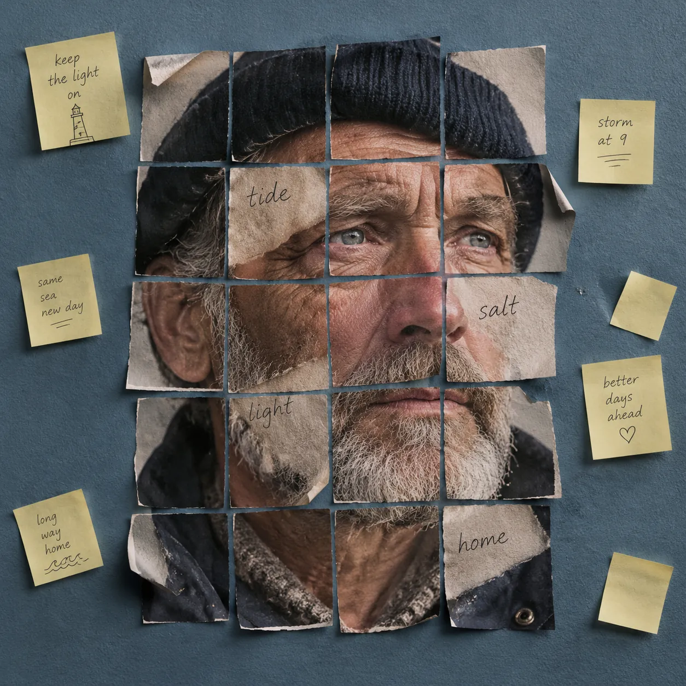</a>

> 创意是把肖像切成粗网格的方形纸片，略微错位地钉在墙上，提示词靠物理细节让它可信：卷起的边缘、翘起的角，以及它们投下的细小阴影。四张纸片上的手写词，加上散落在四周的便利贴，把一张肖像变成了一个故事。我们填入了虚构的退休灯塔看守人和四个词（tide、salt、light、home），石板蓝的墙配浅黄便利贴，形成了忧郁统一的色调。网格要粗（4×5 或 5×6），太细会失去拼贴感。适用于角色海报、纪念作品和书籍封面。

```text
A minimalist cinematic colored poster featuring a a fictional retired lighthouse keeper’s portrait from shoulders to the top of the head. The face is reconstructed using a small number of large, square-cut paper fragments arranged in a simple grid of about 4x5 pieces. Each paper fragment contains a disjointed part of the face which together reconstruct the portrait. The internal paper fragments constituting the face are not perfectly flat; many have slightly curled edges and lifted corners, casting tiny, realistic shadows that give them a three-dimensional, tacked-down appearance. 4 of these squares have subtle black handwritten "tide", "salt", "light", "home" directly on the skin/image. Scattered irregularly around the outer perimeter of this central grid in various randomly placed positions (not confined to the corners), several pale yellow sticky notes are attached to the slate blue wall, containing handwritten short notes such as "keep the light on" and "storm at 9". The overall layout is slightly irregular with visible gaps between the pieces showing slate blue concrete wall background. Realistic paper texture throughout, high-end studio lighting emphasizing the lifted edges, sharp focus on ink and paper grain.
```

- 原作者: [@Arminn_Ai](https://x.com/Arminn_Ai)
- 原帖: https://x.com/Arminn_Ai/status/2019338808009920744
- [在 cinel 上查看详情并一键生成](https://cinel.ai/zh/prompts/p/paper-fragment-portrait-minimal-poster?utm_source=github&utm_medium=awesome&utm_campaign=awesome-gpt-image-2.5-prompts)

### 社交帖子边框破框时尚人像提示词

<a href="https://cinel.ai/zh/prompts/p/social-post-frame-fashion-portrait?utm_source=github&utm_medium=awesome&utm_campaign=awesome-gpt-image-2.5-prompts">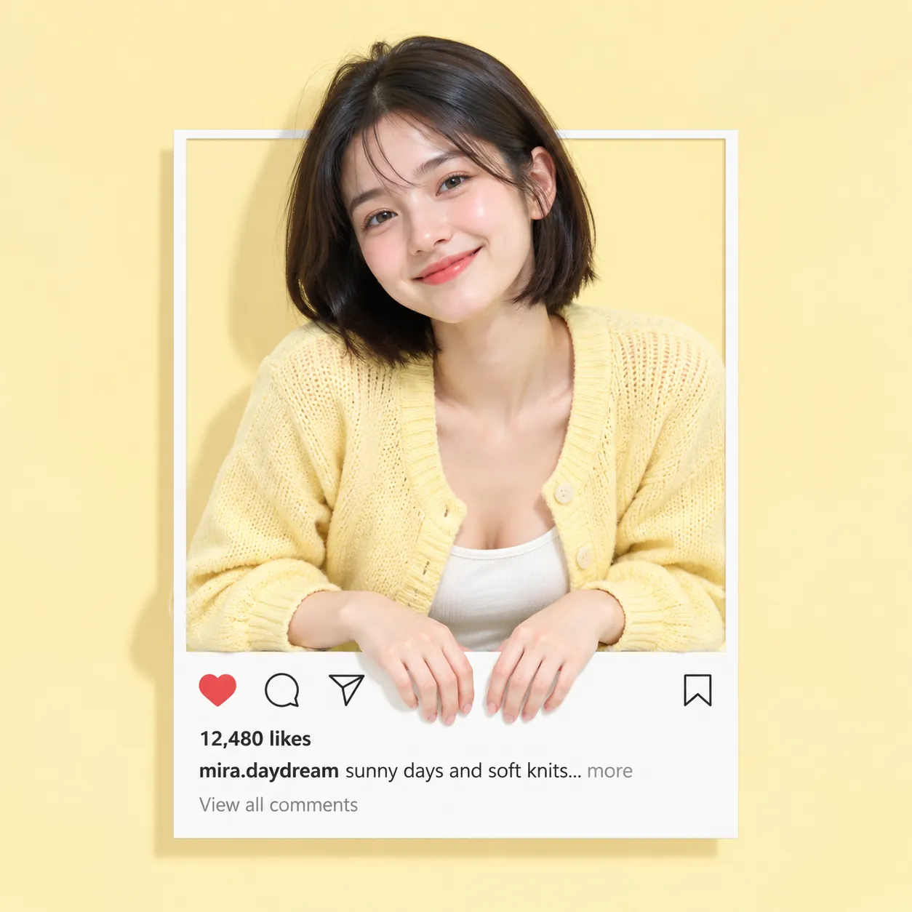</a>

> 一个适合创作者的趣味格式：人物位于白色社交帖子卡片中，加厚的底部面板里有图标、点赞数、用户名和文案，然后人物“破框而出”。提示词提供了几种破框动作（抓住边框、前倾飞吻、手臂搭在底边），你只需选一种——我们保留了“倚靠”。服装、背景色和文案相互关联，整张图保持同一色系。我们的奶油黄版本里，一位深色波波头、笑容灿烂的女性双手搭在边框上，界面文字清晰可读。请使用虚构的账号名；界面是通用样式，不要加上真实平台的 Logo。

```text
A photorealistic fashion upper body shot of a cheerful young woman with a sleek dark bob, laughing softly wearing a butter-yellow cropped cardigan over a white ribbed tank top. The subject is framed inside a central white Instagram-style post border.

Composition & Spacing: The white frame is perfectly centered in the middle of the image, leaving balanced empty soft butter-yellow space above and below the frame to match the theme.

Frame Details: The top, left, and right white borders are very thin. The bottom white section is thicker to include UI elements. The bottom section features a red heart icon, comment bubble, share icon, and bookmark icon.

Text Details: Clearly visible text on the bottom panel: "12,480 likes", username "mira.daydream", caption "sunny days and soft knits... more", and below that, "View all comments".

3D Pop-Out Effect & Hand Pose:
Use ONLY option 3 (Resting) from the list below:
 1. (Grip): head and arms are physically popping out OVER the top and side thin borders. hands are realistically gripping the outer edges of the thin side borders, appearing to hold the frame firmly.
2. (Kiss): Her body is leaning forward towards the camera, creating a strong sense of depth. Her head remains securely framed WITHIN the top thin white border. Only her right hand, raised near her mouth in a blowing-kiss gesture, physically extends forward and breaks OUT of the thin side frame boundary. Her left hand realistically grips the side edge.
3. (Resting): She is looking directly at the camera with a gentle smile. Her head and shoulders physically pop out OVER the top thin white border. Crucially, her hands are realistically resting comfortably on top of the thicker bottom white UI panel, appearing to lean casually on the frame edge.
4. (Dynamic Frame): Her upper body and head remain secure WITHIN the boundaries of the white frame. However, both of her arms are fully extended outward dynamically, breaking past the thin borders up to her elbows, reaching straight toward the camera lens. She forms a distinct “L” shape with both hands, as if framing a scene. Due to perspective, her hands are positioned significantly closer to the camera than her face, showing strong spatial depth.

Subject Dimensionality & Texture: The subject must look like a solid, three-dimensional figure, not flat. Emphasize the detailed texture of the chunky cotton knit, the contours of the face, and realistic hair details. She should have distinct depth separating her from the flat butter yellow background.

Lighting & Shadows: Professional studio lighting creating soft, realistic drop shadows cast by the physical frame and, crucially, by the head, shoulders and hands onto the solid flat butter yellow background, enhancing the dramatic depth and illusion. High definition, commercial photography.
```

- 原作者: [@Arminn_Ai](https://x.com/Arminn_Ai)
- 原帖: https://x.com/Arminn_Ai/status/2016237325639155913
- [在 cinel 上查看详情并一键生成](https://cinel.ai/zh/prompts/p/social-post-frame-fashion-portrait?utm_source=github&utm_medium=awesome&utm_campaign=awesome-gpt-image-2.5-prompts)

### 圆角方块渐变破框产品广告提示词

<a href="https://cinel.ai/zh/prompts/p/rounded-square-graphic-design-ad?utm_source=github&utm_medium=awesome&utm_campaign=awesome-gpt-image-2.5-prompts">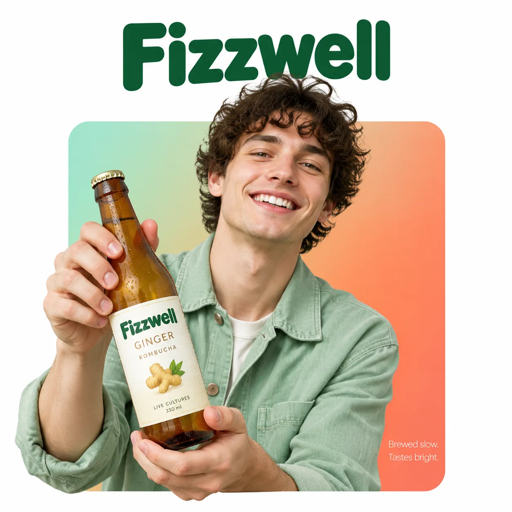</a>

> 这个模板读起来像美术指导的版式规范。一个实心圆角方块填充双色渐变；人物躯干底部与方块下边缘齐平，而头部、双手和产品突破上边和侧边，伸到白色画布上。关键在于它要求人物光线独立于背景，避免渐变色染到皮肤上——这正是这类风格的常见问题。用虚构康普茶品牌 Fizzwell、薄荷绿到珊瑚色的渐变和穿薄荷绿衬衫、笑容灿烂的男生，成品是一张干净、可直接发社媒的广告，只是角落里的标语非常小。复用时换掉两个色值和品牌即可；如果标语重要，就要求放大。

```text
A professional high-end graphic design advertisement composition on a pure solid white canvas. Centered is a perfectly symmetrical, large solid rounded square (not a hollow frame). The entire interior of this square is filled with a smooth, vibrant color gradient fading from mint (#A8E6CF) to coral (#FF8C69).

A young man with curly hair in a mint-green overshirt, grinning is positioned such that the bottom of their torso is perfectly flush and aligned with the very bottom edge of the square, leaving no thick colored border visible beneath them. Crucially, the person and their clothing maintain natural, realistic colors and textures, illuminated by professional studio lighting that is independent of the background gradient (preventing any color cast on their skin or clothes).

They are firmly and realistically gripping a tall amber glass bottle of ginger kombucha. Crucially, the top of their head and hair break the top boundary of the square, partially overlapping the white background. Their hands and the kombucha bottle also break the side boundaries for a powerful 3D breakout effect, extending onto the white canvas.

Typography Layout: At the top, in the white space distinctly above the square with a clear gap, is the bold rounded sans-serif brand text 'Fizzwell' in deep forest green. In the bottom-right corner, layered directly on top of the gradient inside the square, is a block of small, thin, clean white descriptive text: 'Brewed slow. Tastes bright.'.

The lighting is soft, crisp, and commercial, emphasizing the textures of both the subject and the product."
```

- 原作者: [@Arminn_Ai](https://x.com/Arminn_Ai)
- 原帖: https://x.com/Arminn_Ai/status/2024563588602429812
- [在 cinel 上查看详情并一键生成](https://cinel.ai/zh/prompts/p/rounded-square-graphic-design-ad?utm_source=github&utm_medium=awesome&utm_campaign=awesome-gpt-image-2.5-prompts)

### 网点拼贴前卫混合媒介海报提示词

<a href="https://cinel.ai/zh/prompts/p/halftone-avant-garde-collage-poster?utm_source=github&utm_medium=awesome&utm_campaign=awesome-gpt-image-2.5-prompts">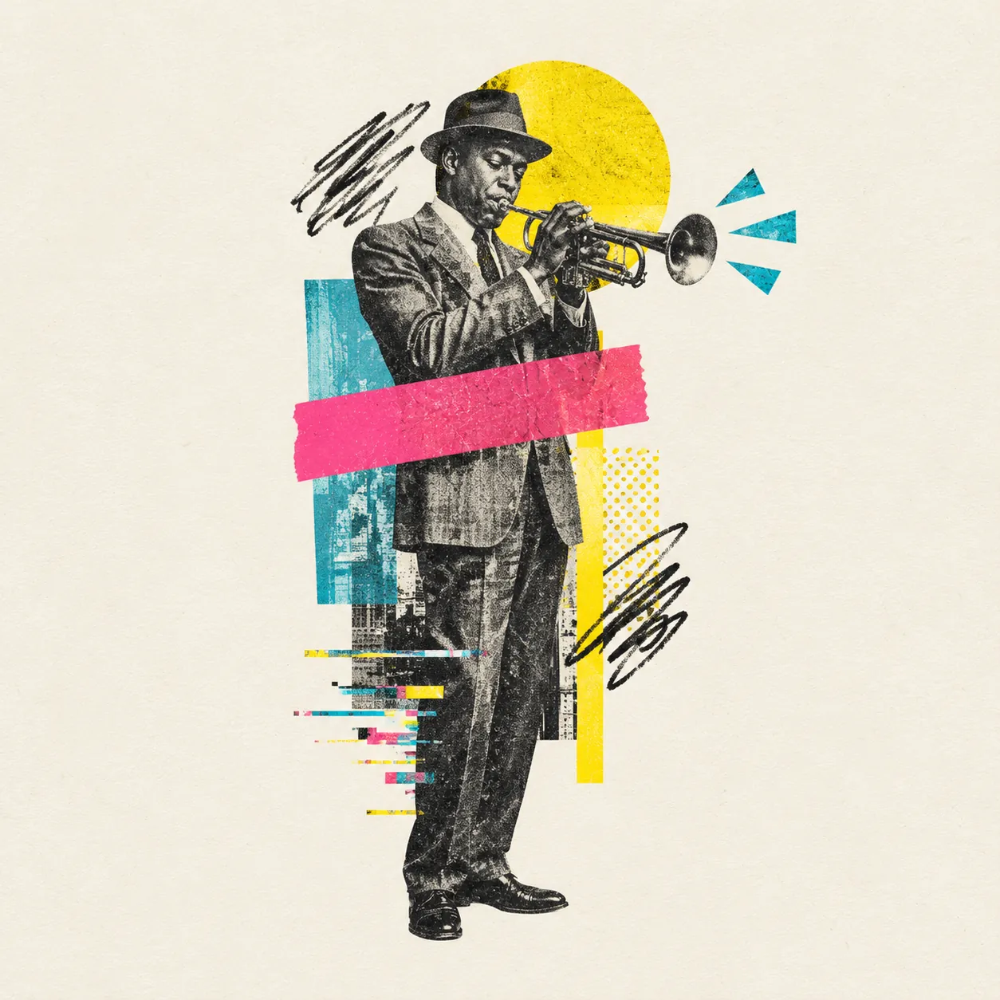</a>

> 这条提示词借用当代杂志插画的语汇，并小心地层层叠加：以黑白点画网点人物为底，再加上青色和黄色的孔版印刷图形、涂鸦线条、数字故障纹理，以及一条横贴在人物身上的粉色或橙色胶带，营造“解构”感。最后几句要求主体居中、四周保留大量奶油色纸张、绝不裁切，让繁复的拼贴显得高级而不杂乱。我们用一位穿复古西装的虚构爵士小号手，成品像一张只差加字的音乐节海报。适用于音乐人、运动员、产品或抽象主题；记得描述姿势，因为它决定了剪影。

```text
A jazz trumpeter in a sharp vintage suit visualized as the central masterpiece of a surreal avant-garde collage, style of modern mixed media editorial illustration. The subject is composed of high-contrast black and white stippled halftone textures blended with vibrant neo-expressionist elements. Overlay details include bold geometric shapes, cyan and yellow risograph patterns, abstract graffiti scribbles, and digital glitch artifacts. A thick strip of pink or orange tape or a color block obscures part of the form for a deconstructed look. The texture is grainy, mimicking vintage poster paper. The composition is strictly centered with a very wide, clean, off-white cream paper background, ensuring the entire subject is fully contained within the frame with generous negative space on all sides, zero cropping, minimal chic aesthetic.
```

- 原作者: [@youraipulse](https://x.com/youraipulse)
- 原帖: https://x.com/youraipulse/status/2008633447095349411
- [在 cinel 上查看详情并一键生成](https://cinel.ai/zh/prompts/p/halftone-avant-garde-collage-poster?utm_source=github&utm_medium=awesome&utm_campaign=awesome-gpt-image-2.5-prompts)

### 3D 金属国家名文字设计提示词

<a href="https://cinel.ai/zh/prompts/p/3d-metallic-country-name-typography?utm_source=github&utm_medium=awesome&utm_campaign=awesome-gpt-image-2.5-prompts">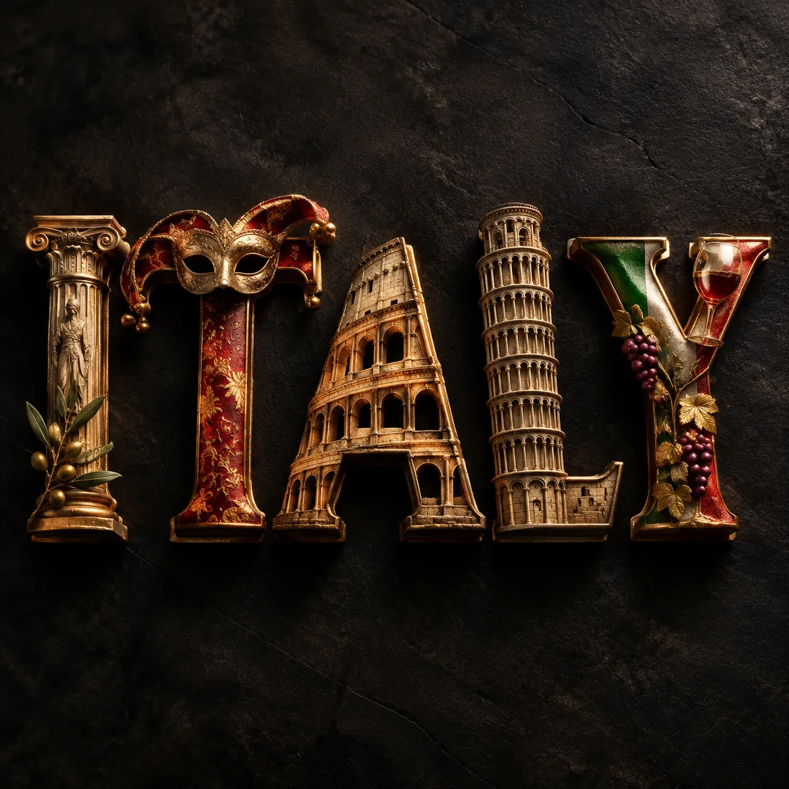</a>

> 国家名的每个字母都变成一件小雕塑：一个融入地标，一个是面具或织物纹样，一个是当地植物或手工艺，全部是带雕刻和轻微磨损的抛光金属。提示词里“每个字母都不重复同一个文化元素”这条规则，让整个单词保持丰富、耐看。我们填了青铜色的 ITALY：字母里分别融入了古典柱式、狂欢节面具、斗兽场、比萨斜塔和带三色点缀的葡萄藤，背景是深色石材。适合旅行内容、世界杯式的国家系列或文旅宣传。发布前请核对符号的文化准确性，尤其是不太熟悉的国家。

```text
A high-quality 3D metallic typography design of the word ITALY, set against a dark, textured background that complements the identity of Italy, creating a cinematic, premium visual tone.

Each individual letter is uniquely designed to represent a distinct cultural element, tradition, landmark, or national symbol from Italy, intelligently adapted to the letter’s shape while maintaining perfect readability.

Cultural elements may include (but are not limited to):
– iconic architecture or monuments
– traditional patterns, textiles, or crafts
– national sports or tools
– folklore, heritage symbols, or historical motifs
– nature elements strongly associated with the country

No two letters repeat the same cultural reference — every letter tells a different cultural story.

The typography features polished metallic material (gold, silver, or bronze), realistic reflections, fine engravings, and subtle surface wear for authenticity.

Dramatic studio lighting with soft rim highlights and deep shadows enhances depth and form.

Ultra-sharp focus, premium 3D render quality, cinematic depth, luxury branding aesthetic, ultra-high resolution.
```

- 原作者: [@aleenaamiir](https://x.com/aleenaamiir)
- 原帖: https://x.com/aleenaamiir/status/2008535456397619240
- [在 cinel 上查看详情并一键生成](https://cinel.ai/zh/prompts/p/3d-metallic-country-name-typography?utm_source=github&utm_medium=awesome&utm_campaign=awesome-gpt-image-2.5-prompts)

### 黑色虚空悬浮产品广告提示词

<a href="https://cinel.ai/zh/prompts/p/floating-product-black-void-ad?utm_source=github&utm_medium=awesome&utm_campaign=awesome-gpt-image-2.5-prompts">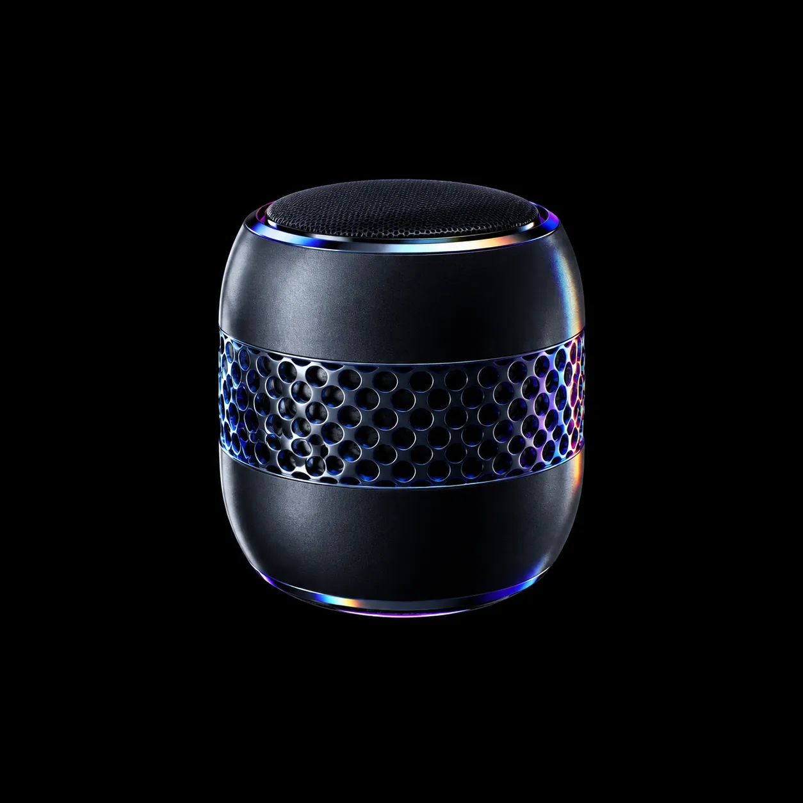</a>

> 一个结构化 JSON 模板，用来做戏剧化的“黑暗中的产品”主图。它最有用的部分是排除清单：不要柔光箱、支架、展台、地面、倒影和文字——这些正是模型最爱添加的影棚痕迹。材质部分把阳极氧化深色金属、高光镜面铬和精密加工的网格纹融合在一起；配色加入靛蓝和酞菁蓝，并在边缘加上薄膜干涉的彩虹高光。我们用了一款无品牌的哑光黑无线音箱：它居中悬浮，带一圈蜂窝格栅和淡淡的棱镜光边。注意原提示词引用了某知名电脑的网格设计作为灵感；如果想避免品牌指向，直接描述纹样即可。

```text
{
  "image_generation_request": {
    "subject_settings": {
      "product_placeholder": "an unbranded minimalist matte-black wireless speaker",
      "positioning": "absolute center, floating, levitating, suspended in mid-air",
      "framing": "full view, no cropping, product must be entirely within frame, generous padding around edges"
    },
    "environment_and_background": {
      "background_color": "#000000",
      "background_type": "pure void, infinite black depth",
      "elements_to_exclude": [
        "lighting boxes",
        "softboxes",
        "stands",
        "pedestals",
        "platforms",
        "text",
        "watermarks",
        "props",
        "surface reflections",
        "studio equipment"
      ]
    },
    "texture_and_material_blending": {
      "primary_finish": "anodized obsidian metal with microscopic grit",
      "secondary_finish": "high-gloss fluid chrome",
      "accent_texture": "Mac Pro inspired precision-machined hemispherical lattice, 3D lattice venting pattern",
      "optical_effects": "monatomic light dispersion, prismatic diffraction on edges, ethereal holographic sheen"
    },
    "lighting_and_color_palette": {
      "key_colors": [
        { "name": "Pure Black", "hex": "#000000" },
        { "name": "Electric Indigo", "hex": "#4B0082" },
        { "name": "Phthalo Blue", "hex": "#000F89" },
        { "name": "Spectral Iridescence", "description": "Thin-film interference rainbow highlights" }
      ],
      "lighting_style": "hard rim lighting, chiaroscuro, high contrast, sharp specular highlights, no ambient fill"
    },
    "negative_constraints": {
      "strict_exclusion": "out of frame, cut off product, blurry edges, tripod, light stand, floor, table, shadows on floor, light flare icons, glowing boxes, copyright text, logo, cluttered background, grey tones, messy geometry"
    },
    "technical_specs": {
      "style": "Hyper-realistic 3D render",
      "engine_hints": "Octane Render, Raytraced, 8k, Unreal Engine 5, Cinematic Lighting"
    }
  }
}
```

- 原作者: [@lloydcreates](https://x.com/lloydcreates)
- 原帖: https://x.com/lloydcreates/status/2026867752376418613
- [在 cinel 上查看详情并一键生成](https://cinel.ai/zh/prompts/p/floating-product-black-void-ad?utm_source=github&utm_medium=awesome&utm_campaign=awesome-gpt-image-2.5-prompts)

### 俏皮未来感品牌视觉手册多页提示词

<a href="https://cinel.ai/zh/prompts/p/playful-brand-kit-multi-page?utm_source=github&utm_medium=awesome&utm_campaign=awesome-gpt-image-2.5-prompts">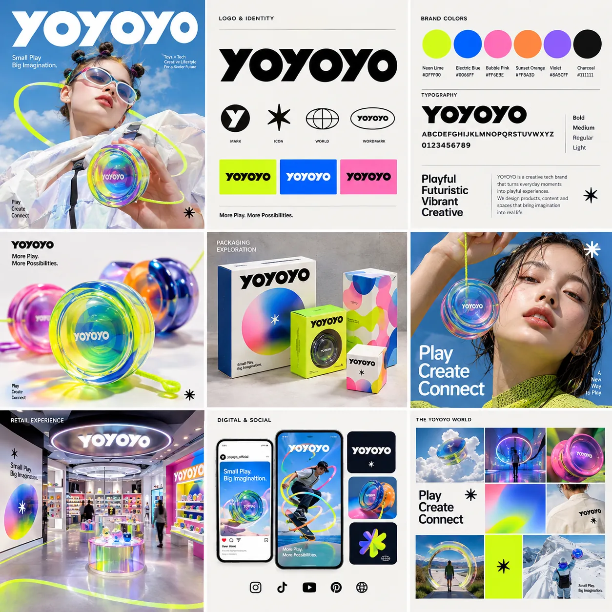</a>

> 这条提示词没有逐项列出交付物，而是描述品牌性格（俏皮、未来感、玩具灵感但高级）以及手册应包含的材料类型：包装、杂志摄影、沉浸式零售、跨平台应用，剩下的交给模型。以 YOYOYO 为名，它给出了一张九格拼版：醒目的字标、图标组、色板和字体样张、半透明彩虹悠悠球产品和包装盒、时尚感人像、霓虹零售空间和手机样机。用来在正式设计冲刺前快速探索视觉方向非常高效。注意其中一格出现了几个真实社交平台的小图标，对外使用前请去掉。

```text
Create a polished multi-page (multiple images) brand kit for a company called YOYOYO. The brand should feel playful, futuristic, vibrant, and design-forward, blending the energy of a toy-inspired product with the sophistication of a premium creative tech brand. Use a bold, experimental visual identity with bright color, clean geometry, modern typography, dynamic motion cues, and slightly surreal imagery. The overall mood should feel inventive, youthful, rhythmic, tactile, and high-concept, with a balance of fun consumer product culture, fashionlike presentation, and contemporary digital design.

Include a sense of product obsession, visual experimentation, packaging exploration, editorial photography, immersive retail, and cross-platform brand application. Make it feel like a confident, contemporary brand world that is both accessible and art-directed, with strong graphic cohesion and a premium creative-studio aesthetic.
```

- 原作者: [@riomadeit](https://x.com/riomadeit)
- 原帖: https://x.com/riomadeit/status/2046682439985082441
- [在 cinel 上查看详情并一键生成](https://cinel.ai/zh/prompts/p/playful-brand-kit-multi-page?utm_source=github&utm_medium=awesome&utm_campaign=awesome-gpt-image-2.5-prompts)

### 小红书九宫格知识海报提示词（睡眠 tips）

<a href="https://cinel.ai/zh/prompts/p/xiaohongshu-nine-grid-poster-zh?utm_source=github&utm_medium=awesome&utm_campaign=awesome-gpt-image-2.5-prompts"></a>

> 很多社交平台偏爱多图卡片，这条中文提示词在一张图里把九张卡一次做完：严格的 3×3 网格、清晰的间隔，可以直接切成九张发布。它写清楚了视觉系统（奶油白、燕麦色、焦糖色，深棕色文字，温柔的轻拟物插画），也给出了每一格的具体文案：封面“让你倒头就睡的 8 个 tips”，之后每格一条，从睡前放下手机到“吸 4 停 4 呼 6”的呼吸法。我们的成品非常贴合要求，中文标题清晰可读，配图道具也对得上（手机、台灯、带禁止符号的咖啡、笔记本、时钟）。换成你自己的主题文案，保留排版规则即可。

```text
生成一张适合小红书发布的 3:4 竖版九宫格海报，整体为 3列 × 3行 排版，九个宫格边界清晰，方便后期直接切割成 9 张单图发布。整体风格干净、高级、统一，适合女性向健康生活方式内容，具有小红书爆款封面气质。画面要求 信息排版清晰、文字大、可读性强、留白舒服、配色温柔治愈。

整体视觉风格：
奶油白、浅米色、淡燕麦色、浅焦糖色为主色调，搭配少量深棕色文字，ins风、治愈感、睡眠疗愈主题，简约排版，轻拟物插画点缀，可加入枕头、月亮、星星、热牛奶、香薰、书本、眼罩、窗帘、床铺等元素。整体像专业新媒体设计图，字体工整，适合做知识科普类小红书九宫格。
排版要求：

整张图必须是标准九宫格构图，切分后每一格都能独立成图

每个宫格内容完整居中，不要把标题或正文压在分割线附近
每个格子之间保留明显间隔或细边框，保证裁切后不影响阅读
所有文字使用中文，清晰易读，不要乱码，不要英文
每个宫格都像独立的小红书图文卡片，但视觉风格保持统一
画面精致、真实、自然，不要廉价营销感，不要过度花哨
九宫格具体内容：

第1格（封面）
大标题：让你倒头就睡的8个 tips
副标题：失眠党、熬夜党一定要收藏
封面视觉最吸睛，适合做首图，加入柔软床铺、月亮、枕头、眼罩等治愈睡眠元素，标题突出，排版高级。

第2格
标题：1. 睡前1小时别玩手机
正文：蓝光会让大脑更清醒，越刷越睡不着。
配图元素：手机、月亮、困倦表情的小插画
第3格
标题：2. 睡前把灯光调暗
正文：暖光环境能帮助身体进入“准备睡觉”的状态。
配图元素：床头灯、暖黄色灯光、窗帘
第4格
标题：3. 房间温度别太高
正文：稍微凉一点，更容易快速入睡。
配图元素：空调、温度计、被子
第5格
标题：4. 晚上别喝浓茶咖啡
正文：咖啡因会延迟困意，让你躺很久还睡不着。
配图元素：咖啡杯、茶杯、禁止符号

第6格
标题：5. 睡前洗个热水澡
正文：能让身体放松下来，入睡速度更快。
配图元素：浴室蒸汽、毛巾、热水
第7格
标题：6. 脑子停不下来就写下来
正文：把烦心事和待办清单写下，大脑会更容易放松。
配图元素：笔记本、钢笔、小台灯
第8格
标题：7. 固定上床时间
正文：每天差不多时间睡，生物钟会越来越稳定。
配图元素：时钟、月亮、床
第9格
标题：8. 试试深呼吸放松法
正文：吸气4秒，停4秒，呼气6秒，慢慢就有困意了。
底部小字：收藏这组，今晚试试看
配图元素：呼吸线条、闭眼人物、星星

画质要求：
高清，高级排版，杂志感，真实可发布，新媒体运营审美，小红书爆款图文风格，文字布局规整，适合直接切图。
```

- 原作者: [@austinit](https://x.com/austinit)
- 原帖: https://x.com/austinit/status/2046037688969769346
- [在 cinel 上查看详情并一键生成](https://cinel.ai/zh/prompts/p/xiaohongshu-nine-grid-poster-zh?utm_source=github&utm_medium=awesome&utm_campaign=awesome-gpt-image-2.5-prompts)

### 图像小说风双眼横条电影海报提示词

<a href="https://cinel.ai/zh/prompts/p/eyes-strip-cinematic-poster?utm_source=github&utm_medium=awesome&utm_campaign=awesome-gpt-image-2.5-prompts">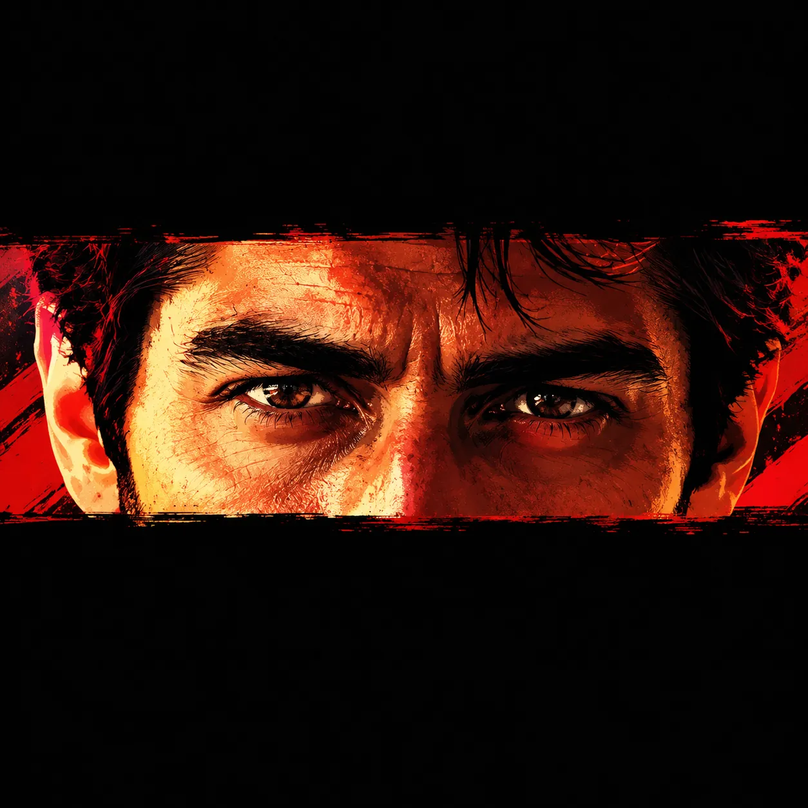</a>

> 一个经典的惊悚片海报手法：只保留横穿双眼的一条窄带，其余全部填黑。提示词加上了图像小说式的红、橙、黑渲染、硬朗的阴影和粗粝质感，附图只作为眼睛参考。我们提供了一位三十五岁左右的虚构男性参考图；成品是凶狠、坚定的凝视，眉头紧锁，头发凌乱，用漫画式排线绘制，背后泛着红光。上下的黑色留白正是关键，那是放标题和演职员信息的位置。适合电影节海报、游戏主视觉或播客封面。

```text
A cinematic poster-style artwork featuring an intense close-up of a man’s eyes centered horizontally across the frame. Only the eyes and part of the face are visible through a narrow horizontal strip, surrounded by deep black negative space above and below. The face is illustrated in a high-contrast, graphic-novel style with bold red, black, and orange tones, dramatic shadows, sharp highlights, and a gritty, intense mood.
The eyes look fierce, emotional, and determined, with slightly messy hair. Use the provided image for eye reference
```

- 原作者: [@Abhiew_](https://x.com/Abhiew_)
- 原帖: https://x.com/Abhiew_/status/2017259594419228875
- [在 cinel 上查看详情并一键生成](https://cinel.ai/zh/prompts/p/eyes-strip-cinematic-poster?utm_source=github&utm_medium=awesome&utm_campaign=awesome-gpt-image-2.5-prompts)

### 巨型网球拍运动时尚广告提示词

<a href="https://cinel.ai/zh/prompts/p/giant-tennis-racket-fashion-ad?utm_source=github&utm_medium=awesome&utm_campaign=awesome-gpt-image-2.5-prompts">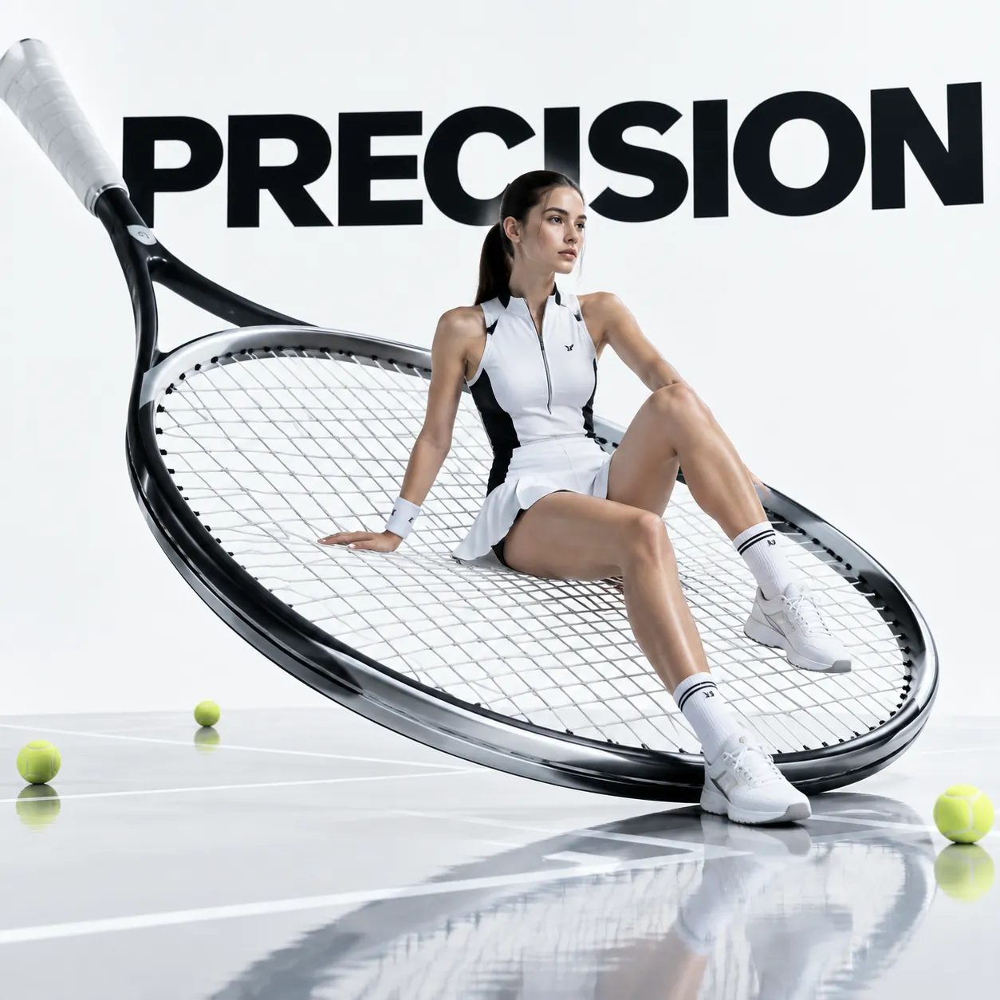</a>

> 这条提示词短而有效，用“尺度”做创意：一支放大到纪念碑尺寸的网球拍变成了躺椅，一位女运动员像坐吊床一样随意坐在拍弦上。她身后是一个巨大的粗体单词 PRECISION（精准），白色影棚配球场般的反光地面，一切干净利落。我们的成品是一张干净、可直接用于广告的方图：运动员穿白色拉链网球裙，向后靠在拍弦上，光亮的地面上散落着网球，单词在顶部被戏剧化地裁切。把球拍换成巨型高尔夫球杆、滑板或芭蕾舞鞋，把单词换成你的广告主题即可。

```text
Avant-garde sports fashion advertisement, oversized tennis racket positioned like monumental sculpture, female athlete seated casually on the strings as if a suspended lounge, giant word “PRECISION” in bold typography behind, crisp white studio backdrop, reflective court-like floor, luxury sportswear editorial aesthetic, cinematic lighting, ultra-clean composition, 1:1
```

- 原作者: [@aronhouyu](https://x.com/aronhouyu)
- 原帖: https://x.com/aronhouyu/status/2047989228274118901
- [在 cinel 上查看详情并一键生成](https://cinel.ai/zh/prompts/p/giant-tennis-racket-fashion-ad?utm_source=github&utm_medium=awesome&utm_campaign=awesome-gpt-image-2.5-prompts)

### 日系爆款虚构广告 2×2 拼图（日文）提示词

<a href="https://cinel.ai/zh/prompts/p/fictional-ads-2x2-grid-ja?utm_source=github&utm_medium=awesome&utm_campaign=awesome-gpt-image-2.5-prompts">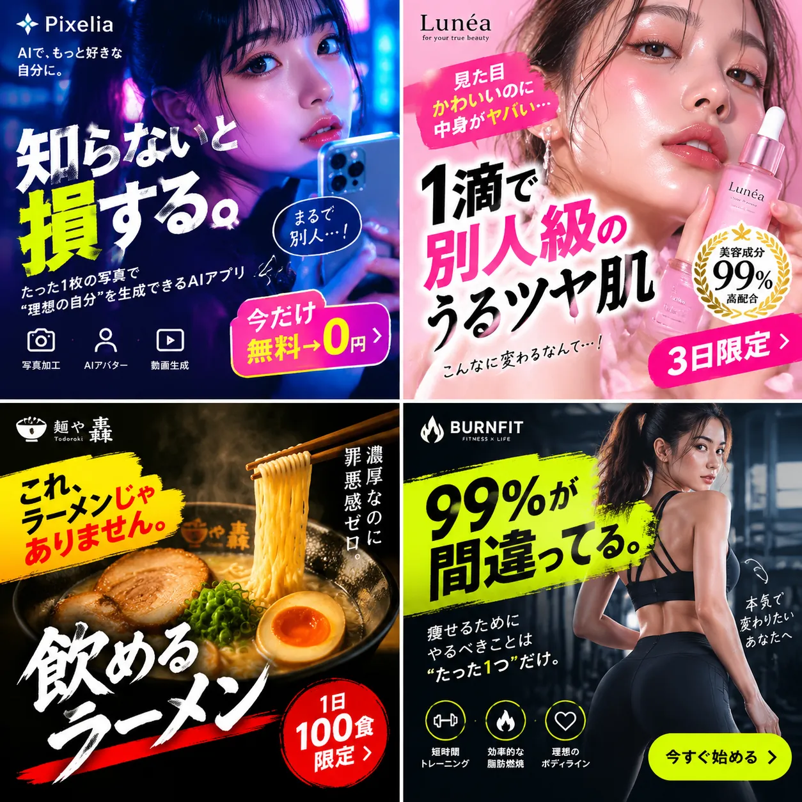</a>

> 这条日文提示词就是一份迷你创意简报，专为让人停止滑动的社交广告而写。它要求在 2×2 网格中放四个虚构品牌（AI 应用、美妆产品、餐饮、健身），然后把信息流广告的套路都写死：震惊式标题、黑底霓虹的鲜艳配色、超大字号、箭头和对话气泡，以及“现在免费”“仅限三天”之类的行动号召。它甚至每次随机抽取一个“禁忌词”、一个反差点和一个稀缺性钩子。我们的成品读起来就像真实的日本广告信息流：霓虹风 AI 应用广告、带 99% 徽章的粉色护肤广告、“这不是拉面”的面食广告，以及宣称“99% 的人都做错了”的健身广告。

```text
日本語の架空広告をテーマに、SNSでバズることを目的としたインパクトの強いビジュアルを作成してください。 1:1の正方形キャンバスに、4種類の広告を「2×2グリッド」で配置してください。 

ジャンル： ①テック（AI・アプリ） ②美容・コスメ ③飲食 ④フィットネス すべて日本語コピー入り・架空ブランドで作成。 

【バズるための演出要件】 
・一瞬で目を引く強烈なキャッチコピー
 ・感情を動かす要素（驚き・共感・焦り・欲望） 
・コントラストの強い配色（ネオン、ビビッドカラー、黒×蛍光など）
 ・大胆なレイアウト（はみ出し・斜め配置・大きすぎる文字） 
・サムネ映えする構図（中央強調・顔アップ・視線誘導）
 ・SNS広告っぽい“あざとさ”（矢印・強調枠・吹き出し） 

【デザインスタイル】 
・2025年トレンドのSNS広告風
・TikTok / Instagram広告風 
・視認性最優先（スマホで見ても読める） 
・写真風 or 高品質イラスト 
・CTA入り（例：今だけ無料・限定・残り3日など） 

【ランダムバズ要素】 
以下の①〜③から、それぞれ1つずつランダムに選び、必ずキャッチコピーに反映すること。
 ①禁断ワード系（いずれか1つ） 
・知らないと損 
・99%が間違ってる 
・今すぐやめて 
②ギャップ演出（いずれか1つ） 
・見た目かわいいのに中身がヤバい 
・普通に見えて実は… 
・これ、○○じゃありません
③数字・限定（いずれか1つ）
・3日限定 
・残り1枠 
・無料→0円 

【重要】 
・4つそれぞれ明確に違う雰囲気にする 
・グリッドは崩さない 
・文字は読みやすく配置する 
・“スクロールを止める違和感”を意図的に入れる 

出力：4広告が1枚にまとまった高インパクトビジュアル
```

- 原作者: [@akiramenaiwoman](https://x.com/akiramenaiwoman)
- 原帖: https://x.com/akiramenaiwoman/status/2046460259817210284
- [在 cinel 上查看详情并一键生成](https://cinel.ai/zh/prompts/p/fictional-ads-2x2-grid-ja?utm_source=github&utm_medium=awesome&utm_campaign=awesome-gpt-image-2.5-prompts)

### 照片+蜡笔涂鸦杂志海报（日文）提示词

<a href="https://cinel.ai/zh/prompts/p/photo-crayon-editorial-poster-ja?utm_source=github&utm_medium=awesome&utm_campaign=awesome-gpt-image-2.5-prompts">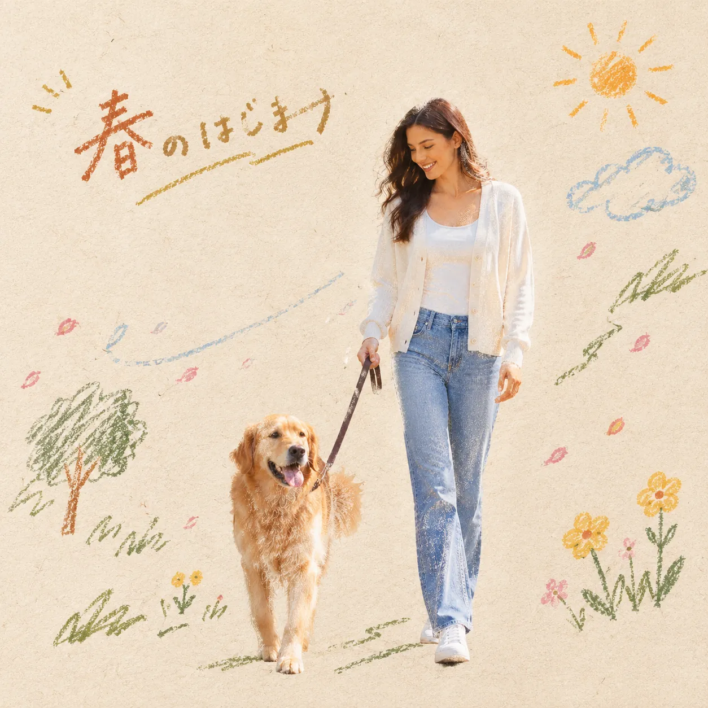</a>

> 这个日文模板把真实照片和油画棒涂鸦融合在一起。你只需填三个字段（主题、照片内容、标题），它就会把抠出的人物放在有颗粒感的牛皮纸背景上，留白至少 50%，再在人物周围叠加粗糙、孩子气的蜡笔画：与主题呼应的风线、花朵、太阳和云朵，以及一个用大地色手写的小标题。示例中我们用了一张女性在公园遛金毛的参考图，主题“春日散步”，标题“春のはじまり”（春天的开始）。成品温柔可爱：她周围是蜡笔画的树、郁金香和太阳，左上角是赤陶色的标题。

```text
【テーマ】
春のおさんぽ

【写真】
公園で犬と散歩する女性
（例：公園で遊ぶ子ども / 親子の笑顔 / 走る子ども など）

【タイトル】
春のはじまり
（例：こどもの日 / Happy Mother's Day / 春のはじまり など）

---

テーマ「春のおさんぽ」に基づいた、
写真とクレヨンイラストを融合したライフスタイル系エディトリアルビジュアル。

提供された写真をメインビジュアルとして使用する。

■ シーン
「公園で犬と散歩する女性」に合った自然な日常の瞬間。
作り込みすぎないリアルな空気感、やわらかい自然光、
人物の自然な動きや感情を重視。

■ 構図
人物を切り抜いたように配置し、
ざらっとした紙質のクラフト系背景
（生成り、ベージュ、淡いグレー、ミルクティー）の上にレイアウト。

・余白50%以上
・左右非対称構図
・抜け感のあるミニマルなエディトリアルデザイン

■ イラスト（最重要）
オイルパステル／クレヨンで描いたような、
ざらつきとかすれのある手描きイラストを重ねる。

▼ルール
・全体の30〜40%以内
・線にムラとかすれ、紙のテクスチャが残る
・力の入り具合で濃淡が変化（濃い部分・薄い部分が混在）
・子どもが描いたような少し不器用なタッチ
・影・立体表現は禁止（フラット）
・人物の動きと連動させる（風・軌跡・流れ）

▼モチーフ（テーマ連動）
・春のおさんぽを象徴する要素をクレヨンタッチで追加
（例：こどもの日 → 鯉のぼり、風、空、草、雲、紙かぶと）
・風の線、動きの線、小さなアイコン、太陽、雲、お花、ハート、星、ジグザグの動線
・空気感をクレヨンの粗いストロークで演出

■ タイトル文字（重要）
画像内に「春のはじまり」を手描きクレヨン文字で配置する。
・配置は左上または右上の余白部分
・クレヨンで書いたようなざらつき・かすれのある文字
・少し不器用で味のある手書き風
・文字色はアースカラー（テラコッタ、マスタード、ダークブラウン）から選択
・サイズは控えめでミニマルに（主役は写真）
・装飾枠なし、フラット

■ 色
あたたかみのあるアースカラー、
やわらかいくすみカラー
（テラコッタ、マスタード、オリーブ、ミルクティー、淡いブルー）

■ 雰囲気
あたたかい、ノスタルジック、こども心、ハンドメイド感、
やさしい、エモーショナル、ストーリー性のある日常

■ スタイル
絵本的ぬくもり × 北欧ミニマル × 上質なライフスタイル広告

■ 品質
高解像度、商用レベルのクオリティ
```

- 原作者: [@konmari_tweet](https://x.com/konmari_tweet)
- 原帖: https://x.com/konmari_tweet/status/2048714101850071422
- [在 cinel 上查看详情并一键生成](https://cinel.ai/zh/prompts/p/photo-crayon-editorial-poster-ja?utm_source=github&utm_medium=awesome&utm_campaign=awesome-gpt-image-2.5-prompts)

### Y2K 原宿风贴纸徽章 Logo 提示词

<a href="https://cinel.ai/zh/prompts/p/y2k-harajuku-badge-logo?utm_source=github&utm_medium=awesome&utm_campaign=awesome-gpt-image-2.5-prompts">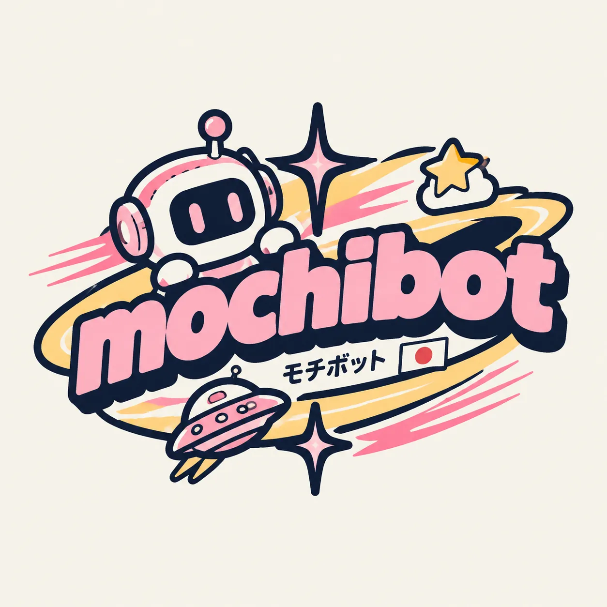</a>

> 一份让模型扮演资深矢量设计师的长篇设计简报。它先让模型“解析”品牌形象（马卡龙主色、暖色强调色、深色描边色、片假名拼写、造型语言、小型文化符号），再围绕粗体小写字母搭建一枚扁平四色贴纸徽章：字母带向右下的厚重立体偏移，加上速度线、四角星闪光和小插画。我们用的是虚构名称 MOCHIBOT。成品是一枚粉色和奶油色的可爱徽章：圆润字体的“mochibot”、片假名“モチボット”、一个小机器人头、一架飞碟和一朵顶着星星的云。简报还要求加入品牌所属国的国旗，所以片假名旁出现了一面小日本国旗。

```text
MOCHIBOT

Act as a Senior Vector Graphic Designer specializing in Y2K Japanese streetwear badge design. Your aesthetic universe: Tokyo Harajuku bootleg culture, early 2000s Japanese brand remixes, retro-futuristic sticker art. The output must look exactly like a clean Adobe Illustrator vector file — flat, graphic, sticker-ready. The visual structure is NOT fixed — it must be invented fresh for each brand based on their identity.

BRAND INTELLIGENCE SYSTEM

Before executing, resolve all of the following and use them to drive every design decision: (1) PRIMARY COLOR — MOCHIBOT's main brand color converted into a pastel or softened Y2K version — still recognizable as the brand but lighter and more kawaii, (2) ACCENT COLOR — MOCHIBOT's secondary color pushed to warm saturation — the energetic pop color of the composition, (3) DARK COLOR — a deep dark version of the brand palette — navy, dark brown, deep green, near-black — used for all outlines and extrusions, (4) LETTER CONTENT — MOCHIBOT's name in bold lowercase or the most iconic abbreviation, (5) JAPANESE TRANSLITERATION — correct katakana of MOCHIBOT as a small secondary text element, (6) BRAND ORIGIN FLAG — MOCHIBOT's country of origin national flag as a small flat element, (7) BRAND SHAPE LANGUAGE — identify the most iconic geometric or graphic forms from MOCHIBOT's visual identity — the shapes, curves, symbols, and structural elements unique to this brand. These shapes become the orbital, background, and decorative elements of the badge — replacing generic ovals with brand-specific geometry, (8) BRAND CULTURAL SYMBOLS — identify 1–2 small iconic objects or symbols from MOCHIBOT's world that can be rendered as tiny flat illustrations within the badge — not the logo itself but objects associated with the brand's universe, (9) COMPOSITION LOGIC — based on all resolved parameters above, autonomously design the structural layout of the badge. The structure must feel like it was invented specifically for MOCHIBOT — not copied from a template. Ask: what shapes from this brand's identity could orbit the letters? What geometry feels native to this brand? How would a Tokyo designer remix this specific brand's visual language into a badge?

PHASE 1: CANVAS

1:1 square canvas. Background: flat off-white or warm light grey. Completely empty. No texture. No gradient.

PHASE 2: BADGE STRUCTURE — FULLY AUTONOMOUS

Using the BRAND SHAPE LANGUAGE and COMPOSITION LOGIC resolved above, design the complete badge structure. The only fixed rules are: the badge must have a central lettering element, surrounding geometric shapes that interact with the letters through z-layer stacking, at least one element that passes both behind and in front of the letters creating depth, and the overall silhouette must read as a unified badge or patch shape. Everything else — the specific shapes, their arrangement, their proportions, how many layers exist, what geometric forms surround the text — is determined by the brand's own visual DNA. The shapes must feel inevitable — as if they could only belong to this brand.

PHASE 3: LETTERING

MOCHIBOT in large bold lowercase — wide, rounded, confident display typeface. Flat PRIMARY COLOR fill. Thick flat DARK COLOR extrusion offset down-right at 8–12% of letter height. Bold DARK COLOR outline. No gradients. No rendering. The letters are the anchor of the entire composition.

PHASE 4: Y2K SIGNATURE ELEMENTS

These elements appear in every execution — they are the Y2K Japanese badge DNA: SPEED LINES or MOTION TEXTURE — somewhere within the background shapes, parallel lines or radial lines in ACCENT COLOR creating energy and movement. 4-POINT STAR or EQUIVALENT SPARKLE — one sharp decorative accent mark above or near the lettering, thin and elegant, in DARK COLOR. JAPANESE KATAKANA — small correct transliteration of MOCHIBOT tucked into the composition in DARK COLOR. SMALL EMBLEM — a tiny flat star-and-cloud emblem placed naturally within the composition. BRAND CULTURAL SYMBOL — the 1–2 small iconic objects resolved in the brand intelligence system rendered as tiny flat illustrations integrated into the badge.

TECH SPECS

Flat vector only — zero gradients, zero effects, zero rendering, zero blur. Clean crisp edges throughout. Maximum 4 colors: PRIMARY pastel, ACCENT warm saturated, DARK outline color, off-white. The badge must feel like a collectible sticker or embroidered patch. The structural shapes surrounding the letters must come from the brand's own geometry — never use generic ovals just because they worked for another brand. Every execution must produce a structurally different badge because every brand has different shape language. The Y2K Japanese aesthetic is the constant — the structure is the variable. Mood: a Tokyo designer who loves MOCHIBOT stayed up all night remixing their identity into the most obsessive fan badge ever made.
```

- 原作者: [@youraipulse](https://x.com/youraipulse)
- 原帖: https://x.com/youraipulse/status/2040769988466733167
- [在 cinel 上查看详情并一键生成](https://cinel.ai/zh/prompts/p/y2k-harajuku-badge-logo?utm_source=github&utm_medium=awesome&utm_campaign=awesome-gpt-image-2.5-prompts)

### 星空星座占星 Logo（午夜蓝与金）提示词

<a href="https://cinel.ai/zh/prompts/p/celestial-zodiac-logo-design?utm_source=github&utm_medium=awesome&utm_campaign=awesome-gpt-image-2.5-prompts">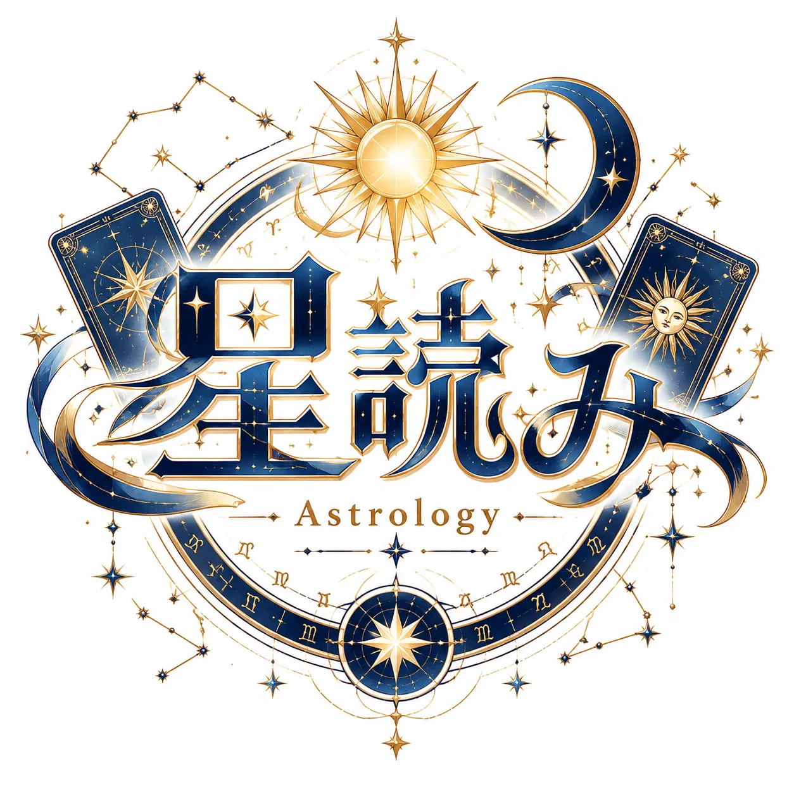</a>

> 一个可复用的 YAML 预设，用来做神秘学频道的 Logo。上半部分固定风格（午夜蓝与闪耀金、细腻的多层描边、星光、编织进文字里的星座线），下面一小段“用户输入”可以改标题、副标题、主题元素和装饰。默认内容是“星読み”（读星），副标题 Astrology，装饰为星座线、塔罗牌边框、新月、放射太阳和魔法阵。我们的成品华丽而均衡：藏青配金色的标题位于黄道环中，两侧是两张塔罗牌，上方是太阳和新月，白底便于抠图。适合虚拟主播和占星账号。

```text
style_preset: "Zodiac Astrology VTuber Logo Aesthetics (Celestial Ver.)"
global_settings:
  vibe: "Mystical, celestial, cosmic wisdom, divination, stargazing"
  background: "Pure white background (for isolation)"
  rendering:
    - "Elegant, celestial vector-style finish"
    - "Deep midnight blue and shining gold palette"
    - "Thin elegant layered outlines with star accents"
    - "Glowing star effects and celestial glow"
drawing_rules:
  line_quality: "Thin, elegant curves with constellation line art accents."
  character_design:
    - "Integrated constellation and tarot motifs woven into the letters"
    - "Custom stylized font: elegant, celestial shapes with star dot accents"
  typography_style:
    - "Main Title: Large, stylized Japanese with constellation dot patterns"
    - "Subtitle: Smaller English text in an elegant celestial font"
  ornament_rule:
    - "Strictly follow the 'ornaments_selection' provided in the USER INPUT SECTION"
    - "Distribute ornaments to create a 'celestial reading' visual impact"
visual_parameters:
  color_palette:
    primary: "Deep midnight blue and shining gold gradient"
    secondary: "Thin gold inner border + Midnight blue outer stroke"
    accents: "Constellation lines, zodiac symbols, and star glow"

# ----------------------------------------------------------
# USER INPUT SECTION (下記を自由に編集してね)
# ----------------------------------------------------------
request:
  input_text: "星読み" # ← ここを好きな名前に変更
  subtitle: "Astrology" # ← 小さく表示したい文字
  motif_concept: "星座図とタロットカード" # ← ここを好きな動物やモノに変更

  custom_colors: "ミッドナイトブルーとシャイニングゴールド" # ← 好きな色を指定

  ornaments_selection:
    - "星座線 (Zodiac constellation lines)"
    - "タロットカード (Tarot card borders)"
    - "三日月 (Crescent moon)"
    - "太陽 (Radiant sun)"
    - "魔法陣 (Mystical magic circle)"
```

- 原作者: [@midori_tatsuta](https://x.com/midori_tatsuta)
- 原帖: https://x.com/midori_tatsuta/status/2039682237751509053
- [在 cinel 上查看详情并一键生成](https://cinel.ai/zh/prompts/p/celestial-zodiac-logo-design?utm_source=github&utm_medium=awesome&utm_campaign=awesome-gpt-image-2.5-prompts)

### 人物剪影史诗叙事海报（红楼梦）提示词

<a href="https://cinel.ai/zh/prompts/p/silhouette-epic-story-poster-zh?utm_source=github&utm_medium=awesome&utm_campaign=awesome-gpt-image-2.5-prompts">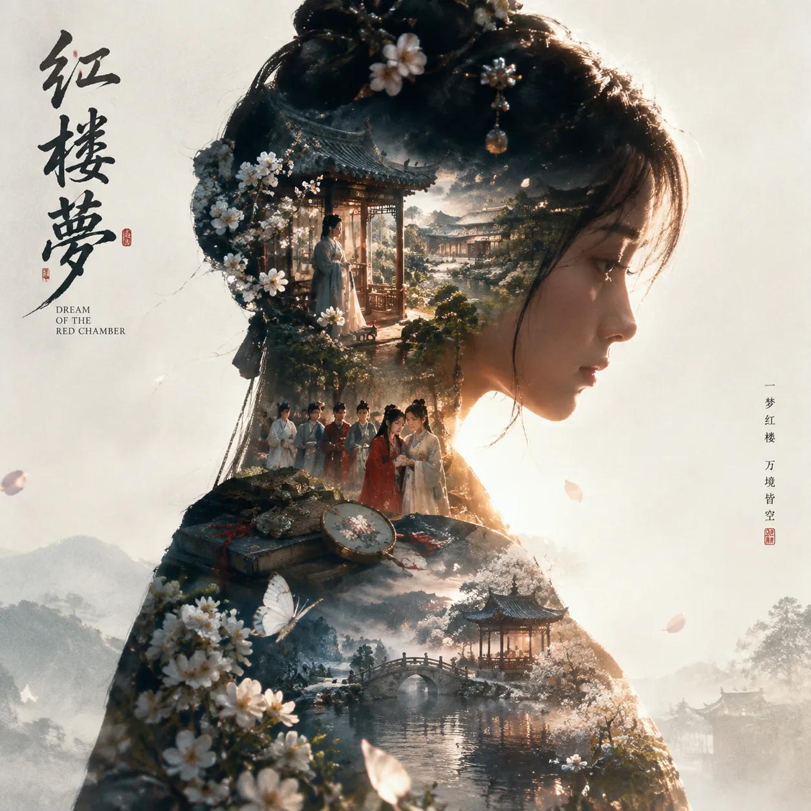</a>

> 一个“一张剪影装下整个故事”的中文海报模板。你填入一部作品和一个角色，提示词就会在巨大优雅的侧脸剪影中填满这个故事的世界（标志性场景、角色关系、建筑、符号、道具），配合电影级侧逆光、体积光与轻雾、真实材质和大面积留白，追求安静、宿命感强的东方电影氛围。示例中我们选了《红楼梦》和林黛玉。成品很有冲击力：她的侧脸剪影里化开亭台楼阁、花枝、湖水和书中的小人物，左上角是竖排的书名书法。适用于任何小说、神话或电影。

```text
根据《红楼梦》自动生成一张 收藏版史诗叙事海报，

巨大优雅的林黛玉人物侧脸剪影作为外轮廓，剪影内部自动生长出最契合该主题的完整世界观、标志性场景、角色关系、象征符号、关键建筑、生物、道具与氛围。

整体不是普通拼贴，而是高级的剪影轮廓填充式叙事合成，带有双重曝光式联想，但强化为电影级叙事表达与空间调度。

电影海报风格 + 东方现实主义美学融合，强调真实物理光影、镜头语言、空间纵深与叙事层级。

光影采用电影级侧逆光与局部暖光点缀，冷暖对比克制真实，加入体积光与轻雾增强空间感。

材质表现为真实质感（建筑、丝绸、肌肤、石材），避免纯绘画笔触感，

保留柔和空气透视，但优化为电影级景深与焦点控制。

轻微胶片颗粒，边缘飞白与刷痕改为电影式柔和融合过渡，

大面积留白，版式克制高级，安静、宏大、克制、宿命感强的东方电影叙事。

所有元素必须强绑定主题，一眼识别，不要杂乱，不要硬拼贴，不要模板化背景，不要廉价奇幻素材。
```

- 原作者: [@liyue_ai](https://x.com/liyue_ai)
- 原帖: https://x.com/liyue_ai/status/2047305151342596557
- [在 cinel 上查看详情并一键生成](https://cinel.ai/zh/prompts/p/silhouette-epic-story-poster-zh?utm_source=github&utm_medium=awesome&utm_campaign=awesome-gpt-image-2.5-prompts)

### 撕破街头海报中显露的 Logo 提示词

<a href="https://cinel.ai/zh/prompts/p/logo-revealed-torn-posters-wall?utm_source=github&utm_medium=awesome&utm_campaign=awesome-gpt-image-2.5-prompts">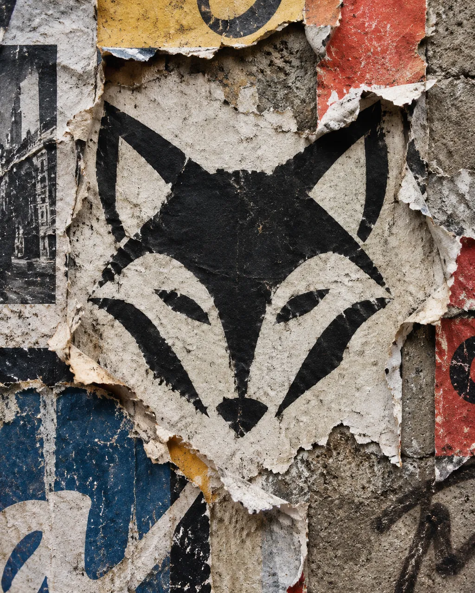</a>

> 一个有触感、有街头说服力的 Logo 样机。提示词不是把 Logo 印在墙上，而是让它的轮廓从多年撕扯的海报中显露出来：层层叠叠的纸张有纤维状的撕裂边缘、卷边、胶痕、褪色和污渍，下面露出粗糙的灰泥墙，日光在每道撕口里投下小小的阴影。物理部分（湿气让边缘卷起、胶水还粘着一部分）让效果格外可信。我们的参考图是一个简单的黑色几何狐狸头标志，成品中狐狸从米色纸张里浮现，周围是褪色的红、蓝和印刷碎片。适合品牌揭幕、专辑封面或潮牌宣传。简洁、粗犷的 Logo 效果最好。

```text
Transform the uploaded logo into a realistic urban wall scene where the logo silhouette is revealed through layers of torn posters. The logo must keep its exact shape and proportions, appearing as if multiple posters have been ripped away over time, exposing the shape naturally within the layered paper textures.

Material details:
Multiple overlapping poster layers with different colors, prints, and paper types.
Ripped edges with fibrous texture, curls, and torn fragments.
Aged paper with fading, stains, glue residue, and slight peeling.
Some areas showing older layers beneath, creating depth.

Physics behavior:
Paper tearing should look natural — irregular edges, varying thickness, partial detachment.
Edges curling outward due to humidity and time.
Glue holding some sections while others peel away.
Layer separation revealing deeper textures gradually.

Surface interaction:
Rough concrete or plaster wall beneath the posters.
Glue marks and residue where posters were attached.
Cracks, dirt, and weathering visible on exposed wall areas.

Environment:
Urban street setting - alley wall or city corner.
Hints of surrounding posters, graffiti, or wear.
No overly clean or staged look.

Lighting:
Natural daylight or soft urban lighting.
Shadows inside torn layers creating depth.
Subtle highlights on curled paper edges.

Atmosphere:
Raw.
Layered.
Time-worn.
Authentic street texture.

Camera & composition:
Straight-on or slightly angled close-up view.
Logo clearly visible through torn layers.
Depth emphasized through overlapping paper textures.

Format:
Aspect ratio: STRICT 4:5 vertical.
No text overlays.

Style:
Hyper-real urban surface photography.
Physically accurate material aging and layering.
```

- 原作者: [@Goodmanprotocol](https://x.com/Goodmanprotocol)
- 原帖: https://x.com/Goodmanprotocol/status/2044599335221104970
- [在 cinel 上查看详情并一键生成](https://cinel.ai/zh/prompts/p/logo-revealed-torn-posters-wall?utm_source=github&utm_medium=awesome&utm_campaign=awesome-gpt-image-2.5-prompts)

### 躺拍“关注我”宣传合成图（两张参考图）提示词

<a href="https://cinel.ai/zh/prompts/p/character-over-background-composite-poster?utm_source=github&utm_medium=awesome&utm_campaign=awesome-gpt-image-2.5-prompts">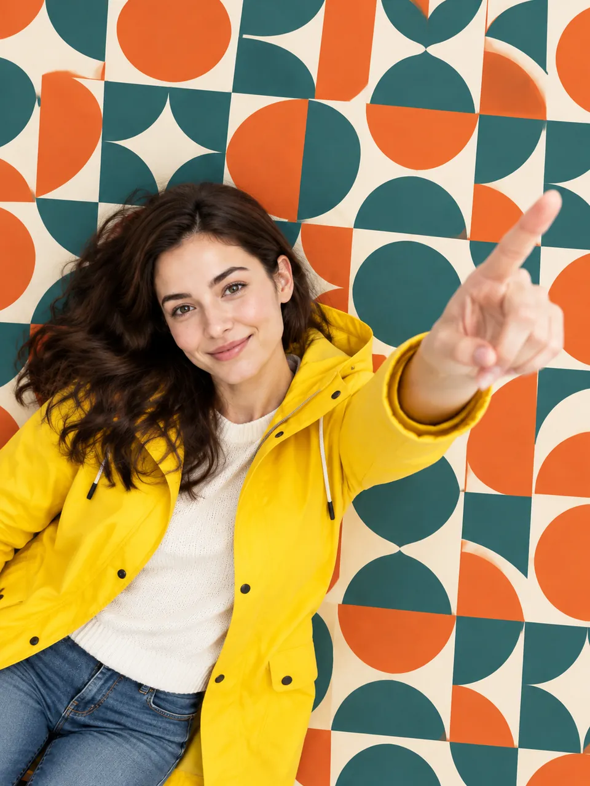</a>

> 一个现成的博主推广模板：把你自己的照片和任意背景图案组合起来，JSON 会把你叠在图案上方，以正上方俯拍的角度，像躺着一样笑着望向镜头，并指向右上角——那里预留了空白，方便之后加上关注或订阅按钮。约束条件（手里不拿手机、手指不被裁掉、手臂长度自然）避免了常见的穿帮。用我们的虚构参考图（一位穿亮黄色雨衣的女性和一张复古橙青几何图案），成品明快又有图形感，右上角留出了干净的界面空间。适合频道横幅、主页推广和活动邀请。

```text
{
  "edit_type": "creative_composite_layering",

  "source": {
    "_hint": "Base logic: Character (Ref 1) superimposed ON TOP OF the Background Image (Ref 2).",
    "mode": "EDIT",
    "reference_images": {
      "first": "foreground_character_person",
      "second": "background_scenery_or_pattern"
    },
    "preserve_from_first": {
      "same_person_or_group": true,
      "same_faces": true,
      "same_hairstyles": true,
      "same_outfits": true
    }
  },

  "identity": {
    "keep_identity_consistent": true,
    "expression": "bright_engaging_smile_at_camera"
  },

  "camera_effect": {
    "_hint": "High-angle selfie style, creating a sense of depth between the hand and face.",
    "perspective": "high_angle_shot_looking_down",
    "style": "social_media_call_to_action",
    "depth_of_field": "focus_on_face_and_pointing_finger",
    "framing": "character_centered_with_space_at_top_right"
  },

  "pose": {
    "_hint": "Key action: Lying down but actively pointing to the 'Follow' button area (Top Right).",
    "pose_style": "lying_down_or_reclining_on_back",
    "face_direction": "looking_directly_up_into_lens",
    "hand_gestures": {
      "right_hand_action": "pointing_index_finger",
      "target_direction": "upper_right_corner_45_degrees",
      "purpose": "mimicking_pressing_subscribe_button",
      "arm_position": "extended_towards_camera_top_right"
    },
    "body_language": "inviting_and_energetic",
    "style_tags": [
      "kpop_idol_fan_service",
      "influencer_promo_style",
      "dynamic_perspective"
    ]
  },

  "background_integration": {
    "_hint": "The second reference image is the background/floor.",
    "method": "full_background_replacement",
    "target_area": "entire_canvas_behind_character",
    "content_source": "reference_image_second",
    "perspective_match": "flat_lay_style",
    "rules": {
      "character_must_be_top_layer": true,
      "leave_space_in_upper_right_for_ui": true
    }
  },

  "composition": {
    "_hint": "Ensure the pointing finger leads the viewer's eye to the top right corner.",
    "visual_flow": "diagonal_line_from_face_to_top_right_corner",
    "focal_points": [
      "character_eyes",
      "pointing_finger_tip"
    ],
    "negative_space": "clear_area_at_top_right_45_degrees"
  },

  "constraints": {
    "no_holding_phone_device": true,
    "finger_must_not_be_cropped_out": true,
    "ensure_arm_is_natural_length": true
"3:4"
  }
}
```

- 原作者: [@BeautyVerse_Lab](https://x.com/BeautyVerse_Lab)
- 原帖: https://x.com/BeautyVerse_Lab/status/2013490554466939282
- [在 cinel 上查看详情并一键生成](https://cinel.ai/zh/prompts/p/character-over-background-composite-poster?utm_source=github&utm_medium=awesome&utm_campaign=awesome-gpt-image-2.5-prompts)

### Logo 化身山巅冰霜石碑提示词

<a href="https://cinel.ai/zh/prompts/p/logo-stone-monument-mountain-peak?utm_source=github&utm_medium=awesome&utm_campaign=awesome-gpt-image-2.5-prompts">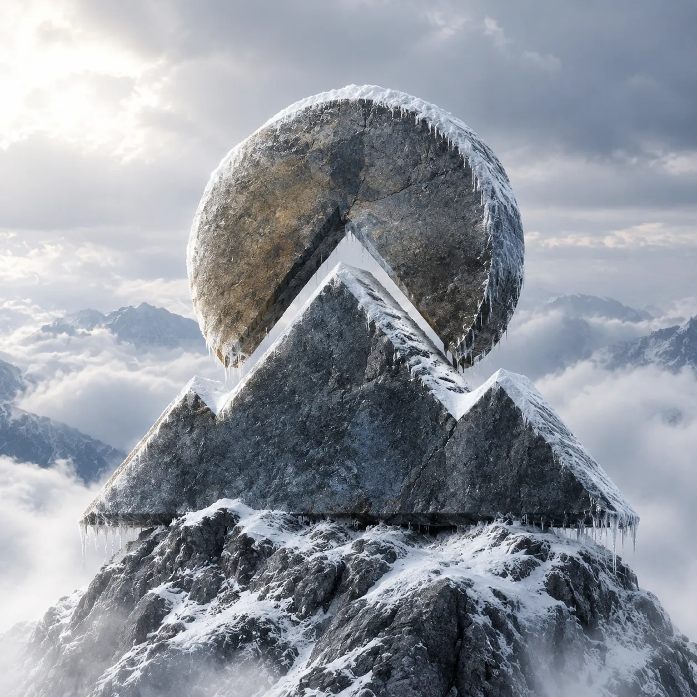</a>

> 给这条提示词一个平面 Logo，它就会变成一座地标：厚重挤出的玄武岩或花岗岩，布满裂纹和缺口，覆着一层半透明冰霜，顶面积雪，悬挑处挂着冰凌，底座嵌入云海之上嶙峋的山顶。低机位的四分之三角度让它显得宏伟，负空间直接贯穿岩石。我们的参考图是一个简单的山峰加太阳标志；成品把它变成了一座巨大的冰冻石质三角，顶上平衡着一个圆形太阳石盘，雾凇在柔光中闪烁。适合户外、探险或远征品牌、年度启动视觉，以及“登顶”主题的宣传。

```text
A hyper-realistic 3D render of a flat logo sculpted as a massive, frosted stone monument standing upright on the jagged peak of a rocky mountain summit.

The logo retains its exact silhouette and proportions but is fully translated into thick, solid carved rock encased in a layer of translucent frost and ice. Each element and shape of the logo is extruded with significant depth and volume, giving it a bold, chunky sculptural mass.

 The surface texture is rough, dark basalt or granite stone, partially obscured by a crystalline frost coating, with deep natural cracks, chipped edges, and fine granular detail across every face. The outer boundary of the logo forms the shell of the sculpture, with negative spaces between design elements carved out as open voids cutting through the rock.
The sculpture sits planted into the top of a rugged mountain peak, partially buried at its base, surrounded by cracked grey rock. A thick, textured layer of white snow and rime ice rests on the top flat surfaces of the logo forms and collects in the crevices and carved edges. Small icicles hang from the lower overhanging curves and edges, catching cold light. The entire structure has a subtle, semi-translucent frozen sheen, softening the harshness of the stone beneath.
The sky behind is filled with a dramatic, dense sea of clouds rolling over distant mountain peaks, creating a misty, ethereal, and cold atmosphere. Soft, diffused light filters through the cloud layer, creating a stark contrast against the dark, frosted stone sculpture. Lighting is soft natural daylight from slightly above and to the left, casting realistic shadows beneath the logo elements and across the rocky peak below. Ambient occlusion deepens the carved negative spaces between the design forms.

Camera angle is slightly low, looking up at the sculpture from a three-quarter front perspective, emphasizing the scale and monumentality of the logo form, mirroring the heroic composition of a landmark monument.

Rendering style: photorealistic, cinematic, ultra-detailed, physically based rendering, no text, no additional elements only the logo as a frosted stone sculpture on a cloud-covered mountain peak.
```

- 原作者: [@zazzygfx](https://x.com/zazzygfx)
- 原帖: https://x.com/zazzygfx/status/2044465748714594617
- [在 cinel 上查看详情并一键生成](https://cinel.ai/zh/prompts/p/logo-stone-monument-mountain-peak?utm_source=github&utm_medium=awesome&utm_campaign=awesome-gpt-image-2.5-prompts)

### 球队球员极繁主义运动拼贴海报提示词

<a href="https://cinel.ai/zh/prompts/p/maximalist-sports-collage-poster?utm_source=github&utm_medium=awesome&utm_campaign=awesome-gpt-image-2.5-prompts">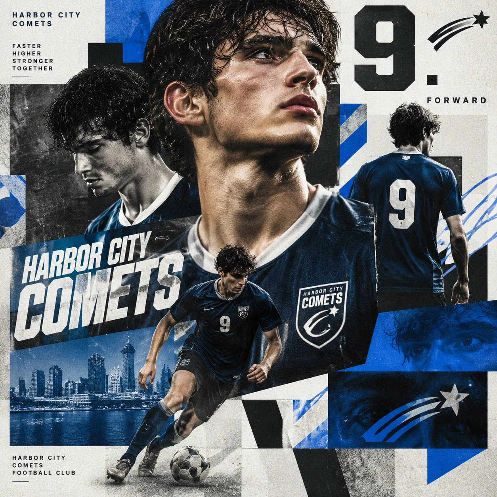</a>

> 一个用于比赛日和官宣图的短模板：填入球队和球员，提示词就会把重复的动作镜头、颗粒质感、抽象几何色块和动感网格叠成一张现代极繁主义拼贴，再加上胶片颗粒和严肃的电影感调色。原文建议模仿某大型运动品牌的广告风格，我们改用了中性的“大胆的运动风”，并用一支虚构球队“港城彗星”的 9 号前锋。成品充满能量又可信：藏青与白的配色、巨大的“9.”和“FORWARD”、城市天际线、彗星队徽，同一位球员以特写、庆祝和带球的形象出现。适合俱乐部、校队和电竞阵容。

```text
Create a digital modern maximalism style sports collage of Harbor City Comets number 9 forward visuals with grainy textures, abstract geometric shapes, dynamic grid layout, minimal background, contemporary editorial composition, inspired by bold sportswear campaigns and modern sports graphic design, strong visual rhythm, bold and emotional atmosphere. Post-process film grain, and specially cinematic color-graded tones for serious intensity.
```

- 原作者: [@Goodmanprotocol](https://x.com/Goodmanprotocol)
- 原帖: https://x.com/Goodmanprotocol/status/2045387100842070500
- [在 cinel 上查看详情并一键生成](https://cinel.ai/zh/prompts/p/maximalist-sports-collage-poster?utm_source=github&utm_medium=awesome&utm_campaign=awesome-gpt-image-2.5-prompts)

### 奢品模特杂志海报（参考图）提示词

<a href="https://cinel.ai/zh/prompts/p/luxury-product-editorial-poster?utm_source=github&utm_medium=awesome&utm_campaign=awesome-gpt-image-2.5-prompts">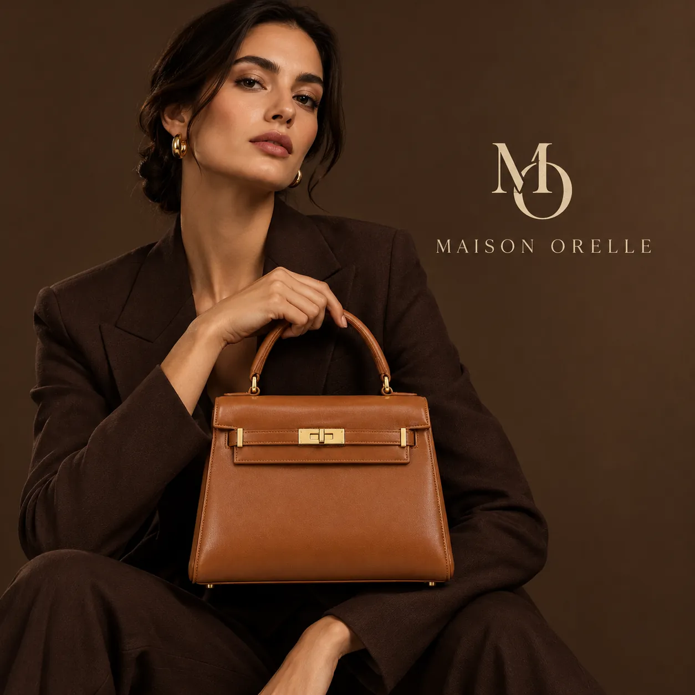</a>

> 一条把普通产品照变成广告海报的精简提示词：产品完全按照片保留，加入一位气质匹配、自然佩戴或手持产品的模特，放置带细微印刷质感的标志，再配上浓郁深沉的色彩、高级棚拍光和大面积留白。原文要求模型复刻真实品牌的官方标志，我们改成了为一个虚构品牌 MAISON ORELLE 设计简洁优雅的标志。以一只焦糖色手提包作为参考图，成品很精致：一位穿巧克力色西装的女性把包放在膝上，温暖的棕色背景上是金色“MO”字母组合和品牌字标。很适合小品牌和转售商家。

```text
Product: the attached reference image.
BRAND NAME: MAISON ORELLE

Create ONE luxury editorial poster. Keep the product EXACT and unchanged. Use the BRAND NAME to infer identity and design a simple elegant logo in the most brand-appropriate position with subtle print texture. Add a perfectly matched attractive model wearing the product naturally. Rich deep colors, HDR, premium studio lighting, clean background, strong negative space, ultra-sharp 8K. No extra text, no watermark.
```

- 原作者: [@aziz4ai](https://x.com/aziz4ai)
- 原帖: https://x.com/aziz4ai/status/2008592833406791789
- [在 cinel 上查看详情并一键生成](https://cinel.ai/zh/prompts/p/luxury-product-editorial-poster?utm_source=github&utm_medium=awesome&utm_campaign=awesome-gpt-image-2.5-prompts)

### 合成波粉色护目镜音乐海报提示词

<a href="https://cinel.ai/zh/prompts/p/synthwave-pink-visor-music-poster?utm_source=github&utm_medium=awesome&utm_campaign=awesome-gpt-image-2.5-prompts">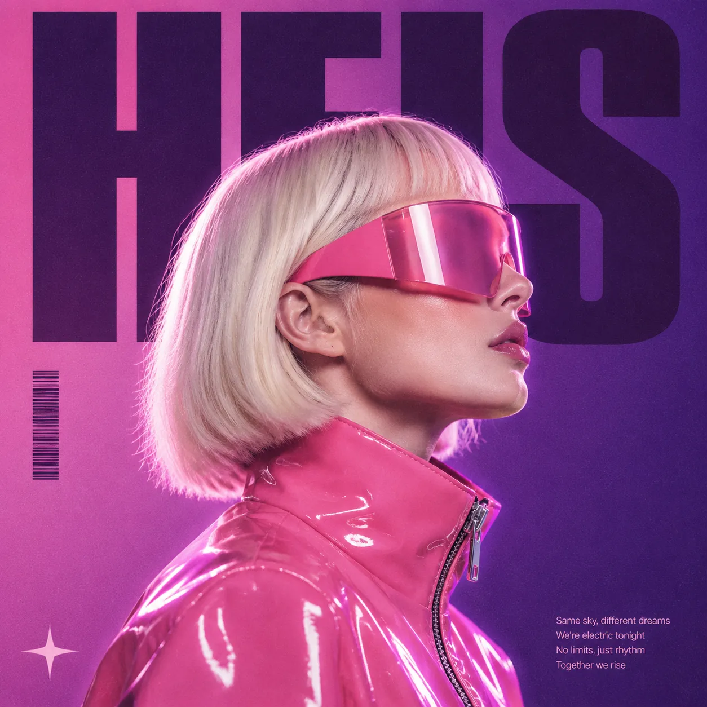</a>

> 一条精致的单曲封面提示词，配色从泡泡糖粉到紫罗兰非常克制：一位铂金色波波头的女性侧脸，戴着超大不透明粉色护目镜，穿高领、镜面般光亮的粉色漆皮夹克，站在一个被她头部部分遮挡的巨大紫色窄体单词前。柔和的棚拍光在漆皮上打出强烈镜面高光、在头发上形成轮廓光，撑起了整个画面；小小的图形细节（条形码、星形标志、四行歌词）让它像真正的发行封面。我们的成品干净、时尚感强，巨大的 HEIS 在她身后被裁切，洋红渐变上覆着胶片颗粒。把单词换成你的歌名或艺人名即可。

```text
A stylized, retro-futuristic music poster in a synthwave aesthetic. The central focus is a woman in profile with a platinum blonde bob haircut, wearing oversized, chunky pink opaque visor sunglasses and a high-collar, extremely glossy pink vinyl jacket with visible zipper detail. Behind her, the word "HEIS" is written in massive, dark purple, condensed block typography, partially hidden by her head. The background is a clean gradient shifting from soft magenta to deep purple, overlaid with a subtle film grain texture. Lighting: Soft studio lighting with high-specular highlights on the glossy jacket and rim lighting on the hair. Color Palette: Dominant shades of bubblegum pink, deep violet, and lavender. Graphics: A small barcode on the left, a minimalist star logo in the bottom-left corner, and four lines of small sans-serif song lyrics in the bottom-right corner. Atmosphere: High-fashion, electronic dance music vibe, clean and polished composition.
```

- 原作者: [@rovvmut_](https://x.com/rovvmut_)
- 原帖: https://x.com/rovvmut_/status/2026574551207792783
- [在 cinel 上查看详情并一键生成](https://cinel.ai/zh/prompts/p/synthwave-pink-visor-music-poster?utm_source=github&utm_medium=awesome&utm_campaign=awesome-gpt-image-2.5-prompts)

### 分屏时尚大片＋单品价格拆解提示词

<a href="https://cinel.ai/zh/prompts/p/split-fashion-editorial-architecture?utm_source=github&utm_medium=awesome&utm_campaign=awesome-gpt-image-2.5-prompts">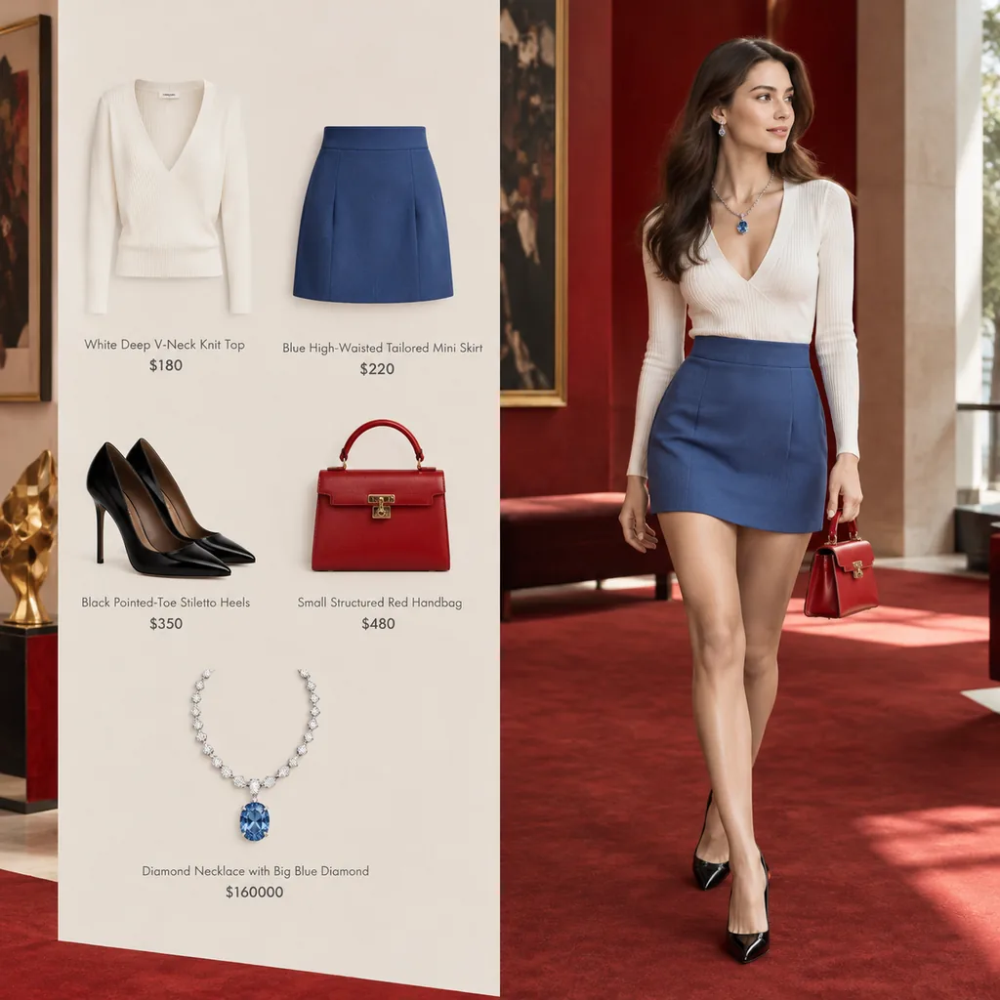</a>

> 一种双栏版式，把一张随性的时尚照和同一套穿搭的电商式单品拆解放在一起。一侧是一位自信的女性走在红墙、柔和自然光的现代空间里，穿白色V领针织衫、蓝色高腰短裙、黑色细高跟，拿红色小手袋，戴蓝钻项链；另一侧每件单品都摆在中性底色上，配一个小号无衬线价签。我们用 GPT Image 2.5 生成的版本价签清晰可读，单品和她身上的穿搭一一对应。可作为 lookbook、可购物帖子和造型指南的快速模板，换成任何服装和价格即可。

```text
A refined fashion editorial image with a 1:1 square aspect ratio, split into two clear sections.

Right side:
A fashionable, confident, elegant woman standing and walking casually in a modern architectural space with red luxurious walls and soft natural light. She wears a white V-neck knit top tucked into a high-waisted blue tailored short skirt, On her feet are sleek black stiletto heels, elegant and minimal. She carries a small structured red handbag in one hand and she is wearing a luxurious diamond necklace with a blue diamond on it.

Her hair is open emphasizing her facial structure. She wears subtle statement earrings. The look is refined, modern, and effortlessly chic. Natural daylight, soft shadows, realistic skin texture. Casual fashion photography style with an editorial, high-end feel. alive color palette, warm tones, shallow depth of field, cinematic realism.

Style & Mood:
Modern elegance, quiet luxury, confident, minimal, editorial casual.

Photography Details:
Eye-level angle, candid stance, 35mm lens, natural lighting, high detail, photorealistic.

Left side:
A clean, minimalist product breakdown layout on a neutral background. The individual fashion items worn by the woman are displayed separately, neatly arranged with subtle shadows. Each item includes a small, elegant price label in refined sans-serif typography:

– white deep V-neck knit top — $180
– blue high-waisted tailored mini skirt — $220
– Black pointed-toe stiletto heels — $350
– Small structured red handbag — $480
– a diamond necklace with a big blue diamond — $160000

The left side feels like a luxury fashion catalog or e-commerce lookbook, with a red carpet, luxurious walls, art pieces on wall

Overall Style & Mood:
Quiet luxury, modern elegance, editorial fashion, high-end retail aesthetic.

Lighting & Quality:
Soft natural light, studio-clean clarity on product side, photorealistic, ultra-high resolution, professional fashion photography.

Negative Prompt:
Cluttered layout, oversized text, flashy logos, mannequins, people on left side, harsh lighting, low resolution, cartoon style.
```

- 原作者: [@craftian_keskin](https://x.com/craftian_keskin)
- 原帖: https://x.com/craftian_keskin/status/2009665973058515294
- [在 cinel 上查看详情并一键生成](https://cinel.ai/zh/prompts/p/split-fashion-editorial-architecture?utm_source=github&utm_medium=awesome&utm_campaign=awesome-gpt-image-2.5-prompts)

### 日式文字主导展览海报

<a href="https://cinel.ai/zh/prompts/p/japanese-typographic-exhibition-poster?utm_source=github&utm_medium=awesome&utm_campaign=awesome-gpt-image-2.5-prompts">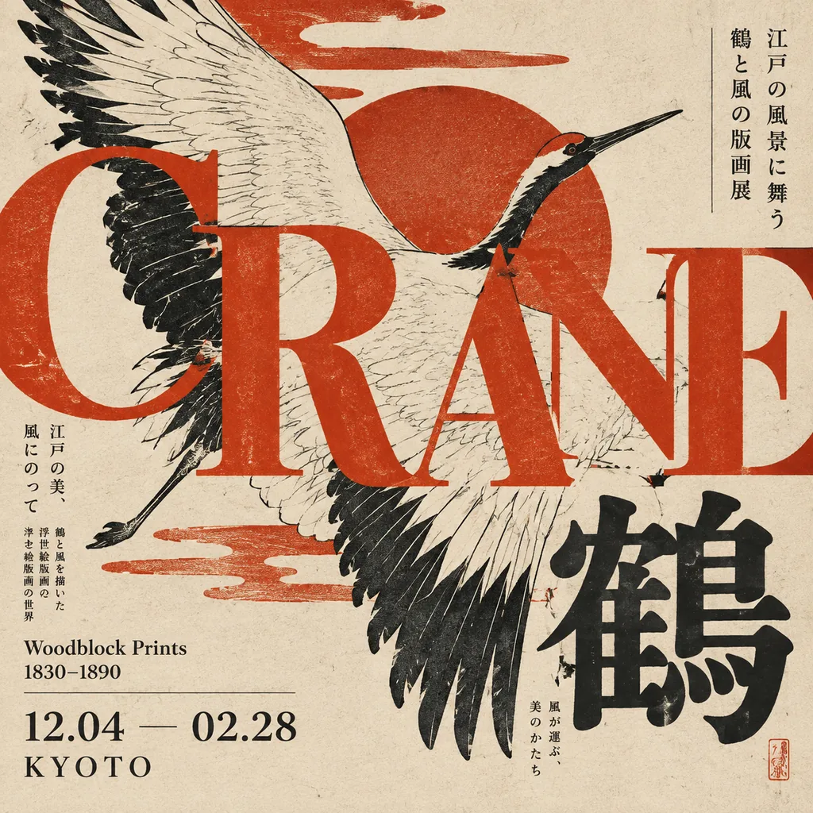</a>

> 来自 @MrLarus 的 GPT Image 2.5 海报模板，发布在一条日式海报设计帖子的评论区。模板让文字成为画面结构：超大裁切字母、富有表现力的汉字、竖排文字栏和印刷质感。我们填入了木版画展主题、单词 CRANE、汉字“鶴”和一只穿过字母的丹顶鹤，并改为方形画幅。适合展览、画廊和文化活动海报。

```text
Create a premium square 1:1 Japanese-inspired editorial poster. Theme: an exhibition of Edo-period woodblock prints about cranes and wind. Main typography: the oversized English word "CRANE" boldly cropped across the poster, with a large expressive Kanji "鶴". Visual subject: a red-crowned crane in woodblock-print style, its wing sweeping through and behind the giant letters. Color palette: vermilion red, ink black and warm cream. Supporting text: small vertical text columns, the line "Woodblock Prints 1830–1890", the dates "12.04 — 02.28" and the word "KYOTO". Draw inspiration from Japanese cultural exhibition posters, experimental typography, independent publishing and contemporary editorial graphic design; make typography the main visual structure with bold cropping, unconventional spacing, overlapping and masking between letters and the bird, fine rules and compact information blocks, clear hierarchy and balanced negative space. Use subtle paper fibers, offset printing texture, ink grain and restrained registration imperfections. It should feel like an original poster commissioned by a Japanese art museum, but do not name any real museum, venue or institution. Avoid generic AI poster templates, meaningless filler text, glossy 3D effects, artificial gradients, sparkles and watermarks.
```

- 原作者: [@MrLarus](https://x.com/MrLarus)
- 原帖: https://x.com/MrLarus/status/2108490595790680205
- [在 cinel 上查看详情并一键生成](https://cinel.ai/zh/prompts/p/japanese-typographic-exhibition-poster?utm_source=github&utm_medium=awesome&utm_campaign=awesome-gpt-image-2.5-prompts)

### 日式面包店微缩世界海报

<a href="https://cinel.ai/zh/prompts/p/japanese-bakery-miniature-poster?utm_source=github&utm_medium=awesome&utm_campaign=awesome-gpt-image-2.5-prompts">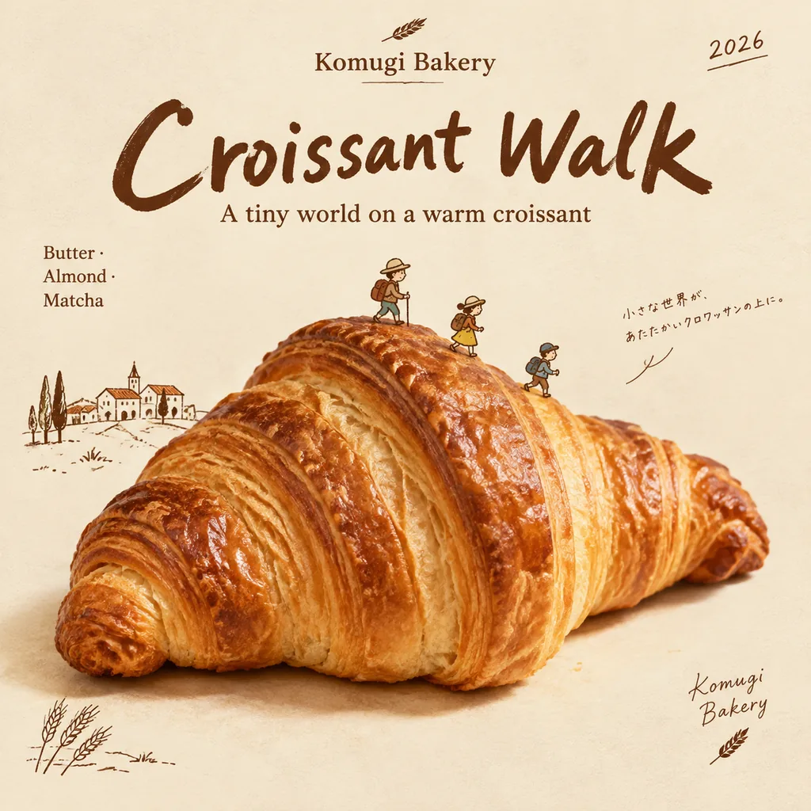</a>

> 来自 @MrLarus 的 GPT Image 2.5 面包店海报模板，发布在他关于可爱面包店设计的帖子评论区。模板把写实的面包摄影、手绘小人和怀旧日式排版结合在一起。我们为虚构的“Komugi Bakery”填入了一个巨大的可颂、标题“Croissant Walk”和三种口味，并改为方形画幅。适合咖啡馆菜单、面包新品和市集海报。

```text
Create a charming Japanese-style bakery poster combining photorealistic food photography, playful hand-drawn illustrations, and nostalgic editorial typography. Brand: "Komugi Bakery". Food: one oversized golden butter croissant. Concept: Miniature World. Headline: "Croissant Walk". Tagline: "A tiny world on a warm croissant". Details: "Butter · Almond · Matcha". Color palette: cream, cocoa brown and butter yellow. Year: 2026. Aspect ratio: 1:1. Japanese indie bakery aesthetics with a warm, playful, slightly nostalgic editorial feel; realistic food photography combined with delicate, imperfect pen-and-ink illustrations. Cream-colored paper background, cocoa-brown lettering, soft natural colors and subtle print textures. Make the croissant the visual centerpiece with appetizing flaky layers, golden crust, soft daylight and realistic shadows, and add a few tiny 2D hand-drawn characters walking across the pastry like explorers on a hill. Strong focal point, about 35–40% clean negative space, expressive Japanese-style handwritten headline, elegant retro serif fonts and small playful annotations. Keep all text accurate and readable. Avoid excessive doodles, cluttered layouts, CGI-looking food, 3D cartoon characters, random text, decorative sparkles, numbering and watermarks. One complete standalone poster, not a collage or mockup.
```

- 原作者: [@MrLarus](https://x.com/MrLarus)
- 原帖: https://x.com/MrLarus/status/2110093836219527170
- [在 cinel 上查看详情并一键生成](https://cinel.ai/zh/prompts/p/japanese-bakery-miniature-poster?utm_source=github&utm_medium=awesome&utm_campaign=awesome-gpt-image-2.5-prompts)

### 等高线山水艺术海报

<a href="https://cinel.ai/zh/prompts/p/contour-line-landscape-art-poster?utm_source=github&utm_medium=awesome&utm_campaign=awesome-gpt-image-2.5-prompts">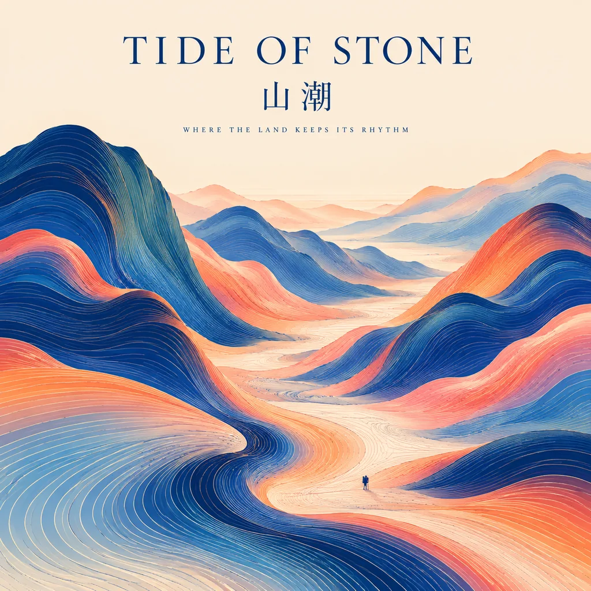</a>

> 来自 @MrLarus 的 GPT Image 2.5 海报模板，发布在他关于等高线山水的帖子下。模板用数百条连续的地形等高线构成抽象地貌，冷暖对比鲜明，加入一个极小的人物体现尺度，并为衬线标题留出安静区域。我们填入了标题“TIDE OF STONE”、副标题“山潮”和靛蓝到珊瑚的配色，并改为方形画幅。适合艺术版画、展览海报和书籍封面。

```text
Create a premium square 1:1 art poster that transforms an imaginary landscape into a vibrant, abstract world of continuous topographic contour lines, combining Eastern landscape aesthetics with modern editorial design. Title: "TIDE OF STONE". Chinese subtitle: "山潮". Landscape: flowing rifts between monumental folded hills. Line structure: sweeping. Color palette: deep indigo, cobalt blue, coral pink, peach orange and warm cream. Scale element: one tiny traveler, less than 1% of the image. Tagline: "WHERE THE LAND KEEPS ITS RHYTHM". Construct the terrain from hundreds of long, smooth, elegant flowing lines that follow its shape and elevation, tighter around curves and folds and wider across calm surfaces. Let colors transition smoothly along the contour lines with strong warm and cool contrast and no random rainbow effects. Balance intricate linework with generous negative space and reserve a calm upper area for refined serif typography with generous spacing. Avoid realistic landscape photography, rocky textures, chaotic patterns, broken strokes, plastic 3D surfaces, watermarks and logos.
```

- 原作者: [@MrLarus](https://x.com/MrLarus)
- 原帖: https://x.com/MrLarus/status/2109874644564271597
- [在 cinel 上查看详情并一键生成](https://cinel.ai/zh/prompts/p/contour-line-landscape-art-poster?utm_source=github&utm_medium=awesome&utm_campaign=awesome-gpt-image-2.5-prompts)

### 从复古地图中升起的城市

<a href="https://cinel.ai/zh/prompts/p/city-rising-from-vintage-map?utm_source=github&utm_medium=awesome&utm_campaign=awesome-gpt-image-2.5-prompts">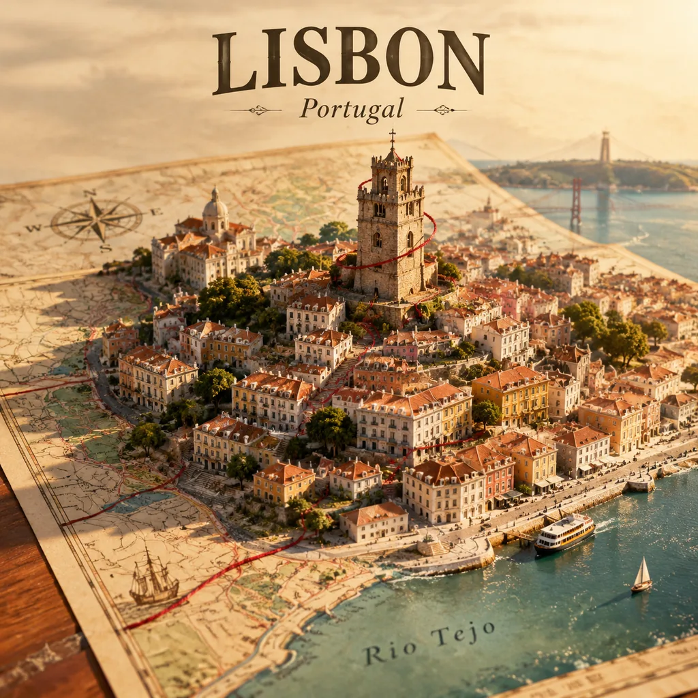</a>

> 这是根据 @Naiknelofar788 用 GPT Image 2.5 分享的“城市逃出地图”提示词填好的示例。我们把城市设为里斯本：陶土屋顶与河畔塔楼从印刷地理中升起，红线绕地标盘旋。适合旅行海报、指南封面和地图店装饰画。

```text
A breathtaking surreal-meets-realistic art composition of Lisbon, Portugal, emerging from an enormous vintage paper map laid flat on a warm ivory surface. The city's real architecture rises from the printed geography like a miniature three-dimensional world: terracotta rooftops, winding streets, a river and a tall landmark tower at the centre. Printed roads transform into actual streets, tiny buildings rise from flat ink into detailed miniature structures, and a single delicate red thread spirals around the landmark. At the top, display 'LISBON' in sophisticated vintage typography with 'Portugal' beneath it. Architectural realism, miniature diorama photography, vintage cartography, warm sunlight and long shadows, premium art-poster aesthetic, no distorted buildings. Square 1:1 composition.
```

- 原作者: [@Naiknelofar788](https://x.com/Naiknelofar788)
- 原帖: https://x.com/Naiknelofar788/status/2109226850203619656
- [在 cinel 上查看详情并一键生成](https://cinel.ai/zh/prompts/p/city-rising-from-vintage-map?utm_source=github&utm_medium=awesome&utm_campaign=awesome-gpt-image-2.5-prompts)

### 一线城市彩铅海报

<a href="https://cinel.ai/zh/prompts/p/one-line-city-poster-colored-pencil?utm_source=github&utm_medium=awesome&utm_campaign=awesome-gpt-image-2.5-prompts">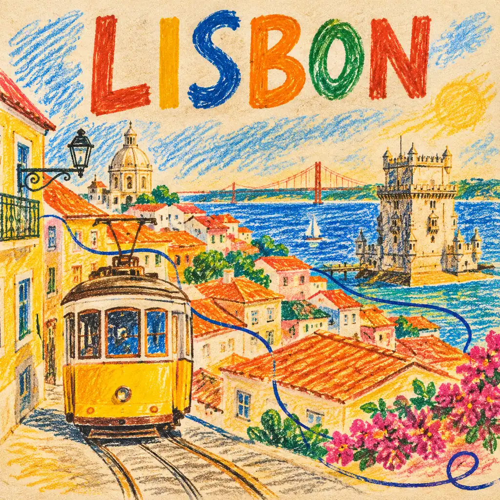</a>

> 这是根据 @Naiknelofar788 分享的“One Line, One World”海报提示词填好的示例。我们把城市设为里斯本：一根连续线穿过屋顶、黄电车与河畔塔楼，配手写标题。适合旅行海报、指南封面和文具。

```text
Create a stunning collectible art poster featuring Lisbon, Portugal, illustrated entirely with expressive colored-pencil strokes and rich wax-crayon textures on warm textured paper. One continuous imperfect hand-drawn line travels through terracotta rooftops, a yellow tram and a tall riverside tower, bold crayon colour blocks, collectible travel-poster composition with the title 'LISBON' in hand-lettered type at the top, warm and joyful, no other text. Square 1:1 composition.
```

- 原作者: [@Naiknelofar788](https://x.com/Naiknelofar788)
- 原帖: https://x.com/Naiknelofar788/status/2109504680875446295
- [在 cinel 上查看详情并一键生成](https://cinel.ai/zh/prompts/p/one-line-city-poster-colored-pencil?utm_source=github&utm_medium=awesome&utm_campaign=awesome-gpt-image-2.5-prompts)

### 复古旅行海报：京都神社

<a href="https://cinel.ai/zh/prompts/p/vintage-travel-poster-kyoto-shrine?utm_source=github&utm_medium=awesome&utm_campaign=awesome-gpt-image-2.5-prompts">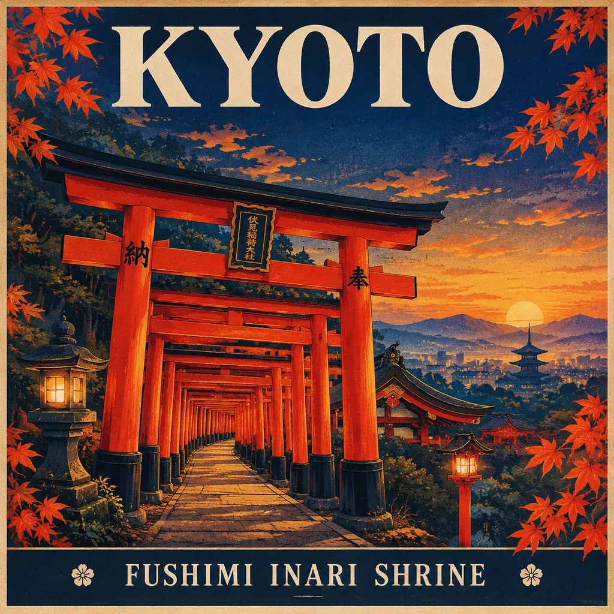</a>

> 这是根据 @Naiknelofar788 用 GPT Image 2.5 分享的复古旅行海报模板填好的示例。我们把地标设为京都伏见稻荷大社。适合旅行海报、指南封面和纪念品艺术。

```text
Create a stunning vintage-style travel poster featuring Fushimi Inari Shrine in Kyoto, Japan, as the main focal point, beautifully illuminated against a dramatic twilight sky. Bold elegant retro typography at the top reads 'KYOTO' and at the bottom 'FUSHIMI INARI SHRINE'. Minimalist vector illustration blended with rich gouache textures, deep indigo sky, warm golden horizon, vermilion torii gates and delicate maple foliage framing the corners, accurate architecture, subtle paper grain, refined screen-print aesthetic, collectible travel poster. Square 1:1 composition.
```

- 原作者: [@Naiknelofar788](https://x.com/Naiknelofar788)
- 原帖: https://x.com/Naiknelofar788/status/2110245562973049248
- [在 cinel 上查看详情并一键生成](https://cinel.ai/zh/prompts/p/vintage-travel-poster-kyoto-shrine?utm_source=github&utm_medium=awesome&utm_campaign=awesome-gpt-image-2.5-prompts)

### 霓虹波普街道剪影海报

<a href="https://cinel.ai/zh/prompts/p/neon-pop-street-silhouette-poster?utm_source=github&utm_medium=awesome&utm_campaign=awesome-gpt-image-2.5-prompts">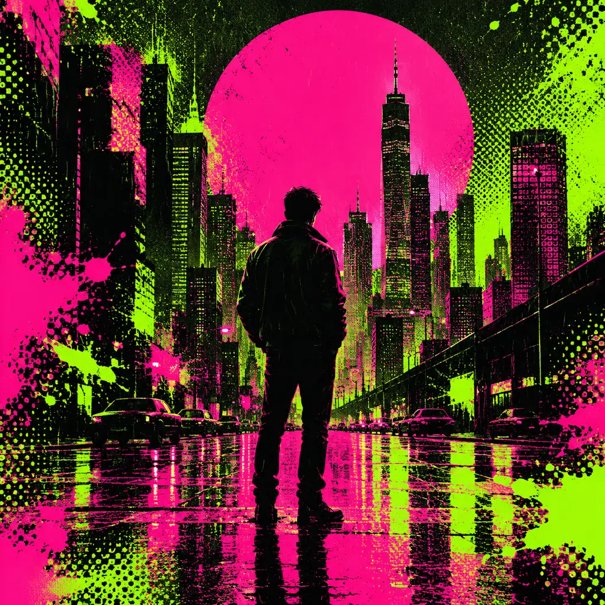</a>

> 仅根据 @azed_ai 的 Midjourney 风格图集中的一张图片反写（原帖只给了风格参考，无提示词）。我们按画面描述了剪影与霓虹配色。适合音乐海报、街头服饰视觉和活动封面。

```text
A bold neon pop-art poster, square 1:1: a dark silhouette of a lone man in a jacket standing in a rainy city street, hot pink and acid green paint splashes and halftone textures, a huge pink sun disc behind towers, gritty screen-print style, high contrast, no readable text. Square 1:1 composition.
```

- 原作者: [@azed_ai](https://x.com/azed_ai)
- 原帖: https://x.com/azed_ai/status/2111321329941221844
- [在 cinel 上查看详情并一键生成](https://cinel.ai/zh/prompts/p/neon-pop-street-silhouette-poster?utm_source=github&utm_medium=awesome&utm_campaign=awesome-gpt-image-2.5-prompts)

### 复古旅行杂志封面：圣托里尼

<a href="https://cinel.ai/zh/prompts/p/vintage-travel-magazine-cover-santorini?utm_source=github&utm_medium=awesome&utm_campaign=awesome-gpt-image-2.5-prompts">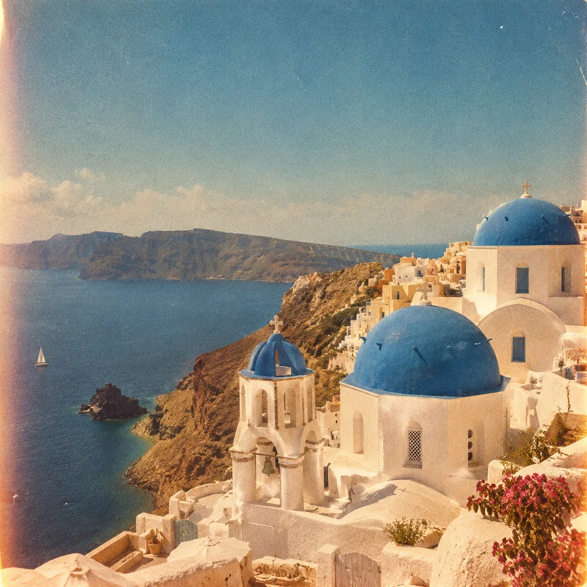</a>

> 根据 @Naiknelofar788 于 2026-10-16 的帖子改写（记录时 31 赞）。我们改成一张干净的1:1图，去掉品牌、Logo、名人/IP元素，也不需要你的照片。一次只改一个变量。

```text
Vintage travel magazine cover art, square 1:1: whitewashed Santorini houses and blue domes above the Aegean, photographed as if on a forgotten 1970s 35mm film roll, warm grain and faded colour, space at top for a title but no readable text, no logo. Square 1:1 composition.
```

- 原作者: [@Naiknelofar788](https://x.com/Naiknelofar788)
- 原帖: https://x.com/Naiknelofar788/status/2110958934144217161
- [在 cinel 上查看详情并一键生成](https://cinel.ai/zh/prompts/p/vintage-travel-magazine-cover-santorini?utm_source=github&utm_medium=awesome&utm_campaign=awesome-gpt-image-2.5-prompts)

### 欧普艺术视错觉图案

<a href="https://cinel.ai/zh/prompts/p/op-art-optical-illusion-pattern-grid?utm_source=github&utm_medium=awesome&utm_campaign=awesome-gpt-image-2.5-prompts">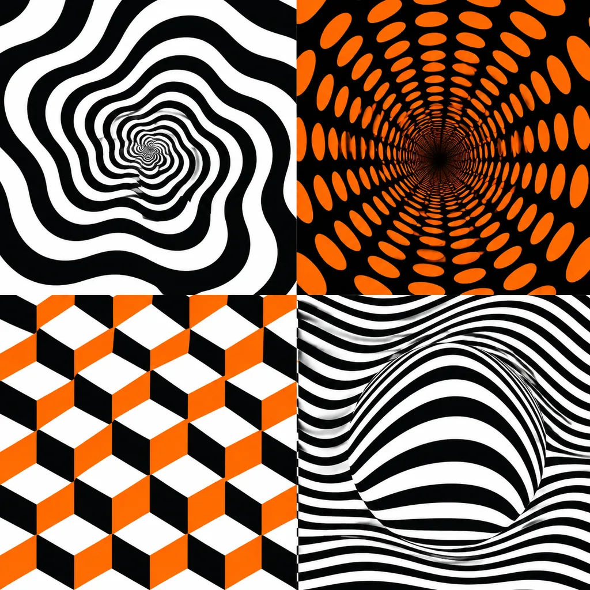</a>

> 根据 @Gdgtify 于 2026-10-18 的帖子改写（记录时 2 赞）。我们改成一张干净的1:1图，去掉品牌、Logo、名人/IP元素，也不需要你的照片。一次只改一个变量。

```text
Op-art poster, square 1:1: four inventive optical-illusion patterns in a clean 2x2 grid, black white and one accent colour, psychophysical wave and depth effects, crisp graphic design, no text, no logo. Square 1:1 composition.
```

- 原作者: [@Gdgtify](https://x.com/Gdgtify)
- 原帖: https://x.com/Gdgtify/status/2111750383185867204
- [在 cinel 上查看详情并一键生成](https://cinel.ai/zh/prompts/p/op-art-optical-illusion-pattern-grid?utm_source=github&utm_medium=awesome&utm_campaign=awesome-gpt-image-2.5-prompts)

### 复古金色沙粒静物

<a href="https://cinel.ai/zh/prompts/p/vintage-golden-sand-still-life?utm_source=github&utm_medium=awesome&utm_campaign=awesome-gpt-image-2.5-prompts">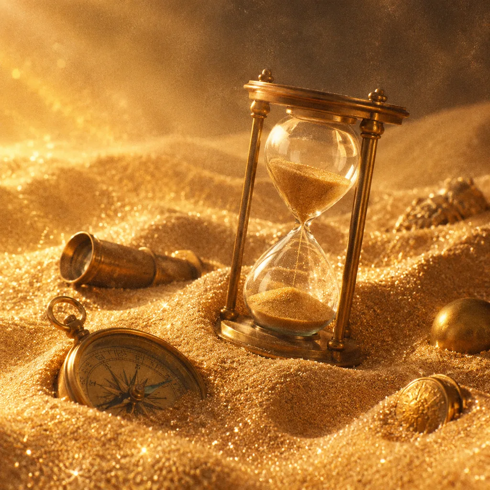</a>

> 根据 @Rana_Farooq_kz 于 2026-10-18 的帖子改写（记录时 0 赞）。我们改成一张干净的1:1图，去掉品牌、Logo、名人/IP元素，也不需要你的照片。一次只改一个变量。

```text
Vintage shimmering golden sand still life, square 1:1: an hourglass and small brass objects half-buried in sparkling golden sand, warm retro light and soft grain, elegant poster-like composition, no text, no logo. Square 1:1 composition.
```

- 原作者: [@Rana_Farooq_kz](https://x.com/Rana_Farooq_kz)
- 原帖: https://x.com/Rana_Farooq_kz/status/2111747201806565381
- [在 cinel 上查看详情并一键生成](https://cinel.ai/zh/prompts/p/vintage-golden-sand-still-life?utm_source=github&utm_medium=awesome&utm_campaign=awesome-gpt-image-2.5-prompts)

### 复古旅行海报：京都

<a href="https://cinel.ai/zh/prompts/p/vintage-travel-poster-kyoto?utm_source=github&utm_medium=awesome&utm_campaign=awesome-gpt-image-2.5-prompts">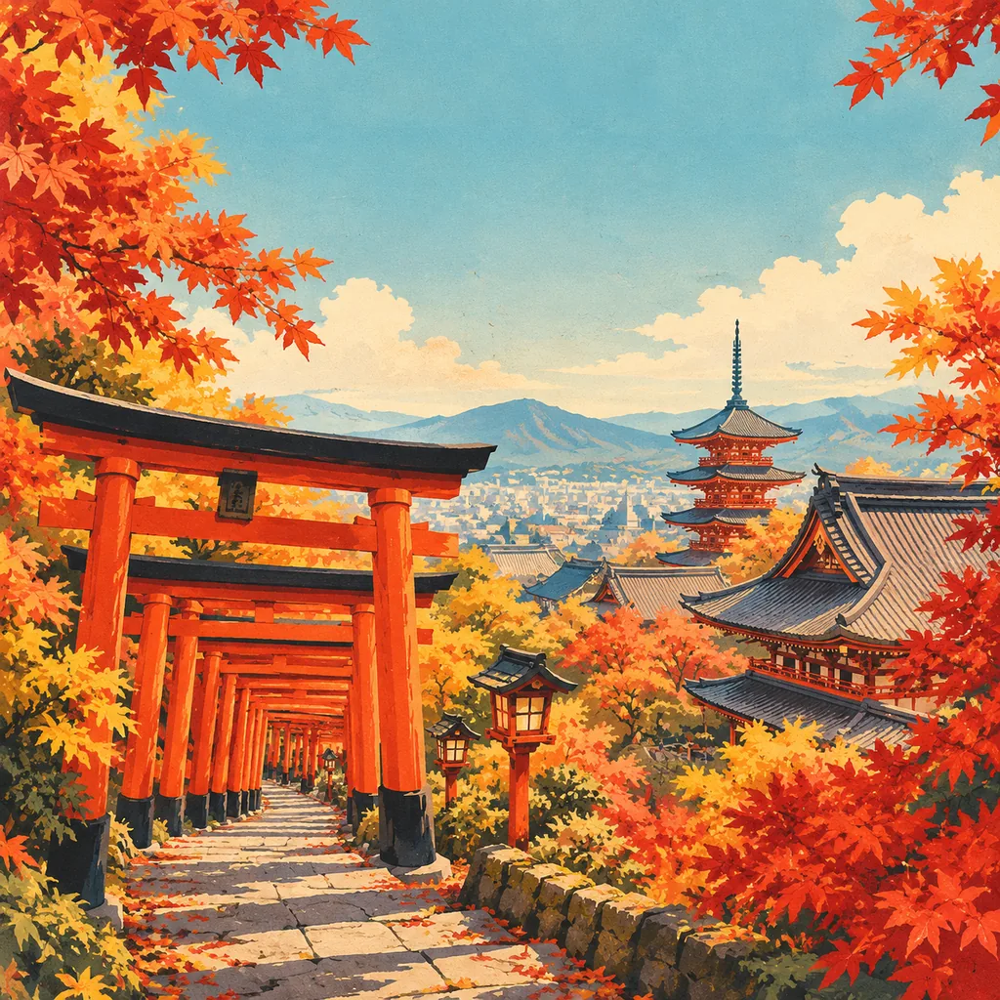</a>

> 根据 @Goodmanprotocol 于 2026-10-17 的帖子改写（记录时 23 赞）。我们改成一张干净的1:1图，去掉品牌、Logo、名人/IP元素，也不需要你的照片。一次只改一个变量。

```text
Charming vintage travel poster, square 1:1: Kyoto in a colourful storybook-inspired illustration, iconic torii path and temple roofs among autumn maples, soft sky and warm print-poster colours, space at top for a title but no readable text, no logo, no brand. Square 1:1 composition.
```

- 原作者: [@Goodmanprotocol](https://x.com/Goodmanprotocol)
- 原帖: https://x.com/Goodmanprotocol/status/2111372178461540580
- [在 cinel 上查看详情并一键生成](https://cinel.ai/zh/prompts/p/vintage-travel-poster-kyoto?utm_source=github&utm_medium=awesome&utm_campaign=awesome-gpt-image-2.5-prompts)

