# 产品与电商 · GPT Image 2.5

[← README](../../README_zh.md) · 51 · [cinel 分类页](https://cinel.ai/zh/prompts/product-photography?utm_source=github&utm_medium=awesome&utm_campaign=awesome-gpt-image-2.5-prompts)

### 九宫格产品样机分镜提示词

<a href="https://cinel.ai/zh/prompts/p/product-mockup-storyboard-grid?utm_source=github&utm_medium=awesome&utm_campaign=awesome-gpt-image-2.5-prompts"></a>

> 这条提示词用一张图完成了一整套品牌作品集拍摄。它的厉害之处在于逐格写明任务：主视觉、材质微距、品牌环境、手部使用、等距构图……每一格都有明确用途，模型就不会重复。反复强调“标签、Logo、比例必须完全一致”，是整组画面不散的关键。示例中，一瓶鼠尾草绿的按压瓶在九格里始终可辨认，道具则在石材和叶片之间变化。改写时，上传一张正面、背景干净的产品照，只修改各格描述，保留 3×3 结构和克制的杂志感。

```text
Create ONE final image. 

A clean 3×3 storyboard grid with nine equal-sized panels on a 4:5 canvas. 

Use the reference image as the base product reference. Keep the same product, packaging design, branding, materials, colors, proportions and overall identity across all nine panels exactly as the reference. The product must remain clearly recognizable in every frame. The label, logo and proportions must stay exactly the same.

This storyboard is a high-end designer mockup presentation for a branding portfolio. The focus is on form, composition, materiality and visual rhythm rather than realism or lifestyle narrative. The overall look should feel curated, editorial and design-driven.

FRAME 1:
Front-facing hero shot of the product in a clean studio setup. Neutral background, balanced composition, calm and confident presentation of the product.

FRAME 2:
Close-up shot with the focus centered on the middle of the product. Focusing on surface texture, materials and print details.

FRAME 3:
Shows the reference product placed in an environment that naturally fits the brand and product category. Studio setting inspired by the product design elements and colours. 

FRAME 4:
Product shown in use or interaction on a neutral studio background. Hands and interaction elements are minimal and restrained, the look matches the style of the package. 

FRAME 5:
Isometric composition showing multiple products arranged in a precise geometric order from the top isometric angle. All products are placed at the same isometric top angle, evenly spaced, clean, structured and graphic.

FRAME 6:
Product levitating slightly tilted on a neutral background that matches the reference image color palette. Floating position is angled and intentional, the product is floating naturally in space.

FRAME 7:
is an extreme close-up focusing on a specific detail of the label, edge, texture or material behavior.

FRAME 8:
The product in an unexpected yet aesthetically strong setting that feels bold, editorial and visually striking.
Unexpected but highly stylized setting. Studio-based, and designer-driven. Bold composition that elevates the brand.

FRAME 9:
Wide composition showing the product in use, placed within a refined designer setup. Clean props, controlled styling, cohesive with the rest of the series.

CAMERA & STYLE:
Ultra high-quality studio imagery with a real camera look. Different camera angles and framings across frames. Controlled depth of field, precise lighting, accurate materials and reflections. Lighting logic, color palette, mood and visual language must remain consistent across all nine panels as one cohesive series.

OUTPUT:
A clean 3×3 grid with no borders, no text, no captions and no watermarks.
```

- 原作者: [@Dari_Designs](https://x.com/Dari_Designs)
- 原帖: https://x.com/Dari_Designs/status/2013268963266904438
- [在 cinel 上查看详情并一键生成](https://cinel.ai/zh/prompts/p/product-mockup-storyboard-grid?utm_source=github&utm_medium=awesome&utm_campaign=awesome-gpt-image-2.5-prompts)

### 蛋白饮与冰咖啡飞溅广告双联图提示词

<a href="https://cinel.ai/zh/prompts/p/protein-drink-bottle-splash-product-shot?utm_source=github&utm_medium=awesome&utm_campaign=awesome-gpt-image-2.5-prompts"></a>

> 这条提示词写成“主提示词”：先是全局设置，再为每张图单独写一个模块，因此它是一套可复用的系统，而不是一次性指令。全局部分为所有模块固定了分辨率、高速定格和电影感棚拍光；每个模块再分别定义瓶身、标签文字、倾斜角度、液体和悬浮配料。正是这种拆分，让我们的 3:4 成品像一组配套广告：哑光蓝蛋白饮倾向牛奶蓝莓飞溅，金色拿铁罐被咖啡豆和热气环绕。原文罐身写的是真实咖啡品牌，我们换成了虚构品牌 KAFELO。复用时一次只改一个模块，全局设置保持不变。

```text
{
  "master_prompt": {
    "global_settings": {
      "resolution": "8K ultra-high-definition",
      "aspect_ratio": "3:4 vertical",
      "style": "hyper-realistic AI-edited commercial product photography",
      "sharpness": "extreme clarity, micro-detail visibility",
      "lighting_quality": "cinematic studio lighting with controlled highlights and shadows",
      "motion_freeze": "high-speed capture, frozen splashes and particles",
      "noise": "none",
      "artifacts": "none"
    },

"module_1_image_1_style": {
      "subject": {
        "type": "plastic protein drink bottle",
        "color": "deep matte blue",
        "surface_details": "condensation droplets across entire bottle",
        "label_text_visible": [
          "milk & yogurt",
          "mock up",
          "protein",
          "SEPARATED SHADOWS"
        ]
      },
      "pose_and_orientation": {
        "position": "slightly tilted to the right",
        "angle": "three-quarter view",
        "motion_feel": "dynamic, leaning into splash"
      },
      "liquid_and_motion": {
        "liquid_color": "white and light beige milk mixture",
        "texture": "smooth, creamy, fluid",
        "motion": "swirling splash rising around bottle base and sides"
      },
      "floating_elements": {
        "blueberries": "whole and halved blueberries at different depths",
        "mint_leaves": "small green leaves with visible veins",
        "droplets": "milk droplets and spheres suspended mid-air"
      },
      "background": {
        "color_gradient": "dark blue to warm amber",
        "bokeh": "soft circular light particles scattered throughout"
      },
      "surface_and_reflection": {
        "base": "matte ground with light liquid pooling",
        "shadow_style": "soft separated shadow under bottle"
      }
    },
"module_2_image_2_style": {
      "subject": {
        "type": "metal coffee can",
        "color": "warm gold",
        "surface_details": "heavy condensation with visible droplets",
        "branding_text_visible": [
          "KAFELO",
          "Latte",
          "NEW LOOK",
          "ICED COFFEE WITH MILK",
          "SUGAR AND SWEETENER OPTIONAL"
        ]
      },
      "pose_and_orientation": {
        "position": "upright, centered",
        "angle": "front-facing",
        "presence": "hero product stance"
      },
      "liquid_and_motion": {
        "liquid_color": "coffee and milk blend",
        "motion": "splash erupting from base",
        "droplet_behavior": "fine droplets scattered outward"
      },
      "floating_elements": {
        "coffee_beans": "whole roasted beans floating around can",
        "steam": "thick swirling steam rising upward",
        "embers": "tiny glowing particles in background"
      },
      "background": {
        "color_palette": "deep brown, amber, gold",
        "atmosphere": "warm, smoky, intense"
      },
      "surface_and_reflection": {
        "base": "wet surface with liquid splash crown",
        "reflection_quality": "subtle reflective highlights"
      }
    }
```

- 原作者: [@mehvishs25](https://x.com/mehvishs25)
- 原帖: https://x.com/mehvishs25/status/2017420332458774791
- [在 cinel 上查看详情并一键生成](https://cinel.ai/zh/prompts/p/protein-drink-bottle-splash-product-shot?utm_source=github&utm_medium=awesome&utm_campaign=awesome-gpt-image-2.5-prompts)

### 低机位时尚广告：手持超大产品提示词

<a href="https://cinel.ai/zh/prompts/p/low-angle-fashion-campaign-product-in-hand?utm_source=github&utm_medium=awesome&utm_campaign=awesome-gpt-image-2.5-prompts"></a>

> 这条提示词只靠一个手法，就把普通的手持产品图变成了广告大片：强制透视。低机位、产品贴近镜头、身后是完整的全身姿势，让包装显得巨大，同时又能看到人物和穿搭。辅助细节也很合理：高调白底、产品清晰对焦、人物略微虚化。我们的口红示例效果很明显：光泽红色管身占据画面三分之一，身后是穿黑色皮衣、大步站立的模特。我们写明了“无品牌外壳”，避免模型自创 Logo。香水、球鞋、手机、饮料都适用，选颜色鲜明的产品效果最好。

```text
Low-angle fashion campaign photograph of a confident model holding a large glossy red lipstick tube with a plain, unbranded, logo-free case very close to the camera, exaggerated perspective with the hand and product dominating the foreground, full-body pose visible in the background, wide stance, dynamic posture, clean pure white studio background, high-key lighting, sharp focus on product, slight depth of field on the model, bold colorful outfit with strong contrast tones, modern beauty advertising aesthetic, ultra-clean composition, commercial studio photography, glossy packaging detail visible, crisp shadows
```

- 原作者: [@azed_ai](https://x.com/azed_ai)
- 原帖: https://x.com/azed_ai/status/2048748266293190833
- [在 cinel 上查看详情并一键生成](https://cinel.ai/zh/prompts/p/low-angle-fashion-campaign-product-in-hand?utm_source=github&utm_medium=awesome&utm_campaign=awesome-gpt-image-2.5-prompts)

### 工业包装设计展示稿提示词

<a href="https://cinel.ai/zh/prompts/p/industrial-packaging-design-sheet?utm_source=github&utm_medium=awesome&utm_campaign=awesome-gpt-image-2.5-prompts"></a>

> 设计师展示包装正是这样：主渲染图被正交视图、结构草图和材质说明围绕。这条提示词要求把这些全放进一张速写本风格的展示稿里，“写实渲染 + 铅笔草图”的混合正是作品集质感的来源。我们以 AI 生成的牛皮纸茶盒（印有叶片插画）为参考图，模型给出了前、侧、顶、底四视图，带毫米箭头的平面刀版，折痕细节，纸张与表面处理色卡，还有一个配散茶和茶杯的小场景。尺寸是编造的，如果要据此印刷，请填写真实尺寸。适合提案、课程作业和早期概念评审。

```text
Using the attached image, create an illustration sheet of professional industrial design packaging for the package folding paperboard tea box. A centered heroic 3D rendering with realistic materials, soft studio lighting and commercial quality finishes. Surrounded by technical views: front, side, top, bottom, oblique perspective and flat position. Include sketches of the frame structure, crease lines, seam details, and size arrows in millimeters. Show materials and finishes (matte, glossy print, plastic, paper, glass, etc.) in handwritten annotations. Add color swatches, realistic product illustrations, and subtle shadows. Clean sketchbook background, realistic rendering + pencil sketch style, modern design design, ultra-detailed, portfolio ready.
```

- 原作者: [@noorwithwifi](https://x.com/noorwithwifi)
- 原帖: https://x.com/noorwithwifi/status/2039679180775063573
- [在 cinel 上查看详情并一键生成](https://cinel.ai/zh/prompts/p/industrial-packaging-design-sheet?utm_source=github&utm_medium=awesome&utm_campaign=awesome-gpt-image-2.5-prompts)

### 俯拍产品平铺：食材环绕与水花飞溅提示词

<a href="https://cinel.ai/zh/prompts/p/top-down-flat-lay-ingredients-product-shot?utm_source=github&utm_medium=awesome&utm_campaign=awesome-gpt-image-2.5-prompts"></a>

> 只有产品和食材两个空，是灵感库里复用性最强的产品提示词之一。它把居中俯拍平铺和定格水花结合在一起，这很少见：水花通常是侧拍，从正上方看，它变成一圈环绕产品的液体画框。标签上的水珠、暖米色背景和方向性阳光增添了清新感。我们用冷压橙汁搭配橙子和薄荷，成品一眼就是果汁广告。注意原文仍写着“高端护肤品广告”，请把这句改成你的品类（饮料、食品、美妆），道具和光线会更贴切。

```text
A glass bottle of cold-pressed orange juice, centered top down flat lay, surrounded by oranges and fresh mint leaves, fresh slices and whole pieces, glossy wet look, water splash frozen mid motion around the product, dewy droplets on label and surface, warm beige seamless background, soft directional sunlight, crisp realistic shadow, high end skincare advertising, ultra realistic macro product photography, 100mm lens look, f/8 sharp focus, clean composition, no extra text, 8k, 1:1
```

- 原作者: [@azed_ai](https://x.com/azed_ai)
- 原帖: https://x.com/azed_ai/status/2015423674061643925
- [在 cinel 上查看详情并一键生成](https://cinel.ai/zh/prompts/p/top-down-flat-lay-ingredients-product-shot?utm_source=github&utm_medium=awesome&utm_campaign=awesome-gpt-image-2.5-prompts)

### 纹理台面俯拍高级产品图提示词

<a href="https://cinel.ai/zh/prompts/p/top-down-textured-surface-product-shot?utm_source=github&utm_medium=awesome&utm_campaign=awesome-gpt-image-2.5-prompts"></a>

> 比水花平铺安静得多，这个模板依靠质感和光线。产品平放在石材、沙、亚麻或盐等材质上；台面“被轻轻扰动，暗示刚刚有过动作或互动”——这个细微线索让场景感觉被人触碰过，而不是软件摆出来的。左上方的阳光投下温暖的长影，提示词还为搭配道具留了位置。用琥珀色精华油滴管瓶、洞石台面、干花和折叠亚麻布，我们的成品就像护肤品牌的杂志大片。模型自己编了一个标签（Radiant Face Oil），请写明你的标签文字，或要求瓶身无标签。

```text
A high-end editorial photo of a amber glass face-oil bottle with a dropper placed flat on a travertine stone slab, captured from a direct top-down view. The surface is gently disturbed to suggest recent motion or interaction. The front of the product is fully visible and properly oriented upright. The area around the product is intentionally left open to optionally place dried flowers and a folded linen cloth that visually enhance the scene. Natural sunlight from the upper left casts warm, realistic shadows. 3D realism, luxury product photography, shallow depth of field, 1:1 format.
```

- 原作者: [@Kerroudjm](https://x.com/Kerroudjm)
- 原帖: https://x.com/Kerroudjm/status/2008559850968473671
- [在 cinel 上查看详情并一键生成](https://cinel.ai/zh/prompts/p/top-down-textured-surface-product-shot?utm_source=github&utm_medium=awesome&utm_campaign=awesome-gpt-image-2.5-prompts)

### 极简服装模特产品海报（参考图版）提示词

<a href="https://cinel.ai/zh/prompts/p/minimal-apparel-model-product-poster?utm_source=github&utm_medium=awesome&utm_campaign=awesome-gpt-image-2.5-prompts">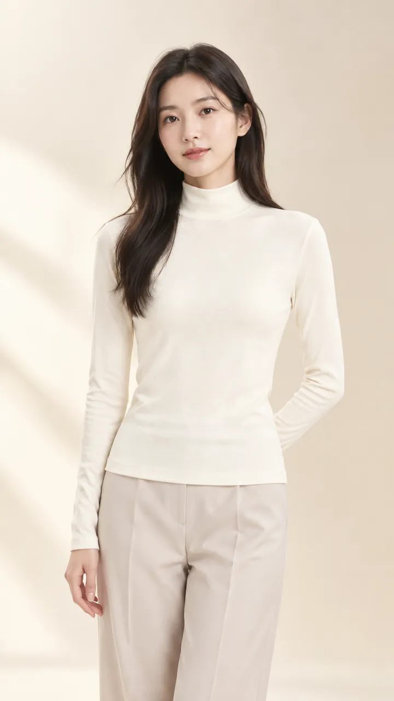</a>

> 这条中文提示词是为服装卖家写的，解决了一个真实的电商问题：不拍摄，就把平铺产品图变成模特上身海报。关键一句是“服装必须严格匹配上传的产品参考图”，后面紧跟精确的面料描述：高支棉或莫代尔微弹针织、修身但不紧绷、圆领或小高领。造型刻意克制：柔和日光、奶油到燕麦色的渐变、自然裸妆、放松的手部动作，突出衣身线条。我们用 AI 生成的奶油白小高领平铺图作参考，模型为虚构模特穿上了几乎一致的单品。我们按提示词保留了 9:16 竖幅：三分之二身构图，头顶留出干净的标题空间。

```text
9：16竖版高端极简时尚产品海报。柔和摄影棚自然日光，温暖米白渐变背景（奶油色、燕麦色），画面极致干净。精致亚洲女性模特（25-30岁），自然裸妆，肤感干净，长发自然垂落或低马尾，姿态放松克制，全身或三分之二身构图，手自然垂放或轻触腰侧，强调衣身线条。服装必须严格匹配上传的产品参考图：高品质打底衫，奶油白/燕麦色/浅驼色/雾灰色，高支棉或莫代尔微弹针织面料，触感柔软，修身但不紧绷，圆领或小高领，长袖，设计极简
```

- 原作者: [@Bitturing](https://x.com/Bitturing)
- 原帖: https://x.com/Bitturing/status/2008786351974740023
- [在 cinel 上查看详情并一键生成](https://cinel.ai/zh/prompts/p/minimal-apparel-model-product-poster?utm_source=github&utm_medium=awesome&utm_campaign=awesome-gpt-image-2.5-prompts)

### 参考图果酱罐组装序列提示词

<a href="https://cinel.ai/zh/prompts/p/jam-jar-reference-product-shot?utm_source=github&utm_medium=awesome&utm_campaign=awesome-gpt-image-2.5-prompts">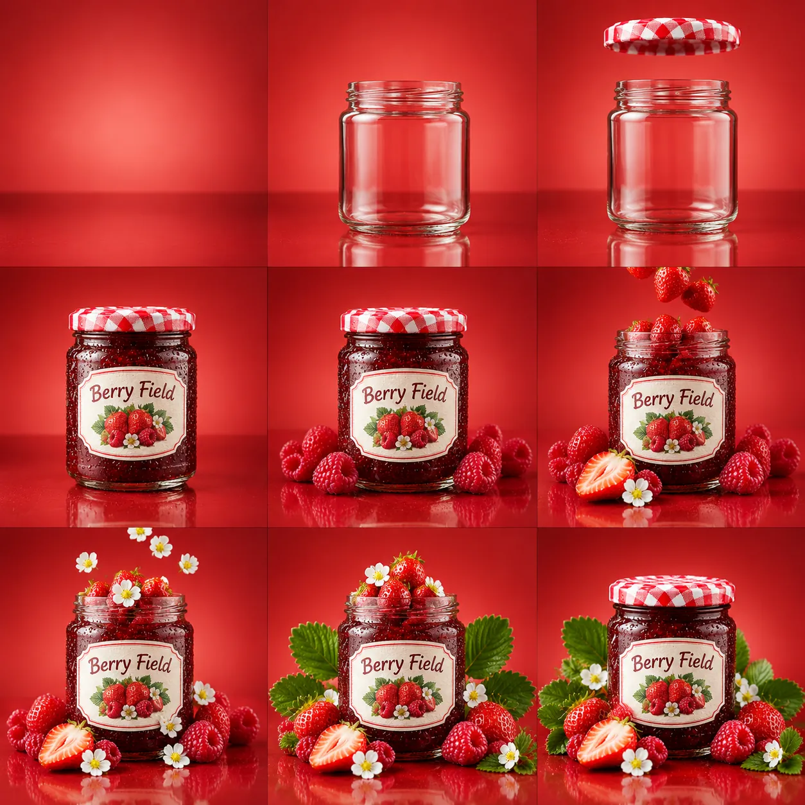</a>

> 这条提示词其实是一段视频脚本：固定正面机位、空的红色布景，然后九个步骤——罐子滑入、盖子落下、水珠凝结、树莓滚入、草莓落下、小花飘落，最后定格在与参考图一致的画面。我们用一张自有的“Berry Field”果酱罐参考图按图片模式运行，模型把整个序列排成了九宫格分镜：从空玻璃罐一直到完整装点好的产品。所以它有双重用途：既是规划短广告的分镜图，也是图生视频模型的提示词。请用你自己的产品照片作为参考图。

```text
Use the uploaded image as the exact visual reference for jar design, label, strawberries, raspberries, flowers, leaves, condensation droplets, red gradient background, and reflective surface.

Camera:
Locked front-facing camera.
No zoom.
No rotation.
No angle change.
Studio composition remains centered.

Style:
Premium beauty commercial.
Smooth assembling sequence.
Ultra realistic.
Slow motion but not dramatic.

Scene – Start (Empty Setup):
Start with an empty red gradient background and glossy reflective surface.
No jar.
No fruits.
No flowers.
No water droplets.

Assembling Sequence:

1. The glass jar base smoothly slides into frame from below and settles perfectly centered.
2. The lid gently lowers from above and aligns perfectly on the jar.
3. Condensation droplets subtly appear on the glass surface as if forming naturally.
4. Raspberries roll in softly from left and right, stopping naturally around the base.
5. Strawberry halves slide into position at the front.
6. Whole strawberries gently drop from above into the open jar top and settle naturally.
7. Small white flowers softly fall into place between the strawberries.
8. Green leaves slide in behind the jar to frame it.
9. Final micro water droplets appear on fruits for freshness effect.

All movements smooth and controlled.
No bouncing.
No exaggerated motion.
No dramatic lighting changes.

Lighting:
Keep original studio lighting.
Deep red background glow remains consistent.
Soft reflections on the glossy surface.

Sound (if supported):
Soft subtle assembling sound design.
Gentle fruit placement sounds.
Light glass contact sound.
No music or very subtle premium ambient tone.

End Frame:
Fully assembled composition exactly matching the reference image.
Everything perfectly arranged.
Hold for 1–2 seconds.
Ultra clean luxury skincare commercial finish.
```

- 原作者: [@ChillaiKalan__](https://x.com/ChillaiKalan__)
- 原帖: https://x.com/ChillaiKalan__/status/2029019321364824452
- [在 cinel 上查看详情并一键生成](https://cinel.ai/zh/prompts/p/jam-jar-reference-product-shot?utm_source=github&utm_medium=awesome&utm_campaign=awesome-gpt-image-2.5-prompts)

### 撕纸露出果肉的汽水罐广告提示词

<a href="https://cinel.ai/zh/prompts/p/soda-can-minimal-paper-background?utm_source=github&utm_medium=awesome&utm_campaign=awesome-gpt-image-2.5-prompts">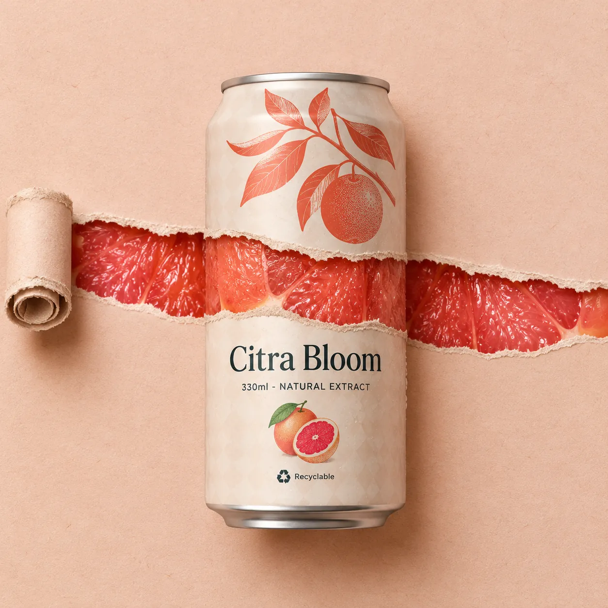</a>

> 视觉巧思在于一条连续的撕纸带横贯整个画面，直接穿过罐身和背景，仿佛整张图印在纸上、被撕开后露出下面的水果。最左端撕下的纸卷成紧实的纸卷，撕口边缘的柔和阴影营造出真实的纵深。提示词还顺带设计了罐身：线描水果插画、低调的几何纹样、品牌名和小号技术文字。我们做了一款虚构的西柚汽水“Citra Bloom”，淡蜜桃色背景配珊瑚色油墨，撕口里的果粒光泽相当逼真。更换水果、配色和品牌，就能用于任何饮料或果汁概念。

```text
A photorealistic, highly detailed commercial product photograph of a standard aluminum slim 330ml soda can centered against a minimal, textured pale peach paper background, with subtle fibers visible. A single, continuous horizontal paper-tear strip runs across the entire width of the frame, seamless from the far-right edge to the far-left edge. The torn channel cuts through the metal body of the can and continues across the background on both sides with a barely perceptible and minimal diagonal slope towards the upper-left. The tear channel is significantly broader, revealing a dense, glistening, and vibrant layer of pink grapefruit juice sacs tightly packed inside. Near the extreme far-left end of this tear, the paper is neatly rolled into a tight, realistic coil that occupies almost the entire left margin. The can features a newly designed, minimalist branding: the upper portion has a stylized, abstract line-art illustration of a grapefruit branch with leaves in a contrasting deep coral, set against a subtle matte geometric diamond pattern on the can surface. Below this, the brand name "Citra Bloom" is printed in an elegant, modern dark typography, with smaller technical text "330ml - NATURAL EXTRACT" and a small "Recyclable" logo. A small, detailed graphic of the fruit is located below the torn path. The lighting is soft and cinematic, casting delicate drop shadows beneath the torn paper edges and the large left coil. 8k resolution, macro details on fibrous paper and glossy fruit texture.
```

- 原作者: [@Arminn_Ai](https://x.com/Arminn_Ai)
- 原帖: https://x.com/Arminn_Ai/status/2027470188644626803
- [在 cinel 上查看详情并一键生成](https://cinel.ai/zh/prompts/p/soda-can-minimal-paper-background?utm_source=github&utm_medium=awesome&utm_campaign=awesome-gpt-image-2.5-prompts)

### Z 世代 Y2K 霓虹彩妆广告提示词

<a href="https://cinel.ai/zh/prompts/p/y2k-cosmetics-ad-gen-z?utm_source=github&utm_medium=awesome&utm_campaign=awesome-gpt-image-2.5-prompts">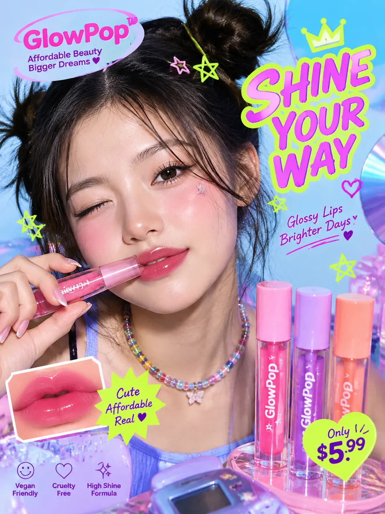</a>

> 这证明了关键词足够“有料”时，短提示词也能走得很远：“Y2K”“Z 世代”“平价彩妆”“霓虹”背后是一整套视觉语言——圆鼓鼓的字体、贴纸、星星、镭射和糖果色。其余一切都由模型自己发明，包括品牌名、口号和价签。我们的成品是一张热闹俏皮的海报：眨眼的模特拿着粉色唇彩，大标题“Shine Your Way”，三支唇彩、唇部特写和各种徽章。由于品牌名是模型编的，发布前请确认它不是某家公司的注册商标，或者直接在提示词里写上你自己的品牌名。加上产品类型和颜色，可控性会更好。

```text
Cute Y2K style affordable cosmetics advertising image designed for Gen Z. Using vibrant color schemes, including neon colors. Aspect ratio is 3:4.
```

- 原作者: [@midori_tatsuta](https://x.com/midori_tatsuta)
- 原帖: https://x.com/midori_tatsuta/status/2045378877363798279
- [在 cinel 上查看详情并一键生成](https://cinel.ai/zh/prompts/p/y2k-cosmetics-ad-gen-z?utm_source=github&utm_medium=awesome&utm_campaign=awesome-gpt-image-2.5-prompts)

### 超现实产品主视觉广告（三词口号）提示词

<a href="https://cinel.ai/zh/prompts/p/surreal-product-hero-creative-ad?utm_source=github&utm_medium=awesome&utm_campaign=awesome-gpt-image-2.5-prompts">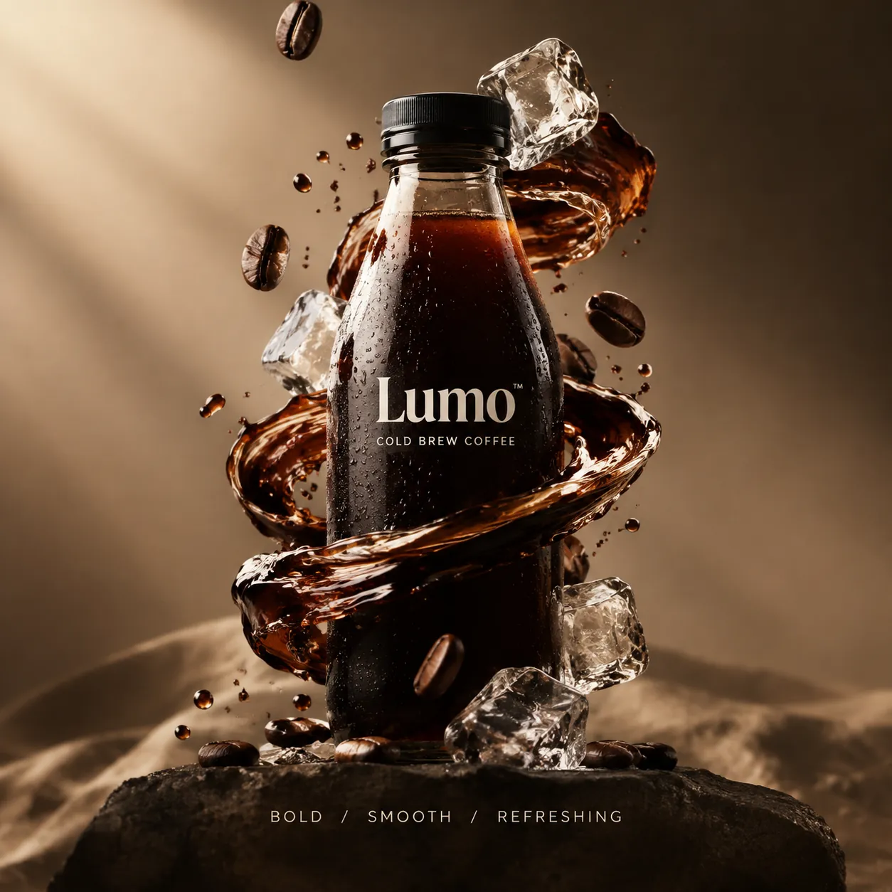</a>

> 这个模板把部分创意决策交给模型：写上产品名和品类，它会自己挑选符合品牌的背景、一个与产品本质相关的超现实元素和一句三个单词的口号。“有创意但不夸张”这一句防止画面失控。我们用了一款虚构的冷萃咖啡“Lumo”：瓶子立在深色岩石上，一条咖啡液带绕瓶旋转，冰块和咖啡豆悬在空中，口号是“Bold / Smooth / Refreshing”。原文要求使用“真实的官方 Logo”，请只在你自己拥有的品牌上这样做，并上传 Logo 作为参考图以保证准确。

```text
Create a realistic yet surreal creative advertisement for Lumo cold-brew coffee in the ready-to-drink coffee space. The product must be the hero, centered in the frame, and visually “formed” in a smart way that automatically reflects the brand’s spirit and identity.

Use a clean, cohesive background that matches the brand’s color palette, with soft cinematic lighting, ultra-realistic premium materials, precise shadows, and a high-end editorial composition.

Add one innovative surreal touch directly tied to the product’s nature—creative but not exaggerated.

Integrate the real official product logo elegantly and seamlessly within the composition, and generate a short, powerful 3-word English slogan automatically that fits the product type and brand tone.

Ultra-high quality, perfectly balanced framing, strong realism, luxury style—no extra text beyond the logo and the 3-word English slogan.
```

- 原作者: [@aziz4ai](https://x.com/aziz4ai)
- 原帖: https://x.com/aziz4ai/status/2008248159815036942
- [在 cinel 上查看详情并一键生成](https://cinel.ai/zh/prompts/p/surreal-product-hero-creative-ad?utm_source=github&utm_medium=awesome&utm_campaign=awesome-gpt-image-2.5-prompts)

### 从手机里探身接可乐的超现实合成提示词

<a href="https://cinel.ai/zh/prompts/p/surreal-tabletop-product-composite?utm_source=github&utm_medium=awesome&utm_campaign=awesome-gpt-image-2.5-prompts">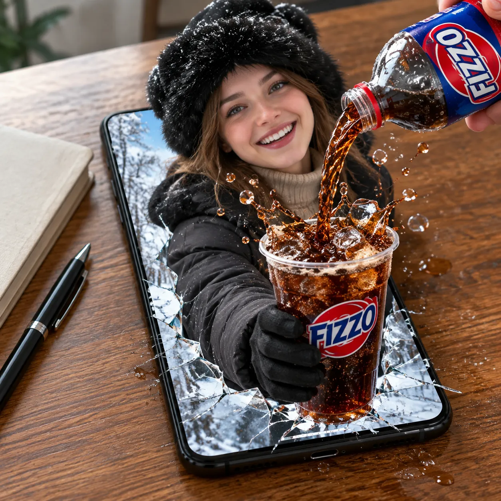</a>

> 一张用 JSON 结构描述的超现实合成图：手机平放在木桌上，屏幕向外碎裂，一个微笑的人从里面探出身来端着杯子，一只真实的手从上方往杯里倒汽水。放射状裂纹、玻璃碎片、气泡、飞溅水珠、瓶身冷凝水，以及桌上的书和笔，这些细节让不可能的场景显得真实可触。原文点名了一个真实的可乐品牌，我们换成了虚构的“FIZZO”标签，但模型画出的红白蓝 Logo 仍让人联想到经典可乐配色，商用时换一套配色会更稳妥。我们的版本里，她戴着毛皮帽和手套，身后是雪景。

```text
{
  "resolution": "8K UHD",
  "style": "photorealistic AI-edited composite, cinematic realism",
  "scene_type": "surreal product-style composition",
  "camera": {
    "angle": "slightly elevated top-down angle",
    "focus": "sharp foreground with shallow depth of field",
    "lens_effects": [
      "natural depth of field",
      "high clarity",
      "macro-level liquid detail"
    ]
  },
  "environment": {
    "surface": "wooden table with visible grain texture",
    "lighting": {
      "type": "soft natural daylight",
      "direction": "from upper left",
      "shadows": "soft realistic shadows under objects"
    },
    "background": {
      "indoor": true,
      "elements": [
        "blurred interior background",
        "snowy outdoor scenery visible inside phone screen in one image"
      ]
    }
  },
  "main_object": {
    "smartphone": {
      "position": "lying flat on wooden table",
      "orientation": "vertical portrait orientation",
      "color": "black",
      "screen_state": "visibly cracked glass with radial fracture lines",
      "screen_interaction": "screen appears broken outward, allowing subject to emerge"
    }
  },
  "human_subject": {
    "visibility": "upper body visible through phone screen",
    "expression": "wide smile, visible teeth",
    "eye_direction": "looking toward the viewer",
    "gender_presentation": "female-presenting",
    "hair": {
      "color": "light brown",
      "style": "loose, shoulder-length"
    },
    "clothing_variants": [
      {
        "outfit": "casual indoor look",
        "details": "neutral top visible behind phone screen"
      },
      {
        "outfit": "winter clothing",
        "details": [
          "dark padded jacket",
          "light turtleneck sweater",
          "black gloves",
          "black fur hat"
        ]
      }
    ]
  },
  "action": {
    "primary_action": "soda being poured into a transparent plastic cup",
    "motion": "liquid splash frozen mid-air",
    "liquid_behavior": [
      "visible carbonation bubbles",
      "splash droplets",
      "overflow splash effect"
    ]
  },
  "beverage": {
    "type": "cola",
    "cup": {
      "material": "transparent plastic",
      "filled_with": "dark carbonated soda with ice",
      "logo": "fictional 'FIZZO' cola logo (red and blue) clearly visible"
    },
    "bottle": {
      "material": "plastic",
      "label": "fictional 'FIZZO' cola branding visible",
      "condition": "condensation droplets on bottle surface",
      "held_by": "human hand entering frame from top right"
    }
  },
  "secondary_objects": [
    {
      "object": "book",
      "position": "left side of phone",
      "color": "light beige cover",
      "state": "closed"
    },
    {
      "object": "pen",
      "position": "near book on table",
      "color": "black",
      "orientation": "diagonal"
    }
  ],
  "effects": {
    "surreal_elements": [
      "subject emerging from phone screen",
      "physical interaction between digital and real space"
    ],
    "particles": [
      "liquid droplets",
      "snow particles in winter scene variant"
    ],
    "glass_effects": [
      "cracked screen shards",
      "reflections on broken glass"
    ]
  },
  "color_palette": {
    "dominant_colors": [
      "warm brown",
      "black",
      "deep cola brown",
      "blue and red branding accents"
    ],
    "contrast": "high contrast between warm table tones and cool screen elements"
  },
  "post_processing": {
    "sharpness": "ultra-sharp",
    "clarity": "high micro-detail",
    "noise": "none",
    "dynamic_range": "high"
  },
  "mood": "playful, surreal, visually striking",
  "realism_level": "high realism with intentional AI-edited surreal effect"
}
```

- 原作者: [@meng_dagg695](https://x.com/meng_dagg695)
- 原帖: https://x.com/meng_dagg695/status/2010615081491677185
- [在 cinel 上查看详情并一键生成](https://cinel.ai/zh/prompts/p/surreal-tabletop-product-composite?utm_source=github&utm_medium=awesome&utm_campaign=awesome-gpt-image-2.5-prompts)

### 日文夏日汽水瓶广告提示词

<a href="https://cinel.ai/zh/prompts/p/summer-soda-bottle-ad-ja?utm_source=github&utm_medium=awesome&utm_campaign=awesome-gpt-image-2.5-prompts">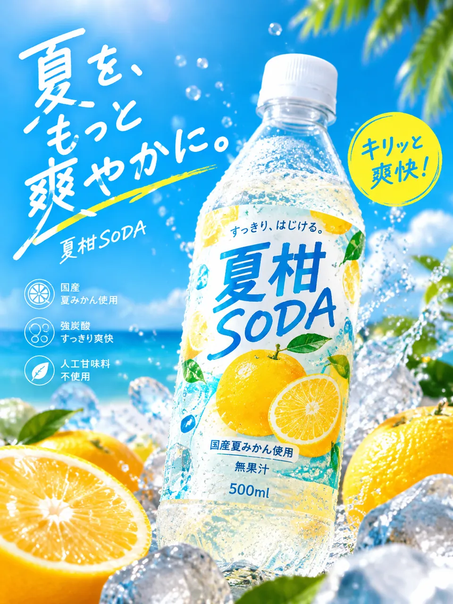</a>

> 这条日文提示词只写了要点（夏季限定碳酸饮料、500ml 塑料瓶、品名“夏柑SODA”、3:4 比例），并要求模型先思考哪些饮料广告设计效果好，再自己写画面规格。成品很像日本便利店的海报：瓶子冲破冰块和水花，切开的夏蜜柑，带棕榈叶的晴朗天空，一行“让夏天更清爽”的大号毛笔字标题，以及几个小徽章。这是让模型担任美术指导的好例子。商用这类文案前，请核对它编出来的每一条宣称，比如“国产”或果汁含量。

```text
画像生成: 商品広告写真, 夏にぴったりの季節商品, 炭酸飲料, 名称="夏柑SODA", 形状=ペットボトル500ml, 2025年に飲料広告として高CTAだったデザインをリサーチしてから画像仕様をデザインして生成, アスペクト比=3:4
```

- 原作者: [@old_pgmrs_will](https://x.com/old_pgmrs_will)
- 原帖: https://x.com/old_pgmrs_will/status/2045852114673635507
- [在 cinel 上查看详情并一键生成](https://cinel.ai/zh/prompts/p/summer-soda-bottle-ad-ja?utm_source=github&utm_medium=awesome&utm_campaign=awesome-gpt-image-2.5-prompts)

### 阳光下石板与镜面上的护肤品提示词

<a href="https://cinel.ai/zh/prompts/p/editorial-studio-product-natural-surface?utm_source=github&utm_medium=awesome&utm_campaign=awesome-gpt-image-2.5-prompts">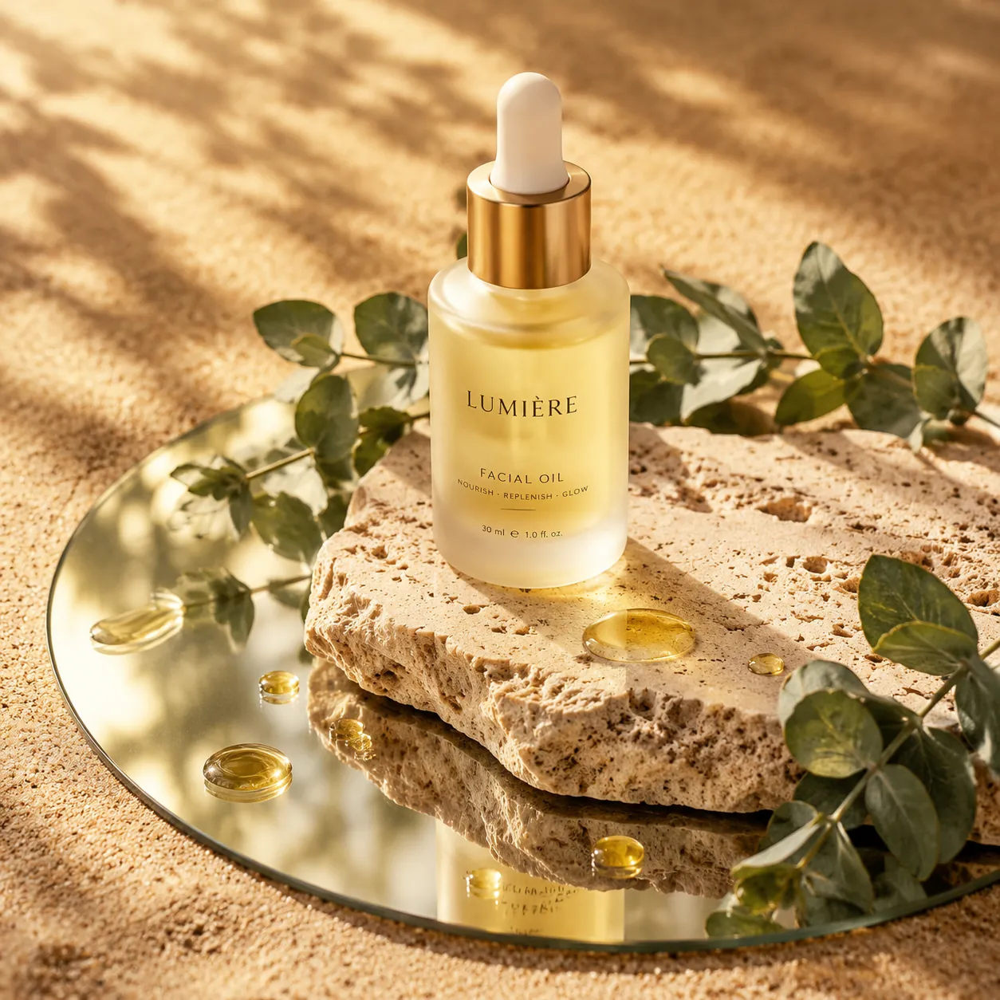</a>

> 一个填空式模板，专做美妆信息流里最常见的温暖阳光护肤风。它的巧妙之处在于层次：产品放在有纹理的石板上，石板放在圆镜上，圆镜放在沙色台面上，产品液滴和几枝植物把各层连接起来。左上方的硬朗阳光投下斜向的树叶阴影，让画面像在户外。我们填的是磨砂玻璃滴管瓶、拉丝金瓶盖、金色面部精油，配尤加利、洞石和暖沙色。模型甚至自己编了一个标签“Lumière”——这是个常见词，但真实产品请用你自己的品牌名。换成薰衣草或玫瑰花瓣，就能改变氛围。

```text
A high-end editorial studio photograph of a dropper bottle, made of frosted glass with a brushed gold cap. The product is placed on a natural, textured travertine stone slab, itself resting on a round mirror laid on a warm sand surface. Around the mirror and on the slab are scattered droplets of golden facial oil with realistic reflections. A few sprigs of eucalyptus lie gently across the slab and mirror, connecting both surfaces naturally. Strong, warm sunlight filters from the top left, casting soft diagonal leaf shadows to simulate filtered daylight. The aesthetic is minimalist and organic, with realistic materials and natural textures highlighted by golden hour tones. Style: 3D realism, luxury product photography, shallow depth of field. Format: 1:1, ultra-detailed.
```

- 原作者: [@Kerroudjm](https://x.com/Kerroudjm)
- 原帖: https://x.com/Kerroudjm/status/2010275488703381858
- [在 cinel 上查看详情并一键生成](https://cinel.ai/zh/prompts/p/editorial-studio-product-natural-surface?utm_source=github&utm_medium=awesome&utm_campaign=awesome-gpt-image-2.5-prompts)

### 品牌周边发售陈列静物提示词

<a href="https://cinel.ai/zh/prompts/p/merch-drop-showroom-still-life?utm_source=github&utm_medium=awesome&utm_campaign=awesome-gpt-image-2.5-prompts">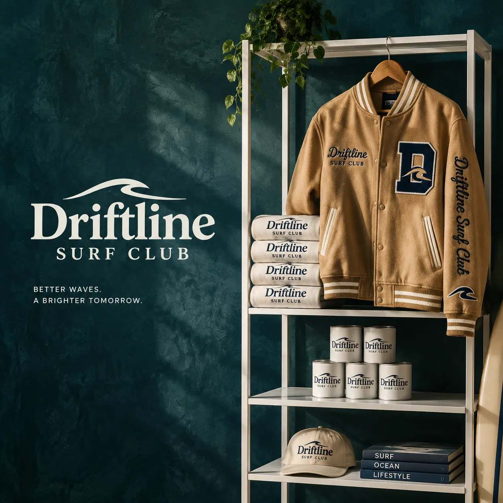</a>

> 这条提示词让模型分阶段担任创意总监：分析品牌、确定核心实体产品和配色、挑选主打服装单品，然后搭建布景——白色金属陈列架、堆叠的产品、手绘画布背景、实体品牌元素（毛圈绣章、刺绣），以及发售公告版式。我们用虚构品牌 Driftline Surf Club 运行，得到深青色背景、带毛圈字母的驼色棒球夹克、陈列架上堆叠的冲浪蜡罐、一顶帽子和几本书，左侧是白色 Logo 和口号。请只用于你自己拥有的品牌；原文示例引用了知名公司，我们已替换。

```text
Driftline Surf Club. Act as a Creative Director and Still Life Photographer for a hypebeast fashion publication.
THE TASK:
Create a high-end "Showroom Still Life" photograph announcing a limited merchandise drop for Driftline Surf Club.
PHASE 1: AUTONOMOUS CURATION (STRATEGY)
Analyze Driftline Surf Club: Identify the industry and the core physical product (e.g., a surf club -> surfboard wax and fins).
Determine the Palette:
Background Color: A deep, rich, textured tone derived from the brand's secondary palette (e.g., Teal, Navy, Burgundy, Slate Grey).
Merch Color: A contrasting warm or neutral tone (Camel, Orange, Cream) to pop against the background.
Select the "Merch Item": Choose a high-quality apparel piece relevant to the brand's vibe (e.g., a Varsity Letterman Jacket, a Heavyweight Hoodie, a Canvas Tote, or a Wool Scarf).
PHASE 2: SET DESIGN (THE RACK)
The Prop: A simple, modern White Powder-Coated Metal Rack or Shelf unit. It stands cleanly in the frame.
The Arrangement:
Hanging Item: The chosen "Merch Item" (e.g., the Jacket) is draped casually over the rack or hanging on a hanger, showing off the texture (wool/felt).
Stacked Items: On the shelves of the rack, stack multiple units of the brand's Core Product (e.g., a stack of basketballs, a pyramid of cans, a row of boxes).
The Background: A Hand-Painted Canvas Backdrop in the chosen Deep Background Color. Visible texture/brushstrokes are essential for that "studio" look.
PHASE 3: PHYSICAL BRANDING (TEXTURE)
On the Merch: The hanging apparel must feature High-Quality Physical Branding. Use "Chenille Patches", "Embroidered Logos", or "Screen Print" running down the sleeve or on the back. It must look like a real, expensive garment.
On the Products: Ensure the stacked core products have the correct Driftline Surf Club logo visible.
PHASE 4: PHOTOGRAPHY & LIGHTING
Lighting: Soft, directional window light from the side. Creates realistic, soft shadows on the rack and rich highlights on the textures.
Lens: 50mm or 85mm. Sharp focus on the merch, slight fall-off in the background.
PHASE 5: UI OVERLAY (THE "DROP" LAYOUT)
Left Side Alignment:
Large, clean White Logo of Driftline Surf Club floating in the negative space on the left.
Under the logo, small white text with the brand's official slogan.
```

- 原作者: [@youraipulse](https://x.com/youraipulse)
- 原帖: https://x.com/youraipulse/status/2015869121058030001
- [在 cinel 上查看详情并一键生成](https://cinel.ai/zh/prompts/p/merch-drop-showroom-still-life?utm_source=github&utm_medium=awesome&utm_campaign=awesome-gpt-image-2.5-prompts)

### 粉色泡沫洁面瓶产品图提示词

<a href="https://cinel.ai/zh/prompts/p/pink-foam-skincare-product-shot?utm_source=github&utm_medium=awesome&utm_campaign=awesome-gpt-image-2.5-prompts">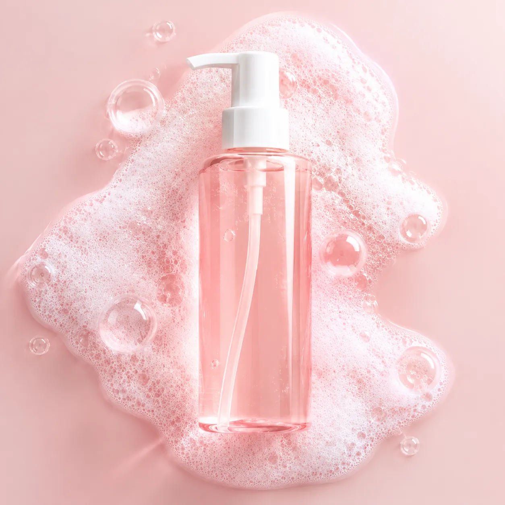</a>

> 一张极简美妆图，产品本身的质感就是布景：洁面瓶立在一团柔软的粉色泡沫中，泡沫以圆润的形状向外铺开，周围漂浮着细小的透明气泡。顶光和轮廓光穿透半透明的液体，让瓶内的吸管发光，正是这个细节营造出“高级感”。负面词禁止了手、杂物、硬阴影和变形的泵头。我们的成品是一只干净、无标签的瓶子，被轻盈的泡沫和光亮的气泡包围，背景是粉彩粉色，可以直接加上你的品牌。同时更换液体颜色和背景色（茶树用薄荷绿、蜂蜜用琥珀色），就能做一整条产品线。

```text
Premium minimalist skincare product photography. A translucent pink liquid cleanser bottle with a white pump dispenser placed vertically at the center of the frame. The bottle rests inside an organic pool of soft pink foamy bubbles, with airy soap lather spreading outward in smooth, rounded shapes. Small transparent bubbles float around the foam surface. Clean matte pastel pink background with subtle gradient. Soft diffused top lighting with gentle rim light creates a luminous glow through the liquid, highlighting the pump tube inside the bottle. Sharp focus, high clarity, realistic liquid refraction, smooth plastic and glass textures, luxury beauty advertising style, modern cosmetic branding, ultra-realistic, 8K detail, high dynamic range.

Negative Prompt:

hands, people, faces, clutter, harsh reflections, label distortion, unreadable text, warped pump, hard shadows, grain, noise, low resolution, CGI look, cartoon style, messy foam, uneven lighting, watermark
```

- 原作者: [@oggii_0](https://x.com/oggii_0)
- 原帖: https://x.com/oggii_0/status/2009163133810823368
- [在 cinel 上查看详情并一键生成](https://cinel.ai/zh/prompts/p/pink-foam-skincare-product-shot?utm_source=github&utm_medium=awesome&utm_campaign=awesome-gpt-image-2.5-prompts)

### 透过长虹玻璃看悬浮产品的广告提示词

<a href="https://cinel.ai/zh/prompts/p/levitating-product-pitch-black-ad?utm_source=github&utm_medium=awesome&utm_campaign=awesome-gpt-image-2.5-prompts">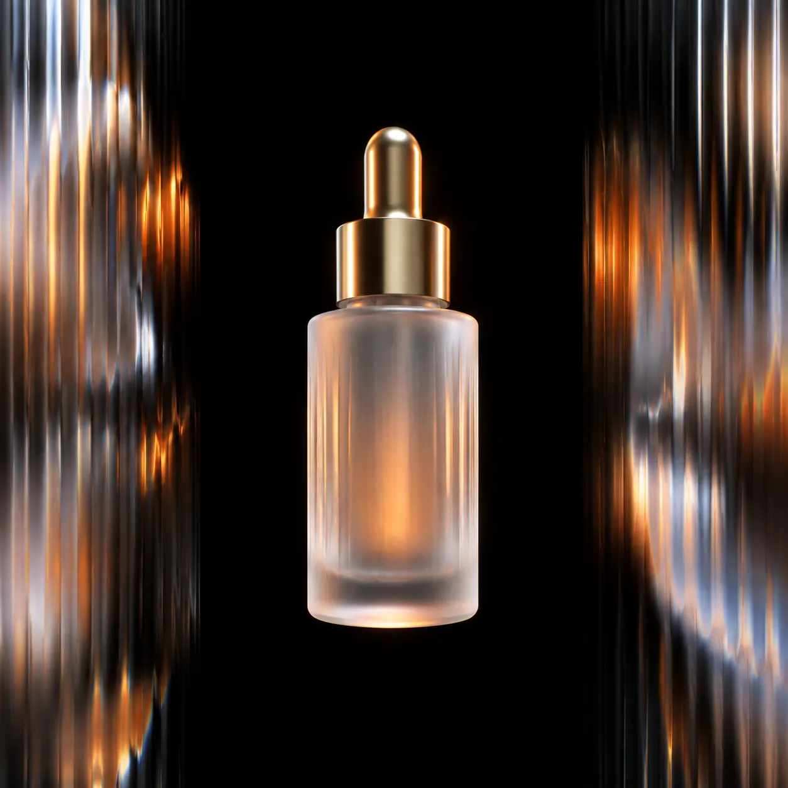</a>

> 黑色虚空主图的近亲，多了一个独特手法：透过竖向的长虹玻璃观看产品，画面边缘被折射成带轻微色散的光条，产品本身依然清晰。材质清单偏工业风（喷砂钛、拉丝铝、散热鳍片），配色只有黑、灰、白和一抹橙色光晕。我们用了一只无品牌的磨砂玻璃精华瓶配金色滴管：它悬浮在正中，内部透出温暖的光，两侧是琥珀色和银色的折射光柱。把材质清单换成与你产品相符的，保留长虹玻璃那一句即可。

```text
{
  "image_generation_request": {
    "subject": {
      "placeholder": "an unbranded frosted glass serum bottle with a gold dropper",
      "position": "dead center, eye-level, perfectly centered in frame",
      "presentation": "levitating, floating in a weightless void, no stands, no platforms, no pedestals, no visible supports"
    },
    "environment": {
      "background": "absolute solid pitch black, hex code #000000, infinite void",
      "lighting": "rim lighting, cinematic chiaroscuro, high-contrast glints on metallic edges, soft orange glow from internal recesses"
    },
    "aesthetic_style": {
      "textures": [
        "shot-blasted matte titanium",
        "brushed aerospace-grade aluminum",
        "anodized dark grey metal",
        "ribbed industrial vertical cooling fins"
      ],
      "optical_effects": "viewed through vertical fluted reeded glass, subtle chromatic distortion, refractive glass warping, radial motion blur on outer edges",
      "color_palette": {
        "primary_background": "#000000",
        "secondary_metal": "#8E8E8E",
        "accent_glow": "#FF8C00",
        "highlights": "#FFFFFF"
      }
    },
    "composition_constraints": {
      "framing": "ensure full product visibility, do not cut off edges, wide safety margins around the subject",
      "elements_to_exclude": [
        "text",
        "logos",
        "watermarks",
        "softboxes",
        "light stands",
        "floor",
        "horizon line",
        "props",
        "human hands",
        "shadows on surfaces"
      ]
    },
    "technical_specs": {
      "focal_length": "85mm macro lens",
      "depth_of_field": "deep focus on product, blurred refractive foreground glass",
      "render_engine": "photorealistic octane render, 8k resolution, ray-traced reflections"
    }
  }
}
```

- 原作者: [@lloydcreates](https://x.com/lloydcreates)
- 原帖: https://x.com/lloydcreates/status/2027745604600811970
- [在 cinel 上查看详情并一键生成](https://cinel.ai/zh/prompts/p/levitating-product-pitch-black-ad?utm_source=github&utm_medium=awesome&utm_campaign=awesome-gpt-image-2.5-prompts)

### 超大手机次元突破饮料广告提示词

<a href="https://cinel.ai/zh/prompts/p/oversized-phone-dimensional-break-ad?utm_source=github&utm_medium=awesome&utm_campaign=awesome-gpt-image-2.5-prompts">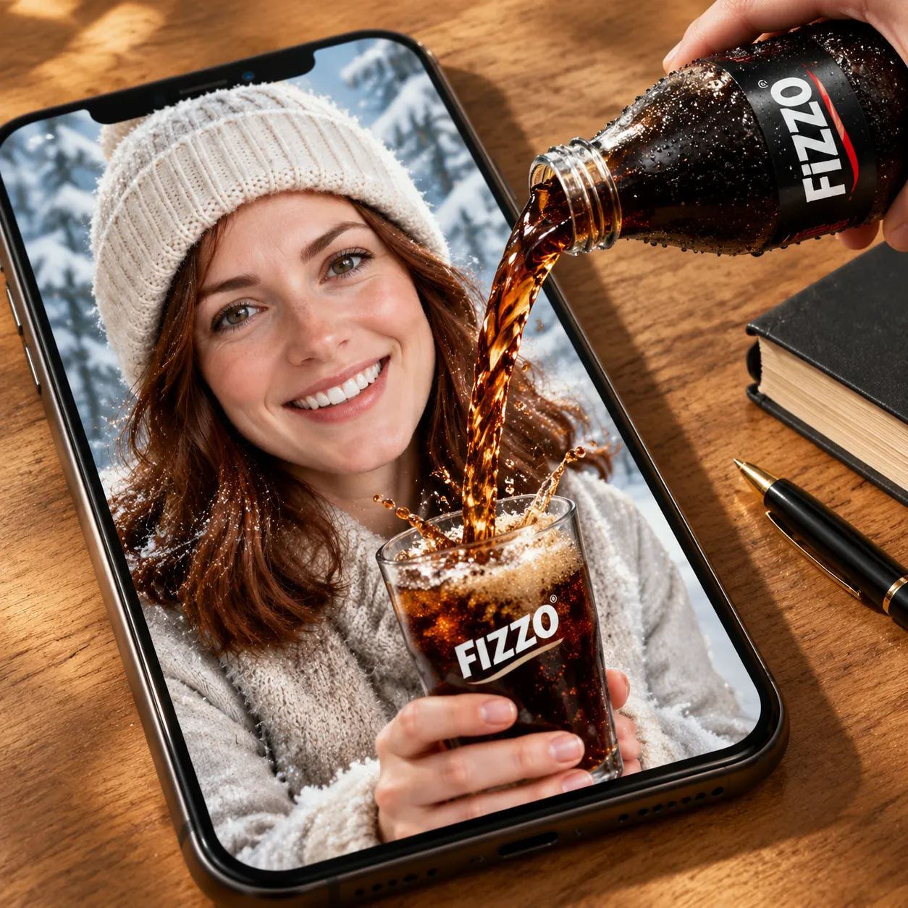</a>

> 创意和我们的“从手机里探身而出”提示词相近，但实现方式不同：这里人物留在超大手机的屏幕里，错觉来自液体——一只真实的手从真实的瓶子里倒出可乐，穿过屏幕，落进她的杯子。手机旁边一本合上的书和一支笔放大了手机的尺寸感。原文点名了一个著名可乐品牌，我们换成了虚构的“FIZZO”，模型给它配了简洁的黑白标签。用一张戴奶油色毛线帽女性的自有参考图，成品里她在雪景中微笑，可乐流进她的杯中。适合饮料、外卖或视频通话类广告。

```text
A hyper-realistic surreal composite scene set on a wooden tabletop. A large oversized smartphone dominates the frame, creating a strong dimensional-break illusion. On the phone screen, the woman from the reference image appears much larger in a close-up winter environment, smiling happily while holding a clear glass with a visible fictional 'FIZZO' logo on it.

A real human hand pours dark FIZZO cola from a cold bottle covered in condensation droplets directly toward the phone screen. The liquid visually breaks through the display and flows into the glass she is holding inside the screen, creating a powerful surreal effect.

A closed book and a black pen sit on the wooden table beside the oversized phone to emphasize scale distortion. Warm natural lighting, soft cinematic shadows, ultra-sharp liquid splash details, hyper-realistic skin texture, realistic reflections on glass and screen, surreal cinematic advertising look, professional commercial photography quality, 8K realism.
```

- 原作者: [@HaniaAi12](https://x.com/HaniaAi12)
- 原帖: https://x.com/HaniaAi12/status/2028309848429846690
- [在 cinel 上查看详情并一键生成](https://cinel.ai/zh/prompts/p/oversized-phone-dimensional-break-ad?utm_source=github&utm_medium=awesome&utm_campaign=awesome-gpt-image-2.5-prompts)

### 九宫格护肤晨间仪式拼图提示词

<a href="https://cinel.ai/zh/prompts/p/lifestyle-window-light-product-scene?utm_source=github&utm_medium=awesome&utm_campaign=awesome-gpt-image-2.5-prompts">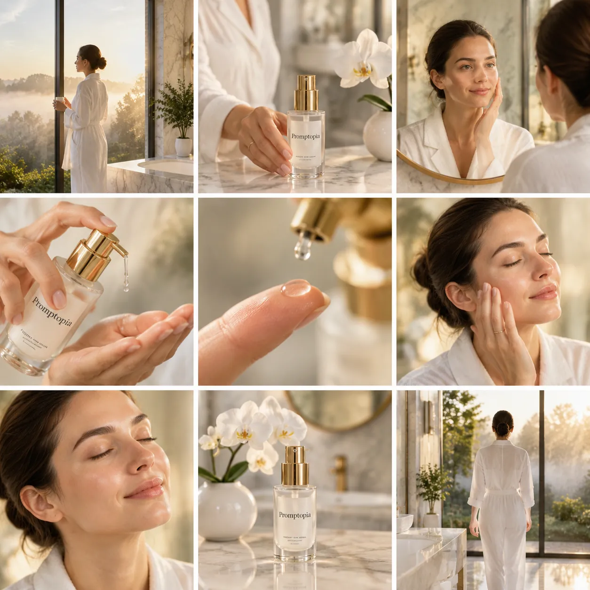</a>

> 一段 JSON 就是一整套美妆广告分镜：九个姿势从窗边站立、伸手拿瓶，到指尖上的一滴精华、闭眼涂抹、配兰花的静物，最后走开。服装、发型、带落地窗的大理石浴室、雾中花园景色和金色日出光线保持不变，所以整组拼图读起来是同一个早晨。我们的成品非常贴合顺序：三乘三网格，全景、中景、特写和微距交替，主角是一只金色泵头的瓶子。瓶身上是原提示词里的标签词，请替换成你自己的品牌。适合新品发布、详情页组图或短视频分镜。

```text
{
  "subject": {
    "person": "Woman, appears to be in her 20s or 30s",
    "pose_and_expression": [
      "Standing by window, looking out, relaxed",
      "Reaching for bottle on counter, hand focus",
      "Looking in mirror, slight smile",
      "Hand dispensing serum from bottle, close-up",
      "Serum drop on fingertip, macro shot",
      "Applying serum to face, eyes closed, serene",
      "Face close-up, eyes closed, content",
      "Bottle and orchid on counter, still life",
      "Walking away from camera, standing by window"
    ]
  },
  "clothing": {
    "items": "White robe, white pajamas/loungewear",
    "material": "Soft, flowing fabric",
    "style": "Casual, luxurious"
  },
  "hair": {
    "color": "Dark brown",
    "style": "Pulled back, neat bun or ponytail"
  },
  "face": {
    "makeup": "Natural, minimal",
    "skin": "Clear, glowing",
    "expression": "Calm, serene, content"
  },
  "accessories": {
    "jewelry": "Simple ring on ring finger",
    "props": [
      "Glass skincare bottle with gold pump dispenser",
      "Product label: 'Promptopia'",
      "White orchid in a small white vase"
    ]
  },
  "environment": {
    "location": "Modern, luxurious bathroom",
    "elements": [
      "Large floor-to-ceiling windows",
      "Marble countertop and walls",
      "Round mirror",
      "View of trees/garden outside",
      "Fog or mist outside window"
    ],
    "atmosphere": "Serene, spa-like, tranquil"
  },
  "lighting": {
    "source": "Natural daylight",
    "quality": "Warm, golden, soft, diffused",
    "time_of_day": "Sunrise or golden hour"
  },
  "camera": {
    "type": "Photography collage",
    "shots": [
      "Wide shot",
      "Medium shot",
      "Close-up",
      "Macro shot"
    ],
    "focus": "Sharp on subject and product, soft background blur (bokeh)"
  },
  "style": {
    "aesthetic": "Cinematic, editorial, beauty, wellness, clean, minimalist",
    "color_palette": "Warm neutrals, white, gold, natural greens"
  }
}
```

- 原作者: [@oggii_0](https://x.com/oggii_0)
- 原帖: https://x.com/oggii_0/status/2009580453083201822
- [在 cinel 上查看详情并一键生成](https://cinel.ai/zh/prompts/p/lifestyle-window-light-product-scene?utm_source=github&utm_medium=awesome&utm_campaign=awesome-gpt-image-2.5-prompts)

### 重新设计过时产品广告（日文提示词）

<a href="https://cinel.ai/zh/prompts/p/redesign-product-ad-ja?utm_source=github&utm_medium=awesome&utm_campaign=awesome-gpt-image-2.5-prompts">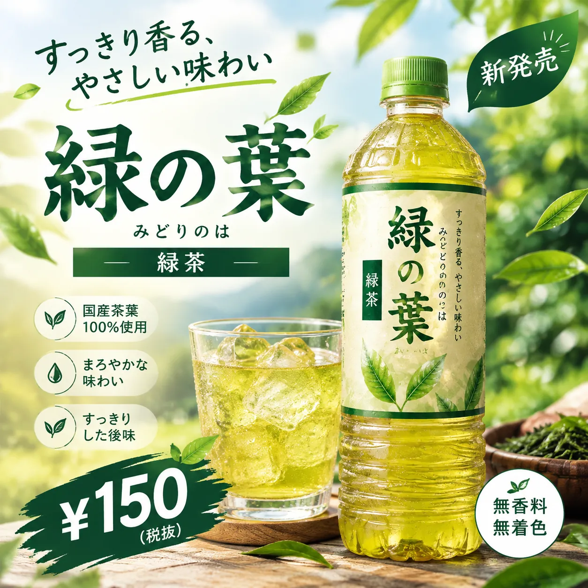</a>

> 两句简短的日文：“请以专业设计师的视角重新设计这张产品广告，做成符合当下趋势和目标人群的精致设计。”所有具体信息都来自上传的图片。我们特意做了一张虚构瓶装绿茶的老式传单，堆满剪贴画叶子，模型交回的是一张精致的日本便利店风格广告：木桌上清新的绿色瓶子、冰绿茶和茶叶，大号毛笔字品名，三个卖点徽章，“新发售”印章和价格爆炸贴。它甚至把品牌名本地化成了日文。使用前请校对它添加的每一条宣称（产地、“100%”、“无添加”）。

```text
この商品広告をプロのデザイナー目線でリデザインして。
今のトレンド、ターゲットに合わせた洗練されたデザインで。
```

- 原作者: [@genel_ai](https://x.com/genel_ai)
- 原帖: https://x.com/genel_ai/status/2046498264774791514
- [在 cinel 上查看详情并一键生成](https://cinel.ai/zh/prompts/p/redesign-product-ad-ja?utm_source=github&utm_medium=awesome&utm_campaign=awesome-gpt-image-2.5-prompts)

### 芒果百香果身体磨砂膏飞溅产品图提示词

<a href="https://cinel.ai/zh/prompts/p/tropical-body-scrub-jar-product-shot?utm_source=github&utm_medium=awesome&utm_campaign=awesome-gpt-image-2.5-prompts">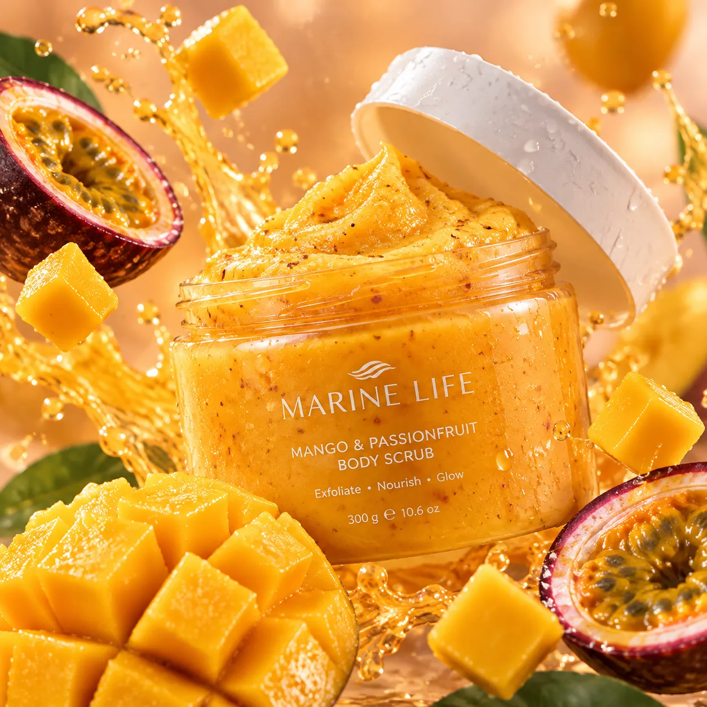</a>

> 这条为护肤新品设计的提示词，用水果来卖磨砂膏：一罐带果粒的黄橙色打发质地磨砂膏，白色盖子掀起，四周悬浮芒果丁和对半切的百香果，金色果汁在暖金色夕阳光和蜜桃色光斑中飞溅。它还附带一段独立的视频提示词和运镜（质地特写拉远、慢动作飞溅、360° 环绕、焦点转移到标签）。我们的静态图温暖多汁：磨砂质感的罐子正处于飞溅中，盖子倾斜，四周是芒果丁和油亮的百香果肉。原文使用了一个具体的品牌名，模型把它印在了罐子上；请换成你自己的品牌名。

```text
Luxurious tropical body scrub product photography, open jar of bright vibrant yellow-orange Mango & Passionfruit body scrub, creamy whipped texture with visible fruit particles, Marine Life brand, elegant minimal packaging, white lid slightly lifted, juicy mango cubes and halved passionfruit floating around, dynamic splash of golden-yellow liquid and fruit juice in the air, fresh exotic fruit pieces mid-air, glossy wet droplets, vibrant juicy colors, appetizing and premium aesthetic, warm golden hour lighting, soft bokeh background in warm peach tones, highly detailed, cinematic product shot, commercial advertising style, 8k, ultra realistic

Video prompt

Ultra-luxurious tropical body scrub commercial video. Open jar of Marine Life Mango & Passionfruit Body Scrub with creamy whipped texture and visible fruit particles. White lid slightly lifted. Juicy mango cubes and halved passionfruit floating dynamically around the jar. Golden-yellow liquid and fruit juice splash dramatically in mid-air. Fresh exotic fruit pieces hover and rotate around the product. Glossy wet droplets on jar and fruit, emphasizing freshness and luxury. Warm golden hour lighting with soft bokeh background in peach tones. Camera slowly circling the product, capturing texture, shine, and vibrant colors in ultra-realistic 8K detail. Cinematic close-ups, smooth slow motion for splashes and floating fruits, commercial advertising style. Background minimalistic to enhance premium aesthetic.
Optional camera directions / effects:
Start with extreme close-up on whipped texture, then pull out to reveal floating fruits.
Slow-motion splash of fruit juice with backlighting to highlight droplets.
Gentle rotating 360° pan around the jar for product showcase.
Focus pull from foreground fruit to product label.
Subtle lens flare from warm golden light for cinematic luxury feel.
```

- 原作者: [@Just_sharon7](https://x.com/Just_sharon7)
- 原帖: https://x.com/Just_sharon7/status/2017969858017931581
- [在 cinel 上查看详情并一键生成](https://cinel.ai/zh/prompts/p/tropical-body-scrub-jar-product-shot?utm_source=github&utm_medium=awesome&utm_campaign=awesome-gpt-image-2.5-prompts)

### 森林场景产品摄影 JSON 模板（双瓶）提示词

<a href="https://cinel.ai/zh/prompts/p/photoreal-product-photography-template?utm_source=github&utm_medium=awesome&utm_campaign=awesome-gpt-image-2.5-prompts">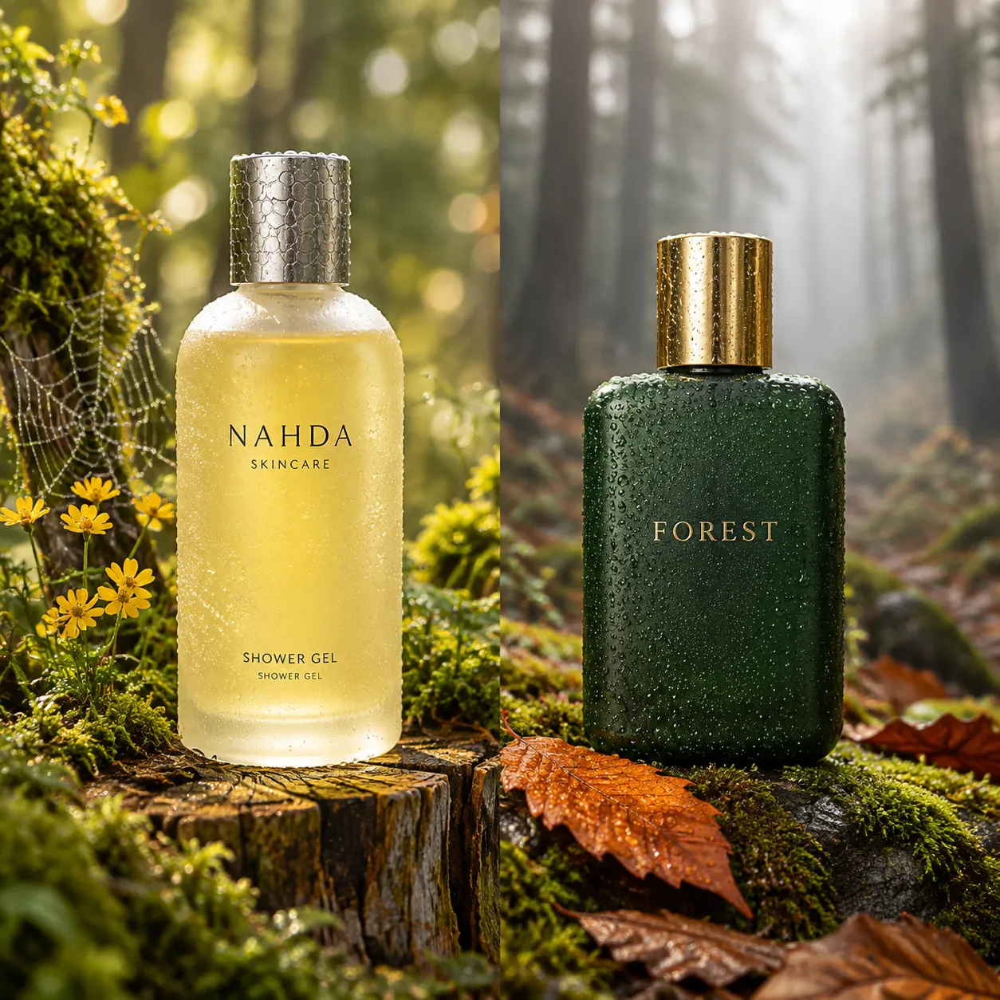</a>

> 这个模板不写一长句，而是把产品摄影拆成模块：全局设置（8K、微距清晰度、无瑕疵），然后每张图一个区块，分别写主体、标签文字、瓶盖材质、环境、光线、相机和色板。模块 1 是一瓶淡黄色磨砂玻璃沐浴露，银色蜂窝纹瓶盖，放在长满青苔、开着小黄花、挂着蛛网的树桩上；模块 2 是一瓶金色瓶盖的哑光绿香水，放在雾气弥漫的森林小径上。作为一条提示词运行时，我们的成品把两瓶放在了同一片阳光林地里并排展示，瓶身挂满水珠。如果想一图一瓶，就把每个模块分开发送。原文在结构中途就结束了。

```text
{
  "master_prompt": {
    "global_settings": {
      "resolution": "8K",
      "aspect_ratio": "1:1",
      "image_type": "photorealistic AI-generated product photography",
      "detail_level": "ultra-high detail, macro clarity",
      "noise": "none",
      "artifacts": "none",
      "focus": "sharp subject, controlled depth of field"
    },

    "module_1_image_1_style": {
      "subject": {
        "object_type": "cosmetic bottle",
        "label_text_visible": "NAHDA SKINCARE",
        "product_type_text": "SHOWER GEL / SHOWER GEL",
        "bottle_material": "frosted translucent glass",
        "liquid_color": "soft pale yellow",
        "shape": "cylindrical with rounded shoulders",
        "cap": {
          "material": "metallic",
          "color": "silver",
          "surface_pattern": "hexagonal honeycomb texture",
          "finish": "matte"
        },
        "surface_details": "small and medium water droplets evenly distributed"
      },
      "environment": {
        "setting": "forest floor",
        "base_surface": "weathered tree stump",
        "surroundings": [
          "green moss",
          "small yellow wildflowers",
          "tree trunk to the right",
          "fine spider web attached to moss"
        ],
        "background": "soft forest bokeh with diffused sunlight",
        "atmosphere": "humid, natural, calm"
      },
      "lighting": {
        "type": "natural diffused light",
        "direction": "soft backlight and side illumination",
        "highlights": "gentle glow through liquid",
        "shadows": "soft, natural"
      },
      "camera": {
        "angle": "eye-level product shot",
        "lens_style": "macro product photography",
        "depth_of_field": "shallow"
      },
      "color_palette": [
        "pale yellow",
        "soft green",
        "natural brown",
        "muted gold"
      ]
    },

    "module_2_image_2_style": {
      "subject": {
        "object_type": "perfume bottle",
        "label_text_visible": "FOREST",
        "bottle_color": "deep matte green",
        "material": "opaque glass",
        "shape": "rectangular with rounded edges",
        "cap": {
          "material": "metallic",
          "color": "gold",
          "finish": "glossy cylindrical"
        },
        "surface_details": "dense fine water droplets covering bottle"
      },
      "environment": {
        "setting": "forest pathway",
        "base_surface": "moss-covered stone or log",
        "foreground_elements": [
          "orange autumn leaf",
          "fallen brown leaves"
        ],
        "background": "tall trees fading into mist",
        "atmosphere": "misty, cool, forest depth"
      },
      "lighting": {
        "type": "warm ambient forest light",
        "direction": "top-front diffused",
        "effects": "soft glow and mist illumination"
      },
      "camera": {
        "angle": "straight-on centered composition",
        "lens_style": "portrait product lens",
        "depth_of_field": "moderate with soft background blur"
      },
      "color_palette": [
        "forest green",
        "gold",
        "autumn orange",
        "earth brown"
```

- 原作者: [@meng_dagg695](https://x.com/meng_dagg695)
- 原帖: https://x.com/meng_dagg695/status/2020094371107074147
- [在 cinel 上查看详情并一键生成](https://cinel.ai/zh/prompts/p/photoreal-product-photography-template?utm_source=github&utm_medium=awesome&utm_campaign=awesome-gpt-image-2.5-prompts)

### 白色线稿角色互动的极简产品图提示词

<a href="https://cinel.ai/zh/prompts/p/warm-beige-wall-minimal-product-shot?utm_source=github&utm_medium=awesome&utm_campaign=awesome-gpt-image-2.5-prompts">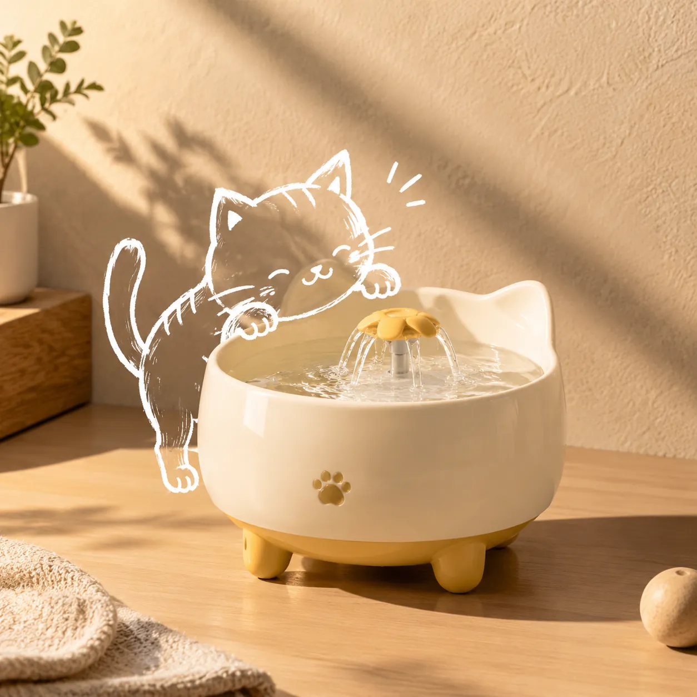</a>

> 混合媒介让普通的产品图变得有趣：真实照片里，产品放在简单的桌面上，背后是米色肌理墙和长长的阳光阴影，一个白色手绘线稿角色在和产品互动。提示词开头的产品栏位没有填写，所以示例中我们只指定了线稿角色（一只小猫）；模型自己挑了一件匹配的产品——一台猫耳造型的陶瓷宠物饮水机，并画了一只白色线条小猫探身去喝水。成品温暖可爱，适合宠物品牌、家居用品或任何需要个性又不想布景繁杂的产品。想要结果可控，请务必在开头写明你的产品和摆放位置。

```text
Product description and its placement], minimalist product photography, clean warm studio scene, textured beige wall in the background, soft directional sunlight creating long shadows, simple table surface, the product placed in a playful conceptual composition, overlaid with a hand-drawn white outline doodle small cat interacting with the product, mixed media style combining real photography and sketch illustration, premium branding feel, shallow depth of field, ultra-realistic, no extra text, no watermarks, 8K, 1:1.
```

- 原作者: [@Sheldon056](https://x.com/Sheldon056)
- 原帖: https://x.com/Sheldon056/status/2029211910621806728
- [在 cinel 上查看详情并一键生成](https://cinel.ai/zh/prompts/p/warm-beige-wall-minimal-product-shot?utm_source=github&utm_medium=awesome&utm_campaign=awesome-gpt-image-2.5-prompts)

### 植物系护肤按压瓶产品图提示词

<a href="https://cinel.ai/zh/prompts/p/matte-pump-bottle-skincare-product-shot?utm_source=github&utm_medium=awesome&utm_campaign=awesome-gpt-image-2.5-prompts">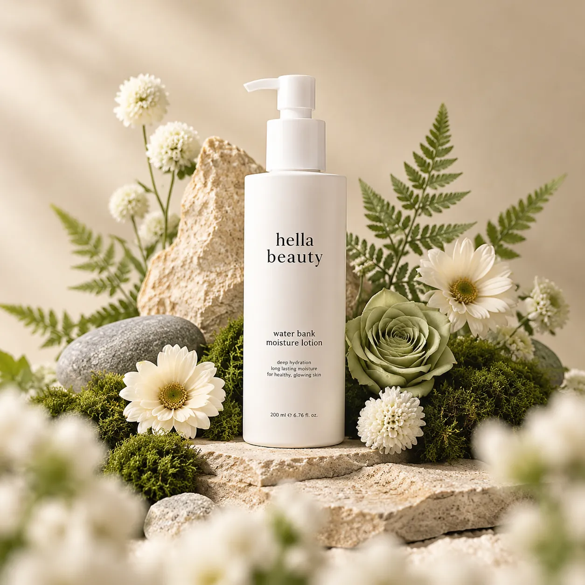</a>

> 一个平静、有水疗感的产品场景，靠的是精心列出的道具：哑光白色按压瓶立在层叠的天然石头上，周围是灰色鹅卵石、浅色肌理岩石、苔藓、白色绒球花、奶油色雏菊、蕨叶和一朵鼠尾草绿玫瑰，前景还有虚化的白花增加纵深。左上方的柔和日光和暖米色背景让一切都很温柔。我们的成品均衡、高级，提示词里的标签文字连小字都渲染得很干净。注意原文使用了一个品牌风格的标签，改编时请换成你自己的名称。非常适合乳液、精华和植物系身体护理产品。

```text
Ultra-high-end photorealistic commercial skincare product photography featuring a matte white plastic pump bottle centered and upright, labeled “hella beauty” in clean black minimalist typography with smaller text reading “water bank moisture lotion” and subtle product details beneath, the bottle placed on a layered natural stone surface surrounded by carefully arranged organic props including smooth gray river stones, pale beige textured rock formations, soft green moss clusters,delicate white pom-pom flowers, cream-colored
daisy-like blossoms, light green fern leaves, and a
muted sage rose, all arranged in a balanced
symmetrical composition, background a soft warm
beige studio backdrop with gentle gradient and no
visible edges, foreground partially framed by softly
blurred out-of-focus white flowers creating depth,
lighting soft diffused daylight-style studio lighting
from upper left producing gentle shadows, natural
highlights on the bottle and petals, and a calm airymood, color palette dominated by warm neutrals, soft
whites, sage greens, and muted earth tones, textures
highly detailed including matte plastic, porous stone,
velvety petals, and moist moss, shallow depth of field
with sharp focus on the product label and midground
elements and smooth bokeh in foreground and
background, premium botanical skincare advertising aesthetic,
clean minimal luxury composition, cinematic realism,
ultra-detailed 8K, studio-grade hyperrealism, no extra
text, no borders, no stylization beyond natural
photorealism.
```

- 原作者: [@ChillaiKalan__](https://x.com/ChillaiKalan__)
- 原帖: https://x.com/ChillaiKalan__/status/2016138326571626611
- [在 cinel 上查看详情并一键生成](https://cinel.ai/zh/prompts/p/matte-pump-bottle-skincare-product-shot?utm_source=github&utm_medium=awesome&utm_campaign=awesome-gpt-image-2.5-prompts)

### 青橙配色复古摩登群像时装广告提示词

<a href="https://cinel.ai/zh/prompts/p/retro-modern-studio-fashion-ad?utm_source=github&utm_medium=awesome&utm_campaign=awesome-gpt-image-2.5-prompts">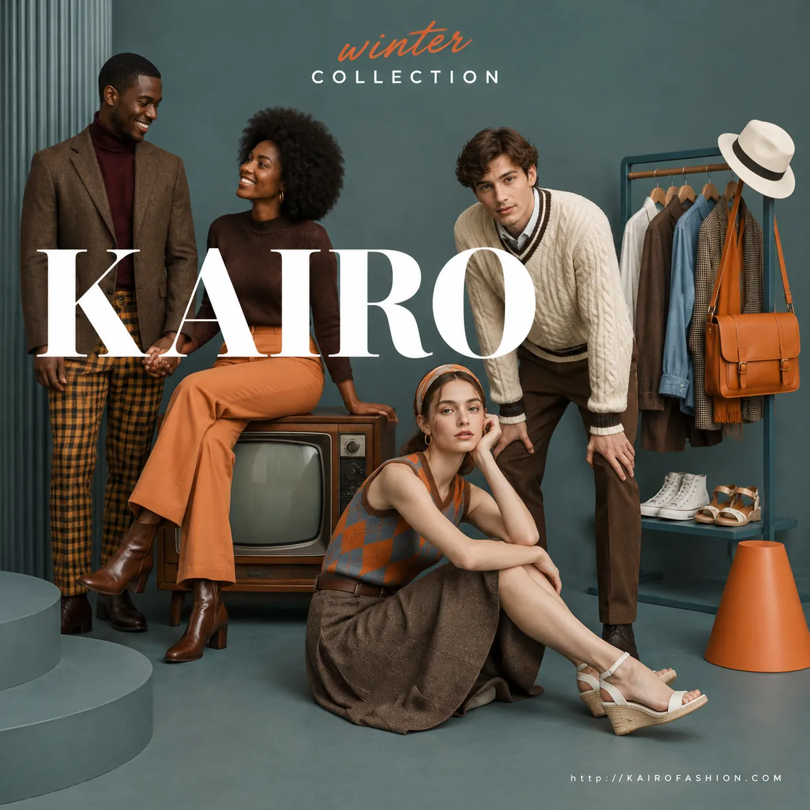</a>

> 一条提示词就完成了整套广告的艺术指导。它规定了布景（#506D6D 青灰色背景、凹槽柱和阶梯式圆台），逐一设计了四位模特的造型（粗花呢西装配格纹裤、焦橙色喇叭裤、菱格背心配发带、绞花针织毛衣），摆放了道具（1950 年代木壳电视、挂着软呢帽和橙色邮差包的衣架、截顶圆锥），甚至指定了字体排版。我们的成品高度还原：一张温暖、秋意浓的群像，超大衬线字“KAIRO”横穿模特之间，顶部是“winter COLLECTION”，底部有一行小网址。色值让配色分毫不差。使用前请把名称和网址换成你自己的。

```text
A wide-angle, studio fashion advertisement with a sophisticated retro-modern aesthetic. The scene is set against a monochromatic teal-grey (#506D6D) architectural backdrop featuring minimalist geometric props, including a fluted column and stepped circular platforms. The lighting is professionally diffused studio light, creating soft, graduated shadows that provide depth without harshness.

The Subjects:
Four models are posed in a cohesive, stylish group dynamic:

A Black man on the far left, standing tall in a brown tweed blazer, a deep burgundy turtleneck, and dark yellow-and-brown checkered trousers. He is smiling and warmly holding the hand of the woman next to him.

A Black woman with a voluminous afro, sitting sideways on a vintage 1950s wooden television set. She wears a dark brown knit top and vibrant burnt orange (#E88D4D) trousers with sleek brown leather boots.

A White woman sitting on the floor in the center, leaning forward with her hand to her face. she wears a vintage-style headband, an argyle-patterned sleeveless top in orange and slate blue, a brown wool skirt, and white wedge sandals.

A White man leaning into the frame from the center-right, hands on his knees. He wears a heavy cream-colored cable-knit sweater with dark trim and tailored brown trousers.
Furniture & Props:
To the right stands a minimalist dark teal industrial clothing rack. It displays curated garments including hanging shirts, a wide-brimmed white fedora, and a prominent structured orange leather messenger bag. At the base of the rack are white high-top sneakers and sandals. A single, truncated orange cone prop sits in the foreground.
Primary Text: A massive, high-contrast white serif font (Bodoni-style) reading "KAIRO" is overlaid across the center-left, partially occluding the models to create a layered, 3D effect.
Header: At the top center, the words "winter" (in orange cursive script) and "COLLECTION" (in white clean sans-serif) are centered.
Footer: The URL "http://KAIROFASHION.COM" is printed in small, wide-tracked white sans-serif in the bottom right corner.
Color Palette:
A sophisticated mix of Teal-Grey, Burnt Orange, Chocolate Brown, and Crisp White, creating a warm yet muted autumnal atmosphere.
```

- 原作者: [@rovvmut_](https://x.com/rovvmut_)
- 原帖: https://x.com/rovvmut_/status/2029228739192865157
- [在 cinel 上查看详情并一键生成](https://cinel.ai/zh/prompts/p/retro-modern-studio-fashion-ad?utm_source=github&utm_medium=awesome&utm_campaign=awesome-gpt-image-2.5-prompts)

### 海浪冲刷的古铜精华瓶产品图提示词

<a href="https://cinel.ai/zh/prompts/p/bronzing-drops-beach-product-shot?utm_source=github&utm_medium=awesome&utm_campaign=awesome-gpt-image-2.5-prompts">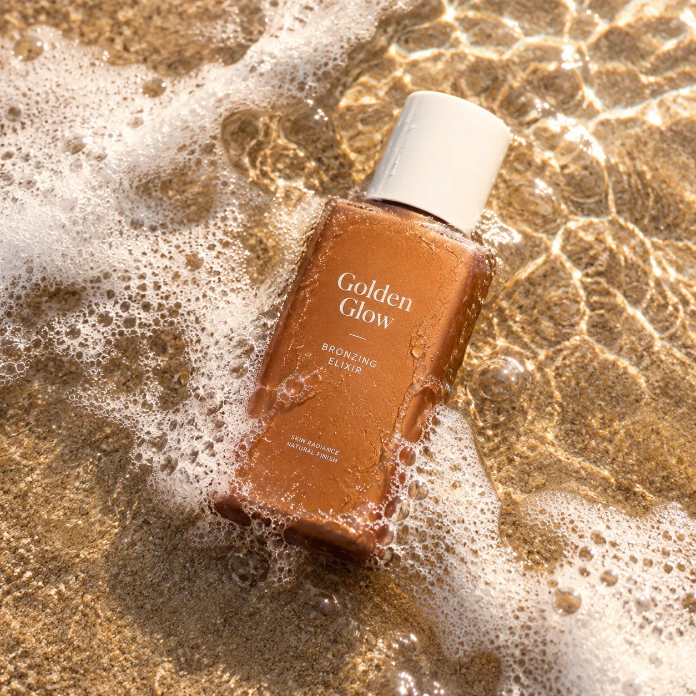</a>

> 一张用真实海水代替棚拍飞溅的夏季新品图：一只白色瓶盖的长方形哑光古铜色瓶子斜躺在湿沙上，温柔的海浪漫过它，瓶底周围是海沫和细小的气泡，水流过标签，浅而清澈的水下能看到细沙，一切都沐浴在上方温暖的夕阳金光中。我们的成品有一种迷人的日晒光泽：蕾丝般的海沫环绕瓶身，涟漪闪着金光，标签是干净的两行字。水流过标签时文字常会变形，所以产品名要短。适合美黑产品、防晒霜和身体油，也很容易改成泳池或礁石潮池场景。

```text
Ultra-realistic summer skincare product photography of a bronzing drop bottle named "Golden Glow - Bronzing Elixir", rectangular matte bottle in warm sun-kissed bronze tone with a clean white cap, placed diagonally on wet beach sand as a gentle ocean wave washes over it, delicate sea foam and tiny bubbles surrounding the base, water partially flowing across the label, fine sand texture visible beneath shallow clear water, golden sunlight casting natural highlights and soft shadows, high-detail water ripples and realistic foam patterns, fresh summer aesthetic, minimal clean branding centered and sharp, warm golden-hour beach lighting, cinematic top-down flat lay composition, natural reflections on wet surface, editorial beauty campaign style, ultra-detailed, photorealistic 8K, soft warm color grading, luxury skincare advertisement Aspect ratio 4.5
```

- 原作者: [@YaseenK7212](https://x.com/YaseenK7212)
- 原帖: https://x.com/YaseenK7212/status/2021835757183209806
- [在 cinel 上查看详情并一键生成](https://cinel.ai/zh/prompts/p/bronzing-drops-beach-product-shot?utm_source=github&utm_medium=awesome&utm_campaign=awesome-gpt-image-2.5-prompts)

### 一件产品生成九宫格社交图提示词

<a href="https://cinel.ai/zh/prompts/p/product-instagram-feed-nine-images?utm_source=github&utm_medium=awesome&utm_campaign=awesome-gpt-image-2.5-prompts">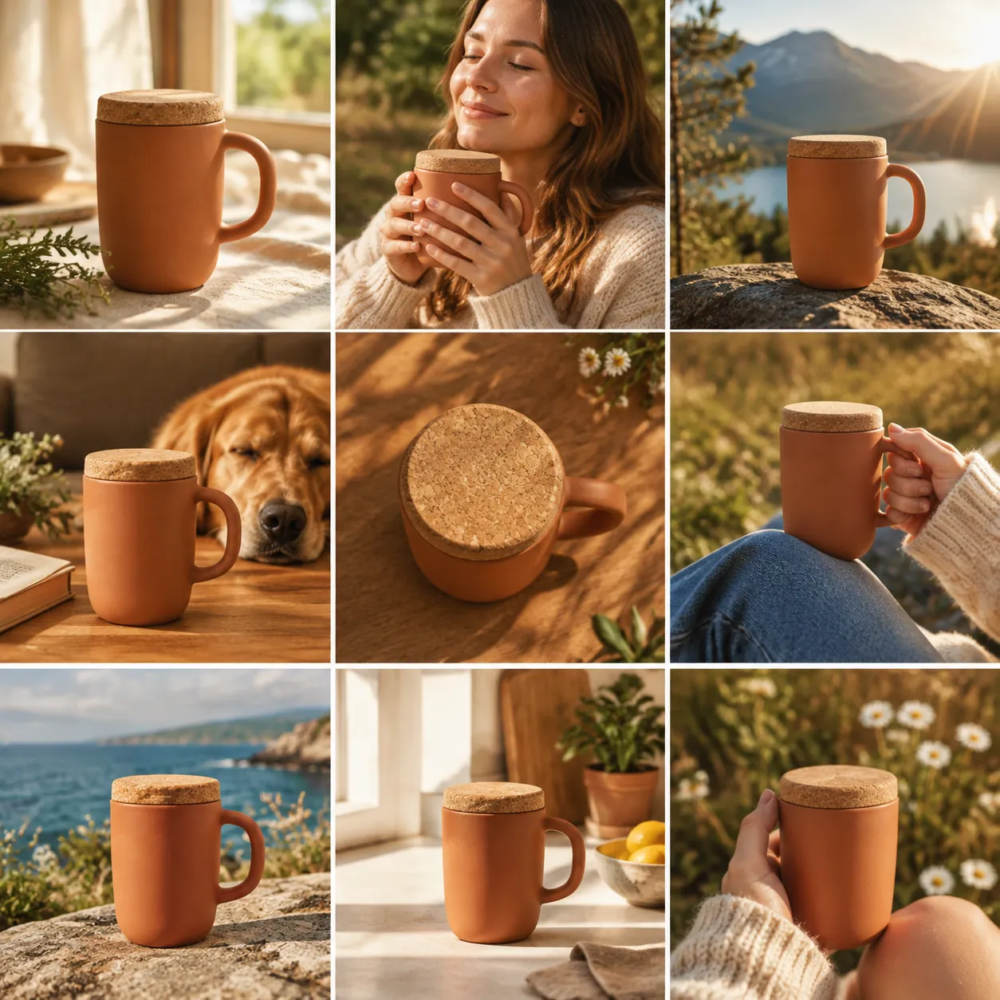</a>

> 一条两句话的提示词，能省下一周的拍摄：附上一张产品照，要求用同一种美学生成九张社交图，地点、角度和构图各不相同，并融入人物、动物和自然。我们在风格栏位填入“温暖、阳光的胶片摄影美学”，参考图是一只软木盖的哑光陶土色随行杯。成品是一张可信的九宫格：杯子在早餐桌上、被微笑的女性捧着、在湖边岩石上、在昏昏欲睡的金毛旁、俯拍露出软木盖、在海边被握在手里、在雏菊丛中。杯子的形状和颜色在九格中都保持一致。

```text
Create a 9-image Instagram feed for this product in a warm, sunlit film-photography aesthetic. Use different locations, angles, and compositions, incorporating people, animals, nature, and various environments while maintaining a cohesive visual style.
```

- 原作者: [@gizakdag](https://x.com/gizakdag)
- 原帖: https://x.com/gizakdag/status/2027122256426521040
- [在 cinel 上查看详情并一键生成](https://cinel.ai/zh/prompts/p/product-instagram-feed-nine-images?utm_source=github&utm_medium=awesome&utm_campaign=awesome-gpt-image-2.5-prompts)

### 水雾爆裂中的跑车棚拍产品图提示词

<a href="https://cinel.ai/zh/prompts/p/rain-mist-sports-car-studio-product-shot?utm_source=github&utm_medium=awesome&utm_campaign=awesome-gpt-image-2.5-prompts">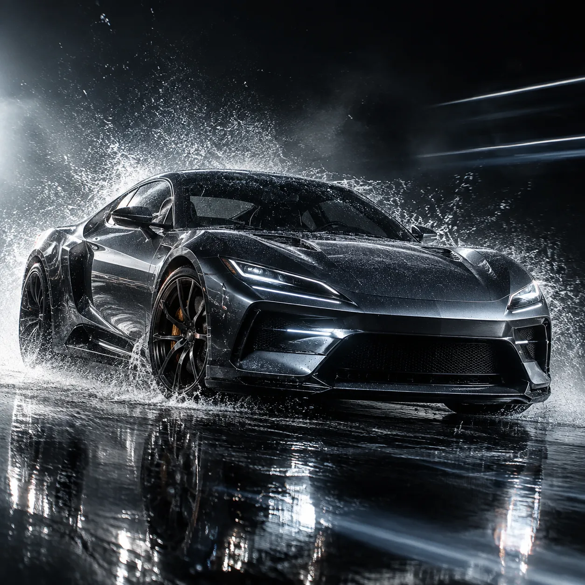</a>

> 一段话就是一套经典汽车广告公式：前侧四分之三英雄角度，亮面车漆带锐利高光，水雾和雨滴在车身周围以定格动态炸开，光线拖尾表现速度，深色极简影棚配强烈轮廓光。原文只写了一辆泛指的豪华跑车，我们的第一版渲染却偏向了某款真实车型和它的车标，所以我们改写成一辆原创车身、无标识的概念跑车。最终成品戏剧感强又干净：一辆深石墨色轿跑，细长的 LED 灯和古铜色卡钳，水花从车轮甩出，倒映在湿润的黑色地面上。可用于汽车美容、轮胎或精洗推广。

```text
Hyper-realistic cinematic product photograph of an unbadged luxury sports concept car with an original body design and no logos or badges, front three-quarter view, glossy paint reflecting sharp highlights. Water mist and rain droplets explode around the car in frozen motion, light streaks emphasizing speed. Dramatic studio lighting with strong rim light and soft fill, shallow depth of field, ultra-sharp focus, dark minimal background, premium automotive advertising realism.
```

- 原作者: [@Strength04_X](https://x.com/Strength04_X)
- 原帖: https://x.com/Strength04_X/status/2020318286538473577
- [在 cinel 上查看详情并一键生成](https://cinel.ai/zh/prompts/p/rain-mist-sports-car-studio-product-shot?utm_source=github&utm_medium=awesome&utm_campaign=awesome-gpt-image-2.5-prompts)

### 产品与成分俯拍平铺广告提示词

<a href="https://cinel.ai/zh/prompts/p/top-down-flat-lay-skincare-ad-zh?utm_source=github&utm_medium=awesome&utm_campaign=awesome-gpt-image-2.5-prompts">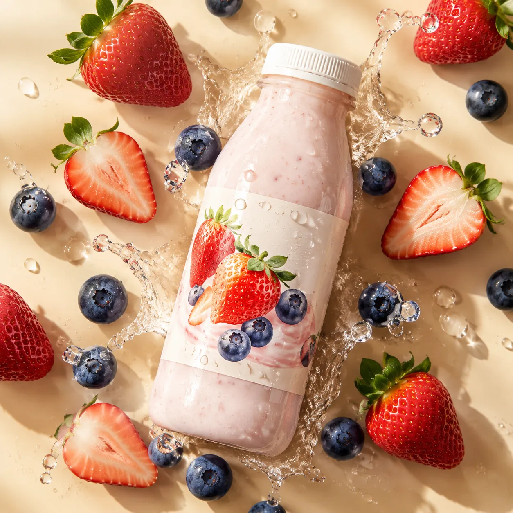</a>

> 一个只有两个空的紧凑中文模板：产品和成分。它让产品居中俯拍平铺，四周环绕新鲜的整颗和切片成分，产品周围有冻结的水花、标签上挂着露珠，在温暖米色无缝背景上用柔和定向日光照明，并指定 100mm 镜头、f/8 光圈，保证画面整体清晰。虽然写的是护肤品广告，用在食品上也很合适：我们填入了一瓶草莓酸奶、草莓和蓝莓。成品明亮诱人，粉色瓶子斜躺在对半切的草莓和挂着水珠的蓝莓之间，水花在空中定格。很适合电商主图。

```text
一瓶草莓酸奶，俯视平铺中心位置，周围环绕草莓和蓝莓，新鲜切片和整块，光泽湿润外观，水花冻结在产品周围，露珠附着在标签和表面，温暖米色无缝背景，柔和定向日光，清晰逼真阴影，高端护肤品广告，超逼真宏观产品摄影，100mm 镜头效果，f/8 锐焦，干净构图，无额外文字，8k，1:1
```

- 原作者: [@0xluffy_eth](https://x.com/0xluffy_eth)
- 原帖: https://x.com/0xluffy_eth/status/2015689672807297132
- [在 cinel 上查看详情并一键生成](https://cinel.ai/zh/prompts/p/top-down-flat-lay-skincare-ad-zh?utm_source=github&utm_medium=awesome&utm_campaign=awesome-gpt-image-2.5-prompts)

### 绿色奢华时装双模特海报提示词

<a href="https://cinel.ai/zh/prompts/p/green-fashion-ad-two-models?utm_source=github&utm_medium=awesome&utm_campaign=awesome-gpt-image-2.5-prompts">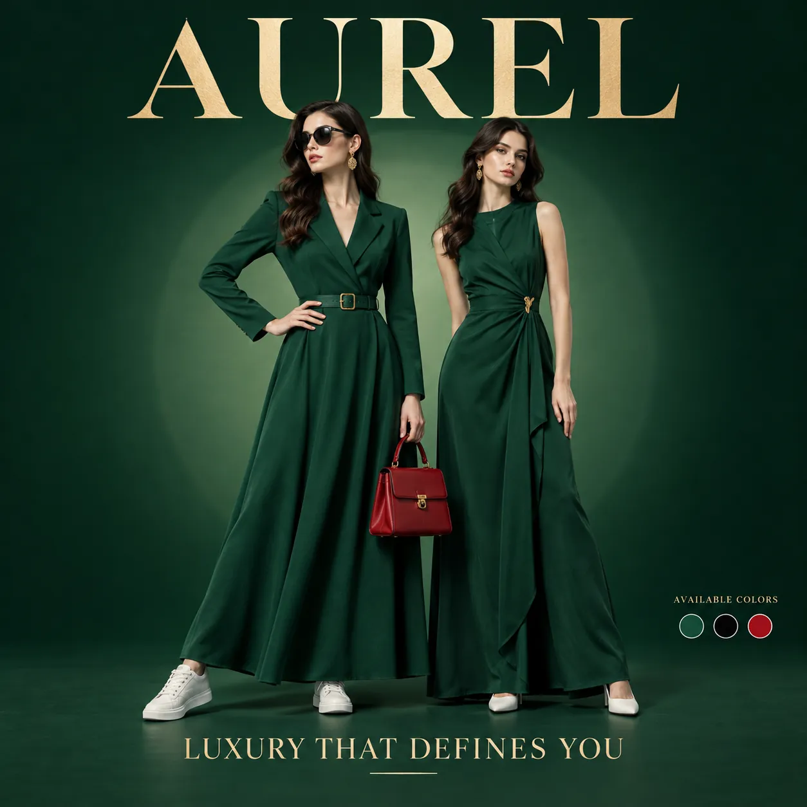</a>

> 一条提示词就完成了一张目录式海报：两位全身模特站在带柔和圆形光晕的深绿背景前，一位穿系腰带的绿色长裙、白色运动鞋、戴墨镜、拎红色手袋，另一位穿与之呼应的优雅造型；顶部是大号衬线品牌名，底部是标语“LUXURY THAT DEFINES YOU”，还有一个小小的“AVAILABLE COLORS”面板，配绿、黑、红三个色点。我们把“BRAND NAME”占位符换成了虚构名称 AUREL。成品精致且切题，红色手袋在一片绿色中格外跳。原文留了一行空着的“小字”，请补上你自己的副标语或删掉。

```text
Luxury fashion advertisement poster, deep green background with a soft circular gradient behind the model, two stylish female models standing full body. First model wearing a long elegant green dress with waist belt, white sneakers, sunglasses, holding a red handbag, confident pose with one hand on waist looking sideways. Second female model standing beside her in a different pose, slightly angled stance with relaxed arms, wearing a similar elegant fashion outfit matching the luxury theme. Studio lighting, minimal shadows, ultra-clean composition, premium fashion campaign style.

At the top place large bold luxury serif text “AUREL” (same placement and style as luxury fashion brands).

At the bottom add text:
“LUXURY THAT DEFINES YOU”
Below it smaller text:

Add a small side section titled “AVAILABLE COLORS” with three small circular color indicators: Green, Black, Red.

Highly detailed, fashion catalog quality, DSLR photography style, 8k resolution, symmetrical layout, luxury branding aesthetic, professional advertising poster.
```

- 原作者: [@auqibhabib](https://x.com/auqibhabib)
- 原帖: https://x.com/auqibhabib/status/2030906462999122123
- [在 cinel 上查看详情并一键生成](https://cinel.ai/zh/prompts/p/green-fashion-ad-two-models?utm_source=github&utm_medium=awesome&utm_campaign=awesome-gpt-image-2.5-prompts)

### 满手泡沫握着洗发水瓶的产品图提示词

<a href="https://cinel.ai/zh/prompts/p/lathered-hands-shampoo-bottle-product-shot?utm_source=github&utm_medium=awesome&utm_campaign=awesome-gpt-image-2.5-prompts">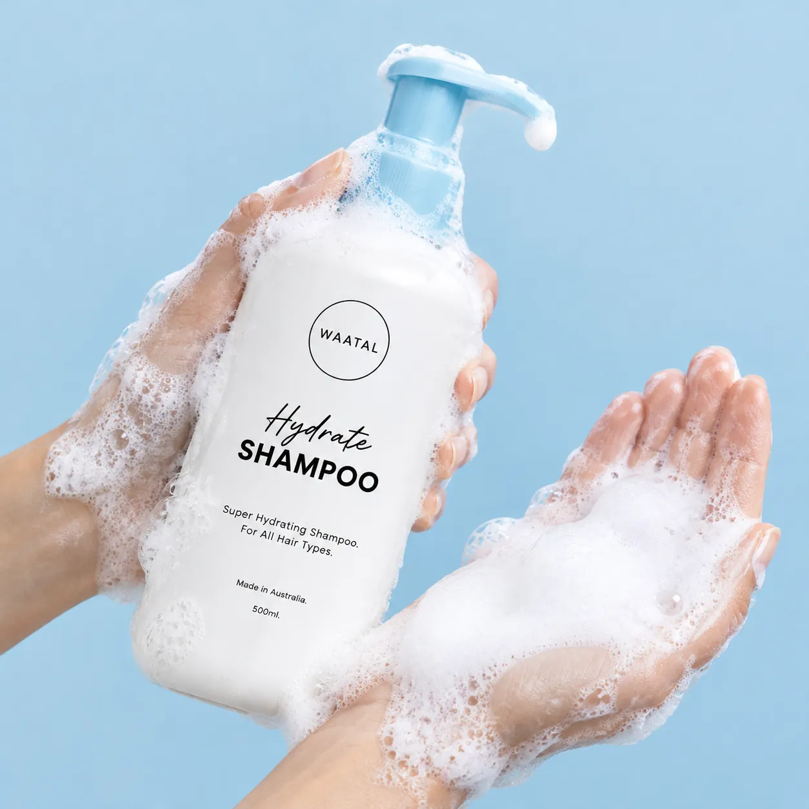</a>

> 一张清新、有触感的洗护产品图，把产品放进使用场景：两只覆满厚厚白色泡沫的手，一只握着配浅蓝色按压头的哑光白色瓶子，另一只手捧着接住泡沫，背景是无缝的浅蓝色，光线柔和均匀。JSON 把标签细化到标志和小字，所以文字渲染得很干净。我们的成品明亮干净：泡沫从按压头溢出、顺着瓶身流下，圆形标志下方是手写体加粗体的“Hydrate SHAMPOO”。注意标签里有一个虚构品牌、一行“澳大利亚制造”和容量；请把这三项都换成你自己产品的真实信息。

```text
{
  "product_photography_prompt": {
    "subject": "Hands holding a shampoo bottle with lather.",
    "hands": {
      "description": "A person's hands with natural skin tone.",
      "action": "One hand holds the bottle, the other is cupped to catch foam.",
      "condition": "Covered in thick, white, bubbly soap lather."
    },
    "bottle": {
      "type": "Pump bottle.",
      "material": "Matte white plastic.",
      "dispenser": "Light blue pump.",
      "contents": "White shampoo, visible as foam."
    },
    "label": {
      "color": "White",
      "text_color": "Black",
      "logo": "Circular with 'WAATAL' inside.",
      "main_text": "Hydrate SHAMPOO (script and bold font).",
      "sub_text": "Super Hydrating Shampoo. For All Hair Types. Made in Australia. 500ml."
    },
    "foam": {
      "texture": "Thick, rich, bubbly lather.",
      "color": "White",
      "location": "Covering hands, bottle neck, and dispenser."
    },
    "background": {
      "color": "Solid soft light blue.",
      "texture": "Seamless, smooth studio background."
    },
    "lighting": {
      "type": "Soft, diffused studio lighting.",
      "direction": "Even illumination, highlighting foam texture and hands."
    },
    "style": {
      "type": "Clean, minimalist product photography.",
      "shot": "Close-up.",
      "focus": "Sharp focus on hands, bottle, and foam.",
      "mood": "Fresh, clean, natural."
    }
  }
}
```

- 原作者: [@Maercihh](https://x.com/Maercihh)
- 原帖: https://x.com/Maercihh/status/2025163854469341484
- [在 cinel 上查看详情并一键生成](https://cinel.ai/zh/prompts/p/lathered-hands-shampoo-bottle-product-shot?utm_source=github&utm_medium=awesome&utm_campaign=awesome-gpt-image-2.5-prompts)

### 纸质挂历桌边静物

<a href="https://cinel.ai/zh/prompts/p/paper-wall-calendar-desk-still?utm_source=github&utm_medium=awesome&utm_campaign=awesome-gpt-image-2.5-prompts">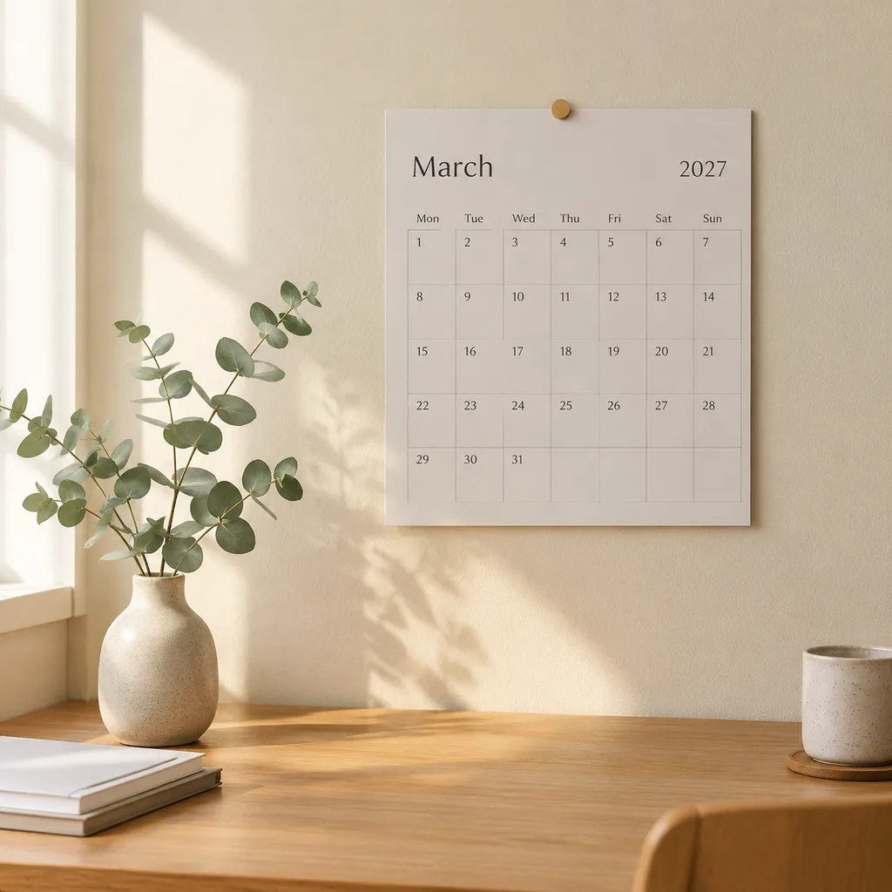</a>

> 根据 @EmilioSchwaiger 分享的一行提示词扩写（原帖在对比 Nano Banana 模型）。我们把它建成完整的桌边静物：周一为始的2027年3月挂历、尤加利与斯堪的纳维亚晨光。适合文具广告、手账封面和书桌布置帖子。

```text
A minimalist still life photograph, square 1:1: a paper wall calendar for March 2027 with weeks beginning on Monday, pinned on a warm cream wall above a wooden desk, a sprig of eucalyptus in a small vase beside it, soft morning window light, clean typography on the calendar grid, calm Scandinavian desk atmosphere, photorealistic, no other text. Square 1:1 composition.
```

- 原作者: [@EmilioSchwaiger](https://x.com/EmilioSchwaiger)
- 原帖: https://x.com/EmilioSchwaiger/status/2109585209687416957
- [在 cinel 上查看详情并一键生成](https://cinel.ai/zh/prompts/p/paper-wall-calendar-desk-still?utm_source=github&utm_medium=awesome&utm_campaign=awesome-gpt-image-2.5-prompts)

### 产品展示视频展台关键帧

<a href="https://cinel.ai/zh/prompts/p/product-presentation-video-podium-keyframe?utm_source=github&utm_medium=awesome&utm_campaign=awesome-gpt-image-2.5-prompts">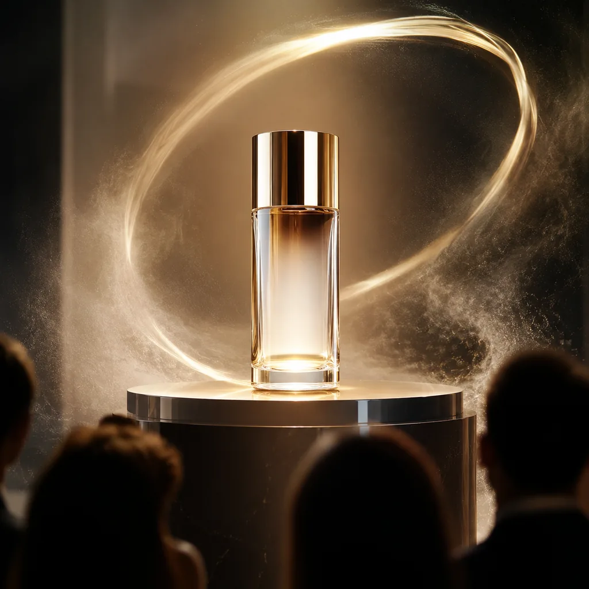</a>

> 根据 @MeenakshiYACS 的产品转视频帖改写成1:1高光帧。我们定格展台亮相并去除品牌。适合美妆上新、店铺横幅和广告概念图。

```text
Photorealistic product video keyframe, square 1:1: an unbranded cosmetic bottle on a glossy podium frozen at the hero moment of a presentation video, a slow arc of golden light and soft mist around it, blurred studio audience silhouettes at the edges, premium cinematic product film still, clean composition, no text, no logo. Square 1:1 composition.
```

- 原作者: [@MeenakshiYACS](https://x.com/MeenakshiYACS)
- 原帖: https://x.com/MeenakshiYACS/status/2110586865426546858
- [在 cinel 上查看详情并一键生成](https://cinel.ai/zh/prompts/p/product-presentation-video-podium-keyframe?utm_source=github&utm_medium=awesome&utm_campaign=awesome-gpt-image-2.5-prompts)

### 新粗野主义能量饮料海报

<a href="https://cinel.ai/zh/prompts/p/neo-brutalism-energy-drink-poster?utm_source=github&utm_medium=awesome&utm_campaign=awesome-gpt-image-2.5-prompts">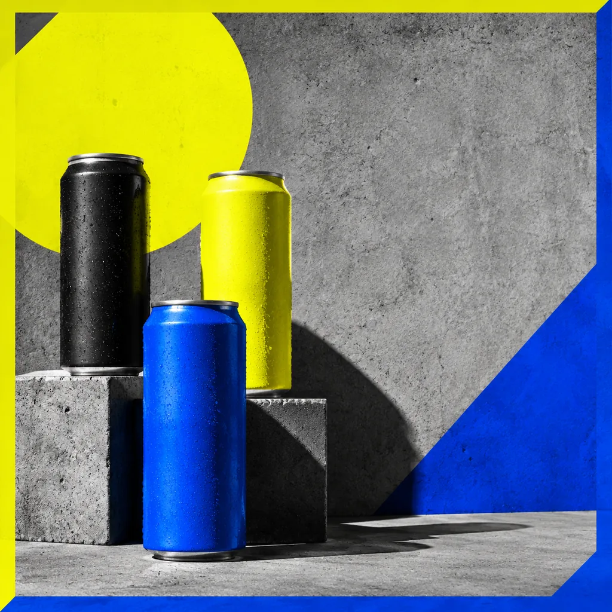</a>

> 根据 @Diplomeme 的 GPT Image 2.5 分享标题《NEO-BRUTALISM × ENERGY DRINKS》补全（完整提示词在评论区）。我们去除了品牌。适合饮料广告、海报版式和社媒 campaign。

```text
A neo-brutalist energy-drink poster, square 1:1: three unbranded aluminium cans in bold black, acid yellow and electric blue on a raw concrete background, hard shadows, oversized geometric shapes and thick borders, punchy studio lighting, premium advertising layout with large blank space for copy, no readable brand text, no logo. Square 1:1 composition.
```

- 原作者: [@Diplomeme](https://x.com/Diplomeme)
- 原帖: https://x.com/Diplomeme/status/2110692363022827617
- [在 cinel 上查看详情并一键生成](https://cinel.ai/zh/prompts/p/neo-brutalism-energy-drink-poster?utm_source=github&utm_medium=awesome&utm_campaign=awesome-gpt-image-2.5-prompts)

### 运动鞋水花与闪电关键帧

<a href="https://cinel.ai/zh/prompts/p/sneaker-water-lightning-splash-keyframe?utm_source=github&utm_medium=awesome&utm_campaign=awesome-gpt-image-2.5-prompts">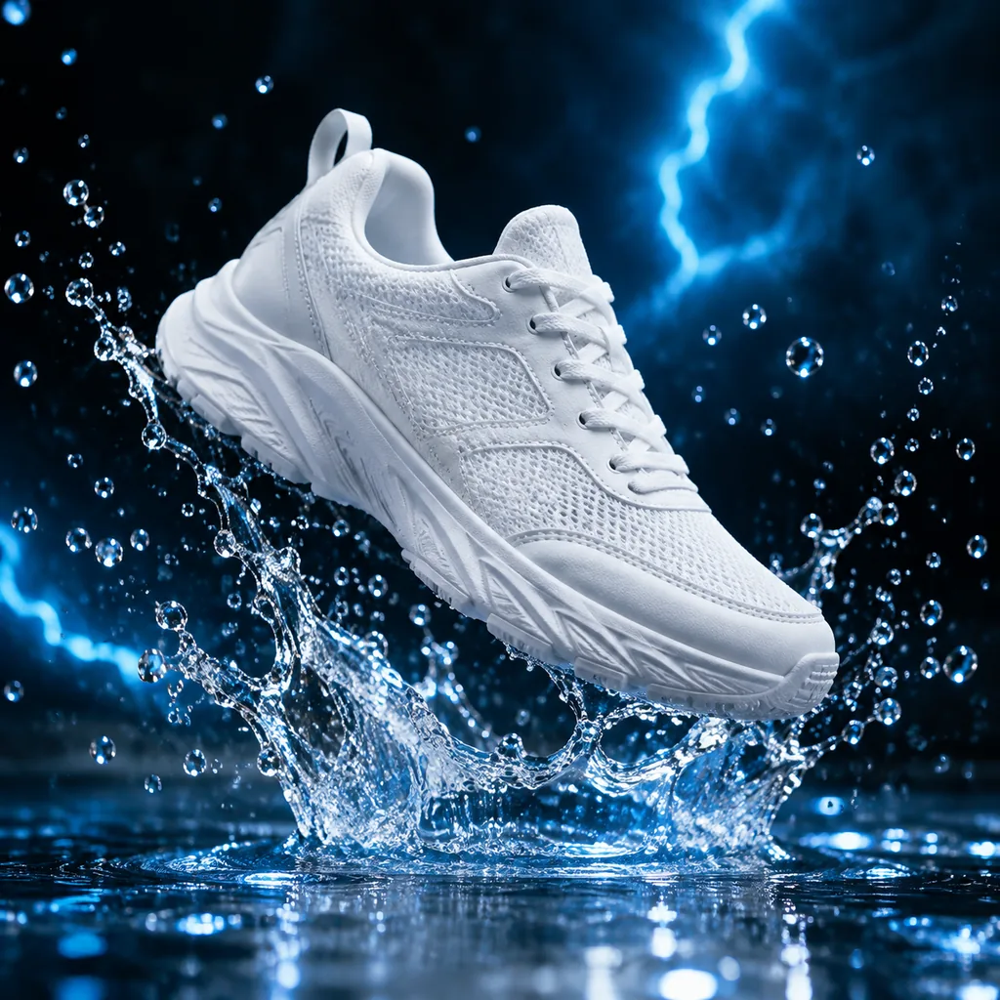</a>

> 根据 @Art_Sweetyvig 的动态运动鞋广告视频帖改写成1:1关键帧。我们定格水冠与闪电。适合鞋类广告、体育横幅和产品封面。

```text
Photorealistic product video keyframe, square 1:1: an unbranded white sneaker frozen mid-splash above a wet reflective surface, water crown and droplets suspended, a crack of blue lightning light in the dark background, dramatic slow-motion advertising still, crisp sole and lace detail, no text, no logo. Square 1:1 composition.
```

- 原作者: [@Art_Sweetyvig](https://x.com/Art_Sweetyvig)
- 原帖: https://x.com/Art_Sweetyvig/status/2110950907345289378
- [在 cinel 上查看详情并一键生成](https://cinel.ai/zh/prompts/p/sneaker-water-lightning-splash-keyframe?utm_source=github&utm_medium=awesome&utm_campaign=awesome-gpt-image-2.5-prompts)

### 动态产品演示发光关键帧

<a href="https://cinel.ai/zh/prompts/p/dynamic-product-demo-glow-keyframe?utm_source=github&utm_medium=awesome&utm_campaign=awesome-gpt-image-2.5-prompts">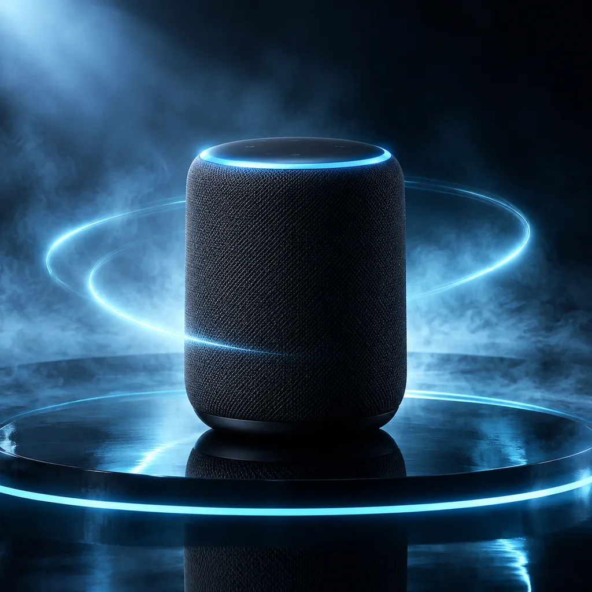</a>

> 根据 @tec_sany 提示词列表中的视频产品演示提示词改写。我们把演示定格成一张发光高光图并去除品牌。适合科技上新、App横幅和产品广告。

```text
Photorealistic product still, square 1:1: a sleek unbranded smart speaker on a dark reflective stage frozen at the hero frame of a dynamic product demo, slow arcs of cyan glowing light around it, modern tech aesthetic, soft mist and crisp reflections, premium advertising still, no text, no logo. Square 1:1 composition.
```

- 原作者: [@tec_sany](https://x.com/tec_sany)
- 原帖: https://x.com/tec_sany/status/2111055022977142816
- [在 cinel 上查看详情并一键生成](https://cinel.ai/zh/prompts/p/dynamic-product-demo-glow-keyframe?utm_source=github&utm_medium=awesome&utm_campaign=awesome-gpt-image-2.5-prompts)

### 无品牌香水水花广告

<a href="https://cinel.ai/zh/prompts/p/unbranded-perfume-water-splash-ad?utm_source=github&utm_medium=awesome&utm_campaign=awesome-gpt-image-2.5-prompts">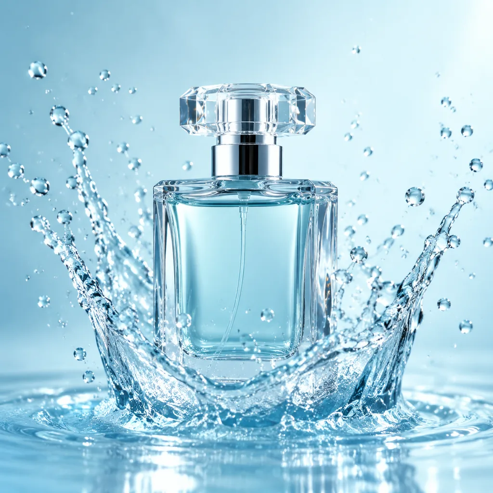</a>

> 根据 @Oceanyx2 于 2026-10-18 的帖子改写（记录时 0 赞）。我们改成一张干净的1:1图，去掉品牌、Logo、名人/IP元素，也不需要你的照片。一次只改一个变量。

```text
Premium product photography, square 1:1: an unbranded glass perfume bottle frozen in a dynamic water splash crown, droplets and soft aqua light on a clean studio background, luxury cosmetic ad, no brand, no text, no logo. Square 1:1 composition.
```

- 原作者: [@Oceanyx2](https://x.com/Oceanyx2)
- 原帖: https://x.com/Oceanyx2/status/2111700813500613019
- [在 cinel 上查看详情并一键生成](https://cinel.ai/zh/prompts/p/unbranded-perfume-water-splash-ad?utm_source=github&utm_medium=awesome&utm_campaign=awesome-gpt-image-2.5-prompts)

### 无品牌牙膏凝胶飞溅广告

<a href="https://cinel.ai/zh/prompts/p/unbranded-toothpaste-gel-splash-ad?utm_source=github&utm_medium=awesome&utm_campaign=awesome-gpt-image-2.5-prompts">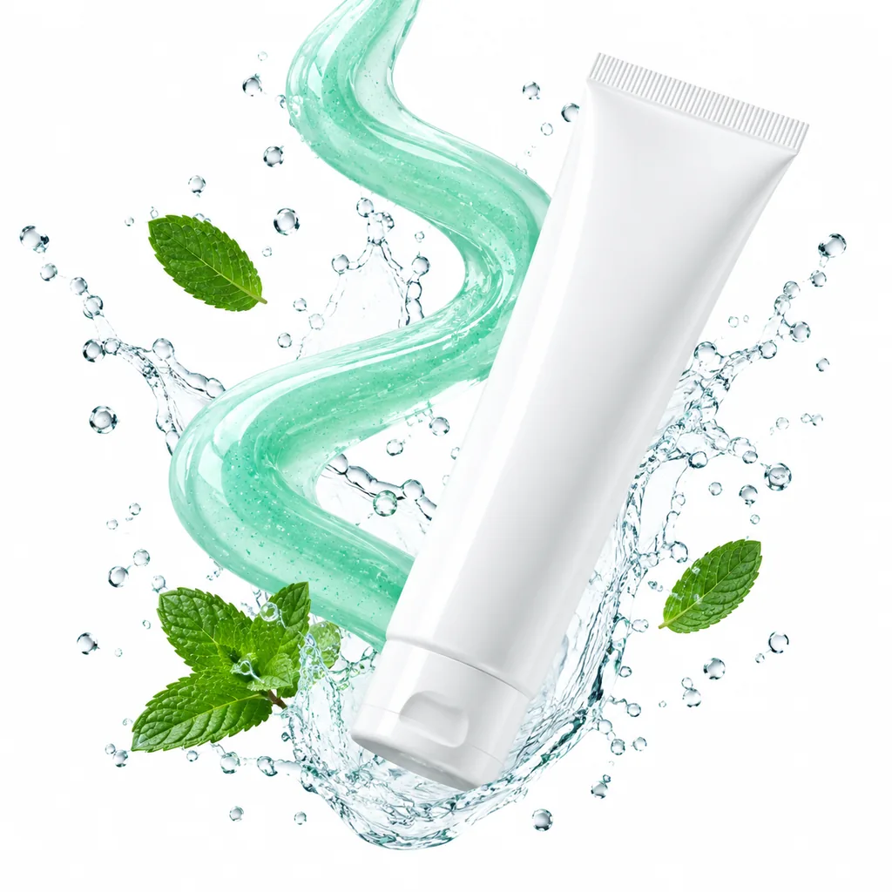</a>

> 根据 @Ezejoy942158 于 2026-10-16 的帖子改写（记录时 2 赞）。我们改成一张干净的1:1图，去掉品牌、Logo、名人/IP元素，也不需要你的照片。一次只改一个变量。

```text
Premium product photography, square 1:1: an unbranded white toothpaste tube and a mint-green gel ribbon frozen mid-splash with clean water droplets, crisp studio light on seamless white, commercial dental-care key visual, no brand, no readable text, no logo. Square 1:1 composition.
```

- 原作者: [@Ezejoy942158](https://x.com/Ezejoy942158)
- 原帖: https://x.com/Ezejoy942158/status/2110912971316551754
- [在 cinel 上查看详情并一键生成](https://cinel.ai/zh/prompts/p/unbranded-toothpaste-gel-splash-ad?utm_source=github&utm_medium=awesome&utm_campaign=awesome-gpt-image-2.5-prompts)

### 樱桃瓶冰花飞溅产品

<a href="https://cinel.ai/zh/prompts/p/cherry-bottle-ice-splash-product?utm_source=github&utm_medium=awesome&utm_campaign=awesome-gpt-image-2.5-prompts">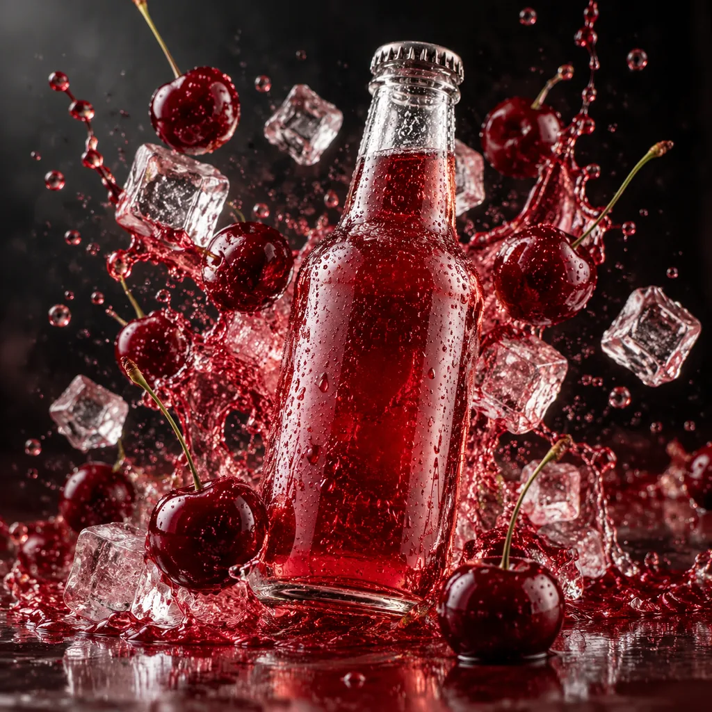</a>

> 根据 @FilmluneCOM 于 2026-10-13 的帖子改写（记录时 0 赞）。我们改成一张干净的1:1图，去掉品牌、Logo、名人/IP元素，也不需要你的照片。一次只改一个变量。

```text
Ultra-realistic 3D product shot, square 1:1: an unbranded glass bottle sharp in focus while cherries, ice cubes and red juice splash frozen mid-air around it, condensation beads, dark premium studio backdrop, no brand, no text, no logo. Square 1:1 composition.
```

- 原作者: [@FilmluneCOM](https://x.com/FilmluneCOM)
- 原帖: https://x.com/FilmluneCOM/status/2109902038834598239
- [在 cinel 上查看详情并一键生成](https://cinel.ai/zh/prompts/p/cherry-bottle-ice-splash-product?utm_source=github&utm_medium=awesome&utm_campaign=awesome-gpt-image-2.5-prompts)

### 膨胀果汁瓶立体字产品海报

<a href="https://cinel.ai/zh/prompts/p/inflating-juice-bottle-typography-poster?utm_source=github&utm_medium=awesome&utm_campaign=awesome-gpt-image-2.5-prompts">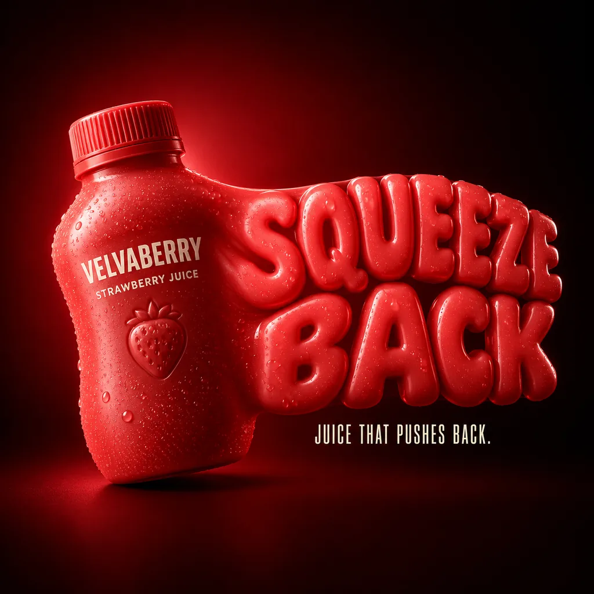</a>

> 根据 @ou_zhen599 于 2026-10-16 的提示词+图片帖改写（记录时 8 赞）。我们改成一张干净的1:1方形图，去掉品牌和Logo，也不需要你的照片。一次只改一个变量。

```text
Premium commercial product poster for a fictional juice brand "VELVABERRY", square 1:1. One short rounded squeeze-style strawberry juice bottle with a ribbed cap, made of soft-touch semi-gloss plastic in saturated strawberry red, sits slightly tilted in the left-center foreground; its body visibly swells and stretches to the right, seamlessly inflating into giant pressurized 3D letters reading "SQUEEZE BACK" in the same glossy strawberry-red material, with condensation beads across both bottle and letters. The bottle label reads exactly "VELVABERRY" and "STRAWBERRY JUICE" with a small embossed strawberry icon. Beneath the inflated slogan, narrow cream-white condensed type reads "JUICE THAT PUSHES BACK." Deep black-to-burgundy gradient background with a concentrated crimson glow behind the product, strong commercial key light from the upper left, subtle right-edge rim light, believable volume tension, crisp legible text, elegant negative space. Avoid extra bottles, melted plastic, random fruit clutter and any resemblance to a real beverage brand. Square 1:1 composition.
```

- 原作者: [@ou_zhen599](https://x.com/ou_zhen599)
- 原帖: https://x.com/ou_zhen599/status/2111034381150339446
- [在 cinel 上查看详情并一键生成](https://cinel.ai/zh/prompts/p/inflating-juice-bottle-typography-poster?utm_source=github&utm_medium=awesome&utm_campaign=awesome-gpt-image-2.5-prompts)

### 行李箱变形飞行摩托关键帧

<a href="https://cinel.ai/zh/prompts/p/suitcase-flying-motorcycle-transform-keyframe?utm_source=github&utm_medium=awesome&utm_campaign=awesome-gpt-image-2.5-prompts">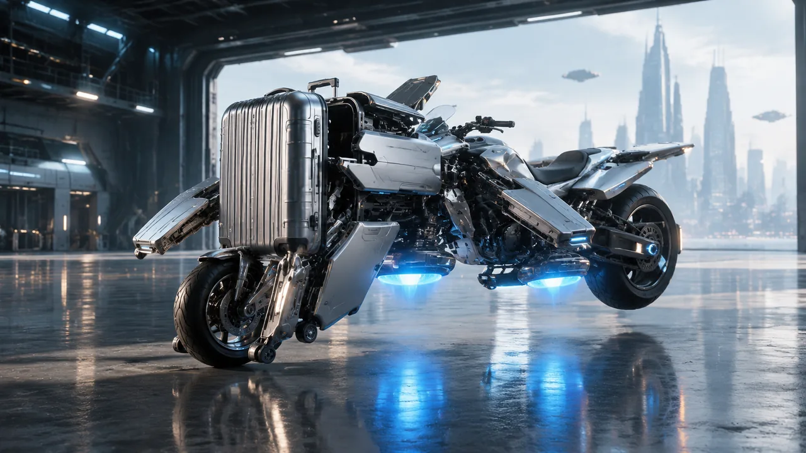</a>

> 根据 @Aiminithoughts 于 2026-10-20 的视频帖改写（记录时 24 赞）。我们改成一张干净的16:9宽屏图，去掉品牌、Logo、名人/IP元素，也不需要你的照片。一次只改一个变量。

```text
Cinematic sci-fi product keyframe, widescreen 16:9: inside a vast futuristic airport hangar, one single sleek brushed-metal suitcase, centered and alone on the floor, is caught at the exact halfway moment of transforming into a flying motorcycle (half suitcase, half bike, a single hybrid object, not a lineup or sequence) — hundreds of precision-engineered panels expanding outward, hidden mechanical arms extending from its core, wheels unfolding, the frame lengthening, twin anti-gravity thrusters glowing blue beneath the chassis. Polished concrete floor with reflections, cool rim lights, hangar doors open to a hazy futuristic skyline. Fictional design, no brand, no text, no logo. Widescreen 16:9 composition.
```

- 原作者: [@Aiminithoughts](https://x.com/Aiminithoughts)
- 原帖: https://x.com/Aiminithoughts/status/2112364398350311506
- [在 cinel 上查看详情并一键生成](https://cinel.ai/zh/prompts/p/suitcase-flying-motorcycle-transform-keyframe?utm_source=github&utm_medium=awesome&utm_campaign=awesome-gpt-image-2.5-prompts)

### 奢华产品主视觉商业海报

<a href="https://cinel.ai/zh/prompts/p/luxury-product-hero-commercial-poster?utm_source=github&utm_medium=awesome&utm_campaign=awesome-gpt-image-2.5-prompts">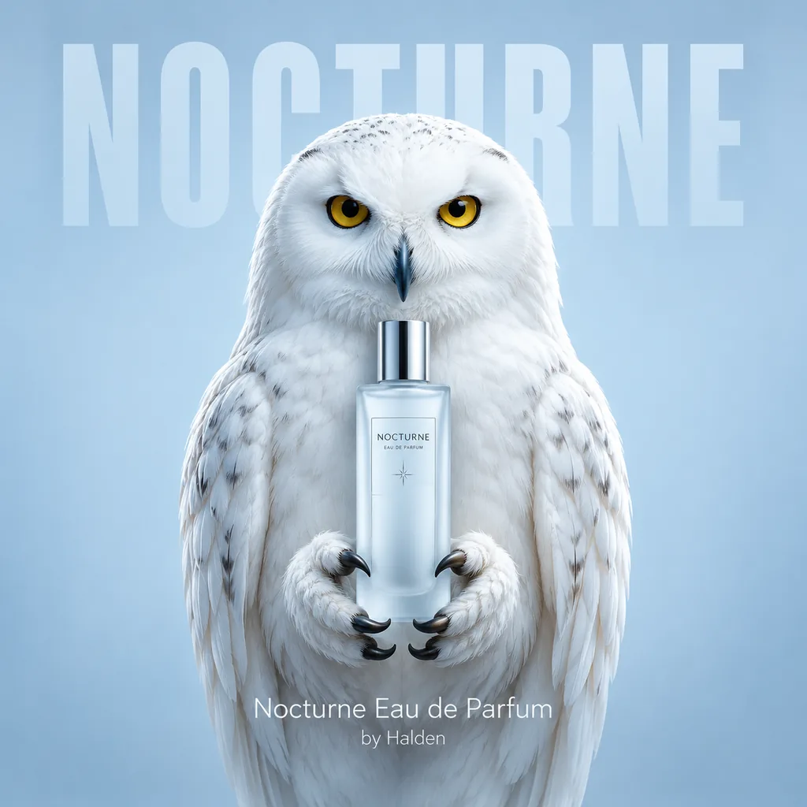</a>

> 根据 @Goodmanprotocol 于 2026-07-21 的提示词+图片帖改写（记录时 84 赞）。我们改成一张干净的1:1方形设计，品牌名均为虚构，不含真实Logo，也不需要上传你的照片或Logo。一次只改一个变量。

```text
Premium luxury commercial advertising poster featuring a snow-white owl centered in the frame, facing the camera with perfect symmetry. The owl gently holds a slim frosted-glass perfume bottle in its talons without deforming it; calm, confident expression. Soft pale-blue gradient studio background with abundant negative space. Soft diffused cinematic studio light, subtle rim light, realistic feathers and premium reflections on the glass. A large uppercase low-opacity headline "NOCTURNE" behind the owl in a bold condensed sans-serif; in front, a thin sans-serif product title "Nocturne Eau de Parfum" with a small subtitle "by Halden" for a fictional house. Perfect center alignment, generous negative space, high-end campaign look, crisp readable text, no real brands. Square 1:1 composition.
```

- 原作者: [@Goodmanprotocol](https://x.com/Goodmanprotocol)
- 原帖: https://x.com/Goodmanprotocol/status/2079490788795531724
- [在 cinel 上查看详情并一键生成](https://cinel.ai/zh/prompts/p/luxury-product-hero-commercial-poster?utm_source=github&utm_medium=awesome&utm_campaign=awesome-gpt-image-2.5-prompts)

### 清爽飞溅冰茶海报

<a href="https://cinel.ai/zh/prompts/p/freshness-splash-iced-tea-poster?utm_source=github&utm_medium=awesome&utm_campaign=awesome-gpt-image-2.5-prompts">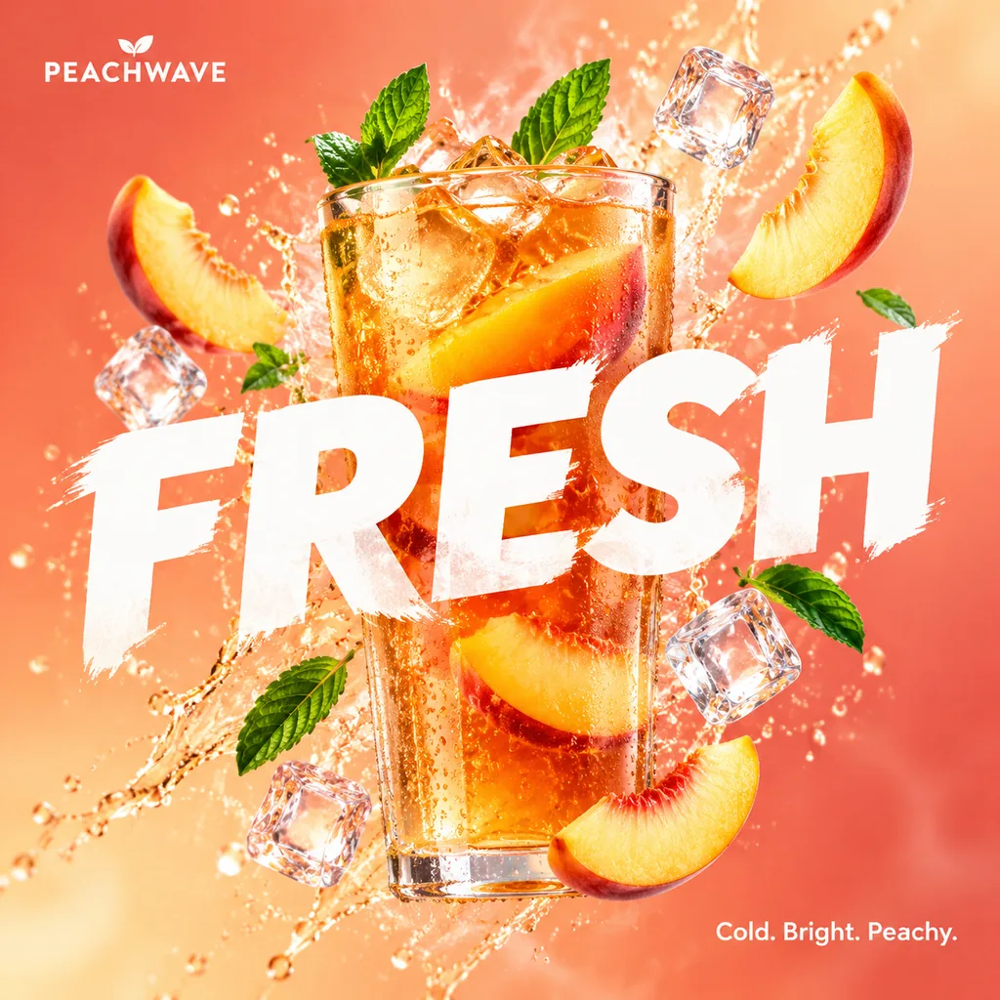</a>

> 根据 @Ziha_ai 于 2026-06-22 的提示词+图片帖改写（记录时 41 赞）。我们改成一张干净的1:1方形设计，品牌名均为虚构，不含真实Logo，也不需要上传你的照片或Logo。一次只改一个变量。

```text
Premium beverage advertising poster built around "freshness in motion": one tall glass of peach iced tea becomes the center of a dynamic splash moment frozen in time. Floating ice cubes, peach slices, mint leaves, bubbles, condensation droplets and cold mist arc diagonally around the glass. Bold oversized typography "FRESH" runs across the middle with the glass overlapping and cutting through the letters. Small simple wordmark "PEACHWAVE" for a fictional drink brand in the top corner, a short tagline "Cold. Bright. Peachy." near the bottom. Warm energetic peach-to-coral gradient background, glossy realistic glass, commercial lighting, clean social-media-ready layout, crisp readable text, no real brands. Square 1:1 composition.
```

- 原作者: [@Ziha_ai](https://x.com/Ziha_ai)
- 原帖: https://x.com/Ziha_ai/status/2068929219133112758
- [在 cinel 上查看详情并一键生成](https://cinel.ai/zh/prompts/p/freshness-splash-iced-tea-poster?utm_source=github&utm_medium=awesome&utm_campaign=awesome-gpt-image-2.5-prompts)

### 复古可乐瓶产品海报

<a href="https://cinel.ai/zh/prompts/p/retro-cola-bottle-product-poster?utm_source=github&utm_medium=awesome&utm_campaign=awesome-gpt-image-2.5-prompts">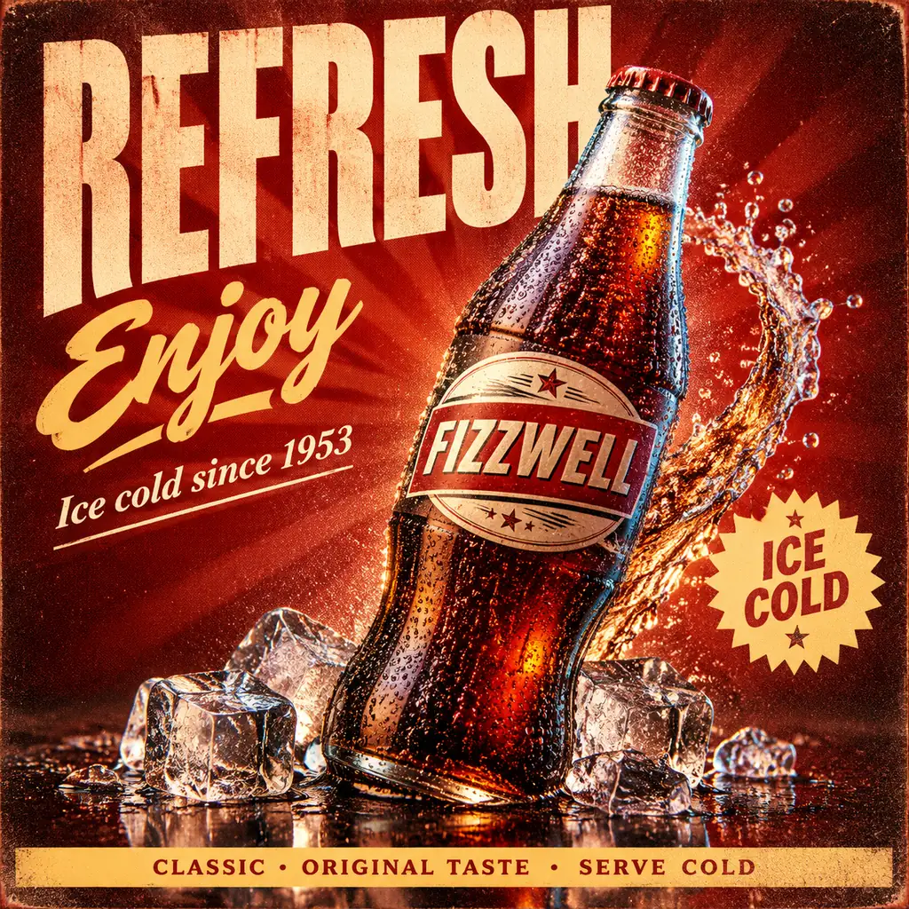</a>

> 根据 @Diplomeme 于 2026-05-01 的提示词+图片帖改写（记录时 201 赞）。我们改成一张干净的1:1方形设计，品牌名均为虚构，不含真实Logo，也不需要上传你的照片或Logo。一次只改一个变量。

```text
Retro product mockup poster fusing 1950s advertising language with ultra-premium product rendering for a fictional cola brand "FIZZWELL". A curvy glass bottle of cola at a 3/4 angle, slightly tilted, resting on a glossy wet reflective surface with ice cubes, melt water and a frozen splash arc behind it. Deep cola liquid with amber highlights, dense condensation droplets, micro bubbles, slightly aged label printed with FIZZWELL. Deep red gradient background with faded vintage sunburst rays, paper grain, halftone noise and dark vignette. Typography: massive condensed cream headline "REFRESH", a warm-yellow script "Enjoy", an italic serif tagline "Ice cold since 1953", a vintage starburst badge "ICE COLD", and a bottom strip "CLASSIC • ORIGINAL TASTE • SERVE COLD". Warm key light, cool rim light, backlight glow through the liquid, film grain, crisp readable text, no real brands. Square 1:1 composition.
```

- 原作者: [@Diplomeme](https://x.com/Diplomeme)
- 原帖: https://x.com/Diplomeme/status/2050273417321177226
- [在 cinel 上查看详情并一键生成](https://cinel.ai/zh/prompts/p/retro-cola-bottle-product-poster?utm_source=github&utm_medium=awesome&utm_campaign=awesome-gpt-image-2.5-prompts)

### 香水广告分镜表

<a href="https://cinel.ai/zh/prompts/p/perfume-commercial-storyboard-sheet?utm_source=github&utm_medium=awesome&utm_campaign=awesome-gpt-image-2.5-prompts">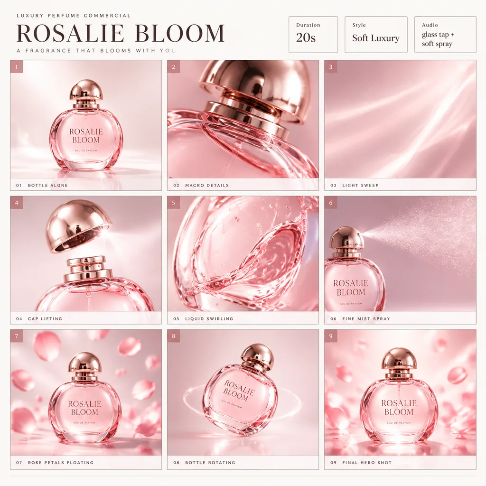</a>

> 根据 @Strength04_X 于 2026-09-10 的提示词+图片帖改写（记录时 196 赞）。我们改成一张干净的1:1方形设计，品牌名均为虚构，不含真实Logo，也不需要上传你的照片或Logo。一次只改一个变量。

```text
Single-page premium storyboard sheet for a luxury rose perfume commercial for a fictional fragrance "ROSALIE BLOOM". Clean editorial grid of 9 cinematic product panels with thin borders and small numbered tabs, plus a compact header with bold elegant title and small info cards: "Duration 20s", "Style: Soft Luxury", "Audio: glass tap + soft spray". Panels: bottle alone on glossy white surface; macro of crystal glass and cap; soft pink light sweep; cap lifting with a sparkle; liquid swirling; fine mist spray; rose petals floating; bottle rotating; final hero shot with petals and pink glow. The bottle is a rounded pebble-shaped pink glass flacon with a domed rose-gold cap; same bottle shape, cap and label in every frame, white-pink gradient environment, champagne highlights, ultra-realistic beauty advertising, crisp readable text, no real brands. Square 1:1 composition.
```

- 原作者: [@Strength04_X](https://x.com/Strength04_X)
- 原帖: https://x.com/Strength04_X/status/2097919290980921451
- [在 cinel 上查看详情并一键生成](https://cinel.ai/zh/prompts/p/perfume-commercial-storyboard-sheet?utm_source=github&utm_medium=awesome&utm_campaign=awesome-gpt-image-2.5-prompts)

### 家居日用品促销版式

<a href="https://cinel.ai/zh/prompts/p/home-care-product-promo-layout?utm_source=github&utm_medium=awesome&utm_campaign=awesome-gpt-image-2.5-prompts">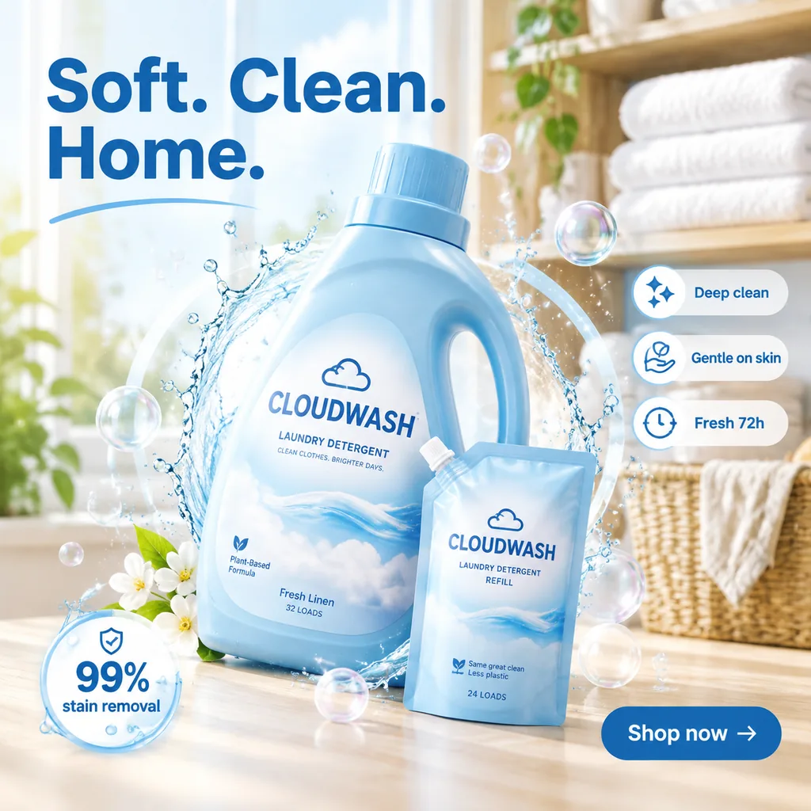</a>

> 根据 @PixuryAI 于 2026-06-02 的提示词+图片帖改写（记录时 84 赞）。我们改成一张干净的1:1方形设计，品牌名均为虚构，不含真实Logo，也不需要上传你的照片或Logo。一次只改一个变量。

```text
Premium daily-necessities social media marketing poster for a fictional laundry detergent "CLOUDWASH" in a soft blue bottle. Warm, bright modern home scene with soft natural daylight: a folded stack of fresh white towels and a linen basket on a light wood shelf in the background. The product stands prominently in the foreground, slightly tilted toward camera, with a smaller refill pouch at lower middle, surrounded by a dynamic circular geometric layout, gentle water splash, floating soap bubbles and fine particles with a soft halo. Small UI-style efficacy labels with icons: "Deep clean", "Gentle on skin", "Fresh 72h", one data badge "99% stain removal" and a pill button "Shop now". Extra-bold headline "Soft. Clean. Home." in clear space at the upper left. Clean high-end hierarchy, glossy realistic packaging, crisp readable text, no real brands. Square 1:1 composition.
```

- 原作者: [@PixuryAI](https://x.com/PixuryAI)
- 原帖: https://x.com/PixuryAI/status/2061657972145635434
- [在 cinel 上查看详情并一键生成](https://cinel.ai/zh/prompts/p/home-care-product-promo-layout?utm_source=github&utm_medium=awesome&utm_campaign=awesome-gpt-image-2.5-prompts)

### 无缝暖象牙影棚背景

<a href="https://cinel.ai/zh/prompts/p/studio-seamless-warm-ivory?utm_source=github&utm_medium=awesome&utm_campaign=awesome-gpt-image-2.5-prompts">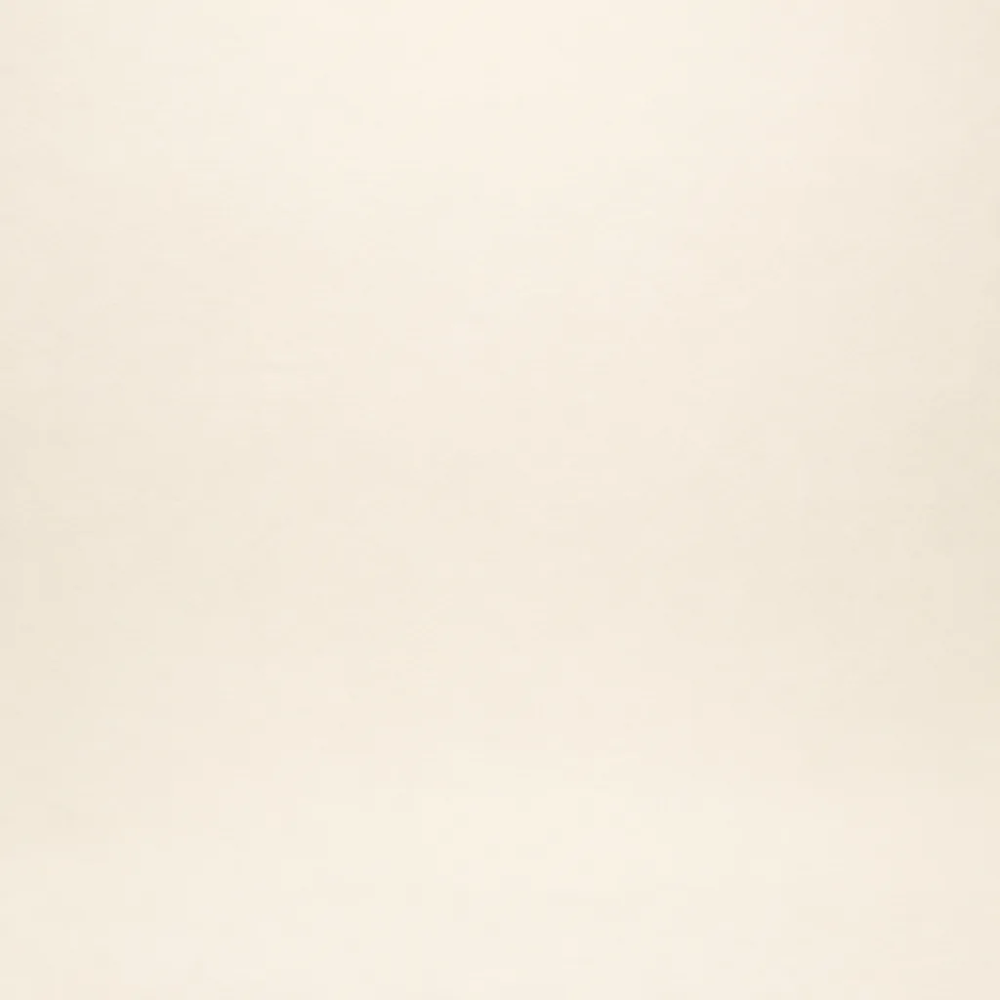</a>

> 从 favprompt 产品摄影提示词抽出的纯无缝暖象牙影棚背景。空，无产品。

```text
Clean empty product photography background only: seamless warm ivory paper studio backdrop with subtle fine paper texture, bright diffused softbox lighting, soft even falloff, no product, no props, no people, no text, no logos. Square 1:1 premium e-commerce seamless background.
```

- 原作者: [@favprompt](https://x.com/favprompt)
- 原帖: https://x.com/favprompt/status/2104323921998741980
- [在 cinel 上查看详情并一键生成](https://cinel.ai/zh/prompts/p/studio-seamless-warm-ivory?utm_source=github&utm_medium=awesome&utm_campaign=awesome-gpt-image-2.5-prompts)

### 哑光炭黑影棚弧面背景

<a href="https://cinel.ai/zh/prompts/p/studio-matte-charcoal-sweep?utm_source=github&utm_medium=awesome&utm_campaign=awesome-gpt-image-2.5-prompts">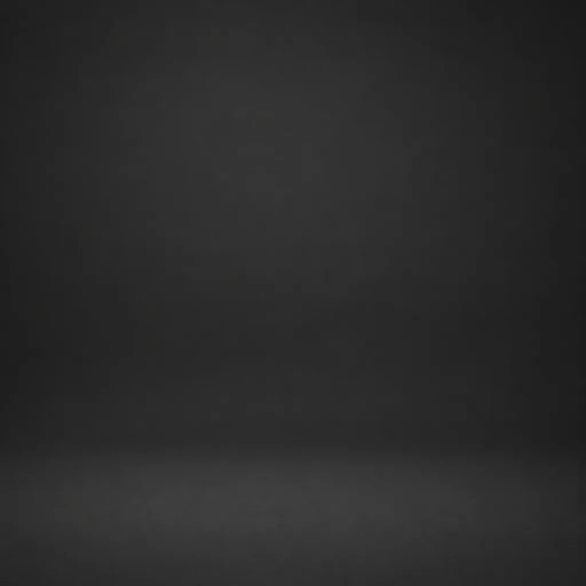</a>

> 哑光炭黑无缝影棚弧面，改编自 AIPromptLabX 深色反光产品背景提示词；仅空背景，无品牌。

```text
Clean empty product photography background only: matte charcoal seamless studio sweep, soft subtle gradient falloff, low-key even lighting, no glossy floor reflection, no product, no people, no text, no logos. Square 1:1 premium e-commerce dark seamless background.
```

- 原作者: [@AIPromptLabX](https://x.com/AIPromptLabX)
- 原帖: https://x.com/AIPromptLabX/status/2114807910245216595
- [在 cinel 上查看详情并一键生成](https://cinel.ai/zh/prompts/p/studio-matte-charcoal-sweep?utm_source=github&utm_medium=awesome&utm_campaign=awesome-gpt-image-2.5-prompts)

### 莫兰迪粉无缝影棚背景

<a href="https://cinel.ai/zh/prompts/p/studio-morandi-pink-seamless?utm_source=github&utm_medium=awesome&utm_campaign=awesome-gpt-image-2.5-prompts"></a>

> 莫兰迪粉无缝背景，改编自 PromptTip 暖米色影棚产品广告提示词；空，无品牌标签。

```text
Clean empty product photography background only: Morandi soft pink seamless studio backdrop, muted dusty blush pastel, soft natural even lighting, gentle falloff, no product, no props, no people, no text, no logos, no brand labels. Landscape 3:2 premium e-commerce seamless background.
```

- 原作者: [@PromptTip](https://x.com/PromptTip)
- 原帖: https://x.com/PromptTip/status/2111760631179485583
- [在 cinel 上查看详情并一键生成](https://cinel.ai/zh/prompts/p/studio-morandi-pink-seamless?utm_source=github&utm_medium=awesome&utm_campaign=awesome-gpt-image-2.5-prompts)

### 浅灰大理石产品背景

<a href="https://cinel.ai/zh/prompts/p/studio-soft-gray-marble?utm_source=github&utm_medium=awesome&utm_campaign=awesome-gpt-image-2.5-prompts">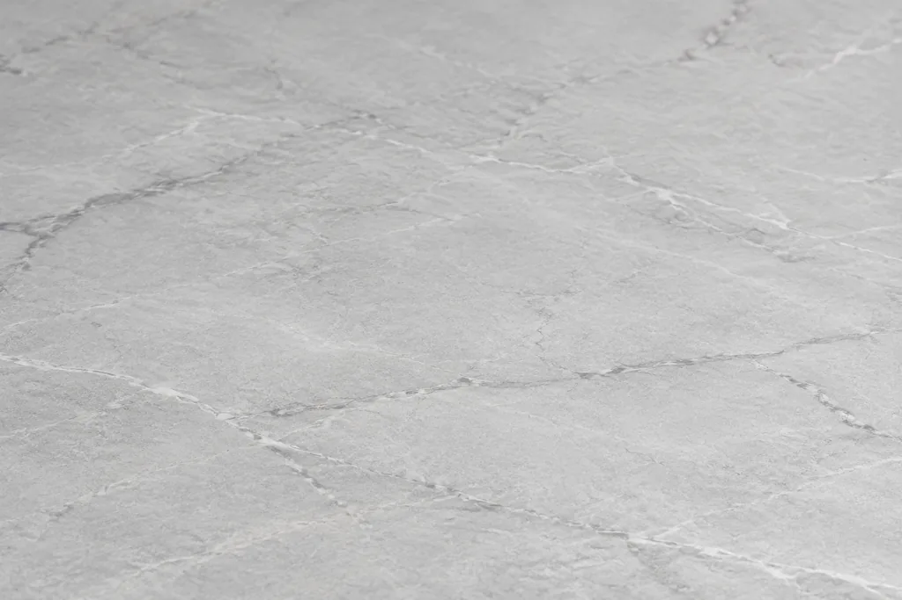</a>

> 浅灰大理石空产品台面，归因 OlatundeAI 干净白/中性影棚产品表提示词。

```text
Clean empty product photography background only: soft gray marble slab surface with subtle quiet veins, matte stone (not mirror polish), soft controlled even studio lighting, gentle contact-shadow zone implied but empty. No product, no people, no text, no logos. Landscape 3:2 premium e-commerce surface background.
```

- 原作者: [@OlatundeAI](https://x.com/OlatundeAI)
- 原帖: https://x.com/OlatundeAI/status/2104523280153468972
- [在 cinel 上查看详情并一键生成](https://cinel.ai/zh/prompts/p/studio-soft-gray-marble?utm_source=github&utm_medium=awesome&utm_campaign=awesome-gpt-image-2.5-prompts)

### 浅木纹桌面俯拍背景

<a href="https://cinel.ai/zh/prompts/p/studio-light-wood-overhead?utm_source=github&utm_medium=awesome&utm_campaign=awesome-gpt-image-2.5-prompts">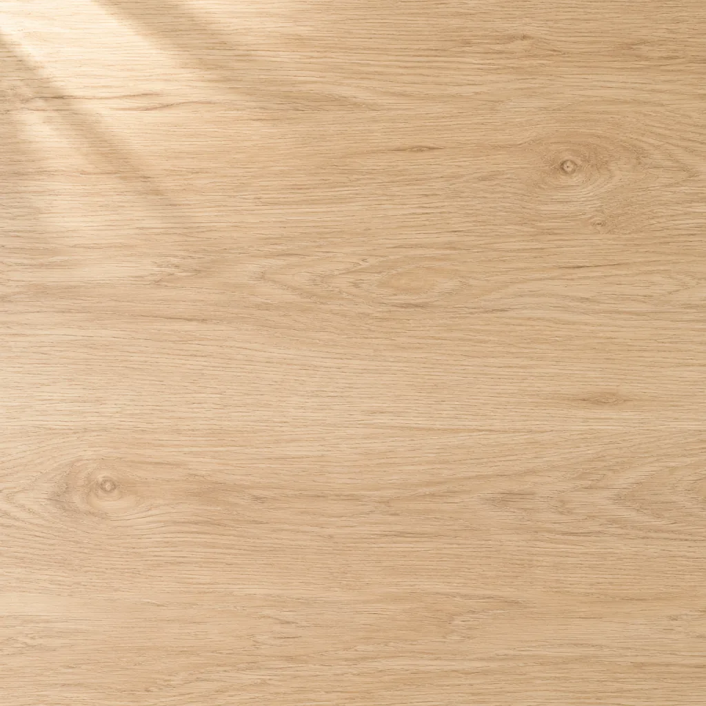</a>

> 浅木俯拍空桌面背景，改编自 KeyoAPI 暖米白影棚产品参考提示词；空，无品牌。

```text
Clean empty product photography background only: light oak wood desk surface photographed straight from above, soft natural window light, subtle wood grain, mostly empty flat lay. No products, no brands, no people, no text, no logos. Square 1:1 premium e-commerce wood surface background.
```

- 原作者: [@KeyoAPI](https://x.com/KeyoAPI)
- 原帖: https://x.com/KeyoAPI/status/2111646675513073820
- [在 cinel 上查看详情并一键生成](https://cinel.ai/zh/prompts/p/studio-light-wood-overhead?utm_source=github&utm_medium=awesome&utm_campaign=awesome-gpt-image-2.5-prompts)
